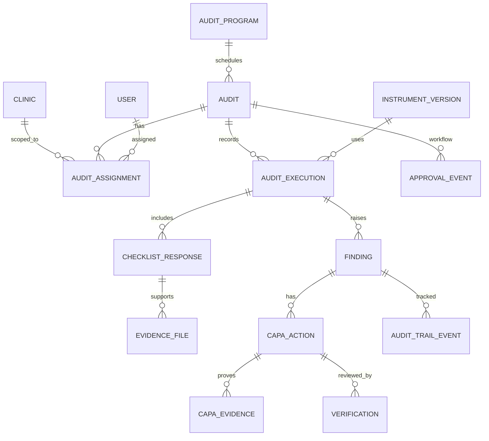

# Logical ERD — Draft

Model konseptual, wajib disesuaikan dengan skema repository aktual dan sumber data existing. Jangan membuat duplikat user/clinic/RBAC bila sudah ada.

## Entitas inti (logical)
- `audit_programs`: periode, tujuan, owner, status.
- `audits`: program, nomor, tanggal, scope, kriteria, status, finalisasi metadata.
- `audit_assignments`: audit, clinic_id, user_id, assignment role, scope, conflict declaration.
- `instrument_versions`: title, source document/url, version, effective date, verification metadata, status.
- `checklist_items`: item per instrument version; jangan menimpa versi yang telah dipakai.
- `audit_executions`: audit + instrument version + snapshot metadata.
- `checklist_responses`: answer, note, sampling metadata, actor/time.
- `evidence_files`: private storage key, original filename metadata (sanitized), MIME/size/hash, uploader, classification, retention state.
- `findings`: finding code, description, classification, criteria reference, root cause, recommendation, status, finalization metadata.
- `capa_actions`: finding_id, action type, root cause, action, owner, due date, status.
- `capa_evidence`: private evidence references, uploader, timestamp.
- `verifications`: reviewer, method, effectiveness result, comments, decision, timestamp.
- `approval_events`: entity type/id, transition, actor, decision, reason, timestamp.
- `audit_trail_events`: actor, action, target, before/after summary redacted, request ID, timestamp.

## Design rules
- Reuse existing `users`, `clinics`, roles/permissions and storage abstraction where possible.
- FK, indexes, unique constraints, soft deletion only when appropriate; immutable history for finalized instruments/results.
- Scope IDs are not authorization: always re-authorize server-side.
- Avoid patient identifiers unless necessary and authorized; prefer redacted references.
- Use transaction for workflow transitions; include version/concurrency strategy if needed.
- Exact table/column names are implementation decisions after Gate 0.
