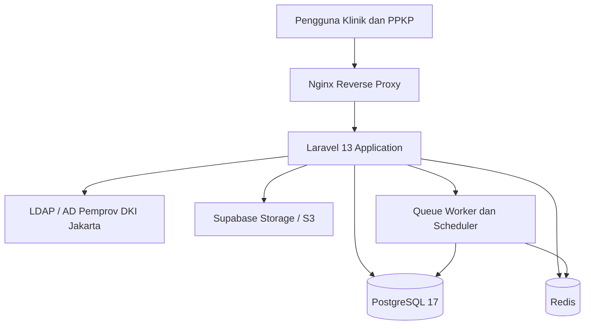
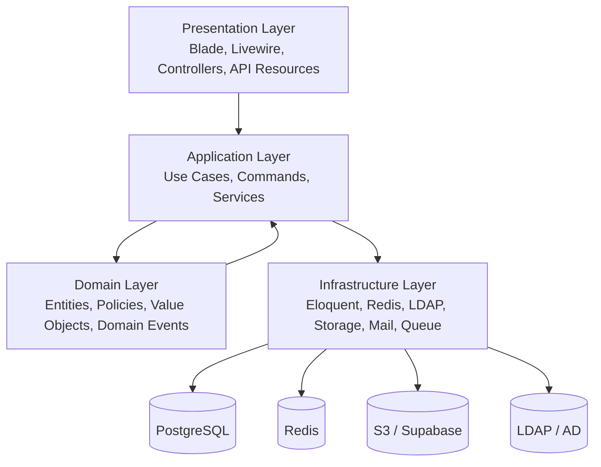
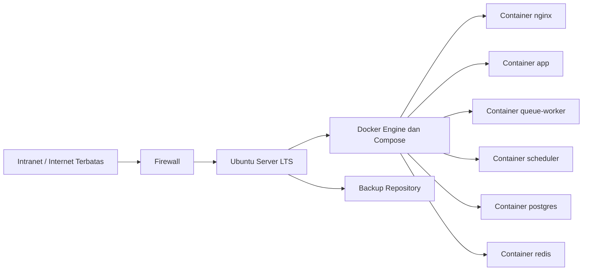
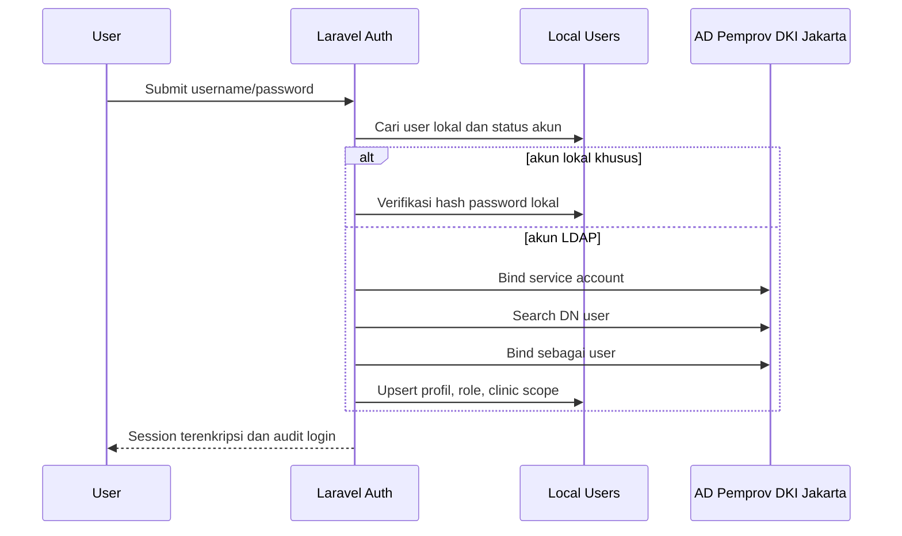
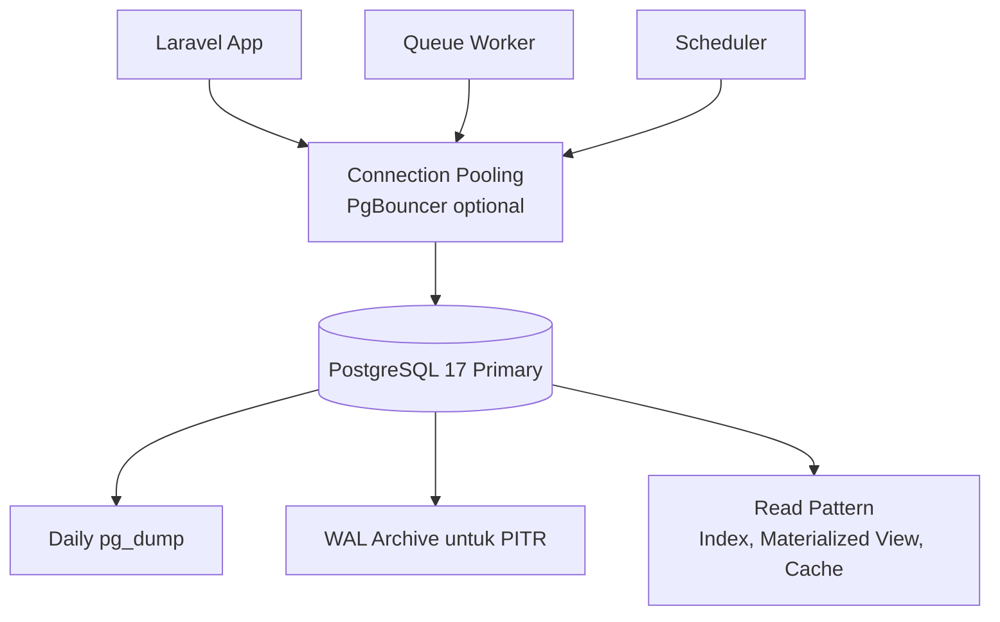
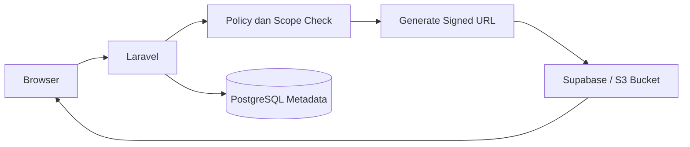
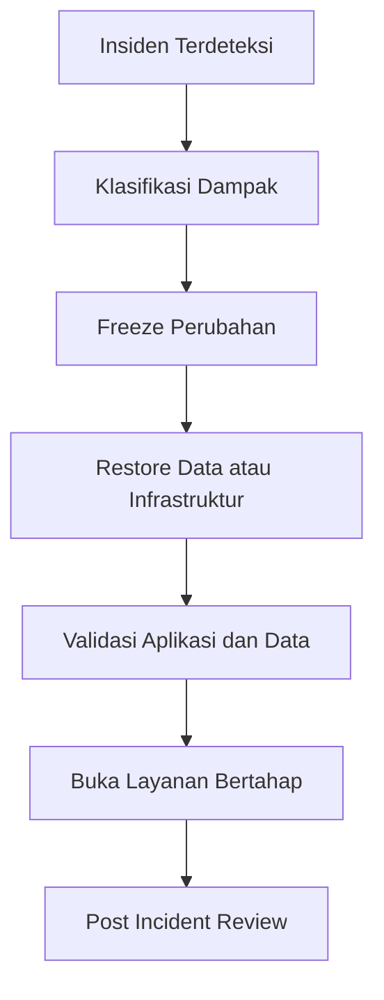

# Technical Architecture Document SIMMAK PPKP

Sistem Informasi Manajemen Mutu, Audit Internal dan Akreditasi

Organisasi: PPKP Provinsi DKI Jakarta

Target teknologi: Laravel 12 LTS, PHP 8.4, PostgreSQL 17, Redis, Docker, Nginx, LDAP, Supabase Storage / S3

Status dokumen: Rekomendasi arsitektur enterprise

Versi dokumen: 1.0.0

Tanggal: 25 Juni 2026

Pemilik dokumen: Tim Teknologi SIMMAK PPKP

Referensi diagram utama: `diagrams/architecture.mmd`

Lokasi dokumen: `docs/ARCHITECTURE.md`

---

## Ringkasan Eksekutif

SIMMAK PPKP dirancang sebagai aplikasi enterprise berbasis Laravel 12 untuk mendukung manajemen mutu, audit internal, akreditasi, CAPA, risiko, dokumen, dan pelaporan lintas unit layanan.

Arsitektur menempatkan Laravel sebagai pusat proses bisnis, PostgreSQL sebagai sumber kebenaran tunggal, Redis sebagai akselerator operasional, LDAP/Active Directory sebagai sumber identitas pegawai, dan Supabase Storage atau S3 sebagai penyimpanan object untuk dokumen.

Deployment direkomendasikan menggunakan Docker Compose pada Ubuntu Server dengan Nginx sebagai reverse proxy, PHP-FPM sebagai runtime aplikasi, queue worker untuk pekerjaan asynchronous, scheduler untuk pekerjaan periodik, PostgreSQL 17 untuk data transaksional, dan Redis untuk cache, session, queue, serta lock.

Dokumen ini menjelaskan keputusan arsitektur, pola integrasi, operasi harian, keamanan, backup, disaster recovery, monitoring, CI/CD, strategi environment, skalabilitas, dan rekomendasi package Laravel.

Sistem ini akan di implementasikan menggunakan di VM server yang hanya bisa di akses menggunakan jaringan lokal dengan Operating Sistem Linux dan Docker Container, pada VM server dan docker sudah tersedia juga sistem yang berjalan. dan postgresql sudah tersedia juga di docker/VM

---

## Daftar Isi

1. Solution Architecture
2. Application Architecture
3. Infrastructure Architecture
4. Docker Architecture
5. LDAP Architecture
6. PostgreSQL Architecture
7. Redis Architecture
8. Supabase / S3 Storage Architecture
9. Backup Strategy
10. Disaster Recovery Plan
11. Security Architecture
12. API Architecture
13. Queue and Job Architecture
14. Monitoring and Logging
15. CI/CD Pipeline Recommendation
16. Environment Strategy
17. Scalability Considerations
18. Laravel Package Recommendations
19. Architecture Governance
20. Operational Runbooks
21. Appendix

---

## Prinsip Arsitektur

Prinsip arsitektur menjadi pagar keputusan agar implementasi konsisten walaupun modul dan tim berkembang.

1. Sumber kebenaran data transaksional berada pada PostgreSQL.
2. File biner tidak disimpan di database, melainkan di object storage dengan metadata terkontrol.
3. Semua akses pengguna melewati Laravel authorization layer.
4. Semua komunikasi eksternal yang sensitif menggunakan TLS.
5. Semua workflow penting meninggalkan audit trail yang dapat ditelusuri.
6. Semua pekerjaan berat dijalankan secara asynchronous melalui queue.
7. Semua perubahan production melewati pipeline, review, dan rollback plan.
8. Semua secret disimpan di environment atau secret manager, bukan di repository.
9. Semua environment memiliki konfigurasi eksplisit dan tidak berbagi kredensial.
10. Semua komponen kritis memiliki health check, backup, dan prosedur pemulihan.

## Asumsi dan Batasan

Dokumen ini merupakan rancangan teknis yang dapat diterapkan bertahap.

Jika repository belum memiliki seluruh file konfigurasi seperti `docker-compose.yml`, contoh pada dokumen ini menjadi rekomendasi baseline untuk implementasi.

Nama domain, alamat LDAP, nama bucket, dan parameter kapasitas harus disesuaikan dengan kebijakan PPKP Provinsi DKI Jakarta.

Diagram resmi yang sudah tersedia di `diagrams/architecture.mmd` diperlakukan sebagai referensi visual utama.

Dokumen ini tidak menggantikan kebijakan keamanan organisasi, tetapi menerjemahkannya ke kontrol teknis aplikasi dan infrastruktur.

## 1. Solution Architecture
Bagian ini menetapkan rancangan arsitektur untuk Solution Architecture pada SIMMAK PPKP.
Tujuannya adalah memberikan panduan yang dapat dieksekusi oleh tim engineering, administrator sistem, auditor internal, dan pemilik proses bisnis.
Keputusan dalam bagian ini harus diperlakukan sebagai baseline, kemudian disesuaikan melalui Architecture Decision Record bila terjadi perubahan besar.

### Referensi Diagram Utama
Diagram solusi utama berada pada `diagrams/architecture.mmd` dan menjadi sumber visual resmi untuk komunikasi lintas tim.
Dokumen ini menggunakan diagram tersebut sebagai baseline lalu memperluasnya menjadi keputusan arsitektur, pola deployment, keamanan, data, integrasi, dan operasi.


### Boundary Kontekstual
- Pengguna internal mengakses aplikasi melalui HTTPS dan tidak berkomunikasi langsung dengan database, Redis, atau storage privat.
- Nginx menjadi batas edge untuk TLS termination, header keamanan, rate limiting, dan routing ke PHP-FPM.
- Laravel menjadi pusat orkestrasi proses bisnis, workflow, otorisasi, validasi, audit trail, dan integrasi eksternal.
- PostgreSQL menyimpan data transaksional tunggal yang menjadi sumber kebenaran untuk identitas lokal, dokumen metadata, audit, CAPA, risiko, mutu, dan akreditasi.
- Supabase Storage atau endpoint S3 kompatibel menyimpan file biner; database hanya menyimpan metadata, hash, versi, dan referensi object key.

### Keputusan Arsitektur Utama
- Gunakan pendekatan eksplisit dan terdokumentasi untuk setiap komponen pada area Solution Architecture.
- Hindari konfigurasi implisit yang hanya diketahui operator tertentu.
- Pastikan setiap perubahan memiliki dampak yang bisa diuji, diamati, dan dipulihkan.
- Pastikan rancangan mendukung keamanan, auditabilitas, dan operasi harian PPKP.

### Kriteria Penerimaan
- Ada konfigurasi atau kode yang mengimplementasikan keputusan area ini.
- Ada test, health check, atau runbook yang membuktikan area ini dapat dioperasikan.
- Ada pemilik teknis yang bertanggung jawab terhadap review berkala.
- Ada bukti bahwa risiko utama sudah ditutup atau diterima secara formal.

### Katalog Kontrol Arsitektur Solution Architecture
Katalog berikut menjadi baseline kontrol teknis, operasional, dan tata kelola untuk area Solution Architecture.
Setiap kontrol dapat dipetakan ke backlog implementasi, acceptance criteria, runbook, atau checklist audit internal.

#### SA-001 - boundary aplikasi
- Tujuan: memastikan boundary aplikasi pada area Solution Architecture mendukung ketersediaan layanan dan tidak bergantung pada pengetahuan informal.
- Implementasi: tetapkan konfigurasi, kode aplikasi, role, dokumentasi, dan prosedur operasional yang eksplisit untuk boundary aplikasi.
- Bukti operasional: log, metrik, konfigurasi, hasil pengujian, catatan perubahan, dan approval yang dapat ditelusuri.
- Risiko bila diabaikan: kegagalan boundary aplikasi dapat menyebabkan gangguan layanan, inkonsistensi data, pelanggaran akses, atau keterlambatan pemulihan.
- Pemilik utama: technical lead SIMMAK PPKP bersama administrator infrastruktur dan pemilik proses bisnis terkait.
- Frekuensi review: minimal triwulanan, setelah perubahan besar, dan setelah insiden yang menyentuh area Solution Architecture.

#### SA-002 - alur request HTTPS
- Tujuan: memastikan alur request HTTPS pada area Solution Architecture mendukung integritas data dan tidak bergantung pada pengetahuan informal.
- Implementasi: tetapkan konfigurasi, kode aplikasi, role, dokumentasi, dan prosedur operasional yang eksplisit untuk alur request HTTPS.
- Bukti operasional: log, metrik, konfigurasi, hasil pengujian, catatan perubahan, dan approval yang dapat ditelusuri.
- Risiko bila diabaikan: kegagalan alur request HTTPS dapat menyebabkan gangguan layanan, inkonsistensi data, pelanggaran akses, atau keterlambatan pemulihan.
- Pemilik utama: technical lead SIMMAK PPKP bersama administrator infrastruktur dan pemilik proses bisnis terkait.
- Frekuensi review: minimal triwulanan, setelah perubahan besar, dan setelah insiden yang menyentuh area Solution Architecture.

#### SA-003 - integrasi LDAP
- Tujuan: memastikan integrasi LDAP pada area Solution Architecture mendukung kerahasiaan informasi dan tidak bergantung pada pengetahuan informal.
- Implementasi: tetapkan konfigurasi, kode aplikasi, role, dokumentasi, dan prosedur operasional yang eksplisit untuk integrasi LDAP.
- Bukti operasional: log, metrik, konfigurasi, hasil pengujian, catatan perubahan, dan approval yang dapat ditelusuri.
- Risiko bila diabaikan: kegagalan integrasi LDAP dapat menyebabkan gangguan layanan, inkonsistensi data, pelanggaran akses, atau keterlambatan pemulihan.
- Pemilik utama: technical lead SIMMAK PPKP bersama administrator infrastruktur dan pemilik proses bisnis terkait.
- Frekuensi review: minimal triwulanan, setelah perubahan besar, dan setelah insiden yang menyentuh area Solution Architecture.

#### SA-004 - integrasi storage
- Tujuan: memastikan integrasi storage pada area Solution Architecture mendukung auditabilitas proses dan tidak bergantung pada pengetahuan informal.
- Implementasi: tetapkan konfigurasi, kode aplikasi, role, dokumentasi, dan prosedur operasional yang eksplisit untuk integrasi storage.
- Bukti operasional: log, metrik, konfigurasi, hasil pengujian, catatan perubahan, dan approval yang dapat ditelusuri.
- Risiko bila diabaikan: kegagalan integrasi storage dapat menyebabkan gangguan layanan, inkonsistensi data, pelanggaran akses, atau keterlambatan pemulihan.
- Pemilik utama: technical lead SIMMAK PPKP bersama administrator infrastruktur dan pemilik proses bisnis terkait.
- Frekuensi review: minimal triwulanan, setelah perubahan besar, dan setelah insiden yang menyentuh area Solution Architecture.

#### SA-005 - alur data dokumen
- Tujuan: memastikan alur data dokumen pada area Solution Architecture mendukung ketahanan operasional dan tidak bergantung pada pengetahuan informal.
- Implementasi: tetapkan konfigurasi, kode aplikasi, role, dokumentasi, dan prosedur operasional yang eksplisit untuk alur data dokumen.
- Bukti operasional: log, metrik, konfigurasi, hasil pengujian, catatan perubahan, dan approval yang dapat ditelusuri.
- Risiko bila diabaikan: kegagalan alur data dokumen dapat menyebabkan gangguan layanan, inkonsistensi data, pelanggaran akses, atau keterlambatan pemulihan.
- Pemilik utama: technical lead SIMMAK PPKP bersama administrator infrastruktur dan pemilik proses bisnis terkait.
- Frekuensi review: minimal triwulanan, setelah perubahan besar, dan setelah insiden yang menyentuh area Solution Architecture.

#### SA-006 - alur dashboard
- Tujuan: memastikan alur dashboard pada area Solution Architecture mendukung kemudahan pemeliharaan dan tidak bergantung pada pengetahuan informal.
- Implementasi: tetapkan konfigurasi, kode aplikasi, role, dokumentasi, dan prosedur operasional yang eksplisit untuk alur dashboard.
- Bukti operasional: log, metrik, konfigurasi, hasil pengujian, catatan perubahan, dan approval yang dapat ditelusuri.
- Risiko bila diabaikan: kegagalan alur dashboard dapat menyebabkan gangguan layanan, inkonsistensi data, pelanggaran akses, atau keterlambatan pemulihan.
- Pemilik utama: technical lead SIMMAK PPKP bersama administrator infrastruktur dan pemilik proses bisnis terkait.
- Frekuensi review: minimal triwulanan, setelah perubahan besar, dan setelah insiden yang menyentuh area Solution Architecture.

#### SA-007 - alur audit trail
- Tujuan: memastikan alur audit trail pada area Solution Architecture mendukung kepatuhan kebijakan dan tidak bergantung pada pengetahuan informal.
- Implementasi: tetapkan konfigurasi, kode aplikasi, role, dokumentasi, dan prosedur operasional yang eksplisit untuk alur audit trail.
- Bukti operasional: log, metrik, konfigurasi, hasil pengujian, catatan perubahan, dan approval yang dapat ditelusuri.
- Risiko bila diabaikan: kegagalan alur audit trail dapat menyebabkan gangguan layanan, inkonsistensi data, pelanggaran akses, atau keterlambatan pemulihan.
- Pemilik utama: technical lead SIMMAK PPKP bersama administrator infrastruktur dan pemilik proses bisnis terkait.
- Frekuensi review: minimal triwulanan, setelah perubahan besar, dan setelah insiden yang menyentuh area Solution Architecture.

#### SA-008 - ketergantungan eksternal
- Tujuan: memastikan ketergantungan eksternal pada area Solution Architecture mendukung kejelasan ownership dan tidak bergantung pada pengetahuan informal.
- Implementasi: tetapkan konfigurasi, kode aplikasi, role, dokumentasi, dan prosedur operasional yang eksplisit untuk ketergantungan eksternal.
- Bukti operasional: log, metrik, konfigurasi, hasil pengujian, catatan perubahan, dan approval yang dapat ditelusuri.
- Risiko bila diabaikan: kegagalan ketergantungan eksternal dapat menyebabkan gangguan layanan, inkonsistensi data, pelanggaran akses, atau keterlambatan pemulihan.
- Pemilik utama: technical lead SIMMAK PPKP bersama administrator infrastruktur dan pemilik proses bisnis terkait.
- Frekuensi review: minimal triwulanan, setelah perubahan besar, dan setelah insiden yang menyentuh area Solution Architecture.

#### SA-009 - domain modul
- Tujuan: memastikan domain modul pada area Solution Architecture mendukung ketersediaan layanan dan tidak bergantung pada pengetahuan informal.
- Implementasi: tetapkan konfigurasi, kode aplikasi, role, dokumentasi, dan prosedur operasional yang eksplisit untuk domain modul.
- Bukti operasional: log, metrik, konfigurasi, hasil pengujian, catatan perubahan, dan approval yang dapat ditelusuri.
- Risiko bila diabaikan: kegagalan domain modul dapat menyebabkan gangguan layanan, inkonsistensi data, pelanggaran akses, atau keterlambatan pemulihan.
- Pemilik utama: technical lead SIMMAK PPKP bersama administrator infrastruktur dan pemilik proses bisnis terkait.
- Frekuensi review: minimal triwulanan, setelah perubahan besar, dan setelah insiden yang menyentuh area Solution Architecture.

#### SA-010 - keputusan teknologi
- Tujuan: memastikan keputusan teknologi pada area Solution Architecture mendukung integritas data dan tidak bergantung pada pengetahuan informal.
- Implementasi: tetapkan konfigurasi, kode aplikasi, role, dokumentasi, dan prosedur operasional yang eksplisit untuk keputusan teknologi.
- Bukti operasional: log, metrik, konfigurasi, hasil pengujian, catatan perubahan, dan approval yang dapat ditelusuri.
- Risiko bila diabaikan: kegagalan keputusan teknologi dapat menyebabkan gangguan layanan, inkonsistensi data, pelanggaran akses, atau keterlambatan pemulihan.
- Pemilik utama: technical lead SIMMAK PPKP bersama administrator infrastruktur dan pemilik proses bisnis terkait.
- Frekuensi review: minimal triwulanan, setelah perubahan besar, dan setelah insiden yang menyentuh area Solution Architecture.

#### SA-011 - boundary aplikasi
- Tujuan: memastikan boundary aplikasi pada area Solution Architecture mendukung kerahasiaan informasi dan tidak bergantung pada pengetahuan informal.
- Implementasi: tetapkan konfigurasi, kode aplikasi, role, dokumentasi, dan prosedur operasional yang eksplisit untuk boundary aplikasi.
- Bukti operasional: log, metrik, konfigurasi, hasil pengujian, catatan perubahan, dan approval yang dapat ditelusuri.
- Risiko bila diabaikan: kegagalan boundary aplikasi dapat menyebabkan gangguan layanan, inkonsistensi data, pelanggaran akses, atau keterlambatan pemulihan.
- Pemilik utama: technical lead SIMMAK PPKP bersama administrator infrastruktur dan pemilik proses bisnis terkait.
- Frekuensi review: minimal triwulanan, setelah perubahan besar, dan setelah insiden yang menyentuh area Solution Architecture.

#### SA-012 - alur request HTTPS
- Tujuan: memastikan alur request HTTPS pada area Solution Architecture mendukung auditabilitas proses dan tidak bergantung pada pengetahuan informal.
- Implementasi: tetapkan konfigurasi, kode aplikasi, role, dokumentasi, dan prosedur operasional yang eksplisit untuk alur request HTTPS.
- Bukti operasional: log, metrik, konfigurasi, hasil pengujian, catatan perubahan, dan approval yang dapat ditelusuri.
- Risiko bila diabaikan: kegagalan alur request HTTPS dapat menyebabkan gangguan layanan, inkonsistensi data, pelanggaran akses, atau keterlambatan pemulihan.
- Pemilik utama: technical lead SIMMAK PPKP bersama administrator infrastruktur dan pemilik proses bisnis terkait.
- Frekuensi review: minimal triwulanan, setelah perubahan besar, dan setelah insiden yang menyentuh area Solution Architecture.

#### SA-013 - integrasi LDAP
- Tujuan: memastikan integrasi LDAP pada area Solution Architecture mendukung ketahanan operasional dan tidak bergantung pada pengetahuan informal.
- Implementasi: tetapkan konfigurasi, kode aplikasi, role, dokumentasi, dan prosedur operasional yang eksplisit untuk integrasi LDAP.
- Bukti operasional: log, metrik, konfigurasi, hasil pengujian, catatan perubahan, dan approval yang dapat ditelusuri.
- Risiko bila diabaikan: kegagalan integrasi LDAP dapat menyebabkan gangguan layanan, inkonsistensi data, pelanggaran akses, atau keterlambatan pemulihan.
- Pemilik utama: technical lead SIMMAK PPKP bersama administrator infrastruktur dan pemilik proses bisnis terkait.
- Frekuensi review: minimal triwulanan, setelah perubahan besar, dan setelah insiden yang menyentuh area Solution Architecture.

#### SA-014 - integrasi storage
- Tujuan: memastikan integrasi storage pada area Solution Architecture mendukung kemudahan pemeliharaan dan tidak bergantung pada pengetahuan informal.
- Implementasi: tetapkan konfigurasi, kode aplikasi, role, dokumentasi, dan prosedur operasional yang eksplisit untuk integrasi storage.
- Bukti operasional: log, metrik, konfigurasi, hasil pengujian, catatan perubahan, dan approval yang dapat ditelusuri.
- Risiko bila diabaikan: kegagalan integrasi storage dapat menyebabkan gangguan layanan, inkonsistensi data, pelanggaran akses, atau keterlambatan pemulihan.
- Pemilik utama: technical lead SIMMAK PPKP bersama administrator infrastruktur dan pemilik proses bisnis terkait.
- Frekuensi review: minimal triwulanan, setelah perubahan besar, dan setelah insiden yang menyentuh area Solution Architecture.

#### SA-015 - alur data dokumen
- Tujuan: memastikan alur data dokumen pada area Solution Architecture mendukung kepatuhan kebijakan dan tidak bergantung pada pengetahuan informal.
- Implementasi: tetapkan konfigurasi, kode aplikasi, role, dokumentasi, dan prosedur operasional yang eksplisit untuk alur data dokumen.
- Bukti operasional: log, metrik, konfigurasi, hasil pengujian, catatan perubahan, dan approval yang dapat ditelusuri.
- Risiko bila diabaikan: kegagalan alur data dokumen dapat menyebabkan gangguan layanan, inkonsistensi data, pelanggaran akses, atau keterlambatan pemulihan.
- Pemilik utama: technical lead SIMMAK PPKP bersama administrator infrastruktur dan pemilik proses bisnis terkait.
- Frekuensi review: minimal triwulanan, setelah perubahan besar, dan setelah insiden yang menyentuh area Solution Architecture.

#### SA-016 - alur dashboard
- Tujuan: memastikan alur dashboard pada area Solution Architecture mendukung kejelasan ownership dan tidak bergantung pada pengetahuan informal.
- Implementasi: tetapkan konfigurasi, kode aplikasi, role, dokumentasi, dan prosedur operasional yang eksplisit untuk alur dashboard.
- Bukti operasional: log, metrik, konfigurasi, hasil pengujian, catatan perubahan, dan approval yang dapat ditelusuri.
- Risiko bila diabaikan: kegagalan alur dashboard dapat menyebabkan gangguan layanan, inkonsistensi data, pelanggaran akses, atau keterlambatan pemulihan.
- Pemilik utama: technical lead SIMMAK PPKP bersama administrator infrastruktur dan pemilik proses bisnis terkait.
- Frekuensi review: minimal triwulanan, setelah perubahan besar, dan setelah insiden yang menyentuh area Solution Architecture.

#### SA-017 - alur audit trail
- Tujuan: memastikan alur audit trail pada area Solution Architecture mendukung ketersediaan layanan dan tidak bergantung pada pengetahuan informal.
- Implementasi: tetapkan konfigurasi, kode aplikasi, role, dokumentasi, dan prosedur operasional yang eksplisit untuk alur audit trail.
- Bukti operasional: log, metrik, konfigurasi, hasil pengujian, catatan perubahan, dan approval yang dapat ditelusuri.
- Risiko bila diabaikan: kegagalan alur audit trail dapat menyebabkan gangguan layanan, inkonsistensi data, pelanggaran akses, atau keterlambatan pemulihan.
- Pemilik utama: technical lead SIMMAK PPKP bersama administrator infrastruktur dan pemilik proses bisnis terkait.
- Frekuensi review: minimal triwulanan, setelah perubahan besar, dan setelah insiden yang menyentuh area Solution Architecture.

#### SA-018 - ketergantungan eksternal
- Tujuan: memastikan ketergantungan eksternal pada area Solution Architecture mendukung integritas data dan tidak bergantung pada pengetahuan informal.
- Implementasi: tetapkan konfigurasi, kode aplikasi, role, dokumentasi, dan prosedur operasional yang eksplisit untuk ketergantungan eksternal.
- Bukti operasional: log, metrik, konfigurasi, hasil pengujian, catatan perubahan, dan approval yang dapat ditelusuri.
- Risiko bila diabaikan: kegagalan ketergantungan eksternal dapat menyebabkan gangguan layanan, inkonsistensi data, pelanggaran akses, atau keterlambatan pemulihan.
- Pemilik utama: technical lead SIMMAK PPKP bersama administrator infrastruktur dan pemilik proses bisnis terkait.
- Frekuensi review: minimal triwulanan, setelah perubahan besar, dan setelah insiden yang menyentuh area Solution Architecture.

#### SA-019 - domain modul
- Tujuan: memastikan domain modul pada area Solution Architecture mendukung kerahasiaan informasi dan tidak bergantung pada pengetahuan informal.
- Implementasi: tetapkan konfigurasi, kode aplikasi, role, dokumentasi, dan prosedur operasional yang eksplisit untuk domain modul.
- Bukti operasional: log, metrik, konfigurasi, hasil pengujian, catatan perubahan, dan approval yang dapat ditelusuri.
- Risiko bila diabaikan: kegagalan domain modul dapat menyebabkan gangguan layanan, inkonsistensi data, pelanggaran akses, atau keterlambatan pemulihan.
- Pemilik utama: technical lead SIMMAK PPKP bersama administrator infrastruktur dan pemilik proses bisnis terkait.
- Frekuensi review: minimal triwulanan, setelah perubahan besar, dan setelah insiden yang menyentuh area Solution Architecture.

#### SA-020 - keputusan teknologi
- Tujuan: memastikan keputusan teknologi pada area Solution Architecture mendukung auditabilitas proses dan tidak bergantung pada pengetahuan informal.
- Implementasi: tetapkan konfigurasi, kode aplikasi, role, dokumentasi, dan prosedur operasional yang eksplisit untuk keputusan teknologi.
- Bukti operasional: log, metrik, konfigurasi, hasil pengujian, catatan perubahan, dan approval yang dapat ditelusuri.
- Risiko bila diabaikan: kegagalan keputusan teknologi dapat menyebabkan gangguan layanan, inkonsistensi data, pelanggaran akses, atau keterlambatan pemulihan.
- Pemilik utama: technical lead SIMMAK PPKP bersama administrator infrastruktur dan pemilik proses bisnis terkait.
- Frekuensi review: minimal triwulanan, setelah perubahan besar, dan setelah insiden yang menyentuh area Solution Architecture.

#### SA-021 - boundary aplikasi
- Tujuan: memastikan boundary aplikasi pada area Solution Architecture mendukung ketahanan operasional dan tidak bergantung pada pengetahuan informal.
- Implementasi: tetapkan konfigurasi, kode aplikasi, role, dokumentasi, dan prosedur operasional yang eksplisit untuk boundary aplikasi.
- Bukti operasional: log, metrik, konfigurasi, hasil pengujian, catatan perubahan, dan approval yang dapat ditelusuri.
- Risiko bila diabaikan: kegagalan boundary aplikasi dapat menyebabkan gangguan layanan, inkonsistensi data, pelanggaran akses, atau keterlambatan pemulihan.
- Pemilik utama: technical lead SIMMAK PPKP bersama administrator infrastruktur dan pemilik proses bisnis terkait.
- Frekuensi review: minimal triwulanan, setelah perubahan besar, dan setelah insiden yang menyentuh area Solution Architecture.

#### SA-022 - alur request HTTPS
- Tujuan: memastikan alur request HTTPS pada area Solution Architecture mendukung kemudahan pemeliharaan dan tidak bergantung pada pengetahuan informal.
- Implementasi: tetapkan konfigurasi, kode aplikasi, role, dokumentasi, dan prosedur operasional yang eksplisit untuk alur request HTTPS.
- Bukti operasional: log, metrik, konfigurasi, hasil pengujian, catatan perubahan, dan approval yang dapat ditelusuri.
- Risiko bila diabaikan: kegagalan alur request HTTPS dapat menyebabkan gangguan layanan, inkonsistensi data, pelanggaran akses, atau keterlambatan pemulihan.
- Pemilik utama: technical lead SIMMAK PPKP bersama administrator infrastruktur dan pemilik proses bisnis terkait.
- Frekuensi review: minimal triwulanan, setelah perubahan besar, dan setelah insiden yang menyentuh area Solution Architecture.

#### SA-023 - integrasi LDAP
- Tujuan: memastikan integrasi LDAP pada area Solution Architecture mendukung kepatuhan kebijakan dan tidak bergantung pada pengetahuan informal.
- Implementasi: tetapkan konfigurasi, kode aplikasi, role, dokumentasi, dan prosedur operasional yang eksplisit untuk integrasi LDAP.
- Bukti operasional: log, metrik, konfigurasi, hasil pengujian, catatan perubahan, dan approval yang dapat ditelusuri.
- Risiko bila diabaikan: kegagalan integrasi LDAP dapat menyebabkan gangguan layanan, inkonsistensi data, pelanggaran akses, atau keterlambatan pemulihan.
- Pemilik utama: technical lead SIMMAK PPKP bersama administrator infrastruktur dan pemilik proses bisnis terkait.
- Frekuensi review: minimal triwulanan, setelah perubahan besar, dan setelah insiden yang menyentuh area Solution Architecture.

#### SA-024 - integrasi storage
- Tujuan: memastikan integrasi storage pada area Solution Architecture mendukung kejelasan ownership dan tidak bergantung pada pengetahuan informal.
- Implementasi: tetapkan konfigurasi, kode aplikasi, role, dokumentasi, dan prosedur operasional yang eksplisit untuk integrasi storage.
- Bukti operasional: log, metrik, konfigurasi, hasil pengujian, catatan perubahan, dan approval yang dapat ditelusuri.
- Risiko bila diabaikan: kegagalan integrasi storage dapat menyebabkan gangguan layanan, inkonsistensi data, pelanggaran akses, atau keterlambatan pemulihan.
- Pemilik utama: technical lead SIMMAK PPKP bersama administrator infrastruktur dan pemilik proses bisnis terkait.
- Frekuensi review: minimal triwulanan, setelah perubahan besar, dan setelah insiden yang menyentuh area Solution Architecture.

#### SA-025 - alur data dokumen
- Tujuan: memastikan alur data dokumen pada area Solution Architecture mendukung ketersediaan layanan dan tidak bergantung pada pengetahuan informal.
- Implementasi: tetapkan konfigurasi, kode aplikasi, role, dokumentasi, dan prosedur operasional yang eksplisit untuk alur data dokumen.
- Bukti operasional: log, metrik, konfigurasi, hasil pengujian, catatan perubahan, dan approval yang dapat ditelusuri.
- Risiko bila diabaikan: kegagalan alur data dokumen dapat menyebabkan gangguan layanan, inkonsistensi data, pelanggaran akses, atau keterlambatan pemulihan.
- Pemilik utama: technical lead SIMMAK PPKP bersama administrator infrastruktur dan pemilik proses bisnis terkait.
- Frekuensi review: minimal triwulanan, setelah perubahan besar, dan setelah insiden yang menyentuh area Solution Architecture.

#### SA-026 - alur dashboard
- Tujuan: memastikan alur dashboard pada area Solution Architecture mendukung integritas data dan tidak bergantung pada pengetahuan informal.
- Implementasi: tetapkan konfigurasi, kode aplikasi, role, dokumentasi, dan prosedur operasional yang eksplisit untuk alur dashboard.
- Bukti operasional: log, metrik, konfigurasi, hasil pengujian, catatan perubahan, dan approval yang dapat ditelusuri.
- Risiko bila diabaikan: kegagalan alur dashboard dapat menyebabkan gangguan layanan, inkonsistensi data, pelanggaran akses, atau keterlambatan pemulihan.
- Pemilik utama: technical lead SIMMAK PPKP bersama administrator infrastruktur dan pemilik proses bisnis terkait.
- Frekuensi review: minimal triwulanan, setelah perubahan besar, dan setelah insiden yang menyentuh area Solution Architecture.

#### SA-027 - alur audit trail
- Tujuan: memastikan alur audit trail pada area Solution Architecture mendukung kerahasiaan informasi dan tidak bergantung pada pengetahuan informal.
- Implementasi: tetapkan konfigurasi, kode aplikasi, role, dokumentasi, dan prosedur operasional yang eksplisit untuk alur audit trail.
- Bukti operasional: log, metrik, konfigurasi, hasil pengujian, catatan perubahan, dan approval yang dapat ditelusuri.
- Risiko bila diabaikan: kegagalan alur audit trail dapat menyebabkan gangguan layanan, inkonsistensi data, pelanggaran akses, atau keterlambatan pemulihan.
- Pemilik utama: technical lead SIMMAK PPKP bersama administrator infrastruktur dan pemilik proses bisnis terkait.
- Frekuensi review: minimal triwulanan, setelah perubahan besar, dan setelah insiden yang menyentuh area Solution Architecture.

#### SA-028 - ketergantungan eksternal
- Tujuan: memastikan ketergantungan eksternal pada area Solution Architecture mendukung auditabilitas proses dan tidak bergantung pada pengetahuan informal.
- Implementasi: tetapkan konfigurasi, kode aplikasi, role, dokumentasi, dan prosedur operasional yang eksplisit untuk ketergantungan eksternal.
- Bukti operasional: log, metrik, konfigurasi, hasil pengujian, catatan perubahan, dan approval yang dapat ditelusuri.
- Risiko bila diabaikan: kegagalan ketergantungan eksternal dapat menyebabkan gangguan layanan, inkonsistensi data, pelanggaran akses, atau keterlambatan pemulihan.
- Pemilik utama: technical lead SIMMAK PPKP bersama administrator infrastruktur dan pemilik proses bisnis terkait.
- Frekuensi review: minimal triwulanan, setelah perubahan besar, dan setelah insiden yang menyentuh area Solution Architecture.

#### SA-029 - domain modul
- Tujuan: memastikan domain modul pada area Solution Architecture mendukung ketahanan operasional dan tidak bergantung pada pengetahuan informal.
- Implementasi: tetapkan konfigurasi, kode aplikasi, role, dokumentasi, dan prosedur operasional yang eksplisit untuk domain modul.
- Bukti operasional: log, metrik, konfigurasi, hasil pengujian, catatan perubahan, dan approval yang dapat ditelusuri.
- Risiko bila diabaikan: kegagalan domain modul dapat menyebabkan gangguan layanan, inkonsistensi data, pelanggaran akses, atau keterlambatan pemulihan.
- Pemilik utama: technical lead SIMMAK PPKP bersama administrator infrastruktur dan pemilik proses bisnis terkait.
- Frekuensi review: minimal triwulanan, setelah perubahan besar, dan setelah insiden yang menyentuh area Solution Architecture.

#### SA-030 - keputusan teknologi
- Tujuan: memastikan keputusan teknologi pada area Solution Architecture mendukung kemudahan pemeliharaan dan tidak bergantung pada pengetahuan informal.
- Implementasi: tetapkan konfigurasi, kode aplikasi, role, dokumentasi, dan prosedur operasional yang eksplisit untuk keputusan teknologi.
- Bukti operasional: log, metrik, konfigurasi, hasil pengujian, catatan perubahan, dan approval yang dapat ditelusuri.
- Risiko bila diabaikan: kegagalan keputusan teknologi dapat menyebabkan gangguan layanan, inkonsistensi data, pelanggaran akses, atau keterlambatan pemulihan.
- Pemilik utama: technical lead SIMMAK PPKP bersama administrator infrastruktur dan pemilik proses bisnis terkait.
- Frekuensi review: minimal triwulanan, setelah perubahan besar, dan setelah insiden yang menyentuh area Solution Architecture.

#### SA-031 - boundary aplikasi
- Tujuan: memastikan boundary aplikasi pada area Solution Architecture mendukung kepatuhan kebijakan dan tidak bergantung pada pengetahuan informal.
- Implementasi: tetapkan konfigurasi, kode aplikasi, role, dokumentasi, dan prosedur operasional yang eksplisit untuk boundary aplikasi.
- Bukti operasional: log, metrik, konfigurasi, hasil pengujian, catatan perubahan, dan approval yang dapat ditelusuri.
- Risiko bila diabaikan: kegagalan boundary aplikasi dapat menyebabkan gangguan layanan, inkonsistensi data, pelanggaran akses, atau keterlambatan pemulihan.
- Pemilik utama: technical lead SIMMAK PPKP bersama administrator infrastruktur dan pemilik proses bisnis terkait.
- Frekuensi review: minimal triwulanan, setelah perubahan besar, dan setelah insiden yang menyentuh area Solution Architecture.

#### SA-032 - alur request HTTPS
- Tujuan: memastikan alur request HTTPS pada area Solution Architecture mendukung kejelasan ownership dan tidak bergantung pada pengetahuan informal.
- Implementasi: tetapkan konfigurasi, kode aplikasi, role, dokumentasi, dan prosedur operasional yang eksplisit untuk alur request HTTPS.
- Bukti operasional: log, metrik, konfigurasi, hasil pengujian, catatan perubahan, dan approval yang dapat ditelusuri.
- Risiko bila diabaikan: kegagalan alur request HTTPS dapat menyebabkan gangguan layanan, inkonsistensi data, pelanggaran akses, atau keterlambatan pemulihan.
- Pemilik utama: technical lead SIMMAK PPKP bersama administrator infrastruktur dan pemilik proses bisnis terkait.
- Frekuensi review: minimal triwulanan, setelah perubahan besar, dan setelah insiden yang menyentuh area Solution Architecture.

#### SA-033 - integrasi LDAP
- Tujuan: memastikan integrasi LDAP pada area Solution Architecture mendukung ketersediaan layanan dan tidak bergantung pada pengetahuan informal.
- Implementasi: tetapkan konfigurasi, kode aplikasi, role, dokumentasi, dan prosedur operasional yang eksplisit untuk integrasi LDAP.
- Bukti operasional: log, metrik, konfigurasi, hasil pengujian, catatan perubahan, dan approval yang dapat ditelusuri.
- Risiko bila diabaikan: kegagalan integrasi LDAP dapat menyebabkan gangguan layanan, inkonsistensi data, pelanggaran akses, atau keterlambatan pemulihan.
- Pemilik utama: technical lead SIMMAK PPKP bersama administrator infrastruktur dan pemilik proses bisnis terkait.
- Frekuensi review: minimal triwulanan, setelah perubahan besar, dan setelah insiden yang menyentuh area Solution Architecture.

#### SA-034 - integrasi storage
- Tujuan: memastikan integrasi storage pada area Solution Architecture mendukung integritas data dan tidak bergantung pada pengetahuan informal.
- Implementasi: tetapkan konfigurasi, kode aplikasi, role, dokumentasi, dan prosedur operasional yang eksplisit untuk integrasi storage.
- Bukti operasional: log, metrik, konfigurasi, hasil pengujian, catatan perubahan, dan approval yang dapat ditelusuri.
- Risiko bila diabaikan: kegagalan integrasi storage dapat menyebabkan gangguan layanan, inkonsistensi data, pelanggaran akses, atau keterlambatan pemulihan.
- Pemilik utama: technical lead SIMMAK PPKP bersama administrator infrastruktur dan pemilik proses bisnis terkait.
- Frekuensi review: minimal triwulanan, setelah perubahan besar, dan setelah insiden yang menyentuh area Solution Architecture.

## 2. Application Architecture
Bagian ini menetapkan rancangan arsitektur untuk Application Architecture pada SIMMAK PPKP.
Tujuannya adalah memberikan panduan yang dapat dieksekusi oleh tim engineering, administrator sistem, auditor internal, dan pemilik proses bisnis.
Keputusan dalam bagian ini harus diperlakukan sebagai baseline, kemudian disesuaikan melalui Architecture Decision Record bila terjadi perubahan besar.

### Layered Architecture Laravel 12


### Pemisahan Tanggung Jawab
- Presentation Layer hanya menangani request, response, form request, view model, API resource, dan validasi input awal.
- Application Layer berisi use case seperti publikasi dokumen, pembuatan audit, tindak lanjut CAPA, approval evidence, dan sinkronisasi LDAP.
- Domain Layer menyimpan aturan inti, status workflow, value object, policy domain, dan domain event yang tidak bergantung pada transport HTTP.
- Infrastructure Layer menyembunyikan detail Eloquent, Redis, LDAP, storage, mail, queue, dan integrasi eksternal dari logika bisnis.
- Laravel package dipakai sebagai fasilitas framework, bukan tempat utama aturan bisnis yang sulit diuji.

### Keputusan Arsitektur Utama
- Gunakan pendekatan eksplisit dan terdokumentasi untuk setiap komponen pada area Application Architecture.
- Hindari konfigurasi implisit yang hanya diketahui operator tertentu.
- Pastikan setiap perubahan memiliki dampak yang bisa diuji, diamati, dan dipulihkan.
- Pastikan rancangan mendukung keamanan, auditabilitas, dan operasi harian PPKP.

### Kriteria Penerimaan
- Ada konfigurasi atau kode yang mengimplementasikan keputusan area ini.
- Ada test, health check, atau runbook yang membuktikan area ini dapat dioperasikan.
- Ada pemilik teknis yang bertanggung jawab terhadap review berkala.
- Ada bukti bahwa risiko utama sudah ditutup atau diterima secara formal.

### Katalog Kontrol Arsitektur Application Architecture
Katalog berikut menjadi baseline kontrol teknis, operasional, dan tata kelola untuk area Application Architecture.
Setiap kontrol dapat dipetakan ke backlog implementasi, acceptance criteria, runbook, atau checklist audit internal.

#### AA-001 - presentation layer
- Tujuan: memastikan presentation layer pada area Application Architecture mendukung ketersediaan layanan dan tidak bergantung pada pengetahuan informal.
- Implementasi: tetapkan konfigurasi, kode aplikasi, role, dokumentasi, dan prosedur operasional yang eksplisit untuk presentation layer.
- Bukti operasional: log, metrik, konfigurasi, hasil pengujian, catatan perubahan, dan approval yang dapat ditelusuri.
- Risiko bila diabaikan: kegagalan presentation layer dapat menyebabkan gangguan layanan, inkonsistensi data, pelanggaran akses, atau keterlambatan pemulihan.
- Pemilik utama: technical lead SIMMAK PPKP bersama administrator infrastruktur dan pemilik proses bisnis terkait.
- Frekuensi review: minimal triwulanan, setelah perubahan besar, dan setelah insiden yang menyentuh area Application Architecture.

#### AA-002 - application service
- Tujuan: memastikan application service pada area Application Architecture mendukung integritas data dan tidak bergantung pada pengetahuan informal.
- Implementasi: tetapkan konfigurasi, kode aplikasi, role, dokumentasi, dan prosedur operasional yang eksplisit untuk application service.
- Bukti operasional: log, metrik, konfigurasi, hasil pengujian, catatan perubahan, dan approval yang dapat ditelusuri.
- Risiko bila diabaikan: kegagalan application service dapat menyebabkan gangguan layanan, inkonsistensi data, pelanggaran akses, atau keterlambatan pemulihan.
- Pemilik utama: technical lead SIMMAK PPKP bersama administrator infrastruktur dan pemilik proses bisnis terkait.
- Frekuensi review: minimal triwulanan, setelah perubahan besar, dan setelah insiden yang menyentuh area Application Architecture.

#### AA-003 - domain model
- Tujuan: memastikan domain model pada area Application Architecture mendukung kerahasiaan informasi dan tidak bergantung pada pengetahuan informal.
- Implementasi: tetapkan konfigurasi, kode aplikasi, role, dokumentasi, dan prosedur operasional yang eksplisit untuk domain model.
- Bukti operasional: log, metrik, konfigurasi, hasil pengujian, catatan perubahan, dan approval yang dapat ditelusuri.
- Risiko bila diabaikan: kegagalan domain model dapat menyebabkan gangguan layanan, inkonsistensi data, pelanggaran akses, atau keterlambatan pemulihan.
- Pemilik utama: technical lead SIMMAK PPKP bersama administrator infrastruktur dan pemilik proses bisnis terkait.
- Frekuensi review: minimal triwulanan, setelah perubahan besar, dan setelah insiden yang menyentuh area Application Architecture.

#### AA-004 - infrastructure adapter
- Tujuan: memastikan infrastructure adapter pada area Application Architecture mendukung auditabilitas proses dan tidak bergantung pada pengetahuan informal.
- Implementasi: tetapkan konfigurasi, kode aplikasi, role, dokumentasi, dan prosedur operasional yang eksplisit untuk infrastructure adapter.
- Bukti operasional: log, metrik, konfigurasi, hasil pengujian, catatan perubahan, dan approval yang dapat ditelusuri.
- Risiko bila diabaikan: kegagalan infrastructure adapter dapat menyebabkan gangguan layanan, inkonsistensi data, pelanggaran akses, atau keterlambatan pemulihan.
- Pemilik utama: technical lead SIMMAK PPKP bersama administrator infrastruktur dan pemilik proses bisnis terkait.
- Frekuensi review: minimal triwulanan, setelah perubahan besar, dan setelah insiden yang menyentuh area Application Architecture.

#### AA-005 - form request
- Tujuan: memastikan form request pada area Application Architecture mendukung ketahanan operasional dan tidak bergantung pada pengetahuan informal.
- Implementasi: tetapkan konfigurasi, kode aplikasi, role, dokumentasi, dan prosedur operasional yang eksplisit untuk form request.
- Bukti operasional: log, metrik, konfigurasi, hasil pengujian, catatan perubahan, dan approval yang dapat ditelusuri.
- Risiko bila diabaikan: kegagalan form request dapat menyebabkan gangguan layanan, inkonsistensi data, pelanggaran akses, atau keterlambatan pemulihan.
- Pemilik utama: technical lead SIMMAK PPKP bersama administrator infrastruktur dan pemilik proses bisnis terkait.
- Frekuensi review: minimal triwulanan, setelah perubahan besar, dan setelah insiden yang menyentuh area Application Architecture.

#### AA-006 - policy dan gate
- Tujuan: memastikan policy dan gate pada area Application Architecture mendukung kemudahan pemeliharaan dan tidak bergantung pada pengetahuan informal.
- Implementasi: tetapkan konfigurasi, kode aplikasi, role, dokumentasi, dan prosedur operasional yang eksplisit untuk policy dan gate.
- Bukti operasional: log, metrik, konfigurasi, hasil pengujian, catatan perubahan, dan approval yang dapat ditelusuri.
- Risiko bila diabaikan: kegagalan policy dan gate dapat menyebabkan gangguan layanan, inkonsistensi data, pelanggaran akses, atau keterlambatan pemulihan.
- Pemilik utama: technical lead SIMMAK PPKP bersama administrator infrastruktur dan pemilik proses bisnis terkait.
- Frekuensi review: minimal triwulanan, setelah perubahan besar, dan setelah insiden yang menyentuh area Application Architecture.

#### AA-007 - event dan listener
- Tujuan: memastikan event dan listener pada area Application Architecture mendukung kepatuhan kebijakan dan tidak bergantung pada pengetahuan informal.
- Implementasi: tetapkan konfigurasi, kode aplikasi, role, dokumentasi, dan prosedur operasional yang eksplisit untuk event dan listener.
- Bukti operasional: log, metrik, konfigurasi, hasil pengujian, catatan perubahan, dan approval yang dapat ditelusuri.
- Risiko bila diabaikan: kegagalan event dan listener dapat menyebabkan gangguan layanan, inkonsistensi data, pelanggaran akses, atau keterlambatan pemulihan.
- Pemilik utama: technical lead SIMMAK PPKP bersama administrator infrastruktur dan pemilik proses bisnis terkait.
- Frekuensi review: minimal triwulanan, setelah perubahan besar, dan setelah insiden yang menyentuh area Application Architecture.

#### AA-008 - repository pattern
- Tujuan: memastikan repository pattern pada area Application Architecture mendukung kejelasan ownership dan tidak bergantung pada pengetahuan informal.
- Implementasi: tetapkan konfigurasi, kode aplikasi, role, dokumentasi, dan prosedur operasional yang eksplisit untuk repository pattern.
- Bukti operasional: log, metrik, konfigurasi, hasil pengujian, catatan perubahan, dan approval yang dapat ditelusuri.
- Risiko bila diabaikan: kegagalan repository pattern dapat menyebabkan gangguan layanan, inkonsistensi data, pelanggaran akses, atau keterlambatan pemulihan.
- Pemilik utama: technical lead SIMMAK PPKP bersama administrator infrastruktur dan pemilik proses bisnis terkait.
- Frekuensi review: minimal triwulanan, setelah perubahan besar, dan setelah insiden yang menyentuh area Application Architecture.

#### AA-009 - validation rule
- Tujuan: memastikan validation rule pada area Application Architecture mendukung ketersediaan layanan dan tidak bergantung pada pengetahuan informal.
- Implementasi: tetapkan konfigurasi, kode aplikasi, role, dokumentasi, dan prosedur operasional yang eksplisit untuk validation rule.
- Bukti operasional: log, metrik, konfigurasi, hasil pengujian, catatan perubahan, dan approval yang dapat ditelusuri.
- Risiko bila diabaikan: kegagalan validation rule dapat menyebabkan gangguan layanan, inkonsistensi data, pelanggaran akses, atau keterlambatan pemulihan.
- Pemilik utama: technical lead SIMMAK PPKP bersama administrator infrastruktur dan pemilik proses bisnis terkait.
- Frekuensi review: minimal triwulanan, setelah perubahan besar, dan setelah insiden yang menyentuh area Application Architecture.

#### AA-010 - module boundary
- Tujuan: memastikan module boundary pada area Application Architecture mendukung integritas data dan tidak bergantung pada pengetahuan informal.
- Implementasi: tetapkan konfigurasi, kode aplikasi, role, dokumentasi, dan prosedur operasional yang eksplisit untuk module boundary.
- Bukti operasional: log, metrik, konfigurasi, hasil pengujian, catatan perubahan, dan approval yang dapat ditelusuri.
- Risiko bila diabaikan: kegagalan module boundary dapat menyebabkan gangguan layanan, inkonsistensi data, pelanggaran akses, atau keterlambatan pemulihan.
- Pemilik utama: technical lead SIMMAK PPKP bersama administrator infrastruktur dan pemilik proses bisnis terkait.
- Frekuensi review: minimal triwulanan, setelah perubahan besar, dan setelah insiden yang menyentuh area Application Architecture.

#### AA-011 - presentation layer
- Tujuan: memastikan presentation layer pada area Application Architecture mendukung kerahasiaan informasi dan tidak bergantung pada pengetahuan informal.
- Implementasi: tetapkan konfigurasi, kode aplikasi, role, dokumentasi, dan prosedur operasional yang eksplisit untuk presentation layer.
- Bukti operasional: log, metrik, konfigurasi, hasil pengujian, catatan perubahan, dan approval yang dapat ditelusuri.
- Risiko bila diabaikan: kegagalan presentation layer dapat menyebabkan gangguan layanan, inkonsistensi data, pelanggaran akses, atau keterlambatan pemulihan.
- Pemilik utama: technical lead SIMMAK PPKP bersama administrator infrastruktur dan pemilik proses bisnis terkait.
- Frekuensi review: minimal triwulanan, setelah perubahan besar, dan setelah insiden yang menyentuh area Application Architecture.

#### AA-012 - application service
- Tujuan: memastikan application service pada area Application Architecture mendukung auditabilitas proses dan tidak bergantung pada pengetahuan informal.
- Implementasi: tetapkan konfigurasi, kode aplikasi, role, dokumentasi, dan prosedur operasional yang eksplisit untuk application service.
- Bukti operasional: log, metrik, konfigurasi, hasil pengujian, catatan perubahan, dan approval yang dapat ditelusuri.
- Risiko bila diabaikan: kegagalan application service dapat menyebabkan gangguan layanan, inkonsistensi data, pelanggaran akses, atau keterlambatan pemulihan.
- Pemilik utama: technical lead SIMMAK PPKP bersama administrator infrastruktur dan pemilik proses bisnis terkait.
- Frekuensi review: minimal triwulanan, setelah perubahan besar, dan setelah insiden yang menyentuh area Application Architecture.

#### AA-013 - domain model
- Tujuan: memastikan domain model pada area Application Architecture mendukung ketahanan operasional dan tidak bergantung pada pengetahuan informal.
- Implementasi: tetapkan konfigurasi, kode aplikasi, role, dokumentasi, dan prosedur operasional yang eksplisit untuk domain model.
- Bukti operasional: log, metrik, konfigurasi, hasil pengujian, catatan perubahan, dan approval yang dapat ditelusuri.
- Risiko bila diabaikan: kegagalan domain model dapat menyebabkan gangguan layanan, inkonsistensi data, pelanggaran akses, atau keterlambatan pemulihan.
- Pemilik utama: technical lead SIMMAK PPKP bersama administrator infrastruktur dan pemilik proses bisnis terkait.
- Frekuensi review: minimal triwulanan, setelah perubahan besar, dan setelah insiden yang menyentuh area Application Architecture.

#### AA-014 - infrastructure adapter
- Tujuan: memastikan infrastructure adapter pada area Application Architecture mendukung kemudahan pemeliharaan dan tidak bergantung pada pengetahuan informal.
- Implementasi: tetapkan konfigurasi, kode aplikasi, role, dokumentasi, dan prosedur operasional yang eksplisit untuk infrastructure adapter.
- Bukti operasional: log, metrik, konfigurasi, hasil pengujian, catatan perubahan, dan approval yang dapat ditelusuri.
- Risiko bila diabaikan: kegagalan infrastructure adapter dapat menyebabkan gangguan layanan, inkonsistensi data, pelanggaran akses, atau keterlambatan pemulihan.
- Pemilik utama: technical lead SIMMAK PPKP bersama administrator infrastruktur dan pemilik proses bisnis terkait.
- Frekuensi review: minimal triwulanan, setelah perubahan besar, dan setelah insiden yang menyentuh area Application Architecture.

#### AA-015 - form request
- Tujuan: memastikan form request pada area Application Architecture mendukung kepatuhan kebijakan dan tidak bergantung pada pengetahuan informal.
- Implementasi: tetapkan konfigurasi, kode aplikasi, role, dokumentasi, dan prosedur operasional yang eksplisit untuk form request.
- Bukti operasional: log, metrik, konfigurasi, hasil pengujian, catatan perubahan, dan approval yang dapat ditelusuri.
- Risiko bila diabaikan: kegagalan form request dapat menyebabkan gangguan layanan, inkonsistensi data, pelanggaran akses, atau keterlambatan pemulihan.
- Pemilik utama: technical lead SIMMAK PPKP bersama administrator infrastruktur dan pemilik proses bisnis terkait.
- Frekuensi review: minimal triwulanan, setelah perubahan besar, dan setelah insiden yang menyentuh area Application Architecture.

#### AA-016 - policy dan gate
- Tujuan: memastikan policy dan gate pada area Application Architecture mendukung kejelasan ownership dan tidak bergantung pada pengetahuan informal.
- Implementasi: tetapkan konfigurasi, kode aplikasi, role, dokumentasi, dan prosedur operasional yang eksplisit untuk policy dan gate.
- Bukti operasional: log, metrik, konfigurasi, hasil pengujian, catatan perubahan, dan approval yang dapat ditelusuri.
- Risiko bila diabaikan: kegagalan policy dan gate dapat menyebabkan gangguan layanan, inkonsistensi data, pelanggaran akses, atau keterlambatan pemulihan.
- Pemilik utama: technical lead SIMMAK PPKP bersama administrator infrastruktur dan pemilik proses bisnis terkait.
- Frekuensi review: minimal triwulanan, setelah perubahan besar, dan setelah insiden yang menyentuh area Application Architecture.

#### AA-017 - event dan listener
- Tujuan: memastikan event dan listener pada area Application Architecture mendukung ketersediaan layanan dan tidak bergantung pada pengetahuan informal.
- Implementasi: tetapkan konfigurasi, kode aplikasi, role, dokumentasi, dan prosedur operasional yang eksplisit untuk event dan listener.
- Bukti operasional: log, metrik, konfigurasi, hasil pengujian, catatan perubahan, dan approval yang dapat ditelusuri.
- Risiko bila diabaikan: kegagalan event dan listener dapat menyebabkan gangguan layanan, inkonsistensi data, pelanggaran akses, atau keterlambatan pemulihan.
- Pemilik utama: technical lead SIMMAK PPKP bersama administrator infrastruktur dan pemilik proses bisnis terkait.
- Frekuensi review: minimal triwulanan, setelah perubahan besar, dan setelah insiden yang menyentuh area Application Architecture.

#### AA-018 - repository pattern
- Tujuan: memastikan repository pattern pada area Application Architecture mendukung integritas data dan tidak bergantung pada pengetahuan informal.
- Implementasi: tetapkan konfigurasi, kode aplikasi, role, dokumentasi, dan prosedur operasional yang eksplisit untuk repository pattern.
- Bukti operasional: log, metrik, konfigurasi, hasil pengujian, catatan perubahan, dan approval yang dapat ditelusuri.
- Risiko bila diabaikan: kegagalan repository pattern dapat menyebabkan gangguan layanan, inkonsistensi data, pelanggaran akses, atau keterlambatan pemulihan.
- Pemilik utama: technical lead SIMMAK PPKP bersama administrator infrastruktur dan pemilik proses bisnis terkait.
- Frekuensi review: minimal triwulanan, setelah perubahan besar, dan setelah insiden yang menyentuh area Application Architecture.

#### AA-019 - validation rule
- Tujuan: memastikan validation rule pada area Application Architecture mendukung kerahasiaan informasi dan tidak bergantung pada pengetahuan informal.
- Implementasi: tetapkan konfigurasi, kode aplikasi, role, dokumentasi, dan prosedur operasional yang eksplisit untuk validation rule.
- Bukti operasional: log, metrik, konfigurasi, hasil pengujian, catatan perubahan, dan approval yang dapat ditelusuri.
- Risiko bila diabaikan: kegagalan validation rule dapat menyebabkan gangguan layanan, inkonsistensi data, pelanggaran akses, atau keterlambatan pemulihan.
- Pemilik utama: technical lead SIMMAK PPKP bersama administrator infrastruktur dan pemilik proses bisnis terkait.
- Frekuensi review: minimal triwulanan, setelah perubahan besar, dan setelah insiden yang menyentuh area Application Architecture.

#### AA-020 - module boundary
- Tujuan: memastikan module boundary pada area Application Architecture mendukung auditabilitas proses dan tidak bergantung pada pengetahuan informal.
- Implementasi: tetapkan konfigurasi, kode aplikasi, role, dokumentasi, dan prosedur operasional yang eksplisit untuk module boundary.
- Bukti operasional: log, metrik, konfigurasi, hasil pengujian, catatan perubahan, dan approval yang dapat ditelusuri.
- Risiko bila diabaikan: kegagalan module boundary dapat menyebabkan gangguan layanan, inkonsistensi data, pelanggaran akses, atau keterlambatan pemulihan.
- Pemilik utama: technical lead SIMMAK PPKP bersama administrator infrastruktur dan pemilik proses bisnis terkait.
- Frekuensi review: minimal triwulanan, setelah perubahan besar, dan setelah insiden yang menyentuh area Application Architecture.

#### AA-021 - presentation layer
- Tujuan: memastikan presentation layer pada area Application Architecture mendukung ketahanan operasional dan tidak bergantung pada pengetahuan informal.
- Implementasi: tetapkan konfigurasi, kode aplikasi, role, dokumentasi, dan prosedur operasional yang eksplisit untuk presentation layer.
- Bukti operasional: log, metrik, konfigurasi, hasil pengujian, catatan perubahan, dan approval yang dapat ditelusuri.
- Risiko bila diabaikan: kegagalan presentation layer dapat menyebabkan gangguan layanan, inkonsistensi data, pelanggaran akses, atau keterlambatan pemulihan.
- Pemilik utama: technical lead SIMMAK PPKP bersama administrator infrastruktur dan pemilik proses bisnis terkait.
- Frekuensi review: minimal triwulanan, setelah perubahan besar, dan setelah insiden yang menyentuh area Application Architecture.

#### AA-022 - application service
- Tujuan: memastikan application service pada area Application Architecture mendukung kemudahan pemeliharaan dan tidak bergantung pada pengetahuan informal.
- Implementasi: tetapkan konfigurasi, kode aplikasi, role, dokumentasi, dan prosedur operasional yang eksplisit untuk application service.
- Bukti operasional: log, metrik, konfigurasi, hasil pengujian, catatan perubahan, dan approval yang dapat ditelusuri.
- Risiko bila diabaikan: kegagalan application service dapat menyebabkan gangguan layanan, inkonsistensi data, pelanggaran akses, atau keterlambatan pemulihan.
- Pemilik utama: technical lead SIMMAK PPKP bersama administrator infrastruktur dan pemilik proses bisnis terkait.
- Frekuensi review: minimal triwulanan, setelah perubahan besar, dan setelah insiden yang menyentuh area Application Architecture.

#### AA-023 - domain model
- Tujuan: memastikan domain model pada area Application Architecture mendukung kepatuhan kebijakan dan tidak bergantung pada pengetahuan informal.
- Implementasi: tetapkan konfigurasi, kode aplikasi, role, dokumentasi, dan prosedur operasional yang eksplisit untuk domain model.
- Bukti operasional: log, metrik, konfigurasi, hasil pengujian, catatan perubahan, dan approval yang dapat ditelusuri.
- Risiko bila diabaikan: kegagalan domain model dapat menyebabkan gangguan layanan, inkonsistensi data, pelanggaran akses, atau keterlambatan pemulihan.
- Pemilik utama: technical lead SIMMAK PPKP bersama administrator infrastruktur dan pemilik proses bisnis terkait.
- Frekuensi review: minimal triwulanan, setelah perubahan besar, dan setelah insiden yang menyentuh area Application Architecture.

#### AA-024 - infrastructure adapter
- Tujuan: memastikan infrastructure adapter pada area Application Architecture mendukung kejelasan ownership dan tidak bergantung pada pengetahuan informal.
- Implementasi: tetapkan konfigurasi, kode aplikasi, role, dokumentasi, dan prosedur operasional yang eksplisit untuk infrastructure adapter.
- Bukti operasional: log, metrik, konfigurasi, hasil pengujian, catatan perubahan, dan approval yang dapat ditelusuri.
- Risiko bila diabaikan: kegagalan infrastructure adapter dapat menyebabkan gangguan layanan, inkonsistensi data, pelanggaran akses, atau keterlambatan pemulihan.
- Pemilik utama: technical lead SIMMAK PPKP bersama administrator infrastruktur dan pemilik proses bisnis terkait.
- Frekuensi review: minimal triwulanan, setelah perubahan besar, dan setelah insiden yang menyentuh area Application Architecture.

#### AA-025 - form request
- Tujuan: memastikan form request pada area Application Architecture mendukung ketersediaan layanan dan tidak bergantung pada pengetahuan informal.
- Implementasi: tetapkan konfigurasi, kode aplikasi, role, dokumentasi, dan prosedur operasional yang eksplisit untuk form request.
- Bukti operasional: log, metrik, konfigurasi, hasil pengujian, catatan perubahan, dan approval yang dapat ditelusuri.
- Risiko bila diabaikan: kegagalan form request dapat menyebabkan gangguan layanan, inkonsistensi data, pelanggaran akses, atau keterlambatan pemulihan.
- Pemilik utama: technical lead SIMMAK PPKP bersama administrator infrastruktur dan pemilik proses bisnis terkait.
- Frekuensi review: minimal triwulanan, setelah perubahan besar, dan setelah insiden yang menyentuh area Application Architecture.

#### AA-026 - policy dan gate
- Tujuan: memastikan policy dan gate pada area Application Architecture mendukung integritas data dan tidak bergantung pada pengetahuan informal.
- Implementasi: tetapkan konfigurasi, kode aplikasi, role, dokumentasi, dan prosedur operasional yang eksplisit untuk policy dan gate.
- Bukti operasional: log, metrik, konfigurasi, hasil pengujian, catatan perubahan, dan approval yang dapat ditelusuri.
- Risiko bila diabaikan: kegagalan policy dan gate dapat menyebabkan gangguan layanan, inkonsistensi data, pelanggaran akses, atau keterlambatan pemulihan.
- Pemilik utama: technical lead SIMMAK PPKP bersama administrator infrastruktur dan pemilik proses bisnis terkait.
- Frekuensi review: minimal triwulanan, setelah perubahan besar, dan setelah insiden yang menyentuh area Application Architecture.

#### AA-027 - event dan listener
- Tujuan: memastikan event dan listener pada area Application Architecture mendukung kerahasiaan informasi dan tidak bergantung pada pengetahuan informal.
- Implementasi: tetapkan konfigurasi, kode aplikasi, role, dokumentasi, dan prosedur operasional yang eksplisit untuk event dan listener.
- Bukti operasional: log, metrik, konfigurasi, hasil pengujian, catatan perubahan, dan approval yang dapat ditelusuri.
- Risiko bila diabaikan: kegagalan event dan listener dapat menyebabkan gangguan layanan, inkonsistensi data, pelanggaran akses, atau keterlambatan pemulihan.
- Pemilik utama: technical lead SIMMAK PPKP bersama administrator infrastruktur dan pemilik proses bisnis terkait.
- Frekuensi review: minimal triwulanan, setelah perubahan besar, dan setelah insiden yang menyentuh area Application Architecture.

#### AA-028 - repository pattern
- Tujuan: memastikan repository pattern pada area Application Architecture mendukung auditabilitas proses dan tidak bergantung pada pengetahuan informal.
- Implementasi: tetapkan konfigurasi, kode aplikasi, role, dokumentasi, dan prosedur operasional yang eksplisit untuk repository pattern.
- Bukti operasional: log, metrik, konfigurasi, hasil pengujian, catatan perubahan, dan approval yang dapat ditelusuri.
- Risiko bila diabaikan: kegagalan repository pattern dapat menyebabkan gangguan layanan, inkonsistensi data, pelanggaran akses, atau keterlambatan pemulihan.
- Pemilik utama: technical lead SIMMAK PPKP bersama administrator infrastruktur dan pemilik proses bisnis terkait.
- Frekuensi review: minimal triwulanan, setelah perubahan besar, dan setelah insiden yang menyentuh area Application Architecture.

#### AA-029 - validation rule
- Tujuan: memastikan validation rule pada area Application Architecture mendukung ketahanan operasional dan tidak bergantung pada pengetahuan informal.
- Implementasi: tetapkan konfigurasi, kode aplikasi, role, dokumentasi, dan prosedur operasional yang eksplisit untuk validation rule.
- Bukti operasional: log, metrik, konfigurasi, hasil pengujian, catatan perubahan, dan approval yang dapat ditelusuri.
- Risiko bila diabaikan: kegagalan validation rule dapat menyebabkan gangguan layanan, inkonsistensi data, pelanggaran akses, atau keterlambatan pemulihan.
- Pemilik utama: technical lead SIMMAK PPKP bersama administrator infrastruktur dan pemilik proses bisnis terkait.
- Frekuensi review: minimal triwulanan, setelah perubahan besar, dan setelah insiden yang menyentuh area Application Architecture.

#### AA-030 - module boundary
- Tujuan: memastikan module boundary pada area Application Architecture mendukung kemudahan pemeliharaan dan tidak bergantung pada pengetahuan informal.
- Implementasi: tetapkan konfigurasi, kode aplikasi, role, dokumentasi, dan prosedur operasional yang eksplisit untuk module boundary.
- Bukti operasional: log, metrik, konfigurasi, hasil pengujian, catatan perubahan, dan approval yang dapat ditelusuri.
- Risiko bila diabaikan: kegagalan module boundary dapat menyebabkan gangguan layanan, inkonsistensi data, pelanggaran akses, atau keterlambatan pemulihan.
- Pemilik utama: technical lead SIMMAK PPKP bersama administrator infrastruktur dan pemilik proses bisnis terkait.
- Frekuensi review: minimal triwulanan, setelah perubahan besar, dan setelah insiden yang menyentuh area Application Architecture.

#### AA-031 - presentation layer
- Tujuan: memastikan presentation layer pada area Application Architecture mendukung kepatuhan kebijakan dan tidak bergantung pada pengetahuan informal.
- Implementasi: tetapkan konfigurasi, kode aplikasi, role, dokumentasi, dan prosedur operasional yang eksplisit untuk presentation layer.
- Bukti operasional: log, metrik, konfigurasi, hasil pengujian, catatan perubahan, dan approval yang dapat ditelusuri.
- Risiko bila diabaikan: kegagalan presentation layer dapat menyebabkan gangguan layanan, inkonsistensi data, pelanggaran akses, atau keterlambatan pemulihan.
- Pemilik utama: technical lead SIMMAK PPKP bersama administrator infrastruktur dan pemilik proses bisnis terkait.
- Frekuensi review: minimal triwulanan, setelah perubahan besar, dan setelah insiden yang menyentuh area Application Architecture.

#### AA-032 - application service
- Tujuan: memastikan application service pada area Application Architecture mendukung kejelasan ownership dan tidak bergantung pada pengetahuan informal.
- Implementasi: tetapkan konfigurasi, kode aplikasi, role, dokumentasi, dan prosedur operasional yang eksplisit untuk application service.
- Bukti operasional: log, metrik, konfigurasi, hasil pengujian, catatan perubahan, dan approval yang dapat ditelusuri.
- Risiko bila diabaikan: kegagalan application service dapat menyebabkan gangguan layanan, inkonsistensi data, pelanggaran akses, atau keterlambatan pemulihan.
- Pemilik utama: technical lead SIMMAK PPKP bersama administrator infrastruktur dan pemilik proses bisnis terkait.
- Frekuensi review: minimal triwulanan, setelah perubahan besar, dan setelah insiden yang menyentuh area Application Architecture.

#### AA-033 - domain model
- Tujuan: memastikan domain model pada area Application Architecture mendukung ketersediaan layanan dan tidak bergantung pada pengetahuan informal.
- Implementasi: tetapkan konfigurasi, kode aplikasi, role, dokumentasi, dan prosedur operasional yang eksplisit untuk domain model.
- Bukti operasional: log, metrik, konfigurasi, hasil pengujian, catatan perubahan, dan approval yang dapat ditelusuri.
- Risiko bila diabaikan: kegagalan domain model dapat menyebabkan gangguan layanan, inkonsistensi data, pelanggaran akses, atau keterlambatan pemulihan.
- Pemilik utama: technical lead SIMMAK PPKP bersama administrator infrastruktur dan pemilik proses bisnis terkait.
- Frekuensi review: minimal triwulanan, setelah perubahan besar, dan setelah insiden yang menyentuh area Application Architecture.

#### AA-034 - infrastructure adapter
- Tujuan: memastikan infrastructure adapter pada area Application Architecture mendukung integritas data dan tidak bergantung pada pengetahuan informal.
- Implementasi: tetapkan konfigurasi, kode aplikasi, role, dokumentasi, dan prosedur operasional yang eksplisit untuk infrastructure adapter.
- Bukti operasional: log, metrik, konfigurasi, hasil pengujian, catatan perubahan, dan approval yang dapat ditelusuri.
- Risiko bila diabaikan: kegagalan infrastructure adapter dapat menyebabkan gangguan layanan, inkonsistensi data, pelanggaran akses, atau keterlambatan pemulihan.
- Pemilik utama: technical lead SIMMAK PPKP bersama administrator infrastruktur dan pemilik proses bisnis terkait.
- Frekuensi review: minimal triwulanan, setelah perubahan besar, dan setelah insiden yang menyentuh area Application Architecture.

## 3. Infrastructure Architecture
Bagian ini menetapkan rancangan arsitektur untuk Infrastructure Architecture pada SIMMAK PPKP.
Tujuannya adalah memberikan panduan yang dapat dieksekusi oleh tim engineering, administrator sistem, auditor internal, dan pemilik proses bisnis.
Keputusan dalam bagian ini harus diperlakukan sebagai baseline, kemudian disesuaikan melalui Architecture Decision Record bila terjadi perubahan besar.

### Topologi Infrastruktur Ubuntu Server


### Baseline Server
- Sistem operasi direkomendasikan Ubuntu Server LTS dengan patch keamanan otomatis yang dikendalikan change window.
- Akses administratif menggunakan SSH key, MFA pada bastion bila tersedia, dan larangan login password langsung.
- Port publik dibatasi ke 80 dan 443; port database, Redis, dan PHP-FPM hanya tersedia pada jaringan Docker internal.
- Volume persisten ditempatkan pada disk yang dipantau kapasitas, IOPS, dan kesehatan filesystem.

### Keputusan Arsitektur Utama
- Gunakan pendekatan eksplisit dan terdokumentasi untuk setiap komponen pada area Infrastructure Architecture.
- Hindari konfigurasi implisit yang hanya diketahui operator tertentu.
- Pastikan setiap perubahan memiliki dampak yang bisa diuji, diamati, dan dipulihkan.
- Pastikan rancangan mendukung keamanan, auditabilitas, dan operasi harian PPKP.

### Kriteria Penerimaan
- Ada konfigurasi atau kode yang mengimplementasikan keputusan area ini.
- Ada test, health check, atau runbook yang membuktikan area ini dapat dioperasikan.
- Ada pemilik teknis yang bertanggung jawab terhadap review berkala.
- Ada bukti bahwa risiko utama sudah ditutup atau diterima secara formal.

### Katalog Kontrol Arsitektur Infrastructure Architecture
Katalog berikut menjadi baseline kontrol teknis, operasional, dan tata kelola untuk area Infrastructure Architecture.
Setiap kontrol dapat dipetakan ke backlog implementasi, acceptance criteria, runbook, atau checklist audit internal.

#### IA-001 - ubuntu hardening
- Tujuan: memastikan ubuntu hardening pada area Infrastructure Architecture mendukung ketersediaan layanan dan tidak bergantung pada pengetahuan informal.
- Implementasi: tetapkan konfigurasi, kode aplikasi, role, dokumentasi, dan prosedur operasional yang eksplisit untuk ubuntu hardening.
- Bukti operasional: log, metrik, konfigurasi, hasil pengujian, catatan perubahan, dan approval yang dapat ditelusuri.
- Risiko bila diabaikan: kegagalan ubuntu hardening dapat menyebabkan gangguan layanan, inkonsistensi data, pelanggaran akses, atau keterlambatan pemulihan.
- Pemilik utama: technical lead SIMMAK PPKP bersama administrator infrastruktur dan pemilik proses bisnis terkait.
- Frekuensi review: minimal triwulanan, setelah perubahan besar, dan setelah insiden yang menyentuh area Infrastructure Architecture.

#### IA-002 - nginx edge
- Tujuan: memastikan nginx edge pada area Infrastructure Architecture mendukung integritas data dan tidak bergantung pada pengetahuan informal.
- Implementasi: tetapkan konfigurasi, kode aplikasi, role, dokumentasi, dan prosedur operasional yang eksplisit untuk nginx edge.
- Bukti operasional: log, metrik, konfigurasi, hasil pengujian, catatan perubahan, dan approval yang dapat ditelusuri.
- Risiko bila diabaikan: kegagalan nginx edge dapat menyebabkan gangguan layanan, inkonsistensi data, pelanggaran akses, atau keterlambatan pemulihan.
- Pemilik utama: technical lead SIMMAK PPKP bersama administrator infrastruktur dan pemilik proses bisnis terkait.
- Frekuensi review: minimal triwulanan, setelah perubahan besar, dan setelah insiden yang menyentuh area Infrastructure Architecture.

#### IA-003 - docker engine
- Tujuan: memastikan docker engine pada area Infrastructure Architecture mendukung kerahasiaan informasi dan tidak bergantung pada pengetahuan informal.
- Implementasi: tetapkan konfigurasi, kode aplikasi, role, dokumentasi, dan prosedur operasional yang eksplisit untuk docker engine.
- Bukti operasional: log, metrik, konfigurasi, hasil pengujian, catatan perubahan, dan approval yang dapat ditelusuri.
- Risiko bila diabaikan: kegagalan docker engine dapat menyebabkan gangguan layanan, inkonsistensi data, pelanggaran akses, atau keterlambatan pemulihan.
- Pemilik utama: technical lead SIMMAK PPKP bersama administrator infrastruktur dan pemilik proses bisnis terkait.
- Frekuensi review: minimal triwulanan, setelah perubahan besar, dan setelah insiden yang menyentuh area Infrastructure Architecture.

#### IA-004 - network firewall
- Tujuan: memastikan network firewall pada area Infrastructure Architecture mendukung auditabilitas proses dan tidak bergantung pada pengetahuan informal.
- Implementasi: tetapkan konfigurasi, kode aplikasi, role, dokumentasi, dan prosedur operasional yang eksplisit untuk network firewall.
- Bukti operasional: log, metrik, konfigurasi, hasil pengujian, catatan perubahan, dan approval yang dapat ditelusuri.
- Risiko bila diabaikan: kegagalan network firewall dapat menyebabkan gangguan layanan, inkonsistensi data, pelanggaran akses, atau keterlambatan pemulihan.
- Pemilik utama: technical lead SIMMAK PPKP bersama administrator infrastruktur dan pemilik proses bisnis terkait.
- Frekuensi review: minimal triwulanan, setelah perubahan besar, dan setelah insiden yang menyentuh area Infrastructure Architecture.

#### IA-005 - volume persisten
- Tujuan: memastikan volume persisten pada area Infrastructure Architecture mendukung ketahanan operasional dan tidak bergantung pada pengetahuan informal.
- Implementasi: tetapkan konfigurasi, kode aplikasi, role, dokumentasi, dan prosedur operasional yang eksplisit untuk volume persisten.
- Bukti operasional: log, metrik, konfigurasi, hasil pengujian, catatan perubahan, dan approval yang dapat ditelusuri.
- Risiko bila diabaikan: kegagalan volume persisten dapat menyebabkan gangguan layanan, inkonsistensi data, pelanggaran akses, atau keterlambatan pemulihan.
- Pemilik utama: technical lead SIMMAK PPKP bersama administrator infrastruktur dan pemilik proses bisnis terkait.
- Frekuensi review: minimal triwulanan, setelah perubahan besar, dan setelah insiden yang menyentuh area Infrastructure Architecture.

#### IA-006 - resource limit
- Tujuan: memastikan resource limit pada area Infrastructure Architecture mendukung kemudahan pemeliharaan dan tidak bergantung pada pengetahuan informal.
- Implementasi: tetapkan konfigurasi, kode aplikasi, role, dokumentasi, dan prosedur operasional yang eksplisit untuk resource limit.
- Bukti operasional: log, metrik, konfigurasi, hasil pengujian, catatan perubahan, dan approval yang dapat ditelusuri.
- Risiko bila diabaikan: kegagalan resource limit dapat menyebabkan gangguan layanan, inkonsistensi data, pelanggaran akses, atau keterlambatan pemulihan.
- Pemilik utama: technical lead SIMMAK PPKP bersama administrator infrastruktur dan pemilik proses bisnis terkait.
- Frekuensi review: minimal triwulanan, setelah perubahan besar, dan setelah insiden yang menyentuh area Infrastructure Architecture.

#### IA-007 - patch management
- Tujuan: memastikan patch management pada area Infrastructure Architecture mendukung kepatuhan kebijakan dan tidak bergantung pada pengetahuan informal.
- Implementasi: tetapkan konfigurasi, kode aplikasi, role, dokumentasi, dan prosedur operasional yang eksplisit untuk patch management.
- Bukti operasional: log, metrik, konfigurasi, hasil pengujian, catatan perubahan, dan approval yang dapat ditelusuri.
- Risiko bila diabaikan: kegagalan patch management dapat menyebabkan gangguan layanan, inkonsistensi data, pelanggaran akses, atau keterlambatan pemulihan.
- Pemilik utama: technical lead SIMMAK PPKP bersama administrator infrastruktur dan pemilik proses bisnis terkait.
- Frekuensi review: minimal triwulanan, setelah perubahan besar, dan setelah insiden yang menyentuh area Infrastructure Architecture.

#### IA-008 - ssh access
- Tujuan: memastikan ssh access pada area Infrastructure Architecture mendukung kejelasan ownership dan tidak bergantung pada pengetahuan informal.
- Implementasi: tetapkan konfigurasi, kode aplikasi, role, dokumentasi, dan prosedur operasional yang eksplisit untuk ssh access.
- Bukti operasional: log, metrik, konfigurasi, hasil pengujian, catatan perubahan, dan approval yang dapat ditelusuri.
- Risiko bila diabaikan: kegagalan ssh access dapat menyebabkan gangguan layanan, inkonsistensi data, pelanggaran akses, atau keterlambatan pemulihan.
- Pemilik utama: technical lead SIMMAK PPKP bersama administrator infrastruktur dan pemilik proses bisnis terkait.
- Frekuensi review: minimal triwulanan, setelah perubahan besar, dan setelah insiden yang menyentuh area Infrastructure Architecture.

#### IA-009 - time sync
- Tujuan: memastikan time sync pada area Infrastructure Architecture mendukung ketersediaan layanan dan tidak bergantung pada pengetahuan informal.
- Implementasi: tetapkan konfigurasi, kode aplikasi, role, dokumentasi, dan prosedur operasional yang eksplisit untuk time sync.
- Bukti operasional: log, metrik, konfigurasi, hasil pengujian, catatan perubahan, dan approval yang dapat ditelusuri.
- Risiko bila diabaikan: kegagalan time sync dapat menyebabkan gangguan layanan, inkonsistensi data, pelanggaran akses, atau keterlambatan pemulihan.
- Pemilik utama: technical lead SIMMAK PPKP bersama administrator infrastruktur dan pemilik proses bisnis terkait.
- Frekuensi review: minimal triwulanan, setelah perubahan besar, dan setelah insiden yang menyentuh area Infrastructure Architecture.

#### IA-010 - certificate renewal
- Tujuan: memastikan certificate renewal pada area Infrastructure Architecture mendukung integritas data dan tidak bergantung pada pengetahuan informal.
- Implementasi: tetapkan konfigurasi, kode aplikasi, role, dokumentasi, dan prosedur operasional yang eksplisit untuk certificate renewal.
- Bukti operasional: log, metrik, konfigurasi, hasil pengujian, catatan perubahan, dan approval yang dapat ditelusuri.
- Risiko bila diabaikan: kegagalan certificate renewal dapat menyebabkan gangguan layanan, inkonsistensi data, pelanggaran akses, atau keterlambatan pemulihan.
- Pemilik utama: technical lead SIMMAK PPKP bersama administrator infrastruktur dan pemilik proses bisnis terkait.
- Frekuensi review: minimal triwulanan, setelah perubahan besar, dan setelah insiden yang menyentuh area Infrastructure Architecture.

#### IA-011 - ubuntu hardening
- Tujuan: memastikan ubuntu hardening pada area Infrastructure Architecture mendukung kerahasiaan informasi dan tidak bergantung pada pengetahuan informal.
- Implementasi: tetapkan konfigurasi, kode aplikasi, role, dokumentasi, dan prosedur operasional yang eksplisit untuk ubuntu hardening.
- Bukti operasional: log, metrik, konfigurasi, hasil pengujian, catatan perubahan, dan approval yang dapat ditelusuri.
- Risiko bila diabaikan: kegagalan ubuntu hardening dapat menyebabkan gangguan layanan, inkonsistensi data, pelanggaran akses, atau keterlambatan pemulihan.
- Pemilik utama: technical lead SIMMAK PPKP bersama administrator infrastruktur dan pemilik proses bisnis terkait.
- Frekuensi review: minimal triwulanan, setelah perubahan besar, dan setelah insiden yang menyentuh area Infrastructure Architecture.

#### IA-012 - nginx edge
- Tujuan: memastikan nginx edge pada area Infrastructure Architecture mendukung auditabilitas proses dan tidak bergantung pada pengetahuan informal.
- Implementasi: tetapkan konfigurasi, kode aplikasi, role, dokumentasi, dan prosedur operasional yang eksplisit untuk nginx edge.
- Bukti operasional: log, metrik, konfigurasi, hasil pengujian, catatan perubahan, dan approval yang dapat ditelusuri.
- Risiko bila diabaikan: kegagalan nginx edge dapat menyebabkan gangguan layanan, inkonsistensi data, pelanggaran akses, atau keterlambatan pemulihan.
- Pemilik utama: technical lead SIMMAK PPKP bersama administrator infrastruktur dan pemilik proses bisnis terkait.
- Frekuensi review: minimal triwulanan, setelah perubahan besar, dan setelah insiden yang menyentuh area Infrastructure Architecture.

#### IA-013 - docker engine
- Tujuan: memastikan docker engine pada area Infrastructure Architecture mendukung ketahanan operasional dan tidak bergantung pada pengetahuan informal.
- Implementasi: tetapkan konfigurasi, kode aplikasi, role, dokumentasi, dan prosedur operasional yang eksplisit untuk docker engine.
- Bukti operasional: log, metrik, konfigurasi, hasil pengujian, catatan perubahan, dan approval yang dapat ditelusuri.
- Risiko bila diabaikan: kegagalan docker engine dapat menyebabkan gangguan layanan, inkonsistensi data, pelanggaran akses, atau keterlambatan pemulihan.
- Pemilik utama: technical lead SIMMAK PPKP bersama administrator infrastruktur dan pemilik proses bisnis terkait.
- Frekuensi review: minimal triwulanan, setelah perubahan besar, dan setelah insiden yang menyentuh area Infrastructure Architecture.

#### IA-014 - network firewall
- Tujuan: memastikan network firewall pada area Infrastructure Architecture mendukung kemudahan pemeliharaan dan tidak bergantung pada pengetahuan informal.
- Implementasi: tetapkan konfigurasi, kode aplikasi, role, dokumentasi, dan prosedur operasional yang eksplisit untuk network firewall.
- Bukti operasional: log, metrik, konfigurasi, hasil pengujian, catatan perubahan, dan approval yang dapat ditelusuri.
- Risiko bila diabaikan: kegagalan network firewall dapat menyebabkan gangguan layanan, inkonsistensi data, pelanggaran akses, atau keterlambatan pemulihan.
- Pemilik utama: technical lead SIMMAK PPKP bersama administrator infrastruktur dan pemilik proses bisnis terkait.
- Frekuensi review: minimal triwulanan, setelah perubahan besar, dan setelah insiden yang menyentuh area Infrastructure Architecture.

#### IA-015 - volume persisten
- Tujuan: memastikan volume persisten pada area Infrastructure Architecture mendukung kepatuhan kebijakan dan tidak bergantung pada pengetahuan informal.
- Implementasi: tetapkan konfigurasi, kode aplikasi, role, dokumentasi, dan prosedur operasional yang eksplisit untuk volume persisten.
- Bukti operasional: log, metrik, konfigurasi, hasil pengujian, catatan perubahan, dan approval yang dapat ditelusuri.
- Risiko bila diabaikan: kegagalan volume persisten dapat menyebabkan gangguan layanan, inkonsistensi data, pelanggaran akses, atau keterlambatan pemulihan.
- Pemilik utama: technical lead SIMMAK PPKP bersama administrator infrastruktur dan pemilik proses bisnis terkait.
- Frekuensi review: minimal triwulanan, setelah perubahan besar, dan setelah insiden yang menyentuh area Infrastructure Architecture.

#### IA-016 - resource limit
- Tujuan: memastikan resource limit pada area Infrastructure Architecture mendukung kejelasan ownership dan tidak bergantung pada pengetahuan informal.
- Implementasi: tetapkan konfigurasi, kode aplikasi, role, dokumentasi, dan prosedur operasional yang eksplisit untuk resource limit.
- Bukti operasional: log, metrik, konfigurasi, hasil pengujian, catatan perubahan, dan approval yang dapat ditelusuri.
- Risiko bila diabaikan: kegagalan resource limit dapat menyebabkan gangguan layanan, inkonsistensi data, pelanggaran akses, atau keterlambatan pemulihan.
- Pemilik utama: technical lead SIMMAK PPKP bersama administrator infrastruktur dan pemilik proses bisnis terkait.
- Frekuensi review: minimal triwulanan, setelah perubahan besar, dan setelah insiden yang menyentuh area Infrastructure Architecture.

#### IA-017 - patch management
- Tujuan: memastikan patch management pada area Infrastructure Architecture mendukung ketersediaan layanan dan tidak bergantung pada pengetahuan informal.
- Implementasi: tetapkan konfigurasi, kode aplikasi, role, dokumentasi, dan prosedur operasional yang eksplisit untuk patch management.
- Bukti operasional: log, metrik, konfigurasi, hasil pengujian, catatan perubahan, dan approval yang dapat ditelusuri.
- Risiko bila diabaikan: kegagalan patch management dapat menyebabkan gangguan layanan, inkonsistensi data, pelanggaran akses, atau keterlambatan pemulihan.
- Pemilik utama: technical lead SIMMAK PPKP bersama administrator infrastruktur dan pemilik proses bisnis terkait.
- Frekuensi review: minimal triwulanan, setelah perubahan besar, dan setelah insiden yang menyentuh area Infrastructure Architecture.

#### IA-018 - ssh access
- Tujuan: memastikan ssh access pada area Infrastructure Architecture mendukung integritas data dan tidak bergantung pada pengetahuan informal.
- Implementasi: tetapkan konfigurasi, kode aplikasi, role, dokumentasi, dan prosedur operasional yang eksplisit untuk ssh access.
- Bukti operasional: log, metrik, konfigurasi, hasil pengujian, catatan perubahan, dan approval yang dapat ditelusuri.
- Risiko bila diabaikan: kegagalan ssh access dapat menyebabkan gangguan layanan, inkonsistensi data, pelanggaran akses, atau keterlambatan pemulihan.
- Pemilik utama: technical lead SIMMAK PPKP bersama administrator infrastruktur dan pemilik proses bisnis terkait.
- Frekuensi review: minimal triwulanan, setelah perubahan besar, dan setelah insiden yang menyentuh area Infrastructure Architecture.

#### IA-019 - time sync
- Tujuan: memastikan time sync pada area Infrastructure Architecture mendukung kerahasiaan informasi dan tidak bergantung pada pengetahuan informal.
- Implementasi: tetapkan konfigurasi, kode aplikasi, role, dokumentasi, dan prosedur operasional yang eksplisit untuk time sync.
- Bukti operasional: log, metrik, konfigurasi, hasil pengujian, catatan perubahan, dan approval yang dapat ditelusuri.
- Risiko bila diabaikan: kegagalan time sync dapat menyebabkan gangguan layanan, inkonsistensi data, pelanggaran akses, atau keterlambatan pemulihan.
- Pemilik utama: technical lead SIMMAK PPKP bersama administrator infrastruktur dan pemilik proses bisnis terkait.
- Frekuensi review: minimal triwulanan, setelah perubahan besar, dan setelah insiden yang menyentuh area Infrastructure Architecture.

#### IA-020 - certificate renewal
- Tujuan: memastikan certificate renewal pada area Infrastructure Architecture mendukung auditabilitas proses dan tidak bergantung pada pengetahuan informal.
- Implementasi: tetapkan konfigurasi, kode aplikasi, role, dokumentasi, dan prosedur operasional yang eksplisit untuk certificate renewal.
- Bukti operasional: log, metrik, konfigurasi, hasil pengujian, catatan perubahan, dan approval yang dapat ditelusuri.
- Risiko bila diabaikan: kegagalan certificate renewal dapat menyebabkan gangguan layanan, inkonsistensi data, pelanggaran akses, atau keterlambatan pemulihan.
- Pemilik utama: technical lead SIMMAK PPKP bersama administrator infrastruktur dan pemilik proses bisnis terkait.
- Frekuensi review: minimal triwulanan, setelah perubahan besar, dan setelah insiden yang menyentuh area Infrastructure Architecture.

#### IA-021 - ubuntu hardening
- Tujuan: memastikan ubuntu hardening pada area Infrastructure Architecture mendukung ketahanan operasional dan tidak bergantung pada pengetahuan informal.
- Implementasi: tetapkan konfigurasi, kode aplikasi, role, dokumentasi, dan prosedur operasional yang eksplisit untuk ubuntu hardening.
- Bukti operasional: log, metrik, konfigurasi, hasil pengujian, catatan perubahan, dan approval yang dapat ditelusuri.
- Risiko bila diabaikan: kegagalan ubuntu hardening dapat menyebabkan gangguan layanan, inkonsistensi data, pelanggaran akses, atau keterlambatan pemulihan.
- Pemilik utama: technical lead SIMMAK PPKP bersama administrator infrastruktur dan pemilik proses bisnis terkait.
- Frekuensi review: minimal triwulanan, setelah perubahan besar, dan setelah insiden yang menyentuh area Infrastructure Architecture.

#### IA-022 - nginx edge
- Tujuan: memastikan nginx edge pada area Infrastructure Architecture mendukung kemudahan pemeliharaan dan tidak bergantung pada pengetahuan informal.
- Implementasi: tetapkan konfigurasi, kode aplikasi, role, dokumentasi, dan prosedur operasional yang eksplisit untuk nginx edge.
- Bukti operasional: log, metrik, konfigurasi, hasil pengujian, catatan perubahan, dan approval yang dapat ditelusuri.
- Risiko bila diabaikan: kegagalan nginx edge dapat menyebabkan gangguan layanan, inkonsistensi data, pelanggaran akses, atau keterlambatan pemulihan.
- Pemilik utama: technical lead SIMMAK PPKP bersama administrator infrastruktur dan pemilik proses bisnis terkait.
- Frekuensi review: minimal triwulanan, setelah perubahan besar, dan setelah insiden yang menyentuh area Infrastructure Architecture.

#### IA-023 - docker engine
- Tujuan: memastikan docker engine pada area Infrastructure Architecture mendukung kepatuhan kebijakan dan tidak bergantung pada pengetahuan informal.
- Implementasi: tetapkan konfigurasi, kode aplikasi, role, dokumentasi, dan prosedur operasional yang eksplisit untuk docker engine.
- Bukti operasional: log, metrik, konfigurasi, hasil pengujian, catatan perubahan, dan approval yang dapat ditelusuri.
- Risiko bila diabaikan: kegagalan docker engine dapat menyebabkan gangguan layanan, inkonsistensi data, pelanggaran akses, atau keterlambatan pemulihan.
- Pemilik utama: technical lead SIMMAK PPKP bersama administrator infrastruktur dan pemilik proses bisnis terkait.
- Frekuensi review: minimal triwulanan, setelah perubahan besar, dan setelah insiden yang menyentuh area Infrastructure Architecture.

#### IA-024 - network firewall
- Tujuan: memastikan network firewall pada area Infrastructure Architecture mendukung kejelasan ownership dan tidak bergantung pada pengetahuan informal.
- Implementasi: tetapkan konfigurasi, kode aplikasi, role, dokumentasi, dan prosedur operasional yang eksplisit untuk network firewall.
- Bukti operasional: log, metrik, konfigurasi, hasil pengujian, catatan perubahan, dan approval yang dapat ditelusuri.
- Risiko bila diabaikan: kegagalan network firewall dapat menyebabkan gangguan layanan, inkonsistensi data, pelanggaran akses, atau keterlambatan pemulihan.
- Pemilik utama: technical lead SIMMAK PPKP bersama administrator infrastruktur dan pemilik proses bisnis terkait.
- Frekuensi review: minimal triwulanan, setelah perubahan besar, dan setelah insiden yang menyentuh area Infrastructure Architecture.

#### IA-025 - volume persisten
- Tujuan: memastikan volume persisten pada area Infrastructure Architecture mendukung ketersediaan layanan dan tidak bergantung pada pengetahuan informal.
- Implementasi: tetapkan konfigurasi, kode aplikasi, role, dokumentasi, dan prosedur operasional yang eksplisit untuk volume persisten.
- Bukti operasional: log, metrik, konfigurasi, hasil pengujian, catatan perubahan, dan approval yang dapat ditelusuri.
- Risiko bila diabaikan: kegagalan volume persisten dapat menyebabkan gangguan layanan, inkonsistensi data, pelanggaran akses, atau keterlambatan pemulihan.
- Pemilik utama: technical lead SIMMAK PPKP bersama administrator infrastruktur dan pemilik proses bisnis terkait.
- Frekuensi review: minimal triwulanan, setelah perubahan besar, dan setelah insiden yang menyentuh area Infrastructure Architecture.

#### IA-026 - resource limit
- Tujuan: memastikan resource limit pada area Infrastructure Architecture mendukung integritas data dan tidak bergantung pada pengetahuan informal.
- Implementasi: tetapkan konfigurasi, kode aplikasi, role, dokumentasi, dan prosedur operasional yang eksplisit untuk resource limit.
- Bukti operasional: log, metrik, konfigurasi, hasil pengujian, catatan perubahan, dan approval yang dapat ditelusuri.
- Risiko bila diabaikan: kegagalan resource limit dapat menyebabkan gangguan layanan, inkonsistensi data, pelanggaran akses, atau keterlambatan pemulihan.
- Pemilik utama: technical lead SIMMAK PPKP bersama administrator infrastruktur dan pemilik proses bisnis terkait.
- Frekuensi review: minimal triwulanan, setelah perubahan besar, dan setelah insiden yang menyentuh area Infrastructure Architecture.

#### IA-027 - patch management
- Tujuan: memastikan patch management pada area Infrastructure Architecture mendukung kerahasiaan informasi dan tidak bergantung pada pengetahuan informal.
- Implementasi: tetapkan konfigurasi, kode aplikasi, role, dokumentasi, dan prosedur operasional yang eksplisit untuk patch management.
- Bukti operasional: log, metrik, konfigurasi, hasil pengujian, catatan perubahan, dan approval yang dapat ditelusuri.
- Risiko bila diabaikan: kegagalan patch management dapat menyebabkan gangguan layanan, inkonsistensi data, pelanggaran akses, atau keterlambatan pemulihan.
- Pemilik utama: technical lead SIMMAK PPKP bersama administrator infrastruktur dan pemilik proses bisnis terkait.
- Frekuensi review: minimal triwulanan, setelah perubahan besar, dan setelah insiden yang menyentuh area Infrastructure Architecture.

#### IA-028 - ssh access
- Tujuan: memastikan ssh access pada area Infrastructure Architecture mendukung auditabilitas proses dan tidak bergantung pada pengetahuan informal.
- Implementasi: tetapkan konfigurasi, kode aplikasi, role, dokumentasi, dan prosedur operasional yang eksplisit untuk ssh access.
- Bukti operasional: log, metrik, konfigurasi, hasil pengujian, catatan perubahan, dan approval yang dapat ditelusuri.
- Risiko bila diabaikan: kegagalan ssh access dapat menyebabkan gangguan layanan, inkonsistensi data, pelanggaran akses, atau keterlambatan pemulihan.
- Pemilik utama: technical lead SIMMAK PPKP bersama administrator infrastruktur dan pemilik proses bisnis terkait.
- Frekuensi review: minimal triwulanan, setelah perubahan besar, dan setelah insiden yang menyentuh area Infrastructure Architecture.

#### IA-029 - time sync
- Tujuan: memastikan time sync pada area Infrastructure Architecture mendukung ketahanan operasional dan tidak bergantung pada pengetahuan informal.
- Implementasi: tetapkan konfigurasi, kode aplikasi, role, dokumentasi, dan prosedur operasional yang eksplisit untuk time sync.
- Bukti operasional: log, metrik, konfigurasi, hasil pengujian, catatan perubahan, dan approval yang dapat ditelusuri.
- Risiko bila diabaikan: kegagalan time sync dapat menyebabkan gangguan layanan, inkonsistensi data, pelanggaran akses, atau keterlambatan pemulihan.
- Pemilik utama: technical lead SIMMAK PPKP bersama administrator infrastruktur dan pemilik proses bisnis terkait.
- Frekuensi review: minimal triwulanan, setelah perubahan besar, dan setelah insiden yang menyentuh area Infrastructure Architecture.

#### IA-030 - certificate renewal
- Tujuan: memastikan certificate renewal pada area Infrastructure Architecture mendukung kemudahan pemeliharaan dan tidak bergantung pada pengetahuan informal.
- Implementasi: tetapkan konfigurasi, kode aplikasi, role, dokumentasi, dan prosedur operasional yang eksplisit untuk certificate renewal.
- Bukti operasional: log, metrik, konfigurasi, hasil pengujian, catatan perubahan, dan approval yang dapat ditelusuri.
- Risiko bila diabaikan: kegagalan certificate renewal dapat menyebabkan gangguan layanan, inkonsistensi data, pelanggaran akses, atau keterlambatan pemulihan.
- Pemilik utama: technical lead SIMMAK PPKP bersama administrator infrastruktur dan pemilik proses bisnis terkait.
- Frekuensi review: minimal triwulanan, setelah perubahan besar, dan setelah insiden yang menyentuh area Infrastructure Architecture.

#### IA-031 - ubuntu hardening
- Tujuan: memastikan ubuntu hardening pada area Infrastructure Architecture mendukung kepatuhan kebijakan dan tidak bergantung pada pengetahuan informal.
- Implementasi: tetapkan konfigurasi, kode aplikasi, role, dokumentasi, dan prosedur operasional yang eksplisit untuk ubuntu hardening.
- Bukti operasional: log, metrik, konfigurasi, hasil pengujian, catatan perubahan, dan approval yang dapat ditelusuri.
- Risiko bila diabaikan: kegagalan ubuntu hardening dapat menyebabkan gangguan layanan, inkonsistensi data, pelanggaran akses, atau keterlambatan pemulihan.
- Pemilik utama: technical lead SIMMAK PPKP bersama administrator infrastruktur dan pemilik proses bisnis terkait.
- Frekuensi review: minimal triwulanan, setelah perubahan besar, dan setelah insiden yang menyentuh area Infrastructure Architecture.

#### IA-032 - nginx edge
- Tujuan: memastikan nginx edge pada area Infrastructure Architecture mendukung kejelasan ownership dan tidak bergantung pada pengetahuan informal.
- Implementasi: tetapkan konfigurasi, kode aplikasi, role, dokumentasi, dan prosedur operasional yang eksplisit untuk nginx edge.
- Bukti operasional: log, metrik, konfigurasi, hasil pengujian, catatan perubahan, dan approval yang dapat ditelusuri.
- Risiko bila diabaikan: kegagalan nginx edge dapat menyebabkan gangguan layanan, inkonsistensi data, pelanggaran akses, atau keterlambatan pemulihan.
- Pemilik utama: technical lead SIMMAK PPKP bersama administrator infrastruktur dan pemilik proses bisnis terkait.
- Frekuensi review: minimal triwulanan, setelah perubahan besar, dan setelah insiden yang menyentuh area Infrastructure Architecture.

#### IA-033 - docker engine
- Tujuan: memastikan docker engine pada area Infrastructure Architecture mendukung ketersediaan layanan dan tidak bergantung pada pengetahuan informal.
- Implementasi: tetapkan konfigurasi, kode aplikasi, role, dokumentasi, dan prosedur operasional yang eksplisit untuk docker engine.
- Bukti operasional: log, metrik, konfigurasi, hasil pengujian, catatan perubahan, dan approval yang dapat ditelusuri.
- Risiko bila diabaikan: kegagalan docker engine dapat menyebabkan gangguan layanan, inkonsistensi data, pelanggaran akses, atau keterlambatan pemulihan.
- Pemilik utama: technical lead SIMMAK PPKP bersama administrator infrastruktur dan pemilik proses bisnis terkait.
- Frekuensi review: minimal triwulanan, setelah perubahan besar, dan setelah insiden yang menyentuh area Infrastructure Architecture.

#### IA-034 - network firewall
- Tujuan: memastikan network firewall pada area Infrastructure Architecture mendukung integritas data dan tidak bergantung pada pengetahuan informal.
- Implementasi: tetapkan konfigurasi, kode aplikasi, role, dokumentasi, dan prosedur operasional yang eksplisit untuk network firewall.
- Bukti operasional: log, metrik, konfigurasi, hasil pengujian, catatan perubahan, dan approval yang dapat ditelusuri.
- Risiko bila diabaikan: kegagalan network firewall dapat menyebabkan gangguan layanan, inkonsistensi data, pelanggaran akses, atau keterlambatan pemulihan.
- Pemilik utama: technical lead SIMMAK PPKP bersama administrator infrastruktur dan pemilik proses bisnis terkait.
- Frekuensi review: minimal triwulanan, setelah perubahan besar, dan setelah insiden yang menyentuh area Infrastructure Architecture.

## 4. Docker Architecture
Bagian ini menetapkan rancangan arsitektur untuk Docker Architecture pada SIMMAK PPKP.
Tujuannya adalah memberikan panduan yang dapat dieksekusi oleh tim engineering, administrator sistem, auditor internal, dan pemilik proses bisnis.
Keputusan dalam bagian ini harus diperlakukan sebagai baseline, kemudian disesuaikan melalui Architecture Decision Record bila terjadi perubahan besar.

### Struktur Docker Compose Rekomendasi
```yaml
services:
  app:
    image: simmak-ppkp/app:${APP_VERSION:-latest}
    build:
      context: .
      dockerfile: docker/php/Dockerfile
    env_file:
      - .env
    depends_on:
      postgres:
        condition: service_healthy
      redis:
        condition: service_healthy
    networks:
      - app_net

  nginx:
    image: nginx:1.27-alpine
    ports:
      - "80:80"
      - "443:443"
    volumes:
      - ./docker/nginx/default.conf:/etc/nginx/conf.d/default.conf:ro
      - public_assets:/var/www/html/public:ro
    depends_on:
      - app
    networks:
      - edge_net
      - app_net

  postgres:
    image: postgres:17-alpine
    environment:
      POSTGRES_DB: simmak_ppkp
      POSTGRES_USER: simmak
      POSTGRES_PASSWORD: ${DB_PASSWORD}
    volumes:
      - pg_data:/var/lib/postgresql/data
      - ./backups/postgres:/backups
    healthcheck:
      test: ["CMD-SHELL", "pg_isready -U simmak -d simmak_ppkp"]
      interval: 10s
      timeout: 5s
      retries: 5
    networks:
      - app_net

  redis:
    image: redis:7-alpine
    command: ["redis-server", "--appendonly", "yes", "--requirepass", "${REDIS_PASSWORD}"]
    volumes:
      - redis_data:/data
    networks:
      - app_net

  queue-worker:
    image: simmak-ppkp/app:${APP_VERSION:-latest}
    command: php artisan queue:work redis --sleep=3 --tries=3 --timeout=120
    env_file:
      - .env
    depends_on:
      - app
      - redis
    networks:
      - app_net

  scheduler:
    image: simmak-ppkp/app:${APP_VERSION:-latest}
    command: php artisan schedule:work
    env_file:
      - .env
    depends_on:
      - app
      - redis
    networks:
      - app_net

volumes:
  pg_data:
  redis_data:
  public_assets:

networks:
  edge_net:
  app_net:
    internal: true
```

### Keputusan Arsitektur Utama
- Gunakan pendekatan eksplisit dan terdokumentasi untuk setiap komponen pada area Docker Architecture.
- Hindari konfigurasi implisit yang hanya diketahui operator tertentu.
- Pastikan setiap perubahan memiliki dampak yang bisa diuji, diamati, dan dipulihkan.
- Pastikan rancangan mendukung keamanan, auditabilitas, dan operasi harian PPKP.

### Kriteria Penerimaan
- Ada konfigurasi atau kode yang mengimplementasikan keputusan area ini.
- Ada test, health check, atau runbook yang membuktikan area ini dapat dioperasikan.
- Ada pemilik teknis yang bertanggung jawab terhadap review berkala.
- Ada bukti bahwa risiko utama sudah ditutup atau diterima secara formal.

### Katalog Kontrol Arsitektur Docker Architecture
Katalog berikut menjadi baseline kontrol teknis, operasional, dan tata kelola untuk area Docker Architecture.
Setiap kontrol dapat dipetakan ke backlog implementasi, acceptance criteria, runbook, atau checklist audit internal.

#### DA-001 - service app
- Tujuan: memastikan service app pada area Docker Architecture mendukung ketersediaan layanan dan tidak bergantung pada pengetahuan informal.
- Implementasi: tetapkan konfigurasi, kode aplikasi, role, dokumentasi, dan prosedur operasional yang eksplisit untuk service app.
- Bukti operasional: log, metrik, konfigurasi, hasil pengujian, catatan perubahan, dan approval yang dapat ditelusuri.
- Risiko bila diabaikan: kegagalan service app dapat menyebabkan gangguan layanan, inkonsistensi data, pelanggaran akses, atau keterlambatan pemulihan.
- Pemilik utama: technical lead SIMMAK PPKP bersama administrator infrastruktur dan pemilik proses bisnis terkait.
- Frekuensi review: minimal triwulanan, setelah perubahan besar, dan setelah insiden yang menyentuh area Docker Architecture.

#### DA-002 - service nginx
- Tujuan: memastikan service nginx pada area Docker Architecture mendukung integritas data dan tidak bergantung pada pengetahuan informal.
- Implementasi: tetapkan konfigurasi, kode aplikasi, role, dokumentasi, dan prosedur operasional yang eksplisit untuk service nginx.
- Bukti operasional: log, metrik, konfigurasi, hasil pengujian, catatan perubahan, dan approval yang dapat ditelusuri.
- Risiko bila diabaikan: kegagalan service nginx dapat menyebabkan gangguan layanan, inkonsistensi data, pelanggaran akses, atau keterlambatan pemulihan.
- Pemilik utama: technical lead SIMMAK PPKP bersama administrator infrastruktur dan pemilik proses bisnis terkait.
- Frekuensi review: minimal triwulanan, setelah perubahan besar, dan setelah insiden yang menyentuh area Docker Architecture.

#### DA-003 - service postgres
- Tujuan: memastikan service postgres pada area Docker Architecture mendukung kerahasiaan informasi dan tidak bergantung pada pengetahuan informal.
- Implementasi: tetapkan konfigurasi, kode aplikasi, role, dokumentasi, dan prosedur operasional yang eksplisit untuk service postgres.
- Bukti operasional: log, metrik, konfigurasi, hasil pengujian, catatan perubahan, dan approval yang dapat ditelusuri.
- Risiko bila diabaikan: kegagalan service postgres dapat menyebabkan gangguan layanan, inkonsistensi data, pelanggaran akses, atau keterlambatan pemulihan.
- Pemilik utama: technical lead SIMMAK PPKP bersama administrator infrastruktur dan pemilik proses bisnis terkait.
- Frekuensi review: minimal triwulanan, setelah perubahan besar, dan setelah insiden yang menyentuh area Docker Architecture.

#### DA-004 - service redis
- Tujuan: memastikan service redis pada area Docker Architecture mendukung auditabilitas proses dan tidak bergantung pada pengetahuan informal.
- Implementasi: tetapkan konfigurasi, kode aplikasi, role, dokumentasi, dan prosedur operasional yang eksplisit untuk service redis.
- Bukti operasional: log, metrik, konfigurasi, hasil pengujian, catatan perubahan, dan approval yang dapat ditelusuri.
- Risiko bila diabaikan: kegagalan service redis dapat menyebabkan gangguan layanan, inkonsistensi data, pelanggaran akses, atau keterlambatan pemulihan.
- Pemilik utama: technical lead SIMMAK PPKP bersama administrator infrastruktur dan pemilik proses bisnis terkait.
- Frekuensi review: minimal triwulanan, setelah perubahan besar, dan setelah insiden yang menyentuh area Docker Architecture.

#### DA-005 - queue-worker
- Tujuan: memastikan queue-worker pada area Docker Architecture mendukung ketahanan operasional dan tidak bergantung pada pengetahuan informal.
- Implementasi: tetapkan konfigurasi, kode aplikasi, role, dokumentasi, dan prosedur operasional yang eksplisit untuk queue-worker.
- Bukti operasional: log, metrik, konfigurasi, hasil pengujian, catatan perubahan, dan approval yang dapat ditelusuri.
- Risiko bila diabaikan: kegagalan queue-worker dapat menyebabkan gangguan layanan, inkonsistensi data, pelanggaran akses, atau keterlambatan pemulihan.
- Pemilik utama: technical lead SIMMAK PPKP bersama administrator infrastruktur dan pemilik proses bisnis terkait.
- Frekuensi review: minimal triwulanan, setelah perubahan besar, dan setelah insiden yang menyentuh area Docker Architecture.

#### DA-006 - scheduler
- Tujuan: memastikan scheduler pada area Docker Architecture mendukung kemudahan pemeliharaan dan tidak bergantung pada pengetahuan informal.
- Implementasi: tetapkan konfigurasi, kode aplikasi, role, dokumentasi, dan prosedur operasional yang eksplisit untuk scheduler.
- Bukti operasional: log, metrik, konfigurasi, hasil pengujian, catatan perubahan, dan approval yang dapat ditelusuri.
- Risiko bila diabaikan: kegagalan scheduler dapat menyebabkan gangguan layanan, inkonsistensi data, pelanggaran akses, atau keterlambatan pemulihan.
- Pemilik utama: technical lead SIMMAK PPKP bersama administrator infrastruktur dan pemilik proses bisnis terkait.
- Frekuensi review: minimal triwulanan, setelah perubahan besar, dan setelah insiden yang menyentuh area Docker Architecture.

#### DA-007 - network internal
- Tujuan: memastikan network internal pada area Docker Architecture mendukung kepatuhan kebijakan dan tidak bergantung pada pengetahuan informal.
- Implementasi: tetapkan konfigurasi, kode aplikasi, role, dokumentasi, dan prosedur operasional yang eksplisit untuk network internal.
- Bukti operasional: log, metrik, konfigurasi, hasil pengujian, catatan perubahan, dan approval yang dapat ditelusuri.
- Risiko bila diabaikan: kegagalan network internal dapat menyebabkan gangguan layanan, inkonsistensi data, pelanggaran akses, atau keterlambatan pemulihan.
- Pemilik utama: technical lead SIMMAK PPKP bersama administrator infrastruktur dan pemilik proses bisnis terkait.
- Frekuensi review: minimal triwulanan, setelah perubahan besar, dan setelah insiden yang menyentuh area Docker Architecture.

#### DA-008 - volume mapping
- Tujuan: memastikan volume mapping pada area Docker Architecture mendukung kejelasan ownership dan tidak bergantung pada pengetahuan informal.
- Implementasi: tetapkan konfigurasi, kode aplikasi, role, dokumentasi, dan prosedur operasional yang eksplisit untuk volume mapping.
- Bukti operasional: log, metrik, konfigurasi, hasil pengujian, catatan perubahan, dan approval yang dapat ditelusuri.
- Risiko bila diabaikan: kegagalan volume mapping dapat menyebabkan gangguan layanan, inkonsistensi data, pelanggaran akses, atau keterlambatan pemulihan.
- Pemilik utama: technical lead SIMMAK PPKP bersama administrator infrastruktur dan pemilik proses bisnis terkait.
- Frekuensi review: minimal triwulanan, setelah perubahan besar, dan setelah insiden yang menyentuh area Docker Architecture.

#### DA-009 - healthcheck
- Tujuan: memastikan healthcheck pada area Docker Architecture mendukung ketersediaan layanan dan tidak bergantung pada pengetahuan informal.
- Implementasi: tetapkan konfigurasi, kode aplikasi, role, dokumentasi, dan prosedur operasional yang eksplisit untuk healthcheck.
- Bukti operasional: log, metrik, konfigurasi, hasil pengujian, catatan perubahan, dan approval yang dapat ditelusuri.
- Risiko bila diabaikan: kegagalan healthcheck dapat menyebabkan gangguan layanan, inkonsistensi data, pelanggaran akses, atau keterlambatan pemulihan.
- Pemilik utama: technical lead SIMMAK PPKP bersama administrator infrastruktur dan pemilik proses bisnis terkait.
- Frekuensi review: minimal triwulanan, setelah perubahan besar, dan setelah insiden yang menyentuh area Docker Architecture.

#### DA-010 - image lifecycle
- Tujuan: memastikan image lifecycle pada area Docker Architecture mendukung integritas data dan tidak bergantung pada pengetahuan informal.
- Implementasi: tetapkan konfigurasi, kode aplikasi, role, dokumentasi, dan prosedur operasional yang eksplisit untuk image lifecycle.
- Bukti operasional: log, metrik, konfigurasi, hasil pengujian, catatan perubahan, dan approval yang dapat ditelusuri.
- Risiko bila diabaikan: kegagalan image lifecycle dapat menyebabkan gangguan layanan, inkonsistensi data, pelanggaran akses, atau keterlambatan pemulihan.
- Pemilik utama: technical lead SIMMAK PPKP bersama administrator infrastruktur dan pemilik proses bisnis terkait.
- Frekuensi review: minimal triwulanan, setelah perubahan besar, dan setelah insiden yang menyentuh area Docker Architecture.

#### DA-011 - service app
- Tujuan: memastikan service app pada area Docker Architecture mendukung kerahasiaan informasi dan tidak bergantung pada pengetahuan informal.
- Implementasi: tetapkan konfigurasi, kode aplikasi, role, dokumentasi, dan prosedur operasional yang eksplisit untuk service app.
- Bukti operasional: log, metrik, konfigurasi, hasil pengujian, catatan perubahan, dan approval yang dapat ditelusuri.
- Risiko bila diabaikan: kegagalan service app dapat menyebabkan gangguan layanan, inkonsistensi data, pelanggaran akses, atau keterlambatan pemulihan.
- Pemilik utama: technical lead SIMMAK PPKP bersama administrator infrastruktur dan pemilik proses bisnis terkait.
- Frekuensi review: minimal triwulanan, setelah perubahan besar, dan setelah insiden yang menyentuh area Docker Architecture.

#### DA-012 - service nginx
- Tujuan: memastikan service nginx pada area Docker Architecture mendukung auditabilitas proses dan tidak bergantung pada pengetahuan informal.
- Implementasi: tetapkan konfigurasi, kode aplikasi, role, dokumentasi, dan prosedur operasional yang eksplisit untuk service nginx.
- Bukti operasional: log, metrik, konfigurasi, hasil pengujian, catatan perubahan, dan approval yang dapat ditelusuri.
- Risiko bila diabaikan: kegagalan service nginx dapat menyebabkan gangguan layanan, inkonsistensi data, pelanggaran akses, atau keterlambatan pemulihan.
- Pemilik utama: technical lead SIMMAK PPKP bersama administrator infrastruktur dan pemilik proses bisnis terkait.
- Frekuensi review: minimal triwulanan, setelah perubahan besar, dan setelah insiden yang menyentuh area Docker Architecture.

#### DA-013 - service postgres
- Tujuan: memastikan service postgres pada area Docker Architecture mendukung ketahanan operasional dan tidak bergantung pada pengetahuan informal.
- Implementasi: tetapkan konfigurasi, kode aplikasi, role, dokumentasi, dan prosedur operasional yang eksplisit untuk service postgres.
- Bukti operasional: log, metrik, konfigurasi, hasil pengujian, catatan perubahan, dan approval yang dapat ditelusuri.
- Risiko bila diabaikan: kegagalan service postgres dapat menyebabkan gangguan layanan, inkonsistensi data, pelanggaran akses, atau keterlambatan pemulihan.
- Pemilik utama: technical lead SIMMAK PPKP bersama administrator infrastruktur dan pemilik proses bisnis terkait.
- Frekuensi review: minimal triwulanan, setelah perubahan besar, dan setelah insiden yang menyentuh area Docker Architecture.

#### DA-014 - service redis
- Tujuan: memastikan service redis pada area Docker Architecture mendukung kemudahan pemeliharaan dan tidak bergantung pada pengetahuan informal.
- Implementasi: tetapkan konfigurasi, kode aplikasi, role, dokumentasi, dan prosedur operasional yang eksplisit untuk service redis.
- Bukti operasional: log, metrik, konfigurasi, hasil pengujian, catatan perubahan, dan approval yang dapat ditelusuri.
- Risiko bila diabaikan: kegagalan service redis dapat menyebabkan gangguan layanan, inkonsistensi data, pelanggaran akses, atau keterlambatan pemulihan.
- Pemilik utama: technical lead SIMMAK PPKP bersama administrator infrastruktur dan pemilik proses bisnis terkait.
- Frekuensi review: minimal triwulanan, setelah perubahan besar, dan setelah insiden yang menyentuh area Docker Architecture.

#### DA-015 - queue-worker
- Tujuan: memastikan queue-worker pada area Docker Architecture mendukung kepatuhan kebijakan dan tidak bergantung pada pengetahuan informal.
- Implementasi: tetapkan konfigurasi, kode aplikasi, role, dokumentasi, dan prosedur operasional yang eksplisit untuk queue-worker.
- Bukti operasional: log, metrik, konfigurasi, hasil pengujian, catatan perubahan, dan approval yang dapat ditelusuri.
- Risiko bila diabaikan: kegagalan queue-worker dapat menyebabkan gangguan layanan, inkonsistensi data, pelanggaran akses, atau keterlambatan pemulihan.
- Pemilik utama: technical lead SIMMAK PPKP bersama administrator infrastruktur dan pemilik proses bisnis terkait.
- Frekuensi review: minimal triwulanan, setelah perubahan besar, dan setelah insiden yang menyentuh area Docker Architecture.

#### DA-016 - scheduler
- Tujuan: memastikan scheduler pada area Docker Architecture mendukung kejelasan ownership dan tidak bergantung pada pengetahuan informal.
- Implementasi: tetapkan konfigurasi, kode aplikasi, role, dokumentasi, dan prosedur operasional yang eksplisit untuk scheduler.
- Bukti operasional: log, metrik, konfigurasi, hasil pengujian, catatan perubahan, dan approval yang dapat ditelusuri.
- Risiko bila diabaikan: kegagalan scheduler dapat menyebabkan gangguan layanan, inkonsistensi data, pelanggaran akses, atau keterlambatan pemulihan.
- Pemilik utama: technical lead SIMMAK PPKP bersama administrator infrastruktur dan pemilik proses bisnis terkait.
- Frekuensi review: minimal triwulanan, setelah perubahan besar, dan setelah insiden yang menyentuh area Docker Architecture.

#### DA-017 - network internal
- Tujuan: memastikan network internal pada area Docker Architecture mendukung ketersediaan layanan dan tidak bergantung pada pengetahuan informal.
- Implementasi: tetapkan konfigurasi, kode aplikasi, role, dokumentasi, dan prosedur operasional yang eksplisit untuk network internal.
- Bukti operasional: log, metrik, konfigurasi, hasil pengujian, catatan perubahan, dan approval yang dapat ditelusuri.
- Risiko bila diabaikan: kegagalan network internal dapat menyebabkan gangguan layanan, inkonsistensi data, pelanggaran akses, atau keterlambatan pemulihan.
- Pemilik utama: technical lead SIMMAK PPKP bersama administrator infrastruktur dan pemilik proses bisnis terkait.
- Frekuensi review: minimal triwulanan, setelah perubahan besar, dan setelah insiden yang menyentuh area Docker Architecture.

#### DA-018 - volume mapping
- Tujuan: memastikan volume mapping pada area Docker Architecture mendukung integritas data dan tidak bergantung pada pengetahuan informal.
- Implementasi: tetapkan konfigurasi, kode aplikasi, role, dokumentasi, dan prosedur operasional yang eksplisit untuk volume mapping.
- Bukti operasional: log, metrik, konfigurasi, hasil pengujian, catatan perubahan, dan approval yang dapat ditelusuri.
- Risiko bila diabaikan: kegagalan volume mapping dapat menyebabkan gangguan layanan, inkonsistensi data, pelanggaran akses, atau keterlambatan pemulihan.
- Pemilik utama: technical lead SIMMAK PPKP bersama administrator infrastruktur dan pemilik proses bisnis terkait.
- Frekuensi review: minimal triwulanan, setelah perubahan besar, dan setelah insiden yang menyentuh area Docker Architecture.

#### DA-019 - healthcheck
- Tujuan: memastikan healthcheck pada area Docker Architecture mendukung kerahasiaan informasi dan tidak bergantung pada pengetahuan informal.
- Implementasi: tetapkan konfigurasi, kode aplikasi, role, dokumentasi, dan prosedur operasional yang eksplisit untuk healthcheck.
- Bukti operasional: log, metrik, konfigurasi, hasil pengujian, catatan perubahan, dan approval yang dapat ditelusuri.
- Risiko bila diabaikan: kegagalan healthcheck dapat menyebabkan gangguan layanan, inkonsistensi data, pelanggaran akses, atau keterlambatan pemulihan.
- Pemilik utama: technical lead SIMMAK PPKP bersama administrator infrastruktur dan pemilik proses bisnis terkait.
- Frekuensi review: minimal triwulanan, setelah perubahan besar, dan setelah insiden yang menyentuh area Docker Architecture.

#### DA-020 - image lifecycle
- Tujuan: memastikan image lifecycle pada area Docker Architecture mendukung auditabilitas proses dan tidak bergantung pada pengetahuan informal.
- Implementasi: tetapkan konfigurasi, kode aplikasi, role, dokumentasi, dan prosedur operasional yang eksplisit untuk image lifecycle.
- Bukti operasional: log, metrik, konfigurasi, hasil pengujian, catatan perubahan, dan approval yang dapat ditelusuri.
- Risiko bila diabaikan: kegagalan image lifecycle dapat menyebabkan gangguan layanan, inkonsistensi data, pelanggaran akses, atau keterlambatan pemulihan.
- Pemilik utama: technical lead SIMMAK PPKP bersama administrator infrastruktur dan pemilik proses bisnis terkait.
- Frekuensi review: minimal triwulanan, setelah perubahan besar, dan setelah insiden yang menyentuh area Docker Architecture.

#### DA-021 - service app
- Tujuan: memastikan service app pada area Docker Architecture mendukung ketahanan operasional dan tidak bergantung pada pengetahuan informal.
- Implementasi: tetapkan konfigurasi, kode aplikasi, role, dokumentasi, dan prosedur operasional yang eksplisit untuk service app.
- Bukti operasional: log, metrik, konfigurasi, hasil pengujian, catatan perubahan, dan approval yang dapat ditelusuri.
- Risiko bila diabaikan: kegagalan service app dapat menyebabkan gangguan layanan, inkonsistensi data, pelanggaran akses, atau keterlambatan pemulihan.
- Pemilik utama: technical lead SIMMAK PPKP bersama administrator infrastruktur dan pemilik proses bisnis terkait.
- Frekuensi review: minimal triwulanan, setelah perubahan besar, dan setelah insiden yang menyentuh area Docker Architecture.

#### DA-022 - service nginx
- Tujuan: memastikan service nginx pada area Docker Architecture mendukung kemudahan pemeliharaan dan tidak bergantung pada pengetahuan informal.
- Implementasi: tetapkan konfigurasi, kode aplikasi, role, dokumentasi, dan prosedur operasional yang eksplisit untuk service nginx.
- Bukti operasional: log, metrik, konfigurasi, hasil pengujian, catatan perubahan, dan approval yang dapat ditelusuri.
- Risiko bila diabaikan: kegagalan service nginx dapat menyebabkan gangguan layanan, inkonsistensi data, pelanggaran akses, atau keterlambatan pemulihan.
- Pemilik utama: technical lead SIMMAK PPKP bersama administrator infrastruktur dan pemilik proses bisnis terkait.
- Frekuensi review: minimal triwulanan, setelah perubahan besar, dan setelah insiden yang menyentuh area Docker Architecture.

#### DA-023 - service postgres
- Tujuan: memastikan service postgres pada area Docker Architecture mendukung kepatuhan kebijakan dan tidak bergantung pada pengetahuan informal.
- Implementasi: tetapkan konfigurasi, kode aplikasi, role, dokumentasi, dan prosedur operasional yang eksplisit untuk service postgres.
- Bukti operasional: log, metrik, konfigurasi, hasil pengujian, catatan perubahan, dan approval yang dapat ditelusuri.
- Risiko bila diabaikan: kegagalan service postgres dapat menyebabkan gangguan layanan, inkonsistensi data, pelanggaran akses, atau keterlambatan pemulihan.
- Pemilik utama: technical lead SIMMAK PPKP bersama administrator infrastruktur dan pemilik proses bisnis terkait.
- Frekuensi review: minimal triwulanan, setelah perubahan besar, dan setelah insiden yang menyentuh area Docker Architecture.

#### DA-024 - service redis
- Tujuan: memastikan service redis pada area Docker Architecture mendukung kejelasan ownership dan tidak bergantung pada pengetahuan informal.
- Implementasi: tetapkan konfigurasi, kode aplikasi, role, dokumentasi, dan prosedur operasional yang eksplisit untuk service redis.
- Bukti operasional: log, metrik, konfigurasi, hasil pengujian, catatan perubahan, dan approval yang dapat ditelusuri.
- Risiko bila diabaikan: kegagalan service redis dapat menyebabkan gangguan layanan, inkonsistensi data, pelanggaran akses, atau keterlambatan pemulihan.
- Pemilik utama: technical lead SIMMAK PPKP bersama administrator infrastruktur dan pemilik proses bisnis terkait.
- Frekuensi review: minimal triwulanan, setelah perubahan besar, dan setelah insiden yang menyentuh area Docker Architecture.

#### DA-025 - queue-worker
- Tujuan: memastikan queue-worker pada area Docker Architecture mendukung ketersediaan layanan dan tidak bergantung pada pengetahuan informal.
- Implementasi: tetapkan konfigurasi, kode aplikasi, role, dokumentasi, dan prosedur operasional yang eksplisit untuk queue-worker.
- Bukti operasional: log, metrik, konfigurasi, hasil pengujian, catatan perubahan, dan approval yang dapat ditelusuri.
- Risiko bila diabaikan: kegagalan queue-worker dapat menyebabkan gangguan layanan, inkonsistensi data, pelanggaran akses, atau keterlambatan pemulihan.
- Pemilik utama: technical lead SIMMAK PPKP bersama administrator infrastruktur dan pemilik proses bisnis terkait.
- Frekuensi review: minimal triwulanan, setelah perubahan besar, dan setelah insiden yang menyentuh area Docker Architecture.

#### DA-026 - scheduler
- Tujuan: memastikan scheduler pada area Docker Architecture mendukung integritas data dan tidak bergantung pada pengetahuan informal.
- Implementasi: tetapkan konfigurasi, kode aplikasi, role, dokumentasi, dan prosedur operasional yang eksplisit untuk scheduler.
- Bukti operasional: log, metrik, konfigurasi, hasil pengujian, catatan perubahan, dan approval yang dapat ditelusuri.
- Risiko bila diabaikan: kegagalan scheduler dapat menyebabkan gangguan layanan, inkonsistensi data, pelanggaran akses, atau keterlambatan pemulihan.
- Pemilik utama: technical lead SIMMAK PPKP bersama administrator infrastruktur dan pemilik proses bisnis terkait.
- Frekuensi review: minimal triwulanan, setelah perubahan besar, dan setelah insiden yang menyentuh area Docker Architecture.

#### DA-027 - network internal
- Tujuan: memastikan network internal pada area Docker Architecture mendukung kerahasiaan informasi dan tidak bergantung pada pengetahuan informal.
- Implementasi: tetapkan konfigurasi, kode aplikasi, role, dokumentasi, dan prosedur operasional yang eksplisit untuk network internal.
- Bukti operasional: log, metrik, konfigurasi, hasil pengujian, catatan perubahan, dan approval yang dapat ditelusuri.
- Risiko bila diabaikan: kegagalan network internal dapat menyebabkan gangguan layanan, inkonsistensi data, pelanggaran akses, atau keterlambatan pemulihan.
- Pemilik utama: technical lead SIMMAK PPKP bersama administrator infrastruktur dan pemilik proses bisnis terkait.
- Frekuensi review: minimal triwulanan, setelah perubahan besar, dan setelah insiden yang menyentuh area Docker Architecture.

#### DA-028 - volume mapping
- Tujuan: memastikan volume mapping pada area Docker Architecture mendukung auditabilitas proses dan tidak bergantung pada pengetahuan informal.
- Implementasi: tetapkan konfigurasi, kode aplikasi, role, dokumentasi, dan prosedur operasional yang eksplisit untuk volume mapping.
- Bukti operasional: log, metrik, konfigurasi, hasil pengujian, catatan perubahan, dan approval yang dapat ditelusuri.
- Risiko bila diabaikan: kegagalan volume mapping dapat menyebabkan gangguan layanan, inkonsistensi data, pelanggaran akses, atau keterlambatan pemulihan.
- Pemilik utama: technical lead SIMMAK PPKP bersama administrator infrastruktur dan pemilik proses bisnis terkait.
- Frekuensi review: minimal triwulanan, setelah perubahan besar, dan setelah insiden yang menyentuh area Docker Architecture.

#### DA-029 - healthcheck
- Tujuan: memastikan healthcheck pada area Docker Architecture mendukung ketahanan operasional dan tidak bergantung pada pengetahuan informal.
- Implementasi: tetapkan konfigurasi, kode aplikasi, role, dokumentasi, dan prosedur operasional yang eksplisit untuk healthcheck.
- Bukti operasional: log, metrik, konfigurasi, hasil pengujian, catatan perubahan, dan approval yang dapat ditelusuri.
- Risiko bila diabaikan: kegagalan healthcheck dapat menyebabkan gangguan layanan, inkonsistensi data, pelanggaran akses, atau keterlambatan pemulihan.
- Pemilik utama: technical lead SIMMAK PPKP bersama administrator infrastruktur dan pemilik proses bisnis terkait.
- Frekuensi review: minimal triwulanan, setelah perubahan besar, dan setelah insiden yang menyentuh area Docker Architecture.

#### DA-030 - image lifecycle
- Tujuan: memastikan image lifecycle pada area Docker Architecture mendukung kemudahan pemeliharaan dan tidak bergantung pada pengetahuan informal.
- Implementasi: tetapkan konfigurasi, kode aplikasi, role, dokumentasi, dan prosedur operasional yang eksplisit untuk image lifecycle.
- Bukti operasional: log, metrik, konfigurasi, hasil pengujian, catatan perubahan, dan approval yang dapat ditelusuri.
- Risiko bila diabaikan: kegagalan image lifecycle dapat menyebabkan gangguan layanan, inkonsistensi data, pelanggaran akses, atau keterlambatan pemulihan.
- Pemilik utama: technical lead SIMMAK PPKP bersama administrator infrastruktur dan pemilik proses bisnis terkait.
- Frekuensi review: minimal triwulanan, setelah perubahan besar, dan setelah insiden yang menyentuh area Docker Architecture.

#### DA-031 - service app
- Tujuan: memastikan service app pada area Docker Architecture mendukung kepatuhan kebijakan dan tidak bergantung pada pengetahuan informal.
- Implementasi: tetapkan konfigurasi, kode aplikasi, role, dokumentasi, dan prosedur operasional yang eksplisit untuk service app.
- Bukti operasional: log, metrik, konfigurasi, hasil pengujian, catatan perubahan, dan approval yang dapat ditelusuri.
- Risiko bila diabaikan: kegagalan service app dapat menyebabkan gangguan layanan, inkonsistensi data, pelanggaran akses, atau keterlambatan pemulihan.
- Pemilik utama: technical lead SIMMAK PPKP bersama administrator infrastruktur dan pemilik proses bisnis terkait.
- Frekuensi review: minimal triwulanan, setelah perubahan besar, dan setelah insiden yang menyentuh area Docker Architecture.

#### DA-032 - service nginx
- Tujuan: memastikan service nginx pada area Docker Architecture mendukung kejelasan ownership dan tidak bergantung pada pengetahuan informal.
- Implementasi: tetapkan konfigurasi, kode aplikasi, role, dokumentasi, dan prosedur operasional yang eksplisit untuk service nginx.
- Bukti operasional: log, metrik, konfigurasi, hasil pengujian, catatan perubahan, dan approval yang dapat ditelusuri.
- Risiko bila diabaikan: kegagalan service nginx dapat menyebabkan gangguan layanan, inkonsistensi data, pelanggaran akses, atau keterlambatan pemulihan.
- Pemilik utama: technical lead SIMMAK PPKP bersama administrator infrastruktur dan pemilik proses bisnis terkait.
- Frekuensi review: minimal triwulanan, setelah perubahan besar, dan setelah insiden yang menyentuh area Docker Architecture.

#### DA-033 - service postgres
- Tujuan: memastikan service postgres pada area Docker Architecture mendukung ketersediaan layanan dan tidak bergantung pada pengetahuan informal.
- Implementasi: tetapkan konfigurasi, kode aplikasi, role, dokumentasi, dan prosedur operasional yang eksplisit untuk service postgres.
- Bukti operasional: log, metrik, konfigurasi, hasil pengujian, catatan perubahan, dan approval yang dapat ditelusuri.
- Risiko bila diabaikan: kegagalan service postgres dapat menyebabkan gangguan layanan, inkonsistensi data, pelanggaran akses, atau keterlambatan pemulihan.
- Pemilik utama: technical lead SIMMAK PPKP bersama administrator infrastruktur dan pemilik proses bisnis terkait.
- Frekuensi review: minimal triwulanan, setelah perubahan besar, dan setelah insiden yang menyentuh area Docker Architecture.

#### DA-034 - service redis
- Tujuan: memastikan service redis pada area Docker Architecture mendukung integritas data dan tidak bergantung pada pengetahuan informal.
- Implementasi: tetapkan konfigurasi, kode aplikasi, role, dokumentasi, dan prosedur operasional yang eksplisit untuk service redis.
- Bukti operasional: log, metrik, konfigurasi, hasil pengujian, catatan perubahan, dan approval yang dapat ditelusuri.
- Risiko bila diabaikan: kegagalan service redis dapat menyebabkan gangguan layanan, inkonsistensi data, pelanggaran akses, atau keterlambatan pemulihan.
- Pemilik utama: technical lead SIMMAK PPKP bersama administrator infrastruktur dan pemilik proses bisnis terkait.
- Frekuensi review: minimal triwulanan, setelah perubahan besar, dan setelah insiden yang menyentuh area Docker Architecture.

## 5. LDAP Architecture
Bagian ini menetapkan rancangan arsitektur untuk LDAP Architecture pada SIMMAK PPKP.
Tujuannya adalah memberikan panduan yang dapat dieksekusi oleh tim engineering, administrator sistem, auditor internal, dan pemilik proses bisnis.
Keputusan dalam bagian ini harus diperlakukan sebagai baseline, kemudian disesuaikan melalui Architecture Decision Record bila terjadi perubahan besar.

### Hybrid Authentication


### Contoh Konfigurasi LDAP
```env
LDAP_ENABLED=true
LDAP_HOST=ad.pemprov-dki.local
LDAP_PORT=636
LDAP_SSL=true
LDAP_TLS=false
LDAP_BASE_DN="DC=pemprov-dki,DC=local"
LDAP_USER_DN="OU=Users,DC=pemprov-dki,DC=local"
LDAP_GROUP_DN="OU=Groups,DC=pemprov-dki,DC=local"
LDAP_BIND_DN="CN=simmak-service,OU=Service Accounts,DC=pemprov-dki,DC=local"
LDAP_BIND_PASSWORD="${LDAP_BIND_PASSWORD}"
LDAP_USERNAME_ATTRIBUTE=sAMAccountName
LDAP_MAIL_ATTRIBUTE=mail
LDAP_DISPLAY_NAME_ATTRIBUTE=displayName
LDAP_GROUP_ATTRIBUTE=memberOf
LDAP_SYNC_CRON="15 */6 * * *"
```
- Akun lokal tetap dibutuhkan untuk break-glass administrator, service account aplikasi, dan skenario ketika AD tidak tersedia.
- Akun LDAP menjadi default untuk pegawai dan mengikuti status aktif, struktur organisasi, serta grup di AD.
- Sinkronisasi tidak boleh menghapus user historis; user dinonaktifkan agar audit trail dan approval masa lalu tetap dapat ditelusuri.

### Keputusan Arsitektur Utama
- Gunakan pendekatan eksplisit dan terdokumentasi untuk setiap komponen pada area LDAP Architecture.
- Hindari konfigurasi implisit yang hanya diketahui operator tertentu.
- Pastikan setiap perubahan memiliki dampak yang bisa diuji, diamati, dan dipulihkan.
- Pastikan rancangan mendukung keamanan, auditabilitas, dan operasi harian PPKP.

### Kriteria Penerimaan
- Ada konfigurasi atau kode yang mengimplementasikan keputusan area ini.
- Ada test, health check, atau runbook yang membuktikan area ini dapat dioperasikan.
- Ada pemilik teknis yang bertanggung jawab terhadap review berkala.
- Ada bukti bahwa risiko utama sudah ditutup atau diterima secara formal.

### Katalog Kontrol Arsitektur LDAP Architecture
Katalog berikut menjadi baseline kontrol teknis, operasional, dan tata kelola untuk area LDAP Architecture.
Setiap kontrol dapat dipetakan ke backlog implementasi, acceptance criteria, runbook, atau checklist audit internal.

#### LDAP-001 - local fallback
- Tujuan: memastikan local fallback pada area LDAP Architecture mendukung ketersediaan layanan dan tidak bergantung pada pengetahuan informal.
- Implementasi: tetapkan konfigurasi, kode aplikasi, role, dokumentasi, dan prosedur operasional yang eksplisit untuk local fallback.
- Bukti operasional: log, metrik, konfigurasi, hasil pengujian, catatan perubahan, dan approval yang dapat ditelusuri.
- Risiko bila diabaikan: kegagalan local fallback dapat menyebabkan gangguan layanan, inkonsistensi data, pelanggaran akses, atau keterlambatan pemulihan.
- Pemilik utama: technical lead SIMMAK PPKP bersama administrator infrastruktur dan pemilik proses bisnis terkait.
- Frekuensi review: minimal triwulanan, setelah perubahan besar, dan setelah insiden yang menyentuh area LDAP Architecture.

#### LDAP-002 - AD bind
- Tujuan: memastikan AD bind pada area LDAP Architecture mendukung integritas data dan tidak bergantung pada pengetahuan informal.
- Implementasi: tetapkan konfigurasi, kode aplikasi, role, dokumentasi, dan prosedur operasional yang eksplisit untuk AD bind.
- Bukti operasional: log, metrik, konfigurasi, hasil pengujian, catatan perubahan, dan approval yang dapat ditelusuri.
- Risiko bila diabaikan: kegagalan AD bind dapat menyebabkan gangguan layanan, inkonsistensi data, pelanggaran akses, atau keterlambatan pemulihan.
- Pemilik utama: technical lead SIMMAK PPKP bersama administrator infrastruktur dan pemilik proses bisnis terkait.
- Frekuensi review: minimal triwulanan, setelah perubahan besar, dan setelah insiden yang menyentuh area LDAP Architecture.

#### LDAP-003 - user search
- Tujuan: memastikan user search pada area LDAP Architecture mendukung kerahasiaan informasi dan tidak bergantung pada pengetahuan informal.
- Implementasi: tetapkan konfigurasi, kode aplikasi, role, dokumentasi, dan prosedur operasional yang eksplisit untuk user search.
- Bukti operasional: log, metrik, konfigurasi, hasil pengujian, catatan perubahan, dan approval yang dapat ditelusuri.
- Risiko bila diabaikan: kegagalan user search dapat menyebabkan gangguan layanan, inkonsistensi data, pelanggaran akses, atau keterlambatan pemulihan.
- Pemilik utama: technical lead SIMMAK PPKP bersama administrator infrastruktur dan pemilik proses bisnis terkait.
- Frekuensi review: minimal triwulanan, setelah perubahan besar, dan setelah insiden yang menyentuh area LDAP Architecture.

#### LDAP-004 - group mapping
- Tujuan: memastikan group mapping pada area LDAP Architecture mendukung auditabilitas proses dan tidak bergantung pada pengetahuan informal.
- Implementasi: tetapkan konfigurasi, kode aplikasi, role, dokumentasi, dan prosedur operasional yang eksplisit untuk group mapping.
- Bukti operasional: log, metrik, konfigurasi, hasil pengujian, catatan perubahan, dan approval yang dapat ditelusuri.
- Risiko bila diabaikan: kegagalan group mapping dapat menyebabkan gangguan layanan, inkonsistensi data, pelanggaran akses, atau keterlambatan pemulihan.
- Pemilik utama: technical lead SIMMAK PPKP bersama administrator infrastruktur dan pemilik proses bisnis terkait.
- Frekuensi review: minimal triwulanan, setelah perubahan besar, dan setelah insiden yang menyentuh area LDAP Architecture.

#### LDAP-005 - role mapping
- Tujuan: memastikan role mapping pada area LDAP Architecture mendukung ketahanan operasional dan tidak bergantung pada pengetahuan informal.
- Implementasi: tetapkan konfigurasi, kode aplikasi, role, dokumentasi, dan prosedur operasional yang eksplisit untuk role mapping.
- Bukti operasional: log, metrik, konfigurasi, hasil pengujian, catatan perubahan, dan approval yang dapat ditelusuri.
- Risiko bila diabaikan: kegagalan role mapping dapat menyebabkan gangguan layanan, inkonsistensi data, pelanggaran akses, atau keterlambatan pemulihan.
- Pemilik utama: technical lead SIMMAK PPKP bersama administrator infrastruktur dan pemilik proses bisnis terkait.
- Frekuensi review: minimal triwulanan, setelah perubahan besar, dan setelah insiden yang menyentuh area LDAP Architecture.

#### LDAP-006 - clinic scope
- Tujuan: memastikan clinic scope pada area LDAP Architecture mendukung kemudahan pemeliharaan dan tidak bergantung pada pengetahuan informal.
- Implementasi: tetapkan konfigurasi, kode aplikasi, role, dokumentasi, dan prosedur operasional yang eksplisit untuk clinic scope.
- Bukti operasional: log, metrik, konfigurasi, hasil pengujian, catatan perubahan, dan approval yang dapat ditelusuri.
- Risiko bila diabaikan: kegagalan clinic scope dapat menyebabkan gangguan layanan, inkonsistensi data, pelanggaran akses, atau keterlambatan pemulihan.
- Pemilik utama: technical lead SIMMAK PPKP bersama administrator infrastruktur dan pemilik proses bisnis terkait.
- Frekuensi review: minimal triwulanan, setelah perubahan besar, dan setelah insiden yang menyentuh area LDAP Architecture.

#### LDAP-007 - scheduled sync
- Tujuan: memastikan scheduled sync pada area LDAP Architecture mendukung kepatuhan kebijakan dan tidak bergantung pada pengetahuan informal.
- Implementasi: tetapkan konfigurasi, kode aplikasi, role, dokumentasi, dan prosedur operasional yang eksplisit untuk scheduled sync.
- Bukti operasional: log, metrik, konfigurasi, hasil pengujian, catatan perubahan, dan approval yang dapat ditelusuri.
- Risiko bila diabaikan: kegagalan scheduled sync dapat menyebabkan gangguan layanan, inkonsistensi data, pelanggaran akses, atau keterlambatan pemulihan.
- Pemilik utama: technical lead SIMMAK PPKP bersama administrator infrastruktur dan pemilik proses bisnis terkait.
- Frekuensi review: minimal triwulanan, setelah perubahan besar, dan setelah insiden yang menyentuh area LDAP Architecture.

#### LDAP-008 - login audit
- Tujuan: memastikan login audit pada area LDAP Architecture mendukung kejelasan ownership dan tidak bergantung pada pengetahuan informal.
- Implementasi: tetapkan konfigurasi, kode aplikasi, role, dokumentasi, dan prosedur operasional yang eksplisit untuk login audit.
- Bukti operasional: log, metrik, konfigurasi, hasil pengujian, catatan perubahan, dan approval yang dapat ditelusuri.
- Risiko bila diabaikan: kegagalan login audit dapat menyebabkan gangguan layanan, inkonsistensi data, pelanggaran akses, atau keterlambatan pemulihan.
- Pemilik utama: technical lead SIMMAK PPKP bersama administrator infrastruktur dan pemilik proses bisnis terkait.
- Frekuensi review: minimal triwulanan, setelah perubahan besar, dan setelah insiden yang menyentuh area LDAP Architecture.

#### LDAP-009 - account deactivation
- Tujuan: memastikan account deactivation pada area LDAP Architecture mendukung ketersediaan layanan dan tidak bergantung pada pengetahuan informal.
- Implementasi: tetapkan konfigurasi, kode aplikasi, role, dokumentasi, dan prosedur operasional yang eksplisit untuk account deactivation.
- Bukti operasional: log, metrik, konfigurasi, hasil pengujian, catatan perubahan, dan approval yang dapat ditelusuri.
- Risiko bila diabaikan: kegagalan account deactivation dapat menyebabkan gangguan layanan, inkonsistensi data, pelanggaran akses, atau keterlambatan pemulihan.
- Pemilik utama: technical lead SIMMAK PPKP bersama administrator infrastruktur dan pemilik proses bisnis terkait.
- Frekuensi review: minimal triwulanan, setelah perubahan besar, dan setelah insiden yang menyentuh area LDAP Architecture.

#### LDAP-010 - break-glass admin
- Tujuan: memastikan break-glass admin pada area LDAP Architecture mendukung integritas data dan tidak bergantung pada pengetahuan informal.
- Implementasi: tetapkan konfigurasi, kode aplikasi, role, dokumentasi, dan prosedur operasional yang eksplisit untuk break-glass admin.
- Bukti operasional: log, metrik, konfigurasi, hasil pengujian, catatan perubahan, dan approval yang dapat ditelusuri.
- Risiko bila diabaikan: kegagalan break-glass admin dapat menyebabkan gangguan layanan, inkonsistensi data, pelanggaran akses, atau keterlambatan pemulihan.
- Pemilik utama: technical lead SIMMAK PPKP bersama administrator infrastruktur dan pemilik proses bisnis terkait.
- Frekuensi review: minimal triwulanan, setelah perubahan besar, dan setelah insiden yang menyentuh area LDAP Architecture.

#### LDAP-011 - local fallback
- Tujuan: memastikan local fallback pada area LDAP Architecture mendukung kerahasiaan informasi dan tidak bergantung pada pengetahuan informal.
- Implementasi: tetapkan konfigurasi, kode aplikasi, role, dokumentasi, dan prosedur operasional yang eksplisit untuk local fallback.
- Bukti operasional: log, metrik, konfigurasi, hasil pengujian, catatan perubahan, dan approval yang dapat ditelusuri.
- Risiko bila diabaikan: kegagalan local fallback dapat menyebabkan gangguan layanan, inkonsistensi data, pelanggaran akses, atau keterlambatan pemulihan.
- Pemilik utama: technical lead SIMMAK PPKP bersama administrator infrastruktur dan pemilik proses bisnis terkait.
- Frekuensi review: minimal triwulanan, setelah perubahan besar, dan setelah insiden yang menyentuh area LDAP Architecture.

#### LDAP-012 - AD bind
- Tujuan: memastikan AD bind pada area LDAP Architecture mendukung auditabilitas proses dan tidak bergantung pada pengetahuan informal.
- Implementasi: tetapkan konfigurasi, kode aplikasi, role, dokumentasi, dan prosedur operasional yang eksplisit untuk AD bind.
- Bukti operasional: log, metrik, konfigurasi, hasil pengujian, catatan perubahan, dan approval yang dapat ditelusuri.
- Risiko bila diabaikan: kegagalan AD bind dapat menyebabkan gangguan layanan, inkonsistensi data, pelanggaran akses, atau keterlambatan pemulihan.
- Pemilik utama: technical lead SIMMAK PPKP bersama administrator infrastruktur dan pemilik proses bisnis terkait.
- Frekuensi review: minimal triwulanan, setelah perubahan besar, dan setelah insiden yang menyentuh area LDAP Architecture.

#### LDAP-013 - user search
- Tujuan: memastikan user search pada area LDAP Architecture mendukung ketahanan operasional dan tidak bergantung pada pengetahuan informal.
- Implementasi: tetapkan konfigurasi, kode aplikasi, role, dokumentasi, dan prosedur operasional yang eksplisit untuk user search.
- Bukti operasional: log, metrik, konfigurasi, hasil pengujian, catatan perubahan, dan approval yang dapat ditelusuri.
- Risiko bila diabaikan: kegagalan user search dapat menyebabkan gangguan layanan, inkonsistensi data, pelanggaran akses, atau keterlambatan pemulihan.
- Pemilik utama: technical lead SIMMAK PPKP bersama administrator infrastruktur dan pemilik proses bisnis terkait.
- Frekuensi review: minimal triwulanan, setelah perubahan besar, dan setelah insiden yang menyentuh area LDAP Architecture.

#### LDAP-014 - group mapping
- Tujuan: memastikan group mapping pada area LDAP Architecture mendukung kemudahan pemeliharaan dan tidak bergantung pada pengetahuan informal.
- Implementasi: tetapkan konfigurasi, kode aplikasi, role, dokumentasi, dan prosedur operasional yang eksplisit untuk group mapping.
- Bukti operasional: log, metrik, konfigurasi, hasil pengujian, catatan perubahan, dan approval yang dapat ditelusuri.
- Risiko bila diabaikan: kegagalan group mapping dapat menyebabkan gangguan layanan, inkonsistensi data, pelanggaran akses, atau keterlambatan pemulihan.
- Pemilik utama: technical lead SIMMAK PPKP bersama administrator infrastruktur dan pemilik proses bisnis terkait.
- Frekuensi review: minimal triwulanan, setelah perubahan besar, dan setelah insiden yang menyentuh area LDAP Architecture.

#### LDAP-015 - role mapping
- Tujuan: memastikan role mapping pada area LDAP Architecture mendukung kepatuhan kebijakan dan tidak bergantung pada pengetahuan informal.
- Implementasi: tetapkan konfigurasi, kode aplikasi, role, dokumentasi, dan prosedur operasional yang eksplisit untuk role mapping.
- Bukti operasional: log, metrik, konfigurasi, hasil pengujian, catatan perubahan, dan approval yang dapat ditelusuri.
- Risiko bila diabaikan: kegagalan role mapping dapat menyebabkan gangguan layanan, inkonsistensi data, pelanggaran akses, atau keterlambatan pemulihan.
- Pemilik utama: technical lead SIMMAK PPKP bersama administrator infrastruktur dan pemilik proses bisnis terkait.
- Frekuensi review: minimal triwulanan, setelah perubahan besar, dan setelah insiden yang menyentuh area LDAP Architecture.

#### LDAP-016 - clinic scope
- Tujuan: memastikan clinic scope pada area LDAP Architecture mendukung kejelasan ownership dan tidak bergantung pada pengetahuan informal.
- Implementasi: tetapkan konfigurasi, kode aplikasi, role, dokumentasi, dan prosedur operasional yang eksplisit untuk clinic scope.
- Bukti operasional: log, metrik, konfigurasi, hasil pengujian, catatan perubahan, dan approval yang dapat ditelusuri.
- Risiko bila diabaikan: kegagalan clinic scope dapat menyebabkan gangguan layanan, inkonsistensi data, pelanggaran akses, atau keterlambatan pemulihan.
- Pemilik utama: technical lead SIMMAK PPKP bersama administrator infrastruktur dan pemilik proses bisnis terkait.
- Frekuensi review: minimal triwulanan, setelah perubahan besar, dan setelah insiden yang menyentuh area LDAP Architecture.

#### LDAP-017 - scheduled sync
- Tujuan: memastikan scheduled sync pada area LDAP Architecture mendukung ketersediaan layanan dan tidak bergantung pada pengetahuan informal.
- Implementasi: tetapkan konfigurasi, kode aplikasi, role, dokumentasi, dan prosedur operasional yang eksplisit untuk scheduled sync.
- Bukti operasional: log, metrik, konfigurasi, hasil pengujian, catatan perubahan, dan approval yang dapat ditelusuri.
- Risiko bila diabaikan: kegagalan scheduled sync dapat menyebabkan gangguan layanan, inkonsistensi data, pelanggaran akses, atau keterlambatan pemulihan.
- Pemilik utama: technical lead SIMMAK PPKP bersama administrator infrastruktur dan pemilik proses bisnis terkait.
- Frekuensi review: minimal triwulanan, setelah perubahan besar, dan setelah insiden yang menyentuh area LDAP Architecture.

#### LDAP-018 - login audit
- Tujuan: memastikan login audit pada area LDAP Architecture mendukung integritas data dan tidak bergantung pada pengetahuan informal.
- Implementasi: tetapkan konfigurasi, kode aplikasi, role, dokumentasi, dan prosedur operasional yang eksplisit untuk login audit.
- Bukti operasional: log, metrik, konfigurasi, hasil pengujian, catatan perubahan, dan approval yang dapat ditelusuri.
- Risiko bila diabaikan: kegagalan login audit dapat menyebabkan gangguan layanan, inkonsistensi data, pelanggaran akses, atau keterlambatan pemulihan.
- Pemilik utama: technical lead SIMMAK PPKP bersama administrator infrastruktur dan pemilik proses bisnis terkait.
- Frekuensi review: minimal triwulanan, setelah perubahan besar, dan setelah insiden yang menyentuh area LDAP Architecture.

#### LDAP-019 - account deactivation
- Tujuan: memastikan account deactivation pada area LDAP Architecture mendukung kerahasiaan informasi dan tidak bergantung pada pengetahuan informal.
- Implementasi: tetapkan konfigurasi, kode aplikasi, role, dokumentasi, dan prosedur operasional yang eksplisit untuk account deactivation.
- Bukti operasional: log, metrik, konfigurasi, hasil pengujian, catatan perubahan, dan approval yang dapat ditelusuri.
- Risiko bila diabaikan: kegagalan account deactivation dapat menyebabkan gangguan layanan, inkonsistensi data, pelanggaran akses, atau keterlambatan pemulihan.
- Pemilik utama: technical lead SIMMAK PPKP bersama administrator infrastruktur dan pemilik proses bisnis terkait.
- Frekuensi review: minimal triwulanan, setelah perubahan besar, dan setelah insiden yang menyentuh area LDAP Architecture.

#### LDAP-020 - break-glass admin
- Tujuan: memastikan break-glass admin pada area LDAP Architecture mendukung auditabilitas proses dan tidak bergantung pada pengetahuan informal.
- Implementasi: tetapkan konfigurasi, kode aplikasi, role, dokumentasi, dan prosedur operasional yang eksplisit untuk break-glass admin.
- Bukti operasional: log, metrik, konfigurasi, hasil pengujian, catatan perubahan, dan approval yang dapat ditelusuri.
- Risiko bila diabaikan: kegagalan break-glass admin dapat menyebabkan gangguan layanan, inkonsistensi data, pelanggaran akses, atau keterlambatan pemulihan.
- Pemilik utama: technical lead SIMMAK PPKP bersama administrator infrastruktur dan pemilik proses bisnis terkait.
- Frekuensi review: minimal triwulanan, setelah perubahan besar, dan setelah insiden yang menyentuh area LDAP Architecture.

#### LDAP-021 - local fallback
- Tujuan: memastikan local fallback pada area LDAP Architecture mendukung ketahanan operasional dan tidak bergantung pada pengetahuan informal.
- Implementasi: tetapkan konfigurasi, kode aplikasi, role, dokumentasi, dan prosedur operasional yang eksplisit untuk local fallback.
- Bukti operasional: log, metrik, konfigurasi, hasil pengujian, catatan perubahan, dan approval yang dapat ditelusuri.
- Risiko bila diabaikan: kegagalan local fallback dapat menyebabkan gangguan layanan, inkonsistensi data, pelanggaran akses, atau keterlambatan pemulihan.
- Pemilik utama: technical lead SIMMAK PPKP bersama administrator infrastruktur dan pemilik proses bisnis terkait.
- Frekuensi review: minimal triwulanan, setelah perubahan besar, dan setelah insiden yang menyentuh area LDAP Architecture.

#### LDAP-022 - AD bind
- Tujuan: memastikan AD bind pada area LDAP Architecture mendukung kemudahan pemeliharaan dan tidak bergantung pada pengetahuan informal.
- Implementasi: tetapkan konfigurasi, kode aplikasi, role, dokumentasi, dan prosedur operasional yang eksplisit untuk AD bind.
- Bukti operasional: log, metrik, konfigurasi, hasil pengujian, catatan perubahan, dan approval yang dapat ditelusuri.
- Risiko bila diabaikan: kegagalan AD bind dapat menyebabkan gangguan layanan, inkonsistensi data, pelanggaran akses, atau keterlambatan pemulihan.
- Pemilik utama: technical lead SIMMAK PPKP bersama administrator infrastruktur dan pemilik proses bisnis terkait.
- Frekuensi review: minimal triwulanan, setelah perubahan besar, dan setelah insiden yang menyentuh area LDAP Architecture.

#### LDAP-023 - user search
- Tujuan: memastikan user search pada area LDAP Architecture mendukung kepatuhan kebijakan dan tidak bergantung pada pengetahuan informal.
- Implementasi: tetapkan konfigurasi, kode aplikasi, role, dokumentasi, dan prosedur operasional yang eksplisit untuk user search.
- Bukti operasional: log, metrik, konfigurasi, hasil pengujian, catatan perubahan, dan approval yang dapat ditelusuri.
- Risiko bila diabaikan: kegagalan user search dapat menyebabkan gangguan layanan, inkonsistensi data, pelanggaran akses, atau keterlambatan pemulihan.
- Pemilik utama: technical lead SIMMAK PPKP bersama administrator infrastruktur dan pemilik proses bisnis terkait.
- Frekuensi review: minimal triwulanan, setelah perubahan besar, dan setelah insiden yang menyentuh area LDAP Architecture.

#### LDAP-024 - group mapping
- Tujuan: memastikan group mapping pada area LDAP Architecture mendukung kejelasan ownership dan tidak bergantung pada pengetahuan informal.
- Implementasi: tetapkan konfigurasi, kode aplikasi, role, dokumentasi, dan prosedur operasional yang eksplisit untuk group mapping.
- Bukti operasional: log, metrik, konfigurasi, hasil pengujian, catatan perubahan, dan approval yang dapat ditelusuri.
- Risiko bila diabaikan: kegagalan group mapping dapat menyebabkan gangguan layanan, inkonsistensi data, pelanggaran akses, atau keterlambatan pemulihan.
- Pemilik utama: technical lead SIMMAK PPKP bersama administrator infrastruktur dan pemilik proses bisnis terkait.
- Frekuensi review: minimal triwulanan, setelah perubahan besar, dan setelah insiden yang menyentuh area LDAP Architecture.

#### LDAP-025 - role mapping
- Tujuan: memastikan role mapping pada area LDAP Architecture mendukung ketersediaan layanan dan tidak bergantung pada pengetahuan informal.
- Implementasi: tetapkan konfigurasi, kode aplikasi, role, dokumentasi, dan prosedur operasional yang eksplisit untuk role mapping.
- Bukti operasional: log, metrik, konfigurasi, hasil pengujian, catatan perubahan, dan approval yang dapat ditelusuri.
- Risiko bila diabaikan: kegagalan role mapping dapat menyebabkan gangguan layanan, inkonsistensi data, pelanggaran akses, atau keterlambatan pemulihan.
- Pemilik utama: technical lead SIMMAK PPKP bersama administrator infrastruktur dan pemilik proses bisnis terkait.
- Frekuensi review: minimal triwulanan, setelah perubahan besar, dan setelah insiden yang menyentuh area LDAP Architecture.

#### LDAP-026 - clinic scope
- Tujuan: memastikan clinic scope pada area LDAP Architecture mendukung integritas data dan tidak bergantung pada pengetahuan informal.
- Implementasi: tetapkan konfigurasi, kode aplikasi, role, dokumentasi, dan prosedur operasional yang eksplisit untuk clinic scope.
- Bukti operasional: log, metrik, konfigurasi, hasil pengujian, catatan perubahan, dan approval yang dapat ditelusuri.
- Risiko bila diabaikan: kegagalan clinic scope dapat menyebabkan gangguan layanan, inkonsistensi data, pelanggaran akses, atau keterlambatan pemulihan.
- Pemilik utama: technical lead SIMMAK PPKP bersama administrator infrastruktur dan pemilik proses bisnis terkait.
- Frekuensi review: minimal triwulanan, setelah perubahan besar, dan setelah insiden yang menyentuh area LDAP Architecture.

#### LDAP-027 - scheduled sync
- Tujuan: memastikan scheduled sync pada area LDAP Architecture mendukung kerahasiaan informasi dan tidak bergantung pada pengetahuan informal.
- Implementasi: tetapkan konfigurasi, kode aplikasi, role, dokumentasi, dan prosedur operasional yang eksplisit untuk scheduled sync.
- Bukti operasional: log, metrik, konfigurasi, hasil pengujian, catatan perubahan, dan approval yang dapat ditelusuri.
- Risiko bila diabaikan: kegagalan scheduled sync dapat menyebabkan gangguan layanan, inkonsistensi data, pelanggaran akses, atau keterlambatan pemulihan.
- Pemilik utama: technical lead SIMMAK PPKP bersama administrator infrastruktur dan pemilik proses bisnis terkait.
- Frekuensi review: minimal triwulanan, setelah perubahan besar, dan setelah insiden yang menyentuh area LDAP Architecture.

#### LDAP-028 - login audit
- Tujuan: memastikan login audit pada area LDAP Architecture mendukung auditabilitas proses dan tidak bergantung pada pengetahuan informal.
- Implementasi: tetapkan konfigurasi, kode aplikasi, role, dokumentasi, dan prosedur operasional yang eksplisit untuk login audit.
- Bukti operasional: log, metrik, konfigurasi, hasil pengujian, catatan perubahan, dan approval yang dapat ditelusuri.
- Risiko bila diabaikan: kegagalan login audit dapat menyebabkan gangguan layanan, inkonsistensi data, pelanggaran akses, atau keterlambatan pemulihan.
- Pemilik utama: technical lead SIMMAK PPKP bersama administrator infrastruktur dan pemilik proses bisnis terkait.
- Frekuensi review: minimal triwulanan, setelah perubahan besar, dan setelah insiden yang menyentuh area LDAP Architecture.

#### LDAP-029 - account deactivation
- Tujuan: memastikan account deactivation pada area LDAP Architecture mendukung ketahanan operasional dan tidak bergantung pada pengetahuan informal.
- Implementasi: tetapkan konfigurasi, kode aplikasi, role, dokumentasi, dan prosedur operasional yang eksplisit untuk account deactivation.
- Bukti operasional: log, metrik, konfigurasi, hasil pengujian, catatan perubahan, dan approval yang dapat ditelusuri.
- Risiko bila diabaikan: kegagalan account deactivation dapat menyebabkan gangguan layanan, inkonsistensi data, pelanggaran akses, atau keterlambatan pemulihan.
- Pemilik utama: technical lead SIMMAK PPKP bersama administrator infrastruktur dan pemilik proses bisnis terkait.
- Frekuensi review: minimal triwulanan, setelah perubahan besar, dan setelah insiden yang menyentuh area LDAP Architecture.

#### LDAP-030 - break-glass admin
- Tujuan: memastikan break-glass admin pada area LDAP Architecture mendukung kemudahan pemeliharaan dan tidak bergantung pada pengetahuan informal.
- Implementasi: tetapkan konfigurasi, kode aplikasi, role, dokumentasi, dan prosedur operasional yang eksplisit untuk break-glass admin.
- Bukti operasional: log, metrik, konfigurasi, hasil pengujian, catatan perubahan, dan approval yang dapat ditelusuri.
- Risiko bila diabaikan: kegagalan break-glass admin dapat menyebabkan gangguan layanan, inkonsistensi data, pelanggaran akses, atau keterlambatan pemulihan.
- Pemilik utama: technical lead SIMMAK PPKP bersama administrator infrastruktur dan pemilik proses bisnis terkait.
- Frekuensi review: minimal triwulanan, setelah perubahan besar, dan setelah insiden yang menyentuh area LDAP Architecture.

#### LDAP-031 - local fallback
- Tujuan: memastikan local fallback pada area LDAP Architecture mendukung kepatuhan kebijakan dan tidak bergantung pada pengetahuan informal.
- Implementasi: tetapkan konfigurasi, kode aplikasi, role, dokumentasi, dan prosedur operasional yang eksplisit untuk local fallback.
- Bukti operasional: log, metrik, konfigurasi, hasil pengujian, catatan perubahan, dan approval yang dapat ditelusuri.
- Risiko bila diabaikan: kegagalan local fallback dapat menyebabkan gangguan layanan, inkonsistensi data, pelanggaran akses, atau keterlambatan pemulihan.
- Pemilik utama: technical lead SIMMAK PPKP bersama administrator infrastruktur dan pemilik proses bisnis terkait.
- Frekuensi review: minimal triwulanan, setelah perubahan besar, dan setelah insiden yang menyentuh area LDAP Architecture.

#### LDAP-032 - AD bind
- Tujuan: memastikan AD bind pada area LDAP Architecture mendukung kejelasan ownership dan tidak bergantung pada pengetahuan informal.
- Implementasi: tetapkan konfigurasi, kode aplikasi, role, dokumentasi, dan prosedur operasional yang eksplisit untuk AD bind.
- Bukti operasional: log, metrik, konfigurasi, hasil pengujian, catatan perubahan, dan approval yang dapat ditelusuri.
- Risiko bila diabaikan: kegagalan AD bind dapat menyebabkan gangguan layanan, inkonsistensi data, pelanggaran akses, atau keterlambatan pemulihan.
- Pemilik utama: technical lead SIMMAK PPKP bersama administrator infrastruktur dan pemilik proses bisnis terkait.
- Frekuensi review: minimal triwulanan, setelah perubahan besar, dan setelah insiden yang menyentuh area LDAP Architecture.

#### LDAP-033 - user search
- Tujuan: memastikan user search pada area LDAP Architecture mendukung ketersediaan layanan dan tidak bergantung pada pengetahuan informal.
- Implementasi: tetapkan konfigurasi, kode aplikasi, role, dokumentasi, dan prosedur operasional yang eksplisit untuk user search.
- Bukti operasional: log, metrik, konfigurasi, hasil pengujian, catatan perubahan, dan approval yang dapat ditelusuri.
- Risiko bila diabaikan: kegagalan user search dapat menyebabkan gangguan layanan, inkonsistensi data, pelanggaran akses, atau keterlambatan pemulihan.
- Pemilik utama: technical lead SIMMAK PPKP bersama administrator infrastruktur dan pemilik proses bisnis terkait.
- Frekuensi review: minimal triwulanan, setelah perubahan besar, dan setelah insiden yang menyentuh area LDAP Architecture.

#### LDAP-034 - group mapping
- Tujuan: memastikan group mapping pada area LDAP Architecture mendukung integritas data dan tidak bergantung pada pengetahuan informal.
- Implementasi: tetapkan konfigurasi, kode aplikasi, role, dokumentasi, dan prosedur operasional yang eksplisit untuk group mapping.
- Bukti operasional: log, metrik, konfigurasi, hasil pengujian, catatan perubahan, dan approval yang dapat ditelusuri.
- Risiko bila diabaikan: kegagalan group mapping dapat menyebabkan gangguan layanan, inkonsistensi data, pelanggaran akses, atau keterlambatan pemulihan.
- Pemilik utama: technical lead SIMMAK PPKP bersama administrator infrastruktur dan pemilik proses bisnis terkait.
- Frekuensi review: minimal triwulanan, setelah perubahan besar, dan setelah insiden yang menyentuh area LDAP Architecture.

## 6. PostgreSQL Architecture
Bagian ini menetapkan rancangan arsitektur untuk PostgreSQL Architecture pada SIMMAK PPKP.
Tujuannya adalah memberikan panduan yang dapat dieksekusi oleh tim engineering, administrator sistem, auditor internal, dan pemilik proses bisnis.
Keputusan dalam bagian ini harus diperlakukan sebagai baseline, kemudian disesuaikan melalui Architecture Decision Record bila terjadi perubahan besar.

### Arsitektur PostgreSQL Tunggal

- Database tunggal simmak_ppkp menyederhanakan transaksi lintas modul dan menjaga integritas referensial.
- Skema public digunakan untuk data aplikasi; skema udit_log dapat dipakai untuk tabel audit berukuran besar.
- PgBouncer direkomendasikan ketika jumlah worker, scheduler, dan request web mulai menekan batas koneksi PostgreSQL.
- Query dashboard yang mahal dipindahkan ke materialized view, cache Redis, atau tabel agregasi yang diperbarui oleh job.

### Keputusan Arsitektur Utama
- Gunakan pendekatan eksplisit dan terdokumentasi untuk setiap komponen pada area PostgreSQL Architecture.
- Hindari konfigurasi implisit yang hanya diketahui operator tertentu.
- Pastikan setiap perubahan memiliki dampak yang bisa diuji, diamati, dan dipulihkan.
- Pastikan rancangan mendukung keamanan, auditabilitas, dan operasi harian PPKP.

### Kriteria Penerimaan
- Ada konfigurasi atau kode yang mengimplementasikan keputusan area ini.
- Ada test, health check, atau runbook yang membuktikan area ini dapat dioperasikan.
- Ada pemilik teknis yang bertanggung jawab terhadap review berkala.
- Ada bukti bahwa risiko utama sudah ditutup atau diterima secara formal.

### Katalog Kontrol Arsitektur PostgreSQL Architecture
Katalog berikut menjadi baseline kontrol teknis, operasional, dan tata kelola untuk area PostgreSQL Architecture.
Setiap kontrol dapat dipetakan ke backlog implementasi, acceptance criteria, runbook, atau checklist audit internal.

#### PG-001 - single database
- Tujuan: memastikan single database pada area PostgreSQL Architecture mendukung ketersediaan layanan dan tidak bergantung pada pengetahuan informal.
- Implementasi: tetapkan konfigurasi, kode aplikasi, role, dokumentasi, dan prosedur operasional yang eksplisit untuk single database.
- Bukti operasional: log, metrik, konfigurasi, hasil pengujian, catatan perubahan, dan approval yang dapat ditelusuri.
- Risiko bila diabaikan: kegagalan single database dapat menyebabkan gangguan layanan, inkonsistensi data, pelanggaran akses, atau keterlambatan pemulihan.
- Pemilik utama: technical lead SIMMAK PPKP bersama administrator infrastruktur dan pemilik proses bisnis terkait.
- Frekuensi review: minimal triwulanan, setelah perubahan besar, dan setelah insiden yang menyentuh area PostgreSQL Architecture.

#### PG-002 - schema design
- Tujuan: memastikan schema design pada area PostgreSQL Architecture mendukung integritas data dan tidak bergantung pada pengetahuan informal.
- Implementasi: tetapkan konfigurasi, kode aplikasi, role, dokumentasi, dan prosedur operasional yang eksplisit untuk schema design.
- Bukti operasional: log, metrik, konfigurasi, hasil pengujian, catatan perubahan, dan approval yang dapat ditelusuri.
- Risiko bila diabaikan: kegagalan schema design dapat menyebabkan gangguan layanan, inkonsistensi data, pelanggaran akses, atau keterlambatan pemulihan.
- Pemilik utama: technical lead SIMMAK PPKP bersama administrator infrastruktur dan pemilik proses bisnis terkait.
- Frekuensi review: minimal triwulanan, setelah perubahan besar, dan setelah insiden yang menyentuh area PostgreSQL Architecture.

#### PG-003 - connection pooling
- Tujuan: memastikan connection pooling pada area PostgreSQL Architecture mendukung kerahasiaan informasi dan tidak bergantung pada pengetahuan informal.
- Implementasi: tetapkan konfigurasi, kode aplikasi, role, dokumentasi, dan prosedur operasional yang eksplisit untuk connection pooling.
- Bukti operasional: log, metrik, konfigurasi, hasil pengujian, catatan perubahan, dan approval yang dapat ditelusuri.
- Risiko bila diabaikan: kegagalan connection pooling dapat menyebabkan gangguan layanan, inkonsistensi data, pelanggaran akses, atau keterlambatan pemulihan.
- Pemilik utama: technical lead SIMMAK PPKP bersama administrator infrastruktur dan pemilik proses bisnis terkait.
- Frekuensi review: minimal triwulanan, setelah perubahan besar, dan setelah insiden yang menyentuh area PostgreSQL Architecture.

#### PG-004 - index strategy
- Tujuan: memastikan index strategy pada area PostgreSQL Architecture mendukung auditabilitas proses dan tidak bergantung pada pengetahuan informal.
- Implementasi: tetapkan konfigurasi, kode aplikasi, role, dokumentasi, dan prosedur operasional yang eksplisit untuk index strategy.
- Bukti operasional: log, metrik, konfigurasi, hasil pengujian, catatan perubahan, dan approval yang dapat ditelusuri.
- Risiko bila diabaikan: kegagalan index strategy dapat menyebabkan gangguan layanan, inkonsistensi data, pelanggaran akses, atau keterlambatan pemulihan.
- Pemilik utama: technical lead SIMMAK PPKP bersama administrator infrastruktur dan pemilik proses bisnis terkait.
- Frekuensi review: minimal triwulanan, setelah perubahan besar, dan setelah insiden yang menyentuh area PostgreSQL Architecture.

#### PG-005 - transaction boundary
- Tujuan: memastikan transaction boundary pada area PostgreSQL Architecture mendukung ketahanan operasional dan tidak bergantung pada pengetahuan informal.
- Implementasi: tetapkan konfigurasi, kode aplikasi, role, dokumentasi, dan prosedur operasional yang eksplisit untuk transaction boundary.
- Bukti operasional: log, metrik, konfigurasi, hasil pengujian, catatan perubahan, dan approval yang dapat ditelusuri.
- Risiko bila diabaikan: kegagalan transaction boundary dapat menyebabkan gangguan layanan, inkonsistensi data, pelanggaran akses, atau keterlambatan pemulihan.
- Pemilik utama: technical lead SIMMAK PPKP bersama administrator infrastruktur dan pemilik proses bisnis terkait.
- Frekuensi review: minimal triwulanan, setelah perubahan besar, dan setelah insiden yang menyentuh area PostgreSQL Architecture.

#### PG-006 - read pattern
- Tujuan: memastikan read pattern pada area PostgreSQL Architecture mendukung kemudahan pemeliharaan dan tidak bergantung pada pengetahuan informal.
- Implementasi: tetapkan konfigurasi, kode aplikasi, role, dokumentasi, dan prosedur operasional yang eksplisit untuk read pattern.
- Bukti operasional: log, metrik, konfigurasi, hasil pengujian, catatan perubahan, dan approval yang dapat ditelusuri.
- Risiko bila diabaikan: kegagalan read pattern dapat menyebabkan gangguan layanan, inkonsistensi data, pelanggaran akses, atau keterlambatan pemulihan.
- Pemilik utama: technical lead SIMMAK PPKP bersama administrator infrastruktur dan pemilik proses bisnis terkait.
- Frekuensi review: minimal triwulanan, setelah perubahan besar, dan setelah insiden yang menyentuh area PostgreSQL Architecture.

#### PG-007 - materialized view
- Tujuan: memastikan materialized view pada area PostgreSQL Architecture mendukung kepatuhan kebijakan dan tidak bergantung pada pengetahuan informal.
- Implementasi: tetapkan konfigurasi, kode aplikasi, role, dokumentasi, dan prosedur operasional yang eksplisit untuk materialized view.
- Bukti operasional: log, metrik, konfigurasi, hasil pengujian, catatan perubahan, dan approval yang dapat ditelusuri.
- Risiko bila diabaikan: kegagalan materialized view dapat menyebabkan gangguan layanan, inkonsistensi data, pelanggaran akses, atau keterlambatan pemulihan.
- Pemilik utama: technical lead SIMMAK PPKP bersama administrator infrastruktur dan pemilik proses bisnis terkait.
- Frekuensi review: minimal triwulanan, setelah perubahan besar, dan setelah insiden yang menyentuh area PostgreSQL Architecture.

#### PG-008 - backup wal
- Tujuan: memastikan backup wal pada area PostgreSQL Architecture mendukung kejelasan ownership dan tidak bergantung pada pengetahuan informal.
- Implementasi: tetapkan konfigurasi, kode aplikasi, role, dokumentasi, dan prosedur operasional yang eksplisit untuk backup wal.
- Bukti operasional: log, metrik, konfigurasi, hasil pengujian, catatan perubahan, dan approval yang dapat ditelusuri.
- Risiko bila diabaikan: kegagalan backup wal dapat menyebabkan gangguan layanan, inkonsistensi data, pelanggaran akses, atau keterlambatan pemulihan.
- Pemilik utama: technical lead SIMMAK PPKP bersama administrator infrastruktur dan pemilik proses bisnis terkait.
- Frekuensi review: minimal triwulanan, setelah perubahan besar, dan setelah insiden yang menyentuh area PostgreSQL Architecture.

#### PG-009 - migration safety
- Tujuan: memastikan migration safety pada area PostgreSQL Architecture mendukung ketersediaan layanan dan tidak bergantung pada pengetahuan informal.
- Implementasi: tetapkan konfigurasi, kode aplikasi, role, dokumentasi, dan prosedur operasional yang eksplisit untuk migration safety.
- Bukti operasional: log, metrik, konfigurasi, hasil pengujian, catatan perubahan, dan approval yang dapat ditelusuri.
- Risiko bila diabaikan: kegagalan migration safety dapat menyebabkan gangguan layanan, inkonsistensi data, pelanggaran akses, atau keterlambatan pemulihan.
- Pemilik utama: technical lead SIMMAK PPKP bersama administrator infrastruktur dan pemilik proses bisnis terkait.
- Frekuensi review: minimal triwulanan, setelah perubahan besar, dan setelah insiden yang menyentuh area PostgreSQL Architecture.

#### PG-010 - data retention
- Tujuan: memastikan data retention pada area PostgreSQL Architecture mendukung integritas data dan tidak bergantung pada pengetahuan informal.
- Implementasi: tetapkan konfigurasi, kode aplikasi, role, dokumentasi, dan prosedur operasional yang eksplisit untuk data retention.
- Bukti operasional: log, metrik, konfigurasi, hasil pengujian, catatan perubahan, dan approval yang dapat ditelusuri.
- Risiko bila diabaikan: kegagalan data retention dapat menyebabkan gangguan layanan, inkonsistensi data, pelanggaran akses, atau keterlambatan pemulihan.
- Pemilik utama: technical lead SIMMAK PPKP bersama administrator infrastruktur dan pemilik proses bisnis terkait.
- Frekuensi review: minimal triwulanan, setelah perubahan besar, dan setelah insiden yang menyentuh area PostgreSQL Architecture.

#### PG-011 - single database
- Tujuan: memastikan single database pada area PostgreSQL Architecture mendukung kerahasiaan informasi dan tidak bergantung pada pengetahuan informal.
- Implementasi: tetapkan konfigurasi, kode aplikasi, role, dokumentasi, dan prosedur operasional yang eksplisit untuk single database.
- Bukti operasional: log, metrik, konfigurasi, hasil pengujian, catatan perubahan, dan approval yang dapat ditelusuri.
- Risiko bila diabaikan: kegagalan single database dapat menyebabkan gangguan layanan, inkonsistensi data, pelanggaran akses, atau keterlambatan pemulihan.
- Pemilik utama: technical lead SIMMAK PPKP bersama administrator infrastruktur dan pemilik proses bisnis terkait.
- Frekuensi review: minimal triwulanan, setelah perubahan besar, dan setelah insiden yang menyentuh area PostgreSQL Architecture.

#### PG-012 - schema design
- Tujuan: memastikan schema design pada area PostgreSQL Architecture mendukung auditabilitas proses dan tidak bergantung pada pengetahuan informal.
- Implementasi: tetapkan konfigurasi, kode aplikasi, role, dokumentasi, dan prosedur operasional yang eksplisit untuk schema design.
- Bukti operasional: log, metrik, konfigurasi, hasil pengujian, catatan perubahan, dan approval yang dapat ditelusuri.
- Risiko bila diabaikan: kegagalan schema design dapat menyebabkan gangguan layanan, inkonsistensi data, pelanggaran akses, atau keterlambatan pemulihan.
- Pemilik utama: technical lead SIMMAK PPKP bersama administrator infrastruktur dan pemilik proses bisnis terkait.
- Frekuensi review: minimal triwulanan, setelah perubahan besar, dan setelah insiden yang menyentuh area PostgreSQL Architecture.

#### PG-013 - connection pooling
- Tujuan: memastikan connection pooling pada area PostgreSQL Architecture mendukung ketahanan operasional dan tidak bergantung pada pengetahuan informal.
- Implementasi: tetapkan konfigurasi, kode aplikasi, role, dokumentasi, dan prosedur operasional yang eksplisit untuk connection pooling.
- Bukti operasional: log, metrik, konfigurasi, hasil pengujian, catatan perubahan, dan approval yang dapat ditelusuri.
- Risiko bila diabaikan: kegagalan connection pooling dapat menyebabkan gangguan layanan, inkonsistensi data, pelanggaran akses, atau keterlambatan pemulihan.
- Pemilik utama: technical lead SIMMAK PPKP bersama administrator infrastruktur dan pemilik proses bisnis terkait.
- Frekuensi review: minimal triwulanan, setelah perubahan besar, dan setelah insiden yang menyentuh area PostgreSQL Architecture.

#### PG-014 - index strategy
- Tujuan: memastikan index strategy pada area PostgreSQL Architecture mendukung kemudahan pemeliharaan dan tidak bergantung pada pengetahuan informal.
- Implementasi: tetapkan konfigurasi, kode aplikasi, role, dokumentasi, dan prosedur operasional yang eksplisit untuk index strategy.
- Bukti operasional: log, metrik, konfigurasi, hasil pengujian, catatan perubahan, dan approval yang dapat ditelusuri.
- Risiko bila diabaikan: kegagalan index strategy dapat menyebabkan gangguan layanan, inkonsistensi data, pelanggaran akses, atau keterlambatan pemulihan.
- Pemilik utama: technical lead SIMMAK PPKP bersama administrator infrastruktur dan pemilik proses bisnis terkait.
- Frekuensi review: minimal triwulanan, setelah perubahan besar, dan setelah insiden yang menyentuh area PostgreSQL Architecture.

#### PG-015 - transaction boundary
- Tujuan: memastikan transaction boundary pada area PostgreSQL Architecture mendukung kepatuhan kebijakan dan tidak bergantung pada pengetahuan informal.
- Implementasi: tetapkan konfigurasi, kode aplikasi, role, dokumentasi, dan prosedur operasional yang eksplisit untuk transaction boundary.
- Bukti operasional: log, metrik, konfigurasi, hasil pengujian, catatan perubahan, dan approval yang dapat ditelusuri.
- Risiko bila diabaikan: kegagalan transaction boundary dapat menyebabkan gangguan layanan, inkonsistensi data, pelanggaran akses, atau keterlambatan pemulihan.
- Pemilik utama: technical lead SIMMAK PPKP bersama administrator infrastruktur dan pemilik proses bisnis terkait.
- Frekuensi review: minimal triwulanan, setelah perubahan besar, dan setelah insiden yang menyentuh area PostgreSQL Architecture.

#### PG-016 - read pattern
- Tujuan: memastikan read pattern pada area PostgreSQL Architecture mendukung kejelasan ownership dan tidak bergantung pada pengetahuan informal.
- Implementasi: tetapkan konfigurasi, kode aplikasi, role, dokumentasi, dan prosedur operasional yang eksplisit untuk read pattern.
- Bukti operasional: log, metrik, konfigurasi, hasil pengujian, catatan perubahan, dan approval yang dapat ditelusuri.
- Risiko bila diabaikan: kegagalan read pattern dapat menyebabkan gangguan layanan, inkonsistensi data, pelanggaran akses, atau keterlambatan pemulihan.
- Pemilik utama: technical lead SIMMAK PPKP bersama administrator infrastruktur dan pemilik proses bisnis terkait.
- Frekuensi review: minimal triwulanan, setelah perubahan besar, dan setelah insiden yang menyentuh area PostgreSQL Architecture.

#### PG-017 - materialized view
- Tujuan: memastikan materialized view pada area PostgreSQL Architecture mendukung ketersediaan layanan dan tidak bergantung pada pengetahuan informal.
- Implementasi: tetapkan konfigurasi, kode aplikasi, role, dokumentasi, dan prosedur operasional yang eksplisit untuk materialized view.
- Bukti operasional: log, metrik, konfigurasi, hasil pengujian, catatan perubahan, dan approval yang dapat ditelusuri.
- Risiko bila diabaikan: kegagalan materialized view dapat menyebabkan gangguan layanan, inkonsistensi data, pelanggaran akses, atau keterlambatan pemulihan.
- Pemilik utama: technical lead SIMMAK PPKP bersama administrator infrastruktur dan pemilik proses bisnis terkait.
- Frekuensi review: minimal triwulanan, setelah perubahan besar, dan setelah insiden yang menyentuh area PostgreSQL Architecture.

#### PG-018 - backup wal
- Tujuan: memastikan backup wal pada area PostgreSQL Architecture mendukung integritas data dan tidak bergantung pada pengetahuan informal.
- Implementasi: tetapkan konfigurasi, kode aplikasi, role, dokumentasi, dan prosedur operasional yang eksplisit untuk backup wal.
- Bukti operasional: log, metrik, konfigurasi, hasil pengujian, catatan perubahan, dan approval yang dapat ditelusuri.
- Risiko bila diabaikan: kegagalan backup wal dapat menyebabkan gangguan layanan, inkonsistensi data, pelanggaran akses, atau keterlambatan pemulihan.
- Pemilik utama: technical lead SIMMAK PPKP bersama administrator infrastruktur dan pemilik proses bisnis terkait.
- Frekuensi review: minimal triwulanan, setelah perubahan besar, dan setelah insiden yang menyentuh area PostgreSQL Architecture.

#### PG-019 - migration safety
- Tujuan: memastikan migration safety pada area PostgreSQL Architecture mendukung kerahasiaan informasi dan tidak bergantung pada pengetahuan informal.
- Implementasi: tetapkan konfigurasi, kode aplikasi, role, dokumentasi, dan prosedur operasional yang eksplisit untuk migration safety.
- Bukti operasional: log, metrik, konfigurasi, hasil pengujian, catatan perubahan, dan approval yang dapat ditelusuri.
- Risiko bila diabaikan: kegagalan migration safety dapat menyebabkan gangguan layanan, inkonsistensi data, pelanggaran akses, atau keterlambatan pemulihan.
- Pemilik utama: technical lead SIMMAK PPKP bersama administrator infrastruktur dan pemilik proses bisnis terkait.
- Frekuensi review: minimal triwulanan, setelah perubahan besar, dan setelah insiden yang menyentuh area PostgreSQL Architecture.

#### PG-020 - data retention
- Tujuan: memastikan data retention pada area PostgreSQL Architecture mendukung auditabilitas proses dan tidak bergantung pada pengetahuan informal.
- Implementasi: tetapkan konfigurasi, kode aplikasi, role, dokumentasi, dan prosedur operasional yang eksplisit untuk data retention.
- Bukti operasional: log, metrik, konfigurasi, hasil pengujian, catatan perubahan, dan approval yang dapat ditelusuri.
- Risiko bila diabaikan: kegagalan data retention dapat menyebabkan gangguan layanan, inkonsistensi data, pelanggaran akses, atau keterlambatan pemulihan.
- Pemilik utama: technical lead SIMMAK PPKP bersama administrator infrastruktur dan pemilik proses bisnis terkait.
- Frekuensi review: minimal triwulanan, setelah perubahan besar, dan setelah insiden yang menyentuh area PostgreSQL Architecture.

#### PG-021 - single database
- Tujuan: memastikan single database pada area PostgreSQL Architecture mendukung ketahanan operasional dan tidak bergantung pada pengetahuan informal.
- Implementasi: tetapkan konfigurasi, kode aplikasi, role, dokumentasi, dan prosedur operasional yang eksplisit untuk single database.
- Bukti operasional: log, metrik, konfigurasi, hasil pengujian, catatan perubahan, dan approval yang dapat ditelusuri.
- Risiko bila diabaikan: kegagalan single database dapat menyebabkan gangguan layanan, inkonsistensi data, pelanggaran akses, atau keterlambatan pemulihan.
- Pemilik utama: technical lead SIMMAK PPKP bersama administrator infrastruktur dan pemilik proses bisnis terkait.
- Frekuensi review: minimal triwulanan, setelah perubahan besar, dan setelah insiden yang menyentuh area PostgreSQL Architecture.

#### PG-022 - schema design
- Tujuan: memastikan schema design pada area PostgreSQL Architecture mendukung kemudahan pemeliharaan dan tidak bergantung pada pengetahuan informal.
- Implementasi: tetapkan konfigurasi, kode aplikasi, role, dokumentasi, dan prosedur operasional yang eksplisit untuk schema design.
- Bukti operasional: log, metrik, konfigurasi, hasil pengujian, catatan perubahan, dan approval yang dapat ditelusuri.
- Risiko bila diabaikan: kegagalan schema design dapat menyebabkan gangguan layanan, inkonsistensi data, pelanggaran akses, atau keterlambatan pemulihan.
- Pemilik utama: technical lead SIMMAK PPKP bersama administrator infrastruktur dan pemilik proses bisnis terkait.
- Frekuensi review: minimal triwulanan, setelah perubahan besar, dan setelah insiden yang menyentuh area PostgreSQL Architecture.

#### PG-023 - connection pooling
- Tujuan: memastikan connection pooling pada area PostgreSQL Architecture mendukung kepatuhan kebijakan dan tidak bergantung pada pengetahuan informal.
- Implementasi: tetapkan konfigurasi, kode aplikasi, role, dokumentasi, dan prosedur operasional yang eksplisit untuk connection pooling.
- Bukti operasional: log, metrik, konfigurasi, hasil pengujian, catatan perubahan, dan approval yang dapat ditelusuri.
- Risiko bila diabaikan: kegagalan connection pooling dapat menyebabkan gangguan layanan, inkonsistensi data, pelanggaran akses, atau keterlambatan pemulihan.
- Pemilik utama: technical lead SIMMAK PPKP bersama administrator infrastruktur dan pemilik proses bisnis terkait.
- Frekuensi review: minimal triwulanan, setelah perubahan besar, dan setelah insiden yang menyentuh area PostgreSQL Architecture.

#### PG-024 - index strategy
- Tujuan: memastikan index strategy pada area PostgreSQL Architecture mendukung kejelasan ownership dan tidak bergantung pada pengetahuan informal.
- Implementasi: tetapkan konfigurasi, kode aplikasi, role, dokumentasi, dan prosedur operasional yang eksplisit untuk index strategy.
- Bukti operasional: log, metrik, konfigurasi, hasil pengujian, catatan perubahan, dan approval yang dapat ditelusuri.
- Risiko bila diabaikan: kegagalan index strategy dapat menyebabkan gangguan layanan, inkonsistensi data, pelanggaran akses, atau keterlambatan pemulihan.
- Pemilik utama: technical lead SIMMAK PPKP bersama administrator infrastruktur dan pemilik proses bisnis terkait.
- Frekuensi review: minimal triwulanan, setelah perubahan besar, dan setelah insiden yang menyentuh area PostgreSQL Architecture.

#### PG-025 - transaction boundary
- Tujuan: memastikan transaction boundary pada area PostgreSQL Architecture mendukung ketersediaan layanan dan tidak bergantung pada pengetahuan informal.
- Implementasi: tetapkan konfigurasi, kode aplikasi, role, dokumentasi, dan prosedur operasional yang eksplisit untuk transaction boundary.
- Bukti operasional: log, metrik, konfigurasi, hasil pengujian, catatan perubahan, dan approval yang dapat ditelusuri.
- Risiko bila diabaikan: kegagalan transaction boundary dapat menyebabkan gangguan layanan, inkonsistensi data, pelanggaran akses, atau keterlambatan pemulihan.
- Pemilik utama: technical lead SIMMAK PPKP bersama administrator infrastruktur dan pemilik proses bisnis terkait.
- Frekuensi review: minimal triwulanan, setelah perubahan besar, dan setelah insiden yang menyentuh area PostgreSQL Architecture.

#### PG-026 - read pattern
- Tujuan: memastikan read pattern pada area PostgreSQL Architecture mendukung integritas data dan tidak bergantung pada pengetahuan informal.
- Implementasi: tetapkan konfigurasi, kode aplikasi, role, dokumentasi, dan prosedur operasional yang eksplisit untuk read pattern.
- Bukti operasional: log, metrik, konfigurasi, hasil pengujian, catatan perubahan, dan approval yang dapat ditelusuri.
- Risiko bila diabaikan: kegagalan read pattern dapat menyebabkan gangguan layanan, inkonsistensi data, pelanggaran akses, atau keterlambatan pemulihan.
- Pemilik utama: technical lead SIMMAK PPKP bersama administrator infrastruktur dan pemilik proses bisnis terkait.
- Frekuensi review: minimal triwulanan, setelah perubahan besar, dan setelah insiden yang menyentuh area PostgreSQL Architecture.

#### PG-027 - materialized view
- Tujuan: memastikan materialized view pada area PostgreSQL Architecture mendukung kerahasiaan informasi dan tidak bergantung pada pengetahuan informal.
- Implementasi: tetapkan konfigurasi, kode aplikasi, role, dokumentasi, dan prosedur operasional yang eksplisit untuk materialized view.
- Bukti operasional: log, metrik, konfigurasi, hasil pengujian, catatan perubahan, dan approval yang dapat ditelusuri.
- Risiko bila diabaikan: kegagalan materialized view dapat menyebabkan gangguan layanan, inkonsistensi data, pelanggaran akses, atau keterlambatan pemulihan.
- Pemilik utama: technical lead SIMMAK PPKP bersama administrator infrastruktur dan pemilik proses bisnis terkait.
- Frekuensi review: minimal triwulanan, setelah perubahan besar, dan setelah insiden yang menyentuh area PostgreSQL Architecture.

#### PG-028 - backup wal
- Tujuan: memastikan backup wal pada area PostgreSQL Architecture mendukung auditabilitas proses dan tidak bergantung pada pengetahuan informal.
- Implementasi: tetapkan konfigurasi, kode aplikasi, role, dokumentasi, dan prosedur operasional yang eksplisit untuk backup wal.
- Bukti operasional: log, metrik, konfigurasi, hasil pengujian, catatan perubahan, dan approval yang dapat ditelusuri.
- Risiko bila diabaikan: kegagalan backup wal dapat menyebabkan gangguan layanan, inkonsistensi data, pelanggaran akses, atau keterlambatan pemulihan.
- Pemilik utama: technical lead SIMMAK PPKP bersama administrator infrastruktur dan pemilik proses bisnis terkait.
- Frekuensi review: minimal triwulanan, setelah perubahan besar, dan setelah insiden yang menyentuh area PostgreSQL Architecture.

#### PG-029 - migration safety
- Tujuan: memastikan migration safety pada area PostgreSQL Architecture mendukung ketahanan operasional dan tidak bergantung pada pengetahuan informal.
- Implementasi: tetapkan konfigurasi, kode aplikasi, role, dokumentasi, dan prosedur operasional yang eksplisit untuk migration safety.
- Bukti operasional: log, metrik, konfigurasi, hasil pengujian, catatan perubahan, dan approval yang dapat ditelusuri.
- Risiko bila diabaikan: kegagalan migration safety dapat menyebabkan gangguan layanan, inkonsistensi data, pelanggaran akses, atau keterlambatan pemulihan.
- Pemilik utama: technical lead SIMMAK PPKP bersama administrator infrastruktur dan pemilik proses bisnis terkait.
- Frekuensi review: minimal triwulanan, setelah perubahan besar, dan setelah insiden yang menyentuh area PostgreSQL Architecture.

#### PG-030 - data retention
- Tujuan: memastikan data retention pada area PostgreSQL Architecture mendukung kemudahan pemeliharaan dan tidak bergantung pada pengetahuan informal.
- Implementasi: tetapkan konfigurasi, kode aplikasi, role, dokumentasi, dan prosedur operasional yang eksplisit untuk data retention.
- Bukti operasional: log, metrik, konfigurasi, hasil pengujian, catatan perubahan, dan approval yang dapat ditelusuri.
- Risiko bila diabaikan: kegagalan data retention dapat menyebabkan gangguan layanan, inkonsistensi data, pelanggaran akses, atau keterlambatan pemulihan.
- Pemilik utama: technical lead SIMMAK PPKP bersama administrator infrastruktur dan pemilik proses bisnis terkait.
- Frekuensi review: minimal triwulanan, setelah perubahan besar, dan setelah insiden yang menyentuh area PostgreSQL Architecture.

#### PG-031 - single database
- Tujuan: memastikan single database pada area PostgreSQL Architecture mendukung kepatuhan kebijakan dan tidak bergantung pada pengetahuan informal.
- Implementasi: tetapkan konfigurasi, kode aplikasi, role, dokumentasi, dan prosedur operasional yang eksplisit untuk single database.
- Bukti operasional: log, metrik, konfigurasi, hasil pengujian, catatan perubahan, dan approval yang dapat ditelusuri.
- Risiko bila diabaikan: kegagalan single database dapat menyebabkan gangguan layanan, inkonsistensi data, pelanggaran akses, atau keterlambatan pemulihan.
- Pemilik utama: technical lead SIMMAK PPKP bersama administrator infrastruktur dan pemilik proses bisnis terkait.
- Frekuensi review: minimal triwulanan, setelah perubahan besar, dan setelah insiden yang menyentuh area PostgreSQL Architecture.

#### PG-032 - schema design
- Tujuan: memastikan schema design pada area PostgreSQL Architecture mendukung kejelasan ownership dan tidak bergantung pada pengetahuan informal.
- Implementasi: tetapkan konfigurasi, kode aplikasi, role, dokumentasi, dan prosedur operasional yang eksplisit untuk schema design.
- Bukti operasional: log, metrik, konfigurasi, hasil pengujian, catatan perubahan, dan approval yang dapat ditelusuri.
- Risiko bila diabaikan: kegagalan schema design dapat menyebabkan gangguan layanan, inkonsistensi data, pelanggaran akses, atau keterlambatan pemulihan.
- Pemilik utama: technical lead SIMMAK PPKP bersama administrator infrastruktur dan pemilik proses bisnis terkait.
- Frekuensi review: minimal triwulanan, setelah perubahan besar, dan setelah insiden yang menyentuh area PostgreSQL Architecture.

#### PG-033 - connection pooling
- Tujuan: memastikan connection pooling pada area PostgreSQL Architecture mendukung ketersediaan layanan dan tidak bergantung pada pengetahuan informal.
- Implementasi: tetapkan konfigurasi, kode aplikasi, role, dokumentasi, dan prosedur operasional yang eksplisit untuk connection pooling.
- Bukti operasional: log, metrik, konfigurasi, hasil pengujian, catatan perubahan, dan approval yang dapat ditelusuri.
- Risiko bila diabaikan: kegagalan connection pooling dapat menyebabkan gangguan layanan, inkonsistensi data, pelanggaran akses, atau keterlambatan pemulihan.
- Pemilik utama: technical lead SIMMAK PPKP bersama administrator infrastruktur dan pemilik proses bisnis terkait.
- Frekuensi review: minimal triwulanan, setelah perubahan besar, dan setelah insiden yang menyentuh area PostgreSQL Architecture.

#### PG-034 - index strategy
- Tujuan: memastikan index strategy pada area PostgreSQL Architecture mendukung integritas data dan tidak bergantung pada pengetahuan informal.
- Implementasi: tetapkan konfigurasi, kode aplikasi, role, dokumentasi, dan prosedur operasional yang eksplisit untuk index strategy.
- Bukti operasional: log, metrik, konfigurasi, hasil pengujian, catatan perubahan, dan approval yang dapat ditelusuri.
- Risiko bila diabaikan: kegagalan index strategy dapat menyebabkan gangguan layanan, inkonsistensi data, pelanggaran akses, atau keterlambatan pemulihan.
- Pemilik utama: technical lead SIMMAK PPKP bersama administrator infrastruktur dan pemilik proses bisnis terkait.
- Frekuensi review: minimal triwulanan, setelah perubahan besar, dan setelah insiden yang menyentuh area PostgreSQL Architecture.

## 7. Redis Architecture
Bagian ini menetapkan rancangan arsitektur untuk Redis Architecture pada SIMMAK PPKP.
Tujuannya adalah memberikan panduan yang dapat dieksekusi oleh tim engineering, administrator sistem, auditor internal, dan pemilik proses bisnis.
Keputusan dalam bagian ini harus diperlakukan sebagai baseline, kemudian disesuaikan melalui Architecture Decision Record bila terjadi perubahan besar.

### Redis Logical Databases
- DB 0: cache aplikasi, konfigurasi, RBAC, dan data dashboard yang dapat dibangun ulang.
- DB 1: session pengguna agar seluruh instance app dapat berbagi session saat scaling horizontal.
- DB 2: queue Laravel untuk pekerjaan asynchronous seperti email, laporan, OCR, ekspor, dan sinkronisasi LDAP.
- DB 3: distributed lock untuk workflow approval, import batch, dan job yang tidak boleh berjalan paralel.
```env
CACHE_STORE=redis
SESSION_DRIVER=redis
QUEUE_CONNECTION=redis
REDIS_CLIENT=phpredis
REDIS_CACHE_DB=0
REDIS_SESSION_DB=1
REDIS_QUEUE_DB=2
REDIS_LOCK_DB=3
```

### Keputusan Arsitektur Utama
- Gunakan pendekatan eksplisit dan terdokumentasi untuk setiap komponen pada area Redis Architecture.
- Hindari konfigurasi implisit yang hanya diketahui operator tertentu.
- Pastikan setiap perubahan memiliki dampak yang bisa diuji, diamati, dan dipulihkan.
- Pastikan rancangan mendukung keamanan, auditabilitas, dan operasi harian PPKP.

### Kriteria Penerimaan
- Ada konfigurasi atau kode yang mengimplementasikan keputusan area ini.
- Ada test, health check, atau runbook yang membuktikan area ini dapat dioperasikan.
- Ada pemilik teknis yang bertanggung jawab terhadap review berkala.
- Ada bukti bahwa risiko utama sudah ditutup atau diterima secara formal.

### Katalog Kontrol Arsitektur Redis Architecture
Katalog berikut menjadi baseline kontrol teknis, operasional, dan tata kelola untuk area Redis Architecture.
Setiap kontrol dapat dipetakan ke backlog implementasi, acceptance criteria, runbook, atau checklist audit internal.

#### RA-001 - cache store
- Tujuan: memastikan cache store pada area Redis Architecture mendukung ketersediaan layanan dan tidak bergantung pada pengetahuan informal.
- Implementasi: tetapkan konfigurasi, kode aplikasi, role, dokumentasi, dan prosedur operasional yang eksplisit untuk cache store.
- Bukti operasional: log, metrik, konfigurasi, hasil pengujian, catatan perubahan, dan approval yang dapat ditelusuri.
- Risiko bila diabaikan: kegagalan cache store dapat menyebabkan gangguan layanan, inkonsistensi data, pelanggaran akses, atau keterlambatan pemulihan.
- Pemilik utama: technical lead SIMMAK PPKP bersama administrator infrastruktur dan pemilik proses bisnis terkait.
- Frekuensi review: minimal triwulanan, setelah perubahan besar, dan setelah insiden yang menyentuh area Redis Architecture.

#### RA-002 - session store
- Tujuan: memastikan session store pada area Redis Architecture mendukung integritas data dan tidak bergantung pada pengetahuan informal.
- Implementasi: tetapkan konfigurasi, kode aplikasi, role, dokumentasi, dan prosedur operasional yang eksplisit untuk session store.
- Bukti operasional: log, metrik, konfigurasi, hasil pengujian, catatan perubahan, dan approval yang dapat ditelusuri.
- Risiko bila diabaikan: kegagalan session store dapat menyebabkan gangguan layanan, inkonsistensi data, pelanggaran akses, atau keterlambatan pemulihan.
- Pemilik utama: technical lead SIMMAK PPKP bersama administrator infrastruktur dan pemilik proses bisnis terkait.
- Frekuensi review: minimal triwulanan, setelah perubahan besar, dan setelah insiden yang menyentuh area Redis Architecture.

#### RA-003 - queue backend
- Tujuan: memastikan queue backend pada area Redis Architecture mendukung kerahasiaan informasi dan tidak bergantung pada pengetahuan informal.
- Implementasi: tetapkan konfigurasi, kode aplikasi, role, dokumentasi, dan prosedur operasional yang eksplisit untuk queue backend.
- Bukti operasional: log, metrik, konfigurasi, hasil pengujian, catatan perubahan, dan approval yang dapat ditelusuri.
- Risiko bila diabaikan: kegagalan queue backend dapat menyebabkan gangguan layanan, inkonsistensi data, pelanggaran akses, atau keterlambatan pemulihan.
- Pemilik utama: technical lead SIMMAK PPKP bersama administrator infrastruktur dan pemilik proses bisnis terkait.
- Frekuensi review: minimal triwulanan, setelah perubahan besar, dan setelah insiden yang menyentuh area Redis Architecture.

#### RA-004 - distributed lock
- Tujuan: memastikan distributed lock pada area Redis Architecture mendukung auditabilitas proses dan tidak bergantung pada pengetahuan informal.
- Implementasi: tetapkan konfigurasi, kode aplikasi, role, dokumentasi, dan prosedur operasional yang eksplisit untuk distributed lock.
- Bukti operasional: log, metrik, konfigurasi, hasil pengujian, catatan perubahan, dan approval yang dapat ditelusuri.
- Risiko bila diabaikan: kegagalan distributed lock dapat menyebabkan gangguan layanan, inkonsistensi data, pelanggaran akses, atau keterlambatan pemulihan.
- Pemilik utama: technical lead SIMMAK PPKP bersama administrator infrastruktur dan pemilik proses bisnis terkait.
- Frekuensi review: minimal triwulanan, setelah perubahan besar, dan setelah insiden yang menyentuh area Redis Architecture.

#### RA-005 - key naming
- Tujuan: memastikan key naming pada area Redis Architecture mendukung ketahanan operasional dan tidak bergantung pada pengetahuan informal.
- Implementasi: tetapkan konfigurasi, kode aplikasi, role, dokumentasi, dan prosedur operasional yang eksplisit untuk key naming.
- Bukti operasional: log, metrik, konfigurasi, hasil pengujian, catatan perubahan, dan approval yang dapat ditelusuri.
- Risiko bila diabaikan: kegagalan key naming dapat menyebabkan gangguan layanan, inkonsistensi data, pelanggaran akses, atau keterlambatan pemulihan.
- Pemilik utama: technical lead SIMMAK PPKP bersama administrator infrastruktur dan pemilik proses bisnis terkait.
- Frekuensi review: minimal triwulanan, setelah perubahan besar, dan setelah insiden yang menyentuh area Redis Architecture.

#### RA-006 - ttl policy
- Tujuan: memastikan ttl policy pada area Redis Architecture mendukung kemudahan pemeliharaan dan tidak bergantung pada pengetahuan informal.
- Implementasi: tetapkan konfigurasi, kode aplikasi, role, dokumentasi, dan prosedur operasional yang eksplisit untuk ttl policy.
- Bukti operasional: log, metrik, konfigurasi, hasil pengujian, catatan perubahan, dan approval yang dapat ditelusuri.
- Risiko bila diabaikan: kegagalan ttl policy dapat menyebabkan gangguan layanan, inkonsistensi data, pelanggaran akses, atau keterlambatan pemulihan.
- Pemilik utama: technical lead SIMMAK PPKP bersama administrator infrastruktur dan pemilik proses bisnis terkait.
- Frekuensi review: minimal triwulanan, setelah perubahan besar, dan setelah insiden yang menyentuh area Redis Architecture.

#### RA-007 - eviction policy
- Tujuan: memastikan eviction policy pada area Redis Architecture mendukung kepatuhan kebijakan dan tidak bergantung pada pengetahuan informal.
- Implementasi: tetapkan konfigurasi, kode aplikasi, role, dokumentasi, dan prosedur operasional yang eksplisit untuk eviction policy.
- Bukti operasional: log, metrik, konfigurasi, hasil pengujian, catatan perubahan, dan approval yang dapat ditelusuri.
- Risiko bila diabaikan: kegagalan eviction policy dapat menyebabkan gangguan layanan, inkonsistensi data, pelanggaran akses, atau keterlambatan pemulihan.
- Pemilik utama: technical lead SIMMAK PPKP bersama administrator infrastruktur dan pemilik proses bisnis terkait.
- Frekuensi review: minimal triwulanan, setelah perubahan besar, dan setelah insiden yang menyentuh area Redis Architecture.

#### RA-008 - persistence AOF
- Tujuan: memastikan persistence AOF pada area Redis Architecture mendukung kejelasan ownership dan tidak bergantung pada pengetahuan informal.
- Implementasi: tetapkan konfigurasi, kode aplikasi, role, dokumentasi, dan prosedur operasional yang eksplisit untuk persistence AOF.
- Bukti operasional: log, metrik, konfigurasi, hasil pengujian, catatan perubahan, dan approval yang dapat ditelusuri.
- Risiko bila diabaikan: kegagalan persistence AOF dapat menyebabkan gangguan layanan, inkonsistensi data, pelanggaran akses, atau keterlambatan pemulihan.
- Pemilik utama: technical lead SIMMAK PPKP bersama administrator infrastruktur dan pemilik proses bisnis terkait.
- Frekuensi review: minimal triwulanan, setelah perubahan besar, dan setelah insiden yang menyentuh area Redis Architecture.

#### RA-009 - queue retry
- Tujuan: memastikan queue retry pada area Redis Architecture mendukung ketersediaan layanan dan tidak bergantung pada pengetahuan informal.
- Implementasi: tetapkan konfigurasi, kode aplikasi, role, dokumentasi, dan prosedur operasional yang eksplisit untuk queue retry.
- Bukti operasional: log, metrik, konfigurasi, hasil pengujian, catatan perubahan, dan approval yang dapat ditelusuri.
- Risiko bila diabaikan: kegagalan queue retry dapat menyebabkan gangguan layanan, inkonsistensi data, pelanggaran akses, atau keterlambatan pemulihan.
- Pemilik utama: technical lead SIMMAK PPKP bersama administrator infrastruktur dan pemilik proses bisnis terkait.
- Frekuensi review: minimal triwulanan, setelah perubahan besar, dan setelah insiden yang menyentuh area Redis Architecture.

#### RA-010 - cache invalidation
- Tujuan: memastikan cache invalidation pada area Redis Architecture mendukung integritas data dan tidak bergantung pada pengetahuan informal.
- Implementasi: tetapkan konfigurasi, kode aplikasi, role, dokumentasi, dan prosedur operasional yang eksplisit untuk cache invalidation.
- Bukti operasional: log, metrik, konfigurasi, hasil pengujian, catatan perubahan, dan approval yang dapat ditelusuri.
- Risiko bila diabaikan: kegagalan cache invalidation dapat menyebabkan gangguan layanan, inkonsistensi data, pelanggaran akses, atau keterlambatan pemulihan.
- Pemilik utama: technical lead SIMMAK PPKP bersama administrator infrastruktur dan pemilik proses bisnis terkait.
- Frekuensi review: minimal triwulanan, setelah perubahan besar, dan setelah insiden yang menyentuh area Redis Architecture.

#### RA-011 - cache store
- Tujuan: memastikan cache store pada area Redis Architecture mendukung kerahasiaan informasi dan tidak bergantung pada pengetahuan informal.
- Implementasi: tetapkan konfigurasi, kode aplikasi, role, dokumentasi, dan prosedur operasional yang eksplisit untuk cache store.
- Bukti operasional: log, metrik, konfigurasi, hasil pengujian, catatan perubahan, dan approval yang dapat ditelusuri.
- Risiko bila diabaikan: kegagalan cache store dapat menyebabkan gangguan layanan, inkonsistensi data, pelanggaran akses, atau keterlambatan pemulihan.
- Pemilik utama: technical lead SIMMAK PPKP bersama administrator infrastruktur dan pemilik proses bisnis terkait.
- Frekuensi review: minimal triwulanan, setelah perubahan besar, dan setelah insiden yang menyentuh area Redis Architecture.

#### RA-012 - session store
- Tujuan: memastikan session store pada area Redis Architecture mendukung auditabilitas proses dan tidak bergantung pada pengetahuan informal.
- Implementasi: tetapkan konfigurasi, kode aplikasi, role, dokumentasi, dan prosedur operasional yang eksplisit untuk session store.
- Bukti operasional: log, metrik, konfigurasi, hasil pengujian, catatan perubahan, dan approval yang dapat ditelusuri.
- Risiko bila diabaikan: kegagalan session store dapat menyebabkan gangguan layanan, inkonsistensi data, pelanggaran akses, atau keterlambatan pemulihan.
- Pemilik utama: technical lead SIMMAK PPKP bersama administrator infrastruktur dan pemilik proses bisnis terkait.
- Frekuensi review: minimal triwulanan, setelah perubahan besar, dan setelah insiden yang menyentuh area Redis Architecture.

#### RA-013 - queue backend
- Tujuan: memastikan queue backend pada area Redis Architecture mendukung ketahanan operasional dan tidak bergantung pada pengetahuan informal.
- Implementasi: tetapkan konfigurasi, kode aplikasi, role, dokumentasi, dan prosedur operasional yang eksplisit untuk queue backend.
- Bukti operasional: log, metrik, konfigurasi, hasil pengujian, catatan perubahan, dan approval yang dapat ditelusuri.
- Risiko bila diabaikan: kegagalan queue backend dapat menyebabkan gangguan layanan, inkonsistensi data, pelanggaran akses, atau keterlambatan pemulihan.
- Pemilik utama: technical lead SIMMAK PPKP bersama administrator infrastruktur dan pemilik proses bisnis terkait.
- Frekuensi review: minimal triwulanan, setelah perubahan besar, dan setelah insiden yang menyentuh area Redis Architecture.

#### RA-014 - distributed lock
- Tujuan: memastikan distributed lock pada area Redis Architecture mendukung kemudahan pemeliharaan dan tidak bergantung pada pengetahuan informal.
- Implementasi: tetapkan konfigurasi, kode aplikasi, role, dokumentasi, dan prosedur operasional yang eksplisit untuk distributed lock.
- Bukti operasional: log, metrik, konfigurasi, hasil pengujian, catatan perubahan, dan approval yang dapat ditelusuri.
- Risiko bila diabaikan: kegagalan distributed lock dapat menyebabkan gangguan layanan, inkonsistensi data, pelanggaran akses, atau keterlambatan pemulihan.
- Pemilik utama: technical lead SIMMAK PPKP bersama administrator infrastruktur dan pemilik proses bisnis terkait.
- Frekuensi review: minimal triwulanan, setelah perubahan besar, dan setelah insiden yang menyentuh area Redis Architecture.

#### RA-015 - key naming
- Tujuan: memastikan key naming pada area Redis Architecture mendukung kepatuhan kebijakan dan tidak bergantung pada pengetahuan informal.
- Implementasi: tetapkan konfigurasi, kode aplikasi, role, dokumentasi, dan prosedur operasional yang eksplisit untuk key naming.
- Bukti operasional: log, metrik, konfigurasi, hasil pengujian, catatan perubahan, dan approval yang dapat ditelusuri.
- Risiko bila diabaikan: kegagalan key naming dapat menyebabkan gangguan layanan, inkonsistensi data, pelanggaran akses, atau keterlambatan pemulihan.
- Pemilik utama: technical lead SIMMAK PPKP bersama administrator infrastruktur dan pemilik proses bisnis terkait.
- Frekuensi review: minimal triwulanan, setelah perubahan besar, dan setelah insiden yang menyentuh area Redis Architecture.

#### RA-016 - ttl policy
- Tujuan: memastikan ttl policy pada area Redis Architecture mendukung kejelasan ownership dan tidak bergantung pada pengetahuan informal.
- Implementasi: tetapkan konfigurasi, kode aplikasi, role, dokumentasi, dan prosedur operasional yang eksplisit untuk ttl policy.
- Bukti operasional: log, metrik, konfigurasi, hasil pengujian, catatan perubahan, dan approval yang dapat ditelusuri.
- Risiko bila diabaikan: kegagalan ttl policy dapat menyebabkan gangguan layanan, inkonsistensi data, pelanggaran akses, atau keterlambatan pemulihan.
- Pemilik utama: technical lead SIMMAK PPKP bersama administrator infrastruktur dan pemilik proses bisnis terkait.
- Frekuensi review: minimal triwulanan, setelah perubahan besar, dan setelah insiden yang menyentuh area Redis Architecture.

#### RA-017 - eviction policy
- Tujuan: memastikan eviction policy pada area Redis Architecture mendukung ketersediaan layanan dan tidak bergantung pada pengetahuan informal.
- Implementasi: tetapkan konfigurasi, kode aplikasi, role, dokumentasi, dan prosedur operasional yang eksplisit untuk eviction policy.
- Bukti operasional: log, metrik, konfigurasi, hasil pengujian, catatan perubahan, dan approval yang dapat ditelusuri.
- Risiko bila diabaikan: kegagalan eviction policy dapat menyebabkan gangguan layanan, inkonsistensi data, pelanggaran akses, atau keterlambatan pemulihan.
- Pemilik utama: technical lead SIMMAK PPKP bersama administrator infrastruktur dan pemilik proses bisnis terkait.
- Frekuensi review: minimal triwulanan, setelah perubahan besar, dan setelah insiden yang menyentuh area Redis Architecture.

#### RA-018 - persistence AOF
- Tujuan: memastikan persistence AOF pada area Redis Architecture mendukung integritas data dan tidak bergantung pada pengetahuan informal.
- Implementasi: tetapkan konfigurasi, kode aplikasi, role, dokumentasi, dan prosedur operasional yang eksplisit untuk persistence AOF.
- Bukti operasional: log, metrik, konfigurasi, hasil pengujian, catatan perubahan, dan approval yang dapat ditelusuri.
- Risiko bila diabaikan: kegagalan persistence AOF dapat menyebabkan gangguan layanan, inkonsistensi data, pelanggaran akses, atau keterlambatan pemulihan.
- Pemilik utama: technical lead SIMMAK PPKP bersama administrator infrastruktur dan pemilik proses bisnis terkait.
- Frekuensi review: minimal triwulanan, setelah perubahan besar, dan setelah insiden yang menyentuh area Redis Architecture.

#### RA-019 - queue retry
- Tujuan: memastikan queue retry pada area Redis Architecture mendukung kerahasiaan informasi dan tidak bergantung pada pengetahuan informal.
- Implementasi: tetapkan konfigurasi, kode aplikasi, role, dokumentasi, dan prosedur operasional yang eksplisit untuk queue retry.
- Bukti operasional: log, metrik, konfigurasi, hasil pengujian, catatan perubahan, dan approval yang dapat ditelusuri.
- Risiko bila diabaikan: kegagalan queue retry dapat menyebabkan gangguan layanan, inkonsistensi data, pelanggaran akses, atau keterlambatan pemulihan.
- Pemilik utama: technical lead SIMMAK PPKP bersama administrator infrastruktur dan pemilik proses bisnis terkait.
- Frekuensi review: minimal triwulanan, setelah perubahan besar, dan setelah insiden yang menyentuh area Redis Architecture.

#### RA-020 - cache invalidation
- Tujuan: memastikan cache invalidation pada area Redis Architecture mendukung auditabilitas proses dan tidak bergantung pada pengetahuan informal.
- Implementasi: tetapkan konfigurasi, kode aplikasi, role, dokumentasi, dan prosedur operasional yang eksplisit untuk cache invalidation.
- Bukti operasional: log, metrik, konfigurasi, hasil pengujian, catatan perubahan, dan approval yang dapat ditelusuri.
- Risiko bila diabaikan: kegagalan cache invalidation dapat menyebabkan gangguan layanan, inkonsistensi data, pelanggaran akses, atau keterlambatan pemulihan.
- Pemilik utama: technical lead SIMMAK PPKP bersama administrator infrastruktur dan pemilik proses bisnis terkait.
- Frekuensi review: minimal triwulanan, setelah perubahan besar, dan setelah insiden yang menyentuh area Redis Architecture.

#### RA-021 - cache store
- Tujuan: memastikan cache store pada area Redis Architecture mendukung ketahanan operasional dan tidak bergantung pada pengetahuan informal.
- Implementasi: tetapkan konfigurasi, kode aplikasi, role, dokumentasi, dan prosedur operasional yang eksplisit untuk cache store.
- Bukti operasional: log, metrik, konfigurasi, hasil pengujian, catatan perubahan, dan approval yang dapat ditelusuri.
- Risiko bila diabaikan: kegagalan cache store dapat menyebabkan gangguan layanan, inkonsistensi data, pelanggaran akses, atau keterlambatan pemulihan.
- Pemilik utama: technical lead SIMMAK PPKP bersama administrator infrastruktur dan pemilik proses bisnis terkait.
- Frekuensi review: minimal triwulanan, setelah perubahan besar, dan setelah insiden yang menyentuh area Redis Architecture.

#### RA-022 - session store
- Tujuan: memastikan session store pada area Redis Architecture mendukung kemudahan pemeliharaan dan tidak bergantung pada pengetahuan informal.
- Implementasi: tetapkan konfigurasi, kode aplikasi, role, dokumentasi, dan prosedur operasional yang eksplisit untuk session store.
- Bukti operasional: log, metrik, konfigurasi, hasil pengujian, catatan perubahan, dan approval yang dapat ditelusuri.
- Risiko bila diabaikan: kegagalan session store dapat menyebabkan gangguan layanan, inkonsistensi data, pelanggaran akses, atau keterlambatan pemulihan.
- Pemilik utama: technical lead SIMMAK PPKP bersama administrator infrastruktur dan pemilik proses bisnis terkait.
- Frekuensi review: minimal triwulanan, setelah perubahan besar, dan setelah insiden yang menyentuh area Redis Architecture.

#### RA-023 - queue backend
- Tujuan: memastikan queue backend pada area Redis Architecture mendukung kepatuhan kebijakan dan tidak bergantung pada pengetahuan informal.
- Implementasi: tetapkan konfigurasi, kode aplikasi, role, dokumentasi, dan prosedur operasional yang eksplisit untuk queue backend.
- Bukti operasional: log, metrik, konfigurasi, hasil pengujian, catatan perubahan, dan approval yang dapat ditelusuri.
- Risiko bila diabaikan: kegagalan queue backend dapat menyebabkan gangguan layanan, inkonsistensi data, pelanggaran akses, atau keterlambatan pemulihan.
- Pemilik utama: technical lead SIMMAK PPKP bersama administrator infrastruktur dan pemilik proses bisnis terkait.
- Frekuensi review: minimal triwulanan, setelah perubahan besar, dan setelah insiden yang menyentuh area Redis Architecture.

#### RA-024 - distributed lock
- Tujuan: memastikan distributed lock pada area Redis Architecture mendukung kejelasan ownership dan tidak bergantung pada pengetahuan informal.
- Implementasi: tetapkan konfigurasi, kode aplikasi, role, dokumentasi, dan prosedur operasional yang eksplisit untuk distributed lock.
- Bukti operasional: log, metrik, konfigurasi, hasil pengujian, catatan perubahan, dan approval yang dapat ditelusuri.
- Risiko bila diabaikan: kegagalan distributed lock dapat menyebabkan gangguan layanan, inkonsistensi data, pelanggaran akses, atau keterlambatan pemulihan.
- Pemilik utama: technical lead SIMMAK PPKP bersama administrator infrastruktur dan pemilik proses bisnis terkait.
- Frekuensi review: minimal triwulanan, setelah perubahan besar, dan setelah insiden yang menyentuh area Redis Architecture.

#### RA-025 - key naming
- Tujuan: memastikan key naming pada area Redis Architecture mendukung ketersediaan layanan dan tidak bergantung pada pengetahuan informal.
- Implementasi: tetapkan konfigurasi, kode aplikasi, role, dokumentasi, dan prosedur operasional yang eksplisit untuk key naming.
- Bukti operasional: log, metrik, konfigurasi, hasil pengujian, catatan perubahan, dan approval yang dapat ditelusuri.
- Risiko bila diabaikan: kegagalan key naming dapat menyebabkan gangguan layanan, inkonsistensi data, pelanggaran akses, atau keterlambatan pemulihan.
- Pemilik utama: technical lead SIMMAK PPKP bersama administrator infrastruktur dan pemilik proses bisnis terkait.
- Frekuensi review: minimal triwulanan, setelah perubahan besar, dan setelah insiden yang menyentuh area Redis Architecture.

#### RA-026 - ttl policy
- Tujuan: memastikan ttl policy pada area Redis Architecture mendukung integritas data dan tidak bergantung pada pengetahuan informal.
- Implementasi: tetapkan konfigurasi, kode aplikasi, role, dokumentasi, dan prosedur operasional yang eksplisit untuk ttl policy.
- Bukti operasional: log, metrik, konfigurasi, hasil pengujian, catatan perubahan, dan approval yang dapat ditelusuri.
- Risiko bila diabaikan: kegagalan ttl policy dapat menyebabkan gangguan layanan, inkonsistensi data, pelanggaran akses, atau keterlambatan pemulihan.
- Pemilik utama: technical lead SIMMAK PPKP bersama administrator infrastruktur dan pemilik proses bisnis terkait.
- Frekuensi review: minimal triwulanan, setelah perubahan besar, dan setelah insiden yang menyentuh area Redis Architecture.

#### RA-027 - eviction policy
- Tujuan: memastikan eviction policy pada area Redis Architecture mendukung kerahasiaan informasi dan tidak bergantung pada pengetahuan informal.
- Implementasi: tetapkan konfigurasi, kode aplikasi, role, dokumentasi, dan prosedur operasional yang eksplisit untuk eviction policy.
- Bukti operasional: log, metrik, konfigurasi, hasil pengujian, catatan perubahan, dan approval yang dapat ditelusuri.
- Risiko bila diabaikan: kegagalan eviction policy dapat menyebabkan gangguan layanan, inkonsistensi data, pelanggaran akses, atau keterlambatan pemulihan.
- Pemilik utama: technical lead SIMMAK PPKP bersama administrator infrastruktur dan pemilik proses bisnis terkait.
- Frekuensi review: minimal triwulanan, setelah perubahan besar, dan setelah insiden yang menyentuh area Redis Architecture.

#### RA-028 - persistence AOF
- Tujuan: memastikan persistence AOF pada area Redis Architecture mendukung auditabilitas proses dan tidak bergantung pada pengetahuan informal.
- Implementasi: tetapkan konfigurasi, kode aplikasi, role, dokumentasi, dan prosedur operasional yang eksplisit untuk persistence AOF.
- Bukti operasional: log, metrik, konfigurasi, hasil pengujian, catatan perubahan, dan approval yang dapat ditelusuri.
- Risiko bila diabaikan: kegagalan persistence AOF dapat menyebabkan gangguan layanan, inkonsistensi data, pelanggaran akses, atau keterlambatan pemulihan.
- Pemilik utama: technical lead SIMMAK PPKP bersama administrator infrastruktur dan pemilik proses bisnis terkait.
- Frekuensi review: minimal triwulanan, setelah perubahan besar, dan setelah insiden yang menyentuh area Redis Architecture.

#### RA-029 - queue retry
- Tujuan: memastikan queue retry pada area Redis Architecture mendukung ketahanan operasional dan tidak bergantung pada pengetahuan informal.
- Implementasi: tetapkan konfigurasi, kode aplikasi, role, dokumentasi, dan prosedur operasional yang eksplisit untuk queue retry.
- Bukti operasional: log, metrik, konfigurasi, hasil pengujian, catatan perubahan, dan approval yang dapat ditelusuri.
- Risiko bila diabaikan: kegagalan queue retry dapat menyebabkan gangguan layanan, inkonsistensi data, pelanggaran akses, atau keterlambatan pemulihan.
- Pemilik utama: technical lead SIMMAK PPKP bersama administrator infrastruktur dan pemilik proses bisnis terkait.
- Frekuensi review: minimal triwulanan, setelah perubahan besar, dan setelah insiden yang menyentuh area Redis Architecture.

#### RA-030 - cache invalidation
- Tujuan: memastikan cache invalidation pada area Redis Architecture mendukung kemudahan pemeliharaan dan tidak bergantung pada pengetahuan informal.
- Implementasi: tetapkan konfigurasi, kode aplikasi, role, dokumentasi, dan prosedur operasional yang eksplisit untuk cache invalidation.
- Bukti operasional: log, metrik, konfigurasi, hasil pengujian, catatan perubahan, dan approval yang dapat ditelusuri.
- Risiko bila diabaikan: kegagalan cache invalidation dapat menyebabkan gangguan layanan, inkonsistensi data, pelanggaran akses, atau keterlambatan pemulihan.
- Pemilik utama: technical lead SIMMAK PPKP bersama administrator infrastruktur dan pemilik proses bisnis terkait.
- Frekuensi review: minimal triwulanan, setelah perubahan besar, dan setelah insiden yang menyentuh area Redis Architecture.

#### RA-031 - cache store
- Tujuan: memastikan cache store pada area Redis Architecture mendukung kepatuhan kebijakan dan tidak bergantung pada pengetahuan informal.
- Implementasi: tetapkan konfigurasi, kode aplikasi, role, dokumentasi, dan prosedur operasional yang eksplisit untuk cache store.
- Bukti operasional: log, metrik, konfigurasi, hasil pengujian, catatan perubahan, dan approval yang dapat ditelusuri.
- Risiko bila diabaikan: kegagalan cache store dapat menyebabkan gangguan layanan, inkonsistensi data, pelanggaran akses, atau keterlambatan pemulihan.
- Pemilik utama: technical lead SIMMAK PPKP bersama administrator infrastruktur dan pemilik proses bisnis terkait.
- Frekuensi review: minimal triwulanan, setelah perubahan besar, dan setelah insiden yang menyentuh area Redis Architecture.

#### RA-032 - session store
- Tujuan: memastikan session store pada area Redis Architecture mendukung kejelasan ownership dan tidak bergantung pada pengetahuan informal.
- Implementasi: tetapkan konfigurasi, kode aplikasi, role, dokumentasi, dan prosedur operasional yang eksplisit untuk session store.
- Bukti operasional: log, metrik, konfigurasi, hasil pengujian, catatan perubahan, dan approval yang dapat ditelusuri.
- Risiko bila diabaikan: kegagalan session store dapat menyebabkan gangguan layanan, inkonsistensi data, pelanggaran akses, atau keterlambatan pemulihan.
- Pemilik utama: technical lead SIMMAK PPKP bersama administrator infrastruktur dan pemilik proses bisnis terkait.
- Frekuensi review: minimal triwulanan, setelah perubahan besar, dan setelah insiden yang menyentuh area Redis Architecture.

#### RA-033 - queue backend
- Tujuan: memastikan queue backend pada area Redis Architecture mendukung ketersediaan layanan dan tidak bergantung pada pengetahuan informal.
- Implementasi: tetapkan konfigurasi, kode aplikasi, role, dokumentasi, dan prosedur operasional yang eksplisit untuk queue backend.
- Bukti operasional: log, metrik, konfigurasi, hasil pengujian, catatan perubahan, dan approval yang dapat ditelusuri.
- Risiko bila diabaikan: kegagalan queue backend dapat menyebabkan gangguan layanan, inkonsistensi data, pelanggaran akses, atau keterlambatan pemulihan.
- Pemilik utama: technical lead SIMMAK PPKP bersama administrator infrastruktur dan pemilik proses bisnis terkait.
- Frekuensi review: minimal triwulanan, setelah perubahan besar, dan setelah insiden yang menyentuh area Redis Architecture.

#### RA-034 - distributed lock
- Tujuan: memastikan distributed lock pada area Redis Architecture mendukung integritas data dan tidak bergantung pada pengetahuan informal.
- Implementasi: tetapkan konfigurasi, kode aplikasi, role, dokumentasi, dan prosedur operasional yang eksplisit untuk distributed lock.
- Bukti operasional: log, metrik, konfigurasi, hasil pengujian, catatan perubahan, dan approval yang dapat ditelusuri.
- Risiko bila diabaikan: kegagalan distributed lock dapat menyebabkan gangguan layanan, inkonsistensi data, pelanggaran akses, atau keterlambatan pemulihan.
- Pemilik utama: technical lead SIMMAK PPKP bersama administrator infrastruktur dan pemilik proses bisnis terkait.
- Frekuensi review: minimal triwulanan, setelah perubahan besar, dan setelah insiden yang menyentuh area Redis Architecture.

## 8. Supabase / S3 Storage Architecture
Bagian ini menetapkan rancangan arsitektur untuk Supabase / S3 Storage Architecture pada SIMMAK PPKP.
Tujuannya adalah memberikan panduan yang dapat dieksekusi oleh tim engineering, administrator sistem, auditor internal, dan pemilik proses bisnis.
Keputusan dalam bagian ini harus diperlakukan sebagai baseline, kemudian disesuaikan melalui Architecture Decision Record bila terjadi perubahan besar.

### Bucket Storage
- documents: dokumen mutu yang memiliki lifecycle draft, review, approval, publish, superseded, dan archive.
- evidence: bukti audit, bukti akreditasi, foto, PDF, dan file pendukung checklist.
- 
eports: laporan hasil ekspor yang dapat dibuat ulang namun perlu retensi sementara.
- ttachments: lampiran komentar, diskusi CAPA, notulen, dan file pendukung kecil.
- 	emporary: upload sementara yang dipromosikan setelah validasi dan dibersihkan oleh scheduler.


### Keputusan Arsitektur Utama
- Gunakan pendekatan eksplisit dan terdokumentasi untuk setiap komponen pada area Supabase / S3 Storage Architecture.
- Hindari konfigurasi implisit yang hanya diketahui operator tertentu.
- Pastikan setiap perubahan memiliki dampak yang bisa diuji, diamati, dan dipulihkan.
- Pastikan rancangan mendukung keamanan, auditabilitas, dan operasi harian PPKP.

### Kriteria Penerimaan
- Ada konfigurasi atau kode yang mengimplementasikan keputusan area ini.
- Ada test, health check, atau runbook yang membuktikan area ini dapat dioperasikan.
- Ada pemilik teknis yang bertanggung jawab terhadap review berkala.
- Ada bukti bahwa risiko utama sudah ditutup atau diterima secara formal.

### Katalog Kontrol Arsitektur Supabase / S3 Storage Architecture
Katalog berikut menjadi baseline kontrol teknis, operasional, dan tata kelola untuk area Supabase / S3 Storage Architecture.
Setiap kontrol dapat dipetakan ke backlog implementasi, acceptance criteria, runbook, atau checklist audit internal.

#### ST-001 - bucket documents
- Tujuan: memastikan bucket documents pada area Supabase / S3 Storage Architecture mendukung ketersediaan layanan dan tidak bergantung pada pengetahuan informal.
- Implementasi: tetapkan konfigurasi, kode aplikasi, role, dokumentasi, dan prosedur operasional yang eksplisit untuk bucket documents.
- Bukti operasional: log, metrik, konfigurasi, hasil pengujian, catatan perubahan, dan approval yang dapat ditelusuri.
- Risiko bila diabaikan: kegagalan bucket documents dapat menyebabkan gangguan layanan, inkonsistensi data, pelanggaran akses, atau keterlambatan pemulihan.
- Pemilik utama: technical lead SIMMAK PPKP bersama administrator infrastruktur dan pemilik proses bisnis terkait.
- Frekuensi review: minimal triwulanan, setelah perubahan besar, dan setelah insiden yang menyentuh area Supabase / S3 Storage Architecture.

#### ST-002 - bucket evidence
- Tujuan: memastikan bucket evidence pada area Supabase / S3 Storage Architecture mendukung integritas data dan tidak bergantung pada pengetahuan informal.
- Implementasi: tetapkan konfigurasi, kode aplikasi, role, dokumentasi, dan prosedur operasional yang eksplisit untuk bucket evidence.
- Bukti operasional: log, metrik, konfigurasi, hasil pengujian, catatan perubahan, dan approval yang dapat ditelusuri.
- Risiko bila diabaikan: kegagalan bucket evidence dapat menyebabkan gangguan layanan, inkonsistensi data, pelanggaran akses, atau keterlambatan pemulihan.
- Pemilik utama: technical lead SIMMAK PPKP bersama administrator infrastruktur dan pemilik proses bisnis terkait.
- Frekuensi review: minimal triwulanan, setelah perubahan besar, dan setelah insiden yang menyentuh area Supabase / S3 Storage Architecture.

#### ST-003 - signed URL
- Tujuan: memastikan signed URL pada area Supabase / S3 Storage Architecture mendukung kerahasiaan informasi dan tidak bergantung pada pengetahuan informal.
- Implementasi: tetapkan konfigurasi, kode aplikasi, role, dokumentasi, dan prosedur operasional yang eksplisit untuk signed URL.
- Bukti operasional: log, metrik, konfigurasi, hasil pengujian, catatan perubahan, dan approval yang dapat ditelusuri.
- Risiko bila diabaikan: kegagalan signed URL dapat menyebabkan gangguan layanan, inkonsistensi data, pelanggaran akses, atau keterlambatan pemulihan.
- Pemilik utama: technical lead SIMMAK PPKP bersama administrator infrastruktur dan pemilik proses bisnis terkait.
- Frekuensi review: minimal triwulanan, setelah perubahan besar, dan setelah insiden yang menyentuh area Supabase / S3 Storage Architecture.

#### ST-004 - object key
- Tujuan: memastikan object key pada area Supabase / S3 Storage Architecture mendukung auditabilitas proses dan tidak bergantung pada pengetahuan informal.
- Implementasi: tetapkan konfigurasi, kode aplikasi, role, dokumentasi, dan prosedur operasional yang eksplisit untuk object key.
- Bukti operasional: log, metrik, konfigurasi, hasil pengujian, catatan perubahan, dan approval yang dapat ditelusuri.
- Risiko bila diabaikan: kegagalan object key dapat menyebabkan gangguan layanan, inkonsistensi data, pelanggaran akses, atau keterlambatan pemulihan.
- Pemilik utama: technical lead SIMMAK PPKP bersama administrator infrastruktur dan pemilik proses bisnis terkait.
- Frekuensi review: minimal triwulanan, setelah perubahan besar, dan setelah insiden yang menyentuh area Supabase / S3 Storage Architecture.

#### ST-005 - metadata table
- Tujuan: memastikan metadata table pada area Supabase / S3 Storage Architecture mendukung ketahanan operasional dan tidak bergantung pada pengetahuan informal.
- Implementasi: tetapkan konfigurasi, kode aplikasi, role, dokumentasi, dan prosedur operasional yang eksplisit untuk metadata table.
- Bukti operasional: log, metrik, konfigurasi, hasil pengujian, catatan perubahan, dan approval yang dapat ditelusuri.
- Risiko bila diabaikan: kegagalan metadata table dapat menyebabkan gangguan layanan, inkonsistensi data, pelanggaran akses, atau keterlambatan pemulihan.
- Pemilik utama: technical lead SIMMAK PPKP bersama administrator infrastruktur dan pemilik proses bisnis terkait.
- Frekuensi review: minimal triwulanan, setelah perubahan besar, dan setelah insiden yang menyentuh area Supabase / S3 Storage Architecture.

#### ST-006 - checksum
- Tujuan: memastikan checksum pada area Supabase / S3 Storage Architecture mendukung kemudahan pemeliharaan dan tidak bergantung pada pengetahuan informal.
- Implementasi: tetapkan konfigurasi, kode aplikasi, role, dokumentasi, dan prosedur operasional yang eksplisit untuk checksum.
- Bukti operasional: log, metrik, konfigurasi, hasil pengujian, catatan perubahan, dan approval yang dapat ditelusuri.
- Risiko bila diabaikan: kegagalan checksum dapat menyebabkan gangguan layanan, inkonsistensi data, pelanggaran akses, atau keterlambatan pemulihan.
- Pemilik utama: technical lead SIMMAK PPKP bersama administrator infrastruktur dan pemilik proses bisnis terkait.
- Frekuensi review: minimal triwulanan, setelah perubahan besar, dan setelah insiden yang menyentuh area Supabase / S3 Storage Architecture.

#### ST-007 - virus scanning
- Tujuan: memastikan virus scanning pada area Supabase / S3 Storage Architecture mendukung kepatuhan kebijakan dan tidak bergantung pada pengetahuan informal.
- Implementasi: tetapkan konfigurasi, kode aplikasi, role, dokumentasi, dan prosedur operasional yang eksplisit untuk virus scanning.
- Bukti operasional: log, metrik, konfigurasi, hasil pengujian, catatan perubahan, dan approval yang dapat ditelusuri.
- Risiko bila diabaikan: kegagalan virus scanning dapat menyebabkan gangguan layanan, inkonsistensi data, pelanggaran akses, atau keterlambatan pemulihan.
- Pemilik utama: technical lead SIMMAK PPKP bersama administrator infrastruktur dan pemilik proses bisnis terkait.
- Frekuensi review: minimal triwulanan, setelah perubahan besar, dan setelah insiden yang menyentuh area Supabase / S3 Storage Architecture.

#### ST-008 - temporary upload
- Tujuan: memastikan temporary upload pada area Supabase / S3 Storage Architecture mendukung kejelasan ownership dan tidak bergantung pada pengetahuan informal.
- Implementasi: tetapkan konfigurasi, kode aplikasi, role, dokumentasi, dan prosedur operasional yang eksplisit untuk temporary upload.
- Bukti operasional: log, metrik, konfigurasi, hasil pengujian, catatan perubahan, dan approval yang dapat ditelusuri.
- Risiko bila diabaikan: kegagalan temporary upload dapat menyebabkan gangguan layanan, inkonsistensi data, pelanggaran akses, atau keterlambatan pemulihan.
- Pemilik utama: technical lead SIMMAK PPKP bersama administrator infrastruktur dan pemilik proses bisnis terkait.
- Frekuensi review: minimal triwulanan, setelah perubahan besar, dan setelah insiden yang menyentuh area Supabase / S3 Storage Architecture.

#### ST-009 - retention policy
- Tujuan: memastikan retention policy pada area Supabase / S3 Storage Architecture mendukung ketersediaan layanan dan tidak bergantung pada pengetahuan informal.
- Implementasi: tetapkan konfigurasi, kode aplikasi, role, dokumentasi, dan prosedur operasional yang eksplisit untuk retention policy.
- Bukti operasional: log, metrik, konfigurasi, hasil pengujian, catatan perubahan, dan approval yang dapat ditelusuri.
- Risiko bila diabaikan: kegagalan retention policy dapat menyebabkan gangguan layanan, inkonsistensi data, pelanggaran akses, atau keterlambatan pemulihan.
- Pemilik utama: technical lead SIMMAK PPKP bersama administrator infrastruktur dan pemilik proses bisnis terkait.
- Frekuensi review: minimal triwulanan, setelah perubahan besar, dan setelah insiden yang menyentuh area Supabase / S3 Storage Architecture.

#### ST-010 - access policy
- Tujuan: memastikan access policy pada area Supabase / S3 Storage Architecture mendukung integritas data dan tidak bergantung pada pengetahuan informal.
- Implementasi: tetapkan konfigurasi, kode aplikasi, role, dokumentasi, dan prosedur operasional yang eksplisit untuk access policy.
- Bukti operasional: log, metrik, konfigurasi, hasil pengujian, catatan perubahan, dan approval yang dapat ditelusuri.
- Risiko bila diabaikan: kegagalan access policy dapat menyebabkan gangguan layanan, inkonsistensi data, pelanggaran akses, atau keterlambatan pemulihan.
- Pemilik utama: technical lead SIMMAK PPKP bersama administrator infrastruktur dan pemilik proses bisnis terkait.
- Frekuensi review: minimal triwulanan, setelah perubahan besar, dan setelah insiden yang menyentuh area Supabase / S3 Storage Architecture.

#### ST-011 - bucket documents
- Tujuan: memastikan bucket documents pada area Supabase / S3 Storage Architecture mendukung kerahasiaan informasi dan tidak bergantung pada pengetahuan informal.
- Implementasi: tetapkan konfigurasi, kode aplikasi, role, dokumentasi, dan prosedur operasional yang eksplisit untuk bucket documents.
- Bukti operasional: log, metrik, konfigurasi, hasil pengujian, catatan perubahan, dan approval yang dapat ditelusuri.
- Risiko bila diabaikan: kegagalan bucket documents dapat menyebabkan gangguan layanan, inkonsistensi data, pelanggaran akses, atau keterlambatan pemulihan.
- Pemilik utama: technical lead SIMMAK PPKP bersama administrator infrastruktur dan pemilik proses bisnis terkait.
- Frekuensi review: minimal triwulanan, setelah perubahan besar, dan setelah insiden yang menyentuh area Supabase / S3 Storage Architecture.

#### ST-012 - bucket evidence
- Tujuan: memastikan bucket evidence pada area Supabase / S3 Storage Architecture mendukung auditabilitas proses dan tidak bergantung pada pengetahuan informal.
- Implementasi: tetapkan konfigurasi, kode aplikasi, role, dokumentasi, dan prosedur operasional yang eksplisit untuk bucket evidence.
- Bukti operasional: log, metrik, konfigurasi, hasil pengujian, catatan perubahan, dan approval yang dapat ditelusuri.
- Risiko bila diabaikan: kegagalan bucket evidence dapat menyebabkan gangguan layanan, inkonsistensi data, pelanggaran akses, atau keterlambatan pemulihan.
- Pemilik utama: technical lead SIMMAK PPKP bersama administrator infrastruktur dan pemilik proses bisnis terkait.
- Frekuensi review: minimal triwulanan, setelah perubahan besar, dan setelah insiden yang menyentuh area Supabase / S3 Storage Architecture.

#### ST-013 - signed URL
- Tujuan: memastikan signed URL pada area Supabase / S3 Storage Architecture mendukung ketahanan operasional dan tidak bergantung pada pengetahuan informal.
- Implementasi: tetapkan konfigurasi, kode aplikasi, role, dokumentasi, dan prosedur operasional yang eksplisit untuk signed URL.
- Bukti operasional: log, metrik, konfigurasi, hasil pengujian, catatan perubahan, dan approval yang dapat ditelusuri.
- Risiko bila diabaikan: kegagalan signed URL dapat menyebabkan gangguan layanan, inkonsistensi data, pelanggaran akses, atau keterlambatan pemulihan.
- Pemilik utama: technical lead SIMMAK PPKP bersama administrator infrastruktur dan pemilik proses bisnis terkait.
- Frekuensi review: minimal triwulanan, setelah perubahan besar, dan setelah insiden yang menyentuh area Supabase / S3 Storage Architecture.

#### ST-014 - object key
- Tujuan: memastikan object key pada area Supabase / S3 Storage Architecture mendukung kemudahan pemeliharaan dan tidak bergantung pada pengetahuan informal.
- Implementasi: tetapkan konfigurasi, kode aplikasi, role, dokumentasi, dan prosedur operasional yang eksplisit untuk object key.
- Bukti operasional: log, metrik, konfigurasi, hasil pengujian, catatan perubahan, dan approval yang dapat ditelusuri.
- Risiko bila diabaikan: kegagalan object key dapat menyebabkan gangguan layanan, inkonsistensi data, pelanggaran akses, atau keterlambatan pemulihan.
- Pemilik utama: technical lead SIMMAK PPKP bersama administrator infrastruktur dan pemilik proses bisnis terkait.
- Frekuensi review: minimal triwulanan, setelah perubahan besar, dan setelah insiden yang menyentuh area Supabase / S3 Storage Architecture.

#### ST-015 - metadata table
- Tujuan: memastikan metadata table pada area Supabase / S3 Storage Architecture mendukung kepatuhan kebijakan dan tidak bergantung pada pengetahuan informal.
- Implementasi: tetapkan konfigurasi, kode aplikasi, role, dokumentasi, dan prosedur operasional yang eksplisit untuk metadata table.
- Bukti operasional: log, metrik, konfigurasi, hasil pengujian, catatan perubahan, dan approval yang dapat ditelusuri.
- Risiko bila diabaikan: kegagalan metadata table dapat menyebabkan gangguan layanan, inkonsistensi data, pelanggaran akses, atau keterlambatan pemulihan.
- Pemilik utama: technical lead SIMMAK PPKP bersama administrator infrastruktur dan pemilik proses bisnis terkait.
- Frekuensi review: minimal triwulanan, setelah perubahan besar, dan setelah insiden yang menyentuh area Supabase / S3 Storage Architecture.

#### ST-016 - checksum
- Tujuan: memastikan checksum pada area Supabase / S3 Storage Architecture mendukung kejelasan ownership dan tidak bergantung pada pengetahuan informal.
- Implementasi: tetapkan konfigurasi, kode aplikasi, role, dokumentasi, dan prosedur operasional yang eksplisit untuk checksum.
- Bukti operasional: log, metrik, konfigurasi, hasil pengujian, catatan perubahan, dan approval yang dapat ditelusuri.
- Risiko bila diabaikan: kegagalan checksum dapat menyebabkan gangguan layanan, inkonsistensi data, pelanggaran akses, atau keterlambatan pemulihan.
- Pemilik utama: technical lead SIMMAK PPKP bersama administrator infrastruktur dan pemilik proses bisnis terkait.
- Frekuensi review: minimal triwulanan, setelah perubahan besar, dan setelah insiden yang menyentuh area Supabase / S3 Storage Architecture.

#### ST-017 - virus scanning
- Tujuan: memastikan virus scanning pada area Supabase / S3 Storage Architecture mendukung ketersediaan layanan dan tidak bergantung pada pengetahuan informal.
- Implementasi: tetapkan konfigurasi, kode aplikasi, role, dokumentasi, dan prosedur operasional yang eksplisit untuk virus scanning.
- Bukti operasional: log, metrik, konfigurasi, hasil pengujian, catatan perubahan, dan approval yang dapat ditelusuri.
- Risiko bila diabaikan: kegagalan virus scanning dapat menyebabkan gangguan layanan, inkonsistensi data, pelanggaran akses, atau keterlambatan pemulihan.
- Pemilik utama: technical lead SIMMAK PPKP bersama administrator infrastruktur dan pemilik proses bisnis terkait.
- Frekuensi review: minimal triwulanan, setelah perubahan besar, dan setelah insiden yang menyentuh area Supabase / S3 Storage Architecture.

#### ST-018 - temporary upload
- Tujuan: memastikan temporary upload pada area Supabase / S3 Storage Architecture mendukung integritas data dan tidak bergantung pada pengetahuan informal.
- Implementasi: tetapkan konfigurasi, kode aplikasi, role, dokumentasi, dan prosedur operasional yang eksplisit untuk temporary upload.
- Bukti operasional: log, metrik, konfigurasi, hasil pengujian, catatan perubahan, dan approval yang dapat ditelusuri.
- Risiko bila diabaikan: kegagalan temporary upload dapat menyebabkan gangguan layanan, inkonsistensi data, pelanggaran akses, atau keterlambatan pemulihan.
- Pemilik utama: technical lead SIMMAK PPKP bersama administrator infrastruktur dan pemilik proses bisnis terkait.
- Frekuensi review: minimal triwulanan, setelah perubahan besar, dan setelah insiden yang menyentuh area Supabase / S3 Storage Architecture.

#### ST-019 - retention policy
- Tujuan: memastikan retention policy pada area Supabase / S3 Storage Architecture mendukung kerahasiaan informasi dan tidak bergantung pada pengetahuan informal.
- Implementasi: tetapkan konfigurasi, kode aplikasi, role, dokumentasi, dan prosedur operasional yang eksplisit untuk retention policy.
- Bukti operasional: log, metrik, konfigurasi, hasil pengujian, catatan perubahan, dan approval yang dapat ditelusuri.
- Risiko bila diabaikan: kegagalan retention policy dapat menyebabkan gangguan layanan, inkonsistensi data, pelanggaran akses, atau keterlambatan pemulihan.
- Pemilik utama: technical lead SIMMAK PPKP bersama administrator infrastruktur dan pemilik proses bisnis terkait.
- Frekuensi review: minimal triwulanan, setelah perubahan besar, dan setelah insiden yang menyentuh area Supabase / S3 Storage Architecture.

#### ST-020 - access policy
- Tujuan: memastikan access policy pada area Supabase / S3 Storage Architecture mendukung auditabilitas proses dan tidak bergantung pada pengetahuan informal.
- Implementasi: tetapkan konfigurasi, kode aplikasi, role, dokumentasi, dan prosedur operasional yang eksplisit untuk access policy.
- Bukti operasional: log, metrik, konfigurasi, hasil pengujian, catatan perubahan, dan approval yang dapat ditelusuri.
- Risiko bila diabaikan: kegagalan access policy dapat menyebabkan gangguan layanan, inkonsistensi data, pelanggaran akses, atau keterlambatan pemulihan.
- Pemilik utama: technical lead SIMMAK PPKP bersama administrator infrastruktur dan pemilik proses bisnis terkait.
- Frekuensi review: minimal triwulanan, setelah perubahan besar, dan setelah insiden yang menyentuh area Supabase / S3 Storage Architecture.

#### ST-021 - bucket documents
- Tujuan: memastikan bucket documents pada area Supabase / S3 Storage Architecture mendukung ketahanan operasional dan tidak bergantung pada pengetahuan informal.
- Implementasi: tetapkan konfigurasi, kode aplikasi, role, dokumentasi, dan prosedur operasional yang eksplisit untuk bucket documents.
- Bukti operasional: log, metrik, konfigurasi, hasil pengujian, catatan perubahan, dan approval yang dapat ditelusuri.
- Risiko bila diabaikan: kegagalan bucket documents dapat menyebabkan gangguan layanan, inkonsistensi data, pelanggaran akses, atau keterlambatan pemulihan.
- Pemilik utama: technical lead SIMMAK PPKP bersama administrator infrastruktur dan pemilik proses bisnis terkait.
- Frekuensi review: minimal triwulanan, setelah perubahan besar, dan setelah insiden yang menyentuh area Supabase / S3 Storage Architecture.

#### ST-022 - bucket evidence
- Tujuan: memastikan bucket evidence pada area Supabase / S3 Storage Architecture mendukung kemudahan pemeliharaan dan tidak bergantung pada pengetahuan informal.
- Implementasi: tetapkan konfigurasi, kode aplikasi, role, dokumentasi, dan prosedur operasional yang eksplisit untuk bucket evidence.
- Bukti operasional: log, metrik, konfigurasi, hasil pengujian, catatan perubahan, dan approval yang dapat ditelusuri.
- Risiko bila diabaikan: kegagalan bucket evidence dapat menyebabkan gangguan layanan, inkonsistensi data, pelanggaran akses, atau keterlambatan pemulihan.
- Pemilik utama: technical lead SIMMAK PPKP bersama administrator infrastruktur dan pemilik proses bisnis terkait.
- Frekuensi review: minimal triwulanan, setelah perubahan besar, dan setelah insiden yang menyentuh area Supabase / S3 Storage Architecture.

#### ST-023 - signed URL
- Tujuan: memastikan signed URL pada area Supabase / S3 Storage Architecture mendukung kepatuhan kebijakan dan tidak bergantung pada pengetahuan informal.
- Implementasi: tetapkan konfigurasi, kode aplikasi, role, dokumentasi, dan prosedur operasional yang eksplisit untuk signed URL.
- Bukti operasional: log, metrik, konfigurasi, hasil pengujian, catatan perubahan, dan approval yang dapat ditelusuri.
- Risiko bila diabaikan: kegagalan signed URL dapat menyebabkan gangguan layanan, inkonsistensi data, pelanggaran akses, atau keterlambatan pemulihan.
- Pemilik utama: technical lead SIMMAK PPKP bersama administrator infrastruktur dan pemilik proses bisnis terkait.
- Frekuensi review: minimal triwulanan, setelah perubahan besar, dan setelah insiden yang menyentuh area Supabase / S3 Storage Architecture.

#### ST-024 - object key
- Tujuan: memastikan object key pada area Supabase / S3 Storage Architecture mendukung kejelasan ownership dan tidak bergantung pada pengetahuan informal.
- Implementasi: tetapkan konfigurasi, kode aplikasi, role, dokumentasi, dan prosedur operasional yang eksplisit untuk object key.
- Bukti operasional: log, metrik, konfigurasi, hasil pengujian, catatan perubahan, dan approval yang dapat ditelusuri.
- Risiko bila diabaikan: kegagalan object key dapat menyebabkan gangguan layanan, inkonsistensi data, pelanggaran akses, atau keterlambatan pemulihan.
- Pemilik utama: technical lead SIMMAK PPKP bersama administrator infrastruktur dan pemilik proses bisnis terkait.
- Frekuensi review: minimal triwulanan, setelah perubahan besar, dan setelah insiden yang menyentuh area Supabase / S3 Storage Architecture.

#### ST-025 - metadata table
- Tujuan: memastikan metadata table pada area Supabase / S3 Storage Architecture mendukung ketersediaan layanan dan tidak bergantung pada pengetahuan informal.
- Implementasi: tetapkan konfigurasi, kode aplikasi, role, dokumentasi, dan prosedur operasional yang eksplisit untuk metadata table.
- Bukti operasional: log, metrik, konfigurasi, hasil pengujian, catatan perubahan, dan approval yang dapat ditelusuri.
- Risiko bila diabaikan: kegagalan metadata table dapat menyebabkan gangguan layanan, inkonsistensi data, pelanggaran akses, atau keterlambatan pemulihan.
- Pemilik utama: technical lead SIMMAK PPKP bersama administrator infrastruktur dan pemilik proses bisnis terkait.
- Frekuensi review: minimal triwulanan, setelah perubahan besar, dan setelah insiden yang menyentuh area Supabase / S3 Storage Architecture.

#### ST-026 - checksum
- Tujuan: memastikan checksum pada area Supabase / S3 Storage Architecture mendukung integritas data dan tidak bergantung pada pengetahuan informal.
- Implementasi: tetapkan konfigurasi, kode aplikasi, role, dokumentasi, dan prosedur operasional yang eksplisit untuk checksum.
- Bukti operasional: log, metrik, konfigurasi, hasil pengujian, catatan perubahan, dan approval yang dapat ditelusuri.
- Risiko bila diabaikan: kegagalan checksum dapat menyebabkan gangguan layanan, inkonsistensi data, pelanggaran akses, atau keterlambatan pemulihan.
- Pemilik utama: technical lead SIMMAK PPKP bersama administrator infrastruktur dan pemilik proses bisnis terkait.
- Frekuensi review: minimal triwulanan, setelah perubahan besar, dan setelah insiden yang menyentuh area Supabase / S3 Storage Architecture.

#### ST-027 - virus scanning
- Tujuan: memastikan virus scanning pada area Supabase / S3 Storage Architecture mendukung kerahasiaan informasi dan tidak bergantung pada pengetahuan informal.
- Implementasi: tetapkan konfigurasi, kode aplikasi, role, dokumentasi, dan prosedur operasional yang eksplisit untuk virus scanning.
- Bukti operasional: log, metrik, konfigurasi, hasil pengujian, catatan perubahan, dan approval yang dapat ditelusuri.
- Risiko bila diabaikan: kegagalan virus scanning dapat menyebabkan gangguan layanan, inkonsistensi data, pelanggaran akses, atau keterlambatan pemulihan.
- Pemilik utama: technical lead SIMMAK PPKP bersama administrator infrastruktur dan pemilik proses bisnis terkait.
- Frekuensi review: minimal triwulanan, setelah perubahan besar, dan setelah insiden yang menyentuh area Supabase / S3 Storage Architecture.

#### ST-028 - temporary upload
- Tujuan: memastikan temporary upload pada area Supabase / S3 Storage Architecture mendukung auditabilitas proses dan tidak bergantung pada pengetahuan informal.
- Implementasi: tetapkan konfigurasi, kode aplikasi, role, dokumentasi, dan prosedur operasional yang eksplisit untuk temporary upload.
- Bukti operasional: log, metrik, konfigurasi, hasil pengujian, catatan perubahan, dan approval yang dapat ditelusuri.
- Risiko bila diabaikan: kegagalan temporary upload dapat menyebabkan gangguan layanan, inkonsistensi data, pelanggaran akses, atau keterlambatan pemulihan.
- Pemilik utama: technical lead SIMMAK PPKP bersama administrator infrastruktur dan pemilik proses bisnis terkait.
- Frekuensi review: minimal triwulanan, setelah perubahan besar, dan setelah insiden yang menyentuh area Supabase / S3 Storage Architecture.

#### ST-029 - retention policy
- Tujuan: memastikan retention policy pada area Supabase / S3 Storage Architecture mendukung ketahanan operasional dan tidak bergantung pada pengetahuan informal.
- Implementasi: tetapkan konfigurasi, kode aplikasi, role, dokumentasi, dan prosedur operasional yang eksplisit untuk retention policy.
- Bukti operasional: log, metrik, konfigurasi, hasil pengujian, catatan perubahan, dan approval yang dapat ditelusuri.
- Risiko bila diabaikan: kegagalan retention policy dapat menyebabkan gangguan layanan, inkonsistensi data, pelanggaran akses, atau keterlambatan pemulihan.
- Pemilik utama: technical lead SIMMAK PPKP bersama administrator infrastruktur dan pemilik proses bisnis terkait.
- Frekuensi review: minimal triwulanan, setelah perubahan besar, dan setelah insiden yang menyentuh area Supabase / S3 Storage Architecture.

#### ST-030 - access policy
- Tujuan: memastikan access policy pada area Supabase / S3 Storage Architecture mendukung kemudahan pemeliharaan dan tidak bergantung pada pengetahuan informal.
- Implementasi: tetapkan konfigurasi, kode aplikasi, role, dokumentasi, dan prosedur operasional yang eksplisit untuk access policy.
- Bukti operasional: log, metrik, konfigurasi, hasil pengujian, catatan perubahan, dan approval yang dapat ditelusuri.
- Risiko bila diabaikan: kegagalan access policy dapat menyebabkan gangguan layanan, inkonsistensi data, pelanggaran akses, atau keterlambatan pemulihan.
- Pemilik utama: technical lead SIMMAK PPKP bersama administrator infrastruktur dan pemilik proses bisnis terkait.
- Frekuensi review: minimal triwulanan, setelah perubahan besar, dan setelah insiden yang menyentuh area Supabase / S3 Storage Architecture.

#### ST-031 - bucket documents
- Tujuan: memastikan bucket documents pada area Supabase / S3 Storage Architecture mendukung kepatuhan kebijakan dan tidak bergantung pada pengetahuan informal.
- Implementasi: tetapkan konfigurasi, kode aplikasi, role, dokumentasi, dan prosedur operasional yang eksplisit untuk bucket documents.
- Bukti operasional: log, metrik, konfigurasi, hasil pengujian, catatan perubahan, dan approval yang dapat ditelusuri.
- Risiko bila diabaikan: kegagalan bucket documents dapat menyebabkan gangguan layanan, inkonsistensi data, pelanggaran akses, atau keterlambatan pemulihan.
- Pemilik utama: technical lead SIMMAK PPKP bersama administrator infrastruktur dan pemilik proses bisnis terkait.
- Frekuensi review: minimal triwulanan, setelah perubahan besar, dan setelah insiden yang menyentuh area Supabase / S3 Storage Architecture.

#### ST-032 - bucket evidence
- Tujuan: memastikan bucket evidence pada area Supabase / S3 Storage Architecture mendukung kejelasan ownership dan tidak bergantung pada pengetahuan informal.
- Implementasi: tetapkan konfigurasi, kode aplikasi, role, dokumentasi, dan prosedur operasional yang eksplisit untuk bucket evidence.
- Bukti operasional: log, metrik, konfigurasi, hasil pengujian, catatan perubahan, dan approval yang dapat ditelusuri.
- Risiko bila diabaikan: kegagalan bucket evidence dapat menyebabkan gangguan layanan, inkonsistensi data, pelanggaran akses, atau keterlambatan pemulihan.
- Pemilik utama: technical lead SIMMAK PPKP bersama administrator infrastruktur dan pemilik proses bisnis terkait.
- Frekuensi review: minimal triwulanan, setelah perubahan besar, dan setelah insiden yang menyentuh area Supabase / S3 Storage Architecture.

#### ST-033 - signed URL
- Tujuan: memastikan signed URL pada area Supabase / S3 Storage Architecture mendukung ketersediaan layanan dan tidak bergantung pada pengetahuan informal.
- Implementasi: tetapkan konfigurasi, kode aplikasi, role, dokumentasi, dan prosedur operasional yang eksplisit untuk signed URL.
- Bukti operasional: log, metrik, konfigurasi, hasil pengujian, catatan perubahan, dan approval yang dapat ditelusuri.
- Risiko bila diabaikan: kegagalan signed URL dapat menyebabkan gangguan layanan, inkonsistensi data, pelanggaran akses, atau keterlambatan pemulihan.
- Pemilik utama: technical lead SIMMAK PPKP bersama administrator infrastruktur dan pemilik proses bisnis terkait.
- Frekuensi review: minimal triwulanan, setelah perubahan besar, dan setelah insiden yang menyentuh area Supabase / S3 Storage Architecture.

#### ST-034 - object key
- Tujuan: memastikan object key pada area Supabase / S3 Storage Architecture mendukung integritas data dan tidak bergantung pada pengetahuan informal.
- Implementasi: tetapkan konfigurasi, kode aplikasi, role, dokumentasi, dan prosedur operasional yang eksplisit untuk object key.
- Bukti operasional: log, metrik, konfigurasi, hasil pengujian, catatan perubahan, dan approval yang dapat ditelusuri.
- Risiko bila diabaikan: kegagalan object key dapat menyebabkan gangguan layanan, inkonsistensi data, pelanggaran akses, atau keterlambatan pemulihan.
- Pemilik utama: technical lead SIMMAK PPKP bersama administrator infrastruktur dan pemilik proses bisnis terkait.
- Frekuensi review: minimal triwulanan, setelah perubahan besar, dan setelah insiden yang menyentuh area Supabase / S3 Storage Architecture.

## 9. Backup Strategy
Bagian ini menetapkan rancangan arsitektur untuk Backup Strategy pada SIMMAK PPKP.
Tujuannya adalah memberikan panduan yang dapat dieksekusi oleh tim engineering, administrator sistem, auditor internal, dan pemilik proses bisnis.
Keputusan dalam bagian ini harus diperlakukan sebagai baseline, kemudian disesuaikan melalui Architecture Decision Record bila terjadi perubahan besar.

### Pola Backup
- Backup database dilakukan harian dengan pg_dump format custom dan validasi restore otomatis di lingkungan terpisah.
- WAL archive diaktifkan untuk kebutuhan point-in-time recovery pada insiden korupsi data atau kesalahan operasional.
- Storage object menggunakan incremental backup berbasis daftar object key, checksum, ukuran, dan timestamp modifikasi.
- Retensi baseline: harian 14 hari, mingguan 8 minggu, bulanan 12 bulan, dan tahunan sesuai kebijakan arsip organisasi.
```bash
pg_dump --format=custom --verbose --file=/backups/simmak_ppkp_$(date +%F).dump simmak_ppkp
pg_restore --list /backups/simmak_ppkp_YYYY-MM-DD.dump > restore-manifest.txt
```

### Keputusan Arsitektur Utama
- Gunakan pendekatan eksplisit dan terdokumentasi untuk setiap komponen pada area Backup Strategy.
- Hindari konfigurasi implisit yang hanya diketahui operator tertentu.
- Pastikan setiap perubahan memiliki dampak yang bisa diuji, diamati, dan dipulihkan.
- Pastikan rancangan mendukung keamanan, auditabilitas, dan operasi harian PPKP.

### Kriteria Penerimaan
- Ada konfigurasi atau kode yang mengimplementasikan keputusan area ini.
- Ada test, health check, atau runbook yang membuktikan area ini dapat dioperasikan.
- Ada pemilik teknis yang bertanggung jawab terhadap review berkala.
- Ada bukti bahwa risiko utama sudah ditutup atau diterima secara formal.

### Katalog Kontrol Arsitektur Backup Strategy
Katalog berikut menjadi baseline kontrol teknis, operasional, dan tata kelola untuk area Backup Strategy.
Setiap kontrol dapat dipetakan ke backlog implementasi, acceptance criteria, runbook, atau checklist audit internal.

#### BK-001 - daily database backup
- Tujuan: memastikan daily database backup pada area Backup Strategy mendukung ketersediaan layanan dan tidak bergantung pada pengetahuan informal.
- Implementasi: tetapkan konfigurasi, kode aplikasi, role, dokumentasi, dan prosedur operasional yang eksplisit untuk daily database backup.
- Bukti operasional: log, metrik, konfigurasi, hasil pengujian, catatan perubahan, dan approval yang dapat ditelusuri.
- Risiko bila diabaikan: kegagalan daily database backup dapat menyebabkan gangguan layanan, inkonsistensi data, pelanggaran akses, atau keterlambatan pemulihan.
- Pemilik utama: technical lead SIMMAK PPKP bersama administrator infrastruktur dan pemilik proses bisnis terkait.
- Frekuensi review: minimal triwulanan, setelah perubahan besar, dan setelah insiden yang menyentuh area Backup Strategy.

#### BK-002 - wal archive
- Tujuan: memastikan wal archive pada area Backup Strategy mendukung integritas data dan tidak bergantung pada pengetahuan informal.
- Implementasi: tetapkan konfigurasi, kode aplikasi, role, dokumentasi, dan prosedur operasional yang eksplisit untuk wal archive.
- Bukti operasional: log, metrik, konfigurasi, hasil pengujian, catatan perubahan, dan approval yang dapat ditelusuri.
- Risiko bila diabaikan: kegagalan wal archive dapat menyebabkan gangguan layanan, inkonsistensi data, pelanggaran akses, atau keterlambatan pemulihan.
- Pemilik utama: technical lead SIMMAK PPKP bersama administrator infrastruktur dan pemilik proses bisnis terkait.
- Frekuensi review: minimal triwulanan, setelah perubahan besar, dan setelah insiden yang menyentuh area Backup Strategy.

#### BK-003 - storage incremental
- Tujuan: memastikan storage incremental pada area Backup Strategy mendukung kerahasiaan informasi dan tidak bergantung pada pengetahuan informal.
- Implementasi: tetapkan konfigurasi, kode aplikasi, role, dokumentasi, dan prosedur operasional yang eksplisit untuk storage incremental.
- Bukti operasional: log, metrik, konfigurasi, hasil pengujian, catatan perubahan, dan approval yang dapat ditelusuri.
- Risiko bila diabaikan: kegagalan storage incremental dapat menyebabkan gangguan layanan, inkonsistensi data, pelanggaran akses, atau keterlambatan pemulihan.
- Pemilik utama: technical lead SIMMAK PPKP bersama administrator infrastruktur dan pemilik proses bisnis terkait.
- Frekuensi review: minimal triwulanan, setelah perubahan besar, dan setelah insiden yang menyentuh area Backup Strategy.

#### BK-004 - retention daily
- Tujuan: memastikan retention daily pada area Backup Strategy mendukung auditabilitas proses dan tidak bergantung pada pengetahuan informal.
- Implementasi: tetapkan konfigurasi, kode aplikasi, role, dokumentasi, dan prosedur operasional yang eksplisit untuk retention daily.
- Bukti operasional: log, metrik, konfigurasi, hasil pengujian, catatan perubahan, dan approval yang dapat ditelusuri.
- Risiko bila diabaikan: kegagalan retention daily dapat menyebabkan gangguan layanan, inkonsistensi data, pelanggaran akses, atau keterlambatan pemulihan.
- Pemilik utama: technical lead SIMMAK PPKP bersama administrator infrastruktur dan pemilik proses bisnis terkait.
- Frekuensi review: minimal triwulanan, setelah perubahan besar, dan setelah insiden yang menyentuh area Backup Strategy.

#### BK-005 - restore testing
- Tujuan: memastikan restore testing pada area Backup Strategy mendukung ketahanan operasional dan tidak bergantung pada pengetahuan informal.
- Implementasi: tetapkan konfigurasi, kode aplikasi, role, dokumentasi, dan prosedur operasional yang eksplisit untuk restore testing.
- Bukti operasional: log, metrik, konfigurasi, hasil pengujian, catatan perubahan, dan approval yang dapat ditelusuri.
- Risiko bila diabaikan: kegagalan restore testing dapat menyebabkan gangguan layanan, inkonsistensi data, pelanggaran akses, atau keterlambatan pemulihan.
- Pemilik utama: technical lead SIMMAK PPKP bersama administrator infrastruktur dan pemilik proses bisnis terkait.
- Frekuensi review: minimal triwulanan, setelah perubahan besar, dan setelah insiden yang menyentuh area Backup Strategy.

#### BK-006 - backup encryption
- Tujuan: memastikan backup encryption pada area Backup Strategy mendukung kemudahan pemeliharaan dan tidak bergantung pada pengetahuan informal.
- Implementasi: tetapkan konfigurasi, kode aplikasi, role, dokumentasi, dan prosedur operasional yang eksplisit untuk backup encryption.
- Bukti operasional: log, metrik, konfigurasi, hasil pengujian, catatan perubahan, dan approval yang dapat ditelusuri.
- Risiko bila diabaikan: kegagalan backup encryption dapat menyebabkan gangguan layanan, inkonsistensi data, pelanggaran akses, atau keterlambatan pemulihan.
- Pemilik utama: technical lead SIMMAK PPKP bersama administrator infrastruktur dan pemilik proses bisnis terkait.
- Frekuensi review: minimal triwulanan, setelah perubahan besar, dan setelah insiden yang menyentuh area Backup Strategy.

#### BK-007 - offsite copy
- Tujuan: memastikan offsite copy pada area Backup Strategy mendukung kepatuhan kebijakan dan tidak bergantung pada pengetahuan informal.
- Implementasi: tetapkan konfigurasi, kode aplikasi, role, dokumentasi, dan prosedur operasional yang eksplisit untuk offsite copy.
- Bukti operasional: log, metrik, konfigurasi, hasil pengujian, catatan perubahan, dan approval yang dapat ditelusuri.
- Risiko bila diabaikan: kegagalan offsite copy dapat menyebabkan gangguan layanan, inkonsistensi data, pelanggaran akses, atau keterlambatan pemulihan.
- Pemilik utama: technical lead SIMMAK PPKP bersama administrator infrastruktur dan pemilik proses bisnis terkait.
- Frekuensi review: minimal triwulanan, setelah perubahan besar, dan setelah insiden yang menyentuh area Backup Strategy.

#### BK-008 - backup monitoring
- Tujuan: memastikan backup monitoring pada area Backup Strategy mendukung kejelasan ownership dan tidak bergantung pada pengetahuan informal.
- Implementasi: tetapkan konfigurasi, kode aplikasi, role, dokumentasi, dan prosedur operasional yang eksplisit untuk backup monitoring.
- Bukti operasional: log, metrik, konfigurasi, hasil pengujian, catatan perubahan, dan approval yang dapat ditelusuri.
- Risiko bila diabaikan: kegagalan backup monitoring dapat menyebabkan gangguan layanan, inkonsistensi data, pelanggaran akses, atau keterlambatan pemulihan.
- Pemilik utama: technical lead SIMMAK PPKP bersama administrator infrastruktur dan pemilik proses bisnis terkait.
- Frekuensi review: minimal triwulanan, setelah perubahan besar, dan setelah insiden yang menyentuh area Backup Strategy.

#### BK-009 - backup ownership
- Tujuan: memastikan backup ownership pada area Backup Strategy mendukung ketersediaan layanan dan tidak bergantung pada pengetahuan informal.
- Implementasi: tetapkan konfigurasi, kode aplikasi, role, dokumentasi, dan prosedur operasional yang eksplisit untuk backup ownership.
- Bukti operasional: log, metrik, konfigurasi, hasil pengujian, catatan perubahan, dan approval yang dapat ditelusuri.
- Risiko bila diabaikan: kegagalan backup ownership dapat menyebabkan gangguan layanan, inkonsistensi data, pelanggaran akses, atau keterlambatan pemulihan.
- Pemilik utama: technical lead SIMMAK PPKP bersama administrator infrastruktur dan pemilik proses bisnis terkait.
- Frekuensi review: minimal triwulanan, setelah perubahan besar, dan setelah insiden yang menyentuh area Backup Strategy.

#### BK-010 - legal hold
- Tujuan: memastikan legal hold pada area Backup Strategy mendukung integritas data dan tidak bergantung pada pengetahuan informal.
- Implementasi: tetapkan konfigurasi, kode aplikasi, role, dokumentasi, dan prosedur operasional yang eksplisit untuk legal hold.
- Bukti operasional: log, metrik, konfigurasi, hasil pengujian, catatan perubahan, dan approval yang dapat ditelusuri.
- Risiko bila diabaikan: kegagalan legal hold dapat menyebabkan gangguan layanan, inkonsistensi data, pelanggaran akses, atau keterlambatan pemulihan.
- Pemilik utama: technical lead SIMMAK PPKP bersama administrator infrastruktur dan pemilik proses bisnis terkait.
- Frekuensi review: minimal triwulanan, setelah perubahan besar, dan setelah insiden yang menyentuh area Backup Strategy.

#### BK-011 - daily database backup
- Tujuan: memastikan daily database backup pada area Backup Strategy mendukung kerahasiaan informasi dan tidak bergantung pada pengetahuan informal.
- Implementasi: tetapkan konfigurasi, kode aplikasi, role, dokumentasi, dan prosedur operasional yang eksplisit untuk daily database backup.
- Bukti operasional: log, metrik, konfigurasi, hasil pengujian, catatan perubahan, dan approval yang dapat ditelusuri.
- Risiko bila diabaikan: kegagalan daily database backup dapat menyebabkan gangguan layanan, inkonsistensi data, pelanggaran akses, atau keterlambatan pemulihan.
- Pemilik utama: technical lead SIMMAK PPKP bersama administrator infrastruktur dan pemilik proses bisnis terkait.
- Frekuensi review: minimal triwulanan, setelah perubahan besar, dan setelah insiden yang menyentuh area Backup Strategy.

#### BK-012 - wal archive
- Tujuan: memastikan wal archive pada area Backup Strategy mendukung auditabilitas proses dan tidak bergantung pada pengetahuan informal.
- Implementasi: tetapkan konfigurasi, kode aplikasi, role, dokumentasi, dan prosedur operasional yang eksplisit untuk wal archive.
- Bukti operasional: log, metrik, konfigurasi, hasil pengujian, catatan perubahan, dan approval yang dapat ditelusuri.
- Risiko bila diabaikan: kegagalan wal archive dapat menyebabkan gangguan layanan, inkonsistensi data, pelanggaran akses, atau keterlambatan pemulihan.
- Pemilik utama: technical lead SIMMAK PPKP bersama administrator infrastruktur dan pemilik proses bisnis terkait.
- Frekuensi review: minimal triwulanan, setelah perubahan besar, dan setelah insiden yang menyentuh area Backup Strategy.

#### BK-013 - storage incremental
- Tujuan: memastikan storage incremental pada area Backup Strategy mendukung ketahanan operasional dan tidak bergantung pada pengetahuan informal.
- Implementasi: tetapkan konfigurasi, kode aplikasi, role, dokumentasi, dan prosedur operasional yang eksplisit untuk storage incremental.
- Bukti operasional: log, metrik, konfigurasi, hasil pengujian, catatan perubahan, dan approval yang dapat ditelusuri.
- Risiko bila diabaikan: kegagalan storage incremental dapat menyebabkan gangguan layanan, inkonsistensi data, pelanggaran akses, atau keterlambatan pemulihan.
- Pemilik utama: technical lead SIMMAK PPKP bersama administrator infrastruktur dan pemilik proses bisnis terkait.
- Frekuensi review: minimal triwulanan, setelah perubahan besar, dan setelah insiden yang menyentuh area Backup Strategy.

#### BK-014 - retention daily
- Tujuan: memastikan retention daily pada area Backup Strategy mendukung kemudahan pemeliharaan dan tidak bergantung pada pengetahuan informal.
- Implementasi: tetapkan konfigurasi, kode aplikasi, role, dokumentasi, dan prosedur operasional yang eksplisit untuk retention daily.
- Bukti operasional: log, metrik, konfigurasi, hasil pengujian, catatan perubahan, dan approval yang dapat ditelusuri.
- Risiko bila diabaikan: kegagalan retention daily dapat menyebabkan gangguan layanan, inkonsistensi data, pelanggaran akses, atau keterlambatan pemulihan.
- Pemilik utama: technical lead SIMMAK PPKP bersama administrator infrastruktur dan pemilik proses bisnis terkait.
- Frekuensi review: minimal triwulanan, setelah perubahan besar, dan setelah insiden yang menyentuh area Backup Strategy.

#### BK-015 - restore testing
- Tujuan: memastikan restore testing pada area Backup Strategy mendukung kepatuhan kebijakan dan tidak bergantung pada pengetahuan informal.
- Implementasi: tetapkan konfigurasi, kode aplikasi, role, dokumentasi, dan prosedur operasional yang eksplisit untuk restore testing.
- Bukti operasional: log, metrik, konfigurasi, hasil pengujian, catatan perubahan, dan approval yang dapat ditelusuri.
- Risiko bila diabaikan: kegagalan restore testing dapat menyebabkan gangguan layanan, inkonsistensi data, pelanggaran akses, atau keterlambatan pemulihan.
- Pemilik utama: technical lead SIMMAK PPKP bersama administrator infrastruktur dan pemilik proses bisnis terkait.
- Frekuensi review: minimal triwulanan, setelah perubahan besar, dan setelah insiden yang menyentuh area Backup Strategy.

#### BK-016 - backup encryption
- Tujuan: memastikan backup encryption pada area Backup Strategy mendukung kejelasan ownership dan tidak bergantung pada pengetahuan informal.
- Implementasi: tetapkan konfigurasi, kode aplikasi, role, dokumentasi, dan prosedur operasional yang eksplisit untuk backup encryption.
- Bukti operasional: log, metrik, konfigurasi, hasil pengujian, catatan perubahan, dan approval yang dapat ditelusuri.
- Risiko bila diabaikan: kegagalan backup encryption dapat menyebabkan gangguan layanan, inkonsistensi data, pelanggaran akses, atau keterlambatan pemulihan.
- Pemilik utama: technical lead SIMMAK PPKP bersama administrator infrastruktur dan pemilik proses bisnis terkait.
- Frekuensi review: minimal triwulanan, setelah perubahan besar, dan setelah insiden yang menyentuh area Backup Strategy.

#### BK-017 - offsite copy
- Tujuan: memastikan offsite copy pada area Backup Strategy mendukung ketersediaan layanan dan tidak bergantung pada pengetahuan informal.
- Implementasi: tetapkan konfigurasi, kode aplikasi, role, dokumentasi, dan prosedur operasional yang eksplisit untuk offsite copy.
- Bukti operasional: log, metrik, konfigurasi, hasil pengujian, catatan perubahan, dan approval yang dapat ditelusuri.
- Risiko bila diabaikan: kegagalan offsite copy dapat menyebabkan gangguan layanan, inkonsistensi data, pelanggaran akses, atau keterlambatan pemulihan.
- Pemilik utama: technical lead SIMMAK PPKP bersama administrator infrastruktur dan pemilik proses bisnis terkait.
- Frekuensi review: minimal triwulanan, setelah perubahan besar, dan setelah insiden yang menyentuh area Backup Strategy.

#### BK-018 - backup monitoring
- Tujuan: memastikan backup monitoring pada area Backup Strategy mendukung integritas data dan tidak bergantung pada pengetahuan informal.
- Implementasi: tetapkan konfigurasi, kode aplikasi, role, dokumentasi, dan prosedur operasional yang eksplisit untuk backup monitoring.
- Bukti operasional: log, metrik, konfigurasi, hasil pengujian, catatan perubahan, dan approval yang dapat ditelusuri.
- Risiko bila diabaikan: kegagalan backup monitoring dapat menyebabkan gangguan layanan, inkonsistensi data, pelanggaran akses, atau keterlambatan pemulihan.
- Pemilik utama: technical lead SIMMAK PPKP bersama administrator infrastruktur dan pemilik proses bisnis terkait.
- Frekuensi review: minimal triwulanan, setelah perubahan besar, dan setelah insiden yang menyentuh area Backup Strategy.

#### BK-019 - backup ownership
- Tujuan: memastikan backup ownership pada area Backup Strategy mendukung kerahasiaan informasi dan tidak bergantung pada pengetahuan informal.
- Implementasi: tetapkan konfigurasi, kode aplikasi, role, dokumentasi, dan prosedur operasional yang eksplisit untuk backup ownership.
- Bukti operasional: log, metrik, konfigurasi, hasil pengujian, catatan perubahan, dan approval yang dapat ditelusuri.
- Risiko bila diabaikan: kegagalan backup ownership dapat menyebabkan gangguan layanan, inkonsistensi data, pelanggaran akses, atau keterlambatan pemulihan.
- Pemilik utama: technical lead SIMMAK PPKP bersama administrator infrastruktur dan pemilik proses bisnis terkait.
- Frekuensi review: minimal triwulanan, setelah perubahan besar, dan setelah insiden yang menyentuh area Backup Strategy.

#### BK-020 - legal hold
- Tujuan: memastikan legal hold pada area Backup Strategy mendukung auditabilitas proses dan tidak bergantung pada pengetahuan informal.
- Implementasi: tetapkan konfigurasi, kode aplikasi, role, dokumentasi, dan prosedur operasional yang eksplisit untuk legal hold.
- Bukti operasional: log, metrik, konfigurasi, hasil pengujian, catatan perubahan, dan approval yang dapat ditelusuri.
- Risiko bila diabaikan: kegagalan legal hold dapat menyebabkan gangguan layanan, inkonsistensi data, pelanggaran akses, atau keterlambatan pemulihan.
- Pemilik utama: technical lead SIMMAK PPKP bersama administrator infrastruktur dan pemilik proses bisnis terkait.
- Frekuensi review: minimal triwulanan, setelah perubahan besar, dan setelah insiden yang menyentuh area Backup Strategy.

#### BK-021 - daily database backup
- Tujuan: memastikan daily database backup pada area Backup Strategy mendukung ketahanan operasional dan tidak bergantung pada pengetahuan informal.
- Implementasi: tetapkan konfigurasi, kode aplikasi, role, dokumentasi, dan prosedur operasional yang eksplisit untuk daily database backup.
- Bukti operasional: log, metrik, konfigurasi, hasil pengujian, catatan perubahan, dan approval yang dapat ditelusuri.
- Risiko bila diabaikan: kegagalan daily database backup dapat menyebabkan gangguan layanan, inkonsistensi data, pelanggaran akses, atau keterlambatan pemulihan.
- Pemilik utama: technical lead SIMMAK PPKP bersama administrator infrastruktur dan pemilik proses bisnis terkait.
- Frekuensi review: minimal triwulanan, setelah perubahan besar, dan setelah insiden yang menyentuh area Backup Strategy.

#### BK-022 - wal archive
- Tujuan: memastikan wal archive pada area Backup Strategy mendukung kemudahan pemeliharaan dan tidak bergantung pada pengetahuan informal.
- Implementasi: tetapkan konfigurasi, kode aplikasi, role, dokumentasi, dan prosedur operasional yang eksplisit untuk wal archive.
- Bukti operasional: log, metrik, konfigurasi, hasil pengujian, catatan perubahan, dan approval yang dapat ditelusuri.
- Risiko bila diabaikan: kegagalan wal archive dapat menyebabkan gangguan layanan, inkonsistensi data, pelanggaran akses, atau keterlambatan pemulihan.
- Pemilik utama: technical lead SIMMAK PPKP bersama administrator infrastruktur dan pemilik proses bisnis terkait.
- Frekuensi review: minimal triwulanan, setelah perubahan besar, dan setelah insiden yang menyentuh area Backup Strategy.

#### BK-023 - storage incremental
- Tujuan: memastikan storage incremental pada area Backup Strategy mendukung kepatuhan kebijakan dan tidak bergantung pada pengetahuan informal.
- Implementasi: tetapkan konfigurasi, kode aplikasi, role, dokumentasi, dan prosedur operasional yang eksplisit untuk storage incremental.
- Bukti operasional: log, metrik, konfigurasi, hasil pengujian, catatan perubahan, dan approval yang dapat ditelusuri.
- Risiko bila diabaikan: kegagalan storage incremental dapat menyebabkan gangguan layanan, inkonsistensi data, pelanggaran akses, atau keterlambatan pemulihan.
- Pemilik utama: technical lead SIMMAK PPKP bersama administrator infrastruktur dan pemilik proses bisnis terkait.
- Frekuensi review: minimal triwulanan, setelah perubahan besar, dan setelah insiden yang menyentuh area Backup Strategy.

#### BK-024 - retention daily
- Tujuan: memastikan retention daily pada area Backup Strategy mendukung kejelasan ownership dan tidak bergantung pada pengetahuan informal.
- Implementasi: tetapkan konfigurasi, kode aplikasi, role, dokumentasi, dan prosedur operasional yang eksplisit untuk retention daily.
- Bukti operasional: log, metrik, konfigurasi, hasil pengujian, catatan perubahan, dan approval yang dapat ditelusuri.
- Risiko bila diabaikan: kegagalan retention daily dapat menyebabkan gangguan layanan, inkonsistensi data, pelanggaran akses, atau keterlambatan pemulihan.
- Pemilik utama: technical lead SIMMAK PPKP bersama administrator infrastruktur dan pemilik proses bisnis terkait.
- Frekuensi review: minimal triwulanan, setelah perubahan besar, dan setelah insiden yang menyentuh area Backup Strategy.

#### BK-025 - restore testing
- Tujuan: memastikan restore testing pada area Backup Strategy mendukung ketersediaan layanan dan tidak bergantung pada pengetahuan informal.
- Implementasi: tetapkan konfigurasi, kode aplikasi, role, dokumentasi, dan prosedur operasional yang eksplisit untuk restore testing.
- Bukti operasional: log, metrik, konfigurasi, hasil pengujian, catatan perubahan, dan approval yang dapat ditelusuri.
- Risiko bila diabaikan: kegagalan restore testing dapat menyebabkan gangguan layanan, inkonsistensi data, pelanggaran akses, atau keterlambatan pemulihan.
- Pemilik utama: technical lead SIMMAK PPKP bersama administrator infrastruktur dan pemilik proses bisnis terkait.
- Frekuensi review: minimal triwulanan, setelah perubahan besar, dan setelah insiden yang menyentuh area Backup Strategy.

#### BK-026 - backup encryption
- Tujuan: memastikan backup encryption pada area Backup Strategy mendukung integritas data dan tidak bergantung pada pengetahuan informal.
- Implementasi: tetapkan konfigurasi, kode aplikasi, role, dokumentasi, dan prosedur operasional yang eksplisit untuk backup encryption.
- Bukti operasional: log, metrik, konfigurasi, hasil pengujian, catatan perubahan, dan approval yang dapat ditelusuri.
- Risiko bila diabaikan: kegagalan backup encryption dapat menyebabkan gangguan layanan, inkonsistensi data, pelanggaran akses, atau keterlambatan pemulihan.
- Pemilik utama: technical lead SIMMAK PPKP bersama administrator infrastruktur dan pemilik proses bisnis terkait.
- Frekuensi review: minimal triwulanan, setelah perubahan besar, dan setelah insiden yang menyentuh area Backup Strategy.

#### BK-027 - offsite copy
- Tujuan: memastikan offsite copy pada area Backup Strategy mendukung kerahasiaan informasi dan tidak bergantung pada pengetahuan informal.
- Implementasi: tetapkan konfigurasi, kode aplikasi, role, dokumentasi, dan prosedur operasional yang eksplisit untuk offsite copy.
- Bukti operasional: log, metrik, konfigurasi, hasil pengujian, catatan perubahan, dan approval yang dapat ditelusuri.
- Risiko bila diabaikan: kegagalan offsite copy dapat menyebabkan gangguan layanan, inkonsistensi data, pelanggaran akses, atau keterlambatan pemulihan.
- Pemilik utama: technical lead SIMMAK PPKP bersama administrator infrastruktur dan pemilik proses bisnis terkait.
- Frekuensi review: minimal triwulanan, setelah perubahan besar, dan setelah insiden yang menyentuh area Backup Strategy.

#### BK-028 - backup monitoring
- Tujuan: memastikan backup monitoring pada area Backup Strategy mendukung auditabilitas proses dan tidak bergantung pada pengetahuan informal.
- Implementasi: tetapkan konfigurasi, kode aplikasi, role, dokumentasi, dan prosedur operasional yang eksplisit untuk backup monitoring.
- Bukti operasional: log, metrik, konfigurasi, hasil pengujian, catatan perubahan, dan approval yang dapat ditelusuri.
- Risiko bila diabaikan: kegagalan backup monitoring dapat menyebabkan gangguan layanan, inkonsistensi data, pelanggaran akses, atau keterlambatan pemulihan.
- Pemilik utama: technical lead SIMMAK PPKP bersama administrator infrastruktur dan pemilik proses bisnis terkait.
- Frekuensi review: minimal triwulanan, setelah perubahan besar, dan setelah insiden yang menyentuh area Backup Strategy.

#### BK-029 - backup ownership
- Tujuan: memastikan backup ownership pada area Backup Strategy mendukung ketahanan operasional dan tidak bergantung pada pengetahuan informal.
- Implementasi: tetapkan konfigurasi, kode aplikasi, role, dokumentasi, dan prosedur operasional yang eksplisit untuk backup ownership.
- Bukti operasional: log, metrik, konfigurasi, hasil pengujian, catatan perubahan, dan approval yang dapat ditelusuri.
- Risiko bila diabaikan: kegagalan backup ownership dapat menyebabkan gangguan layanan, inkonsistensi data, pelanggaran akses, atau keterlambatan pemulihan.
- Pemilik utama: technical lead SIMMAK PPKP bersama administrator infrastruktur dan pemilik proses bisnis terkait.
- Frekuensi review: minimal triwulanan, setelah perubahan besar, dan setelah insiden yang menyentuh area Backup Strategy.

#### BK-030 - legal hold
- Tujuan: memastikan legal hold pada area Backup Strategy mendukung kemudahan pemeliharaan dan tidak bergantung pada pengetahuan informal.
- Implementasi: tetapkan konfigurasi, kode aplikasi, role, dokumentasi, dan prosedur operasional yang eksplisit untuk legal hold.
- Bukti operasional: log, metrik, konfigurasi, hasil pengujian, catatan perubahan, dan approval yang dapat ditelusuri.
- Risiko bila diabaikan: kegagalan legal hold dapat menyebabkan gangguan layanan, inkonsistensi data, pelanggaran akses, atau keterlambatan pemulihan.
- Pemilik utama: technical lead SIMMAK PPKP bersama administrator infrastruktur dan pemilik proses bisnis terkait.
- Frekuensi review: minimal triwulanan, setelah perubahan besar, dan setelah insiden yang menyentuh area Backup Strategy.

#### BK-031 - daily database backup
- Tujuan: memastikan daily database backup pada area Backup Strategy mendukung kepatuhan kebijakan dan tidak bergantung pada pengetahuan informal.
- Implementasi: tetapkan konfigurasi, kode aplikasi, role, dokumentasi, dan prosedur operasional yang eksplisit untuk daily database backup.
- Bukti operasional: log, metrik, konfigurasi, hasil pengujian, catatan perubahan, dan approval yang dapat ditelusuri.
- Risiko bila diabaikan: kegagalan daily database backup dapat menyebabkan gangguan layanan, inkonsistensi data, pelanggaran akses, atau keterlambatan pemulihan.
- Pemilik utama: technical lead SIMMAK PPKP bersama administrator infrastruktur dan pemilik proses bisnis terkait.
- Frekuensi review: minimal triwulanan, setelah perubahan besar, dan setelah insiden yang menyentuh area Backup Strategy.

#### BK-032 - wal archive
- Tujuan: memastikan wal archive pada area Backup Strategy mendukung kejelasan ownership dan tidak bergantung pada pengetahuan informal.
- Implementasi: tetapkan konfigurasi, kode aplikasi, role, dokumentasi, dan prosedur operasional yang eksplisit untuk wal archive.
- Bukti operasional: log, metrik, konfigurasi, hasil pengujian, catatan perubahan, dan approval yang dapat ditelusuri.
- Risiko bila diabaikan: kegagalan wal archive dapat menyebabkan gangguan layanan, inkonsistensi data, pelanggaran akses, atau keterlambatan pemulihan.
- Pemilik utama: technical lead SIMMAK PPKP bersama administrator infrastruktur dan pemilik proses bisnis terkait.
- Frekuensi review: minimal triwulanan, setelah perubahan besar, dan setelah insiden yang menyentuh area Backup Strategy.

#### BK-033 - storage incremental
- Tujuan: memastikan storage incremental pada area Backup Strategy mendukung ketersediaan layanan dan tidak bergantung pada pengetahuan informal.
- Implementasi: tetapkan konfigurasi, kode aplikasi, role, dokumentasi, dan prosedur operasional yang eksplisit untuk storage incremental.
- Bukti operasional: log, metrik, konfigurasi, hasil pengujian, catatan perubahan, dan approval yang dapat ditelusuri.
- Risiko bila diabaikan: kegagalan storage incremental dapat menyebabkan gangguan layanan, inkonsistensi data, pelanggaran akses, atau keterlambatan pemulihan.
- Pemilik utama: technical lead SIMMAK PPKP bersama administrator infrastruktur dan pemilik proses bisnis terkait.
- Frekuensi review: minimal triwulanan, setelah perubahan besar, dan setelah insiden yang menyentuh area Backup Strategy.

#### BK-034 - retention daily
- Tujuan: memastikan retention daily pada area Backup Strategy mendukung integritas data dan tidak bergantung pada pengetahuan informal.
- Implementasi: tetapkan konfigurasi, kode aplikasi, role, dokumentasi, dan prosedur operasional yang eksplisit untuk retention daily.
- Bukti operasional: log, metrik, konfigurasi, hasil pengujian, catatan perubahan, dan approval yang dapat ditelusuri.
- Risiko bila diabaikan: kegagalan retention daily dapat menyebabkan gangguan layanan, inkonsistensi data, pelanggaran akses, atau keterlambatan pemulihan.
- Pemilik utama: technical lead SIMMAK PPKP bersama administrator infrastruktur dan pemilik proses bisnis terkait.
- Frekuensi review: minimal triwulanan, setelah perubahan besar, dan setelah insiden yang menyentuh area Backup Strategy.

## 10. Disaster Recovery Plan
Bagian ini menetapkan rancangan arsitektur untuk Disaster Recovery Plan pada SIMMAK PPKP.
Tujuannya adalah memberikan panduan yang dapat dieksekusi oleh tim engineering, administrator sistem, auditor internal, dan pemilik proses bisnis.
Keputusan dalam bagian ini harus diperlakukan sebagai baseline, kemudian disesuaikan melalui Architecture Decision Record bila terjadi perubahan besar.

### Target Pemulihan
| Skenario | RTO | RPO | Strategi |
| --- | --- | --- | --- |
| Restart container app/nginx | 15 menit | 0 menit | Compose restart dan health check |
| Redis hilang | 30 menit | 15 menit | Recreate cache, restore session bila AOF tersedia |
| PostgreSQL korup | 4 jam | 15 menit | Restore backup terakhir dan WAL archive |
| Server utama gagal | 8 jam | 30 menit | Provision server cadangan, restore DB dan storage metadata |
| Storage object tidak tersedia | 8 jam | 24 jam | Failover ke backup bucket atau replica |


### Keputusan Arsitektur Utama
- Gunakan pendekatan eksplisit dan terdokumentasi untuk setiap komponen pada area Disaster Recovery Plan.
- Hindari konfigurasi implisit yang hanya diketahui operator tertentu.
- Pastikan setiap perubahan memiliki dampak yang bisa diuji, diamati, dan dipulihkan.
- Pastikan rancangan mendukung keamanan, auditabilitas, dan operasi harian PPKP.

### Kriteria Penerimaan
- Ada konfigurasi atau kode yang mengimplementasikan keputusan area ini.
- Ada test, health check, atau runbook yang membuktikan area ini dapat dioperasikan.
- Ada pemilik teknis yang bertanggung jawab terhadap review berkala.
- Ada bukti bahwa risiko utama sudah ditutup atau diterima secara formal.

### Katalog Kontrol Arsitektur Disaster Recovery Plan
Katalog berikut menjadi baseline kontrol teknis, operasional, dan tata kelola untuk area Disaster Recovery Plan.
Setiap kontrol dapat dipetakan ke backlog implementasi, acceptance criteria, runbook, atau checklist audit internal.

#### DR-001 - rto target
- Tujuan: memastikan rto target pada area Disaster Recovery Plan mendukung ketersediaan layanan dan tidak bergantung pada pengetahuan informal.
- Implementasi: tetapkan konfigurasi, kode aplikasi, role, dokumentasi, dan prosedur operasional yang eksplisit untuk rto target.
- Bukti operasional: log, metrik, konfigurasi, hasil pengujian, catatan perubahan, dan approval yang dapat ditelusuri.
- Risiko bila diabaikan: kegagalan rto target dapat menyebabkan gangguan layanan, inkonsistensi data, pelanggaran akses, atau keterlambatan pemulihan.
- Pemilik utama: technical lead SIMMAK PPKP bersama administrator infrastruktur dan pemilik proses bisnis terkait.
- Frekuensi review: minimal triwulanan, setelah perubahan besar, dan setelah insiden yang menyentuh area Disaster Recovery Plan.

#### DR-002 - rpo target
- Tujuan: memastikan rpo target pada area Disaster Recovery Plan mendukung integritas data dan tidak bergantung pada pengetahuan informal.
- Implementasi: tetapkan konfigurasi, kode aplikasi, role, dokumentasi, dan prosedur operasional yang eksplisit untuk rpo target.
- Bukti operasional: log, metrik, konfigurasi, hasil pengujian, catatan perubahan, dan approval yang dapat ditelusuri.
- Risiko bila diabaikan: kegagalan rpo target dapat menyebabkan gangguan layanan, inkonsistensi data, pelanggaran akses, atau keterlambatan pemulihan.
- Pemilik utama: technical lead SIMMAK PPKP bersama administrator infrastruktur dan pemilik proses bisnis terkait.
- Frekuensi review: minimal triwulanan, setelah perubahan besar, dan setelah insiden yang menyentuh area Disaster Recovery Plan.

#### DR-003 - failover app
- Tujuan: memastikan failover app pada area Disaster Recovery Plan mendukung kerahasiaan informasi dan tidak bergantung pada pengetahuan informal.
- Implementasi: tetapkan konfigurasi, kode aplikasi, role, dokumentasi, dan prosedur operasional yang eksplisit untuk failover app.
- Bukti operasional: log, metrik, konfigurasi, hasil pengujian, catatan perubahan, dan approval yang dapat ditelusuri.
- Risiko bila diabaikan: kegagalan failover app dapat menyebabkan gangguan layanan, inkonsistensi data, pelanggaran akses, atau keterlambatan pemulihan.
- Pemilik utama: technical lead SIMMAK PPKP bersama administrator infrastruktur dan pemilik proses bisnis terkait.
- Frekuensi review: minimal triwulanan, setelah perubahan besar, dan setelah insiden yang menyentuh area Disaster Recovery Plan.

#### DR-004 - restore database
- Tujuan: memastikan restore database pada area Disaster Recovery Plan mendukung auditabilitas proses dan tidak bergantung pada pengetahuan informal.
- Implementasi: tetapkan konfigurasi, kode aplikasi, role, dokumentasi, dan prosedur operasional yang eksplisit untuk restore database.
- Bukti operasional: log, metrik, konfigurasi, hasil pengujian, catatan perubahan, dan approval yang dapat ditelusuri.
- Risiko bila diabaikan: kegagalan restore database dapat menyebabkan gangguan layanan, inkonsistensi data, pelanggaran akses, atau keterlambatan pemulihan.
- Pemilik utama: technical lead SIMMAK PPKP bersama administrator infrastruktur dan pemilik proses bisnis terkait.
- Frekuensi review: minimal triwulanan, setelah perubahan besar, dan setelah insiden yang menyentuh area Disaster Recovery Plan.

#### DR-005 - restore storage
- Tujuan: memastikan restore storage pada area Disaster Recovery Plan mendukung ketahanan operasional dan tidak bergantung pada pengetahuan informal.
- Implementasi: tetapkan konfigurasi, kode aplikasi, role, dokumentasi, dan prosedur operasional yang eksplisit untuk restore storage.
- Bukti operasional: log, metrik, konfigurasi, hasil pengujian, catatan perubahan, dan approval yang dapat ditelusuri.
- Risiko bila diabaikan: kegagalan restore storage dapat menyebabkan gangguan layanan, inkonsistensi data, pelanggaran akses, atau keterlambatan pemulihan.
- Pemilik utama: technical lead SIMMAK PPKP bersama administrator infrastruktur dan pemilik proses bisnis terkait.
- Frekuensi review: minimal triwulanan, setelah perubahan besar, dan setelah insiden yang menyentuh area Disaster Recovery Plan.

#### DR-006 - incident command
- Tujuan: memastikan incident command pada area Disaster Recovery Plan mendukung kemudahan pemeliharaan dan tidak bergantung pada pengetahuan informal.
- Implementasi: tetapkan konfigurasi, kode aplikasi, role, dokumentasi, dan prosedur operasional yang eksplisit untuk incident command.
- Bukti operasional: log, metrik, konfigurasi, hasil pengujian, catatan perubahan, dan approval yang dapat ditelusuri.
- Risiko bila diabaikan: kegagalan incident command dapat menyebabkan gangguan layanan, inkonsistensi data, pelanggaran akses, atau keterlambatan pemulihan.
- Pemilik utama: technical lead SIMMAK PPKP bersama administrator infrastruktur dan pemilik proses bisnis terkait.
- Frekuensi review: minimal triwulanan, setelah perubahan besar, dan setelah insiden yang menyentuh area Disaster Recovery Plan.

#### DR-007 - communication plan
- Tujuan: memastikan communication plan pada area Disaster Recovery Plan mendukung kepatuhan kebijakan dan tidak bergantung pada pengetahuan informal.
- Implementasi: tetapkan konfigurasi, kode aplikasi, role, dokumentasi, dan prosedur operasional yang eksplisit untuk communication plan.
- Bukti operasional: log, metrik, konfigurasi, hasil pengujian, catatan perubahan, dan approval yang dapat ditelusuri.
- Risiko bila diabaikan: kegagalan communication plan dapat menyebabkan gangguan layanan, inkonsistensi data, pelanggaran akses, atau keterlambatan pemulihan.
- Pemilik utama: technical lead SIMMAK PPKP bersama administrator infrastruktur dan pemilik proses bisnis terkait.
- Frekuensi review: minimal triwulanan, setelah perubahan besar, dan setelah insiden yang menyentuh area Disaster Recovery Plan.

#### DR-008 - validation checklist
- Tujuan: memastikan validation checklist pada area Disaster Recovery Plan mendukung kejelasan ownership dan tidak bergantung pada pengetahuan informal.
- Implementasi: tetapkan konfigurasi, kode aplikasi, role, dokumentasi, dan prosedur operasional yang eksplisit untuk validation checklist.
- Bukti operasional: log, metrik, konfigurasi, hasil pengujian, catatan perubahan, dan approval yang dapat ditelusuri.
- Risiko bila diabaikan: kegagalan validation checklist dapat menyebabkan gangguan layanan, inkonsistensi data, pelanggaran akses, atau keterlambatan pemulihan.
- Pemilik utama: technical lead SIMMAK PPKP bersama administrator infrastruktur dan pemilik proses bisnis terkait.
- Frekuensi review: minimal triwulanan, setelah perubahan besar, dan setelah insiden yang menyentuh area Disaster Recovery Plan.

#### DR-009 - rollback
- Tujuan: memastikan rollback pada area Disaster Recovery Plan mendukung ketersediaan layanan dan tidak bergantung pada pengetahuan informal.
- Implementasi: tetapkan konfigurasi, kode aplikasi, role, dokumentasi, dan prosedur operasional yang eksplisit untuk rollback.
- Bukti operasional: log, metrik, konfigurasi, hasil pengujian, catatan perubahan, dan approval yang dapat ditelusuri.
- Risiko bila diabaikan: kegagalan rollback dapat menyebabkan gangguan layanan, inkonsistensi data, pelanggaran akses, atau keterlambatan pemulihan.
- Pemilik utama: technical lead SIMMAK PPKP bersama administrator infrastruktur dan pemilik proses bisnis terkait.
- Frekuensi review: minimal triwulanan, setelah perubahan besar, dan setelah insiden yang menyentuh area Disaster Recovery Plan.

#### DR-010 - post incident review
- Tujuan: memastikan post incident review pada area Disaster Recovery Plan mendukung integritas data dan tidak bergantung pada pengetahuan informal.
- Implementasi: tetapkan konfigurasi, kode aplikasi, role, dokumentasi, dan prosedur operasional yang eksplisit untuk post incident review.
- Bukti operasional: log, metrik, konfigurasi, hasil pengujian, catatan perubahan, dan approval yang dapat ditelusuri.
- Risiko bila diabaikan: kegagalan post incident review dapat menyebabkan gangguan layanan, inkonsistensi data, pelanggaran akses, atau keterlambatan pemulihan.
- Pemilik utama: technical lead SIMMAK PPKP bersama administrator infrastruktur dan pemilik proses bisnis terkait.
- Frekuensi review: minimal triwulanan, setelah perubahan besar, dan setelah insiden yang menyentuh area Disaster Recovery Plan.

#### DR-011 - rto target
- Tujuan: memastikan rto target pada area Disaster Recovery Plan mendukung kerahasiaan informasi dan tidak bergantung pada pengetahuan informal.
- Implementasi: tetapkan konfigurasi, kode aplikasi, role, dokumentasi, dan prosedur operasional yang eksplisit untuk rto target.
- Bukti operasional: log, metrik, konfigurasi, hasil pengujian, catatan perubahan, dan approval yang dapat ditelusuri.
- Risiko bila diabaikan: kegagalan rto target dapat menyebabkan gangguan layanan, inkonsistensi data, pelanggaran akses, atau keterlambatan pemulihan.
- Pemilik utama: technical lead SIMMAK PPKP bersama administrator infrastruktur dan pemilik proses bisnis terkait.
- Frekuensi review: minimal triwulanan, setelah perubahan besar, dan setelah insiden yang menyentuh area Disaster Recovery Plan.

#### DR-012 - rpo target
- Tujuan: memastikan rpo target pada area Disaster Recovery Plan mendukung auditabilitas proses dan tidak bergantung pada pengetahuan informal.
- Implementasi: tetapkan konfigurasi, kode aplikasi, role, dokumentasi, dan prosedur operasional yang eksplisit untuk rpo target.
- Bukti operasional: log, metrik, konfigurasi, hasil pengujian, catatan perubahan, dan approval yang dapat ditelusuri.
- Risiko bila diabaikan: kegagalan rpo target dapat menyebabkan gangguan layanan, inkonsistensi data, pelanggaran akses, atau keterlambatan pemulihan.
- Pemilik utama: technical lead SIMMAK PPKP bersama administrator infrastruktur dan pemilik proses bisnis terkait.
- Frekuensi review: minimal triwulanan, setelah perubahan besar, dan setelah insiden yang menyentuh area Disaster Recovery Plan.

#### DR-013 - failover app
- Tujuan: memastikan failover app pada area Disaster Recovery Plan mendukung ketahanan operasional dan tidak bergantung pada pengetahuan informal.
- Implementasi: tetapkan konfigurasi, kode aplikasi, role, dokumentasi, dan prosedur operasional yang eksplisit untuk failover app.
- Bukti operasional: log, metrik, konfigurasi, hasil pengujian, catatan perubahan, dan approval yang dapat ditelusuri.
- Risiko bila diabaikan: kegagalan failover app dapat menyebabkan gangguan layanan, inkonsistensi data, pelanggaran akses, atau keterlambatan pemulihan.
- Pemilik utama: technical lead SIMMAK PPKP bersama administrator infrastruktur dan pemilik proses bisnis terkait.
- Frekuensi review: minimal triwulanan, setelah perubahan besar, dan setelah insiden yang menyentuh area Disaster Recovery Plan.

#### DR-014 - restore database
- Tujuan: memastikan restore database pada area Disaster Recovery Plan mendukung kemudahan pemeliharaan dan tidak bergantung pada pengetahuan informal.
- Implementasi: tetapkan konfigurasi, kode aplikasi, role, dokumentasi, dan prosedur operasional yang eksplisit untuk restore database.
- Bukti operasional: log, metrik, konfigurasi, hasil pengujian, catatan perubahan, dan approval yang dapat ditelusuri.
- Risiko bila diabaikan: kegagalan restore database dapat menyebabkan gangguan layanan, inkonsistensi data, pelanggaran akses, atau keterlambatan pemulihan.
- Pemilik utama: technical lead SIMMAK PPKP bersama administrator infrastruktur dan pemilik proses bisnis terkait.
- Frekuensi review: minimal triwulanan, setelah perubahan besar, dan setelah insiden yang menyentuh area Disaster Recovery Plan.

#### DR-015 - restore storage
- Tujuan: memastikan restore storage pada area Disaster Recovery Plan mendukung kepatuhan kebijakan dan tidak bergantung pada pengetahuan informal.
- Implementasi: tetapkan konfigurasi, kode aplikasi, role, dokumentasi, dan prosedur operasional yang eksplisit untuk restore storage.
- Bukti operasional: log, metrik, konfigurasi, hasil pengujian, catatan perubahan, dan approval yang dapat ditelusuri.
- Risiko bila diabaikan: kegagalan restore storage dapat menyebabkan gangguan layanan, inkonsistensi data, pelanggaran akses, atau keterlambatan pemulihan.
- Pemilik utama: technical lead SIMMAK PPKP bersama administrator infrastruktur dan pemilik proses bisnis terkait.
- Frekuensi review: minimal triwulanan, setelah perubahan besar, dan setelah insiden yang menyentuh area Disaster Recovery Plan.

#### DR-016 - incident command
- Tujuan: memastikan incident command pada area Disaster Recovery Plan mendukung kejelasan ownership dan tidak bergantung pada pengetahuan informal.
- Implementasi: tetapkan konfigurasi, kode aplikasi, role, dokumentasi, dan prosedur operasional yang eksplisit untuk incident command.
- Bukti operasional: log, metrik, konfigurasi, hasil pengujian, catatan perubahan, dan approval yang dapat ditelusuri.
- Risiko bila diabaikan: kegagalan incident command dapat menyebabkan gangguan layanan, inkonsistensi data, pelanggaran akses, atau keterlambatan pemulihan.
- Pemilik utama: technical lead SIMMAK PPKP bersama administrator infrastruktur dan pemilik proses bisnis terkait.
- Frekuensi review: minimal triwulanan, setelah perubahan besar, dan setelah insiden yang menyentuh area Disaster Recovery Plan.

#### DR-017 - communication plan
- Tujuan: memastikan communication plan pada area Disaster Recovery Plan mendukung ketersediaan layanan dan tidak bergantung pada pengetahuan informal.
- Implementasi: tetapkan konfigurasi, kode aplikasi, role, dokumentasi, dan prosedur operasional yang eksplisit untuk communication plan.
- Bukti operasional: log, metrik, konfigurasi, hasil pengujian, catatan perubahan, dan approval yang dapat ditelusuri.
- Risiko bila diabaikan: kegagalan communication plan dapat menyebabkan gangguan layanan, inkonsistensi data, pelanggaran akses, atau keterlambatan pemulihan.
- Pemilik utama: technical lead SIMMAK PPKP bersama administrator infrastruktur dan pemilik proses bisnis terkait.
- Frekuensi review: minimal triwulanan, setelah perubahan besar, dan setelah insiden yang menyentuh area Disaster Recovery Plan.

#### DR-018 - validation checklist
- Tujuan: memastikan validation checklist pada area Disaster Recovery Plan mendukung integritas data dan tidak bergantung pada pengetahuan informal.
- Implementasi: tetapkan konfigurasi, kode aplikasi, role, dokumentasi, dan prosedur operasional yang eksplisit untuk validation checklist.
- Bukti operasional: log, metrik, konfigurasi, hasil pengujian, catatan perubahan, dan approval yang dapat ditelusuri.
- Risiko bila diabaikan: kegagalan validation checklist dapat menyebabkan gangguan layanan, inkonsistensi data, pelanggaran akses, atau keterlambatan pemulihan.
- Pemilik utama: technical lead SIMMAK PPKP bersama administrator infrastruktur dan pemilik proses bisnis terkait.
- Frekuensi review: minimal triwulanan, setelah perubahan besar, dan setelah insiden yang menyentuh area Disaster Recovery Plan.

#### DR-019 - rollback
- Tujuan: memastikan rollback pada area Disaster Recovery Plan mendukung kerahasiaan informasi dan tidak bergantung pada pengetahuan informal.
- Implementasi: tetapkan konfigurasi, kode aplikasi, role, dokumentasi, dan prosedur operasional yang eksplisit untuk rollback.
- Bukti operasional: log, metrik, konfigurasi, hasil pengujian, catatan perubahan, dan approval yang dapat ditelusuri.
- Risiko bila diabaikan: kegagalan rollback dapat menyebabkan gangguan layanan, inkonsistensi data, pelanggaran akses, atau keterlambatan pemulihan.
- Pemilik utama: technical lead SIMMAK PPKP bersama administrator infrastruktur dan pemilik proses bisnis terkait.
- Frekuensi review: minimal triwulanan, setelah perubahan besar, dan setelah insiden yang menyentuh area Disaster Recovery Plan.

#### DR-020 - post incident review
- Tujuan: memastikan post incident review pada area Disaster Recovery Plan mendukung auditabilitas proses dan tidak bergantung pada pengetahuan informal.
- Implementasi: tetapkan konfigurasi, kode aplikasi, role, dokumentasi, dan prosedur operasional yang eksplisit untuk post incident review.
- Bukti operasional: log, metrik, konfigurasi, hasil pengujian, catatan perubahan, dan approval yang dapat ditelusuri.
- Risiko bila diabaikan: kegagalan post incident review dapat menyebabkan gangguan layanan, inkonsistensi data, pelanggaran akses, atau keterlambatan pemulihan.
- Pemilik utama: technical lead SIMMAK PPKP bersama administrator infrastruktur dan pemilik proses bisnis terkait.
- Frekuensi review: minimal triwulanan, setelah perubahan besar, dan setelah insiden yang menyentuh area Disaster Recovery Plan.

#### DR-021 - rto target
- Tujuan: memastikan rto target pada area Disaster Recovery Plan mendukung ketahanan operasional dan tidak bergantung pada pengetahuan informal.
- Implementasi: tetapkan konfigurasi, kode aplikasi, role, dokumentasi, dan prosedur operasional yang eksplisit untuk rto target.
- Bukti operasional: log, metrik, konfigurasi, hasil pengujian, catatan perubahan, dan approval yang dapat ditelusuri.
- Risiko bila diabaikan: kegagalan rto target dapat menyebabkan gangguan layanan, inkonsistensi data, pelanggaran akses, atau keterlambatan pemulihan.
- Pemilik utama: technical lead SIMMAK PPKP bersama administrator infrastruktur dan pemilik proses bisnis terkait.
- Frekuensi review: minimal triwulanan, setelah perubahan besar, dan setelah insiden yang menyentuh area Disaster Recovery Plan.

#### DR-022 - rpo target
- Tujuan: memastikan rpo target pada area Disaster Recovery Plan mendukung kemudahan pemeliharaan dan tidak bergantung pada pengetahuan informal.
- Implementasi: tetapkan konfigurasi, kode aplikasi, role, dokumentasi, dan prosedur operasional yang eksplisit untuk rpo target.
- Bukti operasional: log, metrik, konfigurasi, hasil pengujian, catatan perubahan, dan approval yang dapat ditelusuri.
- Risiko bila diabaikan: kegagalan rpo target dapat menyebabkan gangguan layanan, inkonsistensi data, pelanggaran akses, atau keterlambatan pemulihan.
- Pemilik utama: technical lead SIMMAK PPKP bersama administrator infrastruktur dan pemilik proses bisnis terkait.
- Frekuensi review: minimal triwulanan, setelah perubahan besar, dan setelah insiden yang menyentuh area Disaster Recovery Plan.

#### DR-023 - failover app
- Tujuan: memastikan failover app pada area Disaster Recovery Plan mendukung kepatuhan kebijakan dan tidak bergantung pada pengetahuan informal.
- Implementasi: tetapkan konfigurasi, kode aplikasi, role, dokumentasi, dan prosedur operasional yang eksplisit untuk failover app.
- Bukti operasional: log, metrik, konfigurasi, hasil pengujian, catatan perubahan, dan approval yang dapat ditelusuri.
- Risiko bila diabaikan: kegagalan failover app dapat menyebabkan gangguan layanan, inkonsistensi data, pelanggaran akses, atau keterlambatan pemulihan.
- Pemilik utama: technical lead SIMMAK PPKP bersama administrator infrastruktur dan pemilik proses bisnis terkait.
- Frekuensi review: minimal triwulanan, setelah perubahan besar, dan setelah insiden yang menyentuh area Disaster Recovery Plan.

#### DR-024 - restore database
- Tujuan: memastikan restore database pada area Disaster Recovery Plan mendukung kejelasan ownership dan tidak bergantung pada pengetahuan informal.
- Implementasi: tetapkan konfigurasi, kode aplikasi, role, dokumentasi, dan prosedur operasional yang eksplisit untuk restore database.
- Bukti operasional: log, metrik, konfigurasi, hasil pengujian, catatan perubahan, dan approval yang dapat ditelusuri.
- Risiko bila diabaikan: kegagalan restore database dapat menyebabkan gangguan layanan, inkonsistensi data, pelanggaran akses, atau keterlambatan pemulihan.
- Pemilik utama: technical lead SIMMAK PPKP bersama administrator infrastruktur dan pemilik proses bisnis terkait.
- Frekuensi review: minimal triwulanan, setelah perubahan besar, dan setelah insiden yang menyentuh area Disaster Recovery Plan.

#### DR-025 - restore storage
- Tujuan: memastikan restore storage pada area Disaster Recovery Plan mendukung ketersediaan layanan dan tidak bergantung pada pengetahuan informal.
- Implementasi: tetapkan konfigurasi, kode aplikasi, role, dokumentasi, dan prosedur operasional yang eksplisit untuk restore storage.
- Bukti operasional: log, metrik, konfigurasi, hasil pengujian, catatan perubahan, dan approval yang dapat ditelusuri.
- Risiko bila diabaikan: kegagalan restore storage dapat menyebabkan gangguan layanan, inkonsistensi data, pelanggaran akses, atau keterlambatan pemulihan.
- Pemilik utama: technical lead SIMMAK PPKP bersama administrator infrastruktur dan pemilik proses bisnis terkait.
- Frekuensi review: minimal triwulanan, setelah perubahan besar, dan setelah insiden yang menyentuh area Disaster Recovery Plan.

#### DR-026 - incident command
- Tujuan: memastikan incident command pada area Disaster Recovery Plan mendukung integritas data dan tidak bergantung pada pengetahuan informal.
- Implementasi: tetapkan konfigurasi, kode aplikasi, role, dokumentasi, dan prosedur operasional yang eksplisit untuk incident command.
- Bukti operasional: log, metrik, konfigurasi, hasil pengujian, catatan perubahan, dan approval yang dapat ditelusuri.
- Risiko bila diabaikan: kegagalan incident command dapat menyebabkan gangguan layanan, inkonsistensi data, pelanggaran akses, atau keterlambatan pemulihan.
- Pemilik utama: technical lead SIMMAK PPKP bersama administrator infrastruktur dan pemilik proses bisnis terkait.
- Frekuensi review: minimal triwulanan, setelah perubahan besar, dan setelah insiden yang menyentuh area Disaster Recovery Plan.

#### DR-027 - communication plan
- Tujuan: memastikan communication plan pada area Disaster Recovery Plan mendukung kerahasiaan informasi dan tidak bergantung pada pengetahuan informal.
- Implementasi: tetapkan konfigurasi, kode aplikasi, role, dokumentasi, dan prosedur operasional yang eksplisit untuk communication plan.
- Bukti operasional: log, metrik, konfigurasi, hasil pengujian, catatan perubahan, dan approval yang dapat ditelusuri.
- Risiko bila diabaikan: kegagalan communication plan dapat menyebabkan gangguan layanan, inkonsistensi data, pelanggaran akses, atau keterlambatan pemulihan.
- Pemilik utama: technical lead SIMMAK PPKP bersama administrator infrastruktur dan pemilik proses bisnis terkait.
- Frekuensi review: minimal triwulanan, setelah perubahan besar, dan setelah insiden yang menyentuh area Disaster Recovery Plan.

#### DR-028 - validation checklist
- Tujuan: memastikan validation checklist pada area Disaster Recovery Plan mendukung auditabilitas proses dan tidak bergantung pada pengetahuan informal.
- Implementasi: tetapkan konfigurasi, kode aplikasi, role, dokumentasi, dan prosedur operasional yang eksplisit untuk validation checklist.
- Bukti operasional: log, metrik, konfigurasi, hasil pengujian, catatan perubahan, dan approval yang dapat ditelusuri.
- Risiko bila diabaikan: kegagalan validation checklist dapat menyebabkan gangguan layanan, inkonsistensi data, pelanggaran akses, atau keterlambatan pemulihan.
- Pemilik utama: technical lead SIMMAK PPKP bersama administrator infrastruktur dan pemilik proses bisnis terkait.
- Frekuensi review: minimal triwulanan, setelah perubahan besar, dan setelah insiden yang menyentuh area Disaster Recovery Plan.

#### DR-029 - rollback
- Tujuan: memastikan rollback pada area Disaster Recovery Plan mendukung ketahanan operasional dan tidak bergantung pada pengetahuan informal.
- Implementasi: tetapkan konfigurasi, kode aplikasi, role, dokumentasi, dan prosedur operasional yang eksplisit untuk rollback.
- Bukti operasional: log, metrik, konfigurasi, hasil pengujian, catatan perubahan, dan approval yang dapat ditelusuri.
- Risiko bila diabaikan: kegagalan rollback dapat menyebabkan gangguan layanan, inkonsistensi data, pelanggaran akses, atau keterlambatan pemulihan.
- Pemilik utama: technical lead SIMMAK PPKP bersama administrator infrastruktur dan pemilik proses bisnis terkait.
- Frekuensi review: minimal triwulanan, setelah perubahan besar, dan setelah insiden yang menyentuh area Disaster Recovery Plan.

#### DR-030 - post incident review
- Tujuan: memastikan post incident review pada area Disaster Recovery Plan mendukung kemudahan pemeliharaan dan tidak bergantung pada pengetahuan informal.
- Implementasi: tetapkan konfigurasi, kode aplikasi, role, dokumentasi, dan prosedur operasional yang eksplisit untuk post incident review.
- Bukti operasional: log, metrik, konfigurasi, hasil pengujian, catatan perubahan, dan approval yang dapat ditelusuri.
- Risiko bila diabaikan: kegagalan post incident review dapat menyebabkan gangguan layanan, inkonsistensi data, pelanggaran akses, atau keterlambatan pemulihan.
- Pemilik utama: technical lead SIMMAK PPKP bersama administrator infrastruktur dan pemilik proses bisnis terkait.
- Frekuensi review: minimal triwulanan, setelah perubahan besar, dan setelah insiden yang menyentuh area Disaster Recovery Plan.

#### DR-031 - rto target
- Tujuan: memastikan rto target pada area Disaster Recovery Plan mendukung kepatuhan kebijakan dan tidak bergantung pada pengetahuan informal.
- Implementasi: tetapkan konfigurasi, kode aplikasi, role, dokumentasi, dan prosedur operasional yang eksplisit untuk rto target.
- Bukti operasional: log, metrik, konfigurasi, hasil pengujian, catatan perubahan, dan approval yang dapat ditelusuri.
- Risiko bila diabaikan: kegagalan rto target dapat menyebabkan gangguan layanan, inkonsistensi data, pelanggaran akses, atau keterlambatan pemulihan.
- Pemilik utama: technical lead SIMMAK PPKP bersama administrator infrastruktur dan pemilik proses bisnis terkait.
- Frekuensi review: minimal triwulanan, setelah perubahan besar, dan setelah insiden yang menyentuh area Disaster Recovery Plan.

#### DR-032 - rpo target
- Tujuan: memastikan rpo target pada area Disaster Recovery Plan mendukung kejelasan ownership dan tidak bergantung pada pengetahuan informal.
- Implementasi: tetapkan konfigurasi, kode aplikasi, role, dokumentasi, dan prosedur operasional yang eksplisit untuk rpo target.
- Bukti operasional: log, metrik, konfigurasi, hasil pengujian, catatan perubahan, dan approval yang dapat ditelusuri.
- Risiko bila diabaikan: kegagalan rpo target dapat menyebabkan gangguan layanan, inkonsistensi data, pelanggaran akses, atau keterlambatan pemulihan.
- Pemilik utama: technical lead SIMMAK PPKP bersama administrator infrastruktur dan pemilik proses bisnis terkait.
- Frekuensi review: minimal triwulanan, setelah perubahan besar, dan setelah insiden yang menyentuh area Disaster Recovery Plan.

#### DR-033 - failover app
- Tujuan: memastikan failover app pada area Disaster Recovery Plan mendukung ketersediaan layanan dan tidak bergantung pada pengetahuan informal.
- Implementasi: tetapkan konfigurasi, kode aplikasi, role, dokumentasi, dan prosedur operasional yang eksplisit untuk failover app.
- Bukti operasional: log, metrik, konfigurasi, hasil pengujian, catatan perubahan, dan approval yang dapat ditelusuri.
- Risiko bila diabaikan: kegagalan failover app dapat menyebabkan gangguan layanan, inkonsistensi data, pelanggaran akses, atau keterlambatan pemulihan.
- Pemilik utama: technical lead SIMMAK PPKP bersama administrator infrastruktur dan pemilik proses bisnis terkait.
- Frekuensi review: minimal triwulanan, setelah perubahan besar, dan setelah insiden yang menyentuh area Disaster Recovery Plan.

#### DR-034 - restore database
- Tujuan: memastikan restore database pada area Disaster Recovery Plan mendukung integritas data dan tidak bergantung pada pengetahuan informal.
- Implementasi: tetapkan konfigurasi, kode aplikasi, role, dokumentasi, dan prosedur operasional yang eksplisit untuk restore database.
- Bukti operasional: log, metrik, konfigurasi, hasil pengujian, catatan perubahan, dan approval yang dapat ditelusuri.
- Risiko bila diabaikan: kegagalan restore database dapat menyebabkan gangguan layanan, inkonsistensi data, pelanggaran akses, atau keterlambatan pemulihan.
- Pemilik utama: technical lead SIMMAK PPKP bersama administrator infrastruktur dan pemilik proses bisnis terkait.
- Frekuensi review: minimal triwulanan, setelah perubahan besar, dan setelah insiden yang menyentuh area Disaster Recovery Plan.

## 11. Security Architecture
Bagian ini menetapkan rancangan arsitektur untuk Security Architecture pada SIMMAK PPKP.
Tujuannya adalah memberikan panduan yang dapat dieksekusi oleh tim engineering, administrator sistem, auditor internal, dan pemilik proses bisnis.
Keputusan dalam bagian ini harus diperlakukan sebagai baseline, kemudian disesuaikan melalui Architecture Decision Record bila terjadi perubahan besar.

### Kontrol OWASP dan Pertahanan Berlapis
- A01 Broken Access Control: seluruh endpoint menggunakan policy, gate, middleware scope organisasi, dan test otorisasi negatif.
- A02 Cryptographic Failures: TLS 1.3, encryption key Laravel aman, hashing Argon2id atau bcrypt, dan rotasi secret terjadwal.
- A03 Injection: Eloquent binding, query parameterization, validasi input, dan review untuk raw SQL.
- A04 Insecure Design: threat modeling per modul workflow kritis dan approval untuk perubahan desain keamanan.
- A05 Security Misconfiguration: hardening Nginx, header keamanan, image minimal, dan environment terpisah.
- A06 Vulnerable Components: Dependabot atau tool sejenis, SBOM, scan container, dan patch rutin.
- A07 Identification and Authentication Failures: hybrid auth, lockout, session timeout, dan audit login.
- A08 Software and Data Integrity Failures: pipeline bertanda tangan, checksum artifact, dan proteksi branch.
- A09 Security Logging and Monitoring Failures: structured log, alert, audit trail immutable, dan korelasi request id.
- A10 SSRF: allowlist endpoint eksternal dan larangan fetch URL bebas dari input pengguna.
```nginx
add_header X-Frame-Options "SAMEORIGIN" always;
add_header X-Content-Type-Options "nosniff" always;
add_header Referrer-Policy "strict-origin-when-cross-origin" always;
add_header Permissions-Policy "camera=(), microphone=(), geolocation=()" always;
add_header Content-Security-Policy "default-src 'self'; img-src 'self' data: https:; frame-ancestors 'self';" always;
```

### Keputusan Arsitektur Utama
- Gunakan pendekatan eksplisit dan terdokumentasi untuk setiap komponen pada area Security Architecture.
- Hindari konfigurasi implisit yang hanya diketahui operator tertentu.
- Pastikan setiap perubahan memiliki dampak yang bisa diuji, diamati, dan dipulihkan.
- Pastikan rancangan mendukung keamanan, auditabilitas, dan operasi harian PPKP.

### Kriteria Penerimaan
- Ada konfigurasi atau kode yang mengimplementasikan keputusan area ini.
- Ada test, health check, atau runbook yang membuktikan area ini dapat dioperasikan.
- Ada pemilik teknis yang bertanggung jawab terhadap review berkala.
- Ada bukti bahwa risiko utama sudah ditutup atau diterima secara formal.

### Katalog Kontrol Arsitektur Security Architecture
Katalog berikut menjadi baseline kontrol teknis, operasional, dan tata kelola untuk area Security Architecture.
Setiap kontrol dapat dipetakan ke backlog implementasi, acceptance criteria, runbook, atau checklist audit internal.

#### SEC-001 - OWASP control
- Tujuan: memastikan OWASP control pada area Security Architecture mendukung ketersediaan layanan dan tidak bergantung pada pengetahuan informal.
- Implementasi: tetapkan konfigurasi, kode aplikasi, role, dokumentasi, dan prosedur operasional yang eksplisit untuk OWASP control.
- Bukti operasional: log, metrik, konfigurasi, hasil pengujian, catatan perubahan, dan approval yang dapat ditelusuri.
- Risiko bila diabaikan: kegagalan OWASP control dapat menyebabkan gangguan layanan, inkonsistensi data, pelanggaran akses, atau keterlambatan pemulihan.
- Pemilik utama: technical lead SIMMAK PPKP bersama administrator infrastruktur dan pemilik proses bisnis terkait.
- Frekuensi review: minimal triwulanan, setelah perubahan besar, dan setelah insiden yang menyentuh area Security Architecture.

#### SEC-002 - encryption transit
- Tujuan: memastikan encryption transit pada area Security Architecture mendukung integritas data dan tidak bergantung pada pengetahuan informal.
- Implementasi: tetapkan konfigurasi, kode aplikasi, role, dokumentasi, dan prosedur operasional yang eksplisit untuk encryption transit.
- Bukti operasional: log, metrik, konfigurasi, hasil pengujian, catatan perubahan, dan approval yang dapat ditelusuri.
- Risiko bila diabaikan: kegagalan encryption transit dapat menyebabkan gangguan layanan, inkonsistensi data, pelanggaran akses, atau keterlambatan pemulihan.
- Pemilik utama: technical lead SIMMAK PPKP bersama administrator infrastruktur dan pemilik proses bisnis terkait.
- Frekuensi review: minimal triwulanan, setelah perubahan besar, dan setelah insiden yang menyentuh area Security Architecture.

#### SEC-003 - encryption rest
- Tujuan: memastikan encryption rest pada area Security Architecture mendukung kerahasiaan informasi dan tidak bergantung pada pengetahuan informal.
- Implementasi: tetapkan konfigurasi, kode aplikasi, role, dokumentasi, dan prosedur operasional yang eksplisit untuk encryption rest.
- Bukti operasional: log, metrik, konfigurasi, hasil pengujian, catatan perubahan, dan approval yang dapat ditelusuri.
- Risiko bila diabaikan: kegagalan encryption rest dapat menyebabkan gangguan layanan, inkonsistensi data, pelanggaran akses, atau keterlambatan pemulihan.
- Pemilik utama: technical lead SIMMAK PPKP bersama administrator infrastruktur dan pemilik proses bisnis terkait.
- Frekuensi review: minimal triwulanan, setelah perubahan besar, dan setelah insiden yang menyentuh area Security Architecture.

#### SEC-004 - RBAC
- Tujuan: memastikan RBAC pada area Security Architecture mendukung auditabilitas proses dan tidak bergantung pada pengetahuan informal.
- Implementasi: tetapkan konfigurasi, kode aplikasi, role, dokumentasi, dan prosedur operasional yang eksplisit untuk RBAC.
- Bukti operasional: log, metrik, konfigurasi, hasil pengujian, catatan perubahan, dan approval yang dapat ditelusuri.
- Risiko bila diabaikan: kegagalan RBAC dapat menyebabkan gangguan layanan, inkonsistensi data, pelanggaran akses, atau keterlambatan pemulihan.
- Pemilik utama: technical lead SIMMAK PPKP bersama administrator infrastruktur dan pemilik proses bisnis terkait.
- Frekuensi review: minimal triwulanan, setelah perubahan besar, dan setelah insiden yang menyentuh area Security Architecture.

#### SEC-005 - audit trail
- Tujuan: memastikan audit trail pada area Security Architecture mendukung ketahanan operasional dan tidak bergantung pada pengetahuan informal.
- Implementasi: tetapkan konfigurasi, kode aplikasi, role, dokumentasi, dan prosedur operasional yang eksplisit untuk audit trail.
- Bukti operasional: log, metrik, konfigurasi, hasil pengujian, catatan perubahan, dan approval yang dapat ditelusuri.
- Risiko bila diabaikan: kegagalan audit trail dapat menyebabkan gangguan layanan, inkonsistensi data, pelanggaran akses, atau keterlambatan pemulihan.
- Pemilik utama: technical lead SIMMAK PPKP bersama administrator infrastruktur dan pemilik proses bisnis terkait.
- Frekuensi review: minimal triwulanan, setelah perubahan besar, dan setelah insiden yang menyentuh area Security Architecture.

#### SEC-006 - network segmentation
- Tujuan: memastikan network segmentation pada area Security Architecture mendukung kemudahan pemeliharaan dan tidak bergantung pada pengetahuan informal.
- Implementasi: tetapkan konfigurasi, kode aplikasi, role, dokumentasi, dan prosedur operasional yang eksplisit untuk network segmentation.
- Bukti operasional: log, metrik, konfigurasi, hasil pengujian, catatan perubahan, dan approval yang dapat ditelusuri.
- Risiko bila diabaikan: kegagalan network segmentation dapat menyebabkan gangguan layanan, inkonsistensi data, pelanggaran akses, atau keterlambatan pemulihan.
- Pemilik utama: technical lead SIMMAK PPKP bersama administrator infrastruktur dan pemilik proses bisnis terkait.
- Frekuensi review: minimal triwulanan, setelah perubahan besar, dan setelah insiden yang menyentuh area Security Architecture.

#### SEC-007 - secret management
- Tujuan: memastikan secret management pada area Security Architecture mendukung kepatuhan kebijakan dan tidak bergantung pada pengetahuan informal.
- Implementasi: tetapkan konfigurasi, kode aplikasi, role, dokumentasi, dan prosedur operasional yang eksplisit untuk secret management.
- Bukti operasional: log, metrik, konfigurasi, hasil pengujian, catatan perubahan, dan approval yang dapat ditelusuri.
- Risiko bila diabaikan: kegagalan secret management dapat menyebabkan gangguan layanan, inkonsistensi data, pelanggaran akses, atau keterlambatan pemulihan.
- Pemilik utama: technical lead SIMMAK PPKP bersama administrator infrastruktur dan pemilik proses bisnis terkait.
- Frekuensi review: minimal triwulanan, setelah perubahan besar, dan setelah insiden yang menyentuh area Security Architecture.

#### SEC-008 - session security
- Tujuan: memastikan session security pada area Security Architecture mendukung kejelasan ownership dan tidak bergantung pada pengetahuan informal.
- Implementasi: tetapkan konfigurasi, kode aplikasi, role, dokumentasi, dan prosedur operasional yang eksplisit untuk session security.
- Bukti operasional: log, metrik, konfigurasi, hasil pengujian, catatan perubahan, dan approval yang dapat ditelusuri.
- Risiko bila diabaikan: kegagalan session security dapat menyebabkan gangguan layanan, inkonsistensi data, pelanggaran akses, atau keterlambatan pemulihan.
- Pemilik utama: technical lead SIMMAK PPKP bersama administrator infrastruktur dan pemilik proses bisnis terkait.
- Frekuensi review: minimal triwulanan, setelah perubahan besar, dan setelah insiden yang menyentuh area Security Architecture.

#### SEC-009 - input validation
- Tujuan: memastikan input validation pada area Security Architecture mendukung ketersediaan layanan dan tidak bergantung pada pengetahuan informal.
- Implementasi: tetapkan konfigurasi, kode aplikasi, role, dokumentasi, dan prosedur operasional yang eksplisit untuk input validation.
- Bukti operasional: log, metrik, konfigurasi, hasil pengujian, catatan perubahan, dan approval yang dapat ditelusuri.
- Risiko bila diabaikan: kegagalan input validation dapat menyebabkan gangguan layanan, inkonsistensi data, pelanggaran akses, atau keterlambatan pemulihan.
- Pemilik utama: technical lead SIMMAK PPKP bersama administrator infrastruktur dan pemilik proses bisnis terkait.
- Frekuensi review: minimal triwulanan, setelah perubahan besar, dan setelah insiden yang menyentuh area Security Architecture.

#### SEC-010 - dependency scanning
- Tujuan: memastikan dependency scanning pada area Security Architecture mendukung integritas data dan tidak bergantung pada pengetahuan informal.
- Implementasi: tetapkan konfigurasi, kode aplikasi, role, dokumentasi, dan prosedur operasional yang eksplisit untuk dependency scanning.
- Bukti operasional: log, metrik, konfigurasi, hasil pengujian, catatan perubahan, dan approval yang dapat ditelusuri.
- Risiko bila diabaikan: kegagalan dependency scanning dapat menyebabkan gangguan layanan, inkonsistensi data, pelanggaran akses, atau keterlambatan pemulihan.
- Pemilik utama: technical lead SIMMAK PPKP bersama administrator infrastruktur dan pemilik proses bisnis terkait.
- Frekuensi review: minimal triwulanan, setelah perubahan besar, dan setelah insiden yang menyentuh area Security Architecture.

#### SEC-011 - OWASP control
- Tujuan: memastikan OWASP control pada area Security Architecture mendukung kerahasiaan informasi dan tidak bergantung pada pengetahuan informal.
- Implementasi: tetapkan konfigurasi, kode aplikasi, role, dokumentasi, dan prosedur operasional yang eksplisit untuk OWASP control.
- Bukti operasional: log, metrik, konfigurasi, hasil pengujian, catatan perubahan, dan approval yang dapat ditelusuri.
- Risiko bila diabaikan: kegagalan OWASP control dapat menyebabkan gangguan layanan, inkonsistensi data, pelanggaran akses, atau keterlambatan pemulihan.
- Pemilik utama: technical lead SIMMAK PPKP bersama administrator infrastruktur dan pemilik proses bisnis terkait.
- Frekuensi review: minimal triwulanan, setelah perubahan besar, dan setelah insiden yang menyentuh area Security Architecture.

#### SEC-012 - encryption transit
- Tujuan: memastikan encryption transit pada area Security Architecture mendukung auditabilitas proses dan tidak bergantung pada pengetahuan informal.
- Implementasi: tetapkan konfigurasi, kode aplikasi, role, dokumentasi, dan prosedur operasional yang eksplisit untuk encryption transit.
- Bukti operasional: log, metrik, konfigurasi, hasil pengujian, catatan perubahan, dan approval yang dapat ditelusuri.
- Risiko bila diabaikan: kegagalan encryption transit dapat menyebabkan gangguan layanan, inkonsistensi data, pelanggaran akses, atau keterlambatan pemulihan.
- Pemilik utama: technical lead SIMMAK PPKP bersama administrator infrastruktur dan pemilik proses bisnis terkait.
- Frekuensi review: minimal triwulanan, setelah perubahan besar, dan setelah insiden yang menyentuh area Security Architecture.

#### SEC-013 - encryption rest
- Tujuan: memastikan encryption rest pada area Security Architecture mendukung ketahanan operasional dan tidak bergantung pada pengetahuan informal.
- Implementasi: tetapkan konfigurasi, kode aplikasi, role, dokumentasi, dan prosedur operasional yang eksplisit untuk encryption rest.
- Bukti operasional: log, metrik, konfigurasi, hasil pengujian, catatan perubahan, dan approval yang dapat ditelusuri.
- Risiko bila diabaikan: kegagalan encryption rest dapat menyebabkan gangguan layanan, inkonsistensi data, pelanggaran akses, atau keterlambatan pemulihan.
- Pemilik utama: technical lead SIMMAK PPKP bersama administrator infrastruktur dan pemilik proses bisnis terkait.
- Frekuensi review: minimal triwulanan, setelah perubahan besar, dan setelah insiden yang menyentuh area Security Architecture.

#### SEC-014 - RBAC
- Tujuan: memastikan RBAC pada area Security Architecture mendukung kemudahan pemeliharaan dan tidak bergantung pada pengetahuan informal.
- Implementasi: tetapkan konfigurasi, kode aplikasi, role, dokumentasi, dan prosedur operasional yang eksplisit untuk RBAC.
- Bukti operasional: log, metrik, konfigurasi, hasil pengujian, catatan perubahan, dan approval yang dapat ditelusuri.
- Risiko bila diabaikan: kegagalan RBAC dapat menyebabkan gangguan layanan, inkonsistensi data, pelanggaran akses, atau keterlambatan pemulihan.
- Pemilik utama: technical lead SIMMAK PPKP bersama administrator infrastruktur dan pemilik proses bisnis terkait.
- Frekuensi review: minimal triwulanan, setelah perubahan besar, dan setelah insiden yang menyentuh area Security Architecture.

#### SEC-015 - audit trail
- Tujuan: memastikan audit trail pada area Security Architecture mendukung kepatuhan kebijakan dan tidak bergantung pada pengetahuan informal.
- Implementasi: tetapkan konfigurasi, kode aplikasi, role, dokumentasi, dan prosedur operasional yang eksplisit untuk audit trail.
- Bukti operasional: log, metrik, konfigurasi, hasil pengujian, catatan perubahan, dan approval yang dapat ditelusuri.
- Risiko bila diabaikan: kegagalan audit trail dapat menyebabkan gangguan layanan, inkonsistensi data, pelanggaran akses, atau keterlambatan pemulihan.
- Pemilik utama: technical lead SIMMAK PPKP bersama administrator infrastruktur dan pemilik proses bisnis terkait.
- Frekuensi review: minimal triwulanan, setelah perubahan besar, dan setelah insiden yang menyentuh area Security Architecture.

#### SEC-016 - network segmentation
- Tujuan: memastikan network segmentation pada area Security Architecture mendukung kejelasan ownership dan tidak bergantung pada pengetahuan informal.
- Implementasi: tetapkan konfigurasi, kode aplikasi, role, dokumentasi, dan prosedur operasional yang eksplisit untuk network segmentation.
- Bukti operasional: log, metrik, konfigurasi, hasil pengujian, catatan perubahan, dan approval yang dapat ditelusuri.
- Risiko bila diabaikan: kegagalan network segmentation dapat menyebabkan gangguan layanan, inkonsistensi data, pelanggaran akses, atau keterlambatan pemulihan.
- Pemilik utama: technical lead SIMMAK PPKP bersama administrator infrastruktur dan pemilik proses bisnis terkait.
- Frekuensi review: minimal triwulanan, setelah perubahan besar, dan setelah insiden yang menyentuh area Security Architecture.

#### SEC-017 - secret management
- Tujuan: memastikan secret management pada area Security Architecture mendukung ketersediaan layanan dan tidak bergantung pada pengetahuan informal.
- Implementasi: tetapkan konfigurasi, kode aplikasi, role, dokumentasi, dan prosedur operasional yang eksplisit untuk secret management.
- Bukti operasional: log, metrik, konfigurasi, hasil pengujian, catatan perubahan, dan approval yang dapat ditelusuri.
- Risiko bila diabaikan: kegagalan secret management dapat menyebabkan gangguan layanan, inkonsistensi data, pelanggaran akses, atau keterlambatan pemulihan.
- Pemilik utama: technical lead SIMMAK PPKP bersama administrator infrastruktur dan pemilik proses bisnis terkait.
- Frekuensi review: minimal triwulanan, setelah perubahan besar, dan setelah insiden yang menyentuh area Security Architecture.

#### SEC-018 - session security
- Tujuan: memastikan session security pada area Security Architecture mendukung integritas data dan tidak bergantung pada pengetahuan informal.
- Implementasi: tetapkan konfigurasi, kode aplikasi, role, dokumentasi, dan prosedur operasional yang eksplisit untuk session security.
- Bukti operasional: log, metrik, konfigurasi, hasil pengujian, catatan perubahan, dan approval yang dapat ditelusuri.
- Risiko bila diabaikan: kegagalan session security dapat menyebabkan gangguan layanan, inkonsistensi data, pelanggaran akses, atau keterlambatan pemulihan.
- Pemilik utama: technical lead SIMMAK PPKP bersama administrator infrastruktur dan pemilik proses bisnis terkait.
- Frekuensi review: minimal triwulanan, setelah perubahan besar, dan setelah insiden yang menyentuh area Security Architecture.

#### SEC-019 - input validation
- Tujuan: memastikan input validation pada area Security Architecture mendukung kerahasiaan informasi dan tidak bergantung pada pengetahuan informal.
- Implementasi: tetapkan konfigurasi, kode aplikasi, role, dokumentasi, dan prosedur operasional yang eksplisit untuk input validation.
- Bukti operasional: log, metrik, konfigurasi, hasil pengujian, catatan perubahan, dan approval yang dapat ditelusuri.
- Risiko bila diabaikan: kegagalan input validation dapat menyebabkan gangguan layanan, inkonsistensi data, pelanggaran akses, atau keterlambatan pemulihan.
- Pemilik utama: technical lead SIMMAK PPKP bersama administrator infrastruktur dan pemilik proses bisnis terkait.
- Frekuensi review: minimal triwulanan, setelah perubahan besar, dan setelah insiden yang menyentuh area Security Architecture.

#### SEC-020 - dependency scanning
- Tujuan: memastikan dependency scanning pada area Security Architecture mendukung auditabilitas proses dan tidak bergantung pada pengetahuan informal.
- Implementasi: tetapkan konfigurasi, kode aplikasi, role, dokumentasi, dan prosedur operasional yang eksplisit untuk dependency scanning.
- Bukti operasional: log, metrik, konfigurasi, hasil pengujian, catatan perubahan, dan approval yang dapat ditelusuri.
- Risiko bila diabaikan: kegagalan dependency scanning dapat menyebabkan gangguan layanan, inkonsistensi data, pelanggaran akses, atau keterlambatan pemulihan.
- Pemilik utama: technical lead SIMMAK PPKP bersama administrator infrastruktur dan pemilik proses bisnis terkait.
- Frekuensi review: minimal triwulanan, setelah perubahan besar, dan setelah insiden yang menyentuh area Security Architecture.

#### SEC-021 - OWASP control
- Tujuan: memastikan OWASP control pada area Security Architecture mendukung ketahanan operasional dan tidak bergantung pada pengetahuan informal.
- Implementasi: tetapkan konfigurasi, kode aplikasi, role, dokumentasi, dan prosedur operasional yang eksplisit untuk OWASP control.
- Bukti operasional: log, metrik, konfigurasi, hasil pengujian, catatan perubahan, dan approval yang dapat ditelusuri.
- Risiko bila diabaikan: kegagalan OWASP control dapat menyebabkan gangguan layanan, inkonsistensi data, pelanggaran akses, atau keterlambatan pemulihan.
- Pemilik utama: technical lead SIMMAK PPKP bersama administrator infrastruktur dan pemilik proses bisnis terkait.
- Frekuensi review: minimal triwulanan, setelah perubahan besar, dan setelah insiden yang menyentuh area Security Architecture.

#### SEC-022 - encryption transit
- Tujuan: memastikan encryption transit pada area Security Architecture mendukung kemudahan pemeliharaan dan tidak bergantung pada pengetahuan informal.
- Implementasi: tetapkan konfigurasi, kode aplikasi, role, dokumentasi, dan prosedur operasional yang eksplisit untuk encryption transit.
- Bukti operasional: log, metrik, konfigurasi, hasil pengujian, catatan perubahan, dan approval yang dapat ditelusuri.
- Risiko bila diabaikan: kegagalan encryption transit dapat menyebabkan gangguan layanan, inkonsistensi data, pelanggaran akses, atau keterlambatan pemulihan.
- Pemilik utama: technical lead SIMMAK PPKP bersama administrator infrastruktur dan pemilik proses bisnis terkait.
- Frekuensi review: minimal triwulanan, setelah perubahan besar, dan setelah insiden yang menyentuh area Security Architecture.

#### SEC-023 - encryption rest
- Tujuan: memastikan encryption rest pada area Security Architecture mendukung kepatuhan kebijakan dan tidak bergantung pada pengetahuan informal.
- Implementasi: tetapkan konfigurasi, kode aplikasi, role, dokumentasi, dan prosedur operasional yang eksplisit untuk encryption rest.
- Bukti operasional: log, metrik, konfigurasi, hasil pengujian, catatan perubahan, dan approval yang dapat ditelusuri.
- Risiko bila diabaikan: kegagalan encryption rest dapat menyebabkan gangguan layanan, inkonsistensi data, pelanggaran akses, atau keterlambatan pemulihan.
- Pemilik utama: technical lead SIMMAK PPKP bersama administrator infrastruktur dan pemilik proses bisnis terkait.
- Frekuensi review: minimal triwulanan, setelah perubahan besar, dan setelah insiden yang menyentuh area Security Architecture.

#### SEC-024 - RBAC
- Tujuan: memastikan RBAC pada area Security Architecture mendukung kejelasan ownership dan tidak bergantung pada pengetahuan informal.
- Implementasi: tetapkan konfigurasi, kode aplikasi, role, dokumentasi, dan prosedur operasional yang eksplisit untuk RBAC.
- Bukti operasional: log, metrik, konfigurasi, hasil pengujian, catatan perubahan, dan approval yang dapat ditelusuri.
- Risiko bila diabaikan: kegagalan RBAC dapat menyebabkan gangguan layanan, inkonsistensi data, pelanggaran akses, atau keterlambatan pemulihan.
- Pemilik utama: technical lead SIMMAK PPKP bersama administrator infrastruktur dan pemilik proses bisnis terkait.
- Frekuensi review: minimal triwulanan, setelah perubahan besar, dan setelah insiden yang menyentuh area Security Architecture.

#### SEC-025 - audit trail
- Tujuan: memastikan audit trail pada area Security Architecture mendukung ketersediaan layanan dan tidak bergantung pada pengetahuan informal.
- Implementasi: tetapkan konfigurasi, kode aplikasi, role, dokumentasi, dan prosedur operasional yang eksplisit untuk audit trail.
- Bukti operasional: log, metrik, konfigurasi, hasil pengujian, catatan perubahan, dan approval yang dapat ditelusuri.
- Risiko bila diabaikan: kegagalan audit trail dapat menyebabkan gangguan layanan, inkonsistensi data, pelanggaran akses, atau keterlambatan pemulihan.
- Pemilik utama: technical lead SIMMAK PPKP bersama administrator infrastruktur dan pemilik proses bisnis terkait.
- Frekuensi review: minimal triwulanan, setelah perubahan besar, dan setelah insiden yang menyentuh area Security Architecture.

#### SEC-026 - network segmentation
- Tujuan: memastikan network segmentation pada area Security Architecture mendukung integritas data dan tidak bergantung pada pengetahuan informal.
- Implementasi: tetapkan konfigurasi, kode aplikasi, role, dokumentasi, dan prosedur operasional yang eksplisit untuk network segmentation.
- Bukti operasional: log, metrik, konfigurasi, hasil pengujian, catatan perubahan, dan approval yang dapat ditelusuri.
- Risiko bila diabaikan: kegagalan network segmentation dapat menyebabkan gangguan layanan, inkonsistensi data, pelanggaran akses, atau keterlambatan pemulihan.
- Pemilik utama: technical lead SIMMAK PPKP bersama administrator infrastruktur dan pemilik proses bisnis terkait.
- Frekuensi review: minimal triwulanan, setelah perubahan besar, dan setelah insiden yang menyentuh area Security Architecture.

#### SEC-027 - secret management
- Tujuan: memastikan secret management pada area Security Architecture mendukung kerahasiaan informasi dan tidak bergantung pada pengetahuan informal.
- Implementasi: tetapkan konfigurasi, kode aplikasi, role, dokumentasi, dan prosedur operasional yang eksplisit untuk secret management.
- Bukti operasional: log, metrik, konfigurasi, hasil pengujian, catatan perubahan, dan approval yang dapat ditelusuri.
- Risiko bila diabaikan: kegagalan secret management dapat menyebabkan gangguan layanan, inkonsistensi data, pelanggaran akses, atau keterlambatan pemulihan.
- Pemilik utama: technical lead SIMMAK PPKP bersama administrator infrastruktur dan pemilik proses bisnis terkait.
- Frekuensi review: minimal triwulanan, setelah perubahan besar, dan setelah insiden yang menyentuh area Security Architecture.

#### SEC-028 - session security
- Tujuan: memastikan session security pada area Security Architecture mendukung auditabilitas proses dan tidak bergantung pada pengetahuan informal.
- Implementasi: tetapkan konfigurasi, kode aplikasi, role, dokumentasi, dan prosedur operasional yang eksplisit untuk session security.
- Bukti operasional: log, metrik, konfigurasi, hasil pengujian, catatan perubahan, dan approval yang dapat ditelusuri.
- Risiko bila diabaikan: kegagalan session security dapat menyebabkan gangguan layanan, inkonsistensi data, pelanggaran akses, atau keterlambatan pemulihan.
- Pemilik utama: technical lead SIMMAK PPKP bersama administrator infrastruktur dan pemilik proses bisnis terkait.
- Frekuensi review: minimal triwulanan, setelah perubahan besar, dan setelah insiden yang menyentuh area Security Architecture.

#### SEC-029 - input validation
- Tujuan: memastikan input validation pada area Security Architecture mendukung ketahanan operasional dan tidak bergantung pada pengetahuan informal.
- Implementasi: tetapkan konfigurasi, kode aplikasi, role, dokumentasi, dan prosedur operasional yang eksplisit untuk input validation.
- Bukti operasional: log, metrik, konfigurasi, hasil pengujian, catatan perubahan, dan approval yang dapat ditelusuri.
- Risiko bila diabaikan: kegagalan input validation dapat menyebabkan gangguan layanan, inkonsistensi data, pelanggaran akses, atau keterlambatan pemulihan.
- Pemilik utama: technical lead SIMMAK PPKP bersama administrator infrastruktur dan pemilik proses bisnis terkait.
- Frekuensi review: minimal triwulanan, setelah perubahan besar, dan setelah insiden yang menyentuh area Security Architecture.

#### SEC-030 - dependency scanning
- Tujuan: memastikan dependency scanning pada area Security Architecture mendukung kemudahan pemeliharaan dan tidak bergantung pada pengetahuan informal.
- Implementasi: tetapkan konfigurasi, kode aplikasi, role, dokumentasi, dan prosedur operasional yang eksplisit untuk dependency scanning.
- Bukti operasional: log, metrik, konfigurasi, hasil pengujian, catatan perubahan, dan approval yang dapat ditelusuri.
- Risiko bila diabaikan: kegagalan dependency scanning dapat menyebabkan gangguan layanan, inkonsistensi data, pelanggaran akses, atau keterlambatan pemulihan.
- Pemilik utama: technical lead SIMMAK PPKP bersama administrator infrastruktur dan pemilik proses bisnis terkait.
- Frekuensi review: minimal triwulanan, setelah perubahan besar, dan setelah insiden yang menyentuh area Security Architecture.

#### SEC-031 - OWASP control
- Tujuan: memastikan OWASP control pada area Security Architecture mendukung kepatuhan kebijakan dan tidak bergantung pada pengetahuan informal.
- Implementasi: tetapkan konfigurasi, kode aplikasi, role, dokumentasi, dan prosedur operasional yang eksplisit untuk OWASP control.
- Bukti operasional: log, metrik, konfigurasi, hasil pengujian, catatan perubahan, dan approval yang dapat ditelusuri.
- Risiko bila diabaikan: kegagalan OWASP control dapat menyebabkan gangguan layanan, inkonsistensi data, pelanggaran akses, atau keterlambatan pemulihan.
- Pemilik utama: technical lead SIMMAK PPKP bersama administrator infrastruktur dan pemilik proses bisnis terkait.
- Frekuensi review: minimal triwulanan, setelah perubahan besar, dan setelah insiden yang menyentuh area Security Architecture.

#### SEC-032 - encryption transit
- Tujuan: memastikan encryption transit pada area Security Architecture mendukung kejelasan ownership dan tidak bergantung pada pengetahuan informal.
- Implementasi: tetapkan konfigurasi, kode aplikasi, role, dokumentasi, dan prosedur operasional yang eksplisit untuk encryption transit.
- Bukti operasional: log, metrik, konfigurasi, hasil pengujian, catatan perubahan, dan approval yang dapat ditelusuri.
- Risiko bila diabaikan: kegagalan encryption transit dapat menyebabkan gangguan layanan, inkonsistensi data, pelanggaran akses, atau keterlambatan pemulihan.
- Pemilik utama: technical lead SIMMAK PPKP bersama administrator infrastruktur dan pemilik proses bisnis terkait.
- Frekuensi review: minimal triwulanan, setelah perubahan besar, dan setelah insiden yang menyentuh area Security Architecture.

#### SEC-033 - encryption rest
- Tujuan: memastikan encryption rest pada area Security Architecture mendukung ketersediaan layanan dan tidak bergantung pada pengetahuan informal.
- Implementasi: tetapkan konfigurasi, kode aplikasi, role, dokumentasi, dan prosedur operasional yang eksplisit untuk encryption rest.
- Bukti operasional: log, metrik, konfigurasi, hasil pengujian, catatan perubahan, dan approval yang dapat ditelusuri.
- Risiko bila diabaikan: kegagalan encryption rest dapat menyebabkan gangguan layanan, inkonsistensi data, pelanggaran akses, atau keterlambatan pemulihan.
- Pemilik utama: technical lead SIMMAK PPKP bersama administrator infrastruktur dan pemilik proses bisnis terkait.
- Frekuensi review: minimal triwulanan, setelah perubahan besar, dan setelah insiden yang menyentuh area Security Architecture.

#### SEC-034 - RBAC
- Tujuan: memastikan RBAC pada area Security Architecture mendukung integritas data dan tidak bergantung pada pengetahuan informal.
- Implementasi: tetapkan konfigurasi, kode aplikasi, role, dokumentasi, dan prosedur operasional yang eksplisit untuk RBAC.
- Bukti operasional: log, metrik, konfigurasi, hasil pengujian, catatan perubahan, dan approval yang dapat ditelusuri.
- Risiko bila diabaikan: kegagalan RBAC dapat menyebabkan gangguan layanan, inkonsistensi data, pelanggaran akses, atau keterlambatan pemulihan.
- Pemilik utama: technical lead SIMMAK PPKP bersama administrator infrastruktur dan pemilik proses bisnis terkait.
- Frekuensi review: minimal triwulanan, setelah perubahan besar, dan setelah insiden yang menyentuh area Security Architecture.

## 12. API Architecture
Bagian ini menetapkan rancangan arsitektur untuk API Architecture pada SIMMAK PPKP.
Tujuannya adalah memberikan panduan yang dapat dieksekusi oleh tim engineering, administrator sistem, auditor internal, dan pemilik proses bisnis.
Keputusan dalam bagian ini harus diperlakukan sebagai baseline, kemudian disesuaikan melalui Architecture Decision Record bila terjadi perubahan besar.

### REST API
- API publik internal menggunakan prefix /api/v1 agar perubahan breaking dapat dikelola tanpa mengganggu klien lama.
- Resource utama mengikuti pola plural: /documents, /audits, /capa-actions, /risks, /accreditation-standards, dan /quality-indicators.
- Otentikasi API memakai Laravel Sanctum personal access token untuk integrasi server-to-server dan session cookie untuk UI internal.
- Rate limiting dibedakan antara login, upload, export, dan endpoint read-only dashboard.
```http
GET /api/v1/documents?status=published&clinic_id=123
Authorization: Bearer <token>
Accept: application/json
X-Request-Id: 01JARCHSAMPLE000000000001
```

### Keputusan Arsitektur Utama
- Gunakan pendekatan eksplisit dan terdokumentasi untuk setiap komponen pada area API Architecture.
- Hindari konfigurasi implisit yang hanya diketahui operator tertentu.
- Pastikan setiap perubahan memiliki dampak yang bisa diuji, diamati, dan dipulihkan.
- Pastikan rancangan mendukung keamanan, auditabilitas, dan operasi harian PPKP.

### Kriteria Penerimaan
- Ada konfigurasi atau kode yang mengimplementasikan keputusan area ini.
- Ada test, health check, atau runbook yang membuktikan area ini dapat dioperasikan.
- Ada pemilik teknis yang bertanggung jawab terhadap review berkala.
- Ada bukti bahwa risiko utama sudah ditutup atau diterima secara formal.

### Katalog Kontrol Arsitektur API Architecture
Katalog berikut menjadi baseline kontrol teknis, operasional, dan tata kelola untuk area API Architecture.
Setiap kontrol dapat dipetakan ke backlog implementasi, acceptance criteria, runbook, atau checklist audit internal.

#### API-001 - REST resource
- Tujuan: memastikan REST resource pada area API Architecture mendukung ketersediaan layanan dan tidak bergantung pada pengetahuan informal.
- Implementasi: tetapkan konfigurasi, kode aplikasi, role, dokumentasi, dan prosedur operasional yang eksplisit untuk REST resource.
- Bukti operasional: log, metrik, konfigurasi, hasil pengujian, catatan perubahan, dan approval yang dapat ditelusuri.
- Risiko bila diabaikan: kegagalan REST resource dapat menyebabkan gangguan layanan, inkonsistensi data, pelanggaran akses, atau keterlambatan pemulihan.
- Pemilik utama: technical lead SIMMAK PPKP bersama administrator infrastruktur dan pemilik proses bisnis terkait.
- Frekuensi review: minimal triwulanan, setelah perubahan besar, dan setelah insiden yang menyentuh area API Architecture.

#### API-002 - versioning v1
- Tujuan: memastikan versioning v1 pada area API Architecture mendukung integritas data dan tidak bergantung pada pengetahuan informal.
- Implementasi: tetapkan konfigurasi, kode aplikasi, role, dokumentasi, dan prosedur operasional yang eksplisit untuk versioning v1.
- Bukti operasional: log, metrik, konfigurasi, hasil pengujian, catatan perubahan, dan approval yang dapat ditelusuri.
- Risiko bila diabaikan: kegagalan versioning v1 dapat menyebabkan gangguan layanan, inkonsistensi data, pelanggaran akses, atau keterlambatan pemulihan.
- Pemilik utama: technical lead SIMMAK PPKP bersama administrator infrastruktur dan pemilik proses bisnis terkait.
- Frekuensi review: minimal triwulanan, setelah perubahan besar, dan setelah insiden yang menyentuh area API Architecture.

#### API-003 - sanctum token
- Tujuan: memastikan sanctum token pada area API Architecture mendukung kerahasiaan informasi dan tidak bergantung pada pengetahuan informal.
- Implementasi: tetapkan konfigurasi, kode aplikasi, role, dokumentasi, dan prosedur operasional yang eksplisit untuk sanctum token.
- Bukti operasional: log, metrik, konfigurasi, hasil pengujian, catatan perubahan, dan approval yang dapat ditelusuri.
- Risiko bila diabaikan: kegagalan sanctum token dapat menyebabkan gangguan layanan, inkonsistensi data, pelanggaran akses, atau keterlambatan pemulihan.
- Pemilik utama: technical lead SIMMAK PPKP bersama administrator infrastruktur dan pemilik proses bisnis terkait.
- Frekuensi review: minimal triwulanan, setelah perubahan besar, dan setelah insiden yang menyentuh area API Architecture.

#### API-004 - rate limiting
- Tujuan: memastikan rate limiting pada area API Architecture mendukung auditabilitas proses dan tidak bergantung pada pengetahuan informal.
- Implementasi: tetapkan konfigurasi, kode aplikasi, role, dokumentasi, dan prosedur operasional yang eksplisit untuk rate limiting.
- Bukti operasional: log, metrik, konfigurasi, hasil pengujian, catatan perubahan, dan approval yang dapat ditelusuri.
- Risiko bila diabaikan: kegagalan rate limiting dapat menyebabkan gangguan layanan, inkonsistensi data, pelanggaran akses, atau keterlambatan pemulihan.
- Pemilik utama: technical lead SIMMAK PPKP bersama administrator infrastruktur dan pemilik proses bisnis terkait.
- Frekuensi review: minimal triwulanan, setelah perubahan besar, dan setelah insiden yang menyentuh area API Architecture.

#### API-005 - pagination
- Tujuan: memastikan pagination pada area API Architecture mendukung ketahanan operasional dan tidak bergantung pada pengetahuan informal.
- Implementasi: tetapkan konfigurasi, kode aplikasi, role, dokumentasi, dan prosedur operasional yang eksplisit untuk pagination.
- Bukti operasional: log, metrik, konfigurasi, hasil pengujian, catatan perubahan, dan approval yang dapat ditelusuri.
- Risiko bila diabaikan: kegagalan pagination dapat menyebabkan gangguan layanan, inkonsistensi data, pelanggaran akses, atau keterlambatan pemulihan.
- Pemilik utama: technical lead SIMMAK PPKP bersama administrator infrastruktur dan pemilik proses bisnis terkait.
- Frekuensi review: minimal triwulanan, setelah perubahan besar, dan setelah insiden yang menyentuh area API Architecture.

#### API-006 - filtering
- Tujuan: memastikan filtering pada area API Architecture mendukung kemudahan pemeliharaan dan tidak bergantung pada pengetahuan informal.
- Implementasi: tetapkan konfigurasi, kode aplikasi, role, dokumentasi, dan prosedur operasional yang eksplisit untuk filtering.
- Bukti operasional: log, metrik, konfigurasi, hasil pengujian, catatan perubahan, dan approval yang dapat ditelusuri.
- Risiko bila diabaikan: kegagalan filtering dapat menyebabkan gangguan layanan, inkonsistensi data, pelanggaran akses, atau keterlambatan pemulihan.
- Pemilik utama: technical lead SIMMAK PPKP bersama administrator infrastruktur dan pemilik proses bisnis terkait.
- Frekuensi review: minimal triwulanan, setelah perubahan besar, dan setelah insiden yang menyentuh area API Architecture.

#### API-007 - error format
- Tujuan: memastikan error format pada area API Architecture mendukung kepatuhan kebijakan dan tidak bergantung pada pengetahuan informal.
- Implementasi: tetapkan konfigurasi, kode aplikasi, role, dokumentasi, dan prosedur operasional yang eksplisit untuk error format.
- Bukti operasional: log, metrik, konfigurasi, hasil pengujian, catatan perubahan, dan approval yang dapat ditelusuri.
- Risiko bila diabaikan: kegagalan error format dapat menyebabkan gangguan layanan, inkonsistensi data, pelanggaran akses, atau keterlambatan pemulihan.
- Pemilik utama: technical lead SIMMAK PPKP bersama administrator infrastruktur dan pemilik proses bisnis terkait.
- Frekuensi review: minimal triwulanan, setelah perubahan besar, dan setelah insiden yang menyentuh area API Architecture.

#### API-008 - idempotency
- Tujuan: memastikan idempotency pada area API Architecture mendukung kejelasan ownership dan tidak bergantung pada pengetahuan informal.
- Implementasi: tetapkan konfigurasi, kode aplikasi, role, dokumentasi, dan prosedur operasional yang eksplisit untuk idempotency.
- Bukti operasional: log, metrik, konfigurasi, hasil pengujian, catatan perubahan, dan approval yang dapat ditelusuri.
- Risiko bila diabaikan: kegagalan idempotency dapat menyebabkan gangguan layanan, inkonsistensi data, pelanggaran akses, atau keterlambatan pemulihan.
- Pemilik utama: technical lead SIMMAK PPKP bersama administrator infrastruktur dan pemilik proses bisnis terkait.
- Frekuensi review: minimal triwulanan, setelah perubahan besar, dan setelah insiden yang menyentuh area API Architecture.

#### API-009 - openapi
- Tujuan: memastikan openapi pada area API Architecture mendukung ketersediaan layanan dan tidak bergantung pada pengetahuan informal.
- Implementasi: tetapkan konfigurasi, kode aplikasi, role, dokumentasi, dan prosedur operasional yang eksplisit untuk openapi.
- Bukti operasional: log, metrik, konfigurasi, hasil pengujian, catatan perubahan, dan approval yang dapat ditelusuri.
- Risiko bila diabaikan: kegagalan openapi dapat menyebabkan gangguan layanan, inkonsistensi data, pelanggaran akses, atau keterlambatan pemulihan.
- Pemilik utama: technical lead SIMMAK PPKP bersama administrator infrastruktur dan pemilik proses bisnis terkait.
- Frekuensi review: minimal triwulanan, setelah perubahan besar, dan setelah insiden yang menyentuh area API Architecture.

#### API-010 - webhook readiness
- Tujuan: memastikan webhook readiness pada area API Architecture mendukung integritas data dan tidak bergantung pada pengetahuan informal.
- Implementasi: tetapkan konfigurasi, kode aplikasi, role, dokumentasi, dan prosedur operasional yang eksplisit untuk webhook readiness.
- Bukti operasional: log, metrik, konfigurasi, hasil pengujian, catatan perubahan, dan approval yang dapat ditelusuri.
- Risiko bila diabaikan: kegagalan webhook readiness dapat menyebabkan gangguan layanan, inkonsistensi data, pelanggaran akses, atau keterlambatan pemulihan.
- Pemilik utama: technical lead SIMMAK PPKP bersama administrator infrastruktur dan pemilik proses bisnis terkait.
- Frekuensi review: minimal triwulanan, setelah perubahan besar, dan setelah insiden yang menyentuh area API Architecture.

#### API-011 - REST resource
- Tujuan: memastikan REST resource pada area API Architecture mendukung kerahasiaan informasi dan tidak bergantung pada pengetahuan informal.
- Implementasi: tetapkan konfigurasi, kode aplikasi, role, dokumentasi, dan prosedur operasional yang eksplisit untuk REST resource.
- Bukti operasional: log, metrik, konfigurasi, hasil pengujian, catatan perubahan, dan approval yang dapat ditelusuri.
- Risiko bila diabaikan: kegagalan REST resource dapat menyebabkan gangguan layanan, inkonsistensi data, pelanggaran akses, atau keterlambatan pemulihan.
- Pemilik utama: technical lead SIMMAK PPKP bersama administrator infrastruktur dan pemilik proses bisnis terkait.
- Frekuensi review: minimal triwulanan, setelah perubahan besar, dan setelah insiden yang menyentuh area API Architecture.

#### API-012 - versioning v1
- Tujuan: memastikan versioning v1 pada area API Architecture mendukung auditabilitas proses dan tidak bergantung pada pengetahuan informal.
- Implementasi: tetapkan konfigurasi, kode aplikasi, role, dokumentasi, dan prosedur operasional yang eksplisit untuk versioning v1.
- Bukti operasional: log, metrik, konfigurasi, hasil pengujian, catatan perubahan, dan approval yang dapat ditelusuri.
- Risiko bila diabaikan: kegagalan versioning v1 dapat menyebabkan gangguan layanan, inkonsistensi data, pelanggaran akses, atau keterlambatan pemulihan.
- Pemilik utama: technical lead SIMMAK PPKP bersama administrator infrastruktur dan pemilik proses bisnis terkait.
- Frekuensi review: minimal triwulanan, setelah perubahan besar, dan setelah insiden yang menyentuh area API Architecture.

#### API-013 - sanctum token
- Tujuan: memastikan sanctum token pada area API Architecture mendukung ketahanan operasional dan tidak bergantung pada pengetahuan informal.
- Implementasi: tetapkan konfigurasi, kode aplikasi, role, dokumentasi, dan prosedur operasional yang eksplisit untuk sanctum token.
- Bukti operasional: log, metrik, konfigurasi, hasil pengujian, catatan perubahan, dan approval yang dapat ditelusuri.
- Risiko bila diabaikan: kegagalan sanctum token dapat menyebabkan gangguan layanan, inkonsistensi data, pelanggaran akses, atau keterlambatan pemulihan.
- Pemilik utama: technical lead SIMMAK PPKP bersama administrator infrastruktur dan pemilik proses bisnis terkait.
- Frekuensi review: minimal triwulanan, setelah perubahan besar, dan setelah insiden yang menyentuh area API Architecture.

#### API-014 - rate limiting
- Tujuan: memastikan rate limiting pada area API Architecture mendukung kemudahan pemeliharaan dan tidak bergantung pada pengetahuan informal.
- Implementasi: tetapkan konfigurasi, kode aplikasi, role, dokumentasi, dan prosedur operasional yang eksplisit untuk rate limiting.
- Bukti operasional: log, metrik, konfigurasi, hasil pengujian, catatan perubahan, dan approval yang dapat ditelusuri.
- Risiko bila diabaikan: kegagalan rate limiting dapat menyebabkan gangguan layanan, inkonsistensi data, pelanggaran akses, atau keterlambatan pemulihan.
- Pemilik utama: technical lead SIMMAK PPKP bersama administrator infrastruktur dan pemilik proses bisnis terkait.
- Frekuensi review: minimal triwulanan, setelah perubahan besar, dan setelah insiden yang menyentuh area API Architecture.

#### API-015 - pagination
- Tujuan: memastikan pagination pada area API Architecture mendukung kepatuhan kebijakan dan tidak bergantung pada pengetahuan informal.
- Implementasi: tetapkan konfigurasi, kode aplikasi, role, dokumentasi, dan prosedur operasional yang eksplisit untuk pagination.
- Bukti operasional: log, metrik, konfigurasi, hasil pengujian, catatan perubahan, dan approval yang dapat ditelusuri.
- Risiko bila diabaikan: kegagalan pagination dapat menyebabkan gangguan layanan, inkonsistensi data, pelanggaran akses, atau keterlambatan pemulihan.
- Pemilik utama: technical lead SIMMAK PPKP bersama administrator infrastruktur dan pemilik proses bisnis terkait.
- Frekuensi review: minimal triwulanan, setelah perubahan besar, dan setelah insiden yang menyentuh area API Architecture.

#### API-016 - filtering
- Tujuan: memastikan filtering pada area API Architecture mendukung kejelasan ownership dan tidak bergantung pada pengetahuan informal.
- Implementasi: tetapkan konfigurasi, kode aplikasi, role, dokumentasi, dan prosedur operasional yang eksplisit untuk filtering.
- Bukti operasional: log, metrik, konfigurasi, hasil pengujian, catatan perubahan, dan approval yang dapat ditelusuri.
- Risiko bila diabaikan: kegagalan filtering dapat menyebabkan gangguan layanan, inkonsistensi data, pelanggaran akses, atau keterlambatan pemulihan.
- Pemilik utama: technical lead SIMMAK PPKP bersama administrator infrastruktur dan pemilik proses bisnis terkait.
- Frekuensi review: minimal triwulanan, setelah perubahan besar, dan setelah insiden yang menyentuh area API Architecture.

#### API-017 - error format
- Tujuan: memastikan error format pada area API Architecture mendukung ketersediaan layanan dan tidak bergantung pada pengetahuan informal.
- Implementasi: tetapkan konfigurasi, kode aplikasi, role, dokumentasi, dan prosedur operasional yang eksplisit untuk error format.
- Bukti operasional: log, metrik, konfigurasi, hasil pengujian, catatan perubahan, dan approval yang dapat ditelusuri.
- Risiko bila diabaikan: kegagalan error format dapat menyebabkan gangguan layanan, inkonsistensi data, pelanggaran akses, atau keterlambatan pemulihan.
- Pemilik utama: technical lead SIMMAK PPKP bersama administrator infrastruktur dan pemilik proses bisnis terkait.
- Frekuensi review: minimal triwulanan, setelah perubahan besar, dan setelah insiden yang menyentuh area API Architecture.

#### API-018 - idempotency
- Tujuan: memastikan idempotency pada area API Architecture mendukung integritas data dan tidak bergantung pada pengetahuan informal.
- Implementasi: tetapkan konfigurasi, kode aplikasi, role, dokumentasi, dan prosedur operasional yang eksplisit untuk idempotency.
- Bukti operasional: log, metrik, konfigurasi, hasil pengujian, catatan perubahan, dan approval yang dapat ditelusuri.
- Risiko bila diabaikan: kegagalan idempotency dapat menyebabkan gangguan layanan, inkonsistensi data, pelanggaran akses, atau keterlambatan pemulihan.
- Pemilik utama: technical lead SIMMAK PPKP bersama administrator infrastruktur dan pemilik proses bisnis terkait.
- Frekuensi review: minimal triwulanan, setelah perubahan besar, dan setelah insiden yang menyentuh area API Architecture.

#### API-019 - openapi
- Tujuan: memastikan openapi pada area API Architecture mendukung kerahasiaan informasi dan tidak bergantung pada pengetahuan informal.
- Implementasi: tetapkan konfigurasi, kode aplikasi, role, dokumentasi, dan prosedur operasional yang eksplisit untuk openapi.
- Bukti operasional: log, metrik, konfigurasi, hasil pengujian, catatan perubahan, dan approval yang dapat ditelusuri.
- Risiko bila diabaikan: kegagalan openapi dapat menyebabkan gangguan layanan, inkonsistensi data, pelanggaran akses, atau keterlambatan pemulihan.
- Pemilik utama: technical lead SIMMAK PPKP bersama administrator infrastruktur dan pemilik proses bisnis terkait.
- Frekuensi review: minimal triwulanan, setelah perubahan besar, dan setelah insiden yang menyentuh area API Architecture.

#### API-020 - webhook readiness
- Tujuan: memastikan webhook readiness pada area API Architecture mendukung auditabilitas proses dan tidak bergantung pada pengetahuan informal.
- Implementasi: tetapkan konfigurasi, kode aplikasi, role, dokumentasi, dan prosedur operasional yang eksplisit untuk webhook readiness.
- Bukti operasional: log, metrik, konfigurasi, hasil pengujian, catatan perubahan, dan approval yang dapat ditelusuri.
- Risiko bila diabaikan: kegagalan webhook readiness dapat menyebabkan gangguan layanan, inkonsistensi data, pelanggaran akses, atau keterlambatan pemulihan.
- Pemilik utama: technical lead SIMMAK PPKP bersama administrator infrastruktur dan pemilik proses bisnis terkait.
- Frekuensi review: minimal triwulanan, setelah perubahan besar, dan setelah insiden yang menyentuh area API Architecture.

#### API-021 - REST resource
- Tujuan: memastikan REST resource pada area API Architecture mendukung ketahanan operasional dan tidak bergantung pada pengetahuan informal.
- Implementasi: tetapkan konfigurasi, kode aplikasi, role, dokumentasi, dan prosedur operasional yang eksplisit untuk REST resource.
- Bukti operasional: log, metrik, konfigurasi, hasil pengujian, catatan perubahan, dan approval yang dapat ditelusuri.
- Risiko bila diabaikan: kegagalan REST resource dapat menyebabkan gangguan layanan, inkonsistensi data, pelanggaran akses, atau keterlambatan pemulihan.
- Pemilik utama: technical lead SIMMAK PPKP bersama administrator infrastruktur dan pemilik proses bisnis terkait.
- Frekuensi review: minimal triwulanan, setelah perubahan besar, dan setelah insiden yang menyentuh area API Architecture.

#### API-022 - versioning v1
- Tujuan: memastikan versioning v1 pada area API Architecture mendukung kemudahan pemeliharaan dan tidak bergantung pada pengetahuan informal.
- Implementasi: tetapkan konfigurasi, kode aplikasi, role, dokumentasi, dan prosedur operasional yang eksplisit untuk versioning v1.
- Bukti operasional: log, metrik, konfigurasi, hasil pengujian, catatan perubahan, dan approval yang dapat ditelusuri.
- Risiko bila diabaikan: kegagalan versioning v1 dapat menyebabkan gangguan layanan, inkonsistensi data, pelanggaran akses, atau keterlambatan pemulihan.
- Pemilik utama: technical lead SIMMAK PPKP bersama administrator infrastruktur dan pemilik proses bisnis terkait.
- Frekuensi review: minimal triwulanan, setelah perubahan besar, dan setelah insiden yang menyentuh area API Architecture.

#### API-023 - sanctum token
- Tujuan: memastikan sanctum token pada area API Architecture mendukung kepatuhan kebijakan dan tidak bergantung pada pengetahuan informal.
- Implementasi: tetapkan konfigurasi, kode aplikasi, role, dokumentasi, dan prosedur operasional yang eksplisit untuk sanctum token.
- Bukti operasional: log, metrik, konfigurasi, hasil pengujian, catatan perubahan, dan approval yang dapat ditelusuri.
- Risiko bila diabaikan: kegagalan sanctum token dapat menyebabkan gangguan layanan, inkonsistensi data, pelanggaran akses, atau keterlambatan pemulihan.
- Pemilik utama: technical lead SIMMAK PPKP bersama administrator infrastruktur dan pemilik proses bisnis terkait.
- Frekuensi review: minimal triwulanan, setelah perubahan besar, dan setelah insiden yang menyentuh area API Architecture.

#### API-024 - rate limiting
- Tujuan: memastikan rate limiting pada area API Architecture mendukung kejelasan ownership dan tidak bergantung pada pengetahuan informal.
- Implementasi: tetapkan konfigurasi, kode aplikasi, role, dokumentasi, dan prosedur operasional yang eksplisit untuk rate limiting.
- Bukti operasional: log, metrik, konfigurasi, hasil pengujian, catatan perubahan, dan approval yang dapat ditelusuri.
- Risiko bila diabaikan: kegagalan rate limiting dapat menyebabkan gangguan layanan, inkonsistensi data, pelanggaran akses, atau keterlambatan pemulihan.
- Pemilik utama: technical lead SIMMAK PPKP bersama administrator infrastruktur dan pemilik proses bisnis terkait.
- Frekuensi review: minimal triwulanan, setelah perubahan besar, dan setelah insiden yang menyentuh area API Architecture.

#### API-025 - pagination
- Tujuan: memastikan pagination pada area API Architecture mendukung ketersediaan layanan dan tidak bergantung pada pengetahuan informal.
- Implementasi: tetapkan konfigurasi, kode aplikasi, role, dokumentasi, dan prosedur operasional yang eksplisit untuk pagination.
- Bukti operasional: log, metrik, konfigurasi, hasil pengujian, catatan perubahan, dan approval yang dapat ditelusuri.
- Risiko bila diabaikan: kegagalan pagination dapat menyebabkan gangguan layanan, inkonsistensi data, pelanggaran akses, atau keterlambatan pemulihan.
- Pemilik utama: technical lead SIMMAK PPKP bersama administrator infrastruktur dan pemilik proses bisnis terkait.
- Frekuensi review: minimal triwulanan, setelah perubahan besar, dan setelah insiden yang menyentuh area API Architecture.

#### API-026 - filtering
- Tujuan: memastikan filtering pada area API Architecture mendukung integritas data dan tidak bergantung pada pengetahuan informal.
- Implementasi: tetapkan konfigurasi, kode aplikasi, role, dokumentasi, dan prosedur operasional yang eksplisit untuk filtering.
- Bukti operasional: log, metrik, konfigurasi, hasil pengujian, catatan perubahan, dan approval yang dapat ditelusuri.
- Risiko bila diabaikan: kegagalan filtering dapat menyebabkan gangguan layanan, inkonsistensi data, pelanggaran akses, atau keterlambatan pemulihan.
- Pemilik utama: technical lead SIMMAK PPKP bersama administrator infrastruktur dan pemilik proses bisnis terkait.
- Frekuensi review: minimal triwulanan, setelah perubahan besar, dan setelah insiden yang menyentuh area API Architecture.

#### API-027 - error format
- Tujuan: memastikan error format pada area API Architecture mendukung kerahasiaan informasi dan tidak bergantung pada pengetahuan informal.
- Implementasi: tetapkan konfigurasi, kode aplikasi, role, dokumentasi, dan prosedur operasional yang eksplisit untuk error format.
- Bukti operasional: log, metrik, konfigurasi, hasil pengujian, catatan perubahan, dan approval yang dapat ditelusuri.
- Risiko bila diabaikan: kegagalan error format dapat menyebabkan gangguan layanan, inkonsistensi data, pelanggaran akses, atau keterlambatan pemulihan.
- Pemilik utama: technical lead SIMMAK PPKP bersama administrator infrastruktur dan pemilik proses bisnis terkait.
- Frekuensi review: minimal triwulanan, setelah perubahan besar, dan setelah insiden yang menyentuh area API Architecture.

#### API-028 - idempotency
- Tujuan: memastikan idempotency pada area API Architecture mendukung auditabilitas proses dan tidak bergantung pada pengetahuan informal.
- Implementasi: tetapkan konfigurasi, kode aplikasi, role, dokumentasi, dan prosedur operasional yang eksplisit untuk idempotency.
- Bukti operasional: log, metrik, konfigurasi, hasil pengujian, catatan perubahan, dan approval yang dapat ditelusuri.
- Risiko bila diabaikan: kegagalan idempotency dapat menyebabkan gangguan layanan, inkonsistensi data, pelanggaran akses, atau keterlambatan pemulihan.
- Pemilik utama: technical lead SIMMAK PPKP bersama administrator infrastruktur dan pemilik proses bisnis terkait.
- Frekuensi review: minimal triwulanan, setelah perubahan besar, dan setelah insiden yang menyentuh area API Architecture.

#### API-029 - openapi
- Tujuan: memastikan openapi pada area API Architecture mendukung ketahanan operasional dan tidak bergantung pada pengetahuan informal.
- Implementasi: tetapkan konfigurasi, kode aplikasi, role, dokumentasi, dan prosedur operasional yang eksplisit untuk openapi.
- Bukti operasional: log, metrik, konfigurasi, hasil pengujian, catatan perubahan, dan approval yang dapat ditelusuri.
- Risiko bila diabaikan: kegagalan openapi dapat menyebabkan gangguan layanan, inkonsistensi data, pelanggaran akses, atau keterlambatan pemulihan.
- Pemilik utama: technical lead SIMMAK PPKP bersama administrator infrastruktur dan pemilik proses bisnis terkait.
- Frekuensi review: minimal triwulanan, setelah perubahan besar, dan setelah insiden yang menyentuh area API Architecture.

#### API-030 - webhook readiness
- Tujuan: memastikan webhook readiness pada area API Architecture mendukung kemudahan pemeliharaan dan tidak bergantung pada pengetahuan informal.
- Implementasi: tetapkan konfigurasi, kode aplikasi, role, dokumentasi, dan prosedur operasional yang eksplisit untuk webhook readiness.
- Bukti operasional: log, metrik, konfigurasi, hasil pengujian, catatan perubahan, dan approval yang dapat ditelusuri.
- Risiko bila diabaikan: kegagalan webhook readiness dapat menyebabkan gangguan layanan, inkonsistensi data, pelanggaran akses, atau keterlambatan pemulihan.
- Pemilik utama: technical lead SIMMAK PPKP bersama administrator infrastruktur dan pemilik proses bisnis terkait.
- Frekuensi review: minimal triwulanan, setelah perubahan besar, dan setelah insiden yang menyentuh area API Architecture.

#### API-031 - REST resource
- Tujuan: memastikan REST resource pada area API Architecture mendukung kepatuhan kebijakan dan tidak bergantung pada pengetahuan informal.
- Implementasi: tetapkan konfigurasi, kode aplikasi, role, dokumentasi, dan prosedur operasional yang eksplisit untuk REST resource.
- Bukti operasional: log, metrik, konfigurasi, hasil pengujian, catatan perubahan, dan approval yang dapat ditelusuri.
- Risiko bila diabaikan: kegagalan REST resource dapat menyebabkan gangguan layanan, inkonsistensi data, pelanggaran akses, atau keterlambatan pemulihan.
- Pemilik utama: technical lead SIMMAK PPKP bersama administrator infrastruktur dan pemilik proses bisnis terkait.
- Frekuensi review: minimal triwulanan, setelah perubahan besar, dan setelah insiden yang menyentuh area API Architecture.

#### API-032 - versioning v1
- Tujuan: memastikan versioning v1 pada area API Architecture mendukung kejelasan ownership dan tidak bergantung pada pengetahuan informal.
- Implementasi: tetapkan konfigurasi, kode aplikasi, role, dokumentasi, dan prosedur operasional yang eksplisit untuk versioning v1.
- Bukti operasional: log, metrik, konfigurasi, hasil pengujian, catatan perubahan, dan approval yang dapat ditelusuri.
- Risiko bila diabaikan: kegagalan versioning v1 dapat menyebabkan gangguan layanan, inkonsistensi data, pelanggaran akses, atau keterlambatan pemulihan.
- Pemilik utama: technical lead SIMMAK PPKP bersama administrator infrastruktur dan pemilik proses bisnis terkait.
- Frekuensi review: minimal triwulanan, setelah perubahan besar, dan setelah insiden yang menyentuh area API Architecture.

#### API-033 - sanctum token
- Tujuan: memastikan sanctum token pada area API Architecture mendukung ketersediaan layanan dan tidak bergantung pada pengetahuan informal.
- Implementasi: tetapkan konfigurasi, kode aplikasi, role, dokumentasi, dan prosedur operasional yang eksplisit untuk sanctum token.
- Bukti operasional: log, metrik, konfigurasi, hasil pengujian, catatan perubahan, dan approval yang dapat ditelusuri.
- Risiko bila diabaikan: kegagalan sanctum token dapat menyebabkan gangguan layanan, inkonsistensi data, pelanggaran akses, atau keterlambatan pemulihan.
- Pemilik utama: technical lead SIMMAK PPKP bersama administrator infrastruktur dan pemilik proses bisnis terkait.
- Frekuensi review: minimal triwulanan, setelah perubahan besar, dan setelah insiden yang menyentuh area API Architecture.

#### API-034 - rate limiting
- Tujuan: memastikan rate limiting pada area API Architecture mendukung integritas data dan tidak bergantung pada pengetahuan informal.
- Implementasi: tetapkan konfigurasi, kode aplikasi, role, dokumentasi, dan prosedur operasional yang eksplisit untuk rate limiting.
- Bukti operasional: log, metrik, konfigurasi, hasil pengujian, catatan perubahan, dan approval yang dapat ditelusuri.
- Risiko bila diabaikan: kegagalan rate limiting dapat menyebabkan gangguan layanan, inkonsistensi data, pelanggaran akses, atau keterlambatan pemulihan.
- Pemilik utama: technical lead SIMMAK PPKP bersama administrator infrastruktur dan pemilik proses bisnis terkait.
- Frekuensi review: minimal triwulanan, setelah perubahan besar, dan setelah insiden yang menyentuh area API Architecture.

## 13. Queue and Job Architecture
Bagian ini menetapkan rancangan arsitektur untuk Queue and Job Architecture pada SIMMAK PPKP.
Tujuannya adalah memberikan panduan yang dapat dieksekusi oleh tim engineering, administrator sistem, auditor internal, dan pemilik proses bisnis.
Keputusan dalam bagian ini harus diperlakukan sebagai baseline, kemudian disesuaikan melalui Architecture Decision Record bila terjadi perubahan besar.

### Queue dan Job
- Queue default menangani pekerjaan umum dengan SLA normal.
- Queue 
otifications menangani email, in-app notification, dan eskalasi SLA.
- Queue 
eports menangani ekspor PDF, Excel, CSV, dan agregasi dashboard yang mahal.
- Queue ldap_sync menangani sinkronisasi user dan grup dari AD dengan pembatasan concurrency.
- Queue storage menangani scanning, checksum, thumbnail, dan cleanup temporary object.
```php
Schedule::command('simmak:ldap-sync')->everySixHours()->withoutOverlapping();
Schedule::command('simmak:document-expiry-alerts')->dailyAt('07:00')->onOneServer();
Schedule::command('simmak:backup-health-check')->hourly();
```

### Keputusan Arsitektur Utama
- Gunakan pendekatan eksplisit dan terdokumentasi untuk setiap komponen pada area Queue and Job Architecture.
- Hindari konfigurasi implisit yang hanya diketahui operator tertentu.
- Pastikan setiap perubahan memiliki dampak yang bisa diuji, diamati, dan dipulihkan.
- Pastikan rancangan mendukung keamanan, auditabilitas, dan operasi harian PPKP.

### Kriteria Penerimaan
- Ada konfigurasi atau kode yang mengimplementasikan keputusan area ini.
- Ada test, health check, atau runbook yang membuktikan area ini dapat dioperasikan.
- Ada pemilik teknis yang bertanggung jawab terhadap review berkala.
- Ada bukti bahwa risiko utama sudah ditutup atau diterima secara formal.

### Katalog Kontrol Arsitektur Queue and Job Architecture
Katalog berikut menjadi baseline kontrol teknis, operasional, dan tata kelola untuk area Queue and Job Architecture.
Setiap kontrol dapat dipetakan ke backlog implementasi, acceptance criteria, runbook, atau checklist audit internal.

#### QJ-001 - queue default
- Tujuan: memastikan queue default pada area Queue and Job Architecture mendukung ketersediaan layanan dan tidak bergantung pada pengetahuan informal.
- Implementasi: tetapkan konfigurasi, kode aplikasi, role, dokumentasi, dan prosedur operasional yang eksplisit untuk queue default.
- Bukti operasional: log, metrik, konfigurasi, hasil pengujian, catatan perubahan, dan approval yang dapat ditelusuri.
- Risiko bila diabaikan: kegagalan queue default dapat menyebabkan gangguan layanan, inkonsistensi data, pelanggaran akses, atau keterlambatan pemulihan.
- Pemilik utama: technical lead SIMMAK PPKP bersama administrator infrastruktur dan pemilik proses bisnis terkait.
- Frekuensi review: minimal triwulanan, setelah perubahan besar, dan setelah insiden yang menyentuh area Queue and Job Architecture.

#### QJ-002 - queue notifications
- Tujuan: memastikan queue notifications pada area Queue and Job Architecture mendukung integritas data dan tidak bergantung pada pengetahuan informal.
- Implementasi: tetapkan konfigurasi, kode aplikasi, role, dokumentasi, dan prosedur operasional yang eksplisit untuk queue notifications.
- Bukti operasional: log, metrik, konfigurasi, hasil pengujian, catatan perubahan, dan approval yang dapat ditelusuri.
- Risiko bila diabaikan: kegagalan queue notifications dapat menyebabkan gangguan layanan, inkonsistensi data, pelanggaran akses, atau keterlambatan pemulihan.
- Pemilik utama: technical lead SIMMAK PPKP bersama administrator infrastruktur dan pemilik proses bisnis terkait.
- Frekuensi review: minimal triwulanan, setelah perubahan besar, dan setelah insiden yang menyentuh area Queue and Job Architecture.

#### QJ-003 - queue reports
- Tujuan: memastikan queue reports pada area Queue and Job Architecture mendukung kerahasiaan informasi dan tidak bergantung pada pengetahuan informal.
- Implementasi: tetapkan konfigurasi, kode aplikasi, role, dokumentasi, dan prosedur operasional yang eksplisit untuk queue reports.
- Bukti operasional: log, metrik, konfigurasi, hasil pengujian, catatan perubahan, dan approval yang dapat ditelusuri.
- Risiko bila diabaikan: kegagalan queue reports dapat menyebabkan gangguan layanan, inkonsistensi data, pelanggaran akses, atau keterlambatan pemulihan.
- Pemilik utama: technical lead SIMMAK PPKP bersama administrator infrastruktur dan pemilik proses bisnis terkait.
- Frekuensi review: minimal triwulanan, setelah perubahan besar, dan setelah insiden yang menyentuh area Queue and Job Architecture.

#### QJ-004 - queue ldap_sync
- Tujuan: memastikan queue ldap_sync pada area Queue and Job Architecture mendukung auditabilitas proses dan tidak bergantung pada pengetahuan informal.
- Implementasi: tetapkan konfigurasi, kode aplikasi, role, dokumentasi, dan prosedur operasional yang eksplisit untuk queue ldap_sync.
- Bukti operasional: log, metrik, konfigurasi, hasil pengujian, catatan perubahan, dan approval yang dapat ditelusuri.
- Risiko bila diabaikan: kegagalan queue ldap_sync dapat menyebabkan gangguan layanan, inkonsistensi data, pelanggaran akses, atau keterlambatan pemulihan.
- Pemilik utama: technical lead SIMMAK PPKP bersama administrator infrastruktur dan pemilik proses bisnis terkait.
- Frekuensi review: minimal triwulanan, setelah perubahan besar, dan setelah insiden yang menyentuh area Queue and Job Architecture.

#### QJ-005 - queue storage
- Tujuan: memastikan queue storage pada area Queue and Job Architecture mendukung ketahanan operasional dan tidak bergantung pada pengetahuan informal.
- Implementasi: tetapkan konfigurasi, kode aplikasi, role, dokumentasi, dan prosedur operasional yang eksplisit untuk queue storage.
- Bukti operasional: log, metrik, konfigurasi, hasil pengujian, catatan perubahan, dan approval yang dapat ditelusuri.
- Risiko bila diabaikan: kegagalan queue storage dapat menyebabkan gangguan layanan, inkonsistensi data, pelanggaran akses, atau keterlambatan pemulihan.
- Pemilik utama: technical lead SIMMAK PPKP bersama administrator infrastruktur dan pemilik proses bisnis terkait.
- Frekuensi review: minimal triwulanan, setelah perubahan besar, dan setelah insiden yang menyentuh area Queue and Job Architecture.

#### QJ-006 - retry policy
- Tujuan: memastikan retry policy pada area Queue and Job Architecture mendukung kemudahan pemeliharaan dan tidak bergantung pada pengetahuan informal.
- Implementasi: tetapkan konfigurasi, kode aplikasi, role, dokumentasi, dan prosedur operasional yang eksplisit untuk retry policy.
- Bukti operasional: log, metrik, konfigurasi, hasil pengujian, catatan perubahan, dan approval yang dapat ditelusuri.
- Risiko bila diabaikan: kegagalan retry policy dapat menyebabkan gangguan layanan, inkonsistensi data, pelanggaran akses, atau keterlambatan pemulihan.
- Pemilik utama: technical lead SIMMAK PPKP bersama administrator infrastruktur dan pemilik proses bisnis terkait.
- Frekuensi review: minimal triwulanan, setelah perubahan besar, dan setelah insiden yang menyentuh area Queue and Job Architecture.

#### QJ-007 - dead letter
- Tujuan: memastikan dead letter pada area Queue and Job Architecture mendukung kepatuhan kebijakan dan tidak bergantung pada pengetahuan informal.
- Implementasi: tetapkan konfigurasi, kode aplikasi, role, dokumentasi, dan prosedur operasional yang eksplisit untuk dead letter.
- Bukti operasional: log, metrik, konfigurasi, hasil pengujian, catatan perubahan, dan approval yang dapat ditelusuri.
- Risiko bila diabaikan: kegagalan dead letter dapat menyebabkan gangguan layanan, inkonsistensi data, pelanggaran akses, atau keterlambatan pemulihan.
- Pemilik utama: technical lead SIMMAK PPKP bersama administrator infrastruktur dan pemilik proses bisnis terkait.
- Frekuensi review: minimal triwulanan, setelah perubahan besar, dan setelah insiden yang menyentuh area Queue and Job Architecture.

#### QJ-008 - job idempotency
- Tujuan: memastikan job idempotency pada area Queue and Job Architecture mendukung kejelasan ownership dan tidak bergantung pada pengetahuan informal.
- Implementasi: tetapkan konfigurasi, kode aplikasi, role, dokumentasi, dan prosedur operasional yang eksplisit untuk job idempotency.
- Bukti operasional: log, metrik, konfigurasi, hasil pengujian, catatan perubahan, dan approval yang dapat ditelusuri.
- Risiko bila diabaikan: kegagalan job idempotency dapat menyebabkan gangguan layanan, inkonsistensi data, pelanggaran akses, atau keterlambatan pemulihan.
- Pemilik utama: technical lead SIMMAK PPKP bersama administrator infrastruktur dan pemilik proses bisnis terkait.
- Frekuensi review: minimal triwulanan, setelah perubahan besar, dan setelah insiden yang menyentuh area Queue and Job Architecture.

#### QJ-009 - scheduler
- Tujuan: memastikan scheduler pada area Queue and Job Architecture mendukung ketersediaan layanan dan tidak bergantung pada pengetahuan informal.
- Implementasi: tetapkan konfigurasi, kode aplikasi, role, dokumentasi, dan prosedur operasional yang eksplisit untuk scheduler.
- Bukti operasional: log, metrik, konfigurasi, hasil pengujian, catatan perubahan, dan approval yang dapat ditelusuri.
- Risiko bila diabaikan: kegagalan scheduler dapat menyebabkan gangguan layanan, inkonsistensi data, pelanggaran akses, atau keterlambatan pemulihan.
- Pemilik utama: technical lead SIMMAK PPKP bersama administrator infrastruktur dan pemilik proses bisnis terkait.
- Frekuensi review: minimal triwulanan, setelah perubahan besar, dan setelah insiden yang menyentuh area Queue and Job Architecture.

#### QJ-010 - worker scaling
- Tujuan: memastikan worker scaling pada area Queue and Job Architecture mendukung integritas data dan tidak bergantung pada pengetahuan informal.
- Implementasi: tetapkan konfigurasi, kode aplikasi, role, dokumentasi, dan prosedur operasional yang eksplisit untuk worker scaling.
- Bukti operasional: log, metrik, konfigurasi, hasil pengujian, catatan perubahan, dan approval yang dapat ditelusuri.
- Risiko bila diabaikan: kegagalan worker scaling dapat menyebabkan gangguan layanan, inkonsistensi data, pelanggaran akses, atau keterlambatan pemulihan.
- Pemilik utama: technical lead SIMMAK PPKP bersama administrator infrastruktur dan pemilik proses bisnis terkait.
- Frekuensi review: minimal triwulanan, setelah perubahan besar, dan setelah insiden yang menyentuh area Queue and Job Architecture.

#### QJ-011 - queue default
- Tujuan: memastikan queue default pada area Queue and Job Architecture mendukung kerahasiaan informasi dan tidak bergantung pada pengetahuan informal.
- Implementasi: tetapkan konfigurasi, kode aplikasi, role, dokumentasi, dan prosedur operasional yang eksplisit untuk queue default.
- Bukti operasional: log, metrik, konfigurasi, hasil pengujian, catatan perubahan, dan approval yang dapat ditelusuri.
- Risiko bila diabaikan: kegagalan queue default dapat menyebabkan gangguan layanan, inkonsistensi data, pelanggaran akses, atau keterlambatan pemulihan.
- Pemilik utama: technical lead SIMMAK PPKP bersama administrator infrastruktur dan pemilik proses bisnis terkait.
- Frekuensi review: minimal triwulanan, setelah perubahan besar, dan setelah insiden yang menyentuh area Queue and Job Architecture.

#### QJ-012 - queue notifications
- Tujuan: memastikan queue notifications pada area Queue and Job Architecture mendukung auditabilitas proses dan tidak bergantung pada pengetahuan informal.
- Implementasi: tetapkan konfigurasi, kode aplikasi, role, dokumentasi, dan prosedur operasional yang eksplisit untuk queue notifications.
- Bukti operasional: log, metrik, konfigurasi, hasil pengujian, catatan perubahan, dan approval yang dapat ditelusuri.
- Risiko bila diabaikan: kegagalan queue notifications dapat menyebabkan gangguan layanan, inkonsistensi data, pelanggaran akses, atau keterlambatan pemulihan.
- Pemilik utama: technical lead SIMMAK PPKP bersama administrator infrastruktur dan pemilik proses bisnis terkait.
- Frekuensi review: minimal triwulanan, setelah perubahan besar, dan setelah insiden yang menyentuh area Queue and Job Architecture.

#### QJ-013 - queue reports
- Tujuan: memastikan queue reports pada area Queue and Job Architecture mendukung ketahanan operasional dan tidak bergantung pada pengetahuan informal.
- Implementasi: tetapkan konfigurasi, kode aplikasi, role, dokumentasi, dan prosedur operasional yang eksplisit untuk queue reports.
- Bukti operasional: log, metrik, konfigurasi, hasil pengujian, catatan perubahan, dan approval yang dapat ditelusuri.
- Risiko bila diabaikan: kegagalan queue reports dapat menyebabkan gangguan layanan, inkonsistensi data, pelanggaran akses, atau keterlambatan pemulihan.
- Pemilik utama: technical lead SIMMAK PPKP bersama administrator infrastruktur dan pemilik proses bisnis terkait.
- Frekuensi review: minimal triwulanan, setelah perubahan besar, dan setelah insiden yang menyentuh area Queue and Job Architecture.

#### QJ-014 - queue ldap_sync
- Tujuan: memastikan queue ldap_sync pada area Queue and Job Architecture mendukung kemudahan pemeliharaan dan tidak bergantung pada pengetahuan informal.
- Implementasi: tetapkan konfigurasi, kode aplikasi, role, dokumentasi, dan prosedur operasional yang eksplisit untuk queue ldap_sync.
- Bukti operasional: log, metrik, konfigurasi, hasil pengujian, catatan perubahan, dan approval yang dapat ditelusuri.
- Risiko bila diabaikan: kegagalan queue ldap_sync dapat menyebabkan gangguan layanan, inkonsistensi data, pelanggaran akses, atau keterlambatan pemulihan.
- Pemilik utama: technical lead SIMMAK PPKP bersama administrator infrastruktur dan pemilik proses bisnis terkait.
- Frekuensi review: minimal triwulanan, setelah perubahan besar, dan setelah insiden yang menyentuh area Queue and Job Architecture.

#### QJ-015 - queue storage
- Tujuan: memastikan queue storage pada area Queue and Job Architecture mendukung kepatuhan kebijakan dan tidak bergantung pada pengetahuan informal.
- Implementasi: tetapkan konfigurasi, kode aplikasi, role, dokumentasi, dan prosedur operasional yang eksplisit untuk queue storage.
- Bukti operasional: log, metrik, konfigurasi, hasil pengujian, catatan perubahan, dan approval yang dapat ditelusuri.
- Risiko bila diabaikan: kegagalan queue storage dapat menyebabkan gangguan layanan, inkonsistensi data, pelanggaran akses, atau keterlambatan pemulihan.
- Pemilik utama: technical lead SIMMAK PPKP bersama administrator infrastruktur dan pemilik proses bisnis terkait.
- Frekuensi review: minimal triwulanan, setelah perubahan besar, dan setelah insiden yang menyentuh area Queue and Job Architecture.

#### QJ-016 - retry policy
- Tujuan: memastikan retry policy pada area Queue and Job Architecture mendukung kejelasan ownership dan tidak bergantung pada pengetahuan informal.
- Implementasi: tetapkan konfigurasi, kode aplikasi, role, dokumentasi, dan prosedur operasional yang eksplisit untuk retry policy.
- Bukti operasional: log, metrik, konfigurasi, hasil pengujian, catatan perubahan, dan approval yang dapat ditelusuri.
- Risiko bila diabaikan: kegagalan retry policy dapat menyebabkan gangguan layanan, inkonsistensi data, pelanggaran akses, atau keterlambatan pemulihan.
- Pemilik utama: technical lead SIMMAK PPKP bersama administrator infrastruktur dan pemilik proses bisnis terkait.
- Frekuensi review: minimal triwulanan, setelah perubahan besar, dan setelah insiden yang menyentuh area Queue and Job Architecture.

#### QJ-017 - dead letter
- Tujuan: memastikan dead letter pada area Queue and Job Architecture mendukung ketersediaan layanan dan tidak bergantung pada pengetahuan informal.
- Implementasi: tetapkan konfigurasi, kode aplikasi, role, dokumentasi, dan prosedur operasional yang eksplisit untuk dead letter.
- Bukti operasional: log, metrik, konfigurasi, hasil pengujian, catatan perubahan, dan approval yang dapat ditelusuri.
- Risiko bila diabaikan: kegagalan dead letter dapat menyebabkan gangguan layanan, inkonsistensi data, pelanggaran akses, atau keterlambatan pemulihan.
- Pemilik utama: technical lead SIMMAK PPKP bersama administrator infrastruktur dan pemilik proses bisnis terkait.
- Frekuensi review: minimal triwulanan, setelah perubahan besar, dan setelah insiden yang menyentuh area Queue and Job Architecture.

#### QJ-018 - job idempotency
- Tujuan: memastikan job idempotency pada area Queue and Job Architecture mendukung integritas data dan tidak bergantung pada pengetahuan informal.
- Implementasi: tetapkan konfigurasi, kode aplikasi, role, dokumentasi, dan prosedur operasional yang eksplisit untuk job idempotency.
- Bukti operasional: log, metrik, konfigurasi, hasil pengujian, catatan perubahan, dan approval yang dapat ditelusuri.
- Risiko bila diabaikan: kegagalan job idempotency dapat menyebabkan gangguan layanan, inkonsistensi data, pelanggaran akses, atau keterlambatan pemulihan.
- Pemilik utama: technical lead SIMMAK PPKP bersama administrator infrastruktur dan pemilik proses bisnis terkait.
- Frekuensi review: minimal triwulanan, setelah perubahan besar, dan setelah insiden yang menyentuh area Queue and Job Architecture.

#### QJ-019 - scheduler
- Tujuan: memastikan scheduler pada area Queue and Job Architecture mendukung kerahasiaan informasi dan tidak bergantung pada pengetahuan informal.
- Implementasi: tetapkan konfigurasi, kode aplikasi, role, dokumentasi, dan prosedur operasional yang eksplisit untuk scheduler.
- Bukti operasional: log, metrik, konfigurasi, hasil pengujian, catatan perubahan, dan approval yang dapat ditelusuri.
- Risiko bila diabaikan: kegagalan scheduler dapat menyebabkan gangguan layanan, inkonsistensi data, pelanggaran akses, atau keterlambatan pemulihan.
- Pemilik utama: technical lead SIMMAK PPKP bersama administrator infrastruktur dan pemilik proses bisnis terkait.
- Frekuensi review: minimal triwulanan, setelah perubahan besar, dan setelah insiden yang menyentuh area Queue and Job Architecture.

#### QJ-020 - worker scaling
- Tujuan: memastikan worker scaling pada area Queue and Job Architecture mendukung auditabilitas proses dan tidak bergantung pada pengetahuan informal.
- Implementasi: tetapkan konfigurasi, kode aplikasi, role, dokumentasi, dan prosedur operasional yang eksplisit untuk worker scaling.
- Bukti operasional: log, metrik, konfigurasi, hasil pengujian, catatan perubahan, dan approval yang dapat ditelusuri.
- Risiko bila diabaikan: kegagalan worker scaling dapat menyebabkan gangguan layanan, inkonsistensi data, pelanggaran akses, atau keterlambatan pemulihan.
- Pemilik utama: technical lead SIMMAK PPKP bersama administrator infrastruktur dan pemilik proses bisnis terkait.
- Frekuensi review: minimal triwulanan, setelah perubahan besar, dan setelah insiden yang menyentuh area Queue and Job Architecture.

#### QJ-021 - queue default
- Tujuan: memastikan queue default pada area Queue and Job Architecture mendukung ketahanan operasional dan tidak bergantung pada pengetahuan informal.
- Implementasi: tetapkan konfigurasi, kode aplikasi, role, dokumentasi, dan prosedur operasional yang eksplisit untuk queue default.
- Bukti operasional: log, metrik, konfigurasi, hasil pengujian, catatan perubahan, dan approval yang dapat ditelusuri.
- Risiko bila diabaikan: kegagalan queue default dapat menyebabkan gangguan layanan, inkonsistensi data, pelanggaran akses, atau keterlambatan pemulihan.
- Pemilik utama: technical lead SIMMAK PPKP bersama administrator infrastruktur dan pemilik proses bisnis terkait.
- Frekuensi review: minimal triwulanan, setelah perubahan besar, dan setelah insiden yang menyentuh area Queue and Job Architecture.

#### QJ-022 - queue notifications
- Tujuan: memastikan queue notifications pada area Queue and Job Architecture mendukung kemudahan pemeliharaan dan tidak bergantung pada pengetahuan informal.
- Implementasi: tetapkan konfigurasi, kode aplikasi, role, dokumentasi, dan prosedur operasional yang eksplisit untuk queue notifications.
- Bukti operasional: log, metrik, konfigurasi, hasil pengujian, catatan perubahan, dan approval yang dapat ditelusuri.
- Risiko bila diabaikan: kegagalan queue notifications dapat menyebabkan gangguan layanan, inkonsistensi data, pelanggaran akses, atau keterlambatan pemulihan.
- Pemilik utama: technical lead SIMMAK PPKP bersama administrator infrastruktur dan pemilik proses bisnis terkait.
- Frekuensi review: minimal triwulanan, setelah perubahan besar, dan setelah insiden yang menyentuh area Queue and Job Architecture.

#### QJ-023 - queue reports
- Tujuan: memastikan queue reports pada area Queue and Job Architecture mendukung kepatuhan kebijakan dan tidak bergantung pada pengetahuan informal.
- Implementasi: tetapkan konfigurasi, kode aplikasi, role, dokumentasi, dan prosedur operasional yang eksplisit untuk queue reports.
- Bukti operasional: log, metrik, konfigurasi, hasil pengujian, catatan perubahan, dan approval yang dapat ditelusuri.
- Risiko bila diabaikan: kegagalan queue reports dapat menyebabkan gangguan layanan, inkonsistensi data, pelanggaran akses, atau keterlambatan pemulihan.
- Pemilik utama: technical lead SIMMAK PPKP bersama administrator infrastruktur dan pemilik proses bisnis terkait.
- Frekuensi review: minimal triwulanan, setelah perubahan besar, dan setelah insiden yang menyentuh area Queue and Job Architecture.

#### QJ-024 - queue ldap_sync
- Tujuan: memastikan queue ldap_sync pada area Queue and Job Architecture mendukung kejelasan ownership dan tidak bergantung pada pengetahuan informal.
- Implementasi: tetapkan konfigurasi, kode aplikasi, role, dokumentasi, dan prosedur operasional yang eksplisit untuk queue ldap_sync.
- Bukti operasional: log, metrik, konfigurasi, hasil pengujian, catatan perubahan, dan approval yang dapat ditelusuri.
- Risiko bila diabaikan: kegagalan queue ldap_sync dapat menyebabkan gangguan layanan, inkonsistensi data, pelanggaran akses, atau keterlambatan pemulihan.
- Pemilik utama: technical lead SIMMAK PPKP bersama administrator infrastruktur dan pemilik proses bisnis terkait.
- Frekuensi review: minimal triwulanan, setelah perubahan besar, dan setelah insiden yang menyentuh area Queue and Job Architecture.

#### QJ-025 - queue storage
- Tujuan: memastikan queue storage pada area Queue and Job Architecture mendukung ketersediaan layanan dan tidak bergantung pada pengetahuan informal.
- Implementasi: tetapkan konfigurasi, kode aplikasi, role, dokumentasi, dan prosedur operasional yang eksplisit untuk queue storage.
- Bukti operasional: log, metrik, konfigurasi, hasil pengujian, catatan perubahan, dan approval yang dapat ditelusuri.
- Risiko bila diabaikan: kegagalan queue storage dapat menyebabkan gangguan layanan, inkonsistensi data, pelanggaran akses, atau keterlambatan pemulihan.
- Pemilik utama: technical lead SIMMAK PPKP bersama administrator infrastruktur dan pemilik proses bisnis terkait.
- Frekuensi review: minimal triwulanan, setelah perubahan besar, dan setelah insiden yang menyentuh area Queue and Job Architecture.

#### QJ-026 - retry policy
- Tujuan: memastikan retry policy pada area Queue and Job Architecture mendukung integritas data dan tidak bergantung pada pengetahuan informal.
- Implementasi: tetapkan konfigurasi, kode aplikasi, role, dokumentasi, dan prosedur operasional yang eksplisit untuk retry policy.
- Bukti operasional: log, metrik, konfigurasi, hasil pengujian, catatan perubahan, dan approval yang dapat ditelusuri.
- Risiko bila diabaikan: kegagalan retry policy dapat menyebabkan gangguan layanan, inkonsistensi data, pelanggaran akses, atau keterlambatan pemulihan.
- Pemilik utama: technical lead SIMMAK PPKP bersama administrator infrastruktur dan pemilik proses bisnis terkait.
- Frekuensi review: minimal triwulanan, setelah perubahan besar, dan setelah insiden yang menyentuh area Queue and Job Architecture.

#### QJ-027 - dead letter
- Tujuan: memastikan dead letter pada area Queue and Job Architecture mendukung kerahasiaan informasi dan tidak bergantung pada pengetahuan informal.
- Implementasi: tetapkan konfigurasi, kode aplikasi, role, dokumentasi, dan prosedur operasional yang eksplisit untuk dead letter.
- Bukti operasional: log, metrik, konfigurasi, hasil pengujian, catatan perubahan, dan approval yang dapat ditelusuri.
- Risiko bila diabaikan: kegagalan dead letter dapat menyebabkan gangguan layanan, inkonsistensi data, pelanggaran akses, atau keterlambatan pemulihan.
- Pemilik utama: technical lead SIMMAK PPKP bersama administrator infrastruktur dan pemilik proses bisnis terkait.
- Frekuensi review: minimal triwulanan, setelah perubahan besar, dan setelah insiden yang menyentuh area Queue and Job Architecture.

#### QJ-028 - job idempotency
- Tujuan: memastikan job idempotency pada area Queue and Job Architecture mendukung auditabilitas proses dan tidak bergantung pada pengetahuan informal.
- Implementasi: tetapkan konfigurasi, kode aplikasi, role, dokumentasi, dan prosedur operasional yang eksplisit untuk job idempotency.
- Bukti operasional: log, metrik, konfigurasi, hasil pengujian, catatan perubahan, dan approval yang dapat ditelusuri.
- Risiko bila diabaikan: kegagalan job idempotency dapat menyebabkan gangguan layanan, inkonsistensi data, pelanggaran akses, atau keterlambatan pemulihan.
- Pemilik utama: technical lead SIMMAK PPKP bersama administrator infrastruktur dan pemilik proses bisnis terkait.
- Frekuensi review: minimal triwulanan, setelah perubahan besar, dan setelah insiden yang menyentuh area Queue and Job Architecture.

#### QJ-029 - scheduler
- Tujuan: memastikan scheduler pada area Queue and Job Architecture mendukung ketahanan operasional dan tidak bergantung pada pengetahuan informal.
- Implementasi: tetapkan konfigurasi, kode aplikasi, role, dokumentasi, dan prosedur operasional yang eksplisit untuk scheduler.
- Bukti operasional: log, metrik, konfigurasi, hasil pengujian, catatan perubahan, dan approval yang dapat ditelusuri.
- Risiko bila diabaikan: kegagalan scheduler dapat menyebabkan gangguan layanan, inkonsistensi data, pelanggaran akses, atau keterlambatan pemulihan.
- Pemilik utama: technical lead SIMMAK PPKP bersama administrator infrastruktur dan pemilik proses bisnis terkait.
- Frekuensi review: minimal triwulanan, setelah perubahan besar, dan setelah insiden yang menyentuh area Queue and Job Architecture.

#### QJ-030 - worker scaling
- Tujuan: memastikan worker scaling pada area Queue and Job Architecture mendukung kemudahan pemeliharaan dan tidak bergantung pada pengetahuan informal.
- Implementasi: tetapkan konfigurasi, kode aplikasi, role, dokumentasi, dan prosedur operasional yang eksplisit untuk worker scaling.
- Bukti operasional: log, metrik, konfigurasi, hasil pengujian, catatan perubahan, dan approval yang dapat ditelusuri.
- Risiko bila diabaikan: kegagalan worker scaling dapat menyebabkan gangguan layanan, inkonsistensi data, pelanggaran akses, atau keterlambatan pemulihan.
- Pemilik utama: technical lead SIMMAK PPKP bersama administrator infrastruktur dan pemilik proses bisnis terkait.
- Frekuensi review: minimal triwulanan, setelah perubahan besar, dan setelah insiden yang menyentuh area Queue and Job Architecture.

#### QJ-031 - queue default
- Tujuan: memastikan queue default pada area Queue and Job Architecture mendukung kepatuhan kebijakan dan tidak bergantung pada pengetahuan informal.
- Implementasi: tetapkan konfigurasi, kode aplikasi, role, dokumentasi, dan prosedur operasional yang eksplisit untuk queue default.
- Bukti operasional: log, metrik, konfigurasi, hasil pengujian, catatan perubahan, dan approval yang dapat ditelusuri.
- Risiko bila diabaikan: kegagalan queue default dapat menyebabkan gangguan layanan, inkonsistensi data, pelanggaran akses, atau keterlambatan pemulihan.
- Pemilik utama: technical lead SIMMAK PPKP bersama administrator infrastruktur dan pemilik proses bisnis terkait.
- Frekuensi review: minimal triwulanan, setelah perubahan besar, dan setelah insiden yang menyentuh area Queue and Job Architecture.

#### QJ-032 - queue notifications
- Tujuan: memastikan queue notifications pada area Queue and Job Architecture mendukung kejelasan ownership dan tidak bergantung pada pengetahuan informal.
- Implementasi: tetapkan konfigurasi, kode aplikasi, role, dokumentasi, dan prosedur operasional yang eksplisit untuk queue notifications.
- Bukti operasional: log, metrik, konfigurasi, hasil pengujian, catatan perubahan, dan approval yang dapat ditelusuri.
- Risiko bila diabaikan: kegagalan queue notifications dapat menyebabkan gangguan layanan, inkonsistensi data, pelanggaran akses, atau keterlambatan pemulihan.
- Pemilik utama: technical lead SIMMAK PPKP bersama administrator infrastruktur dan pemilik proses bisnis terkait.
- Frekuensi review: minimal triwulanan, setelah perubahan besar, dan setelah insiden yang menyentuh area Queue and Job Architecture.

#### QJ-033 - queue reports
- Tujuan: memastikan queue reports pada area Queue and Job Architecture mendukung ketersediaan layanan dan tidak bergantung pada pengetahuan informal.
- Implementasi: tetapkan konfigurasi, kode aplikasi, role, dokumentasi, dan prosedur operasional yang eksplisit untuk queue reports.
- Bukti operasional: log, metrik, konfigurasi, hasil pengujian, catatan perubahan, dan approval yang dapat ditelusuri.
- Risiko bila diabaikan: kegagalan queue reports dapat menyebabkan gangguan layanan, inkonsistensi data, pelanggaran akses, atau keterlambatan pemulihan.
- Pemilik utama: technical lead SIMMAK PPKP bersama administrator infrastruktur dan pemilik proses bisnis terkait.
- Frekuensi review: minimal triwulanan, setelah perubahan besar, dan setelah insiden yang menyentuh area Queue and Job Architecture.

#### QJ-034 - queue ldap_sync
- Tujuan: memastikan queue ldap_sync pada area Queue and Job Architecture mendukung integritas data dan tidak bergantung pada pengetahuan informal.
- Implementasi: tetapkan konfigurasi, kode aplikasi, role, dokumentasi, dan prosedur operasional yang eksplisit untuk queue ldap_sync.
- Bukti operasional: log, metrik, konfigurasi, hasil pengujian, catatan perubahan, dan approval yang dapat ditelusuri.
- Risiko bila diabaikan: kegagalan queue ldap_sync dapat menyebabkan gangguan layanan, inkonsistensi data, pelanggaran akses, atau keterlambatan pemulihan.
- Pemilik utama: technical lead SIMMAK PPKP bersama administrator infrastruktur dan pemilik proses bisnis terkait.
- Frekuensi review: minimal triwulanan, setelah perubahan besar, dan setelah insiden yang menyentuh area Queue and Job Architecture.

## 14. Monitoring and Logging
Bagian ini menetapkan rancangan arsitektur untuk Monitoring and Logging pada SIMMAK PPKP.
Tujuannya adalah memberikan panduan yang dapat dieksekusi oleh tim engineering, administrator sistem, auditor internal, dan pemilik proses bisnis.
Keputusan dalam bagian ini harus diperlakukan sebagai baseline, kemudian disesuaikan melalui Architecture Decision Record bila terjadi perubahan besar.

### Observability
- Setiap request membawa 
equest_id yang diteruskan dari Nginx ke Laravel log, queue job, dan response header.
- Health check dibagi menjadi liveness, readiness, dan dependency check agar orkestrasi tidak salah mengambil keputusan.
- Log aplikasi ditulis dalam JSON untuk memudahkan ingestion ke ELK, Loki, Datadog, atau layanan sejenis.
```json
{
  "timestamp": "2026-06-25T07:00:00Z",
  "level": "info",
  "service": "simmak-ppkp",
  "request_id": "01JARCHSAMPLE000000000001",
  "user_id": 1024,
  "clinic_id": 12,
  "event": "document.approved",
  "duration_ms": 184
}
```

### Keputusan Arsitektur Utama
- Gunakan pendekatan eksplisit dan terdokumentasi untuk setiap komponen pada area Monitoring and Logging.
- Hindari konfigurasi implisit yang hanya diketahui operator tertentu.
- Pastikan setiap perubahan memiliki dampak yang bisa diuji, diamati, dan dipulihkan.
- Pastikan rancangan mendukung keamanan, auditabilitas, dan operasi harian PPKP.

### Kriteria Penerimaan
- Ada konfigurasi atau kode yang mengimplementasikan keputusan area ini.
- Ada test, health check, atau runbook yang membuktikan area ini dapat dioperasikan.
- Ada pemilik teknis yang bertanggung jawab terhadap review berkala.
- Ada bukti bahwa risiko utama sudah ditutup atau diterima secara formal.

### Katalog Kontrol Arsitektur Monitoring and Logging
Katalog berikut menjadi baseline kontrol teknis, operasional, dan tata kelola untuk area Monitoring and Logging.
Setiap kontrol dapat dipetakan ke backlog implementasi, acceptance criteria, runbook, atau checklist audit internal.

#### ML-001 - structured log
- Tujuan: memastikan structured log pada area Monitoring and Logging mendukung ketersediaan layanan dan tidak bergantung pada pengetahuan informal.
- Implementasi: tetapkan konfigurasi, kode aplikasi, role, dokumentasi, dan prosedur operasional yang eksplisit untuk structured log.
- Bukti operasional: log, metrik, konfigurasi, hasil pengujian, catatan perubahan, dan approval yang dapat ditelusuri.
- Risiko bila diabaikan: kegagalan structured log dapat menyebabkan gangguan layanan, inkonsistensi data, pelanggaran akses, atau keterlambatan pemulihan.
- Pemilik utama: technical lead SIMMAK PPKP bersama administrator infrastruktur dan pemilik proses bisnis terkait.
- Frekuensi review: minimal triwulanan, setelah perubahan besar, dan setelah insiden yang menyentuh area Monitoring and Logging.

#### ML-002 - request id
- Tujuan: memastikan request id pada area Monitoring and Logging mendukung integritas data dan tidak bergantung pada pengetahuan informal.
- Implementasi: tetapkan konfigurasi, kode aplikasi, role, dokumentasi, dan prosedur operasional yang eksplisit untuk request id.
- Bukti operasional: log, metrik, konfigurasi, hasil pengujian, catatan perubahan, dan approval yang dapat ditelusuri.
- Risiko bila diabaikan: kegagalan request id dapat menyebabkan gangguan layanan, inkonsistensi data, pelanggaran akses, atau keterlambatan pemulihan.
- Pemilik utama: technical lead SIMMAK PPKP bersama administrator infrastruktur dan pemilik proses bisnis terkait.
- Frekuensi review: minimal triwulanan, setelah perubahan besar, dan setelah insiden yang menyentuh area Monitoring and Logging.

#### ML-003 - health check
- Tujuan: memastikan health check pada area Monitoring and Logging mendukung kerahasiaan informasi dan tidak bergantung pada pengetahuan informal.
- Implementasi: tetapkan konfigurasi, kode aplikasi, role, dokumentasi, dan prosedur operasional yang eksplisit untuk health check.
- Bukti operasional: log, metrik, konfigurasi, hasil pengujian, catatan perubahan, dan approval yang dapat ditelusuri.
- Risiko bila diabaikan: kegagalan health check dapat menyebabkan gangguan layanan, inkonsistensi data, pelanggaran akses, atau keterlambatan pemulihan.
- Pemilik utama: technical lead SIMMAK PPKP bersama administrator infrastruktur dan pemilik proses bisnis terkait.
- Frekuensi review: minimal triwulanan, setelah perubahan besar, dan setelah insiden yang menyentuh area Monitoring and Logging.

#### ML-004 - metrics
- Tujuan: memastikan metrics pada area Monitoring and Logging mendukung auditabilitas proses dan tidak bergantung pada pengetahuan informal.
- Implementasi: tetapkan konfigurasi, kode aplikasi, role, dokumentasi, dan prosedur operasional yang eksplisit untuk metrics.
- Bukti operasional: log, metrik, konfigurasi, hasil pengujian, catatan perubahan, dan approval yang dapat ditelusuri.
- Risiko bila diabaikan: kegagalan metrics dapat menyebabkan gangguan layanan, inkonsistensi data, pelanggaran akses, atau keterlambatan pemulihan.
- Pemilik utama: technical lead SIMMAK PPKP bersama administrator infrastruktur dan pemilik proses bisnis terkait.
- Frekuensi review: minimal triwulanan, setelah perubahan besar, dan setelah insiden yang menyentuh area Monitoring and Logging.

#### ML-005 - alerting
- Tujuan: memastikan alerting pada area Monitoring and Logging mendukung ketahanan operasional dan tidak bergantung pada pengetahuan informal.
- Implementasi: tetapkan konfigurasi, kode aplikasi, role, dokumentasi, dan prosedur operasional yang eksplisit untuk alerting.
- Bukti operasional: log, metrik, konfigurasi, hasil pengujian, catatan perubahan, dan approval yang dapat ditelusuri.
- Risiko bila diabaikan: kegagalan alerting dapat menyebabkan gangguan layanan, inkonsistensi data, pelanggaran akses, atau keterlambatan pemulihan.
- Pemilik utama: technical lead SIMMAK PPKP bersama administrator infrastruktur dan pemilik proses bisnis terkait.
- Frekuensi review: minimal triwulanan, setelah perubahan besar, dan setelah insiden yang menyentuh area Monitoring and Logging.

#### ML-006 - audit monitoring
- Tujuan: memastikan audit monitoring pada area Monitoring and Logging mendukung kemudahan pemeliharaan dan tidak bergantung pada pengetahuan informal.
- Implementasi: tetapkan konfigurasi, kode aplikasi, role, dokumentasi, dan prosedur operasional yang eksplisit untuk audit monitoring.
- Bukti operasional: log, metrik, konfigurasi, hasil pengujian, catatan perubahan, dan approval yang dapat ditelusuri.
- Risiko bila diabaikan: kegagalan audit monitoring dapat menyebabkan gangguan layanan, inkonsistensi data, pelanggaran akses, atau keterlambatan pemulihan.
- Pemilik utama: technical lead SIMMAK PPKP bersama administrator infrastruktur dan pemilik proses bisnis terkait.
- Frekuensi review: minimal triwulanan, setelah perubahan besar, dan setelah insiden yang menyentuh area Monitoring and Logging.

#### ML-007 - slow query
- Tujuan: memastikan slow query pada area Monitoring and Logging mendukung kepatuhan kebijakan dan tidak bergantung pada pengetahuan informal.
- Implementasi: tetapkan konfigurasi, kode aplikasi, role, dokumentasi, dan prosedur operasional yang eksplisit untuk slow query.
- Bukti operasional: log, metrik, konfigurasi, hasil pengujian, catatan perubahan, dan approval yang dapat ditelusuri.
- Risiko bila diabaikan: kegagalan slow query dapat menyebabkan gangguan layanan, inkonsistensi data, pelanggaran akses, atau keterlambatan pemulihan.
- Pemilik utama: technical lead SIMMAK PPKP bersama administrator infrastruktur dan pemilik proses bisnis terkait.
- Frekuensi review: minimal triwulanan, setelah perubahan besar, dan setelah insiden yang menyentuh area Monitoring and Logging.

#### ML-008 - queue backlog
- Tujuan: memastikan queue backlog pada area Monitoring and Logging mendukung kejelasan ownership dan tidak bergantung pada pengetahuan informal.
- Implementasi: tetapkan konfigurasi, kode aplikasi, role, dokumentasi, dan prosedur operasional yang eksplisit untuk queue backlog.
- Bukti operasional: log, metrik, konfigurasi, hasil pengujian, catatan perubahan, dan approval yang dapat ditelusuri.
- Risiko bila diabaikan: kegagalan queue backlog dapat menyebabkan gangguan layanan, inkonsistensi data, pelanggaran akses, atau keterlambatan pemulihan.
- Pemilik utama: technical lead SIMMAK PPKP bersama administrator infrastruktur dan pemilik proses bisnis terkait.
- Frekuensi review: minimal triwulanan, setelah perubahan besar, dan setelah insiden yang menyentuh area Monitoring and Logging.

#### ML-009 - disk usage
- Tujuan: memastikan disk usage pada area Monitoring and Logging mendukung ketersediaan layanan dan tidak bergantung pada pengetahuan informal.
- Implementasi: tetapkan konfigurasi, kode aplikasi, role, dokumentasi, dan prosedur operasional yang eksplisit untuk disk usage.
- Bukti operasional: log, metrik, konfigurasi, hasil pengujian, catatan perubahan, dan approval yang dapat ditelusuri.
- Risiko bila diabaikan: kegagalan disk usage dapat menyebabkan gangguan layanan, inkonsistensi data, pelanggaran akses, atau keterlambatan pemulihan.
- Pemilik utama: technical lead SIMMAK PPKP bersama administrator infrastruktur dan pemilik proses bisnis terkait.
- Frekuensi review: minimal triwulanan, setelah perubahan besar, dan setelah insiden yang menyentuh area Monitoring and Logging.

#### ML-010 - synthetic check
- Tujuan: memastikan synthetic check pada area Monitoring and Logging mendukung integritas data dan tidak bergantung pada pengetahuan informal.
- Implementasi: tetapkan konfigurasi, kode aplikasi, role, dokumentasi, dan prosedur operasional yang eksplisit untuk synthetic check.
- Bukti operasional: log, metrik, konfigurasi, hasil pengujian, catatan perubahan, dan approval yang dapat ditelusuri.
- Risiko bila diabaikan: kegagalan synthetic check dapat menyebabkan gangguan layanan, inkonsistensi data, pelanggaran akses, atau keterlambatan pemulihan.
- Pemilik utama: technical lead SIMMAK PPKP bersama administrator infrastruktur dan pemilik proses bisnis terkait.
- Frekuensi review: minimal triwulanan, setelah perubahan besar, dan setelah insiden yang menyentuh area Monitoring and Logging.

#### ML-011 - structured log
- Tujuan: memastikan structured log pada area Monitoring and Logging mendukung kerahasiaan informasi dan tidak bergantung pada pengetahuan informal.
- Implementasi: tetapkan konfigurasi, kode aplikasi, role, dokumentasi, dan prosedur operasional yang eksplisit untuk structured log.
- Bukti operasional: log, metrik, konfigurasi, hasil pengujian, catatan perubahan, dan approval yang dapat ditelusuri.
- Risiko bila diabaikan: kegagalan structured log dapat menyebabkan gangguan layanan, inkonsistensi data, pelanggaran akses, atau keterlambatan pemulihan.
- Pemilik utama: technical lead SIMMAK PPKP bersama administrator infrastruktur dan pemilik proses bisnis terkait.
- Frekuensi review: minimal triwulanan, setelah perubahan besar, dan setelah insiden yang menyentuh area Monitoring and Logging.

#### ML-012 - request id
- Tujuan: memastikan request id pada area Monitoring and Logging mendukung auditabilitas proses dan tidak bergantung pada pengetahuan informal.
- Implementasi: tetapkan konfigurasi, kode aplikasi, role, dokumentasi, dan prosedur operasional yang eksplisit untuk request id.
- Bukti operasional: log, metrik, konfigurasi, hasil pengujian, catatan perubahan, dan approval yang dapat ditelusuri.
- Risiko bila diabaikan: kegagalan request id dapat menyebabkan gangguan layanan, inkonsistensi data, pelanggaran akses, atau keterlambatan pemulihan.
- Pemilik utama: technical lead SIMMAK PPKP bersama administrator infrastruktur dan pemilik proses bisnis terkait.
- Frekuensi review: minimal triwulanan, setelah perubahan besar, dan setelah insiden yang menyentuh area Monitoring and Logging.

#### ML-013 - health check
- Tujuan: memastikan health check pada area Monitoring and Logging mendukung ketahanan operasional dan tidak bergantung pada pengetahuan informal.
- Implementasi: tetapkan konfigurasi, kode aplikasi, role, dokumentasi, dan prosedur operasional yang eksplisit untuk health check.
- Bukti operasional: log, metrik, konfigurasi, hasil pengujian, catatan perubahan, dan approval yang dapat ditelusuri.
- Risiko bila diabaikan: kegagalan health check dapat menyebabkan gangguan layanan, inkonsistensi data, pelanggaran akses, atau keterlambatan pemulihan.
- Pemilik utama: technical lead SIMMAK PPKP bersama administrator infrastruktur dan pemilik proses bisnis terkait.
- Frekuensi review: minimal triwulanan, setelah perubahan besar, dan setelah insiden yang menyentuh area Monitoring and Logging.

#### ML-014 - metrics
- Tujuan: memastikan metrics pada area Monitoring and Logging mendukung kemudahan pemeliharaan dan tidak bergantung pada pengetahuan informal.
- Implementasi: tetapkan konfigurasi, kode aplikasi, role, dokumentasi, dan prosedur operasional yang eksplisit untuk metrics.
- Bukti operasional: log, metrik, konfigurasi, hasil pengujian, catatan perubahan, dan approval yang dapat ditelusuri.
- Risiko bila diabaikan: kegagalan metrics dapat menyebabkan gangguan layanan, inkonsistensi data, pelanggaran akses, atau keterlambatan pemulihan.
- Pemilik utama: technical lead SIMMAK PPKP bersama administrator infrastruktur dan pemilik proses bisnis terkait.
- Frekuensi review: minimal triwulanan, setelah perubahan besar, dan setelah insiden yang menyentuh area Monitoring and Logging.

#### ML-015 - alerting
- Tujuan: memastikan alerting pada area Monitoring and Logging mendukung kepatuhan kebijakan dan tidak bergantung pada pengetahuan informal.
- Implementasi: tetapkan konfigurasi, kode aplikasi, role, dokumentasi, dan prosedur operasional yang eksplisit untuk alerting.
- Bukti operasional: log, metrik, konfigurasi, hasil pengujian, catatan perubahan, dan approval yang dapat ditelusuri.
- Risiko bila diabaikan: kegagalan alerting dapat menyebabkan gangguan layanan, inkonsistensi data, pelanggaran akses, atau keterlambatan pemulihan.
- Pemilik utama: technical lead SIMMAK PPKP bersama administrator infrastruktur dan pemilik proses bisnis terkait.
- Frekuensi review: minimal triwulanan, setelah perubahan besar, dan setelah insiden yang menyentuh area Monitoring and Logging.

#### ML-016 - audit monitoring
- Tujuan: memastikan audit monitoring pada area Monitoring and Logging mendukung kejelasan ownership dan tidak bergantung pada pengetahuan informal.
- Implementasi: tetapkan konfigurasi, kode aplikasi, role, dokumentasi, dan prosedur operasional yang eksplisit untuk audit monitoring.
- Bukti operasional: log, metrik, konfigurasi, hasil pengujian, catatan perubahan, dan approval yang dapat ditelusuri.
- Risiko bila diabaikan: kegagalan audit monitoring dapat menyebabkan gangguan layanan, inkonsistensi data, pelanggaran akses, atau keterlambatan pemulihan.
- Pemilik utama: technical lead SIMMAK PPKP bersama administrator infrastruktur dan pemilik proses bisnis terkait.
- Frekuensi review: minimal triwulanan, setelah perubahan besar, dan setelah insiden yang menyentuh area Monitoring and Logging.

#### ML-017 - slow query
- Tujuan: memastikan slow query pada area Monitoring and Logging mendukung ketersediaan layanan dan tidak bergantung pada pengetahuan informal.
- Implementasi: tetapkan konfigurasi, kode aplikasi, role, dokumentasi, dan prosedur operasional yang eksplisit untuk slow query.
- Bukti operasional: log, metrik, konfigurasi, hasil pengujian, catatan perubahan, dan approval yang dapat ditelusuri.
- Risiko bila diabaikan: kegagalan slow query dapat menyebabkan gangguan layanan, inkonsistensi data, pelanggaran akses, atau keterlambatan pemulihan.
- Pemilik utama: technical lead SIMMAK PPKP bersama administrator infrastruktur dan pemilik proses bisnis terkait.
- Frekuensi review: minimal triwulanan, setelah perubahan besar, dan setelah insiden yang menyentuh area Monitoring and Logging.

#### ML-018 - queue backlog
- Tujuan: memastikan queue backlog pada area Monitoring and Logging mendukung integritas data dan tidak bergantung pada pengetahuan informal.
- Implementasi: tetapkan konfigurasi, kode aplikasi, role, dokumentasi, dan prosedur operasional yang eksplisit untuk queue backlog.
- Bukti operasional: log, metrik, konfigurasi, hasil pengujian, catatan perubahan, dan approval yang dapat ditelusuri.
- Risiko bila diabaikan: kegagalan queue backlog dapat menyebabkan gangguan layanan, inkonsistensi data, pelanggaran akses, atau keterlambatan pemulihan.
- Pemilik utama: technical lead SIMMAK PPKP bersama administrator infrastruktur dan pemilik proses bisnis terkait.
- Frekuensi review: minimal triwulanan, setelah perubahan besar, dan setelah insiden yang menyentuh area Monitoring and Logging.

#### ML-019 - disk usage
- Tujuan: memastikan disk usage pada area Monitoring and Logging mendukung kerahasiaan informasi dan tidak bergantung pada pengetahuan informal.
- Implementasi: tetapkan konfigurasi, kode aplikasi, role, dokumentasi, dan prosedur operasional yang eksplisit untuk disk usage.
- Bukti operasional: log, metrik, konfigurasi, hasil pengujian, catatan perubahan, dan approval yang dapat ditelusuri.
- Risiko bila diabaikan: kegagalan disk usage dapat menyebabkan gangguan layanan, inkonsistensi data, pelanggaran akses, atau keterlambatan pemulihan.
- Pemilik utama: technical lead SIMMAK PPKP bersama administrator infrastruktur dan pemilik proses bisnis terkait.
- Frekuensi review: minimal triwulanan, setelah perubahan besar, dan setelah insiden yang menyentuh area Monitoring and Logging.

#### ML-020 - synthetic check
- Tujuan: memastikan synthetic check pada area Monitoring and Logging mendukung auditabilitas proses dan tidak bergantung pada pengetahuan informal.
- Implementasi: tetapkan konfigurasi, kode aplikasi, role, dokumentasi, dan prosedur operasional yang eksplisit untuk synthetic check.
- Bukti operasional: log, metrik, konfigurasi, hasil pengujian, catatan perubahan, dan approval yang dapat ditelusuri.
- Risiko bila diabaikan: kegagalan synthetic check dapat menyebabkan gangguan layanan, inkonsistensi data, pelanggaran akses, atau keterlambatan pemulihan.
- Pemilik utama: technical lead SIMMAK PPKP bersama administrator infrastruktur dan pemilik proses bisnis terkait.
- Frekuensi review: minimal triwulanan, setelah perubahan besar, dan setelah insiden yang menyentuh area Monitoring and Logging.

#### ML-021 - structured log
- Tujuan: memastikan structured log pada area Monitoring and Logging mendukung ketahanan operasional dan tidak bergantung pada pengetahuan informal.
- Implementasi: tetapkan konfigurasi, kode aplikasi, role, dokumentasi, dan prosedur operasional yang eksplisit untuk structured log.
- Bukti operasional: log, metrik, konfigurasi, hasil pengujian, catatan perubahan, dan approval yang dapat ditelusuri.
- Risiko bila diabaikan: kegagalan structured log dapat menyebabkan gangguan layanan, inkonsistensi data, pelanggaran akses, atau keterlambatan pemulihan.
- Pemilik utama: technical lead SIMMAK PPKP bersama administrator infrastruktur dan pemilik proses bisnis terkait.
- Frekuensi review: minimal triwulanan, setelah perubahan besar, dan setelah insiden yang menyentuh area Monitoring and Logging.

#### ML-022 - request id
- Tujuan: memastikan request id pada area Monitoring and Logging mendukung kemudahan pemeliharaan dan tidak bergantung pada pengetahuan informal.
- Implementasi: tetapkan konfigurasi, kode aplikasi, role, dokumentasi, dan prosedur operasional yang eksplisit untuk request id.
- Bukti operasional: log, metrik, konfigurasi, hasil pengujian, catatan perubahan, dan approval yang dapat ditelusuri.
- Risiko bila diabaikan: kegagalan request id dapat menyebabkan gangguan layanan, inkonsistensi data, pelanggaran akses, atau keterlambatan pemulihan.
- Pemilik utama: technical lead SIMMAK PPKP bersama administrator infrastruktur dan pemilik proses bisnis terkait.
- Frekuensi review: minimal triwulanan, setelah perubahan besar, dan setelah insiden yang menyentuh area Monitoring and Logging.

#### ML-023 - health check
- Tujuan: memastikan health check pada area Monitoring and Logging mendukung kepatuhan kebijakan dan tidak bergantung pada pengetahuan informal.
- Implementasi: tetapkan konfigurasi, kode aplikasi, role, dokumentasi, dan prosedur operasional yang eksplisit untuk health check.
- Bukti operasional: log, metrik, konfigurasi, hasil pengujian, catatan perubahan, dan approval yang dapat ditelusuri.
- Risiko bila diabaikan: kegagalan health check dapat menyebabkan gangguan layanan, inkonsistensi data, pelanggaran akses, atau keterlambatan pemulihan.
- Pemilik utama: technical lead SIMMAK PPKP bersama administrator infrastruktur dan pemilik proses bisnis terkait.
- Frekuensi review: minimal triwulanan, setelah perubahan besar, dan setelah insiden yang menyentuh area Monitoring and Logging.

#### ML-024 - metrics
- Tujuan: memastikan metrics pada area Monitoring and Logging mendukung kejelasan ownership dan tidak bergantung pada pengetahuan informal.
- Implementasi: tetapkan konfigurasi, kode aplikasi, role, dokumentasi, dan prosedur operasional yang eksplisit untuk metrics.
- Bukti operasional: log, metrik, konfigurasi, hasil pengujian, catatan perubahan, dan approval yang dapat ditelusuri.
- Risiko bila diabaikan: kegagalan metrics dapat menyebabkan gangguan layanan, inkonsistensi data, pelanggaran akses, atau keterlambatan pemulihan.
- Pemilik utama: technical lead SIMMAK PPKP bersama administrator infrastruktur dan pemilik proses bisnis terkait.
- Frekuensi review: minimal triwulanan, setelah perubahan besar, dan setelah insiden yang menyentuh area Monitoring and Logging.

#### ML-025 - alerting
- Tujuan: memastikan alerting pada area Monitoring and Logging mendukung ketersediaan layanan dan tidak bergantung pada pengetahuan informal.
- Implementasi: tetapkan konfigurasi, kode aplikasi, role, dokumentasi, dan prosedur operasional yang eksplisit untuk alerting.
- Bukti operasional: log, metrik, konfigurasi, hasil pengujian, catatan perubahan, dan approval yang dapat ditelusuri.
- Risiko bila diabaikan: kegagalan alerting dapat menyebabkan gangguan layanan, inkonsistensi data, pelanggaran akses, atau keterlambatan pemulihan.
- Pemilik utama: technical lead SIMMAK PPKP bersama administrator infrastruktur dan pemilik proses bisnis terkait.
- Frekuensi review: minimal triwulanan, setelah perubahan besar, dan setelah insiden yang menyentuh area Monitoring and Logging.

#### ML-026 - audit monitoring
- Tujuan: memastikan audit monitoring pada area Monitoring and Logging mendukung integritas data dan tidak bergantung pada pengetahuan informal.
- Implementasi: tetapkan konfigurasi, kode aplikasi, role, dokumentasi, dan prosedur operasional yang eksplisit untuk audit monitoring.
- Bukti operasional: log, metrik, konfigurasi, hasil pengujian, catatan perubahan, dan approval yang dapat ditelusuri.
- Risiko bila diabaikan: kegagalan audit monitoring dapat menyebabkan gangguan layanan, inkonsistensi data, pelanggaran akses, atau keterlambatan pemulihan.
- Pemilik utama: technical lead SIMMAK PPKP bersama administrator infrastruktur dan pemilik proses bisnis terkait.
- Frekuensi review: minimal triwulanan, setelah perubahan besar, dan setelah insiden yang menyentuh area Monitoring and Logging.

#### ML-027 - slow query
- Tujuan: memastikan slow query pada area Monitoring and Logging mendukung kerahasiaan informasi dan tidak bergantung pada pengetahuan informal.
- Implementasi: tetapkan konfigurasi, kode aplikasi, role, dokumentasi, dan prosedur operasional yang eksplisit untuk slow query.
- Bukti operasional: log, metrik, konfigurasi, hasil pengujian, catatan perubahan, dan approval yang dapat ditelusuri.
- Risiko bila diabaikan: kegagalan slow query dapat menyebabkan gangguan layanan, inkonsistensi data, pelanggaran akses, atau keterlambatan pemulihan.
- Pemilik utama: technical lead SIMMAK PPKP bersama administrator infrastruktur dan pemilik proses bisnis terkait.
- Frekuensi review: minimal triwulanan, setelah perubahan besar, dan setelah insiden yang menyentuh area Monitoring and Logging.

#### ML-028 - queue backlog
- Tujuan: memastikan queue backlog pada area Monitoring and Logging mendukung auditabilitas proses dan tidak bergantung pada pengetahuan informal.
- Implementasi: tetapkan konfigurasi, kode aplikasi, role, dokumentasi, dan prosedur operasional yang eksplisit untuk queue backlog.
- Bukti operasional: log, metrik, konfigurasi, hasil pengujian, catatan perubahan, dan approval yang dapat ditelusuri.
- Risiko bila diabaikan: kegagalan queue backlog dapat menyebabkan gangguan layanan, inkonsistensi data, pelanggaran akses, atau keterlambatan pemulihan.
- Pemilik utama: technical lead SIMMAK PPKP bersama administrator infrastruktur dan pemilik proses bisnis terkait.
- Frekuensi review: minimal triwulanan, setelah perubahan besar, dan setelah insiden yang menyentuh area Monitoring and Logging.

#### ML-029 - disk usage
- Tujuan: memastikan disk usage pada area Monitoring and Logging mendukung ketahanan operasional dan tidak bergantung pada pengetahuan informal.
- Implementasi: tetapkan konfigurasi, kode aplikasi, role, dokumentasi, dan prosedur operasional yang eksplisit untuk disk usage.
- Bukti operasional: log, metrik, konfigurasi, hasil pengujian, catatan perubahan, dan approval yang dapat ditelusuri.
- Risiko bila diabaikan: kegagalan disk usage dapat menyebabkan gangguan layanan, inkonsistensi data, pelanggaran akses, atau keterlambatan pemulihan.
- Pemilik utama: technical lead SIMMAK PPKP bersama administrator infrastruktur dan pemilik proses bisnis terkait.
- Frekuensi review: minimal triwulanan, setelah perubahan besar, dan setelah insiden yang menyentuh area Monitoring and Logging.

#### ML-030 - synthetic check
- Tujuan: memastikan synthetic check pada area Monitoring and Logging mendukung kemudahan pemeliharaan dan tidak bergantung pada pengetahuan informal.
- Implementasi: tetapkan konfigurasi, kode aplikasi, role, dokumentasi, dan prosedur operasional yang eksplisit untuk synthetic check.
- Bukti operasional: log, metrik, konfigurasi, hasil pengujian, catatan perubahan, dan approval yang dapat ditelusuri.
- Risiko bila diabaikan: kegagalan synthetic check dapat menyebabkan gangguan layanan, inkonsistensi data, pelanggaran akses, atau keterlambatan pemulihan.
- Pemilik utama: technical lead SIMMAK PPKP bersama administrator infrastruktur dan pemilik proses bisnis terkait.
- Frekuensi review: minimal triwulanan, setelah perubahan besar, dan setelah insiden yang menyentuh area Monitoring and Logging.

#### ML-031 - structured log
- Tujuan: memastikan structured log pada area Monitoring and Logging mendukung kepatuhan kebijakan dan tidak bergantung pada pengetahuan informal.
- Implementasi: tetapkan konfigurasi, kode aplikasi, role, dokumentasi, dan prosedur operasional yang eksplisit untuk structured log.
- Bukti operasional: log, metrik, konfigurasi, hasil pengujian, catatan perubahan, dan approval yang dapat ditelusuri.
- Risiko bila diabaikan: kegagalan structured log dapat menyebabkan gangguan layanan, inkonsistensi data, pelanggaran akses, atau keterlambatan pemulihan.
- Pemilik utama: technical lead SIMMAK PPKP bersama administrator infrastruktur dan pemilik proses bisnis terkait.
- Frekuensi review: minimal triwulanan, setelah perubahan besar, dan setelah insiden yang menyentuh area Monitoring and Logging.

#### ML-032 - request id
- Tujuan: memastikan request id pada area Monitoring and Logging mendukung kejelasan ownership dan tidak bergantung pada pengetahuan informal.
- Implementasi: tetapkan konfigurasi, kode aplikasi, role, dokumentasi, dan prosedur operasional yang eksplisit untuk request id.
- Bukti operasional: log, metrik, konfigurasi, hasil pengujian, catatan perubahan, dan approval yang dapat ditelusuri.
- Risiko bila diabaikan: kegagalan request id dapat menyebabkan gangguan layanan, inkonsistensi data, pelanggaran akses, atau keterlambatan pemulihan.
- Pemilik utama: technical lead SIMMAK PPKP bersama administrator infrastruktur dan pemilik proses bisnis terkait.
- Frekuensi review: minimal triwulanan, setelah perubahan besar, dan setelah insiden yang menyentuh area Monitoring and Logging.

#### ML-033 - health check
- Tujuan: memastikan health check pada area Monitoring and Logging mendukung ketersediaan layanan dan tidak bergantung pada pengetahuan informal.
- Implementasi: tetapkan konfigurasi, kode aplikasi, role, dokumentasi, dan prosedur operasional yang eksplisit untuk health check.
- Bukti operasional: log, metrik, konfigurasi, hasil pengujian, catatan perubahan, dan approval yang dapat ditelusuri.
- Risiko bila diabaikan: kegagalan health check dapat menyebabkan gangguan layanan, inkonsistensi data, pelanggaran akses, atau keterlambatan pemulihan.
- Pemilik utama: technical lead SIMMAK PPKP bersama administrator infrastruktur dan pemilik proses bisnis terkait.
- Frekuensi review: minimal triwulanan, setelah perubahan besar, dan setelah insiden yang menyentuh area Monitoring and Logging.

#### ML-034 - metrics
- Tujuan: memastikan metrics pada area Monitoring and Logging mendukung integritas data dan tidak bergantung pada pengetahuan informal.
- Implementasi: tetapkan konfigurasi, kode aplikasi, role, dokumentasi, dan prosedur operasional yang eksplisit untuk metrics.
- Bukti operasional: log, metrik, konfigurasi, hasil pengujian, catatan perubahan, dan approval yang dapat ditelusuri.
- Risiko bila diabaikan: kegagalan metrics dapat menyebabkan gangguan layanan, inkonsistensi data, pelanggaran akses, atau keterlambatan pemulihan.
- Pemilik utama: technical lead SIMMAK PPKP bersama administrator infrastruktur dan pemilik proses bisnis terkait.
- Frekuensi review: minimal triwulanan, setelah perubahan besar, dan setelah insiden yang menyentuh area Monitoring and Logging.

## 15. CI/CD Pipeline Recommendation
Bagian ini menetapkan rancangan arsitektur untuk CI/CD Pipeline Recommendation pada SIMMAK PPKP.
Tujuannya adalah memberikan panduan yang dapat dieksekusi oleh tim engineering, administrator sistem, auditor internal, dan pemilik proses bisnis.
Keputusan dalam bagian ini harus diperlakukan sebagai baseline, kemudian disesuaikan melalui Architecture Decision Record bila terjadi perubahan besar.

### Pipeline Rekomendasi

```mermaid
flowchart LR
    Commit[Commit / PR] --> Static[Lint, Format, Static Analysis]
    Static --> Test[Unit dan Feature Test]
    Test --> Build[Build PHP-FPM Image]
    Build --> Scan[Dependency dan Container Scan]
    Scan --> Push[Push Image Registry]
    Push --> DeployStaging[Deploy Staging]
    DeployStaging --> Smoke[Smoke Test]
    Smoke --> Approval[Manual Approval]
    Approval --> DeployProd[Deploy Production]
```

- Pipeline harus fail-fast untuk style, test, dependency vulnerability, migration dry run, dan build image.
- Production deployment membutuhkan approval dan rencana rollback yang jelas.
- Artifact yang dipromosikan ke production harus image yang sama dengan staging, bukan rebuild baru.

### Keputusan Arsitektur Utama
- Gunakan pendekatan eksplisit dan terdokumentasi untuk setiap komponen pada area CI/CD Pipeline Recommendation.
- Hindari konfigurasi implisit yang hanya diketahui operator tertentu.
- Pastikan setiap perubahan memiliki dampak yang bisa diuji, diamati, dan dipulihkan.
- Pastikan rancangan mendukung keamanan, auditabilitas, dan operasi harian PPKP.

### Kriteria Penerimaan
- Ada konfigurasi atau kode yang mengimplementasikan keputusan area ini.
- Ada test, health check, atau runbook yang membuktikan area ini dapat dioperasikan.
- Ada pemilik teknis yang bertanggung jawab terhadap review berkala.
- Ada bukti bahwa risiko utama sudah ditutup atau diterima secara formal.

### Katalog Kontrol Arsitektur CI/CD Pipeline Recommendation
Katalog berikut menjadi baseline kontrol teknis, operasional, dan tata kelola untuk area CI/CD Pipeline Recommendation.
Setiap kontrol dapat dipetakan ke backlog implementasi, acceptance criteria, runbook, atau checklist audit internal.

#### CI-001 - pull request check
- Tujuan: memastikan pull request check pada area CI/CD Pipeline Recommendation mendukung ketersediaan layanan dan tidak bergantung pada pengetahuan informal.
- Implementasi: tetapkan konfigurasi, kode aplikasi, role, dokumentasi, dan prosedur operasional yang eksplisit untuk pull request check.
- Bukti operasional: log, metrik, konfigurasi, hasil pengujian, catatan perubahan, dan approval yang dapat ditelusuri.
- Risiko bila diabaikan: kegagalan pull request check dapat menyebabkan gangguan layanan, inkonsistensi data, pelanggaran akses, atau keterlambatan pemulihan.
- Pemilik utama: technical lead SIMMAK PPKP bersama administrator infrastruktur dan pemilik proses bisnis terkait.
- Frekuensi review: minimal triwulanan, setelah perubahan besar, dan setelah insiden yang menyentuh area CI/CD Pipeline Recommendation.

#### CI-002 - static analysis
- Tujuan: memastikan static analysis pada area CI/CD Pipeline Recommendation mendukung integritas data dan tidak bergantung pada pengetahuan informal.
- Implementasi: tetapkan konfigurasi, kode aplikasi, role, dokumentasi, dan prosedur operasional yang eksplisit untuk static analysis.
- Bukti operasional: log, metrik, konfigurasi, hasil pengujian, catatan perubahan, dan approval yang dapat ditelusuri.
- Risiko bila diabaikan: kegagalan static analysis dapat menyebabkan gangguan layanan, inkonsistensi data, pelanggaran akses, atau keterlambatan pemulihan.
- Pemilik utama: technical lead SIMMAK PPKP bersama administrator infrastruktur dan pemilik proses bisnis terkait.
- Frekuensi review: minimal triwulanan, setelah perubahan besar, dan setelah insiden yang menyentuh area CI/CD Pipeline Recommendation.

#### CI-003 - unit test
- Tujuan: memastikan unit test pada area CI/CD Pipeline Recommendation mendukung kerahasiaan informasi dan tidak bergantung pada pengetahuan informal.
- Implementasi: tetapkan konfigurasi, kode aplikasi, role, dokumentasi, dan prosedur operasional yang eksplisit untuk unit test.
- Bukti operasional: log, metrik, konfigurasi, hasil pengujian, catatan perubahan, dan approval yang dapat ditelusuri.
- Risiko bila diabaikan: kegagalan unit test dapat menyebabkan gangguan layanan, inkonsistensi data, pelanggaran akses, atau keterlambatan pemulihan.
- Pemilik utama: technical lead SIMMAK PPKP bersama administrator infrastruktur dan pemilik proses bisnis terkait.
- Frekuensi review: minimal triwulanan, setelah perubahan besar, dan setelah insiden yang menyentuh area CI/CD Pipeline Recommendation.

#### CI-004 - feature test
- Tujuan: memastikan feature test pada area CI/CD Pipeline Recommendation mendukung auditabilitas proses dan tidak bergantung pada pengetahuan informal.
- Implementasi: tetapkan konfigurasi, kode aplikasi, role, dokumentasi, dan prosedur operasional yang eksplisit untuk feature test.
- Bukti operasional: log, metrik, konfigurasi, hasil pengujian, catatan perubahan, dan approval yang dapat ditelusuri.
- Risiko bila diabaikan: kegagalan feature test dapat menyebabkan gangguan layanan, inkonsistensi data, pelanggaran akses, atau keterlambatan pemulihan.
- Pemilik utama: technical lead SIMMAK PPKP bersama administrator infrastruktur dan pemilik proses bisnis terkait.
- Frekuensi review: minimal triwulanan, setelah perubahan besar, dan setelah insiden yang menyentuh area CI/CD Pipeline Recommendation.

#### CI-005 - image build
- Tujuan: memastikan image build pada area CI/CD Pipeline Recommendation mendukung ketahanan operasional dan tidak bergantung pada pengetahuan informal.
- Implementasi: tetapkan konfigurasi, kode aplikasi, role, dokumentasi, dan prosedur operasional yang eksplisit untuk image build.
- Bukti operasional: log, metrik, konfigurasi, hasil pengujian, catatan perubahan, dan approval yang dapat ditelusuri.
- Risiko bila diabaikan: kegagalan image build dapat menyebabkan gangguan layanan, inkonsistensi data, pelanggaran akses, atau keterlambatan pemulihan.
- Pemilik utama: technical lead SIMMAK PPKP bersama administrator infrastruktur dan pemilik proses bisnis terkait.
- Frekuensi review: minimal triwulanan, setelah perubahan besar, dan setelah insiden yang menyentuh area CI/CD Pipeline Recommendation.

#### CI-006 - container scan
- Tujuan: memastikan container scan pada area CI/CD Pipeline Recommendation mendukung kemudahan pemeliharaan dan tidak bergantung pada pengetahuan informal.
- Implementasi: tetapkan konfigurasi, kode aplikasi, role, dokumentasi, dan prosedur operasional yang eksplisit untuk container scan.
- Bukti operasional: log, metrik, konfigurasi, hasil pengujian, catatan perubahan, dan approval yang dapat ditelusuri.
- Risiko bila diabaikan: kegagalan container scan dapat menyebabkan gangguan layanan, inkonsistensi data, pelanggaran akses, atau keterlambatan pemulihan.
- Pemilik utama: technical lead SIMMAK PPKP bersama administrator infrastruktur dan pemilik proses bisnis terkait.
- Frekuensi review: minimal triwulanan, setelah perubahan besar, dan setelah insiden yang menyentuh area CI/CD Pipeline Recommendation.

#### CI-007 - staging deploy
- Tujuan: memastikan staging deploy pada area CI/CD Pipeline Recommendation mendukung kepatuhan kebijakan dan tidak bergantung pada pengetahuan informal.
- Implementasi: tetapkan konfigurasi, kode aplikasi, role, dokumentasi, dan prosedur operasional yang eksplisit untuk staging deploy.
- Bukti operasional: log, metrik, konfigurasi, hasil pengujian, catatan perubahan, dan approval yang dapat ditelusuri.
- Risiko bila diabaikan: kegagalan staging deploy dapat menyebabkan gangguan layanan, inkonsistensi data, pelanggaran akses, atau keterlambatan pemulihan.
- Pemilik utama: technical lead SIMMAK PPKP bersama administrator infrastruktur dan pemilik proses bisnis terkait.
- Frekuensi review: minimal triwulanan, setelah perubahan besar, dan setelah insiden yang menyentuh area CI/CD Pipeline Recommendation.

#### CI-008 - smoke test
- Tujuan: memastikan smoke test pada area CI/CD Pipeline Recommendation mendukung kejelasan ownership dan tidak bergantung pada pengetahuan informal.
- Implementasi: tetapkan konfigurasi, kode aplikasi, role, dokumentasi, dan prosedur operasional yang eksplisit untuk smoke test.
- Bukti operasional: log, metrik, konfigurasi, hasil pengujian, catatan perubahan, dan approval yang dapat ditelusuri.
- Risiko bila diabaikan: kegagalan smoke test dapat menyebabkan gangguan layanan, inkonsistensi data, pelanggaran akses, atau keterlambatan pemulihan.
- Pemilik utama: technical lead SIMMAK PPKP bersama administrator infrastruktur dan pemilik proses bisnis terkait.
- Frekuensi review: minimal triwulanan, setelah perubahan besar, dan setelah insiden yang menyentuh area CI/CD Pipeline Recommendation.

#### CI-009 - manual approval
- Tujuan: memastikan manual approval pada area CI/CD Pipeline Recommendation mendukung ketersediaan layanan dan tidak bergantung pada pengetahuan informal.
- Implementasi: tetapkan konfigurasi, kode aplikasi, role, dokumentasi, dan prosedur operasional yang eksplisit untuk manual approval.
- Bukti operasional: log, metrik, konfigurasi, hasil pengujian, catatan perubahan, dan approval yang dapat ditelusuri.
- Risiko bila diabaikan: kegagalan manual approval dapat menyebabkan gangguan layanan, inkonsistensi data, pelanggaran akses, atau keterlambatan pemulihan.
- Pemilik utama: technical lead SIMMAK PPKP bersama administrator infrastruktur dan pemilik proses bisnis terkait.
- Frekuensi review: minimal triwulanan, setelah perubahan besar, dan setelah insiden yang menyentuh area CI/CD Pipeline Recommendation.

#### CI-010 - rollback release
- Tujuan: memastikan rollback release pada area CI/CD Pipeline Recommendation mendukung integritas data dan tidak bergantung pada pengetahuan informal.
- Implementasi: tetapkan konfigurasi, kode aplikasi, role, dokumentasi, dan prosedur operasional yang eksplisit untuk rollback release.
- Bukti operasional: log, metrik, konfigurasi, hasil pengujian, catatan perubahan, dan approval yang dapat ditelusuri.
- Risiko bila diabaikan: kegagalan rollback release dapat menyebabkan gangguan layanan, inkonsistensi data, pelanggaran akses, atau keterlambatan pemulihan.
- Pemilik utama: technical lead SIMMAK PPKP bersama administrator infrastruktur dan pemilik proses bisnis terkait.
- Frekuensi review: minimal triwulanan, setelah perubahan besar, dan setelah insiden yang menyentuh area CI/CD Pipeline Recommendation.

#### CI-011 - pull request check
- Tujuan: memastikan pull request check pada area CI/CD Pipeline Recommendation mendukung kerahasiaan informasi dan tidak bergantung pada pengetahuan informal.
- Implementasi: tetapkan konfigurasi, kode aplikasi, role, dokumentasi, dan prosedur operasional yang eksplisit untuk pull request check.
- Bukti operasional: log, metrik, konfigurasi, hasil pengujian, catatan perubahan, dan approval yang dapat ditelusuri.
- Risiko bila diabaikan: kegagalan pull request check dapat menyebabkan gangguan layanan, inkonsistensi data, pelanggaran akses, atau keterlambatan pemulihan.
- Pemilik utama: technical lead SIMMAK PPKP bersama administrator infrastruktur dan pemilik proses bisnis terkait.
- Frekuensi review: minimal triwulanan, setelah perubahan besar, dan setelah insiden yang menyentuh area CI/CD Pipeline Recommendation.

#### CI-012 - static analysis
- Tujuan: memastikan static analysis pada area CI/CD Pipeline Recommendation mendukung auditabilitas proses dan tidak bergantung pada pengetahuan informal.
- Implementasi: tetapkan konfigurasi, kode aplikasi, role, dokumentasi, dan prosedur operasional yang eksplisit untuk static analysis.
- Bukti operasional: log, metrik, konfigurasi, hasil pengujian, catatan perubahan, dan approval yang dapat ditelusuri.
- Risiko bila diabaikan: kegagalan static analysis dapat menyebabkan gangguan layanan, inkonsistensi data, pelanggaran akses, atau keterlambatan pemulihan.
- Pemilik utama: technical lead SIMMAK PPKP bersama administrator infrastruktur dan pemilik proses bisnis terkait.
- Frekuensi review: minimal triwulanan, setelah perubahan besar, dan setelah insiden yang menyentuh area CI/CD Pipeline Recommendation.

#### CI-013 - unit test
- Tujuan: memastikan unit test pada area CI/CD Pipeline Recommendation mendukung ketahanan operasional dan tidak bergantung pada pengetahuan informal.
- Implementasi: tetapkan konfigurasi, kode aplikasi, role, dokumentasi, dan prosedur operasional yang eksplisit untuk unit test.
- Bukti operasional: log, metrik, konfigurasi, hasil pengujian, catatan perubahan, dan approval yang dapat ditelusuri.
- Risiko bila diabaikan: kegagalan unit test dapat menyebabkan gangguan layanan, inkonsistensi data, pelanggaran akses, atau keterlambatan pemulihan.
- Pemilik utama: technical lead SIMMAK PPKP bersama administrator infrastruktur dan pemilik proses bisnis terkait.
- Frekuensi review: minimal triwulanan, setelah perubahan besar, dan setelah insiden yang menyentuh area CI/CD Pipeline Recommendation.

#### CI-014 - feature test
- Tujuan: memastikan feature test pada area CI/CD Pipeline Recommendation mendukung kemudahan pemeliharaan dan tidak bergantung pada pengetahuan informal.
- Implementasi: tetapkan konfigurasi, kode aplikasi, role, dokumentasi, dan prosedur operasional yang eksplisit untuk feature test.
- Bukti operasional: log, metrik, konfigurasi, hasil pengujian, catatan perubahan, dan approval yang dapat ditelusuri.
- Risiko bila diabaikan: kegagalan feature test dapat menyebabkan gangguan layanan, inkonsistensi data, pelanggaran akses, atau keterlambatan pemulihan.
- Pemilik utama: technical lead SIMMAK PPKP bersama administrator infrastruktur dan pemilik proses bisnis terkait.
- Frekuensi review: minimal triwulanan, setelah perubahan besar, dan setelah insiden yang menyentuh area CI/CD Pipeline Recommendation.

#### CI-015 - image build
- Tujuan: memastikan image build pada area CI/CD Pipeline Recommendation mendukung kepatuhan kebijakan dan tidak bergantung pada pengetahuan informal.
- Implementasi: tetapkan konfigurasi, kode aplikasi, role, dokumentasi, dan prosedur operasional yang eksplisit untuk image build.
- Bukti operasional: log, metrik, konfigurasi, hasil pengujian, catatan perubahan, dan approval yang dapat ditelusuri.
- Risiko bila diabaikan: kegagalan image build dapat menyebabkan gangguan layanan, inkonsistensi data, pelanggaran akses, atau keterlambatan pemulihan.
- Pemilik utama: technical lead SIMMAK PPKP bersama administrator infrastruktur dan pemilik proses bisnis terkait.
- Frekuensi review: minimal triwulanan, setelah perubahan besar, dan setelah insiden yang menyentuh area CI/CD Pipeline Recommendation.

#### CI-016 - container scan
- Tujuan: memastikan container scan pada area CI/CD Pipeline Recommendation mendukung kejelasan ownership dan tidak bergantung pada pengetahuan informal.
- Implementasi: tetapkan konfigurasi, kode aplikasi, role, dokumentasi, dan prosedur operasional yang eksplisit untuk container scan.
- Bukti operasional: log, metrik, konfigurasi, hasil pengujian, catatan perubahan, dan approval yang dapat ditelusuri.
- Risiko bila diabaikan: kegagalan container scan dapat menyebabkan gangguan layanan, inkonsistensi data, pelanggaran akses, atau keterlambatan pemulihan.
- Pemilik utama: technical lead SIMMAK PPKP bersama administrator infrastruktur dan pemilik proses bisnis terkait.
- Frekuensi review: minimal triwulanan, setelah perubahan besar, dan setelah insiden yang menyentuh area CI/CD Pipeline Recommendation.

#### CI-017 - staging deploy
- Tujuan: memastikan staging deploy pada area CI/CD Pipeline Recommendation mendukung ketersediaan layanan dan tidak bergantung pada pengetahuan informal.
- Implementasi: tetapkan konfigurasi, kode aplikasi, role, dokumentasi, dan prosedur operasional yang eksplisit untuk staging deploy.
- Bukti operasional: log, metrik, konfigurasi, hasil pengujian, catatan perubahan, dan approval yang dapat ditelusuri.
- Risiko bila diabaikan: kegagalan staging deploy dapat menyebabkan gangguan layanan, inkonsistensi data, pelanggaran akses, atau keterlambatan pemulihan.
- Pemilik utama: technical lead SIMMAK PPKP bersama administrator infrastruktur dan pemilik proses bisnis terkait.
- Frekuensi review: minimal triwulanan, setelah perubahan besar, dan setelah insiden yang menyentuh area CI/CD Pipeline Recommendation.

#### CI-018 - smoke test
- Tujuan: memastikan smoke test pada area CI/CD Pipeline Recommendation mendukung integritas data dan tidak bergantung pada pengetahuan informal.
- Implementasi: tetapkan konfigurasi, kode aplikasi, role, dokumentasi, dan prosedur operasional yang eksplisit untuk smoke test.
- Bukti operasional: log, metrik, konfigurasi, hasil pengujian, catatan perubahan, dan approval yang dapat ditelusuri.
- Risiko bila diabaikan: kegagalan smoke test dapat menyebabkan gangguan layanan, inkonsistensi data, pelanggaran akses, atau keterlambatan pemulihan.
- Pemilik utama: technical lead SIMMAK PPKP bersama administrator infrastruktur dan pemilik proses bisnis terkait.
- Frekuensi review: minimal triwulanan, setelah perubahan besar, dan setelah insiden yang menyentuh area CI/CD Pipeline Recommendation.

#### CI-019 - manual approval
- Tujuan: memastikan manual approval pada area CI/CD Pipeline Recommendation mendukung kerahasiaan informasi dan tidak bergantung pada pengetahuan informal.
- Implementasi: tetapkan konfigurasi, kode aplikasi, role, dokumentasi, dan prosedur operasional yang eksplisit untuk manual approval.
- Bukti operasional: log, metrik, konfigurasi, hasil pengujian, catatan perubahan, dan approval yang dapat ditelusuri.
- Risiko bila diabaikan: kegagalan manual approval dapat menyebabkan gangguan layanan, inkonsistensi data, pelanggaran akses, atau keterlambatan pemulihan.
- Pemilik utama: technical lead SIMMAK PPKP bersama administrator infrastruktur dan pemilik proses bisnis terkait.
- Frekuensi review: minimal triwulanan, setelah perubahan besar, dan setelah insiden yang menyentuh area CI/CD Pipeline Recommendation.

#### CI-020 - rollback release
- Tujuan: memastikan rollback release pada area CI/CD Pipeline Recommendation mendukung auditabilitas proses dan tidak bergantung pada pengetahuan informal.
- Implementasi: tetapkan konfigurasi, kode aplikasi, role, dokumentasi, dan prosedur operasional yang eksplisit untuk rollback release.
- Bukti operasional: log, metrik, konfigurasi, hasil pengujian, catatan perubahan, dan approval yang dapat ditelusuri.
- Risiko bila diabaikan: kegagalan rollback release dapat menyebabkan gangguan layanan, inkonsistensi data, pelanggaran akses, atau keterlambatan pemulihan.
- Pemilik utama: technical lead SIMMAK PPKP bersama administrator infrastruktur dan pemilik proses bisnis terkait.
- Frekuensi review: minimal triwulanan, setelah perubahan besar, dan setelah insiden yang menyentuh area CI/CD Pipeline Recommendation.

#### CI-021 - pull request check
- Tujuan: memastikan pull request check pada area CI/CD Pipeline Recommendation mendukung ketahanan operasional dan tidak bergantung pada pengetahuan informal.
- Implementasi: tetapkan konfigurasi, kode aplikasi, role, dokumentasi, dan prosedur operasional yang eksplisit untuk pull request check.
- Bukti operasional: log, metrik, konfigurasi, hasil pengujian, catatan perubahan, dan approval yang dapat ditelusuri.
- Risiko bila diabaikan: kegagalan pull request check dapat menyebabkan gangguan layanan, inkonsistensi data, pelanggaran akses, atau keterlambatan pemulihan.
- Pemilik utama: technical lead SIMMAK PPKP bersama administrator infrastruktur dan pemilik proses bisnis terkait.
- Frekuensi review: minimal triwulanan, setelah perubahan besar, dan setelah insiden yang menyentuh area CI/CD Pipeline Recommendation.

#### CI-022 - static analysis
- Tujuan: memastikan static analysis pada area CI/CD Pipeline Recommendation mendukung kemudahan pemeliharaan dan tidak bergantung pada pengetahuan informal.
- Implementasi: tetapkan konfigurasi, kode aplikasi, role, dokumentasi, dan prosedur operasional yang eksplisit untuk static analysis.
- Bukti operasional: log, metrik, konfigurasi, hasil pengujian, catatan perubahan, dan approval yang dapat ditelusuri.
- Risiko bila diabaikan: kegagalan static analysis dapat menyebabkan gangguan layanan, inkonsistensi data, pelanggaran akses, atau keterlambatan pemulihan.
- Pemilik utama: technical lead SIMMAK PPKP bersama administrator infrastruktur dan pemilik proses bisnis terkait.
- Frekuensi review: minimal triwulanan, setelah perubahan besar, dan setelah insiden yang menyentuh area CI/CD Pipeline Recommendation.

#### CI-023 - unit test
- Tujuan: memastikan unit test pada area CI/CD Pipeline Recommendation mendukung kepatuhan kebijakan dan tidak bergantung pada pengetahuan informal.
- Implementasi: tetapkan konfigurasi, kode aplikasi, role, dokumentasi, dan prosedur operasional yang eksplisit untuk unit test.
- Bukti operasional: log, metrik, konfigurasi, hasil pengujian, catatan perubahan, dan approval yang dapat ditelusuri.
- Risiko bila diabaikan: kegagalan unit test dapat menyebabkan gangguan layanan, inkonsistensi data, pelanggaran akses, atau keterlambatan pemulihan.
- Pemilik utama: technical lead SIMMAK PPKP bersama administrator infrastruktur dan pemilik proses bisnis terkait.
- Frekuensi review: minimal triwulanan, setelah perubahan besar, dan setelah insiden yang menyentuh area CI/CD Pipeline Recommendation.

#### CI-024 - feature test
- Tujuan: memastikan feature test pada area CI/CD Pipeline Recommendation mendukung kejelasan ownership dan tidak bergantung pada pengetahuan informal.
- Implementasi: tetapkan konfigurasi, kode aplikasi, role, dokumentasi, dan prosedur operasional yang eksplisit untuk feature test.
- Bukti operasional: log, metrik, konfigurasi, hasil pengujian, catatan perubahan, dan approval yang dapat ditelusuri.
- Risiko bila diabaikan: kegagalan feature test dapat menyebabkan gangguan layanan, inkonsistensi data, pelanggaran akses, atau keterlambatan pemulihan.
- Pemilik utama: technical lead SIMMAK PPKP bersama administrator infrastruktur dan pemilik proses bisnis terkait.
- Frekuensi review: minimal triwulanan, setelah perubahan besar, dan setelah insiden yang menyentuh area CI/CD Pipeline Recommendation.

#### CI-025 - image build
- Tujuan: memastikan image build pada area CI/CD Pipeline Recommendation mendukung ketersediaan layanan dan tidak bergantung pada pengetahuan informal.
- Implementasi: tetapkan konfigurasi, kode aplikasi, role, dokumentasi, dan prosedur operasional yang eksplisit untuk image build.
- Bukti operasional: log, metrik, konfigurasi, hasil pengujian, catatan perubahan, dan approval yang dapat ditelusuri.
- Risiko bila diabaikan: kegagalan image build dapat menyebabkan gangguan layanan, inkonsistensi data, pelanggaran akses, atau keterlambatan pemulihan.
- Pemilik utama: technical lead SIMMAK PPKP bersama administrator infrastruktur dan pemilik proses bisnis terkait.
- Frekuensi review: minimal triwulanan, setelah perubahan besar, dan setelah insiden yang menyentuh area CI/CD Pipeline Recommendation.

#### CI-026 - container scan
- Tujuan: memastikan container scan pada area CI/CD Pipeline Recommendation mendukung integritas data dan tidak bergantung pada pengetahuan informal.
- Implementasi: tetapkan konfigurasi, kode aplikasi, role, dokumentasi, dan prosedur operasional yang eksplisit untuk container scan.
- Bukti operasional: log, metrik, konfigurasi, hasil pengujian, catatan perubahan, dan approval yang dapat ditelusuri.
- Risiko bila diabaikan: kegagalan container scan dapat menyebabkan gangguan layanan, inkonsistensi data, pelanggaran akses, atau keterlambatan pemulihan.
- Pemilik utama: technical lead SIMMAK PPKP bersama administrator infrastruktur dan pemilik proses bisnis terkait.
- Frekuensi review: minimal triwulanan, setelah perubahan besar, dan setelah insiden yang menyentuh area CI/CD Pipeline Recommendation.

#### CI-027 - staging deploy
- Tujuan: memastikan staging deploy pada area CI/CD Pipeline Recommendation mendukung kerahasiaan informasi dan tidak bergantung pada pengetahuan informal.
- Implementasi: tetapkan konfigurasi, kode aplikasi, role, dokumentasi, dan prosedur operasional yang eksplisit untuk staging deploy.
- Bukti operasional: log, metrik, konfigurasi, hasil pengujian, catatan perubahan, dan approval yang dapat ditelusuri.
- Risiko bila diabaikan: kegagalan staging deploy dapat menyebabkan gangguan layanan, inkonsistensi data, pelanggaran akses, atau keterlambatan pemulihan.
- Pemilik utama: technical lead SIMMAK PPKP bersama administrator infrastruktur dan pemilik proses bisnis terkait.
- Frekuensi review: minimal triwulanan, setelah perubahan besar, dan setelah insiden yang menyentuh area CI/CD Pipeline Recommendation.

#### CI-028 - smoke test
- Tujuan: memastikan smoke test pada area CI/CD Pipeline Recommendation mendukung auditabilitas proses dan tidak bergantung pada pengetahuan informal.
- Implementasi: tetapkan konfigurasi, kode aplikasi, role, dokumentasi, dan prosedur operasional yang eksplisit untuk smoke test.
- Bukti operasional: log, metrik, konfigurasi, hasil pengujian, catatan perubahan, dan approval yang dapat ditelusuri.
- Risiko bila diabaikan: kegagalan smoke test dapat menyebabkan gangguan layanan, inkonsistensi data, pelanggaran akses, atau keterlambatan pemulihan.
- Pemilik utama: technical lead SIMMAK PPKP bersama administrator infrastruktur dan pemilik proses bisnis terkait.
- Frekuensi review: minimal triwulanan, setelah perubahan besar, dan setelah insiden yang menyentuh area CI/CD Pipeline Recommendation.

#### CI-029 - manual approval
- Tujuan: memastikan manual approval pada area CI/CD Pipeline Recommendation mendukung ketahanan operasional dan tidak bergantung pada pengetahuan informal.
- Implementasi: tetapkan konfigurasi, kode aplikasi, role, dokumentasi, dan prosedur operasional yang eksplisit untuk manual approval.
- Bukti operasional: log, metrik, konfigurasi, hasil pengujian, catatan perubahan, dan approval yang dapat ditelusuri.
- Risiko bila diabaikan: kegagalan manual approval dapat menyebabkan gangguan layanan, inkonsistensi data, pelanggaran akses, atau keterlambatan pemulihan.
- Pemilik utama: technical lead SIMMAK PPKP bersama administrator infrastruktur dan pemilik proses bisnis terkait.
- Frekuensi review: minimal triwulanan, setelah perubahan besar, dan setelah insiden yang menyentuh area CI/CD Pipeline Recommendation.

#### CI-030 - rollback release
- Tujuan: memastikan rollback release pada area CI/CD Pipeline Recommendation mendukung kemudahan pemeliharaan dan tidak bergantung pada pengetahuan informal.
- Implementasi: tetapkan konfigurasi, kode aplikasi, role, dokumentasi, dan prosedur operasional yang eksplisit untuk rollback release.
- Bukti operasional: log, metrik, konfigurasi, hasil pengujian, catatan perubahan, dan approval yang dapat ditelusuri.
- Risiko bila diabaikan: kegagalan rollback release dapat menyebabkan gangguan layanan, inkonsistensi data, pelanggaran akses, atau keterlambatan pemulihan.
- Pemilik utama: technical lead SIMMAK PPKP bersama administrator infrastruktur dan pemilik proses bisnis terkait.
- Frekuensi review: minimal triwulanan, setelah perubahan besar, dan setelah insiden yang menyentuh area CI/CD Pipeline Recommendation.

#### CI-031 - pull request check
- Tujuan: memastikan pull request check pada area CI/CD Pipeline Recommendation mendukung kepatuhan kebijakan dan tidak bergantung pada pengetahuan informal.
- Implementasi: tetapkan konfigurasi, kode aplikasi, role, dokumentasi, dan prosedur operasional yang eksplisit untuk pull request check.
- Bukti operasional: log, metrik, konfigurasi, hasil pengujian, catatan perubahan, dan approval yang dapat ditelusuri.
- Risiko bila diabaikan: kegagalan pull request check dapat menyebabkan gangguan layanan, inkonsistensi data, pelanggaran akses, atau keterlambatan pemulihan.
- Pemilik utama: technical lead SIMMAK PPKP bersama administrator infrastruktur dan pemilik proses bisnis terkait.
- Frekuensi review: minimal triwulanan, setelah perubahan besar, dan setelah insiden yang menyentuh area CI/CD Pipeline Recommendation.

#### CI-032 - static analysis
- Tujuan: memastikan static analysis pada area CI/CD Pipeline Recommendation mendukung kejelasan ownership dan tidak bergantung pada pengetahuan informal.
- Implementasi: tetapkan konfigurasi, kode aplikasi, role, dokumentasi, dan prosedur operasional yang eksplisit untuk static analysis.
- Bukti operasional: log, metrik, konfigurasi, hasil pengujian, catatan perubahan, dan approval yang dapat ditelusuri.
- Risiko bila diabaikan: kegagalan static analysis dapat menyebabkan gangguan layanan, inkonsistensi data, pelanggaran akses, atau keterlambatan pemulihan.
- Pemilik utama: technical lead SIMMAK PPKP bersama administrator infrastruktur dan pemilik proses bisnis terkait.
- Frekuensi review: minimal triwulanan, setelah perubahan besar, dan setelah insiden yang menyentuh area CI/CD Pipeline Recommendation.

#### CI-033 - unit test
- Tujuan: memastikan unit test pada area CI/CD Pipeline Recommendation mendukung ketersediaan layanan dan tidak bergantung pada pengetahuan informal.
- Implementasi: tetapkan konfigurasi, kode aplikasi, role, dokumentasi, dan prosedur operasional yang eksplisit untuk unit test.
- Bukti operasional: log, metrik, konfigurasi, hasil pengujian, catatan perubahan, dan approval yang dapat ditelusuri.
- Risiko bila diabaikan: kegagalan unit test dapat menyebabkan gangguan layanan, inkonsistensi data, pelanggaran akses, atau keterlambatan pemulihan.
- Pemilik utama: technical lead SIMMAK PPKP bersama administrator infrastruktur dan pemilik proses bisnis terkait.
- Frekuensi review: minimal triwulanan, setelah perubahan besar, dan setelah insiden yang menyentuh area CI/CD Pipeline Recommendation.

#### CI-034 - feature test
- Tujuan: memastikan feature test pada area CI/CD Pipeline Recommendation mendukung integritas data dan tidak bergantung pada pengetahuan informal.
- Implementasi: tetapkan konfigurasi, kode aplikasi, role, dokumentasi, dan prosedur operasional yang eksplisit untuk feature test.
- Bukti operasional: log, metrik, konfigurasi, hasil pengujian, catatan perubahan, dan approval yang dapat ditelusuri.
- Risiko bila diabaikan: kegagalan feature test dapat menyebabkan gangguan layanan, inkonsistensi data, pelanggaran akses, atau keterlambatan pemulihan.
- Pemilik utama: technical lead SIMMAK PPKP bersama administrator infrastruktur dan pemilik proses bisnis terkait.
- Frekuensi review: minimal triwulanan, setelah perubahan besar, dan setelah insiden yang menyentuh area CI/CD Pipeline Recommendation.

## 16. Environment Strategy
Bagian ini menetapkan rancangan arsitektur untuk Environment Strategy pada SIMMAK PPKP.
Tujuannya adalah memberikan panduan yang dapat dieksekusi oleh tim engineering, administrator sistem, auditor internal, dan pemilik proses bisnis.
Keputusan dalam bagian ini harus diperlakukan sebagai baseline, kemudian disesuaikan melalui Architecture Decision Record bila terjadi perubahan besar.

### Strategi Environment
| Environment | Tujuan | Data | Integrasi | Deployment |
| --- | --- | --- | --- | --- |
| Development | Pengembangan lokal | dummy atau subset anonim | LDAP mock, storage sandbox | Docker lokal |
| Staging | UAT dan rehearsal release | data sintetis atau masking | LDAP staging bila tersedia | Compose server staging |
| Production | Layanan resmi | data nyata | AD, storage, SMTP resmi | Compose production |
- Secret antar environment tidak boleh dibagikan.
- Migration diuji di staging sebelum production.
- Feature flag dipakai untuk aktivasi bertahap modul berisiko.

### Keputusan Arsitektur Utama
- Gunakan pendekatan eksplisit dan terdokumentasi untuk setiap komponen pada area Environment Strategy.
- Hindari konfigurasi implisit yang hanya diketahui operator tertentu.
- Pastikan setiap perubahan memiliki dampak yang bisa diuji, diamati, dan dipulihkan.
- Pastikan rancangan mendukung keamanan, auditabilitas, dan operasi harian PPKP.

### Kriteria Penerimaan
- Ada konfigurasi atau kode yang mengimplementasikan keputusan area ini.
- Ada test, health check, atau runbook yang membuktikan area ini dapat dioperasikan.
- Ada pemilik teknis yang bertanggung jawab terhadap review berkala.
- Ada bukti bahwa risiko utama sudah ditutup atau diterima secara formal.

### Katalog Kontrol Arsitektur Environment Strategy
Katalog berikut menjadi baseline kontrol teknis, operasional, dan tata kelola untuk area Environment Strategy.
Setiap kontrol dapat dipetakan ke backlog implementasi, acceptance criteria, runbook, atau checklist audit internal.

#### ENV-001 - development
- Tujuan: memastikan development pada area Environment Strategy mendukung ketersediaan layanan dan tidak bergantung pada pengetahuan informal.
- Implementasi: tetapkan konfigurasi, kode aplikasi, role, dokumentasi, dan prosedur operasional yang eksplisit untuk development.
- Bukti operasional: log, metrik, konfigurasi, hasil pengujian, catatan perubahan, dan approval yang dapat ditelusuri.
- Risiko bila diabaikan: kegagalan development dapat menyebabkan gangguan layanan, inkonsistensi data, pelanggaran akses, atau keterlambatan pemulihan.
- Pemilik utama: technical lead SIMMAK PPKP bersama administrator infrastruktur dan pemilik proses bisnis terkait.
- Frekuensi review: minimal triwulanan, setelah perubahan besar, dan setelah insiden yang menyentuh area Environment Strategy.

#### ENV-002 - staging
- Tujuan: memastikan staging pada area Environment Strategy mendukung integritas data dan tidak bergantung pada pengetahuan informal.
- Implementasi: tetapkan konfigurasi, kode aplikasi, role, dokumentasi, dan prosedur operasional yang eksplisit untuk staging.
- Bukti operasional: log, metrik, konfigurasi, hasil pengujian, catatan perubahan, dan approval yang dapat ditelusuri.
- Risiko bila diabaikan: kegagalan staging dapat menyebabkan gangguan layanan, inkonsistensi data, pelanggaran akses, atau keterlambatan pemulihan.
- Pemilik utama: technical lead SIMMAK PPKP bersama administrator infrastruktur dan pemilik proses bisnis terkait.
- Frekuensi review: minimal triwulanan, setelah perubahan besar, dan setelah insiden yang menyentuh area Environment Strategy.

#### ENV-003 - production
- Tujuan: memastikan production pada area Environment Strategy mendukung kerahasiaan informasi dan tidak bergantung pada pengetahuan informal.
- Implementasi: tetapkan konfigurasi, kode aplikasi, role, dokumentasi, dan prosedur operasional yang eksplisit untuk production.
- Bukti operasional: log, metrik, konfigurasi, hasil pengujian, catatan perubahan, dan approval yang dapat ditelusuri.
- Risiko bila diabaikan: kegagalan production dapat menyebabkan gangguan layanan, inkonsistensi data, pelanggaran akses, atau keterlambatan pemulihan.
- Pemilik utama: technical lead SIMMAK PPKP bersama administrator infrastruktur dan pemilik proses bisnis terkait.
- Frekuensi review: minimal triwulanan, setelah perubahan besar, dan setelah insiden yang menyentuh area Environment Strategy.

#### ENV-004 - secret isolation
- Tujuan: memastikan secret isolation pada area Environment Strategy mendukung auditabilitas proses dan tidak bergantung pada pengetahuan informal.
- Implementasi: tetapkan konfigurasi, kode aplikasi, role, dokumentasi, dan prosedur operasional yang eksplisit untuk secret isolation.
- Bukti operasional: log, metrik, konfigurasi, hasil pengujian, catatan perubahan, dan approval yang dapat ditelusuri.
- Risiko bila diabaikan: kegagalan secret isolation dapat menyebabkan gangguan layanan, inkonsistensi data, pelanggaran akses, atau keterlambatan pemulihan.
- Pemilik utama: technical lead SIMMAK PPKP bersama administrator infrastruktur dan pemilik proses bisnis terkait.
- Frekuensi review: minimal triwulanan, setelah perubahan besar, dan setelah insiden yang menyentuh area Environment Strategy.

#### ENV-005 - data masking
- Tujuan: memastikan data masking pada area Environment Strategy mendukung ketahanan operasional dan tidak bergantung pada pengetahuan informal.
- Implementasi: tetapkan konfigurasi, kode aplikasi, role, dokumentasi, dan prosedur operasional yang eksplisit untuk data masking.
- Bukti operasional: log, metrik, konfigurasi, hasil pengujian, catatan perubahan, dan approval yang dapat ditelusuri.
- Risiko bila diabaikan: kegagalan data masking dapat menyebabkan gangguan layanan, inkonsistensi data, pelanggaran akses, atau keterlambatan pemulihan.
- Pemilik utama: technical lead SIMMAK PPKP bersama administrator infrastruktur dan pemilik proses bisnis terkait.
- Frekuensi review: minimal triwulanan, setelah perubahan besar, dan setelah insiden yang menyentuh area Environment Strategy.

#### ENV-006 - ldap sandbox
- Tujuan: memastikan ldap sandbox pada area Environment Strategy mendukung kemudahan pemeliharaan dan tidak bergantung pada pengetahuan informal.
- Implementasi: tetapkan konfigurasi, kode aplikasi, role, dokumentasi, dan prosedur operasional yang eksplisit untuk ldap sandbox.
- Bukti operasional: log, metrik, konfigurasi, hasil pengujian, catatan perubahan, dan approval yang dapat ditelusuri.
- Risiko bila diabaikan: kegagalan ldap sandbox dapat menyebabkan gangguan layanan, inkonsistensi data, pelanggaran akses, atau keterlambatan pemulihan.
- Pemilik utama: technical lead SIMMAK PPKP bersama administrator infrastruktur dan pemilik proses bisnis terkait.
- Frekuensi review: minimal triwulanan, setelah perubahan besar, dan setelah insiden yang menyentuh area Environment Strategy.

#### ENV-007 - storage sandbox
- Tujuan: memastikan storage sandbox pada area Environment Strategy mendukung kepatuhan kebijakan dan tidak bergantung pada pengetahuan informal.
- Implementasi: tetapkan konfigurasi, kode aplikasi, role, dokumentasi, dan prosedur operasional yang eksplisit untuk storage sandbox.
- Bukti operasional: log, metrik, konfigurasi, hasil pengujian, catatan perubahan, dan approval yang dapat ditelusuri.
- Risiko bila diabaikan: kegagalan storage sandbox dapat menyebabkan gangguan layanan, inkonsistensi data, pelanggaran akses, atau keterlambatan pemulihan.
- Pemilik utama: technical lead SIMMAK PPKP bersama administrator infrastruktur dan pemilik proses bisnis terkait.
- Frekuensi review: minimal triwulanan, setelah perubahan besar, dan setelah insiden yang menyentuh area Environment Strategy.

#### ENV-008 - feature flag
- Tujuan: memastikan feature flag pada area Environment Strategy mendukung kejelasan ownership dan tidak bergantung pada pengetahuan informal.
- Implementasi: tetapkan konfigurasi, kode aplikasi, role, dokumentasi, dan prosedur operasional yang eksplisit untuk feature flag.
- Bukti operasional: log, metrik, konfigurasi, hasil pengujian, catatan perubahan, dan approval yang dapat ditelusuri.
- Risiko bila diabaikan: kegagalan feature flag dapat menyebabkan gangguan layanan, inkonsistensi data, pelanggaran akses, atau keterlambatan pemulihan.
- Pemilik utama: technical lead SIMMAK PPKP bersama administrator infrastruktur dan pemilik proses bisnis terkait.
- Frekuensi review: minimal triwulanan, setelah perubahan besar, dan setelah insiden yang menyentuh area Environment Strategy.

#### ENV-009 - migration rehearsal
- Tujuan: memastikan migration rehearsal pada area Environment Strategy mendukung ketersediaan layanan dan tidak bergantung pada pengetahuan informal.
- Implementasi: tetapkan konfigurasi, kode aplikasi, role, dokumentasi, dan prosedur operasional yang eksplisit untuk migration rehearsal.
- Bukti operasional: log, metrik, konfigurasi, hasil pengujian, catatan perubahan, dan approval yang dapat ditelusuri.
- Risiko bila diabaikan: kegagalan migration rehearsal dapat menyebabkan gangguan layanan, inkonsistensi data, pelanggaran akses, atau keterlambatan pemulihan.
- Pemilik utama: technical lead SIMMAK PPKP bersama administrator infrastruktur dan pemilik proses bisnis terkait.
- Frekuensi review: minimal triwulanan, setelah perubahan besar, dan setelah insiden yang menyentuh area Environment Strategy.

#### ENV-010 - configuration drift
- Tujuan: memastikan configuration drift pada area Environment Strategy mendukung integritas data dan tidak bergantung pada pengetahuan informal.
- Implementasi: tetapkan konfigurasi, kode aplikasi, role, dokumentasi, dan prosedur operasional yang eksplisit untuk configuration drift.
- Bukti operasional: log, metrik, konfigurasi, hasil pengujian, catatan perubahan, dan approval yang dapat ditelusuri.
- Risiko bila diabaikan: kegagalan configuration drift dapat menyebabkan gangguan layanan, inkonsistensi data, pelanggaran akses, atau keterlambatan pemulihan.
- Pemilik utama: technical lead SIMMAK PPKP bersama administrator infrastruktur dan pemilik proses bisnis terkait.
- Frekuensi review: minimal triwulanan, setelah perubahan besar, dan setelah insiden yang menyentuh area Environment Strategy.

#### ENV-011 - development
- Tujuan: memastikan development pada area Environment Strategy mendukung kerahasiaan informasi dan tidak bergantung pada pengetahuan informal.
- Implementasi: tetapkan konfigurasi, kode aplikasi, role, dokumentasi, dan prosedur operasional yang eksplisit untuk development.
- Bukti operasional: log, metrik, konfigurasi, hasil pengujian, catatan perubahan, dan approval yang dapat ditelusuri.
- Risiko bila diabaikan: kegagalan development dapat menyebabkan gangguan layanan, inkonsistensi data, pelanggaran akses, atau keterlambatan pemulihan.
- Pemilik utama: technical lead SIMMAK PPKP bersama administrator infrastruktur dan pemilik proses bisnis terkait.
- Frekuensi review: minimal triwulanan, setelah perubahan besar, dan setelah insiden yang menyentuh area Environment Strategy.

#### ENV-012 - staging
- Tujuan: memastikan staging pada area Environment Strategy mendukung auditabilitas proses dan tidak bergantung pada pengetahuan informal.
- Implementasi: tetapkan konfigurasi, kode aplikasi, role, dokumentasi, dan prosedur operasional yang eksplisit untuk staging.
- Bukti operasional: log, metrik, konfigurasi, hasil pengujian, catatan perubahan, dan approval yang dapat ditelusuri.
- Risiko bila diabaikan: kegagalan staging dapat menyebabkan gangguan layanan, inkonsistensi data, pelanggaran akses, atau keterlambatan pemulihan.
- Pemilik utama: technical lead SIMMAK PPKP bersama administrator infrastruktur dan pemilik proses bisnis terkait.
- Frekuensi review: minimal triwulanan, setelah perubahan besar, dan setelah insiden yang menyentuh area Environment Strategy.

#### ENV-013 - production
- Tujuan: memastikan production pada area Environment Strategy mendukung ketahanan operasional dan tidak bergantung pada pengetahuan informal.
- Implementasi: tetapkan konfigurasi, kode aplikasi, role, dokumentasi, dan prosedur operasional yang eksplisit untuk production.
- Bukti operasional: log, metrik, konfigurasi, hasil pengujian, catatan perubahan, dan approval yang dapat ditelusuri.
- Risiko bila diabaikan: kegagalan production dapat menyebabkan gangguan layanan, inkonsistensi data, pelanggaran akses, atau keterlambatan pemulihan.
- Pemilik utama: technical lead SIMMAK PPKP bersama administrator infrastruktur dan pemilik proses bisnis terkait.
- Frekuensi review: minimal triwulanan, setelah perubahan besar, dan setelah insiden yang menyentuh area Environment Strategy.

#### ENV-014 - secret isolation
- Tujuan: memastikan secret isolation pada area Environment Strategy mendukung kemudahan pemeliharaan dan tidak bergantung pada pengetahuan informal.
- Implementasi: tetapkan konfigurasi, kode aplikasi, role, dokumentasi, dan prosedur operasional yang eksplisit untuk secret isolation.
- Bukti operasional: log, metrik, konfigurasi, hasil pengujian, catatan perubahan, dan approval yang dapat ditelusuri.
- Risiko bila diabaikan: kegagalan secret isolation dapat menyebabkan gangguan layanan, inkonsistensi data, pelanggaran akses, atau keterlambatan pemulihan.
- Pemilik utama: technical lead SIMMAK PPKP bersama administrator infrastruktur dan pemilik proses bisnis terkait.
- Frekuensi review: minimal triwulanan, setelah perubahan besar, dan setelah insiden yang menyentuh area Environment Strategy.

#### ENV-015 - data masking
- Tujuan: memastikan data masking pada area Environment Strategy mendukung kepatuhan kebijakan dan tidak bergantung pada pengetahuan informal.
- Implementasi: tetapkan konfigurasi, kode aplikasi, role, dokumentasi, dan prosedur operasional yang eksplisit untuk data masking.
- Bukti operasional: log, metrik, konfigurasi, hasil pengujian, catatan perubahan, dan approval yang dapat ditelusuri.
- Risiko bila diabaikan: kegagalan data masking dapat menyebabkan gangguan layanan, inkonsistensi data, pelanggaran akses, atau keterlambatan pemulihan.
- Pemilik utama: technical lead SIMMAK PPKP bersama administrator infrastruktur dan pemilik proses bisnis terkait.
- Frekuensi review: minimal triwulanan, setelah perubahan besar, dan setelah insiden yang menyentuh area Environment Strategy.

#### ENV-016 - ldap sandbox
- Tujuan: memastikan ldap sandbox pada area Environment Strategy mendukung kejelasan ownership dan tidak bergantung pada pengetahuan informal.
- Implementasi: tetapkan konfigurasi, kode aplikasi, role, dokumentasi, dan prosedur operasional yang eksplisit untuk ldap sandbox.
- Bukti operasional: log, metrik, konfigurasi, hasil pengujian, catatan perubahan, dan approval yang dapat ditelusuri.
- Risiko bila diabaikan: kegagalan ldap sandbox dapat menyebabkan gangguan layanan, inkonsistensi data, pelanggaran akses, atau keterlambatan pemulihan.
- Pemilik utama: technical lead SIMMAK PPKP bersama administrator infrastruktur dan pemilik proses bisnis terkait.
- Frekuensi review: minimal triwulanan, setelah perubahan besar, dan setelah insiden yang menyentuh area Environment Strategy.

#### ENV-017 - storage sandbox
- Tujuan: memastikan storage sandbox pada area Environment Strategy mendukung ketersediaan layanan dan tidak bergantung pada pengetahuan informal.
- Implementasi: tetapkan konfigurasi, kode aplikasi, role, dokumentasi, dan prosedur operasional yang eksplisit untuk storage sandbox.
- Bukti operasional: log, metrik, konfigurasi, hasil pengujian, catatan perubahan, dan approval yang dapat ditelusuri.
- Risiko bila diabaikan: kegagalan storage sandbox dapat menyebabkan gangguan layanan, inkonsistensi data, pelanggaran akses, atau keterlambatan pemulihan.
- Pemilik utama: technical lead SIMMAK PPKP bersama administrator infrastruktur dan pemilik proses bisnis terkait.
- Frekuensi review: minimal triwulanan, setelah perubahan besar, dan setelah insiden yang menyentuh area Environment Strategy.

#### ENV-018 - feature flag
- Tujuan: memastikan feature flag pada area Environment Strategy mendukung integritas data dan tidak bergantung pada pengetahuan informal.
- Implementasi: tetapkan konfigurasi, kode aplikasi, role, dokumentasi, dan prosedur operasional yang eksplisit untuk feature flag.
- Bukti operasional: log, metrik, konfigurasi, hasil pengujian, catatan perubahan, dan approval yang dapat ditelusuri.
- Risiko bila diabaikan: kegagalan feature flag dapat menyebabkan gangguan layanan, inkonsistensi data, pelanggaran akses, atau keterlambatan pemulihan.
- Pemilik utama: technical lead SIMMAK PPKP bersama administrator infrastruktur dan pemilik proses bisnis terkait.
- Frekuensi review: minimal triwulanan, setelah perubahan besar, dan setelah insiden yang menyentuh area Environment Strategy.

#### ENV-019 - migration rehearsal
- Tujuan: memastikan migration rehearsal pada area Environment Strategy mendukung kerahasiaan informasi dan tidak bergantung pada pengetahuan informal.
- Implementasi: tetapkan konfigurasi, kode aplikasi, role, dokumentasi, dan prosedur operasional yang eksplisit untuk migration rehearsal.
- Bukti operasional: log, metrik, konfigurasi, hasil pengujian, catatan perubahan, dan approval yang dapat ditelusuri.
- Risiko bila diabaikan: kegagalan migration rehearsal dapat menyebabkan gangguan layanan, inkonsistensi data, pelanggaran akses, atau keterlambatan pemulihan.
- Pemilik utama: technical lead SIMMAK PPKP bersama administrator infrastruktur dan pemilik proses bisnis terkait.
- Frekuensi review: minimal triwulanan, setelah perubahan besar, dan setelah insiden yang menyentuh area Environment Strategy.

#### ENV-020 - configuration drift
- Tujuan: memastikan configuration drift pada area Environment Strategy mendukung auditabilitas proses dan tidak bergantung pada pengetahuan informal.
- Implementasi: tetapkan konfigurasi, kode aplikasi, role, dokumentasi, dan prosedur operasional yang eksplisit untuk configuration drift.
- Bukti operasional: log, metrik, konfigurasi, hasil pengujian, catatan perubahan, dan approval yang dapat ditelusuri.
- Risiko bila diabaikan: kegagalan configuration drift dapat menyebabkan gangguan layanan, inkonsistensi data, pelanggaran akses, atau keterlambatan pemulihan.
- Pemilik utama: technical lead SIMMAK PPKP bersama administrator infrastruktur dan pemilik proses bisnis terkait.
- Frekuensi review: minimal triwulanan, setelah perubahan besar, dan setelah insiden yang menyentuh area Environment Strategy.

#### ENV-021 - development
- Tujuan: memastikan development pada area Environment Strategy mendukung ketahanan operasional dan tidak bergantung pada pengetahuan informal.
- Implementasi: tetapkan konfigurasi, kode aplikasi, role, dokumentasi, dan prosedur operasional yang eksplisit untuk development.
- Bukti operasional: log, metrik, konfigurasi, hasil pengujian, catatan perubahan, dan approval yang dapat ditelusuri.
- Risiko bila diabaikan: kegagalan development dapat menyebabkan gangguan layanan, inkonsistensi data, pelanggaran akses, atau keterlambatan pemulihan.
- Pemilik utama: technical lead SIMMAK PPKP bersama administrator infrastruktur dan pemilik proses bisnis terkait.
- Frekuensi review: minimal triwulanan, setelah perubahan besar, dan setelah insiden yang menyentuh area Environment Strategy.

#### ENV-022 - staging
- Tujuan: memastikan staging pada area Environment Strategy mendukung kemudahan pemeliharaan dan tidak bergantung pada pengetahuan informal.
- Implementasi: tetapkan konfigurasi, kode aplikasi, role, dokumentasi, dan prosedur operasional yang eksplisit untuk staging.
- Bukti operasional: log, metrik, konfigurasi, hasil pengujian, catatan perubahan, dan approval yang dapat ditelusuri.
- Risiko bila diabaikan: kegagalan staging dapat menyebabkan gangguan layanan, inkonsistensi data, pelanggaran akses, atau keterlambatan pemulihan.
- Pemilik utama: technical lead SIMMAK PPKP bersama administrator infrastruktur dan pemilik proses bisnis terkait.
- Frekuensi review: minimal triwulanan, setelah perubahan besar, dan setelah insiden yang menyentuh area Environment Strategy.

#### ENV-023 - production
- Tujuan: memastikan production pada area Environment Strategy mendukung kepatuhan kebijakan dan tidak bergantung pada pengetahuan informal.
- Implementasi: tetapkan konfigurasi, kode aplikasi, role, dokumentasi, dan prosedur operasional yang eksplisit untuk production.
- Bukti operasional: log, metrik, konfigurasi, hasil pengujian, catatan perubahan, dan approval yang dapat ditelusuri.
- Risiko bila diabaikan: kegagalan production dapat menyebabkan gangguan layanan, inkonsistensi data, pelanggaran akses, atau keterlambatan pemulihan.
- Pemilik utama: technical lead SIMMAK PPKP bersama administrator infrastruktur dan pemilik proses bisnis terkait.
- Frekuensi review: minimal triwulanan, setelah perubahan besar, dan setelah insiden yang menyentuh area Environment Strategy.

#### ENV-024 - secret isolation
- Tujuan: memastikan secret isolation pada area Environment Strategy mendukung kejelasan ownership dan tidak bergantung pada pengetahuan informal.
- Implementasi: tetapkan konfigurasi, kode aplikasi, role, dokumentasi, dan prosedur operasional yang eksplisit untuk secret isolation.
- Bukti operasional: log, metrik, konfigurasi, hasil pengujian, catatan perubahan, dan approval yang dapat ditelusuri.
- Risiko bila diabaikan: kegagalan secret isolation dapat menyebabkan gangguan layanan, inkonsistensi data, pelanggaran akses, atau keterlambatan pemulihan.
- Pemilik utama: technical lead SIMMAK PPKP bersama administrator infrastruktur dan pemilik proses bisnis terkait.
- Frekuensi review: minimal triwulanan, setelah perubahan besar, dan setelah insiden yang menyentuh area Environment Strategy.

#### ENV-025 - data masking
- Tujuan: memastikan data masking pada area Environment Strategy mendukung ketersediaan layanan dan tidak bergantung pada pengetahuan informal.
- Implementasi: tetapkan konfigurasi, kode aplikasi, role, dokumentasi, dan prosedur operasional yang eksplisit untuk data masking.
- Bukti operasional: log, metrik, konfigurasi, hasil pengujian, catatan perubahan, dan approval yang dapat ditelusuri.
- Risiko bila diabaikan: kegagalan data masking dapat menyebabkan gangguan layanan, inkonsistensi data, pelanggaran akses, atau keterlambatan pemulihan.
- Pemilik utama: technical lead SIMMAK PPKP bersama administrator infrastruktur dan pemilik proses bisnis terkait.
- Frekuensi review: minimal triwulanan, setelah perubahan besar, dan setelah insiden yang menyentuh area Environment Strategy.

#### ENV-026 - ldap sandbox
- Tujuan: memastikan ldap sandbox pada area Environment Strategy mendukung integritas data dan tidak bergantung pada pengetahuan informal.
- Implementasi: tetapkan konfigurasi, kode aplikasi, role, dokumentasi, dan prosedur operasional yang eksplisit untuk ldap sandbox.
- Bukti operasional: log, metrik, konfigurasi, hasil pengujian, catatan perubahan, dan approval yang dapat ditelusuri.
- Risiko bila diabaikan: kegagalan ldap sandbox dapat menyebabkan gangguan layanan, inkonsistensi data, pelanggaran akses, atau keterlambatan pemulihan.
- Pemilik utama: technical lead SIMMAK PPKP bersama administrator infrastruktur dan pemilik proses bisnis terkait.
- Frekuensi review: minimal triwulanan, setelah perubahan besar, dan setelah insiden yang menyentuh area Environment Strategy.

#### ENV-027 - storage sandbox
- Tujuan: memastikan storage sandbox pada area Environment Strategy mendukung kerahasiaan informasi dan tidak bergantung pada pengetahuan informal.
- Implementasi: tetapkan konfigurasi, kode aplikasi, role, dokumentasi, dan prosedur operasional yang eksplisit untuk storage sandbox.
- Bukti operasional: log, metrik, konfigurasi, hasil pengujian, catatan perubahan, dan approval yang dapat ditelusuri.
- Risiko bila diabaikan: kegagalan storage sandbox dapat menyebabkan gangguan layanan, inkonsistensi data, pelanggaran akses, atau keterlambatan pemulihan.
- Pemilik utama: technical lead SIMMAK PPKP bersama administrator infrastruktur dan pemilik proses bisnis terkait.
- Frekuensi review: minimal triwulanan, setelah perubahan besar, dan setelah insiden yang menyentuh area Environment Strategy.

#### ENV-028 - feature flag
- Tujuan: memastikan feature flag pada area Environment Strategy mendukung auditabilitas proses dan tidak bergantung pada pengetahuan informal.
- Implementasi: tetapkan konfigurasi, kode aplikasi, role, dokumentasi, dan prosedur operasional yang eksplisit untuk feature flag.
- Bukti operasional: log, metrik, konfigurasi, hasil pengujian, catatan perubahan, dan approval yang dapat ditelusuri.
- Risiko bila diabaikan: kegagalan feature flag dapat menyebabkan gangguan layanan, inkonsistensi data, pelanggaran akses, atau keterlambatan pemulihan.
- Pemilik utama: technical lead SIMMAK PPKP bersama administrator infrastruktur dan pemilik proses bisnis terkait.
- Frekuensi review: minimal triwulanan, setelah perubahan besar, dan setelah insiden yang menyentuh area Environment Strategy.

#### ENV-029 - migration rehearsal
- Tujuan: memastikan migration rehearsal pada area Environment Strategy mendukung ketahanan operasional dan tidak bergantung pada pengetahuan informal.
- Implementasi: tetapkan konfigurasi, kode aplikasi, role, dokumentasi, dan prosedur operasional yang eksplisit untuk migration rehearsal.
- Bukti operasional: log, metrik, konfigurasi, hasil pengujian, catatan perubahan, dan approval yang dapat ditelusuri.
- Risiko bila diabaikan: kegagalan migration rehearsal dapat menyebabkan gangguan layanan, inkonsistensi data, pelanggaran akses, atau keterlambatan pemulihan.
- Pemilik utama: technical lead SIMMAK PPKP bersama administrator infrastruktur dan pemilik proses bisnis terkait.
- Frekuensi review: minimal triwulanan, setelah perubahan besar, dan setelah insiden yang menyentuh area Environment Strategy.

#### ENV-030 - configuration drift
- Tujuan: memastikan configuration drift pada area Environment Strategy mendukung kemudahan pemeliharaan dan tidak bergantung pada pengetahuan informal.
- Implementasi: tetapkan konfigurasi, kode aplikasi, role, dokumentasi, dan prosedur operasional yang eksplisit untuk configuration drift.
- Bukti operasional: log, metrik, konfigurasi, hasil pengujian, catatan perubahan, dan approval yang dapat ditelusuri.
- Risiko bila diabaikan: kegagalan configuration drift dapat menyebabkan gangguan layanan, inkonsistensi data, pelanggaran akses, atau keterlambatan pemulihan.
- Pemilik utama: technical lead SIMMAK PPKP bersama administrator infrastruktur dan pemilik proses bisnis terkait.
- Frekuensi review: minimal triwulanan, setelah perubahan besar, dan setelah insiden yang menyentuh area Environment Strategy.

#### ENV-031 - development
- Tujuan: memastikan development pada area Environment Strategy mendukung kepatuhan kebijakan dan tidak bergantung pada pengetahuan informal.
- Implementasi: tetapkan konfigurasi, kode aplikasi, role, dokumentasi, dan prosedur operasional yang eksplisit untuk development.
- Bukti operasional: log, metrik, konfigurasi, hasil pengujian, catatan perubahan, dan approval yang dapat ditelusuri.
- Risiko bila diabaikan: kegagalan development dapat menyebabkan gangguan layanan, inkonsistensi data, pelanggaran akses, atau keterlambatan pemulihan.
- Pemilik utama: technical lead SIMMAK PPKP bersama administrator infrastruktur dan pemilik proses bisnis terkait.
- Frekuensi review: minimal triwulanan, setelah perubahan besar, dan setelah insiden yang menyentuh area Environment Strategy.

#### ENV-032 - staging
- Tujuan: memastikan staging pada area Environment Strategy mendukung kejelasan ownership dan tidak bergantung pada pengetahuan informal.
- Implementasi: tetapkan konfigurasi, kode aplikasi, role, dokumentasi, dan prosedur operasional yang eksplisit untuk staging.
- Bukti operasional: log, metrik, konfigurasi, hasil pengujian, catatan perubahan, dan approval yang dapat ditelusuri.
- Risiko bila diabaikan: kegagalan staging dapat menyebabkan gangguan layanan, inkonsistensi data, pelanggaran akses, atau keterlambatan pemulihan.
- Pemilik utama: technical lead SIMMAK PPKP bersama administrator infrastruktur dan pemilik proses bisnis terkait.
- Frekuensi review: minimal triwulanan, setelah perubahan besar, dan setelah insiden yang menyentuh area Environment Strategy.

#### ENV-033 - production
- Tujuan: memastikan production pada area Environment Strategy mendukung ketersediaan layanan dan tidak bergantung pada pengetahuan informal.
- Implementasi: tetapkan konfigurasi, kode aplikasi, role, dokumentasi, dan prosedur operasional yang eksplisit untuk production.
- Bukti operasional: log, metrik, konfigurasi, hasil pengujian, catatan perubahan, dan approval yang dapat ditelusuri.
- Risiko bila diabaikan: kegagalan production dapat menyebabkan gangguan layanan, inkonsistensi data, pelanggaran akses, atau keterlambatan pemulihan.
- Pemilik utama: technical lead SIMMAK PPKP bersama administrator infrastruktur dan pemilik proses bisnis terkait.
- Frekuensi review: minimal triwulanan, setelah perubahan besar, dan setelah insiden yang menyentuh area Environment Strategy.

#### ENV-034 - secret isolation
- Tujuan: memastikan secret isolation pada area Environment Strategy mendukung integritas data dan tidak bergantung pada pengetahuan informal.
- Implementasi: tetapkan konfigurasi, kode aplikasi, role, dokumentasi, dan prosedur operasional yang eksplisit untuk secret isolation.
- Bukti operasional: log, metrik, konfigurasi, hasil pengujian, catatan perubahan, dan approval yang dapat ditelusuri.
- Risiko bila diabaikan: kegagalan secret isolation dapat menyebabkan gangguan layanan, inkonsistensi data, pelanggaran akses, atau keterlambatan pemulihan.
- Pemilik utama: technical lead SIMMAK PPKP bersama administrator infrastruktur dan pemilik proses bisnis terkait.
- Frekuensi review: minimal triwulanan, setelah perubahan besar, dan setelah insiden yang menyentuh area Environment Strategy.

## 17. Scalability Considerations
Bagian ini menetapkan rancangan arsitektur untuk Scalability Considerations pada SIMMAK PPKP.
Tujuannya adalah memberikan panduan yang dapat dieksekusi oleh tim engineering, administrator sistem, auditor internal, dan pemilik proses bisnis.
Keputusan dalam bagian ini harus diperlakukan sebagai baseline, kemudian disesuaikan melalui Architecture Decision Record bila terjadi perubahan besar.

### Skalabilitas
- Skala vertikal dilakukan lebih dulu untuk menyederhanakan operasi awal: CPU, RAM, disk IOPS, dan tuning PHP-FPM.
- Skala horizontal app container dimungkinkan karena session berada di Redis dan file berada di object storage.
- Queue worker dapat diskalakan per queue berdasarkan backlog dan SLA.
- Database menjadi komponen paling kritis; optimasi index, query plan, pooling, partitioning, dan caching dilakukan sebelum read replica.
- Modul dashboard menggunakan cache dan pre-aggregation agar tidak membebani transaksi harian.

### Keputusan Arsitektur Utama
- Gunakan pendekatan eksplisit dan terdokumentasi untuk setiap komponen pada area Scalability Considerations.
- Hindari konfigurasi implisit yang hanya diketahui operator tertentu.
- Pastikan setiap perubahan memiliki dampak yang bisa diuji, diamati, dan dipulihkan.
- Pastikan rancangan mendukung keamanan, auditabilitas, dan operasi harian PPKP.

### Kriteria Penerimaan
- Ada konfigurasi atau kode yang mengimplementasikan keputusan area ini.
- Ada test, health check, atau runbook yang membuktikan area ini dapat dioperasikan.
- Ada pemilik teknis yang bertanggung jawab terhadap review berkala.
- Ada bukti bahwa risiko utama sudah ditutup atau diterima secara formal.

### Katalog Kontrol Arsitektur Scalability Considerations
Katalog berikut menjadi baseline kontrol teknis, operasional, dan tata kelola untuk area Scalability Considerations.
Setiap kontrol dapat dipetakan ke backlog implementasi, acceptance criteria, runbook, atau checklist audit internal.

#### SC-001 - vertical scaling
- Tujuan: memastikan vertical scaling pada area Scalability Considerations mendukung ketersediaan layanan dan tidak bergantung pada pengetahuan informal.
- Implementasi: tetapkan konfigurasi, kode aplikasi, role, dokumentasi, dan prosedur operasional yang eksplisit untuk vertical scaling.
- Bukti operasional: log, metrik, konfigurasi, hasil pengujian, catatan perubahan, dan approval yang dapat ditelusuri.
- Risiko bila diabaikan: kegagalan vertical scaling dapat menyebabkan gangguan layanan, inkonsistensi data, pelanggaran akses, atau keterlambatan pemulihan.
- Pemilik utama: technical lead SIMMAK PPKP bersama administrator infrastruktur dan pemilik proses bisnis terkait.
- Frekuensi review: minimal triwulanan, setelah perubahan besar, dan setelah insiden yang menyentuh area Scalability Considerations.

#### SC-002 - horizontal app
- Tujuan: memastikan horizontal app pada area Scalability Considerations mendukung integritas data dan tidak bergantung pada pengetahuan informal.
- Implementasi: tetapkan konfigurasi, kode aplikasi, role, dokumentasi, dan prosedur operasional yang eksplisit untuk horizontal app.
- Bukti operasional: log, metrik, konfigurasi, hasil pengujian, catatan perubahan, dan approval yang dapat ditelusuri.
- Risiko bila diabaikan: kegagalan horizontal app dapat menyebabkan gangguan layanan, inkonsistensi data, pelanggaran akses, atau keterlambatan pemulihan.
- Pemilik utama: technical lead SIMMAK PPKP bersama administrator infrastruktur dan pemilik proses bisnis terkait.
- Frekuensi review: minimal triwulanan, setelah perubahan besar, dan setelah insiden yang menyentuh area Scalability Considerations.

#### SC-003 - worker scaling
- Tujuan: memastikan worker scaling pada area Scalability Considerations mendukung kerahasiaan informasi dan tidak bergantung pada pengetahuan informal.
- Implementasi: tetapkan konfigurasi, kode aplikasi, role, dokumentasi, dan prosedur operasional yang eksplisit untuk worker scaling.
- Bukti operasional: log, metrik, konfigurasi, hasil pengujian, catatan perubahan, dan approval yang dapat ditelusuri.
- Risiko bila diabaikan: kegagalan worker scaling dapat menyebabkan gangguan layanan, inkonsistensi data, pelanggaran akses, atau keterlambatan pemulihan.
- Pemilik utama: technical lead SIMMAK PPKP bersama administrator infrastruktur dan pemilik proses bisnis terkait.
- Frekuensi review: minimal triwulanan, setelah perubahan besar, dan setelah insiden yang menyentuh area Scalability Considerations.

#### SC-004 - database tuning
- Tujuan: memastikan database tuning pada area Scalability Considerations mendukung auditabilitas proses dan tidak bergantung pada pengetahuan informal.
- Implementasi: tetapkan konfigurasi, kode aplikasi, role, dokumentasi, dan prosedur operasional yang eksplisit untuk database tuning.
- Bukti operasional: log, metrik, konfigurasi, hasil pengujian, catatan perubahan, dan approval yang dapat ditelusuri.
- Risiko bila diabaikan: kegagalan database tuning dapat menyebabkan gangguan layanan, inkonsistensi data, pelanggaran akses, atau keterlambatan pemulihan.
- Pemilik utama: technical lead SIMMAK PPKP bersama administrator infrastruktur dan pemilik proses bisnis terkait.
- Frekuensi review: minimal triwulanan, setelah perubahan besar, dan setelah insiden yang menyentuh area Scalability Considerations.

#### SC-005 - cache strategy
- Tujuan: memastikan cache strategy pada area Scalability Considerations mendukung ketahanan operasional dan tidak bergantung pada pengetahuan informal.
- Implementasi: tetapkan konfigurasi, kode aplikasi, role, dokumentasi, dan prosedur operasional yang eksplisit untuk cache strategy.
- Bukti operasional: log, metrik, konfigurasi, hasil pengujian, catatan perubahan, dan approval yang dapat ditelusuri.
- Risiko bila diabaikan: kegagalan cache strategy dapat menyebabkan gangguan layanan, inkonsistensi data, pelanggaran akses, atau keterlambatan pemulihan.
- Pemilik utama: technical lead SIMMAK PPKP bersama administrator infrastruktur dan pemilik proses bisnis terkait.
- Frekuensi review: minimal triwulanan, setelah perubahan besar, dan setelah insiden yang menyentuh area Scalability Considerations.

#### SC-006 - read optimization
- Tujuan: memastikan read optimization pada area Scalability Considerations mendukung kemudahan pemeliharaan dan tidak bergantung pada pengetahuan informal.
- Implementasi: tetapkan konfigurasi, kode aplikasi, role, dokumentasi, dan prosedur operasional yang eksplisit untuk read optimization.
- Bukti operasional: log, metrik, konfigurasi, hasil pengujian, catatan perubahan, dan approval yang dapat ditelusuri.
- Risiko bila diabaikan: kegagalan read optimization dapat menyebabkan gangguan layanan, inkonsistensi data, pelanggaran akses, atau keterlambatan pemulihan.
- Pemilik utama: technical lead SIMMAK PPKP bersama administrator infrastruktur dan pemilik proses bisnis terkait.
- Frekuensi review: minimal triwulanan, setelah perubahan besar, dan setelah insiden yang menyentuh area Scalability Considerations.

#### SC-007 - asset delivery
- Tujuan: memastikan asset delivery pada area Scalability Considerations mendukung kepatuhan kebijakan dan tidak bergantung pada pengetahuan informal.
- Implementasi: tetapkan konfigurasi, kode aplikasi, role, dokumentasi, dan prosedur operasional yang eksplisit untuk asset delivery.
- Bukti operasional: log, metrik, konfigurasi, hasil pengujian, catatan perubahan, dan approval yang dapat ditelusuri.
- Risiko bila diabaikan: kegagalan asset delivery dapat menyebabkan gangguan layanan, inkonsistensi data, pelanggaran akses, atau keterlambatan pemulihan.
- Pemilik utama: technical lead SIMMAK PPKP bersama administrator infrastruktur dan pemilik proses bisnis terkait.
- Frekuensi review: minimal triwulanan, setelah perubahan besar, dan setelah insiden yang menyentuh area Scalability Considerations.

#### SC-008 - storage throughput
- Tujuan: memastikan storage throughput pada area Scalability Considerations mendukung kejelasan ownership dan tidak bergantung pada pengetahuan informal.
- Implementasi: tetapkan konfigurasi, kode aplikasi, role, dokumentasi, dan prosedur operasional yang eksplisit untuk storage throughput.
- Bukti operasional: log, metrik, konfigurasi, hasil pengujian, catatan perubahan, dan approval yang dapat ditelusuri.
- Risiko bila diabaikan: kegagalan storage throughput dapat menyebabkan gangguan layanan, inkonsistensi data, pelanggaran akses, atau keterlambatan pemulihan.
- Pemilik utama: technical lead SIMMAK PPKP bersama administrator infrastruktur dan pemilik proses bisnis terkait.
- Frekuensi review: minimal triwulanan, setelah perubahan besar, dan setelah insiden yang menyentuh area Scalability Considerations.

#### SC-009 - queue partitioning
- Tujuan: memastikan queue partitioning pada area Scalability Considerations mendukung ketersediaan layanan dan tidak bergantung pada pengetahuan informal.
- Implementasi: tetapkan konfigurasi, kode aplikasi, role, dokumentasi, dan prosedur operasional yang eksplisit untuk queue partitioning.
- Bukti operasional: log, metrik, konfigurasi, hasil pengujian, catatan perubahan, dan approval yang dapat ditelusuri.
- Risiko bila diabaikan: kegagalan queue partitioning dapat menyebabkan gangguan layanan, inkonsistensi data, pelanggaran akses, atau keterlambatan pemulihan.
- Pemilik utama: technical lead SIMMAK PPKP bersama administrator infrastruktur dan pemilik proses bisnis terkait.
- Frekuensi review: minimal triwulanan, setelah perubahan besar, dan setelah insiden yang menyentuh area Scalability Considerations.

#### SC-010 - capacity planning
- Tujuan: memastikan capacity planning pada area Scalability Considerations mendukung integritas data dan tidak bergantung pada pengetahuan informal.
- Implementasi: tetapkan konfigurasi, kode aplikasi, role, dokumentasi, dan prosedur operasional yang eksplisit untuk capacity planning.
- Bukti operasional: log, metrik, konfigurasi, hasil pengujian, catatan perubahan, dan approval yang dapat ditelusuri.
- Risiko bila diabaikan: kegagalan capacity planning dapat menyebabkan gangguan layanan, inkonsistensi data, pelanggaran akses, atau keterlambatan pemulihan.
- Pemilik utama: technical lead SIMMAK PPKP bersama administrator infrastruktur dan pemilik proses bisnis terkait.
- Frekuensi review: minimal triwulanan, setelah perubahan besar, dan setelah insiden yang menyentuh area Scalability Considerations.

#### SC-011 - vertical scaling
- Tujuan: memastikan vertical scaling pada area Scalability Considerations mendukung kerahasiaan informasi dan tidak bergantung pada pengetahuan informal.
- Implementasi: tetapkan konfigurasi, kode aplikasi, role, dokumentasi, dan prosedur operasional yang eksplisit untuk vertical scaling.
- Bukti operasional: log, metrik, konfigurasi, hasil pengujian, catatan perubahan, dan approval yang dapat ditelusuri.
- Risiko bila diabaikan: kegagalan vertical scaling dapat menyebabkan gangguan layanan, inkonsistensi data, pelanggaran akses, atau keterlambatan pemulihan.
- Pemilik utama: technical lead SIMMAK PPKP bersama administrator infrastruktur dan pemilik proses bisnis terkait.
- Frekuensi review: minimal triwulanan, setelah perubahan besar, dan setelah insiden yang menyentuh area Scalability Considerations.

#### SC-012 - horizontal app
- Tujuan: memastikan horizontal app pada area Scalability Considerations mendukung auditabilitas proses dan tidak bergantung pada pengetahuan informal.
- Implementasi: tetapkan konfigurasi, kode aplikasi, role, dokumentasi, dan prosedur operasional yang eksplisit untuk horizontal app.
- Bukti operasional: log, metrik, konfigurasi, hasil pengujian, catatan perubahan, dan approval yang dapat ditelusuri.
- Risiko bila diabaikan: kegagalan horizontal app dapat menyebabkan gangguan layanan, inkonsistensi data, pelanggaran akses, atau keterlambatan pemulihan.
- Pemilik utama: technical lead SIMMAK PPKP bersama administrator infrastruktur dan pemilik proses bisnis terkait.
- Frekuensi review: minimal triwulanan, setelah perubahan besar, dan setelah insiden yang menyentuh area Scalability Considerations.

#### SC-013 - worker scaling
- Tujuan: memastikan worker scaling pada area Scalability Considerations mendukung ketahanan operasional dan tidak bergantung pada pengetahuan informal.
- Implementasi: tetapkan konfigurasi, kode aplikasi, role, dokumentasi, dan prosedur operasional yang eksplisit untuk worker scaling.
- Bukti operasional: log, metrik, konfigurasi, hasil pengujian, catatan perubahan, dan approval yang dapat ditelusuri.
- Risiko bila diabaikan: kegagalan worker scaling dapat menyebabkan gangguan layanan, inkonsistensi data, pelanggaran akses, atau keterlambatan pemulihan.
- Pemilik utama: technical lead SIMMAK PPKP bersama administrator infrastruktur dan pemilik proses bisnis terkait.
- Frekuensi review: minimal triwulanan, setelah perubahan besar, dan setelah insiden yang menyentuh area Scalability Considerations.

#### SC-014 - database tuning
- Tujuan: memastikan database tuning pada area Scalability Considerations mendukung kemudahan pemeliharaan dan tidak bergantung pada pengetahuan informal.
- Implementasi: tetapkan konfigurasi, kode aplikasi, role, dokumentasi, dan prosedur operasional yang eksplisit untuk database tuning.
- Bukti operasional: log, metrik, konfigurasi, hasil pengujian, catatan perubahan, dan approval yang dapat ditelusuri.
- Risiko bila diabaikan: kegagalan database tuning dapat menyebabkan gangguan layanan, inkonsistensi data, pelanggaran akses, atau keterlambatan pemulihan.
- Pemilik utama: technical lead SIMMAK PPKP bersama administrator infrastruktur dan pemilik proses bisnis terkait.
- Frekuensi review: minimal triwulanan, setelah perubahan besar, dan setelah insiden yang menyentuh area Scalability Considerations.

#### SC-015 - cache strategy
- Tujuan: memastikan cache strategy pada area Scalability Considerations mendukung kepatuhan kebijakan dan tidak bergantung pada pengetahuan informal.
- Implementasi: tetapkan konfigurasi, kode aplikasi, role, dokumentasi, dan prosedur operasional yang eksplisit untuk cache strategy.
- Bukti operasional: log, metrik, konfigurasi, hasil pengujian, catatan perubahan, dan approval yang dapat ditelusuri.
- Risiko bila diabaikan: kegagalan cache strategy dapat menyebabkan gangguan layanan, inkonsistensi data, pelanggaran akses, atau keterlambatan pemulihan.
- Pemilik utama: technical lead SIMMAK PPKP bersama administrator infrastruktur dan pemilik proses bisnis terkait.
- Frekuensi review: minimal triwulanan, setelah perubahan besar, dan setelah insiden yang menyentuh area Scalability Considerations.

#### SC-016 - read optimization
- Tujuan: memastikan read optimization pada area Scalability Considerations mendukung kejelasan ownership dan tidak bergantung pada pengetahuan informal.
- Implementasi: tetapkan konfigurasi, kode aplikasi, role, dokumentasi, dan prosedur operasional yang eksplisit untuk read optimization.
- Bukti operasional: log, metrik, konfigurasi, hasil pengujian, catatan perubahan, dan approval yang dapat ditelusuri.
- Risiko bila diabaikan: kegagalan read optimization dapat menyebabkan gangguan layanan, inkonsistensi data, pelanggaran akses, atau keterlambatan pemulihan.
- Pemilik utama: technical lead SIMMAK PPKP bersama administrator infrastruktur dan pemilik proses bisnis terkait.
- Frekuensi review: minimal triwulanan, setelah perubahan besar, dan setelah insiden yang menyentuh area Scalability Considerations.

#### SC-017 - asset delivery
- Tujuan: memastikan asset delivery pada area Scalability Considerations mendukung ketersediaan layanan dan tidak bergantung pada pengetahuan informal.
- Implementasi: tetapkan konfigurasi, kode aplikasi, role, dokumentasi, dan prosedur operasional yang eksplisit untuk asset delivery.
- Bukti operasional: log, metrik, konfigurasi, hasil pengujian, catatan perubahan, dan approval yang dapat ditelusuri.
- Risiko bila diabaikan: kegagalan asset delivery dapat menyebabkan gangguan layanan, inkonsistensi data, pelanggaran akses, atau keterlambatan pemulihan.
- Pemilik utama: technical lead SIMMAK PPKP bersama administrator infrastruktur dan pemilik proses bisnis terkait.
- Frekuensi review: minimal triwulanan, setelah perubahan besar, dan setelah insiden yang menyentuh area Scalability Considerations.

#### SC-018 - storage throughput
- Tujuan: memastikan storage throughput pada area Scalability Considerations mendukung integritas data dan tidak bergantung pada pengetahuan informal.
- Implementasi: tetapkan konfigurasi, kode aplikasi, role, dokumentasi, dan prosedur operasional yang eksplisit untuk storage throughput.
- Bukti operasional: log, metrik, konfigurasi, hasil pengujian, catatan perubahan, dan approval yang dapat ditelusuri.
- Risiko bila diabaikan: kegagalan storage throughput dapat menyebabkan gangguan layanan, inkonsistensi data, pelanggaran akses, atau keterlambatan pemulihan.
- Pemilik utama: technical lead SIMMAK PPKP bersama administrator infrastruktur dan pemilik proses bisnis terkait.
- Frekuensi review: minimal triwulanan, setelah perubahan besar, dan setelah insiden yang menyentuh area Scalability Considerations.

#### SC-019 - queue partitioning
- Tujuan: memastikan queue partitioning pada area Scalability Considerations mendukung kerahasiaan informasi dan tidak bergantung pada pengetahuan informal.
- Implementasi: tetapkan konfigurasi, kode aplikasi, role, dokumentasi, dan prosedur operasional yang eksplisit untuk queue partitioning.
- Bukti operasional: log, metrik, konfigurasi, hasil pengujian, catatan perubahan, dan approval yang dapat ditelusuri.
- Risiko bila diabaikan: kegagalan queue partitioning dapat menyebabkan gangguan layanan, inkonsistensi data, pelanggaran akses, atau keterlambatan pemulihan.
- Pemilik utama: technical lead SIMMAK PPKP bersama administrator infrastruktur dan pemilik proses bisnis terkait.
- Frekuensi review: minimal triwulanan, setelah perubahan besar, dan setelah insiden yang menyentuh area Scalability Considerations.

#### SC-020 - capacity planning
- Tujuan: memastikan capacity planning pada area Scalability Considerations mendukung auditabilitas proses dan tidak bergantung pada pengetahuan informal.
- Implementasi: tetapkan konfigurasi, kode aplikasi, role, dokumentasi, dan prosedur operasional yang eksplisit untuk capacity planning.
- Bukti operasional: log, metrik, konfigurasi, hasil pengujian, catatan perubahan, dan approval yang dapat ditelusuri.
- Risiko bila diabaikan: kegagalan capacity planning dapat menyebabkan gangguan layanan, inkonsistensi data, pelanggaran akses, atau keterlambatan pemulihan.
- Pemilik utama: technical lead SIMMAK PPKP bersama administrator infrastruktur dan pemilik proses bisnis terkait.
- Frekuensi review: minimal triwulanan, setelah perubahan besar, dan setelah insiden yang menyentuh area Scalability Considerations.

#### SC-021 - vertical scaling
- Tujuan: memastikan vertical scaling pada area Scalability Considerations mendukung ketahanan operasional dan tidak bergantung pada pengetahuan informal.
- Implementasi: tetapkan konfigurasi, kode aplikasi, role, dokumentasi, dan prosedur operasional yang eksplisit untuk vertical scaling.
- Bukti operasional: log, metrik, konfigurasi, hasil pengujian, catatan perubahan, dan approval yang dapat ditelusuri.
- Risiko bila diabaikan: kegagalan vertical scaling dapat menyebabkan gangguan layanan, inkonsistensi data, pelanggaran akses, atau keterlambatan pemulihan.
- Pemilik utama: technical lead SIMMAK PPKP bersama administrator infrastruktur dan pemilik proses bisnis terkait.
- Frekuensi review: minimal triwulanan, setelah perubahan besar, dan setelah insiden yang menyentuh area Scalability Considerations.

#### SC-022 - horizontal app
- Tujuan: memastikan horizontal app pada area Scalability Considerations mendukung kemudahan pemeliharaan dan tidak bergantung pada pengetahuan informal.
- Implementasi: tetapkan konfigurasi, kode aplikasi, role, dokumentasi, dan prosedur operasional yang eksplisit untuk horizontal app.
- Bukti operasional: log, metrik, konfigurasi, hasil pengujian, catatan perubahan, dan approval yang dapat ditelusuri.
- Risiko bila diabaikan: kegagalan horizontal app dapat menyebabkan gangguan layanan, inkonsistensi data, pelanggaran akses, atau keterlambatan pemulihan.
- Pemilik utama: technical lead SIMMAK PPKP bersama administrator infrastruktur dan pemilik proses bisnis terkait.
- Frekuensi review: minimal triwulanan, setelah perubahan besar, dan setelah insiden yang menyentuh area Scalability Considerations.

#### SC-023 - worker scaling
- Tujuan: memastikan worker scaling pada area Scalability Considerations mendukung kepatuhan kebijakan dan tidak bergantung pada pengetahuan informal.
- Implementasi: tetapkan konfigurasi, kode aplikasi, role, dokumentasi, dan prosedur operasional yang eksplisit untuk worker scaling.
- Bukti operasional: log, metrik, konfigurasi, hasil pengujian, catatan perubahan, dan approval yang dapat ditelusuri.
- Risiko bila diabaikan: kegagalan worker scaling dapat menyebabkan gangguan layanan, inkonsistensi data, pelanggaran akses, atau keterlambatan pemulihan.
- Pemilik utama: technical lead SIMMAK PPKP bersama administrator infrastruktur dan pemilik proses bisnis terkait.
- Frekuensi review: minimal triwulanan, setelah perubahan besar, dan setelah insiden yang menyentuh area Scalability Considerations.

#### SC-024 - database tuning
- Tujuan: memastikan database tuning pada area Scalability Considerations mendukung kejelasan ownership dan tidak bergantung pada pengetahuan informal.
- Implementasi: tetapkan konfigurasi, kode aplikasi, role, dokumentasi, dan prosedur operasional yang eksplisit untuk database tuning.
- Bukti operasional: log, metrik, konfigurasi, hasil pengujian, catatan perubahan, dan approval yang dapat ditelusuri.
- Risiko bila diabaikan: kegagalan database tuning dapat menyebabkan gangguan layanan, inkonsistensi data, pelanggaran akses, atau keterlambatan pemulihan.
- Pemilik utama: technical lead SIMMAK PPKP bersama administrator infrastruktur dan pemilik proses bisnis terkait.
- Frekuensi review: minimal triwulanan, setelah perubahan besar, dan setelah insiden yang menyentuh area Scalability Considerations.

#### SC-025 - cache strategy
- Tujuan: memastikan cache strategy pada area Scalability Considerations mendukung ketersediaan layanan dan tidak bergantung pada pengetahuan informal.
- Implementasi: tetapkan konfigurasi, kode aplikasi, role, dokumentasi, dan prosedur operasional yang eksplisit untuk cache strategy.
- Bukti operasional: log, metrik, konfigurasi, hasil pengujian, catatan perubahan, dan approval yang dapat ditelusuri.
- Risiko bila diabaikan: kegagalan cache strategy dapat menyebabkan gangguan layanan, inkonsistensi data, pelanggaran akses, atau keterlambatan pemulihan.
- Pemilik utama: technical lead SIMMAK PPKP bersama administrator infrastruktur dan pemilik proses bisnis terkait.
- Frekuensi review: minimal triwulanan, setelah perubahan besar, dan setelah insiden yang menyentuh area Scalability Considerations.

#### SC-026 - read optimization
- Tujuan: memastikan read optimization pada area Scalability Considerations mendukung integritas data dan tidak bergantung pada pengetahuan informal.
- Implementasi: tetapkan konfigurasi, kode aplikasi, role, dokumentasi, dan prosedur operasional yang eksplisit untuk read optimization.
- Bukti operasional: log, metrik, konfigurasi, hasil pengujian, catatan perubahan, dan approval yang dapat ditelusuri.
- Risiko bila diabaikan: kegagalan read optimization dapat menyebabkan gangguan layanan, inkonsistensi data, pelanggaran akses, atau keterlambatan pemulihan.
- Pemilik utama: technical lead SIMMAK PPKP bersama administrator infrastruktur dan pemilik proses bisnis terkait.
- Frekuensi review: minimal triwulanan, setelah perubahan besar, dan setelah insiden yang menyentuh area Scalability Considerations.

#### SC-027 - asset delivery
- Tujuan: memastikan asset delivery pada area Scalability Considerations mendukung kerahasiaan informasi dan tidak bergantung pada pengetahuan informal.
- Implementasi: tetapkan konfigurasi, kode aplikasi, role, dokumentasi, dan prosedur operasional yang eksplisit untuk asset delivery.
- Bukti operasional: log, metrik, konfigurasi, hasil pengujian, catatan perubahan, dan approval yang dapat ditelusuri.
- Risiko bila diabaikan: kegagalan asset delivery dapat menyebabkan gangguan layanan, inkonsistensi data, pelanggaran akses, atau keterlambatan pemulihan.
- Pemilik utama: technical lead SIMMAK PPKP bersama administrator infrastruktur dan pemilik proses bisnis terkait.
- Frekuensi review: minimal triwulanan, setelah perubahan besar, dan setelah insiden yang menyentuh area Scalability Considerations.

#### SC-028 - storage throughput
- Tujuan: memastikan storage throughput pada area Scalability Considerations mendukung auditabilitas proses dan tidak bergantung pada pengetahuan informal.
- Implementasi: tetapkan konfigurasi, kode aplikasi, role, dokumentasi, dan prosedur operasional yang eksplisit untuk storage throughput.
- Bukti operasional: log, metrik, konfigurasi, hasil pengujian, catatan perubahan, dan approval yang dapat ditelusuri.
- Risiko bila diabaikan: kegagalan storage throughput dapat menyebabkan gangguan layanan, inkonsistensi data, pelanggaran akses, atau keterlambatan pemulihan.
- Pemilik utama: technical lead SIMMAK PPKP bersama administrator infrastruktur dan pemilik proses bisnis terkait.
- Frekuensi review: minimal triwulanan, setelah perubahan besar, dan setelah insiden yang menyentuh area Scalability Considerations.

#### SC-029 - queue partitioning
- Tujuan: memastikan queue partitioning pada area Scalability Considerations mendukung ketahanan operasional dan tidak bergantung pada pengetahuan informal.
- Implementasi: tetapkan konfigurasi, kode aplikasi, role, dokumentasi, dan prosedur operasional yang eksplisit untuk queue partitioning.
- Bukti operasional: log, metrik, konfigurasi, hasil pengujian, catatan perubahan, dan approval yang dapat ditelusuri.
- Risiko bila diabaikan: kegagalan queue partitioning dapat menyebabkan gangguan layanan, inkonsistensi data, pelanggaran akses, atau keterlambatan pemulihan.
- Pemilik utama: technical lead SIMMAK PPKP bersama administrator infrastruktur dan pemilik proses bisnis terkait.
- Frekuensi review: minimal triwulanan, setelah perubahan besar, dan setelah insiden yang menyentuh area Scalability Considerations.

#### SC-030 - capacity planning
- Tujuan: memastikan capacity planning pada area Scalability Considerations mendukung kemudahan pemeliharaan dan tidak bergantung pada pengetahuan informal.
- Implementasi: tetapkan konfigurasi, kode aplikasi, role, dokumentasi, dan prosedur operasional yang eksplisit untuk capacity planning.
- Bukti operasional: log, metrik, konfigurasi, hasil pengujian, catatan perubahan, dan approval yang dapat ditelusuri.
- Risiko bila diabaikan: kegagalan capacity planning dapat menyebabkan gangguan layanan, inkonsistensi data, pelanggaran akses, atau keterlambatan pemulihan.
- Pemilik utama: technical lead SIMMAK PPKP bersama administrator infrastruktur dan pemilik proses bisnis terkait.
- Frekuensi review: minimal triwulanan, setelah perubahan besar, dan setelah insiden yang menyentuh area Scalability Considerations.

#### SC-031 - vertical scaling
- Tujuan: memastikan vertical scaling pada area Scalability Considerations mendukung kepatuhan kebijakan dan tidak bergantung pada pengetahuan informal.
- Implementasi: tetapkan konfigurasi, kode aplikasi, role, dokumentasi, dan prosedur operasional yang eksplisit untuk vertical scaling.
- Bukti operasional: log, metrik, konfigurasi, hasil pengujian, catatan perubahan, dan approval yang dapat ditelusuri.
- Risiko bila diabaikan: kegagalan vertical scaling dapat menyebabkan gangguan layanan, inkonsistensi data, pelanggaran akses, atau keterlambatan pemulihan.
- Pemilik utama: technical lead SIMMAK PPKP bersama administrator infrastruktur dan pemilik proses bisnis terkait.
- Frekuensi review: minimal triwulanan, setelah perubahan besar, dan setelah insiden yang menyentuh area Scalability Considerations.

#### SC-032 - horizontal app
- Tujuan: memastikan horizontal app pada area Scalability Considerations mendukung kejelasan ownership dan tidak bergantung pada pengetahuan informal.
- Implementasi: tetapkan konfigurasi, kode aplikasi, role, dokumentasi, dan prosedur operasional yang eksplisit untuk horizontal app.
- Bukti operasional: log, metrik, konfigurasi, hasil pengujian, catatan perubahan, dan approval yang dapat ditelusuri.
- Risiko bila diabaikan: kegagalan horizontal app dapat menyebabkan gangguan layanan, inkonsistensi data, pelanggaran akses, atau keterlambatan pemulihan.
- Pemilik utama: technical lead SIMMAK PPKP bersama administrator infrastruktur dan pemilik proses bisnis terkait.
- Frekuensi review: minimal triwulanan, setelah perubahan besar, dan setelah insiden yang menyentuh area Scalability Considerations.

#### SC-033 - worker scaling
- Tujuan: memastikan worker scaling pada area Scalability Considerations mendukung ketersediaan layanan dan tidak bergantung pada pengetahuan informal.
- Implementasi: tetapkan konfigurasi, kode aplikasi, role, dokumentasi, dan prosedur operasional yang eksplisit untuk worker scaling.
- Bukti operasional: log, metrik, konfigurasi, hasil pengujian, catatan perubahan, dan approval yang dapat ditelusuri.
- Risiko bila diabaikan: kegagalan worker scaling dapat menyebabkan gangguan layanan, inkonsistensi data, pelanggaran akses, atau keterlambatan pemulihan.
- Pemilik utama: technical lead SIMMAK PPKP bersama administrator infrastruktur dan pemilik proses bisnis terkait.
- Frekuensi review: minimal triwulanan, setelah perubahan besar, dan setelah insiden yang menyentuh area Scalability Considerations.

#### SC-034 - database tuning
- Tujuan: memastikan database tuning pada area Scalability Considerations mendukung integritas data dan tidak bergantung pada pengetahuan informal.
- Implementasi: tetapkan konfigurasi, kode aplikasi, role, dokumentasi, dan prosedur operasional yang eksplisit untuk database tuning.
- Bukti operasional: log, metrik, konfigurasi, hasil pengujian, catatan perubahan, dan approval yang dapat ditelusuri.
- Risiko bila diabaikan: kegagalan database tuning dapat menyebabkan gangguan layanan, inkonsistensi data, pelanggaran akses, atau keterlambatan pemulihan.
- Pemilik utama: technical lead SIMMAK PPKP bersama administrator infrastruktur dan pemilik proses bisnis terkait.
- Frekuensi review: minimal triwulanan, setelah perubahan besar, dan setelah insiden yang menyentuh area Scalability Considerations.

## 18. Laravel Package Recommendations
Bagian ini menetapkan rancangan arsitektur untuk Laravel Package Recommendations pada SIMMAK PPKP.
Tujuannya adalah memberikan panduan yang dapat dieksekusi oleh tim engineering, administrator sistem, auditor internal, dan pemilik proses bisnis.
Keputusan dalam bagian ini harus diperlakukan sebagai baseline, kemudian disesuaikan melalui Architecture Decision Record bila terjadi perubahan besar.

### Rekomendasi Package Laravel
| Kebutuhan | Package | Catatan |
| --- | --- | --- |
| RBAC | spatie/laravel-permission | Role dan permission granular |
| Audit log | spatie/laravel-activitylog atau owen-it/laravel-auditing | Pilih satu sesuai model audit |
| LDAP | directorytree/ldaprecord-laravel | Integrasi AD matang |
| Queue dashboard | laravel/horizon | Cocok bila Redis dipakai untuk queue |
| API token | laravel/sanctum | Integrasi native Laravel |
| Media library | spatie/laravel-medialibrary | Perlu adapter S3 dan kebijakan metadata |
| Excel | maatwebsite/excel | Ekspor/import terkontrol |
| PDF | barryvdh/laravel-dompdf atau browsr | Pilih berdasarkan kebutuhan rendering |
| Backup | spatie/laravel-backup | Orkestrasi backup aplikasi dan notifikasi |
| Health | spatie/laravel-health | Endpoint readiness dan dependency check |
| Settings | spatie/laravel-settings | Konfigurasi bisnis yang typed |
| Query builder API | spatie/laravel-query-builder | Filter dan include aman |

### Keputusan Arsitektur Utama
- Gunakan pendekatan eksplisit dan terdokumentasi untuk setiap komponen pada area Laravel Package Recommendations.
- Hindari konfigurasi implisit yang hanya diketahui operator tertentu.
- Pastikan setiap perubahan memiliki dampak yang bisa diuji, diamati, dan dipulihkan.
- Pastikan rancangan mendukung keamanan, auditabilitas, dan operasi harian PPKP.

### Kriteria Penerimaan
- Ada konfigurasi atau kode yang mengimplementasikan keputusan area ini.
- Ada test, health check, atau runbook yang membuktikan area ini dapat dioperasikan.
- Ada pemilik teknis yang bertanggung jawab terhadap review berkala.
- Ada bukti bahwa risiko utama sudah ditutup atau diterima secara formal.

### Katalog Kontrol Arsitektur Laravel Package Recommendations
Katalog berikut menjadi baseline kontrol teknis, operasional, dan tata kelola untuk area Laravel Package Recommendations.
Setiap kontrol dapat dipetakan ke backlog implementasi, acceptance criteria, runbook, atau checklist audit internal.

#### PKG-001 - RBAC package
- Tujuan: memastikan RBAC package pada area Laravel Package Recommendations mendukung ketersediaan layanan dan tidak bergantung pada pengetahuan informal.
- Implementasi: tetapkan konfigurasi, kode aplikasi, role, dokumentasi, dan prosedur operasional yang eksplisit untuk RBAC package.
- Bukti operasional: log, metrik, konfigurasi, hasil pengujian, catatan perubahan, dan approval yang dapat ditelusuri.
- Risiko bila diabaikan: kegagalan RBAC package dapat menyebabkan gangguan layanan, inkonsistensi data, pelanggaran akses, atau keterlambatan pemulihan.
- Pemilik utama: technical lead SIMMAK PPKP bersama administrator infrastruktur dan pemilik proses bisnis terkait.
- Frekuensi review: minimal triwulanan, setelah perubahan besar, dan setelah insiden yang menyentuh area Laravel Package Recommendations.

#### PKG-002 - audit package
- Tujuan: memastikan audit package pada area Laravel Package Recommendations mendukung integritas data dan tidak bergantung pada pengetahuan informal.
- Implementasi: tetapkan konfigurasi, kode aplikasi, role, dokumentasi, dan prosedur operasional yang eksplisit untuk audit package.
- Bukti operasional: log, metrik, konfigurasi, hasil pengujian, catatan perubahan, dan approval yang dapat ditelusuri.
- Risiko bila diabaikan: kegagalan audit package dapat menyebabkan gangguan layanan, inkonsistensi data, pelanggaran akses, atau keterlambatan pemulihan.
- Pemilik utama: technical lead SIMMAK PPKP bersama administrator infrastruktur dan pemilik proses bisnis terkait.
- Frekuensi review: minimal triwulanan, setelah perubahan besar, dan setelah insiden yang menyentuh area Laravel Package Recommendations.

#### PKG-003 - ldap package
- Tujuan: memastikan ldap package pada area Laravel Package Recommendations mendukung kerahasiaan informasi dan tidak bergantung pada pengetahuan informal.
- Implementasi: tetapkan konfigurasi, kode aplikasi, role, dokumentasi, dan prosedur operasional yang eksplisit untuk ldap package.
- Bukti operasional: log, metrik, konfigurasi, hasil pengujian, catatan perubahan, dan approval yang dapat ditelusuri.
- Risiko bila diabaikan: kegagalan ldap package dapat menyebabkan gangguan layanan, inkonsistensi data, pelanggaran akses, atau keterlambatan pemulihan.
- Pemilik utama: technical lead SIMMAK PPKP bersama administrator infrastruktur dan pemilik proses bisnis terkait.
- Frekuensi review: minimal triwulanan, setelah perubahan besar, dan setelah insiden yang menyentuh area Laravel Package Recommendations.

#### PKG-004 - horizon
- Tujuan: memastikan horizon pada area Laravel Package Recommendations mendukung auditabilitas proses dan tidak bergantung pada pengetahuan informal.
- Implementasi: tetapkan konfigurasi, kode aplikasi, role, dokumentasi, dan prosedur operasional yang eksplisit untuk horizon.
- Bukti operasional: log, metrik, konfigurasi, hasil pengujian, catatan perubahan, dan approval yang dapat ditelusuri.
- Risiko bila diabaikan: kegagalan horizon dapat menyebabkan gangguan layanan, inkonsistensi data, pelanggaran akses, atau keterlambatan pemulihan.
- Pemilik utama: technical lead SIMMAK PPKP bersama administrator infrastruktur dan pemilik proses bisnis terkait.
- Frekuensi review: minimal triwulanan, setelah perubahan besar, dan setelah insiden yang menyentuh area Laravel Package Recommendations.

#### PKG-005 - sanctum
- Tujuan: memastikan sanctum pada area Laravel Package Recommendations mendukung ketahanan operasional dan tidak bergantung pada pengetahuan informal.
- Implementasi: tetapkan konfigurasi, kode aplikasi, role, dokumentasi, dan prosedur operasional yang eksplisit untuk sanctum.
- Bukti operasional: log, metrik, konfigurasi, hasil pengujian, catatan perubahan, dan approval yang dapat ditelusuri.
- Risiko bila diabaikan: kegagalan sanctum dapat menyebabkan gangguan layanan, inkonsistensi data, pelanggaran akses, atau keterlambatan pemulihan.
- Pemilik utama: technical lead SIMMAK PPKP bersama administrator infrastruktur dan pemilik proses bisnis terkait.
- Frekuensi review: minimal triwulanan, setelah perubahan besar, dan setelah insiden yang menyentuh area Laravel Package Recommendations.

#### PKG-006 - media library
- Tujuan: memastikan media library pada area Laravel Package Recommendations mendukung kemudahan pemeliharaan dan tidak bergantung pada pengetahuan informal.
- Implementasi: tetapkan konfigurasi, kode aplikasi, role, dokumentasi, dan prosedur operasional yang eksplisit untuk media library.
- Bukti operasional: log, metrik, konfigurasi, hasil pengujian, catatan perubahan, dan approval yang dapat ditelusuri.
- Risiko bila diabaikan: kegagalan media library dapat menyebabkan gangguan layanan, inkonsistensi data, pelanggaran akses, atau keterlambatan pemulihan.
- Pemilik utama: technical lead SIMMAK PPKP bersama administrator infrastruktur dan pemilik proses bisnis terkait.
- Frekuensi review: minimal triwulanan, setelah perubahan besar, dan setelah insiden yang menyentuh area Laravel Package Recommendations.

#### PKG-007 - excel export
- Tujuan: memastikan excel export pada area Laravel Package Recommendations mendukung kepatuhan kebijakan dan tidak bergantung pada pengetahuan informal.
- Implementasi: tetapkan konfigurasi, kode aplikasi, role, dokumentasi, dan prosedur operasional yang eksplisit untuk excel export.
- Bukti operasional: log, metrik, konfigurasi, hasil pengujian, catatan perubahan, dan approval yang dapat ditelusuri.
- Risiko bila diabaikan: kegagalan excel export dapat menyebabkan gangguan layanan, inkonsistensi data, pelanggaran akses, atau keterlambatan pemulihan.
- Pemilik utama: technical lead SIMMAK PPKP bersama administrator infrastruktur dan pemilik proses bisnis terkait.
- Frekuensi review: minimal triwulanan, setelah perubahan besar, dan setelah insiden yang menyentuh area Laravel Package Recommendations.

#### PKG-008 - pdf generation
- Tujuan: memastikan pdf generation pada area Laravel Package Recommendations mendukung kejelasan ownership dan tidak bergantung pada pengetahuan informal.
- Implementasi: tetapkan konfigurasi, kode aplikasi, role, dokumentasi, dan prosedur operasional yang eksplisit untuk pdf generation.
- Bukti operasional: log, metrik, konfigurasi, hasil pengujian, catatan perubahan, dan approval yang dapat ditelusuri.
- Risiko bila diabaikan: kegagalan pdf generation dapat menyebabkan gangguan layanan, inkonsistensi data, pelanggaran akses, atau keterlambatan pemulihan.
- Pemilik utama: technical lead SIMMAK PPKP bersama administrator infrastruktur dan pemilik proses bisnis terkait.
- Frekuensi review: minimal triwulanan, setelah perubahan besar, dan setelah insiden yang menyentuh area Laravel Package Recommendations.

#### PKG-009 - backup package
- Tujuan: memastikan backup package pada area Laravel Package Recommendations mendukung ketersediaan layanan dan tidak bergantung pada pengetahuan informal.
- Implementasi: tetapkan konfigurasi, kode aplikasi, role, dokumentasi, dan prosedur operasional yang eksplisit untuk backup package.
- Bukti operasional: log, metrik, konfigurasi, hasil pengujian, catatan perubahan, dan approval yang dapat ditelusuri.
- Risiko bila diabaikan: kegagalan backup package dapat menyebabkan gangguan layanan, inkonsistensi data, pelanggaran akses, atau keterlambatan pemulihan.
- Pemilik utama: technical lead SIMMAK PPKP bersama administrator infrastruktur dan pemilik proses bisnis terkait.
- Frekuensi review: minimal triwulanan, setelah perubahan besar, dan setelah insiden yang menyentuh area Laravel Package Recommendations.

#### PKG-010 - health package
- Tujuan: memastikan health package pada area Laravel Package Recommendations mendukung integritas data dan tidak bergantung pada pengetahuan informal.
- Implementasi: tetapkan konfigurasi, kode aplikasi, role, dokumentasi, dan prosedur operasional yang eksplisit untuk health package.
- Bukti operasional: log, metrik, konfigurasi, hasil pengujian, catatan perubahan, dan approval yang dapat ditelusuri.
- Risiko bila diabaikan: kegagalan health package dapat menyebabkan gangguan layanan, inkonsistensi data, pelanggaran akses, atau keterlambatan pemulihan.
- Pemilik utama: technical lead SIMMAK PPKP bersama administrator infrastruktur dan pemilik proses bisnis terkait.
- Frekuensi review: minimal triwulanan, setelah perubahan besar, dan setelah insiden yang menyentuh area Laravel Package Recommendations.

#### PKG-011 - RBAC package
- Tujuan: memastikan RBAC package pada area Laravel Package Recommendations mendukung kerahasiaan informasi dan tidak bergantung pada pengetahuan informal.
- Implementasi: tetapkan konfigurasi, kode aplikasi, role, dokumentasi, dan prosedur operasional yang eksplisit untuk RBAC package.
- Bukti operasional: log, metrik, konfigurasi, hasil pengujian, catatan perubahan, dan approval yang dapat ditelusuri.
- Risiko bila diabaikan: kegagalan RBAC package dapat menyebabkan gangguan layanan, inkonsistensi data, pelanggaran akses, atau keterlambatan pemulihan.
- Pemilik utama: technical lead SIMMAK PPKP bersama administrator infrastruktur dan pemilik proses bisnis terkait.
- Frekuensi review: minimal triwulanan, setelah perubahan besar, dan setelah insiden yang menyentuh area Laravel Package Recommendations.

#### PKG-012 - audit package
- Tujuan: memastikan audit package pada area Laravel Package Recommendations mendukung auditabilitas proses dan tidak bergantung pada pengetahuan informal.
- Implementasi: tetapkan konfigurasi, kode aplikasi, role, dokumentasi, dan prosedur operasional yang eksplisit untuk audit package.
- Bukti operasional: log, metrik, konfigurasi, hasil pengujian, catatan perubahan, dan approval yang dapat ditelusuri.
- Risiko bila diabaikan: kegagalan audit package dapat menyebabkan gangguan layanan, inkonsistensi data, pelanggaran akses, atau keterlambatan pemulihan.
- Pemilik utama: technical lead SIMMAK PPKP bersama administrator infrastruktur dan pemilik proses bisnis terkait.
- Frekuensi review: minimal triwulanan, setelah perubahan besar, dan setelah insiden yang menyentuh area Laravel Package Recommendations.

#### PKG-013 - ldap package
- Tujuan: memastikan ldap package pada area Laravel Package Recommendations mendukung ketahanan operasional dan tidak bergantung pada pengetahuan informal.
- Implementasi: tetapkan konfigurasi, kode aplikasi, role, dokumentasi, dan prosedur operasional yang eksplisit untuk ldap package.
- Bukti operasional: log, metrik, konfigurasi, hasil pengujian, catatan perubahan, dan approval yang dapat ditelusuri.
- Risiko bila diabaikan: kegagalan ldap package dapat menyebabkan gangguan layanan, inkonsistensi data, pelanggaran akses, atau keterlambatan pemulihan.
- Pemilik utama: technical lead SIMMAK PPKP bersama administrator infrastruktur dan pemilik proses bisnis terkait.
- Frekuensi review: minimal triwulanan, setelah perubahan besar, dan setelah insiden yang menyentuh area Laravel Package Recommendations.

#### PKG-014 - horizon
- Tujuan: memastikan horizon pada area Laravel Package Recommendations mendukung kemudahan pemeliharaan dan tidak bergantung pada pengetahuan informal.
- Implementasi: tetapkan konfigurasi, kode aplikasi, role, dokumentasi, dan prosedur operasional yang eksplisit untuk horizon.
- Bukti operasional: log, metrik, konfigurasi, hasil pengujian, catatan perubahan, dan approval yang dapat ditelusuri.
- Risiko bila diabaikan: kegagalan horizon dapat menyebabkan gangguan layanan, inkonsistensi data, pelanggaran akses, atau keterlambatan pemulihan.
- Pemilik utama: technical lead SIMMAK PPKP bersama administrator infrastruktur dan pemilik proses bisnis terkait.
- Frekuensi review: minimal triwulanan, setelah perubahan besar, dan setelah insiden yang menyentuh area Laravel Package Recommendations.

#### PKG-015 - sanctum
- Tujuan: memastikan sanctum pada area Laravel Package Recommendations mendukung kepatuhan kebijakan dan tidak bergantung pada pengetahuan informal.
- Implementasi: tetapkan konfigurasi, kode aplikasi, role, dokumentasi, dan prosedur operasional yang eksplisit untuk sanctum.
- Bukti operasional: log, metrik, konfigurasi, hasil pengujian, catatan perubahan, dan approval yang dapat ditelusuri.
- Risiko bila diabaikan: kegagalan sanctum dapat menyebabkan gangguan layanan, inkonsistensi data, pelanggaran akses, atau keterlambatan pemulihan.
- Pemilik utama: technical lead SIMMAK PPKP bersama administrator infrastruktur dan pemilik proses bisnis terkait.
- Frekuensi review: minimal triwulanan, setelah perubahan besar, dan setelah insiden yang menyentuh area Laravel Package Recommendations.

#### PKG-016 - media library
- Tujuan: memastikan media library pada area Laravel Package Recommendations mendukung kejelasan ownership dan tidak bergantung pada pengetahuan informal.
- Implementasi: tetapkan konfigurasi, kode aplikasi, role, dokumentasi, dan prosedur operasional yang eksplisit untuk media library.
- Bukti operasional: log, metrik, konfigurasi, hasil pengujian, catatan perubahan, dan approval yang dapat ditelusuri.
- Risiko bila diabaikan: kegagalan media library dapat menyebabkan gangguan layanan, inkonsistensi data, pelanggaran akses, atau keterlambatan pemulihan.
- Pemilik utama: technical lead SIMMAK PPKP bersama administrator infrastruktur dan pemilik proses bisnis terkait.
- Frekuensi review: minimal triwulanan, setelah perubahan besar, dan setelah insiden yang menyentuh area Laravel Package Recommendations.

#### PKG-017 - excel export
- Tujuan: memastikan excel export pada area Laravel Package Recommendations mendukung ketersediaan layanan dan tidak bergantung pada pengetahuan informal.
- Implementasi: tetapkan konfigurasi, kode aplikasi, role, dokumentasi, dan prosedur operasional yang eksplisit untuk excel export.
- Bukti operasional: log, metrik, konfigurasi, hasil pengujian, catatan perubahan, dan approval yang dapat ditelusuri.
- Risiko bila diabaikan: kegagalan excel export dapat menyebabkan gangguan layanan, inkonsistensi data, pelanggaran akses, atau keterlambatan pemulihan.
- Pemilik utama: technical lead SIMMAK PPKP bersama administrator infrastruktur dan pemilik proses bisnis terkait.
- Frekuensi review: minimal triwulanan, setelah perubahan besar, dan setelah insiden yang menyentuh area Laravel Package Recommendations.

#### PKG-018 - pdf generation
- Tujuan: memastikan pdf generation pada area Laravel Package Recommendations mendukung integritas data dan tidak bergantung pada pengetahuan informal.
- Implementasi: tetapkan konfigurasi, kode aplikasi, role, dokumentasi, dan prosedur operasional yang eksplisit untuk pdf generation.
- Bukti operasional: log, metrik, konfigurasi, hasil pengujian, catatan perubahan, dan approval yang dapat ditelusuri.
- Risiko bila diabaikan: kegagalan pdf generation dapat menyebabkan gangguan layanan, inkonsistensi data, pelanggaran akses, atau keterlambatan pemulihan.
- Pemilik utama: technical lead SIMMAK PPKP bersama administrator infrastruktur dan pemilik proses bisnis terkait.
- Frekuensi review: minimal triwulanan, setelah perubahan besar, dan setelah insiden yang menyentuh area Laravel Package Recommendations.

#### PKG-019 - backup package
- Tujuan: memastikan backup package pada area Laravel Package Recommendations mendukung kerahasiaan informasi dan tidak bergantung pada pengetahuan informal.
- Implementasi: tetapkan konfigurasi, kode aplikasi, role, dokumentasi, dan prosedur operasional yang eksplisit untuk backup package.
- Bukti operasional: log, metrik, konfigurasi, hasil pengujian, catatan perubahan, dan approval yang dapat ditelusuri.
- Risiko bila diabaikan: kegagalan backup package dapat menyebabkan gangguan layanan, inkonsistensi data, pelanggaran akses, atau keterlambatan pemulihan.
- Pemilik utama: technical lead SIMMAK PPKP bersama administrator infrastruktur dan pemilik proses bisnis terkait.
- Frekuensi review: minimal triwulanan, setelah perubahan besar, dan setelah insiden yang menyentuh area Laravel Package Recommendations.

#### PKG-020 - health package
- Tujuan: memastikan health package pada area Laravel Package Recommendations mendukung auditabilitas proses dan tidak bergantung pada pengetahuan informal.
- Implementasi: tetapkan konfigurasi, kode aplikasi, role, dokumentasi, dan prosedur operasional yang eksplisit untuk health package.
- Bukti operasional: log, metrik, konfigurasi, hasil pengujian, catatan perubahan, dan approval yang dapat ditelusuri.
- Risiko bila diabaikan: kegagalan health package dapat menyebabkan gangguan layanan, inkonsistensi data, pelanggaran akses, atau keterlambatan pemulihan.
- Pemilik utama: technical lead SIMMAK PPKP bersama administrator infrastruktur dan pemilik proses bisnis terkait.
- Frekuensi review: minimal triwulanan, setelah perubahan besar, dan setelah insiden yang menyentuh area Laravel Package Recommendations.

#### PKG-021 - RBAC package
- Tujuan: memastikan RBAC package pada area Laravel Package Recommendations mendukung ketahanan operasional dan tidak bergantung pada pengetahuan informal.
- Implementasi: tetapkan konfigurasi, kode aplikasi, role, dokumentasi, dan prosedur operasional yang eksplisit untuk RBAC package.
- Bukti operasional: log, metrik, konfigurasi, hasil pengujian, catatan perubahan, dan approval yang dapat ditelusuri.
- Risiko bila diabaikan: kegagalan RBAC package dapat menyebabkan gangguan layanan, inkonsistensi data, pelanggaran akses, atau keterlambatan pemulihan.
- Pemilik utama: technical lead SIMMAK PPKP bersama administrator infrastruktur dan pemilik proses bisnis terkait.
- Frekuensi review: minimal triwulanan, setelah perubahan besar, dan setelah insiden yang menyentuh area Laravel Package Recommendations.

#### PKG-022 - audit package
- Tujuan: memastikan audit package pada area Laravel Package Recommendations mendukung kemudahan pemeliharaan dan tidak bergantung pada pengetahuan informal.
- Implementasi: tetapkan konfigurasi, kode aplikasi, role, dokumentasi, dan prosedur operasional yang eksplisit untuk audit package.
- Bukti operasional: log, metrik, konfigurasi, hasil pengujian, catatan perubahan, dan approval yang dapat ditelusuri.
- Risiko bila diabaikan: kegagalan audit package dapat menyebabkan gangguan layanan, inkonsistensi data, pelanggaran akses, atau keterlambatan pemulihan.
- Pemilik utama: technical lead SIMMAK PPKP bersama administrator infrastruktur dan pemilik proses bisnis terkait.
- Frekuensi review: minimal triwulanan, setelah perubahan besar, dan setelah insiden yang menyentuh area Laravel Package Recommendations.

#### PKG-023 - ldap package
- Tujuan: memastikan ldap package pada area Laravel Package Recommendations mendukung kepatuhan kebijakan dan tidak bergantung pada pengetahuan informal.
- Implementasi: tetapkan konfigurasi, kode aplikasi, role, dokumentasi, dan prosedur operasional yang eksplisit untuk ldap package.
- Bukti operasional: log, metrik, konfigurasi, hasil pengujian, catatan perubahan, dan approval yang dapat ditelusuri.
- Risiko bila diabaikan: kegagalan ldap package dapat menyebabkan gangguan layanan, inkonsistensi data, pelanggaran akses, atau keterlambatan pemulihan.
- Pemilik utama: technical lead SIMMAK PPKP bersama administrator infrastruktur dan pemilik proses bisnis terkait.
- Frekuensi review: minimal triwulanan, setelah perubahan besar, dan setelah insiden yang menyentuh area Laravel Package Recommendations.

#### PKG-024 - horizon
- Tujuan: memastikan horizon pada area Laravel Package Recommendations mendukung kejelasan ownership dan tidak bergantung pada pengetahuan informal.
- Implementasi: tetapkan konfigurasi, kode aplikasi, role, dokumentasi, dan prosedur operasional yang eksplisit untuk horizon.
- Bukti operasional: log, metrik, konfigurasi, hasil pengujian, catatan perubahan, dan approval yang dapat ditelusuri.
- Risiko bila diabaikan: kegagalan horizon dapat menyebabkan gangguan layanan, inkonsistensi data, pelanggaran akses, atau keterlambatan pemulihan.
- Pemilik utama: technical lead SIMMAK PPKP bersama administrator infrastruktur dan pemilik proses bisnis terkait.
- Frekuensi review: minimal triwulanan, setelah perubahan besar, dan setelah insiden yang menyentuh area Laravel Package Recommendations.

#### PKG-025 - sanctum
- Tujuan: memastikan sanctum pada area Laravel Package Recommendations mendukung ketersediaan layanan dan tidak bergantung pada pengetahuan informal.
- Implementasi: tetapkan konfigurasi, kode aplikasi, role, dokumentasi, dan prosedur operasional yang eksplisit untuk sanctum.
- Bukti operasional: log, metrik, konfigurasi, hasil pengujian, catatan perubahan, dan approval yang dapat ditelusuri.
- Risiko bila diabaikan: kegagalan sanctum dapat menyebabkan gangguan layanan, inkonsistensi data, pelanggaran akses, atau keterlambatan pemulihan.
- Pemilik utama: technical lead SIMMAK PPKP bersama administrator infrastruktur dan pemilik proses bisnis terkait.
- Frekuensi review: minimal triwulanan, setelah perubahan besar, dan setelah insiden yang menyentuh area Laravel Package Recommendations.

#### PKG-026 - media library
- Tujuan: memastikan media library pada area Laravel Package Recommendations mendukung integritas data dan tidak bergantung pada pengetahuan informal.
- Implementasi: tetapkan konfigurasi, kode aplikasi, role, dokumentasi, dan prosedur operasional yang eksplisit untuk media library.
- Bukti operasional: log, metrik, konfigurasi, hasil pengujian, catatan perubahan, dan approval yang dapat ditelusuri.
- Risiko bila diabaikan: kegagalan media library dapat menyebabkan gangguan layanan, inkonsistensi data, pelanggaran akses, atau keterlambatan pemulihan.
- Pemilik utama: technical lead SIMMAK PPKP bersama administrator infrastruktur dan pemilik proses bisnis terkait.
- Frekuensi review: minimal triwulanan, setelah perubahan besar, dan setelah insiden yang menyentuh area Laravel Package Recommendations.

#### PKG-027 - excel export
- Tujuan: memastikan excel export pada area Laravel Package Recommendations mendukung kerahasiaan informasi dan tidak bergantung pada pengetahuan informal.
- Implementasi: tetapkan konfigurasi, kode aplikasi, role, dokumentasi, dan prosedur operasional yang eksplisit untuk excel export.
- Bukti operasional: log, metrik, konfigurasi, hasil pengujian, catatan perubahan, dan approval yang dapat ditelusuri.
- Risiko bila diabaikan: kegagalan excel export dapat menyebabkan gangguan layanan, inkonsistensi data, pelanggaran akses, atau keterlambatan pemulihan.
- Pemilik utama: technical lead SIMMAK PPKP bersama administrator infrastruktur dan pemilik proses bisnis terkait.
- Frekuensi review: minimal triwulanan, setelah perubahan besar, dan setelah insiden yang menyentuh area Laravel Package Recommendations.

#### PKG-028 - pdf generation
- Tujuan: memastikan pdf generation pada area Laravel Package Recommendations mendukung auditabilitas proses dan tidak bergantung pada pengetahuan informal.
- Implementasi: tetapkan konfigurasi, kode aplikasi, role, dokumentasi, dan prosedur operasional yang eksplisit untuk pdf generation.
- Bukti operasional: log, metrik, konfigurasi, hasil pengujian, catatan perubahan, dan approval yang dapat ditelusuri.
- Risiko bila diabaikan: kegagalan pdf generation dapat menyebabkan gangguan layanan, inkonsistensi data, pelanggaran akses, atau keterlambatan pemulihan.
- Pemilik utama: technical lead SIMMAK PPKP bersama administrator infrastruktur dan pemilik proses bisnis terkait.
- Frekuensi review: minimal triwulanan, setelah perubahan besar, dan setelah insiden yang menyentuh area Laravel Package Recommendations.

#### PKG-029 - backup package
- Tujuan: memastikan backup package pada area Laravel Package Recommendations mendukung ketahanan operasional dan tidak bergantung pada pengetahuan informal.
- Implementasi: tetapkan konfigurasi, kode aplikasi, role, dokumentasi, dan prosedur operasional yang eksplisit untuk backup package.
- Bukti operasional: log, metrik, konfigurasi, hasil pengujian, catatan perubahan, dan approval yang dapat ditelusuri.
- Risiko bila diabaikan: kegagalan backup package dapat menyebabkan gangguan layanan, inkonsistensi data, pelanggaran akses, atau keterlambatan pemulihan.
- Pemilik utama: technical lead SIMMAK PPKP bersama administrator infrastruktur dan pemilik proses bisnis terkait.
- Frekuensi review: minimal triwulanan, setelah perubahan besar, dan setelah insiden yang menyentuh area Laravel Package Recommendations.

#### PKG-030 - health package
- Tujuan: memastikan health package pada area Laravel Package Recommendations mendukung kemudahan pemeliharaan dan tidak bergantung pada pengetahuan informal.
- Implementasi: tetapkan konfigurasi, kode aplikasi, role, dokumentasi, dan prosedur operasional yang eksplisit untuk health package.
- Bukti operasional: log, metrik, konfigurasi, hasil pengujian, catatan perubahan, dan approval yang dapat ditelusuri.
- Risiko bila diabaikan: kegagalan health package dapat menyebabkan gangguan layanan, inkonsistensi data, pelanggaran akses, atau keterlambatan pemulihan.
- Pemilik utama: technical lead SIMMAK PPKP bersama administrator infrastruktur dan pemilik proses bisnis terkait.
- Frekuensi review: minimal triwulanan, setelah perubahan besar, dan setelah insiden yang menyentuh area Laravel Package Recommendations.

#### PKG-031 - RBAC package
- Tujuan: memastikan RBAC package pada area Laravel Package Recommendations mendukung kepatuhan kebijakan dan tidak bergantung pada pengetahuan informal.
- Implementasi: tetapkan konfigurasi, kode aplikasi, role, dokumentasi, dan prosedur operasional yang eksplisit untuk RBAC package.
- Bukti operasional: log, metrik, konfigurasi, hasil pengujian, catatan perubahan, dan approval yang dapat ditelusuri.
- Risiko bila diabaikan: kegagalan RBAC package dapat menyebabkan gangguan layanan, inkonsistensi data, pelanggaran akses, atau keterlambatan pemulihan.
- Pemilik utama: technical lead SIMMAK PPKP bersama administrator infrastruktur dan pemilik proses bisnis terkait.
- Frekuensi review: minimal triwulanan, setelah perubahan besar, dan setelah insiden yang menyentuh area Laravel Package Recommendations.

#### PKG-032 - audit package
- Tujuan: memastikan audit package pada area Laravel Package Recommendations mendukung kejelasan ownership dan tidak bergantung pada pengetahuan informal.
- Implementasi: tetapkan konfigurasi, kode aplikasi, role, dokumentasi, dan prosedur operasional yang eksplisit untuk audit package.
- Bukti operasional: log, metrik, konfigurasi, hasil pengujian, catatan perubahan, dan approval yang dapat ditelusuri.
- Risiko bila diabaikan: kegagalan audit package dapat menyebabkan gangguan layanan, inkonsistensi data, pelanggaran akses, atau keterlambatan pemulihan.
- Pemilik utama: technical lead SIMMAK PPKP bersama administrator infrastruktur dan pemilik proses bisnis terkait.
- Frekuensi review: minimal triwulanan, setelah perubahan besar, dan setelah insiden yang menyentuh area Laravel Package Recommendations.

#### PKG-033 - ldap package
- Tujuan: memastikan ldap package pada area Laravel Package Recommendations mendukung ketersediaan layanan dan tidak bergantung pada pengetahuan informal.
- Implementasi: tetapkan konfigurasi, kode aplikasi, role, dokumentasi, dan prosedur operasional yang eksplisit untuk ldap package.
- Bukti operasional: log, metrik, konfigurasi, hasil pengujian, catatan perubahan, dan approval yang dapat ditelusuri.
- Risiko bila diabaikan: kegagalan ldap package dapat menyebabkan gangguan layanan, inkonsistensi data, pelanggaran akses, atau keterlambatan pemulihan.
- Pemilik utama: technical lead SIMMAK PPKP bersama administrator infrastruktur dan pemilik proses bisnis terkait.
- Frekuensi review: minimal triwulanan, setelah perubahan besar, dan setelah insiden yang menyentuh area Laravel Package Recommendations.

#### PKG-034 - horizon
- Tujuan: memastikan horizon pada area Laravel Package Recommendations mendukung integritas data dan tidak bergantung pada pengetahuan informal.
- Implementasi: tetapkan konfigurasi, kode aplikasi, role, dokumentasi, dan prosedur operasional yang eksplisit untuk horizon.
- Bukti operasional: log, metrik, konfigurasi, hasil pengujian, catatan perubahan, dan approval yang dapat ditelusuri.
- Risiko bila diabaikan: kegagalan horizon dapat menyebabkan gangguan layanan, inkonsistensi data, pelanggaran akses, atau keterlambatan pemulihan.
- Pemilik utama: technical lead SIMMAK PPKP bersama administrator infrastruktur dan pemilik proses bisnis terkait.
- Frekuensi review: minimal triwulanan, setelah perubahan besar, dan setelah insiden yang menyentuh area Laravel Package Recommendations.

## 19. Architecture Governance
Governance memastikan dokumen ini tidak berhenti sebagai artefak statis, tetapi menjadi mekanisme pengambilan keputusan teknis.

### Architecture Decision Record
- Setiap perubahan fundamental ditulis sebagai ADR dengan konteks, keputusan, konsekuensi, alternatif, dan status.
- ADR wajib untuk perubahan database engine, auth provider, storage provider, deployment topology, dan model otorisasi.
- ADR disimpan bersama repository agar dapat ditinjau bersama perubahan kode.

### Review Berkala
- Review bulanan untuk backlog risiko teknis.
- Review triwulanan untuk kapasitas, keamanan, backup, dan disaster recovery.
- Review pasca insiden untuk memperbarui runbook, alert, dan kontrol.

## 20. Operational Runbooks

### Runbook 01 - Restart aplikasi
- Tujuan: menyediakan langkah operasional standar untuk Restart aplikasi.
- Prasyarat: operator memiliki akses yang disetujui, change ticket, dan informasi environment yang benar.
- Langkah 1: catat waktu mulai, environment, request id atau incident id bila tersedia.
- Langkah 2: verifikasi kondisi awal melalui health check, log, metrik, dan status container.
- Langkah 3: lakukan tindakan utama sesuai prosedur teknis yang telah diuji di staging.
- Langkah 4: validasi hasil melalui smoke test, audit log, dan konfirmasi pemilik proses.
- Langkah 5: dokumentasikan hasil, anomali, dan tindak lanjut.
- Rollback: hentikan tindakan bila validasi gagal dan kembali ke baseline terakhir yang diketahui sehat.

### Runbook 02 - Deploy rilis baru
- Tujuan: menyediakan langkah operasional standar untuk Deploy rilis baru.
- Prasyarat: operator memiliki akses yang disetujui, change ticket, dan informasi environment yang benar.
- Langkah 1: catat waktu mulai, environment, request id atau incident id bila tersedia.
- Langkah 2: verifikasi kondisi awal melalui health check, log, metrik, dan status container.
- Langkah 3: lakukan tindakan utama sesuai prosedur teknis yang telah diuji di staging.
- Langkah 4: validasi hasil melalui smoke test, audit log, dan konfirmasi pemilik proses.
- Langkah 5: dokumentasikan hasil, anomali, dan tindak lanjut.
- Rollback: hentikan tindakan bila validasi gagal dan kembali ke baseline terakhir yang diketahui sehat.

### Runbook 03 - Rollback rilis
- Tujuan: menyediakan langkah operasional standar untuk Rollback rilis.
- Prasyarat: operator memiliki akses yang disetujui, change ticket, dan informasi environment yang benar.
- Langkah 1: catat waktu mulai, environment, request id atau incident id bila tersedia.
- Langkah 2: verifikasi kondisi awal melalui health check, log, metrik, dan status container.
- Langkah 3: lakukan tindakan utama sesuai prosedur teknis yang telah diuji di staging.
- Langkah 4: validasi hasil melalui smoke test, audit log, dan konfirmasi pemilik proses.
- Langkah 5: dokumentasikan hasil, anomali, dan tindak lanjut.
- Rollback: hentikan tindakan bila validasi gagal dan kembali ke baseline terakhir yang diketahui sehat.

### Runbook 04 - Restore database
- Tujuan: menyediakan langkah operasional standar untuk Restore database.
- Prasyarat: operator memiliki akses yang disetujui, change ticket, dan informasi environment yang benar.
- Langkah 1: catat waktu mulai, environment, request id atau incident id bila tersedia.
- Langkah 2: verifikasi kondisi awal melalui health check, log, metrik, dan status container.
- Langkah 3: lakukan tindakan utama sesuai prosedur teknis yang telah diuji di staging.
- Langkah 4: validasi hasil melalui smoke test, audit log, dan konfirmasi pemilik proses.
- Langkah 5: dokumentasikan hasil, anomali, dan tindak lanjut.
- Rollback: hentikan tindakan bila validasi gagal dan kembali ke baseline terakhir yang diketahui sehat.

### Runbook 05 - Rotate secret
- Tujuan: menyediakan langkah operasional standar untuk Rotate secret.
- Prasyarat: operator memiliki akses yang disetujui, change ticket, dan informasi environment yang benar.
- Langkah 1: catat waktu mulai, environment, request id atau incident id bila tersedia.
- Langkah 2: verifikasi kondisi awal melalui health check, log, metrik, dan status container.
- Langkah 3: lakukan tindakan utama sesuai prosedur teknis yang telah diuji di staging.
- Langkah 4: validasi hasil melalui smoke test, audit log, dan konfirmasi pemilik proses.
- Langkah 5: dokumentasikan hasil, anomali, dan tindak lanjut.
- Rollback: hentikan tindakan bila validasi gagal dan kembali ke baseline terakhir yang diketahui sehat.

### Runbook 06 - Perpanjang sertifikat TLS
- Tujuan: menyediakan langkah operasional standar untuk Perpanjang sertifikat TLS.
- Prasyarat: operator memiliki akses yang disetujui, change ticket, dan informasi environment yang benar.
- Langkah 1: catat waktu mulai, environment, request id atau incident id bila tersedia.
- Langkah 2: verifikasi kondisi awal melalui health check, log, metrik, dan status container.
- Langkah 3: lakukan tindakan utama sesuai prosedur teknis yang telah diuji di staging.
- Langkah 4: validasi hasil melalui smoke test, audit log, dan konfirmasi pemilik proses.
- Langkah 5: dokumentasikan hasil, anomali, dan tindak lanjut.
- Rollback: hentikan tindakan bila validasi gagal dan kembali ke baseline terakhir yang diketahui sehat.

### Runbook 07 - Investigasi login gagal
- Tujuan: menyediakan langkah operasional standar untuk Investigasi login gagal.
- Prasyarat: operator memiliki akses yang disetujui, change ticket, dan informasi environment yang benar.
- Langkah 1: catat waktu mulai, environment, request id atau incident id bila tersedia.
- Langkah 2: verifikasi kondisi awal melalui health check, log, metrik, dan status container.
- Langkah 3: lakukan tindakan utama sesuai prosedur teknis yang telah diuji di staging.
- Langkah 4: validasi hasil melalui smoke test, audit log, dan konfirmasi pemilik proses.
- Langkah 5: dokumentasikan hasil, anomali, dan tindak lanjut.
- Rollback: hentikan tindakan bila validasi gagal dan kembali ke baseline terakhir yang diketahui sehat.

### Runbook 08 - Investigasi queue backlog
- Tujuan: menyediakan langkah operasional standar untuk Investigasi queue backlog.
- Prasyarat: operator memiliki akses yang disetujui, change ticket, dan informasi environment yang benar.
- Langkah 1: catat waktu mulai, environment, request id atau incident id bila tersedia.
- Langkah 2: verifikasi kondisi awal melalui health check, log, metrik, dan status container.
- Langkah 3: lakukan tindakan utama sesuai prosedur teknis yang telah diuji di staging.
- Langkah 4: validasi hasil melalui smoke test, audit log, dan konfirmasi pemilik proses.
- Langkah 5: dokumentasikan hasil, anomali, dan tindak lanjut.
- Rollback: hentikan tindakan bila validasi gagal dan kembali ke baseline terakhir yang diketahui sehat.

### Runbook 09 - Bersihkan temporary upload
- Tujuan: menyediakan langkah operasional standar untuk Bersihkan temporary upload.
- Prasyarat: operator memiliki akses yang disetujui, change ticket, dan informasi environment yang benar.
- Langkah 1: catat waktu mulai, environment, request id atau incident id bila tersedia.
- Langkah 2: verifikasi kondisi awal melalui health check, log, metrik, dan status container.
- Langkah 3: lakukan tindakan utama sesuai prosedur teknis yang telah diuji di staging.
- Langkah 4: validasi hasil melalui smoke test, audit log, dan konfirmasi pemilik proses.
- Langkah 5: dokumentasikan hasil, anomali, dan tindak lanjut.
- Rollback: hentikan tindakan bila validasi gagal dan kembali ke baseline terakhir yang diketahui sehat.

### Runbook 10 - Validasi backup harian
- Tujuan: menyediakan langkah operasional standar untuk Validasi backup harian.
- Prasyarat: operator memiliki akses yang disetujui, change ticket, dan informasi environment yang benar.
- Langkah 1: catat waktu mulai, environment, request id atau incident id bila tersedia.
- Langkah 2: verifikasi kondisi awal melalui health check, log, metrik, dan status container.
- Langkah 3: lakukan tindakan utama sesuai prosedur teknis yang telah diuji di staging.
- Langkah 4: validasi hasil melalui smoke test, audit log, dan konfirmasi pemilik proses.
- Langkah 5: dokumentasikan hasil, anomali, dan tindak lanjut.
- Rollback: hentikan tindakan bila validasi gagal dan kembali ke baseline terakhir yang diketahui sehat.

### Runbook 11 - Sinkronisasi LDAP manual
- Tujuan: menyediakan langkah operasional standar untuk Sinkronisasi LDAP manual.
- Prasyarat: operator memiliki akses yang disetujui, change ticket, dan informasi environment yang benar.
- Langkah 1: catat waktu mulai, environment, request id atau incident id bila tersedia.
- Langkah 2: verifikasi kondisi awal melalui health check, log, metrik, dan status container.
- Langkah 3: lakukan tindakan utama sesuai prosedur teknis yang telah diuji di staging.
- Langkah 4: validasi hasil melalui smoke test, audit log, dan konfirmasi pemilik proses.
- Langkah 5: dokumentasikan hasil, anomali, dan tindak lanjut.
- Rollback: hentikan tindakan bila validasi gagal dan kembali ke baseline terakhir yang diketahui sehat.

### Runbook 12 - Aktifkan break-glass admin
- Tujuan: menyediakan langkah operasional standar untuk Aktifkan break-glass admin.
- Prasyarat: operator memiliki akses yang disetujui, change ticket, dan informasi environment yang benar.
- Langkah 1: catat waktu mulai, environment, request id atau incident id bila tersedia.
- Langkah 2: verifikasi kondisi awal melalui health check, log, metrik, dan status container.
- Langkah 3: lakukan tindakan utama sesuai prosedur teknis yang telah diuji di staging.
- Langkah 4: validasi hasil melalui smoke test, audit log, dan konfirmasi pemilik proses.
- Langkah 5: dokumentasikan hasil, anomali, dan tindak lanjut.
- Rollback: hentikan tindakan bila validasi gagal dan kembali ke baseline terakhir yang diketahui sehat.

### Runbook 13 - Nonaktifkan user kompromi
- Tujuan: menyediakan langkah operasional standar untuk Nonaktifkan user kompromi.
- Prasyarat: operator memiliki akses yang disetujui, change ticket, dan informasi environment yang benar.
- Langkah 1: catat waktu mulai, environment, request id atau incident id bila tersedia.
- Langkah 2: verifikasi kondisi awal melalui health check, log, metrik, dan status container.
- Langkah 3: lakukan tindakan utama sesuai prosedur teknis yang telah diuji di staging.
- Langkah 4: validasi hasil melalui smoke test, audit log, dan konfirmasi pemilik proses.
- Langkah 5: dokumentasikan hasil, anomali, dan tindak lanjut.
- Rollback: hentikan tindakan bila validasi gagal dan kembali ke baseline terakhir yang diketahui sehat.

### Runbook 14 - Failover storage
- Tujuan: menyediakan langkah operasional standar untuk Failover storage.
- Prasyarat: operator memiliki akses yang disetujui, change ticket, dan informasi environment yang benar.
- Langkah 1: catat waktu mulai, environment, request id atau incident id bila tersedia.
- Langkah 2: verifikasi kondisi awal melalui health check, log, metrik, dan status container.
- Langkah 3: lakukan tindakan utama sesuai prosedur teknis yang telah diuji di staging.
- Langkah 4: validasi hasil melalui smoke test, audit log, dan konfirmasi pemilik proses.
- Langkah 5: dokumentasikan hasil, anomali, dan tindak lanjut.
- Rollback: hentikan tindakan bila validasi gagal dan kembali ke baseline terakhir yang diketahui sehat.

### Runbook 15 - Scale queue worker
- Tujuan: menyediakan langkah operasional standar untuk Scale queue worker.
- Prasyarat: operator memiliki akses yang disetujui, change ticket, dan informasi environment yang benar.
- Langkah 1: catat waktu mulai, environment, request id atau incident id bila tersedia.
- Langkah 2: verifikasi kondisi awal melalui health check, log, metrik, dan status container.
- Langkah 3: lakukan tindakan utama sesuai prosedur teknis yang telah diuji di staging.
- Langkah 4: validasi hasil melalui smoke test, audit log, dan konfirmasi pemilik proses.
- Langkah 5: dokumentasikan hasil, anomali, dan tindak lanjut.
- Rollback: hentikan tindakan bila validasi gagal dan kembali ke baseline terakhir yang diketahui sehat.

### Runbook 16 - Analisis slow query
- Tujuan: menyediakan langkah operasional standar untuk Analisis slow query.
- Prasyarat: operator memiliki akses yang disetujui, change ticket, dan informasi environment yang benar.
- Langkah 1: catat waktu mulai, environment, request id atau incident id bila tersedia.
- Langkah 2: verifikasi kondisi awal melalui health check, log, metrik, dan status container.
- Langkah 3: lakukan tindakan utama sesuai prosedur teknis yang telah diuji di staging.
- Langkah 4: validasi hasil melalui smoke test, audit log, dan konfirmasi pemilik proses.
- Langkah 5: dokumentasikan hasil, anomali, dan tindak lanjut.
- Rollback: hentikan tindakan bila validasi gagal dan kembali ke baseline terakhir yang diketahui sehat.

### Runbook 17 - Rebuild cache dashboard
- Tujuan: menyediakan langkah operasional standar untuk Rebuild cache dashboard.
- Prasyarat: operator memiliki akses yang disetujui, change ticket, dan informasi environment yang benar.
- Langkah 1: catat waktu mulai, environment, request id atau incident id bila tersedia.
- Langkah 2: verifikasi kondisi awal melalui health check, log, metrik, dan status container.
- Langkah 3: lakukan tindakan utama sesuai prosedur teknis yang telah diuji di staging.
- Langkah 4: validasi hasil melalui smoke test, audit log, dan konfirmasi pemilik proses.
- Langkah 5: dokumentasikan hasil, anomali, dan tindak lanjut.
- Rollback: hentikan tindakan bila validasi gagal dan kembali ke baseline terakhir yang diketahui sehat.

### Runbook 18 - Audit akses dokumen
- Tujuan: menyediakan langkah operasional standar untuk Audit akses dokumen.
- Prasyarat: operator memiliki akses yang disetujui, change ticket, dan informasi environment yang benar.
- Langkah 1: catat waktu mulai, environment, request id atau incident id bila tersedia.
- Langkah 2: verifikasi kondisi awal melalui health check, log, metrik, dan status container.
- Langkah 3: lakukan tindakan utama sesuai prosedur teknis yang telah diuji di staging.
- Langkah 4: validasi hasil melalui smoke test, audit log, dan konfirmasi pemilik proses.
- Langkah 5: dokumentasikan hasil, anomali, dan tindak lanjut.
- Rollback: hentikan tindakan bila validasi gagal dan kembali ke baseline terakhir yang diketahui sehat.

### Runbook 19 - Uji DR tahunan
- Tujuan: menyediakan langkah operasional standar untuk Uji DR tahunan.
- Prasyarat: operator memiliki akses yang disetujui, change ticket, dan informasi environment yang benar.
- Langkah 1: catat waktu mulai, environment, request id atau incident id bila tersedia.
- Langkah 2: verifikasi kondisi awal melalui health check, log, metrik, dan status container.
- Langkah 3: lakukan tindakan utama sesuai prosedur teknis yang telah diuji di staging.
- Langkah 4: validasi hasil melalui smoke test, audit log, dan konfirmasi pemilik proses.
- Langkah 5: dokumentasikan hasil, anomali, dan tindak lanjut.
- Rollback: hentikan tindakan bila validasi gagal dan kembali ke baseline terakhir yang diketahui sehat.

### Runbook 20 - Patch image container
- Tujuan: menyediakan langkah operasional standar untuk Patch image container.
- Prasyarat: operator memiliki akses yang disetujui, change ticket, dan informasi environment yang benar.
- Langkah 1: catat waktu mulai, environment, request id atau incident id bila tersedia.
- Langkah 2: verifikasi kondisi awal melalui health check, log, metrik, dan status container.
- Langkah 3: lakukan tindakan utama sesuai prosedur teknis yang telah diuji di staging.
- Langkah 4: validasi hasil melalui smoke test, audit log, dan konfirmasi pemilik proses.
- Langkah 5: dokumentasikan hasil, anomali, dan tindak lanjut.
- Rollback: hentikan tindakan bila validasi gagal dan kembali ke baseline terakhir yang diketahui sehat.

## 21. Appendix

### Glosarium
- AD: Active Directory sebagai direktori identitas organisasi.
- ADR: Architecture Decision Record untuk mencatat keputusan teknis penting.
- CAPA: Corrective and Preventive Action untuk tindak lanjut temuan.
- DMS: Document Management System untuk pengelolaan dokumen mutu.
- LDAP: Lightweight Directory Access Protocol untuk autentikasi direktori.
- PITR: Point-in-Time Recovery untuk pemulihan database ke waktu tertentu.
- RBAC: Role-Based Access Control untuk otorisasi berbasis peran.
- RPO: Recovery Point Objective sebagai toleransi kehilangan data.
- RTO: Recovery Time Objective sebagai target waktu pemulihan layanan.
- S3: Object storage protocol yang kompatibel untuk penyimpanan file.
- SLA: Service Level Agreement untuk target layanan.
- WAL: Write-Ahead Log PostgreSQL untuk durability dan recovery.

### Checklist Implementasi Awal
- Buat docker-compose.yml sesuai struktur service yang direkomendasikan.
- Buat image PHP-FPM berbasis PHP 8.4 dengan extension PostgreSQL, Redis, LDAP, intl, zip, gd, dan opcache.
- Buat konfigurasi Nginx production dengan TLS, security header, rate limit, dan upstream PHP-FPM.
- Konfigurasi PostgreSQL 17 dengan backup harian, WAL archive, dan user least privilege.
- Konfigurasi Redis dengan password, AOF, logical DB, dan kebijakan memory.
- Konfigurasi Laravel .env untuk database, Redis, queue, session, LDAP, storage, mail, dan logging.
- Implementasikan RBAC dan policy untuk seluruh modul.
- Implementasikan audit trail untuk login, dokumen, approval, export, dan perubahan master data.
- Implementasikan health check untuk app, database, Redis, storage, LDAP, dan queue.
- Implementasikan pipeline CI/CD dengan lint, test, build, scan, staging deploy, smoke test, dan approval production.

### Lampiran Kontrol Tambahan

---

Akhir dokumen.
