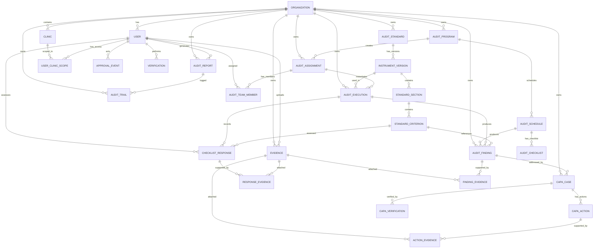

# Dokumentasi Arsitektur — SIMMAK Audit Internal Klinik

**Versi:** 1.0  
**Tanggal:** 19 Oktober 2026  
**Modul:** Audit Internal Klinik (Release 1)  
**Stack:** Laravel 12 + PHP 8.3 + PostgreSQL 17 + Blade + Tailwind v4

---

## 1. Ringkasan Arsitektur

SIMMAK Audit Internal Klinik dibangun sebagai modul terintegrasi dalam sistem SIMMAK PPKP yang sudah ada. Arsitektur mengikuti prinsip **modular, terpisah antara business logic dan presentasi (controller thin, service thick)**, dan **add-only migration** (tidak merusak data yang sudah ada).

### 1.1 Prinsip Desain

| Prinsip | Implementasi |
|---------|-------------|
| Modular | Setiap fitur (standar, program, assignment, execution, findings, CAPA, evidence, report) memiliki service dan controller tersendiri |
| Separation of Concerns | Controller hanya menangani request/response, business logic ada di service class |
| Authorization | Policy per model (Spatie Permission), middleware `permission:` pada setiap route, scope klinik berbasis `user_clinic_scopes` |
| Data Integrity | UUID primary key, soft delete, foreign key constraint, unique constraint pada kode dokumen |
| Audit Trail | `audit_trails` tabel append-only (tidak dapat diupdate/dihapus melalui model) |
| Private Storage | Evidence disimpan di disk privat, unduhan melalui route terotorisasi |

---

## 2. ERD (Entity Relationship Diagram)



---

## 3. Struktur Tabel Database

Tabel yang baru ditambahkan untuk modul Audit Internal Klinik:

| Tabel | Deskripsi |
|-------|-----------|
| `regulatory_sources` | Sumber regulasi hukum (KMK, Permenkes, dll) dengan status verifikasi |
| `audit_standards` | Standar audit yang dikelola organisasi |
| `instrument_versions` | Versi instrumen audit (draft, review, approved, active, archived) |
| `standard_sections` | Bab/area penilaian dalam versi instrumen |
| `standard_criteria` | Kriteria atau elemen penilaian |
| `audit_assignments` | Penugasan audit per klinik |
| `audit_team_members` | Anggota tim auditor dengan deklarasi independensi & konflik |
| `audit_executions` | Eksekusi audit yang terkait dengan versi instrumen |
| `checklist_responses` | Respons penilaian per kriteria |
| `evidence` | Berkas bukti audit (private storage) |
| `response_evidence` | Hubungan respons checklist dengan bukti |
| `finding_evidence` | Hubungan temuan dengan bukti |
| `action_evidence` | Hubungan action CAPA dengan bukti |
| `approval_events` | Riwayat persetujuan (append-only) |
| `audit_reports` | Laporan audit dengan file PDF dan Excel |

Tabel yang sudah ada dan digunakan ulang:
- `clinics`, `users`, `organizations` (master data)
- `audit_programs`, `audit_schedules`, `audit_findings` (diperluas dengan kolom baru)
- `capa_cases`, `capa_actions`, `capa_verifications` (CAPA dasar yang sudah ada)
- `audit_trails`, `activity_logs` (audit trail dasar)
- Spatie permission tables (`roles`, `permissions`, `model_has_*`, `role_has_permissions`)

---

## 4. Alur Kerja (Workflow)

```
Perencanaan → Review/Persetujuan Program → Penugasan → Persiapan → 
Pelaksanaan → Review Hasil → Finalisasi Laporan → Tindak Lanjut → 
Verifikasi → Penutupan
```

### 4.1 Status Audit Program
`draft → submitted_for_review → approved → scheduled → in_progress → completed → archived`

### 4.2 Status Audit Execution
`preparation → in_progress → submitted_for_review → finalized → cancelled`

### 4.3 Status Temuan (Finding)
`draft → under_review → confirmed → action_required → pending_verification → closed`

### 4.4 Status CAPA
`open → analysis → action → verification → closed`

---

## 5. Model Keamanan (Security Model)

### 5.1 Otorisasi
- Setiap route dilindungi dengan middleware `permission:{permission_name}`
- Policy per model mengecek: organisasi, clinic scope, assignment membership, workflow state, separation of duties
- Tidak ada otorisasi hanya berdasarkan UI visibility

### 5.2 Isolasi Klinik
- User hanya dapat mengakses klinik yang terdaftar di `user_clinic_scopes`
- Satu pegawai dapat memiliki multiple clinic scope (mis. admin klinik + auditor)
- Super-admin / role dengan `clinics.manage` dapat melihat semua klinik dalam organisasi

### 5.3 Separation of Duties
- Verifier tidak dapat memverifikasi CAPA milik dirinya sendiri (owner_id !== verifier_id)
- Pembuat temuan tidak dapat melakukan verifikasi akhir atas temuan sendiri
- Pembuat program tidak dapat menyetujui program sendiri (self-approval blocked)

### 5.4 Audit Trail Append-Only
- Model `AuditTrail` mencegah update dan delete melalui override method
- Setiap transisi kritis dicatat dengan actor, timestamp, before/after values

---

## 6. Struktur Direktori

```
app/
  Http/Controllers/
    AuditReportController.php
    AuditStandardController.php
    AuditProgramController.php
    AuditAssignmentController.php
    AuditExecutionController.php
    AuditEvidenceController.php
    AuditFindingController.php
    CapaController.php (diperluas)
  Models/
    AuditReport.php
    AuditStandard.php
    InstrumentVersion.php
    StandardSection.php
    StandardCriterion.php
    AuditAssignment.php
    AuditTeamMember.php
    AuditExecution.php
    ChecklistResponse.php
    Evidence.php
    ApprovalEvent.php
    ResponseEvidence.php
    FindingEvidence.php
    ActionEvidence.php
    AuditFinding.php (diperluas)
  Policies/
    AuditReportPolicy.php
    AuditStandardPolicy.php
    AuditProgramPolicy.php
    AuditAssignmentPolicy.php
    AuditExecutionPolicy.php
    ChecklistResponsePolicy.php
    EvidencePolicy.php
    AuditFindingPolicy.php
    CapaCasePolicy.php
    CapaActionPolicy.php
    InstrumentVersionPolicy.php
    ApprovalEventPolicy.php
  Services/
    AuditReportService.php
    AuditStandardService.php
    AuditProgramService.php
    AuditAssignmentService.php
    AuditExecutionService.php
    AuditEvidenceService.php
    AuditDashboardService.php (diperluas)
  Exports/
    ReportExport.php
  Providers/
    AuthServiceProvider.php (baru)
resources/views/audit/
  standards/, programs/, assignments/, executions/, evidence/, findings/, reports/, dashboard/
```

---

## 7. Dependensi Baru

| Paket | Versi | Tujuan |
|-------|-------|--------|
| `barryvdh/laravel-dompdf` | ^3.1 | Generate PDF laporan |
| `maatwebsite/excel` | ^4.0 | Generate Excel laporan |

---

## 8. Keputusan Arsitektur

| Keputusan | Alasan |
|---------|--------|
| Menggunakan model `AuditFinding` yang sudah ada dengan menambahkan kolom | Hindari duplikasi tabel, maintain integritas data yang sudah ada |
| Tabel `evidence` terpisah dari `documents` (DMS) | Evidence audit memiliki kebutuhan keamanan dan isolasi klinik yang berbeda |
| `AuditTrail` append-only (no update/delete) | Memenuhi kebutuhan integritas audit/akreditasi |
| Clinic scope berbasis `user_clinic_scopes` | Mendukung multi-clinic per user (sebagai admin dan auditor sekaligus) |
