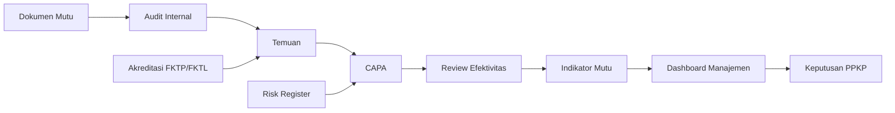
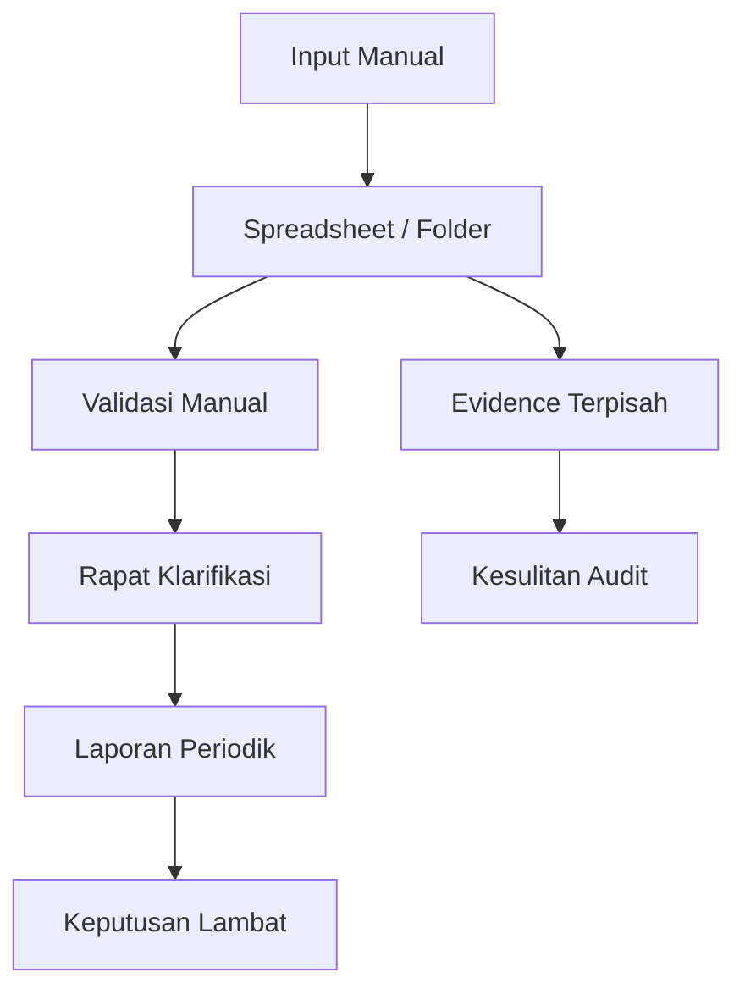
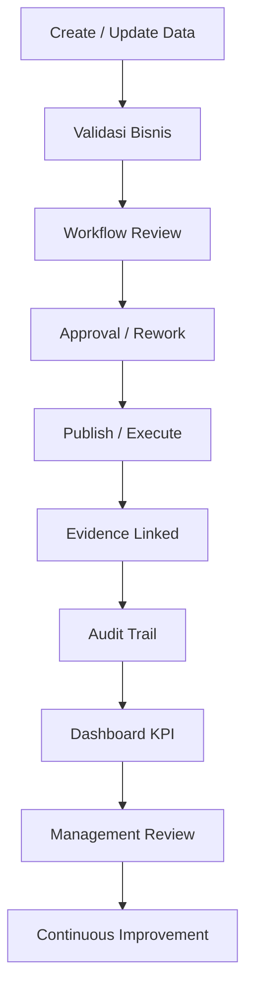

# Business Requirement Document (BRD) SIMMAK PPKP

**Sistem Informasi Manajemen Mutu, Audit Internal, Risiko, CAPA, dan Akreditasi PPKP Provinsi DKI Jakarta**

| Atribut | Nilai |
|---|---|
| Nama dokumen | Business Requirement Document |
| Nama sistem | SIMMAK PPKP |
| Organisasi | PPKP Provinsi DKI Jakarta |
| Cakupan organisasi | 1 Manajemen Pusat, 1 Klinik Utama, 15 Klinik Pratama |
| Model organisasi | Single organization multi-clinic dengan `organization_id`, `clinic_id`, dan `unit_id` |
| Domain | Mutu, audit internal, akreditasi, CAPA, risiko, dokumen, dashboard manajemen |
| Target teknologi | Laravel 12, PostgreSQL 17, Redis, Docker, LDAP AD DKI, Supabase Storage |
| Bahasa dokumen | Indonesia profesional enterprise |
| Status | Baseline BRD enterprise |
| Tanggal | 25 Juni 2026 |

## Daftar Isi

1. Executive Summary
2. Background
3. Business Case
4. Problem Statement
5. Vision
6. Mission
7. Goals
8. Stakeholder Analysis
9. RACI Matrix
10. As-Is Business Process
11. To-Be Business Process
12. Business Requirement
13. KPI
14. Governance Model
15. Risk Analysis
16. Change Management
17. Roadmap
18. Success Metrics
19. Budget Assumption
20. Conclusion

---

## 1. Executive Summary

SIMMAK PPKP adalah platform enterprise untuk mengonsolidasikan tata kelola mutu, audit internal, CAPA, risiko, akreditasi, pengendalian dokumen, dan dashboard manajemen di lingkungan PPKP Provinsi DKI Jakarta.
Sistem ini dirancang untuk menjawab kebutuhan organisasi yang memiliki satu manajemen pusat, satu klinik utama, dan lima belas klinik pratama dalam satu model organisasi terpadu.
BRD ini mendefinisikan kebutuhan bisnis yang harus dipenuhi agar SIMMAK PPKP menjadi sumber kebenaran operasional dan strategis bagi seluruh proses mutu.
Pendekatan yang digunakan adalah enterprise quality management berbasis bukti, workflow, kontrol akses, audit trail, dan pengukuran kinerja lintas klinik.

### 1.1 Nilai Strategis

1.1.1. Menyatukan dokumen mutu, evidence akreditasi, temuan audit, CAPA, risiko, dan indikator mutu dalam satu platform.
1.1.2. Mengurangi ketergantungan pada spreadsheet, folder lokal, dan komunikasi manual yang sulit diaudit.
1.1.3. Menyediakan dashboard pusat yang dapat membandingkan kesiapan dan kinerja seluruh klinik secara objektif.
1.1.4. Mempercepat penutupan temuan dan gap akreditasi melalui tugas, tenggat, eskalasi, dan bukti penyelesaian.
1.1.5. Memastikan standar FKTP dan FKTL dapat dikelola dinamis tanpa perubahan kode aplikasi.
1.1.6. Memperkuat kontrol tata kelola melalui RBAC, scoping organisasi, dan audit trail append-only secara logis.
1.1.7. Mendukung budaya mutu dengan siklus PDCA yang terlihat dalam data harian, rapat mutu, dan laporan manajemen.
1.1.8. Meningkatkan kesiapan pemeriksaan karena seluruh bukti, keputusan, dan status terdokumentasi secara konsisten.

### 1.2 Cakupan Modul Strategis

| Modul | Nama | Kontribusi Bisnis |
|---|---|---|
| DMS | Document Management System | mengendalikan dokumen mutu, kebijakan, SOP, formulir, distribusi, versi, masa berlaku, dan bukti baca |
| AUD | Audit Internal | mengelola program audit, jadwal, checklist, fieldwork, temuan, laporan, dan tindak lanjut |
| CAPA | Corrective and Preventive Action | mengelola RCA, tindakan korektif, tindakan preventif, verifikasi, dan uji efektivitas |
| RSK | Risk Management | mengelola risk register, penilaian, mitigasi, monitoring, review, dan heatmap risiko |
| ACC | Accreditation Management | mengelola standar FKTP dan FKTL, self assessment, evidence, gap, mock survey, dan readiness |
| QLT | Quality Management | mengelola program mutu, indikator, target, pengukuran, evaluasi, dan peningkatan berkelanjutan |
| DSH | Dashboard and Reporting | menyediakan cockpit eksekutif, analitik klinik, ekspor laporan, dan pemantauan lintas modul |

### 1.3 Ringkasan Operating Model

1.3.ORG-01. Manajemen Pusat PPKP berperan sebagai Manajemen Pusat dengan fokus bisnis: Pusat kendali mutu, governance, kebijakan, pelaporan lintas klinik.
1.3.KLU-01. Klinik Utama PPKP berperan sebagai Klinik Utama dengan fokus bisnis: Layanan rujukan internal, pembinaan klinis, standar FKTL bila relevan.
1.3.KLP-01. Klinik Pratama PPKP Jakarta Pusat berperan sebagai Klinik Pratama dengan fokus bisnis: Layanan primer wilayah Jakarta Pusat.
1.3.KLP-02. Klinik Pratama PPKP Jakarta Utara berperan sebagai Klinik Pratama dengan fokus bisnis: Layanan primer wilayah Jakarta Utara.
1.3.KLP-03. Klinik Pratama PPKP Jakarta Barat berperan sebagai Klinik Pratama dengan fokus bisnis: Layanan primer wilayah Jakarta Barat.
1.3.KLP-04. Klinik Pratama PPKP Jakarta Selatan berperan sebagai Klinik Pratama dengan fokus bisnis: Layanan primer wilayah Jakarta Selatan.
1.3.KLP-05. Klinik Pratama PPKP Jakarta Timur berperan sebagai Klinik Pratama dengan fokus bisnis: Layanan primer wilayah Jakarta Timur.
1.3.KLP-06. Klinik Pratama PPKP Kepulauan Seribu berperan sebagai Klinik Pratama dengan fokus bisnis: Layanan primer wilayah Kepulauan Seribu.
1.3.KLP-07. Klinik Pratama PPKP Cempaka Putih berperan sebagai Klinik Pratama dengan fokus bisnis: Layanan primer kawasan Cempaka Putih.
1.3.KLP-08. Klinik Pratama PPKP Tanah Abang berperan sebagai Klinik Pratama dengan fokus bisnis: Layanan primer kawasan Tanah Abang.
1.3.KLP-09. Klinik Pratama PPKP Tanjung Priok berperan sebagai Klinik Pratama dengan fokus bisnis: Layanan primer kawasan Tanjung Priok.
1.3.KLP-10. Klinik Pratama PPKP Kebon Jeruk berperan sebagai Klinik Pratama dengan fokus bisnis: Layanan primer kawasan Kebon Jeruk.
1.3.KLP-11. Klinik Pratama PPKP Tebet berperan sebagai Klinik Pratama dengan fokus bisnis: Layanan primer kawasan Tebet.
1.3.KLP-12. Klinik Pratama PPKP Matraman berperan sebagai Klinik Pratama dengan fokus bisnis: Layanan primer kawasan Matraman.
1.3.KLP-13. Klinik Pratama PPKP Pasar Minggu berperan sebagai Klinik Pratama dengan fokus bisnis: Layanan primer kawasan Pasar Minggu.
1.3.KLP-14. Klinik Pratama PPKP Duren Sawit berperan sebagai Klinik Pratama dengan fokus bisnis: Layanan primer kawasan Duren Sawit.
1.3.KLP-15. Klinik Pratama PPKP Koja berperan sebagai Klinik Pratama dengan fokus bisnis: Layanan primer kawasan Koja.

### 1.4 Prinsip Eksekutif

1.4.1. Satu sumber kebenaran data mutu dan akreditasi harus dipakai lintas modul.
1.4.2. Setiap keputusan penting harus memiliki pemilik, waktu, alasan, status, dan evidence.
1.4.3. Setiap klinik harus memiliki ruang kerja operasional sendiri tanpa kehilangan konsolidasi pusat.
1.4.4. Konfigurasi workflow, standar, matrix risiko, role, dan template harus dapat diubah oleh admin berwenang dari UI.
1.4.5. Seluruh proses harus menghasilkan data yang siap digunakan untuk audit internal, akreditasi, dan rapat manajemen.
1.4.6. Implementasi harus mempertimbangkan kesiapan SDM klinik, bukan hanya kelengkapan fitur aplikasi.
1.4.7. Keamanan dan kepatuhan harus menjadi bagian dari proses bisnis, bukan lapisan tambahan di akhir proyek.
1.4.8. Dashboard harus menjadi alat pengambilan keputusan, bukan sekadar visualisasi angka.

---

## 2. Background

PPKP Provinsi DKI Jakarta memerlukan sistem yang dapat mendukung pengelolaan mutu dan kepatuhan secara konsisten pada struktur layanan yang tersebar.
Kompleksitas meningkat karena setiap klinik memiliki kebutuhan operasional sendiri, sementara manajemen pusat membutuhkan standar, konsolidasi, dan kontrol yang seragam.
Kondisi ini menuntut sistem yang mampu mengelola proses berbasis organisasi, klinik, dan unit secara eksplisit.

### 2.1 Konteks Organisasi

| Kode | Entitas | Tipe | Konteks Bisnis |
|---|---|---|---|
| ORG-01 | Manajemen Pusat PPKP | Manajemen Pusat | Pusat kendali mutu, governance, kebijakan, pelaporan lintas klinik |
| KLU-01 | Klinik Utama PPKP | Klinik Utama | Layanan rujukan internal, pembinaan klinis, standar FKTL bila relevan |
| KLP-01 | Klinik Pratama PPKP Jakarta Pusat | Klinik Pratama | Layanan primer wilayah Jakarta Pusat |
| KLP-02 | Klinik Pratama PPKP Jakarta Utara | Klinik Pratama | Layanan primer wilayah Jakarta Utara |
| KLP-03 | Klinik Pratama PPKP Jakarta Barat | Klinik Pratama | Layanan primer wilayah Jakarta Barat |
| KLP-04 | Klinik Pratama PPKP Jakarta Selatan | Klinik Pratama | Layanan primer wilayah Jakarta Selatan |
| KLP-05 | Klinik Pratama PPKP Jakarta Timur | Klinik Pratama | Layanan primer wilayah Jakarta Timur |
| KLP-06 | Klinik Pratama PPKP Kepulauan Seribu | Klinik Pratama | Layanan primer wilayah Kepulauan Seribu |
| KLP-07 | Klinik Pratama PPKP Cempaka Putih | Klinik Pratama | Layanan primer kawasan Cempaka Putih |
| KLP-08 | Klinik Pratama PPKP Tanah Abang | Klinik Pratama | Layanan primer kawasan Tanah Abang |
| KLP-09 | Klinik Pratama PPKP Tanjung Priok | Klinik Pratama | Layanan primer kawasan Tanjung Priok |
| KLP-10 | Klinik Pratama PPKP Kebon Jeruk | Klinik Pratama | Layanan primer kawasan Kebon Jeruk |
| KLP-11 | Klinik Pratama PPKP Tebet | Klinik Pratama | Layanan primer kawasan Tebet |
| KLP-12 | Klinik Pratama PPKP Matraman | Klinik Pratama | Layanan primer kawasan Matraman |
| KLP-13 | Klinik Pratama PPKP Pasar Minggu | Klinik Pratama | Layanan primer kawasan Pasar Minggu |
| KLP-14 | Klinik Pratama PPKP Duren Sawit | Klinik Pratama | Layanan primer kawasan Duren Sawit |
| KLP-15 | Klinik Pratama PPKP Koja | Klinik Pratama | Layanan primer kawasan Koja |

2.1.ORG-01. Manajemen Pusat PPKP wajib memiliki konfigurasi scope yang memastikan data operasional dapat dipisahkan dari klinik lain tetapi tetap dapat dikonsolidasi di tingkat pusat.
2.1.ORG-01.a. Manajemen Pusat PPKP membutuhkan akses terhadap dokumen, audit, CAPA, risiko, akreditasi, mutu, dan dashboard sesuai mandat Manajemen Pusat.
2.1.KLU-01. Klinik Utama PPKP wajib memiliki konfigurasi scope yang memastikan data operasional dapat dipisahkan dari klinik lain tetapi tetap dapat dikonsolidasi di tingkat pusat.
2.1.KLU-01.a. Klinik Utama PPKP membutuhkan akses terhadap dokumen, audit, CAPA, risiko, akreditasi, mutu, dan dashboard sesuai mandat Klinik Utama.
2.1.KLP-01. Klinik Pratama PPKP Jakarta Pusat wajib memiliki konfigurasi scope yang memastikan data operasional dapat dipisahkan dari klinik lain tetapi tetap dapat dikonsolidasi di tingkat pusat.
2.1.KLP-01.a. Klinik Pratama PPKP Jakarta Pusat membutuhkan akses terhadap dokumen, audit, CAPA, risiko, akreditasi, mutu, dan dashboard sesuai mandat Klinik Pratama.
2.1.KLP-02. Klinik Pratama PPKP Jakarta Utara wajib memiliki konfigurasi scope yang memastikan data operasional dapat dipisahkan dari klinik lain tetapi tetap dapat dikonsolidasi di tingkat pusat.
2.1.KLP-02.a. Klinik Pratama PPKP Jakarta Utara membutuhkan akses terhadap dokumen, audit, CAPA, risiko, akreditasi, mutu, dan dashboard sesuai mandat Klinik Pratama.
2.1.KLP-03. Klinik Pratama PPKP Jakarta Barat wajib memiliki konfigurasi scope yang memastikan data operasional dapat dipisahkan dari klinik lain tetapi tetap dapat dikonsolidasi di tingkat pusat.
2.1.KLP-03.a. Klinik Pratama PPKP Jakarta Barat membutuhkan akses terhadap dokumen, audit, CAPA, risiko, akreditasi, mutu, dan dashboard sesuai mandat Klinik Pratama.
2.1.KLP-04. Klinik Pratama PPKP Jakarta Selatan wajib memiliki konfigurasi scope yang memastikan data operasional dapat dipisahkan dari klinik lain tetapi tetap dapat dikonsolidasi di tingkat pusat.
2.1.KLP-04.a. Klinik Pratama PPKP Jakarta Selatan membutuhkan akses terhadap dokumen, audit, CAPA, risiko, akreditasi, mutu, dan dashboard sesuai mandat Klinik Pratama.
2.1.KLP-05. Klinik Pratama PPKP Jakarta Timur wajib memiliki konfigurasi scope yang memastikan data operasional dapat dipisahkan dari klinik lain tetapi tetap dapat dikonsolidasi di tingkat pusat.
2.1.KLP-05.a. Klinik Pratama PPKP Jakarta Timur membutuhkan akses terhadap dokumen, audit, CAPA, risiko, akreditasi, mutu, dan dashboard sesuai mandat Klinik Pratama.
2.1.KLP-06. Klinik Pratama PPKP Kepulauan Seribu wajib memiliki konfigurasi scope yang memastikan data operasional dapat dipisahkan dari klinik lain tetapi tetap dapat dikonsolidasi di tingkat pusat.
2.1.KLP-06.a. Klinik Pratama PPKP Kepulauan Seribu membutuhkan akses terhadap dokumen, audit, CAPA, risiko, akreditasi, mutu, dan dashboard sesuai mandat Klinik Pratama.
2.1.KLP-07. Klinik Pratama PPKP Cempaka Putih wajib memiliki konfigurasi scope yang memastikan data operasional dapat dipisahkan dari klinik lain tetapi tetap dapat dikonsolidasi di tingkat pusat.
2.1.KLP-07.a. Klinik Pratama PPKP Cempaka Putih membutuhkan akses terhadap dokumen, audit, CAPA, risiko, akreditasi, mutu, dan dashboard sesuai mandat Klinik Pratama.
2.1.KLP-08. Klinik Pratama PPKP Tanah Abang wajib memiliki konfigurasi scope yang memastikan data operasional dapat dipisahkan dari klinik lain tetapi tetap dapat dikonsolidasi di tingkat pusat.
2.1.KLP-08.a. Klinik Pratama PPKP Tanah Abang membutuhkan akses terhadap dokumen, audit, CAPA, risiko, akreditasi, mutu, dan dashboard sesuai mandat Klinik Pratama.
2.1.KLP-09. Klinik Pratama PPKP Tanjung Priok wajib memiliki konfigurasi scope yang memastikan data operasional dapat dipisahkan dari klinik lain tetapi tetap dapat dikonsolidasi di tingkat pusat.
2.1.KLP-09.a. Klinik Pratama PPKP Tanjung Priok membutuhkan akses terhadap dokumen, audit, CAPA, risiko, akreditasi, mutu, dan dashboard sesuai mandat Klinik Pratama.
2.1.KLP-10. Klinik Pratama PPKP Kebon Jeruk wajib memiliki konfigurasi scope yang memastikan data operasional dapat dipisahkan dari klinik lain tetapi tetap dapat dikonsolidasi di tingkat pusat.
2.1.KLP-10.a. Klinik Pratama PPKP Kebon Jeruk membutuhkan akses terhadap dokumen, audit, CAPA, risiko, akreditasi, mutu, dan dashboard sesuai mandat Klinik Pratama.
2.1.KLP-11. Klinik Pratama PPKP Tebet wajib memiliki konfigurasi scope yang memastikan data operasional dapat dipisahkan dari klinik lain tetapi tetap dapat dikonsolidasi di tingkat pusat.
2.1.KLP-11.a. Klinik Pratama PPKP Tebet membutuhkan akses terhadap dokumen, audit, CAPA, risiko, akreditasi, mutu, dan dashboard sesuai mandat Klinik Pratama.
2.1.KLP-12. Klinik Pratama PPKP Matraman wajib memiliki konfigurasi scope yang memastikan data operasional dapat dipisahkan dari klinik lain tetapi tetap dapat dikonsolidasi di tingkat pusat.
2.1.KLP-12.a. Klinik Pratama PPKP Matraman membutuhkan akses terhadap dokumen, audit, CAPA, risiko, akreditasi, mutu, dan dashboard sesuai mandat Klinik Pratama.
2.1.KLP-13. Klinik Pratama PPKP Pasar Minggu wajib memiliki konfigurasi scope yang memastikan data operasional dapat dipisahkan dari klinik lain tetapi tetap dapat dikonsolidasi di tingkat pusat.
2.1.KLP-13.a. Klinik Pratama PPKP Pasar Minggu membutuhkan akses terhadap dokumen, audit, CAPA, risiko, akreditasi, mutu, dan dashboard sesuai mandat Klinik Pratama.
2.1.KLP-14. Klinik Pratama PPKP Duren Sawit wajib memiliki konfigurasi scope yang memastikan data operasional dapat dipisahkan dari klinik lain tetapi tetap dapat dikonsolidasi di tingkat pusat.
2.1.KLP-14.a. Klinik Pratama PPKP Duren Sawit membutuhkan akses terhadap dokumen, audit, CAPA, risiko, akreditasi, mutu, dan dashboard sesuai mandat Klinik Pratama.
2.1.KLP-15. Klinik Pratama PPKP Koja wajib memiliki konfigurasi scope yang memastikan data operasional dapat dipisahkan dari klinik lain tetapi tetap dapat dikonsolidasi di tingkat pusat.
2.1.KLP-15.a. Klinik Pratama PPKP Koja membutuhkan akses terhadap dokumen, audit, CAPA, risiko, akreditasi, mutu, dan dashboard sesuai mandat Klinik Pratama.

### 2.2 Konteks Regulasi dan Mutu

2.2.1. Organisasi layanan kesehatan membutuhkan bukti terdokumentasi atas kepatuhan terhadap standar mutu dan akreditasi.
2.2.2. Akreditasi FKTP dan FKTL menuntut evidence yang relevan, terkini, dapat diverifikasi, dan mudah ditelusuri.
2.2.3. Audit internal membutuhkan program, checklist, bukti, temuan, rekomendasi, dan tindak lanjut yang formal.
2.2.4. CAPA membutuhkan root cause analysis dan evaluasi efektivitas agar masalah tidak hanya ditutup secara administratif.
2.2.5. Manajemen risiko membutuhkan risk appetite, matrix, owner, mitigasi, dan monitoring berkala.
2.2.6. Indikator mutu membutuhkan baseline, target, data measurement, validasi, analisis tren, dan keputusan tindak lanjut.
2.2.7. Dokumen mutu membutuhkan versioning, approval, distribusi, expiry monitoring, dan kontrol akses.
2.2.8. Dashboard membutuhkan data yang terverifikasi, bukan kompilasi manual tanpa lineage.

### 2.3 Konteks Teknologi

| Teknologi | Peran | Implikasi Bisnis |
|---|---|---|
| Laravel 12 | Platform aplikasi web | Mendukung workflow bisnis, API, policy, queue, scheduler, dan integrasi |
| PostgreSQL 17 | Database utama | Menjadi sumber kebenaran untuk data transaksional dan relasional |
| Redis | Cache, queue, session, lock | Mempercepat proses, menjaga antrian, dan mendukung pekerjaan asynchronous |
| Docker | Runtime dan deployment | Menstandarkan lingkungan aplikasi, database, cache, worker, dan scheduler |
| LDAP AD DKI | Sumber identitas | Mengintegrasikan autentikasi pegawai dan mapping user organisasi |
| Supabase Storage | Object storage | Menyimpan dokumen, evidence, lampiran audit, dan arsip biner |

2.3.Laravel 12. Penggunaan Laravel 12 sebagai Platform aplikasi web harus diterjemahkan ke kontrol bisnis: Mendukung workflow bisnis, API, policy, queue, scheduler, dan integrasi.
2.3.PostgreSQL 17. Penggunaan PostgreSQL 17 sebagai Database utama harus diterjemahkan ke kontrol bisnis: Menjadi sumber kebenaran untuk data transaksional dan relasional.
2.3.Redis. Penggunaan Redis sebagai Cache, queue, session, lock harus diterjemahkan ke kontrol bisnis: Mempercepat proses, menjaga antrian, dan mendukung pekerjaan asynchronous.
2.3.Docker. Penggunaan Docker sebagai Runtime dan deployment harus diterjemahkan ke kontrol bisnis: Menstandarkan lingkungan aplikasi, database, cache, worker, dan scheduler.
2.3.LDAP AD DKI. Penggunaan LDAP AD DKI sebagai Sumber identitas harus diterjemahkan ke kontrol bisnis: Mengintegrasikan autentikasi pegawai dan mapping user organisasi.
2.3.Supabase Storage. Penggunaan Supabase Storage sebagai Object storage harus diterjemahkan ke kontrol bisnis: Menyimpan dokumen, evidence, lampiran audit, dan arsip biner.

---

## 3. Business Case

Business case SIMMAK PPKP didasarkan pada kebutuhan memperbaiki efektivitas tata kelola mutu dan mengurangi biaya tersembunyi dari proses manual.
Manfaat yang ditargetkan meliputi pengurangan waktu pencarian bukti, percepatan penutupan CAPA, peningkatan readiness akreditasi, dan transparansi risiko lintas klinik.

### 3.1 Driver Bisnis

3.1.1. Kebutuhan konsolidasi data mutu dari 17 entitas dalam satu dashboard eksekutif.
3.1.2. Kebutuhan kontrol dokumen yang mampu menjamin versi aktif dan mencegah penggunaan dokumen kedaluwarsa.
3.1.3. Kebutuhan audit internal yang lebih terencana, terdokumentasi, dan mudah ditindaklanjuti.
3.1.4. Kebutuhan CAPA yang memiliki ownership jelas dan tidak berhenti pada pencatatan temuan.
3.1.5. Kebutuhan risk management yang dapat menghubungkan risiko tinggi dengan mitigasi dan indikator pemantauan.
3.1.6. Kebutuhan readiness akreditasi FKTP/FKTL yang dapat dipantau per standar dan per klinik.
3.1.7. Kebutuhan pelaporan manajemen yang dapat dibuat cepat tanpa rekonsiliasi manual berulang.
3.1.8. Kebutuhan audit trail untuk mendukung akuntabilitas proses dan investigasi historis.

### 3.2 Manfaat Terukur

| Modul | Kategori Manfaat | Manfaat Bisnis |
|---|---|---|
| DMS | Efisiensi | Mengurangi waktu administrasi pada Document Management System melalui workflow, template, dan notifikasi. |
| DMS | Kontrol | Meningkatkan kepatuhan proses Document Management System melalui approval, audit trail, dan scoping akses. |
| DMS | Transparansi | Menyediakan status Document Management System yang dapat dilihat pusat, klinik, dan unit sesuai hak akses. |
| DMS | Keputusan | Menghasilkan data Document Management System yang dapat digunakan untuk rapat mutu dan keputusan manajemen. |
| AUD | Efisiensi | Mengurangi waktu administrasi pada Audit Internal melalui workflow, template, dan notifikasi. |
| AUD | Kontrol | Meningkatkan kepatuhan proses Audit Internal melalui approval, audit trail, dan scoping akses. |
| AUD | Transparansi | Menyediakan status Audit Internal yang dapat dilihat pusat, klinik, dan unit sesuai hak akses. |
| AUD | Keputusan | Menghasilkan data Audit Internal yang dapat digunakan untuk rapat mutu dan keputusan manajemen. |
| CAPA | Efisiensi | Mengurangi waktu administrasi pada Corrective and Preventive Action melalui workflow, template, dan notifikasi. |
| CAPA | Kontrol | Meningkatkan kepatuhan proses Corrective and Preventive Action melalui approval, audit trail, dan scoping akses. |
| CAPA | Transparansi | Menyediakan status Corrective and Preventive Action yang dapat dilihat pusat, klinik, dan unit sesuai hak akses. |
| CAPA | Keputusan | Menghasilkan data Corrective and Preventive Action yang dapat digunakan untuk rapat mutu dan keputusan manajemen. |
| RSK | Efisiensi | Mengurangi waktu administrasi pada Risk Management melalui workflow, template, dan notifikasi. |
| RSK | Kontrol | Meningkatkan kepatuhan proses Risk Management melalui approval, audit trail, dan scoping akses. |
| RSK | Transparansi | Menyediakan status Risk Management yang dapat dilihat pusat, klinik, dan unit sesuai hak akses. |
| RSK | Keputusan | Menghasilkan data Risk Management yang dapat digunakan untuk rapat mutu dan keputusan manajemen. |
| ACC | Efisiensi | Mengurangi waktu administrasi pada Accreditation Management melalui workflow, template, dan notifikasi. |
| ACC | Kontrol | Meningkatkan kepatuhan proses Accreditation Management melalui approval, audit trail, dan scoping akses. |
| ACC | Transparansi | Menyediakan status Accreditation Management yang dapat dilihat pusat, klinik, dan unit sesuai hak akses. |
| ACC | Keputusan | Menghasilkan data Accreditation Management yang dapat digunakan untuk rapat mutu dan keputusan manajemen. |
| QLT | Efisiensi | Mengurangi waktu administrasi pada Quality Management melalui workflow, template, dan notifikasi. |
| QLT | Kontrol | Meningkatkan kepatuhan proses Quality Management melalui approval, audit trail, dan scoping akses. |
| QLT | Transparansi | Menyediakan status Quality Management yang dapat dilihat pusat, klinik, dan unit sesuai hak akses. |
| QLT | Keputusan | Menghasilkan data Quality Management yang dapat digunakan untuk rapat mutu dan keputusan manajemen. |
| DSH | Efisiensi | Mengurangi waktu administrasi pada Dashboard and Reporting melalui workflow, template, dan notifikasi. |
| DSH | Kontrol | Meningkatkan kepatuhan proses Dashboard and Reporting melalui approval, audit trail, dan scoping akses. |
| DSH | Transparansi | Menyediakan status Dashboard and Reporting yang dapat dilihat pusat, klinik, dan unit sesuai hak akses. |
| DSH | Keputusan | Menghasilkan data Dashboard and Reporting yang dapat digunakan untuk rapat mutu dan keputusan manajemen. |

### 3.3 Biaya yang Dihindari

3.3.1. Biaya waktu akibat pencarian dokumen dan evidence di banyak folder tidak terstruktur.
3.3.2. Biaya risiko kepatuhan akibat penggunaan dokumen yang bukan versi berlaku.
3.3.3. Biaya keterlambatan tindak lanjut temuan karena tidak ada eskalasi otomatis.
3.3.4. Biaya rapat berulang untuk memvalidasi data yang seharusnya sudah tersedia di sistem.
3.3.5. Biaya reputasi apabila readiness akreditasi rendah baru terlihat mendekati jadwal survey.
3.3.6. Biaya operasional karena setiap klinik membuat format laporan sendiri.
3.3.7. Biaya audit karena evidence tidak dapat ditelusuri ke keputusan atau aktivitas terkait.
3.3.8. Biaya teknis karena standar, workflow, dan matrix risiko di-hardcode dan sulit berubah.

---

## 4. Problem Statement

Permasalahan utama yang diselesaikan SIMMAK PPKP adalah fragmentasi proses mutu dan akreditasi yang menyebabkan data tidak konsisten, tindak lanjut lambat, dan bukti sulit diverifikasi.
Tanpa platform terpadu, organisasi menghadapi risiko ketidaksiapan audit, keterlambatan CAPA, gap akreditasi yang tidak terlihat, dan dashboard manajemen yang tidak real-time.

### 4.1 Masalah Inti

| Masalah | Kondisi | Dampak Bisnis |
|---|---|---|
| Fragmentasi dokumen | Dokumen tersebar di folder, email, atau perangkat lokal | Versi tidak terkendali dan bukti sulit diverifikasi |
| Audit tidak terintegrasi | Program, checklist, temuan, dan follow-up dikelola terpisah | Temuan terlambat ditutup dan sulit dianalisis |
| CAPA administratif | Tindak lanjut sering berfokus pada penutupan tugas | Efektivitas perbaikan tidak terbukti |
| Risiko tidak operasional | Risk register tidak terhubung dengan mitigasi harian | Risiko tinggi tidak mendapat perhatian memadai |
| Akreditasi reaktif | Evidence dikumpulkan menjelang survey | Gap sulit diprioritaskan |
| Indikator mutu manual | Pengukuran dan validasi dilakukan di spreadsheet | Data lambat dan rentan salah |
| Dashboard tidak konsisten | Setiap unit membuat format laporan sendiri | Manajemen tidak melihat satu versi kebenaran |
| Akses tidak terukur | Hak akses tidak selalu mengikuti organisasi, klinik, unit | Risiko kebocoran atau keterbatasan data |

4.1.1. Fragmentasi dokumen: Dokumen tersebar di folder, email, atau perangkat lokal; dampaknya adalah Versi tidak terkendali dan bukti sulit diverifikasi.
4.1.1.a. SIMMAK PPKP harus menyediakan kontrol proses, data, evidence, dan dashboard untuk mengurangi dampak tersebut.
4.1.2. Audit tidak terintegrasi: Program, checklist, temuan, dan follow-up dikelola terpisah; dampaknya adalah Temuan terlambat ditutup dan sulit dianalisis.
4.1.2.a. SIMMAK PPKP harus menyediakan kontrol proses, data, evidence, dan dashboard untuk mengurangi dampak tersebut.
4.1.3. CAPA administratif: Tindak lanjut sering berfokus pada penutupan tugas; dampaknya adalah Efektivitas perbaikan tidak terbukti.
4.1.3.a. SIMMAK PPKP harus menyediakan kontrol proses, data, evidence, dan dashboard untuk mengurangi dampak tersebut.
4.1.4. Risiko tidak operasional: Risk register tidak terhubung dengan mitigasi harian; dampaknya adalah Risiko tinggi tidak mendapat perhatian memadai.
4.1.4.a. SIMMAK PPKP harus menyediakan kontrol proses, data, evidence, dan dashboard untuk mengurangi dampak tersebut.
4.1.5. Akreditasi reaktif: Evidence dikumpulkan menjelang survey; dampaknya adalah Gap sulit diprioritaskan.
4.1.5.a. SIMMAK PPKP harus menyediakan kontrol proses, data, evidence, dan dashboard untuk mengurangi dampak tersebut.
4.1.6. Indikator mutu manual: Pengukuran dan validasi dilakukan di spreadsheet; dampaknya adalah Data lambat dan rentan salah.
4.1.6.a. SIMMAK PPKP harus menyediakan kontrol proses, data, evidence, dan dashboard untuk mengurangi dampak tersebut.
4.1.7. Dashboard tidak konsisten: Setiap unit membuat format laporan sendiri; dampaknya adalah Manajemen tidak melihat satu versi kebenaran.
4.1.7.a. SIMMAK PPKP harus menyediakan kontrol proses, data, evidence, dan dashboard untuk mengurangi dampak tersebut.
4.1.8. Akses tidak terukur: Hak akses tidak selalu mengikuti organisasi, klinik, unit; dampaknya adalah Risiko kebocoran atau keterbatasan data.
4.1.8.a. SIMMAK PPKP harus menyediakan kontrol proses, data, evidence, dan dashboard untuk mengurangi dampak tersebut.

### 4.2 Dampak per Entitas

4.2.ORG-01. Pada Manajemen Pusat PPKP, proses manual berpotensi menunda pencarian bukti, tindak lanjut temuan, dan pelaporan mutu.
4.2.ORG-01.a. Manajemen Pusat PPKP memerlukan baseline proses yang sama namun tetap dapat menyesuaikan tugas unit sesuai konteks operasional.
4.2.KLU-01. Pada Klinik Utama PPKP, proses manual berpotensi menunda pencarian bukti, tindak lanjut temuan, dan pelaporan mutu.
4.2.KLU-01.a. Klinik Utama PPKP memerlukan baseline proses yang sama namun tetap dapat menyesuaikan tugas unit sesuai konteks operasional.
4.2.KLP-01. Pada Klinik Pratama PPKP Jakarta Pusat, proses manual berpotensi menunda pencarian bukti, tindak lanjut temuan, dan pelaporan mutu.
4.2.KLP-01.a. Klinik Pratama PPKP Jakarta Pusat memerlukan baseline proses yang sama namun tetap dapat menyesuaikan tugas unit sesuai konteks operasional.
4.2.KLP-02. Pada Klinik Pratama PPKP Jakarta Utara, proses manual berpotensi menunda pencarian bukti, tindak lanjut temuan, dan pelaporan mutu.
4.2.KLP-02.a. Klinik Pratama PPKP Jakarta Utara memerlukan baseline proses yang sama namun tetap dapat menyesuaikan tugas unit sesuai konteks operasional.
4.2.KLP-03. Pada Klinik Pratama PPKP Jakarta Barat, proses manual berpotensi menunda pencarian bukti, tindak lanjut temuan, dan pelaporan mutu.
4.2.KLP-03.a. Klinik Pratama PPKP Jakarta Barat memerlukan baseline proses yang sama namun tetap dapat menyesuaikan tugas unit sesuai konteks operasional.
4.2.KLP-04. Pada Klinik Pratama PPKP Jakarta Selatan, proses manual berpotensi menunda pencarian bukti, tindak lanjut temuan, dan pelaporan mutu.
4.2.KLP-04.a. Klinik Pratama PPKP Jakarta Selatan memerlukan baseline proses yang sama namun tetap dapat menyesuaikan tugas unit sesuai konteks operasional.
4.2.KLP-05. Pada Klinik Pratama PPKP Jakarta Timur, proses manual berpotensi menunda pencarian bukti, tindak lanjut temuan, dan pelaporan mutu.
4.2.KLP-05.a. Klinik Pratama PPKP Jakarta Timur memerlukan baseline proses yang sama namun tetap dapat menyesuaikan tugas unit sesuai konteks operasional.
4.2.KLP-06. Pada Klinik Pratama PPKP Kepulauan Seribu, proses manual berpotensi menunda pencarian bukti, tindak lanjut temuan, dan pelaporan mutu.
4.2.KLP-06.a. Klinik Pratama PPKP Kepulauan Seribu memerlukan baseline proses yang sama namun tetap dapat menyesuaikan tugas unit sesuai konteks operasional.
4.2.KLP-07. Pada Klinik Pratama PPKP Cempaka Putih, proses manual berpotensi menunda pencarian bukti, tindak lanjut temuan, dan pelaporan mutu.
4.2.KLP-07.a. Klinik Pratama PPKP Cempaka Putih memerlukan baseline proses yang sama namun tetap dapat menyesuaikan tugas unit sesuai konteks operasional.
4.2.KLP-08. Pada Klinik Pratama PPKP Tanah Abang, proses manual berpotensi menunda pencarian bukti, tindak lanjut temuan, dan pelaporan mutu.
4.2.KLP-08.a. Klinik Pratama PPKP Tanah Abang memerlukan baseline proses yang sama namun tetap dapat menyesuaikan tugas unit sesuai konteks operasional.
4.2.KLP-09. Pada Klinik Pratama PPKP Tanjung Priok, proses manual berpotensi menunda pencarian bukti, tindak lanjut temuan, dan pelaporan mutu.
4.2.KLP-09.a. Klinik Pratama PPKP Tanjung Priok memerlukan baseline proses yang sama namun tetap dapat menyesuaikan tugas unit sesuai konteks operasional.
4.2.KLP-10. Pada Klinik Pratama PPKP Kebon Jeruk, proses manual berpotensi menunda pencarian bukti, tindak lanjut temuan, dan pelaporan mutu.
4.2.KLP-10.a. Klinik Pratama PPKP Kebon Jeruk memerlukan baseline proses yang sama namun tetap dapat menyesuaikan tugas unit sesuai konteks operasional.
4.2.KLP-11. Pada Klinik Pratama PPKP Tebet, proses manual berpotensi menunda pencarian bukti, tindak lanjut temuan, dan pelaporan mutu.
4.2.KLP-11.a. Klinik Pratama PPKP Tebet memerlukan baseline proses yang sama namun tetap dapat menyesuaikan tugas unit sesuai konteks operasional.
4.2.KLP-12. Pada Klinik Pratama PPKP Matraman, proses manual berpotensi menunda pencarian bukti, tindak lanjut temuan, dan pelaporan mutu.
4.2.KLP-12.a. Klinik Pratama PPKP Matraman memerlukan baseline proses yang sama namun tetap dapat menyesuaikan tugas unit sesuai konteks operasional.
4.2.KLP-13. Pada Klinik Pratama PPKP Pasar Minggu, proses manual berpotensi menunda pencarian bukti, tindak lanjut temuan, dan pelaporan mutu.
4.2.KLP-13.a. Klinik Pratama PPKP Pasar Minggu memerlukan baseline proses yang sama namun tetap dapat menyesuaikan tugas unit sesuai konteks operasional.
4.2.KLP-14. Pada Klinik Pratama PPKP Duren Sawit, proses manual berpotensi menunda pencarian bukti, tindak lanjut temuan, dan pelaporan mutu.
4.2.KLP-14.a. Klinik Pratama PPKP Duren Sawit memerlukan baseline proses yang sama namun tetap dapat menyesuaikan tugas unit sesuai konteks operasional.
4.2.KLP-15. Pada Klinik Pratama PPKP Koja, proses manual berpotensi menunda pencarian bukti, tindak lanjut temuan, dan pelaporan mutu.
4.2.KLP-15.a. Klinik Pratama PPKP Koja memerlukan baseline proses yang sama namun tetap dapat menyesuaikan tugas unit sesuai konteks operasional.

---

## 5. Vision

Visi SIMMAK PPKP adalah menjadi platform digital terpadu yang membuat tata kelola mutu, audit internal, risiko, CAPA, dan akreditasi berjalan berbasis data, evidence, dan akuntabilitas.
Platform ini harus membantu PPKP Provinsi DKI Jakarta melihat kesiapan dan kinerja seluruh klinik dalam satu pandangan, sekaligus memberi pengguna klinik alat kerja yang praktis untuk tugas harian.

### 5.1 Pernyataan Visi

5.1.1. Menjadikan mutu sebagai proses harian yang dapat dilihat, diukur, dan diperbaiki secara berkelanjutan.
5.1.2. Menjadikan evidence sebagai aset organisasi yang terkelola, bukan lampiran yang dicari ketika dibutuhkan.
5.1.3. Menjadikan audit internal sebagai mekanisme pembelajaran dan assurance, bukan sekadar kewajiban periodik.
5.1.4. Menjadikan CAPA sebagai sistem perbaikan efektif yang terhubung dengan akar masalah, risiko, dan indikator.
5.1.5. Menjadikan akreditasi sebagai kesiapan berkelanjutan, bukan proyek sesaat menjelang survey.
5.1.6. Menjadikan dashboard sebagai alat pengambilan keputusan yang dapat dipercaya oleh pimpinan.
5.1.7. Menjadikan data scope organisasi, klinik, dan unit sebagai fondasi keamanan dan relevansi informasi.
5.1.8. Menjadikan konfigurasi bisnis sebagai kemampuan mandiri agar sistem adaptif terhadap perubahan standar.

### 5.2 Target Keadaan Masa Depan

5.2.DMS. Document Management System berjalan sebagai kapabilitas digital yang mengendalikan dokumen mutu, kebijakan, SOP, formulir, distribusi, versi, masa berlaku, dan bukti baca dengan kontrol workflow, audit trail, dan dashboard.
5.2.DMS.akurat. Output Document Management System harus akurat agar dapat digunakan dalam keputusan mutu dan akreditasi.
5.2.DMS.tepat waktu. Output Document Management System harus tepat waktu agar dapat digunakan dalam keputusan mutu dan akreditasi.
5.2.DMS.tertelusur. Output Document Management System harus tertelusur agar dapat digunakan dalam keputusan mutu dan akreditasi.
5.2.DMS.terstandar. Output Document Management System harus terstandar agar dapat digunakan dalam keputusan mutu dan akreditasi.
5.2.DMS.aman. Output Document Management System harus aman agar dapat digunakan dalam keputusan mutu dan akreditasi.
5.2.DMS.mudah diaudit. Output Document Management System harus mudah diaudit agar dapat digunakan dalam keputusan mutu dan akreditasi.
5.2.DMS.mudah digunakan. Output Document Management System harus mudah digunakan agar dapat digunakan dalam keputusan mutu dan akreditasi.
5.2.DMS.terukur. Output Document Management System harus terukur agar dapat digunakan dalam keputusan mutu dan akreditasi.
5.2.DMS.terintegrasi. Output Document Management System harus terintegrasi agar dapat digunakan dalam keputusan mutu dan akreditasi.
5.2.DMS.dapat dikonfigurasi. Output Document Management System harus dapat dikonfigurasi agar dapat digunakan dalam keputusan mutu dan akreditasi.
5.2.AUD. Audit Internal berjalan sebagai kapabilitas digital yang mengelola program audit, jadwal, checklist, fieldwork, temuan, laporan, dan tindak lanjut dengan kontrol workflow, audit trail, dan dashboard.
5.2.AUD.akurat. Output Audit Internal harus akurat agar dapat digunakan dalam keputusan mutu dan akreditasi.
5.2.AUD.tepat waktu. Output Audit Internal harus tepat waktu agar dapat digunakan dalam keputusan mutu dan akreditasi.
5.2.AUD.tertelusur. Output Audit Internal harus tertelusur agar dapat digunakan dalam keputusan mutu dan akreditasi.
5.2.AUD.terstandar. Output Audit Internal harus terstandar agar dapat digunakan dalam keputusan mutu dan akreditasi.
5.2.AUD.aman. Output Audit Internal harus aman agar dapat digunakan dalam keputusan mutu dan akreditasi.
5.2.AUD.mudah diaudit. Output Audit Internal harus mudah diaudit agar dapat digunakan dalam keputusan mutu dan akreditasi.
5.2.AUD.mudah digunakan. Output Audit Internal harus mudah digunakan agar dapat digunakan dalam keputusan mutu dan akreditasi.
5.2.AUD.terukur. Output Audit Internal harus terukur agar dapat digunakan dalam keputusan mutu dan akreditasi.
5.2.AUD.terintegrasi. Output Audit Internal harus terintegrasi agar dapat digunakan dalam keputusan mutu dan akreditasi.
5.2.AUD.dapat dikonfigurasi. Output Audit Internal harus dapat dikonfigurasi agar dapat digunakan dalam keputusan mutu dan akreditasi.
5.2.CAPA. Corrective and Preventive Action berjalan sebagai kapabilitas digital yang mengelola RCA, tindakan korektif, tindakan preventif, verifikasi, dan uji efektivitas dengan kontrol workflow, audit trail, dan dashboard.
5.2.CAPA.akurat. Output Corrective and Preventive Action harus akurat agar dapat digunakan dalam keputusan mutu dan akreditasi.
5.2.CAPA.tepat waktu. Output Corrective and Preventive Action harus tepat waktu agar dapat digunakan dalam keputusan mutu dan akreditasi.
5.2.CAPA.tertelusur. Output Corrective and Preventive Action harus tertelusur agar dapat digunakan dalam keputusan mutu dan akreditasi.
5.2.CAPA.terstandar. Output Corrective and Preventive Action harus terstandar agar dapat digunakan dalam keputusan mutu dan akreditasi.
5.2.CAPA.aman. Output Corrective and Preventive Action harus aman agar dapat digunakan dalam keputusan mutu dan akreditasi.
5.2.CAPA.mudah diaudit. Output Corrective and Preventive Action harus mudah diaudit agar dapat digunakan dalam keputusan mutu dan akreditasi.
5.2.CAPA.mudah digunakan. Output Corrective and Preventive Action harus mudah digunakan agar dapat digunakan dalam keputusan mutu dan akreditasi.
5.2.CAPA.terukur. Output Corrective and Preventive Action harus terukur agar dapat digunakan dalam keputusan mutu dan akreditasi.
5.2.CAPA.terintegrasi. Output Corrective and Preventive Action harus terintegrasi agar dapat digunakan dalam keputusan mutu dan akreditasi.
5.2.CAPA.dapat dikonfigurasi. Output Corrective and Preventive Action harus dapat dikonfigurasi agar dapat digunakan dalam keputusan mutu dan akreditasi.
5.2.RSK. Risk Management berjalan sebagai kapabilitas digital yang mengelola risk register, penilaian, mitigasi, monitoring, review, dan heatmap risiko dengan kontrol workflow, audit trail, dan dashboard.
5.2.RSK.akurat. Output Risk Management harus akurat agar dapat digunakan dalam keputusan mutu dan akreditasi.
5.2.RSK.tepat waktu. Output Risk Management harus tepat waktu agar dapat digunakan dalam keputusan mutu dan akreditasi.
5.2.RSK.tertelusur. Output Risk Management harus tertelusur agar dapat digunakan dalam keputusan mutu dan akreditasi.
5.2.RSK.terstandar. Output Risk Management harus terstandar agar dapat digunakan dalam keputusan mutu dan akreditasi.
5.2.RSK.aman. Output Risk Management harus aman agar dapat digunakan dalam keputusan mutu dan akreditasi.
5.2.RSK.mudah diaudit. Output Risk Management harus mudah diaudit agar dapat digunakan dalam keputusan mutu dan akreditasi.
5.2.RSK.mudah digunakan. Output Risk Management harus mudah digunakan agar dapat digunakan dalam keputusan mutu dan akreditasi.
5.2.RSK.terukur. Output Risk Management harus terukur agar dapat digunakan dalam keputusan mutu dan akreditasi.
5.2.RSK.terintegrasi. Output Risk Management harus terintegrasi agar dapat digunakan dalam keputusan mutu dan akreditasi.
5.2.RSK.dapat dikonfigurasi. Output Risk Management harus dapat dikonfigurasi agar dapat digunakan dalam keputusan mutu dan akreditasi.
5.2.ACC. Accreditation Management berjalan sebagai kapabilitas digital yang mengelola standar FKTP dan FKTL, self assessment, evidence, gap, mock survey, dan readiness dengan kontrol workflow, audit trail, dan dashboard.
5.2.ACC.akurat. Output Accreditation Management harus akurat agar dapat digunakan dalam keputusan mutu dan akreditasi.
5.2.ACC.tepat waktu. Output Accreditation Management harus tepat waktu agar dapat digunakan dalam keputusan mutu dan akreditasi.
5.2.ACC.tertelusur. Output Accreditation Management harus tertelusur agar dapat digunakan dalam keputusan mutu dan akreditasi.
5.2.ACC.terstandar. Output Accreditation Management harus terstandar agar dapat digunakan dalam keputusan mutu dan akreditasi.
5.2.ACC.aman. Output Accreditation Management harus aman agar dapat digunakan dalam keputusan mutu dan akreditasi.
5.2.ACC.mudah diaudit. Output Accreditation Management harus mudah diaudit agar dapat digunakan dalam keputusan mutu dan akreditasi.
5.2.ACC.mudah digunakan. Output Accreditation Management harus mudah digunakan agar dapat digunakan dalam keputusan mutu dan akreditasi.
5.2.ACC.terukur. Output Accreditation Management harus terukur agar dapat digunakan dalam keputusan mutu dan akreditasi.
5.2.ACC.terintegrasi. Output Accreditation Management harus terintegrasi agar dapat digunakan dalam keputusan mutu dan akreditasi.
5.2.ACC.dapat dikonfigurasi. Output Accreditation Management harus dapat dikonfigurasi agar dapat digunakan dalam keputusan mutu dan akreditasi.
5.2.QLT. Quality Management berjalan sebagai kapabilitas digital yang mengelola program mutu, indikator, target, pengukuran, evaluasi, dan peningkatan berkelanjutan dengan kontrol workflow, audit trail, dan dashboard.
5.2.QLT.akurat. Output Quality Management harus akurat agar dapat digunakan dalam keputusan mutu dan akreditasi.
5.2.QLT.tepat waktu. Output Quality Management harus tepat waktu agar dapat digunakan dalam keputusan mutu dan akreditasi.
5.2.QLT.tertelusur. Output Quality Management harus tertelusur agar dapat digunakan dalam keputusan mutu dan akreditasi.
5.2.QLT.terstandar. Output Quality Management harus terstandar agar dapat digunakan dalam keputusan mutu dan akreditasi.
5.2.QLT.aman. Output Quality Management harus aman agar dapat digunakan dalam keputusan mutu dan akreditasi.
5.2.QLT.mudah diaudit. Output Quality Management harus mudah diaudit agar dapat digunakan dalam keputusan mutu dan akreditasi.
5.2.QLT.mudah digunakan. Output Quality Management harus mudah digunakan agar dapat digunakan dalam keputusan mutu dan akreditasi.
5.2.QLT.terukur. Output Quality Management harus terukur agar dapat digunakan dalam keputusan mutu dan akreditasi.
5.2.QLT.terintegrasi. Output Quality Management harus terintegrasi agar dapat digunakan dalam keputusan mutu dan akreditasi.
5.2.QLT.dapat dikonfigurasi. Output Quality Management harus dapat dikonfigurasi agar dapat digunakan dalam keputusan mutu dan akreditasi.
5.2.DSH. Dashboard and Reporting berjalan sebagai kapabilitas digital yang menyediakan cockpit eksekutif, analitik klinik, ekspor laporan, dan pemantauan lintas modul dengan kontrol workflow, audit trail, dan dashboard.
5.2.DSH.akurat. Output Dashboard and Reporting harus akurat agar dapat digunakan dalam keputusan mutu dan akreditasi.
5.2.DSH.tepat waktu. Output Dashboard and Reporting harus tepat waktu agar dapat digunakan dalam keputusan mutu dan akreditasi.
5.2.DSH.tertelusur. Output Dashboard and Reporting harus tertelusur agar dapat digunakan dalam keputusan mutu dan akreditasi.
5.2.DSH.terstandar. Output Dashboard and Reporting harus terstandar agar dapat digunakan dalam keputusan mutu dan akreditasi.
5.2.DSH.aman. Output Dashboard and Reporting harus aman agar dapat digunakan dalam keputusan mutu dan akreditasi.
5.2.DSH.mudah diaudit. Output Dashboard and Reporting harus mudah diaudit agar dapat digunakan dalam keputusan mutu dan akreditasi.
5.2.DSH.mudah digunakan. Output Dashboard and Reporting harus mudah digunakan agar dapat digunakan dalam keputusan mutu dan akreditasi.
5.2.DSH.terukur. Output Dashboard and Reporting harus terukur agar dapat digunakan dalam keputusan mutu dan akreditasi.
5.2.DSH.terintegrasi. Output Dashboard and Reporting harus terintegrasi agar dapat digunakan dalam keputusan mutu dan akreditasi.
5.2.DSH.dapat dikonfigurasi. Output Dashboard and Reporting harus dapat dikonfigurasi agar dapat digunakan dalam keputusan mutu dan akreditasi.

---

## 6. Mission

Misi SIMMAK PPKP adalah menyediakan platform, proses, dan data yang memungkinkan seluruh entitas PPKP menjalankan tata kelola mutu secara konsisten.

### 6.1 Misi Utama

6.1.1. Membangun satu platform terpadu untuk dokumen mutu, audit, CAPA, risiko, akreditasi, quality management, dan dashboard.
6.1.2. Menetapkan workflow standar yang dapat dikonfigurasi tanpa perubahan kode untuk kebutuhan pusat dan klinik.
6.1.3. Menghubungkan setiap bukti, temuan, risiko, indikator, dan rencana aksi dalam jejak yang dapat ditelusuri.
6.1.4. Menyediakan akses berbasis role, organisasi, klinik, unit, dan status pekerjaan.
6.1.5. Menyediakan data konsolidasi bagi manajemen pusat tanpa melanggar isolasi data operasional klinik.
6.1.6. Meningkatkan kesiapan akreditasi melalui self assessment, gap analysis, evidence mapping, dan readiness score.
6.1.7. Memperkuat budaya perbaikan berkelanjutan melalui indikator mutu, PDSA, CAPA, dan rapat tinjauan manajemen.
6.1.8. Menyediakan fondasi teknologi yang aman, dapat dipelihara, dan siap berkembang.

### 6.2 Misi Operasional per Modul

6.2.DMS. Misi modul Document Management System adalah mengendalikan dokumen mutu, kebijakan, SOP, formulir, distribusi, versi, masa berlaku, dan bukti baca secara konsisten di seluruh entitas.
6.2.DMS.registrasi dokumen. Kapabilitas registrasi dokumen harus memiliki owner, status, tenggat bila relevan, evidence, dan audit trail.
6.2.DMS.klasifikasi dokumen. Kapabilitas klasifikasi dokumen harus memiliki owner, status, tenggat bila relevan, evidence, dan audit trail.
6.2.DMS.penomoran terkendali. Kapabilitas penomoran terkendali harus memiliki owner, status, tenggat bila relevan, evidence, dan audit trail.
6.2.DMS.workflow review. Kapabilitas workflow review harus memiliki owner, status, tenggat bila relevan, evidence, dan audit trail.
6.2.DMS.approval berjenjang. Kapabilitas approval berjenjang harus memiliki owner, status, tenggat bila relevan, evidence, dan audit trail.
6.2.DMS.publikasi. Kapabilitas publikasi harus memiliki owner, status, tenggat bila relevan, evidence, dan audit trail.
6.2.DMS.distribusi. Kapabilitas distribusi harus memiliki owner, status, tenggat bila relevan, evidence, dan audit trail.
6.2.DMS.acknowledgement. Kapabilitas acknowledgement harus memiliki owner, status, tenggat bila relevan, evidence, dan audit trail.
6.2.DMS.versioning. Kapabilitas versioning harus memiliki owner, status, tenggat bila relevan, evidence, dan audit trail.
6.2.DMS.retensi. Kapabilitas retensi harus memiliki owner, status, tenggat bila relevan, evidence, dan audit trail.
6.2.DMS.expiry monitoring. Kapabilitas expiry monitoring harus memiliki owner, status, tenggat bila relevan, evidence, dan audit trail.
6.2.DMS.QR verification. Kapabilitas QR verification harus memiliki owner, status, tenggat bila relevan, evidence, dan audit trail.
6.2.DMS.evidence linking. Kapabilitas evidence linking harus memiliki owner, status, tenggat bila relevan, evidence, dan audit trail.
6.2.DMS.arsip. Kapabilitas arsip harus memiliki owner, status, tenggat bila relevan, evidence, dan audit trail.
6.2.DMS.pencarian. Kapabilitas pencarian harus memiliki owner, status, tenggat bila relevan, evidence, dan audit trail.
6.2.DMS.akses berbasis scope. Kapabilitas akses berbasis scope harus memiliki owner, status, tenggat bila relevan, evidence, dan audit trail.
6.2.DMS.watermark. Kapabilitas watermark harus memiliki owner, status, tenggat bila relevan, evidence, dan audit trail.
6.2.DMS.riwayat revisi. Kapabilitas riwayat revisi harus memiliki owner, status, tenggat bila relevan, evidence, dan audit trail.
6.2.AUD. Misi modul Audit Internal adalah mengelola program audit, jadwal, checklist, fieldwork, temuan, laporan, dan tindak lanjut secara konsisten di seluruh entitas.
6.2.AUD.program audit. Kapabilitas program audit harus memiliki owner, status, tenggat bila relevan, evidence, dan audit trail.
6.2.AUD.audit universe. Kapabilitas audit universe harus memiliki owner, status, tenggat bila relevan, evidence, dan audit trail.
6.2.AUD.perencanaan tahunan. Kapabilitas perencanaan tahunan harus memiliki owner, status, tenggat bila relevan, evidence, dan audit trail.
6.2.AUD.jadwal audit. Kapabilitas jadwal audit harus memiliki owner, status, tenggat bila relevan, evidence, dan audit trail.
6.2.AUD.penugasan auditor. Kapabilitas penugasan auditor harus memiliki owner, status, tenggat bila relevan, evidence, dan audit trail.
6.2.AUD.checklist. Kapabilitas checklist harus memiliki owner, status, tenggat bila relevan, evidence, dan audit trail.
6.2.AUD.sampling. Kapabilitas sampling harus memiliki owner, status, tenggat bila relevan, evidence, dan audit trail.
6.2.AUD.fieldwork. Kapabilitas fieldwork harus memiliki owner, status, tenggat bila relevan, evidence, dan audit trail.
6.2.AUD.temuan. Kapabilitas temuan harus memiliki owner, status, tenggat bila relevan, evidence, dan audit trail.
6.2.AUD.klasifikasi temuan. Kapabilitas klasifikasi temuan harus memiliki owner, status, tenggat bila relevan, evidence, dan audit trail.
6.2.AUD.evidence audit. Kapabilitas evidence audit harus memiliki owner, status, tenggat bila relevan, evidence, dan audit trail.
6.2.AUD.laporan audit. Kapabilitas laporan audit harus memiliki owner, status, tenggat bila relevan, evidence, dan audit trail.
6.2.AUD.exit meeting. Kapabilitas exit meeting harus memiliki owner, status, tenggat bila relevan, evidence, dan audit trail.
6.2.AUD.CAPA trigger. Kapabilitas CAPA trigger harus memiliki owner, status, tenggat bila relevan, evidence, dan audit trail.
6.2.AUD.follow up. Kapabilitas follow up harus memiliki owner, status, tenggat bila relevan, evidence, dan audit trail.
6.2.AUD.closing audit. Kapabilitas closing audit harus memiliki owner, status, tenggat bila relevan, evidence, dan audit trail.
6.2.AUD.independensi. Kapabilitas independensi harus memiliki owner, status, tenggat bila relevan, evidence, dan audit trail.
6.2.AUD.dashboard audit. Kapabilitas dashboard audit harus memiliki owner, status, tenggat bila relevan, evidence, dan audit trail.
6.2.CAPA. Misi modul Corrective and Preventive Action adalah mengelola RCA, tindakan korektif, tindakan preventif, verifikasi, dan uji efektivitas secara konsisten di seluruh entitas.
6.2.CAPA.registrasi CAPA. Kapabilitas registrasi CAPA harus memiliki owner, status, tenggat bila relevan, evidence, dan audit trail.
6.2.CAPA.sumber CAPA. Kapabilitas sumber CAPA harus memiliki owner, status, tenggat bila relevan, evidence, dan audit trail.
6.2.CAPA.root cause analysis. Kapabilitas root cause analysis harus memiliki owner, status, tenggat bila relevan, evidence, dan audit trail.
6.2.CAPA.5 why. Kapabilitas 5 why harus memiliki owner, status, tenggat bila relevan, evidence, dan audit trail.
6.2.CAPA.fishbone. Kapabilitas fishbone harus memiliki owner, status, tenggat bila relevan, evidence, dan audit trail.
6.2.CAPA.corrective action. Kapabilitas corrective action harus memiliki owner, status, tenggat bila relevan, evidence, dan audit trail.
6.2.CAPA.preventive action. Kapabilitas preventive action harus memiliki owner, status, tenggat bila relevan, evidence, dan audit trail.
6.2.CAPA.PIC assignment. Kapabilitas PIC assignment harus memiliki owner, status, tenggat bila relevan, evidence, dan audit trail.
6.2.CAPA.due date. Kapabilitas due date harus memiliki owner, status, tenggat bila relevan, evidence, dan audit trail.
6.2.CAPA.approval rencana. Kapabilitas approval rencana harus memiliki owner, status, tenggat bila relevan, evidence, dan audit trail.
6.2.CAPA.verifikasi tindakan. Kapabilitas verifikasi tindakan harus memiliki owner, status, tenggat bila relevan, evidence, dan audit trail.
6.2.CAPA.effectiveness review. Kapabilitas effectiveness review harus memiliki owner, status, tenggat bila relevan, evidence, dan audit trail.
6.2.CAPA.reopen. Kapabilitas reopen harus memiliki owner, status, tenggat bila relevan, evidence, dan audit trail.
6.2.CAPA.escalation. Kapabilitas escalation harus memiliki owner, status, tenggat bila relevan, evidence, dan audit trail.
6.2.CAPA.evidence CAPA. Kapabilitas evidence CAPA harus memiliki owner, status, tenggat bila relevan, evidence, dan audit trail.
6.2.CAPA.closure. Kapabilitas closure harus memiliki owner, status, tenggat bila relevan, evidence, dan audit trail.
6.2.CAPA.lesson learned. Kapabilitas lesson learned harus memiliki owner, status, tenggat bila relevan, evidence, dan audit trail.
6.2.CAPA.trend CAPA. Kapabilitas trend CAPA harus memiliki owner, status, tenggat bila relevan, evidence, dan audit trail.
6.2.RSK. Misi modul Risk Management adalah mengelola risk register, penilaian, mitigasi, monitoring, review, dan heatmap risiko secara konsisten di seluruh entitas.
6.2.RSK.risk register. Kapabilitas risk register harus memiliki owner, status, tenggat bila relevan, evidence, dan audit trail.
6.2.RSK.kategori risiko. Kapabilitas kategori risiko harus memiliki owner, status, tenggat bila relevan, evidence, dan audit trail.
6.2.RSK.risk owner. Kapabilitas risk owner harus memiliki owner, status, tenggat bila relevan, evidence, dan audit trail.
6.2.RSK.inherent risk. Kapabilitas inherent risk harus memiliki owner, status, tenggat bila relevan, evidence, dan audit trail.
6.2.RSK.control assessment. Kapabilitas control assessment harus memiliki owner, status, tenggat bila relevan, evidence, dan audit trail.
6.2.RSK.residual risk. Kapabilitas residual risk harus memiliki owner, status, tenggat bila relevan, evidence, dan audit trail.
6.2.RSK.risk matrix. Kapabilitas risk matrix harus memiliki owner, status, tenggat bila relevan, evidence, dan audit trail.
6.2.RSK.treatment plan. Kapabilitas treatment plan harus memiliki owner, status, tenggat bila relevan, evidence, dan audit trail.
6.2.RSK.mitigation task. Kapabilitas mitigation task harus memiliki owner, status, tenggat bila relevan, evidence, dan audit trail.
6.2.RSK.KRI. Kapabilitas KRI harus memiliki owner, status, tenggat bila relevan, evidence, dan audit trail.
6.2.RSK.monitoring periodik. Kapabilitas monitoring periodik harus memiliki owner, status, tenggat bila relevan, evidence, dan audit trail.
6.2.RSK.review risiko. Kapabilitas review risiko harus memiliki owner, status, tenggat bila relevan, evidence, dan audit trail.
6.2.RSK.escalation. Kapabilitas escalation harus memiliki owner, status, tenggat bila relevan, evidence, dan audit trail.
6.2.RSK.risk appetite. Kapabilitas risk appetite harus memiliki owner, status, tenggat bila relevan, evidence, dan audit trail.
6.2.RSK.risk tolerance. Kapabilitas risk tolerance harus memiliki owner, status, tenggat bila relevan, evidence, dan audit trail.
6.2.RSK.heatmap. Kapabilitas heatmap harus memiliki owner, status, tenggat bila relevan, evidence, dan audit trail.
6.2.RSK.link CAPA. Kapabilitas link CAPA harus memiliki owner, status, tenggat bila relevan, evidence, dan audit trail.
6.2.RSK.laporan risiko. Kapabilitas laporan risiko harus memiliki owner, status, tenggat bila relevan, evidence, dan audit trail.
6.2.ACC. Misi modul Accreditation Management adalah mengelola standar FKTP dan FKTL, self assessment, evidence, gap, mock survey, dan readiness secara konsisten di seluruh entitas.
6.2.ACC.standar dinamis. Kapabilitas standar dinamis harus memiliki owner, status, tenggat bila relevan, evidence, dan audit trail.
6.2.ACC.bab akreditasi. Kapabilitas bab akreditasi harus memiliki owner, status, tenggat bila relevan, evidence, dan audit trail.
6.2.ACC.kriteria. Kapabilitas kriteria harus memiliki owner, status, tenggat bila relevan, evidence, dan audit trail.
6.2.ACC.elemen penilaian. Kapabilitas elemen penilaian harus memiliki owner, status, tenggat bila relevan, evidence, dan audit trail.
6.2.ACC.self assessment. Kapabilitas self assessment harus memiliki owner, status, tenggat bila relevan, evidence, dan audit trail.
6.2.ACC.scoring. Kapabilitas scoring harus memiliki owner, status, tenggat bila relevan, evidence, dan audit trail.
6.2.ACC.evidence mapping. Kapabilitas evidence mapping harus memiliki owner, status, tenggat bila relevan, evidence, dan audit trail.
6.2.ACC.gap analysis. Kapabilitas gap analysis harus memiliki owner, status, tenggat bila relevan, evidence, dan audit trail.
6.2.ACC.action plan. Kapabilitas action plan harus memiliki owner, status, tenggat bila relevan, evidence, dan audit trail.
6.2.ACC.mock survey. Kapabilitas mock survey harus memiliki owner, status, tenggat bila relevan, evidence, dan audit trail.
6.2.ACC.survey readiness. Kapabilitas survey readiness harus memiliki owner, status, tenggat bila relevan, evidence, dan audit trail.
6.2.ACC.FKTP. Kapabilitas FKTP harus memiliki owner, status, tenggat bila relevan, evidence, dan audit trail.
6.2.ACC.FKTL. Kapabilitas FKTL harus memiliki owner, status, tenggat bila relevan, evidence, dan audit trail.
6.2.ACC.dokumen bukti. Kapabilitas dokumen bukti harus memiliki owner, status, tenggat bila relevan, evidence, dan audit trail.
6.2.ACC.jadwal akreditasi. Kapabilitas jadwal akreditasi harus memiliki owner, status, tenggat bila relevan, evidence, dan audit trail.
6.2.ACC.rekap kepatuhan. Kapabilitas rekap kepatuhan harus memiliki owner, status, tenggat bila relevan, evidence, dan audit trail.
6.2.ACC.temuan survey. Kapabilitas temuan survey harus memiliki owner, status, tenggat bila relevan, evidence, dan audit trail.
6.2.ACC.readiness dashboard. Kapabilitas readiness dashboard harus memiliki owner, status, tenggat bila relevan, evidence, dan audit trail.
6.2.QLT. Misi modul Quality Management adalah mengelola program mutu, indikator, target, pengukuran, evaluasi, dan peningkatan berkelanjutan secara konsisten di seluruh entitas.
6.2.QLT.program mutu. Kapabilitas program mutu harus memiliki owner, status, tenggat bila relevan, evidence, dan audit trail.
6.2.QLT.indikator nasional. Kapabilitas indikator nasional harus memiliki owner, status, tenggat bila relevan, evidence, dan audit trail.
6.2.QLT.indikator lokal. Kapabilitas indikator lokal harus memiliki owner, status, tenggat bila relevan, evidence, dan audit trail.
6.2.QLT.target. Kapabilitas target harus memiliki owner, status, tenggat bila relevan, evidence, dan audit trail.
6.2.QLT.baseline. Kapabilitas baseline harus memiliki owner, status, tenggat bila relevan, evidence, dan audit trail.
6.2.QLT.pengukuran. Kapabilitas pengukuran harus memiliki owner, status, tenggat bila relevan, evidence, dan audit trail.
6.2.QLT.validasi data. Kapabilitas validasi data harus memiliki owner, status, tenggat bila relevan, evidence, dan audit trail.
6.2.QLT.trend analysis. Kapabilitas trend analysis harus memiliki owner, status, tenggat bila relevan, evidence, dan audit trail.
6.2.QLT.PDSA. Kapabilitas PDSA harus memiliki owner, status, tenggat bila relevan, evidence, dan audit trail.
6.2.QLT.rapat mutu. Kapabilitas rapat mutu harus memiliki owner, status, tenggat bila relevan, evidence, dan audit trail.
6.2.QLT.notulen. Kapabilitas notulen harus memiliki owner, status, tenggat bila relevan, evidence, dan audit trail.
6.2.QLT.rekomendasi. Kapabilitas rekomendasi harus memiliki owner, status, tenggat bila relevan, evidence, dan audit trail.
6.2.QLT.inisiatif peningkatan. Kapabilitas inisiatif peningkatan harus memiliki owner, status, tenggat bila relevan, evidence, dan audit trail.
6.2.QLT.evaluasi. Kapabilitas evaluasi harus memiliki owner, status, tenggat bila relevan, evidence, dan audit trail.
6.2.QLT.publikasi hasil. Kapabilitas publikasi hasil harus memiliki owner, status, tenggat bila relevan, evidence, dan audit trail.
6.2.QLT.unit scorecard. Kapabilitas unit scorecard harus memiliki owner, status, tenggat bila relevan, evidence, dan audit trail.
6.2.QLT.quality calendar. Kapabilitas quality calendar harus memiliki owner, status, tenggat bila relevan, evidence, dan audit trail.
6.2.QLT.quality dashboard. Kapabilitas quality dashboard harus memiliki owner, status, tenggat bila relevan, evidence, dan audit trail.
6.2.DSH. Misi modul Dashboard and Reporting adalah menyediakan cockpit eksekutif, analitik klinik, ekspor laporan, dan pemantauan lintas modul secara konsisten di seluruh entitas.
6.2.DSH.dashboard pusat. Kapabilitas dashboard pusat harus memiliki owner, status, tenggat bila relevan, evidence, dan audit trail.
6.2.DSH.dashboard klinik. Kapabilitas dashboard klinik harus memiliki owner, status, tenggat bila relevan, evidence, dan audit trail.
6.2.DSH.KPI cache. Kapabilitas KPI cache harus memiliki owner, status, tenggat bila relevan, evidence, dan audit trail.
6.2.DSH.drill down. Kapabilitas drill down harus memiliki owner, status, tenggat bila relevan, evidence, dan audit trail.
6.2.DSH.filter scope. Kapabilitas filter scope harus memiliki owner, status, tenggat bila relevan, evidence, dan audit trail.
6.2.DSH.trend lintas waktu. Kapabilitas trend lintas waktu harus memiliki owner, status, tenggat bila relevan, evidence, dan audit trail.
6.2.DSH.alert. Kapabilitas alert harus memiliki owner, status, tenggat bila relevan, evidence, dan audit trail.
6.2.DSH.export. Kapabilitas export harus memiliki owner, status, tenggat bila relevan, evidence, dan audit trail.
6.2.DSH.scheduled report. Kapabilitas scheduled report harus memiliki owner, status, tenggat bila relevan, evidence, dan audit trail.
6.2.DSH.executive summary. Kapabilitas executive summary harus memiliki owner, status, tenggat bila relevan, evidence, dan audit trail.
6.2.DSH.readiness score. Kapabilitas readiness score harus memiliki owner, status, tenggat bila relevan, evidence, dan audit trail.
6.2.DSH.risk heatmap. Kapabilitas risk heatmap harus memiliki owner, status, tenggat bila relevan, evidence, dan audit trail.
6.2.DSH.CAPA aging. Kapabilitas CAPA aging harus memiliki owner, status, tenggat bila relevan, evidence, dan audit trail.
6.2.DSH.audit status. Kapabilitas audit status harus memiliki owner, status, tenggat bila relevan, evidence, dan audit trail.
6.2.DSH.dokumen expired. Kapabilitas dokumen expired harus memiliki owner, status, tenggat bila relevan, evidence, dan audit trail.
6.2.DSH.quality score. Kapabilitas quality score harus memiliki owner, status, tenggat bila relevan, evidence, dan audit trail.
6.2.DSH.data freshness. Kapabilitas data freshness harus memiliki owner, status, tenggat bila relevan, evidence, dan audit trail.
6.2.DSH.access analytics. Kapabilitas access analytics harus memiliki owner, status, tenggat bila relevan, evidence, dan audit trail.

---

## 7. Goals

Goals SIMMAK PPKP diterjemahkan menjadi sasaran bisnis yang dapat diukur dan dikaitkan dengan proses operasional.

### 7.1 Sasaran Strategis

| ID | Goal | Ukuran Keberhasilan | Owner Bisnis |
|---|---|---|---|
| G-01 | Konsolidasi tata kelola mutu | Seluruh modul utama aktif untuk 17 entitas | Pimpinan PPKP dan pemilik proses |
| G-02 | Kesiapan akreditasi berkelanjutan | Readiness score tersedia per klinik, standar, dan periode | Pimpinan PPKP dan pemilik proses |
| G-03 | Penutupan temuan efektif | CAPA memiliki RCA, tindakan, verifikasi, dan effectiveness review | Pimpinan PPKP dan pemilik proses |
| G-04 | Kontrol dokumen kuat | Dokumen aktif, expired, dan draft dapat dipantau pusat | Pimpinan PPKP dan pemilik proses |
| G-05 | Risiko terkelola | Risk register dan mitigasi dipantau berkala | Pimpinan PPKP dan pemilik proses |
| G-06 | Data mutu valid | Indikator memiliki target, realisasi, validasi, dan analisis tren | Pimpinan PPKP dan pemilik proses |
| G-07 | Pelaporan cepat | Dashboard dan export tersedia tanpa rekonsiliasi manual besar | Pimpinan PPKP dan pemilik proses |
| G-08 | Keamanan terkontrol | Akses mengikuti role dan scope organisasi/klinik/unit | Pimpinan PPKP dan pemilik proses |

7.1.G-01. Konsolidasi tata kelola mutu harus dicapai dengan ukuran Seluruh modul utama aktif untuk 17 entitas dan dimiliki oleh Pimpinan PPKP dan pemilik proses.
7.1.G-02. Kesiapan akreditasi berkelanjutan harus dicapai dengan ukuran Readiness score tersedia per klinik, standar, dan periode dan dimiliki oleh Pimpinan PPKP dan pemilik proses.
7.1.G-03. Penutupan temuan efektif harus dicapai dengan ukuran CAPA memiliki RCA, tindakan, verifikasi, dan effectiveness review dan dimiliki oleh Pimpinan PPKP dan pemilik proses.
7.1.G-04. Kontrol dokumen kuat harus dicapai dengan ukuran Dokumen aktif, expired, dan draft dapat dipantau pusat dan dimiliki oleh Pimpinan PPKP dan pemilik proses.
7.1.G-05. Risiko terkelola harus dicapai dengan ukuran Risk register dan mitigasi dipantau berkala dan dimiliki oleh Pimpinan PPKP dan pemilik proses.
7.1.G-06. Data mutu valid harus dicapai dengan ukuran Indikator memiliki target, realisasi, validasi, dan analisis tren dan dimiliki oleh Pimpinan PPKP dan pemilik proses.
7.1.G-07. Pelaporan cepat harus dicapai dengan ukuran Dashboard dan export tersedia tanpa rekonsiliasi manual besar dan dimiliki oleh Pimpinan PPKP dan pemilik proses.
7.1.G-08. Keamanan terkontrol harus dicapai dengan ukuran Akses mengikuti role dan scope organisasi/klinik/unit dan dimiliki oleh Pimpinan PPKP dan pemilik proses.

### 7.2 Sasaran per Entitas

7.2.ORG-01.1. Manajemen Pusat PPKP harus mencapai sasaran dokumen aktif terkendali sesuai mandat Manajemen Pusat.
7.2.ORG-01.2. Manajemen Pusat PPKP harus mencapai sasaran audit internal terjadwal sesuai mandat Manajemen Pusat.
7.2.ORG-01.3. Manajemen Pusat PPKP harus mencapai sasaran CAPA overdue terkendali sesuai mandat Manajemen Pusat.
7.2.ORG-01.4. Manajemen Pusat PPKP harus mencapai sasaran risk register diperbarui sesuai mandat Manajemen Pusat.
7.2.ORG-01.5. Manajemen Pusat PPKP harus mencapai sasaran readiness akreditasi terpantau sesuai mandat Manajemen Pusat.
7.2.ORG-01.6. Manajemen Pusat PPKP harus mencapai sasaran indikator mutu tervalidasi sesuai mandat Manajemen Pusat.
7.2.ORG-01.7. Manajemen Pusat PPKP harus mencapai sasaran dashboard digunakan dalam rapat sesuai mandat Manajemen Pusat.
7.2.KLU-01.1. Klinik Utama PPKP harus mencapai sasaran dokumen aktif terkendali sesuai mandat Klinik Utama.
7.2.KLU-01.2. Klinik Utama PPKP harus mencapai sasaran audit internal terjadwal sesuai mandat Klinik Utama.
7.2.KLU-01.3. Klinik Utama PPKP harus mencapai sasaran CAPA overdue terkendali sesuai mandat Klinik Utama.
7.2.KLU-01.4. Klinik Utama PPKP harus mencapai sasaran risk register diperbarui sesuai mandat Klinik Utama.
7.2.KLU-01.5. Klinik Utama PPKP harus mencapai sasaran readiness akreditasi terpantau sesuai mandat Klinik Utama.
7.2.KLU-01.6. Klinik Utama PPKP harus mencapai sasaran indikator mutu tervalidasi sesuai mandat Klinik Utama.
7.2.KLU-01.7. Klinik Utama PPKP harus mencapai sasaran dashboard digunakan dalam rapat sesuai mandat Klinik Utama.
7.2.KLP-01.1. Klinik Pratama PPKP Jakarta Pusat harus mencapai sasaran dokumen aktif terkendali sesuai mandat Klinik Pratama.
7.2.KLP-01.2. Klinik Pratama PPKP Jakarta Pusat harus mencapai sasaran audit internal terjadwal sesuai mandat Klinik Pratama.
7.2.KLP-01.3. Klinik Pratama PPKP Jakarta Pusat harus mencapai sasaran CAPA overdue terkendali sesuai mandat Klinik Pratama.
7.2.KLP-01.4. Klinik Pratama PPKP Jakarta Pusat harus mencapai sasaran risk register diperbarui sesuai mandat Klinik Pratama.
7.2.KLP-01.5. Klinik Pratama PPKP Jakarta Pusat harus mencapai sasaran readiness akreditasi terpantau sesuai mandat Klinik Pratama.
7.2.KLP-01.6. Klinik Pratama PPKP Jakarta Pusat harus mencapai sasaran indikator mutu tervalidasi sesuai mandat Klinik Pratama.
7.2.KLP-01.7. Klinik Pratama PPKP Jakarta Pusat harus mencapai sasaran dashboard digunakan dalam rapat sesuai mandat Klinik Pratama.
7.2.KLP-02.1. Klinik Pratama PPKP Jakarta Utara harus mencapai sasaran dokumen aktif terkendali sesuai mandat Klinik Pratama.
7.2.KLP-02.2. Klinik Pratama PPKP Jakarta Utara harus mencapai sasaran audit internal terjadwal sesuai mandat Klinik Pratama.
7.2.KLP-02.3. Klinik Pratama PPKP Jakarta Utara harus mencapai sasaran CAPA overdue terkendali sesuai mandat Klinik Pratama.
7.2.KLP-02.4. Klinik Pratama PPKP Jakarta Utara harus mencapai sasaran risk register diperbarui sesuai mandat Klinik Pratama.
7.2.KLP-02.5. Klinik Pratama PPKP Jakarta Utara harus mencapai sasaran readiness akreditasi terpantau sesuai mandat Klinik Pratama.
7.2.KLP-02.6. Klinik Pratama PPKP Jakarta Utara harus mencapai sasaran indikator mutu tervalidasi sesuai mandat Klinik Pratama.
7.2.KLP-02.7. Klinik Pratama PPKP Jakarta Utara harus mencapai sasaran dashboard digunakan dalam rapat sesuai mandat Klinik Pratama.
7.2.KLP-03.1. Klinik Pratama PPKP Jakarta Barat harus mencapai sasaran dokumen aktif terkendali sesuai mandat Klinik Pratama.
7.2.KLP-03.2. Klinik Pratama PPKP Jakarta Barat harus mencapai sasaran audit internal terjadwal sesuai mandat Klinik Pratama.
7.2.KLP-03.3. Klinik Pratama PPKP Jakarta Barat harus mencapai sasaran CAPA overdue terkendali sesuai mandat Klinik Pratama.
7.2.KLP-03.4. Klinik Pratama PPKP Jakarta Barat harus mencapai sasaran risk register diperbarui sesuai mandat Klinik Pratama.
7.2.KLP-03.5. Klinik Pratama PPKP Jakarta Barat harus mencapai sasaran readiness akreditasi terpantau sesuai mandat Klinik Pratama.
7.2.KLP-03.6. Klinik Pratama PPKP Jakarta Barat harus mencapai sasaran indikator mutu tervalidasi sesuai mandat Klinik Pratama.
7.2.KLP-03.7. Klinik Pratama PPKP Jakarta Barat harus mencapai sasaran dashboard digunakan dalam rapat sesuai mandat Klinik Pratama.
7.2.KLP-04.1. Klinik Pratama PPKP Jakarta Selatan harus mencapai sasaran dokumen aktif terkendali sesuai mandat Klinik Pratama.
7.2.KLP-04.2. Klinik Pratama PPKP Jakarta Selatan harus mencapai sasaran audit internal terjadwal sesuai mandat Klinik Pratama.
7.2.KLP-04.3. Klinik Pratama PPKP Jakarta Selatan harus mencapai sasaran CAPA overdue terkendali sesuai mandat Klinik Pratama.
7.2.KLP-04.4. Klinik Pratama PPKP Jakarta Selatan harus mencapai sasaran risk register diperbarui sesuai mandat Klinik Pratama.
7.2.KLP-04.5. Klinik Pratama PPKP Jakarta Selatan harus mencapai sasaran readiness akreditasi terpantau sesuai mandat Klinik Pratama.
7.2.KLP-04.6. Klinik Pratama PPKP Jakarta Selatan harus mencapai sasaran indikator mutu tervalidasi sesuai mandat Klinik Pratama.
7.2.KLP-04.7. Klinik Pratama PPKP Jakarta Selatan harus mencapai sasaran dashboard digunakan dalam rapat sesuai mandat Klinik Pratama.
7.2.KLP-05.1. Klinik Pratama PPKP Jakarta Timur harus mencapai sasaran dokumen aktif terkendali sesuai mandat Klinik Pratama.
7.2.KLP-05.2. Klinik Pratama PPKP Jakarta Timur harus mencapai sasaran audit internal terjadwal sesuai mandat Klinik Pratama.
7.2.KLP-05.3. Klinik Pratama PPKP Jakarta Timur harus mencapai sasaran CAPA overdue terkendali sesuai mandat Klinik Pratama.
7.2.KLP-05.4. Klinik Pratama PPKP Jakarta Timur harus mencapai sasaran risk register diperbarui sesuai mandat Klinik Pratama.
7.2.KLP-05.5. Klinik Pratama PPKP Jakarta Timur harus mencapai sasaran readiness akreditasi terpantau sesuai mandat Klinik Pratama.
7.2.KLP-05.6. Klinik Pratama PPKP Jakarta Timur harus mencapai sasaran indikator mutu tervalidasi sesuai mandat Klinik Pratama.
7.2.KLP-05.7. Klinik Pratama PPKP Jakarta Timur harus mencapai sasaran dashboard digunakan dalam rapat sesuai mandat Klinik Pratama.
7.2.KLP-06.1. Klinik Pratama PPKP Kepulauan Seribu harus mencapai sasaran dokumen aktif terkendali sesuai mandat Klinik Pratama.
7.2.KLP-06.2. Klinik Pratama PPKP Kepulauan Seribu harus mencapai sasaran audit internal terjadwal sesuai mandat Klinik Pratama.
7.2.KLP-06.3. Klinik Pratama PPKP Kepulauan Seribu harus mencapai sasaran CAPA overdue terkendali sesuai mandat Klinik Pratama.
7.2.KLP-06.4. Klinik Pratama PPKP Kepulauan Seribu harus mencapai sasaran risk register diperbarui sesuai mandat Klinik Pratama.
7.2.KLP-06.5. Klinik Pratama PPKP Kepulauan Seribu harus mencapai sasaran readiness akreditasi terpantau sesuai mandat Klinik Pratama.
7.2.KLP-06.6. Klinik Pratama PPKP Kepulauan Seribu harus mencapai sasaran indikator mutu tervalidasi sesuai mandat Klinik Pratama.
7.2.KLP-06.7. Klinik Pratama PPKP Kepulauan Seribu harus mencapai sasaran dashboard digunakan dalam rapat sesuai mandat Klinik Pratama.
7.2.KLP-07.1. Klinik Pratama PPKP Cempaka Putih harus mencapai sasaran dokumen aktif terkendali sesuai mandat Klinik Pratama.
7.2.KLP-07.2. Klinik Pratama PPKP Cempaka Putih harus mencapai sasaran audit internal terjadwal sesuai mandat Klinik Pratama.
7.2.KLP-07.3. Klinik Pratama PPKP Cempaka Putih harus mencapai sasaran CAPA overdue terkendali sesuai mandat Klinik Pratama.
7.2.KLP-07.4. Klinik Pratama PPKP Cempaka Putih harus mencapai sasaran risk register diperbarui sesuai mandat Klinik Pratama.
7.2.KLP-07.5. Klinik Pratama PPKP Cempaka Putih harus mencapai sasaran readiness akreditasi terpantau sesuai mandat Klinik Pratama.
7.2.KLP-07.6. Klinik Pratama PPKP Cempaka Putih harus mencapai sasaran indikator mutu tervalidasi sesuai mandat Klinik Pratama.
7.2.KLP-07.7. Klinik Pratama PPKP Cempaka Putih harus mencapai sasaran dashboard digunakan dalam rapat sesuai mandat Klinik Pratama.
7.2.KLP-08.1. Klinik Pratama PPKP Tanah Abang harus mencapai sasaran dokumen aktif terkendali sesuai mandat Klinik Pratama.
7.2.KLP-08.2. Klinik Pratama PPKP Tanah Abang harus mencapai sasaran audit internal terjadwal sesuai mandat Klinik Pratama.
7.2.KLP-08.3. Klinik Pratama PPKP Tanah Abang harus mencapai sasaran CAPA overdue terkendali sesuai mandat Klinik Pratama.
7.2.KLP-08.4. Klinik Pratama PPKP Tanah Abang harus mencapai sasaran risk register diperbarui sesuai mandat Klinik Pratama.
7.2.KLP-08.5. Klinik Pratama PPKP Tanah Abang harus mencapai sasaran readiness akreditasi terpantau sesuai mandat Klinik Pratama.
7.2.KLP-08.6. Klinik Pratama PPKP Tanah Abang harus mencapai sasaran indikator mutu tervalidasi sesuai mandat Klinik Pratama.
7.2.KLP-08.7. Klinik Pratama PPKP Tanah Abang harus mencapai sasaran dashboard digunakan dalam rapat sesuai mandat Klinik Pratama.
7.2.KLP-09.1. Klinik Pratama PPKP Tanjung Priok harus mencapai sasaran dokumen aktif terkendali sesuai mandat Klinik Pratama.
7.2.KLP-09.2. Klinik Pratama PPKP Tanjung Priok harus mencapai sasaran audit internal terjadwal sesuai mandat Klinik Pratama.
7.2.KLP-09.3. Klinik Pratama PPKP Tanjung Priok harus mencapai sasaran CAPA overdue terkendali sesuai mandat Klinik Pratama.
7.2.KLP-09.4. Klinik Pratama PPKP Tanjung Priok harus mencapai sasaran risk register diperbarui sesuai mandat Klinik Pratama.
7.2.KLP-09.5. Klinik Pratama PPKP Tanjung Priok harus mencapai sasaran readiness akreditasi terpantau sesuai mandat Klinik Pratama.
7.2.KLP-09.6. Klinik Pratama PPKP Tanjung Priok harus mencapai sasaran indikator mutu tervalidasi sesuai mandat Klinik Pratama.
7.2.KLP-09.7. Klinik Pratama PPKP Tanjung Priok harus mencapai sasaran dashboard digunakan dalam rapat sesuai mandat Klinik Pratama.
7.2.KLP-10.1. Klinik Pratama PPKP Kebon Jeruk harus mencapai sasaran dokumen aktif terkendali sesuai mandat Klinik Pratama.
7.2.KLP-10.2. Klinik Pratama PPKP Kebon Jeruk harus mencapai sasaran audit internal terjadwal sesuai mandat Klinik Pratama.
7.2.KLP-10.3. Klinik Pratama PPKP Kebon Jeruk harus mencapai sasaran CAPA overdue terkendali sesuai mandat Klinik Pratama.
7.2.KLP-10.4. Klinik Pratama PPKP Kebon Jeruk harus mencapai sasaran risk register diperbarui sesuai mandat Klinik Pratama.
7.2.KLP-10.5. Klinik Pratama PPKP Kebon Jeruk harus mencapai sasaran readiness akreditasi terpantau sesuai mandat Klinik Pratama.
7.2.KLP-10.6. Klinik Pratama PPKP Kebon Jeruk harus mencapai sasaran indikator mutu tervalidasi sesuai mandat Klinik Pratama.
7.2.KLP-10.7. Klinik Pratama PPKP Kebon Jeruk harus mencapai sasaran dashboard digunakan dalam rapat sesuai mandat Klinik Pratama.
7.2.KLP-11.1. Klinik Pratama PPKP Tebet harus mencapai sasaran dokumen aktif terkendali sesuai mandat Klinik Pratama.
7.2.KLP-11.2. Klinik Pratama PPKP Tebet harus mencapai sasaran audit internal terjadwal sesuai mandat Klinik Pratama.
7.2.KLP-11.3. Klinik Pratama PPKP Tebet harus mencapai sasaran CAPA overdue terkendali sesuai mandat Klinik Pratama.
7.2.KLP-11.4. Klinik Pratama PPKP Tebet harus mencapai sasaran risk register diperbarui sesuai mandat Klinik Pratama.
7.2.KLP-11.5. Klinik Pratama PPKP Tebet harus mencapai sasaran readiness akreditasi terpantau sesuai mandat Klinik Pratama.
7.2.KLP-11.6. Klinik Pratama PPKP Tebet harus mencapai sasaran indikator mutu tervalidasi sesuai mandat Klinik Pratama.
7.2.KLP-11.7. Klinik Pratama PPKP Tebet harus mencapai sasaran dashboard digunakan dalam rapat sesuai mandat Klinik Pratama.
7.2.KLP-12.1. Klinik Pratama PPKP Matraman harus mencapai sasaran dokumen aktif terkendali sesuai mandat Klinik Pratama.
7.2.KLP-12.2. Klinik Pratama PPKP Matraman harus mencapai sasaran audit internal terjadwal sesuai mandat Klinik Pratama.
7.2.KLP-12.3. Klinik Pratama PPKP Matraman harus mencapai sasaran CAPA overdue terkendali sesuai mandat Klinik Pratama.
7.2.KLP-12.4. Klinik Pratama PPKP Matraman harus mencapai sasaran risk register diperbarui sesuai mandat Klinik Pratama.
7.2.KLP-12.5. Klinik Pratama PPKP Matraman harus mencapai sasaran readiness akreditasi terpantau sesuai mandat Klinik Pratama.
7.2.KLP-12.6. Klinik Pratama PPKP Matraman harus mencapai sasaran indikator mutu tervalidasi sesuai mandat Klinik Pratama.
7.2.KLP-12.7. Klinik Pratama PPKP Matraman harus mencapai sasaran dashboard digunakan dalam rapat sesuai mandat Klinik Pratama.
7.2.KLP-13.1. Klinik Pratama PPKP Pasar Minggu harus mencapai sasaran dokumen aktif terkendali sesuai mandat Klinik Pratama.
7.2.KLP-13.2. Klinik Pratama PPKP Pasar Minggu harus mencapai sasaran audit internal terjadwal sesuai mandat Klinik Pratama.
7.2.KLP-13.3. Klinik Pratama PPKP Pasar Minggu harus mencapai sasaran CAPA overdue terkendali sesuai mandat Klinik Pratama.
7.2.KLP-13.4. Klinik Pratama PPKP Pasar Minggu harus mencapai sasaran risk register diperbarui sesuai mandat Klinik Pratama.
7.2.KLP-13.5. Klinik Pratama PPKP Pasar Minggu harus mencapai sasaran readiness akreditasi terpantau sesuai mandat Klinik Pratama.
7.2.KLP-13.6. Klinik Pratama PPKP Pasar Minggu harus mencapai sasaran indikator mutu tervalidasi sesuai mandat Klinik Pratama.
7.2.KLP-13.7. Klinik Pratama PPKP Pasar Minggu harus mencapai sasaran dashboard digunakan dalam rapat sesuai mandat Klinik Pratama.
7.2.KLP-14.1. Klinik Pratama PPKP Duren Sawit harus mencapai sasaran dokumen aktif terkendali sesuai mandat Klinik Pratama.
7.2.KLP-14.2. Klinik Pratama PPKP Duren Sawit harus mencapai sasaran audit internal terjadwal sesuai mandat Klinik Pratama.
7.2.KLP-14.3. Klinik Pratama PPKP Duren Sawit harus mencapai sasaran CAPA overdue terkendali sesuai mandat Klinik Pratama.
7.2.KLP-14.4. Klinik Pratama PPKP Duren Sawit harus mencapai sasaran risk register diperbarui sesuai mandat Klinik Pratama.
7.2.KLP-14.5. Klinik Pratama PPKP Duren Sawit harus mencapai sasaran readiness akreditasi terpantau sesuai mandat Klinik Pratama.
7.2.KLP-14.6. Klinik Pratama PPKP Duren Sawit harus mencapai sasaran indikator mutu tervalidasi sesuai mandat Klinik Pratama.
7.2.KLP-14.7. Klinik Pratama PPKP Duren Sawit harus mencapai sasaran dashboard digunakan dalam rapat sesuai mandat Klinik Pratama.
7.2.KLP-15.1. Klinik Pratama PPKP Koja harus mencapai sasaran dokumen aktif terkendali sesuai mandat Klinik Pratama.
7.2.KLP-15.2. Klinik Pratama PPKP Koja harus mencapai sasaran audit internal terjadwal sesuai mandat Klinik Pratama.
7.2.KLP-15.3. Klinik Pratama PPKP Koja harus mencapai sasaran CAPA overdue terkendali sesuai mandat Klinik Pratama.
7.2.KLP-15.4. Klinik Pratama PPKP Koja harus mencapai sasaran risk register diperbarui sesuai mandat Klinik Pratama.
7.2.KLP-15.5. Klinik Pratama PPKP Koja harus mencapai sasaran readiness akreditasi terpantau sesuai mandat Klinik Pratama.
7.2.KLP-15.6. Klinik Pratama PPKP Koja harus mencapai sasaran indikator mutu tervalidasi sesuai mandat Klinik Pratama.
7.2.KLP-15.7. Klinik Pratama PPKP Koja harus mencapai sasaran dashboard digunakan dalam rapat sesuai mandat Klinik Pratama.

---

## 8. Stakeholder Analysis

Analisis stakeholder menetapkan kepentingan, pengaruh, kebutuhan informasi, dan strategi keterlibatan agar implementasi SIMMAK PPKP dapat diterima dan digunakan efektif.

### 8.1 Peta Stakeholder

| Stakeholder | Peran | Kepentingan | Kebutuhan Informasi |
|---|---|---|---|
| Kepala PPKP Provinsi DKI Jakarta | Sponsor eksekutif | Arah strategis, prioritas, keputusan investasi | Dashboard eksekutif, laporan konsolidasi, status risiko utama |
| Sekretariat / Manajemen Pusat | Pemilik tata kelola | Koordinasi lintas klinik, kebijakan, eskalasi | Kontrol pusat, standar seragam, auditabilitas |
| Kepala Klinik Utama | Pemilik layanan rujukan | Kepatuhan klinik utama, mutu layanan, readiness | Scorecard klinik, gap prioritas, risiko layanan |
| Kepala Klinik Pratama | Pemilik operasional klinik | Eksekusi mutu harian, tindak lanjut temuan | Dashboard klinik, tugas CAPA, status dokumen |
| Komite Mutu | Pemilik program mutu | Indikator, PDSA, rapat tinjauan manajemen | Data terverifikasi, tren mutu, rekomendasi |
| Tim Audit Internal | Assurance | Audit plan, fieldwork, temuan, laporan | Checklist, evidence, independence, traceability |
| Tim Akreditasi | Pemilik readiness | Self assessment, evidence, gap closure | Peta standar FKTP/FKTL, readiness score |
| PIC Unit | Pelaksana proses | Menyiapkan evidence, menjalankan tindakan, melapor | Tugas jelas, tenggat, instruksi praktis |
| Admin Dokumen | Pengendali dokumen | Registrasi, review, publikasi, arsip | Workflow jelas, versi terkendali, notifikasi expiry |
| Admin Sistem | Operasi aplikasi | User, role, LDAP, konfigurasi, monitoring | Kontrol akses, audit log, health check |
| Dinas / Pengawas Eksternal | Penerima laporan | Menilai kepatuhan dan kesiapan | Laporan formal, data konsisten, evidence |
| Surveyor Akreditasi | Reviewer eksternal | Menilai bukti dan implementasi | Evidence tertata, jejak keputusan, ringkasan gap |
| Tim TI Pemprov / PPKP | Penyedia layanan teknis | Infrastruktur, LDAP, keamanan, backup | Spesifikasi integrasi, SOP operasi, SLA |
| Pegawai Klinik | Pengguna operasional | Membaca dokumen, melaksanakan prosedur, mengisi data | UX sederhana, akses cepat, notifikasi relevan |

### 8.2 Analisis Pengaruh dan Kepentingan

8.2.1. Kepala PPKP Provinsi DKI Jakarta memiliki peran Sponsor eksekutif dengan kepentingan utama: Arah strategis, prioritas, keputusan investasi.
8.2.1.a. Kebutuhan informasinya adalah Dashboard eksekutif, laporan konsolidasi, status risiko utama.
8.2.1.b. Strategi engagement: libatkan dalam validasi proses, UAT, pelatihan, dan evaluasi manfaat sesuai mandatnya.
8.2.1.c. Risiko resistensi: proses baru dianggap menambah beban bila manfaat dashboard dan pengurangan kerja manual tidak dikomunikasikan.
8.2.1.d. Indikator adopsi: login aktif, penyelesaian tugas, kualitas data, dan partisipasi dalam review proses.
8.2.2. Sekretariat / Manajemen Pusat memiliki peran Pemilik tata kelola dengan kepentingan utama: Koordinasi lintas klinik, kebijakan, eskalasi.
8.2.2.a. Kebutuhan informasinya adalah Kontrol pusat, standar seragam, auditabilitas.
8.2.2.b. Strategi engagement: libatkan dalam validasi proses, UAT, pelatihan, dan evaluasi manfaat sesuai mandatnya.
8.2.2.c. Risiko resistensi: proses baru dianggap menambah beban bila manfaat dashboard dan pengurangan kerja manual tidak dikomunikasikan.
8.2.2.d. Indikator adopsi: login aktif, penyelesaian tugas, kualitas data, dan partisipasi dalam review proses.
8.2.3. Kepala Klinik Utama memiliki peran Pemilik layanan rujukan dengan kepentingan utama: Kepatuhan klinik utama, mutu layanan, readiness.
8.2.3.a. Kebutuhan informasinya adalah Scorecard klinik, gap prioritas, risiko layanan.
8.2.3.b. Strategi engagement: libatkan dalam validasi proses, UAT, pelatihan, dan evaluasi manfaat sesuai mandatnya.
8.2.3.c. Risiko resistensi: proses baru dianggap menambah beban bila manfaat dashboard dan pengurangan kerja manual tidak dikomunikasikan.
8.2.3.d. Indikator adopsi: login aktif, penyelesaian tugas, kualitas data, dan partisipasi dalam review proses.
8.2.4. Kepala Klinik Pratama memiliki peran Pemilik operasional klinik dengan kepentingan utama: Eksekusi mutu harian, tindak lanjut temuan.
8.2.4.a. Kebutuhan informasinya adalah Dashboard klinik, tugas CAPA, status dokumen.
8.2.4.b. Strategi engagement: libatkan dalam validasi proses, UAT, pelatihan, dan evaluasi manfaat sesuai mandatnya.
8.2.4.c. Risiko resistensi: proses baru dianggap menambah beban bila manfaat dashboard dan pengurangan kerja manual tidak dikomunikasikan.
8.2.4.d. Indikator adopsi: login aktif, penyelesaian tugas, kualitas data, dan partisipasi dalam review proses.
8.2.5. Komite Mutu memiliki peran Pemilik program mutu dengan kepentingan utama: Indikator, PDSA, rapat tinjauan manajemen.
8.2.5.a. Kebutuhan informasinya adalah Data terverifikasi, tren mutu, rekomendasi.
8.2.5.b. Strategi engagement: libatkan dalam validasi proses, UAT, pelatihan, dan evaluasi manfaat sesuai mandatnya.
8.2.5.c. Risiko resistensi: proses baru dianggap menambah beban bila manfaat dashboard dan pengurangan kerja manual tidak dikomunikasikan.
8.2.5.d. Indikator adopsi: login aktif, penyelesaian tugas, kualitas data, dan partisipasi dalam review proses.
8.2.6. Tim Audit Internal memiliki peran Assurance dengan kepentingan utama: Audit plan, fieldwork, temuan, laporan.
8.2.6.a. Kebutuhan informasinya adalah Checklist, evidence, independence, traceability.
8.2.6.b. Strategi engagement: libatkan dalam validasi proses, UAT, pelatihan, dan evaluasi manfaat sesuai mandatnya.
8.2.6.c. Risiko resistensi: proses baru dianggap menambah beban bila manfaat dashboard dan pengurangan kerja manual tidak dikomunikasikan.
8.2.6.d. Indikator adopsi: login aktif, penyelesaian tugas, kualitas data, dan partisipasi dalam review proses.
8.2.7. Tim Akreditasi memiliki peran Pemilik readiness dengan kepentingan utama: Self assessment, evidence, gap closure.
8.2.7.a. Kebutuhan informasinya adalah Peta standar FKTP/FKTL, readiness score.
8.2.7.b. Strategi engagement: libatkan dalam validasi proses, UAT, pelatihan, dan evaluasi manfaat sesuai mandatnya.
8.2.7.c. Risiko resistensi: proses baru dianggap menambah beban bila manfaat dashboard dan pengurangan kerja manual tidak dikomunikasikan.
8.2.7.d. Indikator adopsi: login aktif, penyelesaian tugas, kualitas data, dan partisipasi dalam review proses.
8.2.8. PIC Unit memiliki peran Pelaksana proses dengan kepentingan utama: Menyiapkan evidence, menjalankan tindakan, melapor.
8.2.8.a. Kebutuhan informasinya adalah Tugas jelas, tenggat, instruksi praktis.
8.2.8.b. Strategi engagement: libatkan dalam validasi proses, UAT, pelatihan, dan evaluasi manfaat sesuai mandatnya.
8.2.8.c. Risiko resistensi: proses baru dianggap menambah beban bila manfaat dashboard dan pengurangan kerja manual tidak dikomunikasikan.
8.2.8.d. Indikator adopsi: login aktif, penyelesaian tugas, kualitas data, dan partisipasi dalam review proses.
8.2.9. Admin Dokumen memiliki peran Pengendali dokumen dengan kepentingan utama: Registrasi, review, publikasi, arsip.
8.2.9.a. Kebutuhan informasinya adalah Workflow jelas, versi terkendali, notifikasi expiry.
8.2.9.b. Strategi engagement: libatkan dalam validasi proses, UAT, pelatihan, dan evaluasi manfaat sesuai mandatnya.
8.2.9.c. Risiko resistensi: proses baru dianggap menambah beban bila manfaat dashboard dan pengurangan kerja manual tidak dikomunikasikan.
8.2.9.d. Indikator adopsi: login aktif, penyelesaian tugas, kualitas data, dan partisipasi dalam review proses.
8.2.10. Admin Sistem memiliki peran Operasi aplikasi dengan kepentingan utama: User, role, LDAP, konfigurasi, monitoring.
8.2.10.a. Kebutuhan informasinya adalah Kontrol akses, audit log, health check.
8.2.10.b. Strategi engagement: libatkan dalam validasi proses, UAT, pelatihan, dan evaluasi manfaat sesuai mandatnya.
8.2.10.c. Risiko resistensi: proses baru dianggap menambah beban bila manfaat dashboard dan pengurangan kerja manual tidak dikomunikasikan.
8.2.10.d. Indikator adopsi: login aktif, penyelesaian tugas, kualitas data, dan partisipasi dalam review proses.
8.2.11. Dinas / Pengawas Eksternal memiliki peran Penerima laporan dengan kepentingan utama: Menilai kepatuhan dan kesiapan.
8.2.11.a. Kebutuhan informasinya adalah Laporan formal, data konsisten, evidence.
8.2.11.b. Strategi engagement: libatkan dalam validasi proses, UAT, pelatihan, dan evaluasi manfaat sesuai mandatnya.
8.2.11.c. Risiko resistensi: proses baru dianggap menambah beban bila manfaat dashboard dan pengurangan kerja manual tidak dikomunikasikan.
8.2.11.d. Indikator adopsi: login aktif, penyelesaian tugas, kualitas data, dan partisipasi dalam review proses.
8.2.12. Surveyor Akreditasi memiliki peran Reviewer eksternal dengan kepentingan utama: Menilai bukti dan implementasi.
8.2.12.a. Kebutuhan informasinya adalah Evidence tertata, jejak keputusan, ringkasan gap.
8.2.12.b. Strategi engagement: libatkan dalam validasi proses, UAT, pelatihan, dan evaluasi manfaat sesuai mandatnya.
8.2.12.c. Risiko resistensi: proses baru dianggap menambah beban bila manfaat dashboard dan pengurangan kerja manual tidak dikomunikasikan.
8.2.12.d. Indikator adopsi: login aktif, penyelesaian tugas, kualitas data, dan partisipasi dalam review proses.
8.2.13. Tim TI Pemprov / PPKP memiliki peran Penyedia layanan teknis dengan kepentingan utama: Infrastruktur, LDAP, keamanan, backup.
8.2.13.a. Kebutuhan informasinya adalah Spesifikasi integrasi, SOP operasi, SLA.
8.2.13.b. Strategi engagement: libatkan dalam validasi proses, UAT, pelatihan, dan evaluasi manfaat sesuai mandatnya.
8.2.13.c. Risiko resistensi: proses baru dianggap menambah beban bila manfaat dashboard dan pengurangan kerja manual tidak dikomunikasikan.
8.2.13.d. Indikator adopsi: login aktif, penyelesaian tugas, kualitas data, dan partisipasi dalam review proses.
8.2.14. Pegawai Klinik memiliki peran Pengguna operasional dengan kepentingan utama: Membaca dokumen, melaksanakan prosedur, mengisi data.
8.2.14.a. Kebutuhan informasinya adalah UX sederhana, akses cepat, notifikasi relevan.
8.2.14.b. Strategi engagement: libatkan dalam validasi proses, UAT, pelatihan, dan evaluasi manfaat sesuai mandatnya.
8.2.14.c. Risiko resistensi: proses baru dianggap menambah beban bila manfaat dashboard dan pengurangan kerja manual tidak dikomunikasikan.
8.2.14.d. Indikator adopsi: login aktif, penyelesaian tugas, kualitas data, dan partisipasi dalam review proses.

### 8.3 Kebutuhan Stakeholder per Modul

8.3.1.DMS. Kepala PPKP Provinsi DKI Jakarta membutuhkan Document Management System untuk mengendalikan dokumen mutu, kebijakan, SOP, formulir, distribusi, versi, masa berlaku, dan bukti baca dalam batas kewenangan Sponsor eksekutif.
8.3.1.AUD. Kepala PPKP Provinsi DKI Jakarta membutuhkan Audit Internal untuk mengelola program audit, jadwal, checklist, fieldwork, temuan, laporan, dan tindak lanjut dalam batas kewenangan Sponsor eksekutif.
8.3.1.CAPA. Kepala PPKP Provinsi DKI Jakarta membutuhkan Corrective and Preventive Action untuk mengelola RCA, tindakan korektif, tindakan preventif, verifikasi, dan uji efektivitas dalam batas kewenangan Sponsor eksekutif.
8.3.1.RSK. Kepala PPKP Provinsi DKI Jakarta membutuhkan Risk Management untuk mengelola risk register, penilaian, mitigasi, monitoring, review, dan heatmap risiko dalam batas kewenangan Sponsor eksekutif.
8.3.1.ACC. Kepala PPKP Provinsi DKI Jakarta membutuhkan Accreditation Management untuk mengelola standar FKTP dan FKTL, self assessment, evidence, gap, mock survey, dan readiness dalam batas kewenangan Sponsor eksekutif.
8.3.1.QLT. Kepala PPKP Provinsi DKI Jakarta membutuhkan Quality Management untuk mengelola program mutu, indikator, target, pengukuran, evaluasi, dan peningkatan berkelanjutan dalam batas kewenangan Sponsor eksekutif.
8.3.1.DSH. Kepala PPKP Provinsi DKI Jakarta membutuhkan Dashboard and Reporting untuk menyediakan cockpit eksekutif, analitik klinik, ekspor laporan, dan pemantauan lintas modul dalam batas kewenangan Sponsor eksekutif.
8.3.2.DMS. Sekretariat / Manajemen Pusat membutuhkan Document Management System untuk mengendalikan dokumen mutu, kebijakan, SOP, formulir, distribusi, versi, masa berlaku, dan bukti baca dalam batas kewenangan Pemilik tata kelola.
8.3.2.AUD. Sekretariat / Manajemen Pusat membutuhkan Audit Internal untuk mengelola program audit, jadwal, checklist, fieldwork, temuan, laporan, dan tindak lanjut dalam batas kewenangan Pemilik tata kelola.
8.3.2.CAPA. Sekretariat / Manajemen Pusat membutuhkan Corrective and Preventive Action untuk mengelola RCA, tindakan korektif, tindakan preventif, verifikasi, dan uji efektivitas dalam batas kewenangan Pemilik tata kelola.
8.3.2.RSK. Sekretariat / Manajemen Pusat membutuhkan Risk Management untuk mengelola risk register, penilaian, mitigasi, monitoring, review, dan heatmap risiko dalam batas kewenangan Pemilik tata kelola.
8.3.2.ACC. Sekretariat / Manajemen Pusat membutuhkan Accreditation Management untuk mengelola standar FKTP dan FKTL, self assessment, evidence, gap, mock survey, dan readiness dalam batas kewenangan Pemilik tata kelola.
8.3.2.QLT. Sekretariat / Manajemen Pusat membutuhkan Quality Management untuk mengelola program mutu, indikator, target, pengukuran, evaluasi, dan peningkatan berkelanjutan dalam batas kewenangan Pemilik tata kelola.
8.3.2.DSH. Sekretariat / Manajemen Pusat membutuhkan Dashboard and Reporting untuk menyediakan cockpit eksekutif, analitik klinik, ekspor laporan, dan pemantauan lintas modul dalam batas kewenangan Pemilik tata kelola.
8.3.3.DMS. Kepala Klinik Utama membutuhkan Document Management System untuk mengendalikan dokumen mutu, kebijakan, SOP, formulir, distribusi, versi, masa berlaku, dan bukti baca dalam batas kewenangan Pemilik layanan rujukan.
8.3.3.AUD. Kepala Klinik Utama membutuhkan Audit Internal untuk mengelola program audit, jadwal, checklist, fieldwork, temuan, laporan, dan tindak lanjut dalam batas kewenangan Pemilik layanan rujukan.
8.3.3.CAPA. Kepala Klinik Utama membutuhkan Corrective and Preventive Action untuk mengelola RCA, tindakan korektif, tindakan preventif, verifikasi, dan uji efektivitas dalam batas kewenangan Pemilik layanan rujukan.
8.3.3.RSK. Kepala Klinik Utama membutuhkan Risk Management untuk mengelola risk register, penilaian, mitigasi, monitoring, review, dan heatmap risiko dalam batas kewenangan Pemilik layanan rujukan.
8.3.3.ACC. Kepala Klinik Utama membutuhkan Accreditation Management untuk mengelola standar FKTP dan FKTL, self assessment, evidence, gap, mock survey, dan readiness dalam batas kewenangan Pemilik layanan rujukan.
8.3.3.QLT. Kepala Klinik Utama membutuhkan Quality Management untuk mengelola program mutu, indikator, target, pengukuran, evaluasi, dan peningkatan berkelanjutan dalam batas kewenangan Pemilik layanan rujukan.
8.3.3.DSH. Kepala Klinik Utama membutuhkan Dashboard and Reporting untuk menyediakan cockpit eksekutif, analitik klinik, ekspor laporan, dan pemantauan lintas modul dalam batas kewenangan Pemilik layanan rujukan.
8.3.4.DMS. Kepala Klinik Pratama membutuhkan Document Management System untuk mengendalikan dokumen mutu, kebijakan, SOP, formulir, distribusi, versi, masa berlaku, dan bukti baca dalam batas kewenangan Pemilik operasional klinik.
8.3.4.AUD. Kepala Klinik Pratama membutuhkan Audit Internal untuk mengelola program audit, jadwal, checklist, fieldwork, temuan, laporan, dan tindak lanjut dalam batas kewenangan Pemilik operasional klinik.
8.3.4.CAPA. Kepala Klinik Pratama membutuhkan Corrective and Preventive Action untuk mengelola RCA, tindakan korektif, tindakan preventif, verifikasi, dan uji efektivitas dalam batas kewenangan Pemilik operasional klinik.
8.3.4.RSK. Kepala Klinik Pratama membutuhkan Risk Management untuk mengelola risk register, penilaian, mitigasi, monitoring, review, dan heatmap risiko dalam batas kewenangan Pemilik operasional klinik.
8.3.4.ACC. Kepala Klinik Pratama membutuhkan Accreditation Management untuk mengelola standar FKTP dan FKTL, self assessment, evidence, gap, mock survey, dan readiness dalam batas kewenangan Pemilik operasional klinik.
8.3.4.QLT. Kepala Klinik Pratama membutuhkan Quality Management untuk mengelola program mutu, indikator, target, pengukuran, evaluasi, dan peningkatan berkelanjutan dalam batas kewenangan Pemilik operasional klinik.
8.3.4.DSH. Kepala Klinik Pratama membutuhkan Dashboard and Reporting untuk menyediakan cockpit eksekutif, analitik klinik, ekspor laporan, dan pemantauan lintas modul dalam batas kewenangan Pemilik operasional klinik.
8.3.5.DMS. Komite Mutu membutuhkan Document Management System untuk mengendalikan dokumen mutu, kebijakan, SOP, formulir, distribusi, versi, masa berlaku, dan bukti baca dalam batas kewenangan Pemilik program mutu.
8.3.5.AUD. Komite Mutu membutuhkan Audit Internal untuk mengelola program audit, jadwal, checklist, fieldwork, temuan, laporan, dan tindak lanjut dalam batas kewenangan Pemilik program mutu.
8.3.5.CAPA. Komite Mutu membutuhkan Corrective and Preventive Action untuk mengelola RCA, tindakan korektif, tindakan preventif, verifikasi, dan uji efektivitas dalam batas kewenangan Pemilik program mutu.
8.3.5.RSK. Komite Mutu membutuhkan Risk Management untuk mengelola risk register, penilaian, mitigasi, monitoring, review, dan heatmap risiko dalam batas kewenangan Pemilik program mutu.
8.3.5.ACC. Komite Mutu membutuhkan Accreditation Management untuk mengelola standar FKTP dan FKTL, self assessment, evidence, gap, mock survey, dan readiness dalam batas kewenangan Pemilik program mutu.
8.3.5.QLT. Komite Mutu membutuhkan Quality Management untuk mengelola program mutu, indikator, target, pengukuran, evaluasi, dan peningkatan berkelanjutan dalam batas kewenangan Pemilik program mutu.
8.3.5.DSH. Komite Mutu membutuhkan Dashboard and Reporting untuk menyediakan cockpit eksekutif, analitik klinik, ekspor laporan, dan pemantauan lintas modul dalam batas kewenangan Pemilik program mutu.
8.3.6.DMS. Tim Audit Internal membutuhkan Document Management System untuk mengendalikan dokumen mutu, kebijakan, SOP, formulir, distribusi, versi, masa berlaku, dan bukti baca dalam batas kewenangan Assurance.
8.3.6.AUD. Tim Audit Internal membutuhkan Audit Internal untuk mengelola program audit, jadwal, checklist, fieldwork, temuan, laporan, dan tindak lanjut dalam batas kewenangan Assurance.
8.3.6.CAPA. Tim Audit Internal membutuhkan Corrective and Preventive Action untuk mengelola RCA, tindakan korektif, tindakan preventif, verifikasi, dan uji efektivitas dalam batas kewenangan Assurance.
8.3.6.RSK. Tim Audit Internal membutuhkan Risk Management untuk mengelola risk register, penilaian, mitigasi, monitoring, review, dan heatmap risiko dalam batas kewenangan Assurance.
8.3.6.ACC. Tim Audit Internal membutuhkan Accreditation Management untuk mengelola standar FKTP dan FKTL, self assessment, evidence, gap, mock survey, dan readiness dalam batas kewenangan Assurance.
8.3.6.QLT. Tim Audit Internal membutuhkan Quality Management untuk mengelola program mutu, indikator, target, pengukuran, evaluasi, dan peningkatan berkelanjutan dalam batas kewenangan Assurance.
8.3.6.DSH. Tim Audit Internal membutuhkan Dashboard and Reporting untuk menyediakan cockpit eksekutif, analitik klinik, ekspor laporan, dan pemantauan lintas modul dalam batas kewenangan Assurance.
8.3.7.DMS. Tim Akreditasi membutuhkan Document Management System untuk mengendalikan dokumen mutu, kebijakan, SOP, formulir, distribusi, versi, masa berlaku, dan bukti baca dalam batas kewenangan Pemilik readiness.
8.3.7.AUD. Tim Akreditasi membutuhkan Audit Internal untuk mengelola program audit, jadwal, checklist, fieldwork, temuan, laporan, dan tindak lanjut dalam batas kewenangan Pemilik readiness.
8.3.7.CAPA. Tim Akreditasi membutuhkan Corrective and Preventive Action untuk mengelola RCA, tindakan korektif, tindakan preventif, verifikasi, dan uji efektivitas dalam batas kewenangan Pemilik readiness.
8.3.7.RSK. Tim Akreditasi membutuhkan Risk Management untuk mengelola risk register, penilaian, mitigasi, monitoring, review, dan heatmap risiko dalam batas kewenangan Pemilik readiness.
8.3.7.ACC. Tim Akreditasi membutuhkan Accreditation Management untuk mengelola standar FKTP dan FKTL, self assessment, evidence, gap, mock survey, dan readiness dalam batas kewenangan Pemilik readiness.
8.3.7.QLT. Tim Akreditasi membutuhkan Quality Management untuk mengelola program mutu, indikator, target, pengukuran, evaluasi, dan peningkatan berkelanjutan dalam batas kewenangan Pemilik readiness.
8.3.7.DSH. Tim Akreditasi membutuhkan Dashboard and Reporting untuk menyediakan cockpit eksekutif, analitik klinik, ekspor laporan, dan pemantauan lintas modul dalam batas kewenangan Pemilik readiness.
8.3.8.DMS. PIC Unit membutuhkan Document Management System untuk mengendalikan dokumen mutu, kebijakan, SOP, formulir, distribusi, versi, masa berlaku, dan bukti baca dalam batas kewenangan Pelaksana proses.
8.3.8.AUD. PIC Unit membutuhkan Audit Internal untuk mengelola program audit, jadwal, checklist, fieldwork, temuan, laporan, dan tindak lanjut dalam batas kewenangan Pelaksana proses.
8.3.8.CAPA. PIC Unit membutuhkan Corrective and Preventive Action untuk mengelola RCA, tindakan korektif, tindakan preventif, verifikasi, dan uji efektivitas dalam batas kewenangan Pelaksana proses.
8.3.8.RSK. PIC Unit membutuhkan Risk Management untuk mengelola risk register, penilaian, mitigasi, monitoring, review, dan heatmap risiko dalam batas kewenangan Pelaksana proses.
8.3.8.ACC. PIC Unit membutuhkan Accreditation Management untuk mengelola standar FKTP dan FKTL, self assessment, evidence, gap, mock survey, dan readiness dalam batas kewenangan Pelaksana proses.
8.3.8.QLT. PIC Unit membutuhkan Quality Management untuk mengelola program mutu, indikator, target, pengukuran, evaluasi, dan peningkatan berkelanjutan dalam batas kewenangan Pelaksana proses.
8.3.8.DSH. PIC Unit membutuhkan Dashboard and Reporting untuk menyediakan cockpit eksekutif, analitik klinik, ekspor laporan, dan pemantauan lintas modul dalam batas kewenangan Pelaksana proses.
8.3.9.DMS. Admin Dokumen membutuhkan Document Management System untuk mengendalikan dokumen mutu, kebijakan, SOP, formulir, distribusi, versi, masa berlaku, dan bukti baca dalam batas kewenangan Pengendali dokumen.
8.3.9.AUD. Admin Dokumen membutuhkan Audit Internal untuk mengelola program audit, jadwal, checklist, fieldwork, temuan, laporan, dan tindak lanjut dalam batas kewenangan Pengendali dokumen.
8.3.9.CAPA. Admin Dokumen membutuhkan Corrective and Preventive Action untuk mengelola RCA, tindakan korektif, tindakan preventif, verifikasi, dan uji efektivitas dalam batas kewenangan Pengendali dokumen.
8.3.9.RSK. Admin Dokumen membutuhkan Risk Management untuk mengelola risk register, penilaian, mitigasi, monitoring, review, dan heatmap risiko dalam batas kewenangan Pengendali dokumen.
8.3.9.ACC. Admin Dokumen membutuhkan Accreditation Management untuk mengelola standar FKTP dan FKTL, self assessment, evidence, gap, mock survey, dan readiness dalam batas kewenangan Pengendali dokumen.
8.3.9.QLT. Admin Dokumen membutuhkan Quality Management untuk mengelola program mutu, indikator, target, pengukuran, evaluasi, dan peningkatan berkelanjutan dalam batas kewenangan Pengendali dokumen.
8.3.9.DSH. Admin Dokumen membutuhkan Dashboard and Reporting untuk menyediakan cockpit eksekutif, analitik klinik, ekspor laporan, dan pemantauan lintas modul dalam batas kewenangan Pengendali dokumen.
8.3.10.DMS. Admin Sistem membutuhkan Document Management System untuk mengendalikan dokumen mutu, kebijakan, SOP, formulir, distribusi, versi, masa berlaku, dan bukti baca dalam batas kewenangan Operasi aplikasi.
8.3.10.AUD. Admin Sistem membutuhkan Audit Internal untuk mengelola program audit, jadwal, checklist, fieldwork, temuan, laporan, dan tindak lanjut dalam batas kewenangan Operasi aplikasi.
8.3.10.CAPA. Admin Sistem membutuhkan Corrective and Preventive Action untuk mengelola RCA, tindakan korektif, tindakan preventif, verifikasi, dan uji efektivitas dalam batas kewenangan Operasi aplikasi.
8.3.10.RSK. Admin Sistem membutuhkan Risk Management untuk mengelola risk register, penilaian, mitigasi, monitoring, review, dan heatmap risiko dalam batas kewenangan Operasi aplikasi.
8.3.10.ACC. Admin Sistem membutuhkan Accreditation Management untuk mengelola standar FKTP dan FKTL, self assessment, evidence, gap, mock survey, dan readiness dalam batas kewenangan Operasi aplikasi.
8.3.10.QLT. Admin Sistem membutuhkan Quality Management untuk mengelola program mutu, indikator, target, pengukuran, evaluasi, dan peningkatan berkelanjutan dalam batas kewenangan Operasi aplikasi.
8.3.10.DSH. Admin Sistem membutuhkan Dashboard and Reporting untuk menyediakan cockpit eksekutif, analitik klinik, ekspor laporan, dan pemantauan lintas modul dalam batas kewenangan Operasi aplikasi.
8.3.11.DMS. Dinas / Pengawas Eksternal membutuhkan Document Management System untuk mengendalikan dokumen mutu, kebijakan, SOP, formulir, distribusi, versi, masa berlaku, dan bukti baca dalam batas kewenangan Penerima laporan.
8.3.11.AUD. Dinas / Pengawas Eksternal membutuhkan Audit Internal untuk mengelola program audit, jadwal, checklist, fieldwork, temuan, laporan, dan tindak lanjut dalam batas kewenangan Penerima laporan.
8.3.11.CAPA. Dinas / Pengawas Eksternal membutuhkan Corrective and Preventive Action untuk mengelola RCA, tindakan korektif, tindakan preventif, verifikasi, dan uji efektivitas dalam batas kewenangan Penerima laporan.
8.3.11.RSK. Dinas / Pengawas Eksternal membutuhkan Risk Management untuk mengelola risk register, penilaian, mitigasi, monitoring, review, dan heatmap risiko dalam batas kewenangan Penerima laporan.
8.3.11.ACC. Dinas / Pengawas Eksternal membutuhkan Accreditation Management untuk mengelola standar FKTP dan FKTL, self assessment, evidence, gap, mock survey, dan readiness dalam batas kewenangan Penerima laporan.
8.3.11.QLT. Dinas / Pengawas Eksternal membutuhkan Quality Management untuk mengelola program mutu, indikator, target, pengukuran, evaluasi, dan peningkatan berkelanjutan dalam batas kewenangan Penerima laporan.
8.3.11.DSH. Dinas / Pengawas Eksternal membutuhkan Dashboard and Reporting untuk menyediakan cockpit eksekutif, analitik klinik, ekspor laporan, dan pemantauan lintas modul dalam batas kewenangan Penerima laporan.
8.3.12.DMS. Surveyor Akreditasi membutuhkan Document Management System untuk mengendalikan dokumen mutu, kebijakan, SOP, formulir, distribusi, versi, masa berlaku, dan bukti baca dalam batas kewenangan Reviewer eksternal.
8.3.12.AUD. Surveyor Akreditasi membutuhkan Audit Internal untuk mengelola program audit, jadwal, checklist, fieldwork, temuan, laporan, dan tindak lanjut dalam batas kewenangan Reviewer eksternal.
8.3.12.CAPA. Surveyor Akreditasi membutuhkan Corrective and Preventive Action untuk mengelola RCA, tindakan korektif, tindakan preventif, verifikasi, dan uji efektivitas dalam batas kewenangan Reviewer eksternal.
8.3.12.RSK. Surveyor Akreditasi membutuhkan Risk Management untuk mengelola risk register, penilaian, mitigasi, monitoring, review, dan heatmap risiko dalam batas kewenangan Reviewer eksternal.
8.3.12.ACC. Surveyor Akreditasi membutuhkan Accreditation Management untuk mengelola standar FKTP dan FKTL, self assessment, evidence, gap, mock survey, dan readiness dalam batas kewenangan Reviewer eksternal.
8.3.12.QLT. Surveyor Akreditasi membutuhkan Quality Management untuk mengelola program mutu, indikator, target, pengukuran, evaluasi, dan peningkatan berkelanjutan dalam batas kewenangan Reviewer eksternal.
8.3.12.DSH. Surveyor Akreditasi membutuhkan Dashboard and Reporting untuk menyediakan cockpit eksekutif, analitik klinik, ekspor laporan, dan pemantauan lintas modul dalam batas kewenangan Reviewer eksternal.
8.3.13.DMS. Tim TI Pemprov / PPKP membutuhkan Document Management System untuk mengendalikan dokumen mutu, kebijakan, SOP, formulir, distribusi, versi, masa berlaku, dan bukti baca dalam batas kewenangan Penyedia layanan teknis.
8.3.13.AUD. Tim TI Pemprov / PPKP membutuhkan Audit Internal untuk mengelola program audit, jadwal, checklist, fieldwork, temuan, laporan, dan tindak lanjut dalam batas kewenangan Penyedia layanan teknis.
8.3.13.CAPA. Tim TI Pemprov / PPKP membutuhkan Corrective and Preventive Action untuk mengelola RCA, tindakan korektif, tindakan preventif, verifikasi, dan uji efektivitas dalam batas kewenangan Penyedia layanan teknis.
8.3.13.RSK. Tim TI Pemprov / PPKP membutuhkan Risk Management untuk mengelola risk register, penilaian, mitigasi, monitoring, review, dan heatmap risiko dalam batas kewenangan Penyedia layanan teknis.
8.3.13.ACC. Tim TI Pemprov / PPKP membutuhkan Accreditation Management untuk mengelola standar FKTP dan FKTL, self assessment, evidence, gap, mock survey, dan readiness dalam batas kewenangan Penyedia layanan teknis.
8.3.13.QLT. Tim TI Pemprov / PPKP membutuhkan Quality Management untuk mengelola program mutu, indikator, target, pengukuran, evaluasi, dan peningkatan berkelanjutan dalam batas kewenangan Penyedia layanan teknis.
8.3.13.DSH. Tim TI Pemprov / PPKP membutuhkan Dashboard and Reporting untuk menyediakan cockpit eksekutif, analitik klinik, ekspor laporan, dan pemantauan lintas modul dalam batas kewenangan Penyedia layanan teknis.
8.3.14.DMS. Pegawai Klinik membutuhkan Document Management System untuk mengendalikan dokumen mutu, kebijakan, SOP, formulir, distribusi, versi, masa berlaku, dan bukti baca dalam batas kewenangan Pengguna operasional.
8.3.14.AUD. Pegawai Klinik membutuhkan Audit Internal untuk mengelola program audit, jadwal, checklist, fieldwork, temuan, laporan, dan tindak lanjut dalam batas kewenangan Pengguna operasional.
8.3.14.CAPA. Pegawai Klinik membutuhkan Corrective and Preventive Action untuk mengelola RCA, tindakan korektif, tindakan preventif, verifikasi, dan uji efektivitas dalam batas kewenangan Pengguna operasional.
8.3.14.RSK. Pegawai Klinik membutuhkan Risk Management untuk mengelola risk register, penilaian, mitigasi, monitoring, review, dan heatmap risiko dalam batas kewenangan Pengguna operasional.
8.3.14.ACC. Pegawai Klinik membutuhkan Accreditation Management untuk mengelola standar FKTP dan FKTL, self assessment, evidence, gap, mock survey, dan readiness dalam batas kewenangan Pengguna operasional.
8.3.14.QLT. Pegawai Klinik membutuhkan Quality Management untuk mengelola program mutu, indikator, target, pengukuran, evaluasi, dan peningkatan berkelanjutan dalam batas kewenangan Pengguna operasional.
8.3.14.DSH. Pegawai Klinik membutuhkan Dashboard and Reporting untuk menyediakan cockpit eksekutif, analitik klinik, ekspor laporan, dan pemantauan lintas modul dalam batas kewenangan Pengguna operasional.

---

## 9. RACI Matrix

RACI matrix menjelaskan siapa yang Responsible, Accountable, Consulted, dan Informed pada proses bisnis utama SIMMAK PPKP.
RACI harus digunakan sebagai baseline governance dan dapat disesuaikan saat struktur organisasi resmi berubah.

### 9.1 Definisi RACI

9.1.1. Responsible adalah pihak yang mengerjakan atau memastikan pekerjaan operasional selesai.
9.1.2. Accountable adalah pemilik akhir hasil dan keputusan proses.
9.1.3. Consulted adalah pihak yang harus dimintai masukan sebelum keputusan atau penyelesaian.
9.1.4. Informed adalah pihak yang harus menerima informasi status atau hasil.
9.1.5. Setiap proses harus memiliki tepat satu accountable utama untuk menghindari ambiguitas keputusan.
9.1.6. Responsible dapat lebih dari satu bila proses membutuhkan kolaborasi lintas unit.
9.1.7. Consulted harus dibatasi agar workflow tidak menjadi terlalu lambat.
9.1.8. Informed harus didukung notifikasi dan dashboard, bukan hanya email manual.

### 9.2 Matrix RACI Proses Utama

| ID | Proses | Responsible | Accountable | Consulted | Informed |
|---|---|---|---|---|---|
| P-01 | Pengelolaan dokumen mutu | PIC Unit / Lead Modul | Process Owner | Komite Mutu / Admin Sistem | Kepala Klinik / Manajemen Pusat |
| P-02 | Penyusunan program audit | PIC Unit / Lead Modul | Process Owner | Komite Mutu / Admin Sistem | Kepala Klinik / Manajemen Pusat |
| P-03 | Pelaksanaan audit internal | PIC Unit / Lead Modul | Process Owner | Komite Mutu / Admin Sistem | Kepala Klinik / Manajemen Pusat |
| P-04 | Penutupan temuan audit | PIC Unit / Lead Modul | Process Owner | Komite Mutu / Admin Sistem | Kepala Klinik / Manajemen Pusat |
| P-05 | Pengelolaan CAPA | PIC Unit / Lead Modul | Process Owner | Komite Mutu / Admin Sistem | Kepala Klinik / Manajemen Pusat |
| P-06 | Penilaian risiko | PIC Unit / Lead Modul | Process Owner | Komite Mutu / Admin Sistem | Kepala Klinik / Manajemen Pusat |
| P-07 | Mitigasi risiko | PIC Unit / Lead Modul | Process Owner | Komite Mutu / Admin Sistem | Kepala Klinik / Manajemen Pusat |
| P-08 | Self assessment akreditasi | PIC Unit / Lead Modul | Process Owner | Komite Mutu / Admin Sistem | Kepala Klinik / Manajemen Pusat |
| P-09 | Gap closure akreditasi | PIC Unit / Lead Modul | Process Owner | Komite Mutu / Admin Sistem | Kepala Klinik / Manajemen Pusat |
| P-10 | Pengukuran indikator mutu | PIC Unit / Lead Modul | Process Owner | Komite Mutu / Admin Sistem | Kepala Klinik / Manajemen Pusat |
| P-11 | Rapat tinjauan manajemen | PIC Unit / Lead Modul | Process Owner | Komite Mutu / Admin Sistem | Kepala Klinik / Manajemen Pusat |
| P-12 | Pelaporan eksekutif | PIC Unit / Lead Modul | Process Owner | Komite Mutu / Admin Sistem | Kepala Klinik / Manajemen Pusat |
| P-13 | Manajemen user dan role | PIC Unit / Lead Modul | Process Owner | Komite Mutu / Admin Sistem | Kepala Klinik / Manajemen Pusat |
| P-14 | Integrasi LDAP | PIC Unit / Lead Modul | Process Owner | Komite Mutu / Admin Sistem | Kepala Klinik / Manajemen Pusat |
| P-15 | Retensi dan arsip | PIC Unit / Lead Modul | Process Owner | Komite Mutu / Admin Sistem | Kepala Klinik / Manajemen Pusat |
| P-16 | Manajemen evidence | PIC Unit / Lead Modul | Process Owner | Komite Mutu / Admin Sistem | Kepala Klinik / Manajemen Pusat |
| P-17 | Eskalasi overdue | PIC Unit / Lead Modul | Process Owner | Komite Mutu / Admin Sistem | Kepala Klinik / Manajemen Pusat |
| P-18 | Review efektivitas | PIC Unit / Lead Modul | Process Owner | Komite Mutu / Admin Sistem | Kepala Klinik / Manajemen Pusat |
| P-19 | Validasi data KPI | PIC Unit / Lead Modul | Process Owner | Komite Mutu / Admin Sistem | Kepala Klinik / Manajemen Pusat |
| P-20 | Perubahan konfigurasi workflow | PIC Unit / Lead Modul | Process Owner | Komite Mutu / Admin Sistem | Kepala Klinik / Manajemen Pusat |

9.2.P-01. Untuk proses Pengelolaan dokumen mutu, pihak Responsible adalah PIC Unit / Lead Modul.
9.2.P-01.a. Accountable adalah Process Owner, yang menyetujui hasil akhir dan menerima eskalasi.
9.2.P-01.b. Consulted adalah Komite Mutu / Admin Sistem, terutama bila keputusan berdampak pada standar, data, atau kontrol akses.
9.2.P-01.c. Informed adalah Kepala Klinik / Manajemen Pusat, melalui dashboard, notifikasi, dan laporan periodik.
9.2.P-02. Untuk proses Penyusunan program audit, pihak Responsible adalah PIC Unit / Lead Modul.
9.2.P-02.a. Accountable adalah Process Owner, yang menyetujui hasil akhir dan menerima eskalasi.
9.2.P-02.b. Consulted adalah Komite Mutu / Admin Sistem, terutama bila keputusan berdampak pada standar, data, atau kontrol akses.
9.2.P-02.c. Informed adalah Kepala Klinik / Manajemen Pusat, melalui dashboard, notifikasi, dan laporan periodik.
9.2.P-03. Untuk proses Pelaksanaan audit internal, pihak Responsible adalah PIC Unit / Lead Modul.
9.2.P-03.a. Accountable adalah Process Owner, yang menyetujui hasil akhir dan menerima eskalasi.
9.2.P-03.b. Consulted adalah Komite Mutu / Admin Sistem, terutama bila keputusan berdampak pada standar, data, atau kontrol akses.
9.2.P-03.c. Informed adalah Kepala Klinik / Manajemen Pusat, melalui dashboard, notifikasi, dan laporan periodik.
9.2.P-04. Untuk proses Penutupan temuan audit, pihak Responsible adalah PIC Unit / Lead Modul.
9.2.P-04.a. Accountable adalah Process Owner, yang menyetujui hasil akhir dan menerima eskalasi.
9.2.P-04.b. Consulted adalah Komite Mutu / Admin Sistem, terutama bila keputusan berdampak pada standar, data, atau kontrol akses.
9.2.P-04.c. Informed adalah Kepala Klinik / Manajemen Pusat, melalui dashboard, notifikasi, dan laporan periodik.
9.2.P-05. Untuk proses Pengelolaan CAPA, pihak Responsible adalah PIC Unit / Lead Modul.
9.2.P-05.a. Accountable adalah Process Owner, yang menyetujui hasil akhir dan menerima eskalasi.
9.2.P-05.b. Consulted adalah Komite Mutu / Admin Sistem, terutama bila keputusan berdampak pada standar, data, atau kontrol akses.
9.2.P-05.c. Informed adalah Kepala Klinik / Manajemen Pusat, melalui dashboard, notifikasi, dan laporan periodik.
9.2.P-06. Untuk proses Penilaian risiko, pihak Responsible adalah PIC Unit / Lead Modul.
9.2.P-06.a. Accountable adalah Process Owner, yang menyetujui hasil akhir dan menerima eskalasi.
9.2.P-06.b. Consulted adalah Komite Mutu / Admin Sistem, terutama bila keputusan berdampak pada standar, data, atau kontrol akses.
9.2.P-06.c. Informed adalah Kepala Klinik / Manajemen Pusat, melalui dashboard, notifikasi, dan laporan periodik.
9.2.P-07. Untuk proses Mitigasi risiko, pihak Responsible adalah PIC Unit / Lead Modul.
9.2.P-07.a. Accountable adalah Process Owner, yang menyetujui hasil akhir dan menerima eskalasi.
9.2.P-07.b. Consulted adalah Komite Mutu / Admin Sistem, terutama bila keputusan berdampak pada standar, data, atau kontrol akses.
9.2.P-07.c. Informed adalah Kepala Klinik / Manajemen Pusat, melalui dashboard, notifikasi, dan laporan periodik.
9.2.P-08. Untuk proses Self assessment akreditasi, pihak Responsible adalah PIC Unit / Lead Modul.
9.2.P-08.a. Accountable adalah Process Owner, yang menyetujui hasil akhir dan menerima eskalasi.
9.2.P-08.b. Consulted adalah Komite Mutu / Admin Sistem, terutama bila keputusan berdampak pada standar, data, atau kontrol akses.
9.2.P-08.c. Informed adalah Kepala Klinik / Manajemen Pusat, melalui dashboard, notifikasi, dan laporan periodik.
9.2.P-09. Untuk proses Gap closure akreditasi, pihak Responsible adalah PIC Unit / Lead Modul.
9.2.P-09.a. Accountable adalah Process Owner, yang menyetujui hasil akhir dan menerima eskalasi.
9.2.P-09.b. Consulted adalah Komite Mutu / Admin Sistem, terutama bila keputusan berdampak pada standar, data, atau kontrol akses.
9.2.P-09.c. Informed adalah Kepala Klinik / Manajemen Pusat, melalui dashboard, notifikasi, dan laporan periodik.
9.2.P-10. Untuk proses Pengukuran indikator mutu, pihak Responsible adalah PIC Unit / Lead Modul.
9.2.P-10.a. Accountable adalah Process Owner, yang menyetujui hasil akhir dan menerima eskalasi.
9.2.P-10.b. Consulted adalah Komite Mutu / Admin Sistem, terutama bila keputusan berdampak pada standar, data, atau kontrol akses.
9.2.P-10.c. Informed adalah Kepala Klinik / Manajemen Pusat, melalui dashboard, notifikasi, dan laporan periodik.
9.2.P-11. Untuk proses Rapat tinjauan manajemen, pihak Responsible adalah PIC Unit / Lead Modul.
9.2.P-11.a. Accountable adalah Process Owner, yang menyetujui hasil akhir dan menerima eskalasi.
9.2.P-11.b. Consulted adalah Komite Mutu / Admin Sistem, terutama bila keputusan berdampak pada standar, data, atau kontrol akses.
9.2.P-11.c. Informed adalah Kepala Klinik / Manajemen Pusat, melalui dashboard, notifikasi, dan laporan periodik.
9.2.P-12. Untuk proses Pelaporan eksekutif, pihak Responsible adalah PIC Unit / Lead Modul.
9.2.P-12.a. Accountable adalah Process Owner, yang menyetujui hasil akhir dan menerima eskalasi.
9.2.P-12.b. Consulted adalah Komite Mutu / Admin Sistem, terutama bila keputusan berdampak pada standar, data, atau kontrol akses.
9.2.P-12.c. Informed adalah Kepala Klinik / Manajemen Pusat, melalui dashboard, notifikasi, dan laporan periodik.
9.2.P-13. Untuk proses Manajemen user dan role, pihak Responsible adalah PIC Unit / Lead Modul.
9.2.P-13.a. Accountable adalah Process Owner, yang menyetujui hasil akhir dan menerima eskalasi.
9.2.P-13.b. Consulted adalah Komite Mutu / Admin Sistem, terutama bila keputusan berdampak pada standar, data, atau kontrol akses.
9.2.P-13.c. Informed adalah Kepala Klinik / Manajemen Pusat, melalui dashboard, notifikasi, dan laporan periodik.
9.2.P-14. Untuk proses Integrasi LDAP, pihak Responsible adalah PIC Unit / Lead Modul.
9.2.P-14.a. Accountable adalah Process Owner, yang menyetujui hasil akhir dan menerima eskalasi.
9.2.P-14.b. Consulted adalah Komite Mutu / Admin Sistem, terutama bila keputusan berdampak pada standar, data, atau kontrol akses.
9.2.P-14.c. Informed adalah Kepala Klinik / Manajemen Pusat, melalui dashboard, notifikasi, dan laporan periodik.
9.2.P-15. Untuk proses Retensi dan arsip, pihak Responsible adalah PIC Unit / Lead Modul.
9.2.P-15.a. Accountable adalah Process Owner, yang menyetujui hasil akhir dan menerima eskalasi.
9.2.P-15.b. Consulted adalah Komite Mutu / Admin Sistem, terutama bila keputusan berdampak pada standar, data, atau kontrol akses.
9.2.P-15.c. Informed adalah Kepala Klinik / Manajemen Pusat, melalui dashboard, notifikasi, dan laporan periodik.
9.2.P-16. Untuk proses Manajemen evidence, pihak Responsible adalah PIC Unit / Lead Modul.
9.2.P-16.a. Accountable adalah Process Owner, yang menyetujui hasil akhir dan menerima eskalasi.
9.2.P-16.b. Consulted adalah Komite Mutu / Admin Sistem, terutama bila keputusan berdampak pada standar, data, atau kontrol akses.
9.2.P-16.c. Informed adalah Kepala Klinik / Manajemen Pusat, melalui dashboard, notifikasi, dan laporan periodik.
9.2.P-17. Untuk proses Eskalasi overdue, pihak Responsible adalah PIC Unit / Lead Modul.
9.2.P-17.a. Accountable adalah Process Owner, yang menyetujui hasil akhir dan menerima eskalasi.
9.2.P-17.b. Consulted adalah Komite Mutu / Admin Sistem, terutama bila keputusan berdampak pada standar, data, atau kontrol akses.
9.2.P-17.c. Informed adalah Kepala Klinik / Manajemen Pusat, melalui dashboard, notifikasi, dan laporan periodik.
9.2.P-18. Untuk proses Review efektivitas, pihak Responsible adalah PIC Unit / Lead Modul.
9.2.P-18.a. Accountable adalah Process Owner, yang menyetujui hasil akhir dan menerima eskalasi.
9.2.P-18.b. Consulted adalah Komite Mutu / Admin Sistem, terutama bila keputusan berdampak pada standar, data, atau kontrol akses.
9.2.P-18.c. Informed adalah Kepala Klinik / Manajemen Pusat, melalui dashboard, notifikasi, dan laporan periodik.
9.2.P-19. Untuk proses Validasi data KPI, pihak Responsible adalah PIC Unit / Lead Modul.
9.2.P-19.a. Accountable adalah Process Owner, yang menyetujui hasil akhir dan menerima eskalasi.
9.2.P-19.b. Consulted adalah Komite Mutu / Admin Sistem, terutama bila keputusan berdampak pada standar, data, atau kontrol akses.
9.2.P-19.c. Informed adalah Kepala Klinik / Manajemen Pusat, melalui dashboard, notifikasi, dan laporan periodik.
9.2.P-20. Untuk proses Perubahan konfigurasi workflow, pihak Responsible adalah PIC Unit / Lead Modul.
9.2.P-20.a. Accountable adalah Process Owner, yang menyetujui hasil akhir dan menerima eskalasi.
9.2.P-20.b. Consulted adalah Komite Mutu / Admin Sistem, terutama bila keputusan berdampak pada standar, data, atau kontrol akses.
9.2.P-20.c. Informed adalah Kepala Klinik / Manajemen Pusat, melalui dashboard, notifikasi, dan laporan periodik.

### 9.3 RACI per Modul

9.3.DMS.1. Pada Document Management System, aktivitas create harus memiliki RACI eksplisit sebelum workflow dipublikasikan.
9.3.DMS.2. Pada Document Management System, aktivitas review harus memiliki RACI eksplisit sebelum workflow dipublikasikan.
9.3.DMS.3. Pada Document Management System, aktivitas approve harus memiliki RACI eksplisit sebelum workflow dipublikasikan.
9.3.DMS.4. Pada Document Management System, aktivitas execute harus memiliki RACI eksplisit sebelum workflow dipublikasikan.
9.3.DMS.5. Pada Document Management System, aktivitas verify harus memiliki RACI eksplisit sebelum workflow dipublikasikan.
9.3.DMS.6. Pada Document Management System, aktivitas report harus memiliki RACI eksplisit sebelum workflow dipublikasikan.
9.3.DMS.7. Pada Document Management System, aktivitas archive harus memiliki RACI eksplisit sebelum workflow dipublikasikan.
9.3.AUD.1. Pada Audit Internal, aktivitas create harus memiliki RACI eksplisit sebelum workflow dipublikasikan.
9.3.AUD.2. Pada Audit Internal, aktivitas review harus memiliki RACI eksplisit sebelum workflow dipublikasikan.
9.3.AUD.3. Pada Audit Internal, aktivitas approve harus memiliki RACI eksplisit sebelum workflow dipublikasikan.
9.3.AUD.4. Pada Audit Internal, aktivitas execute harus memiliki RACI eksplisit sebelum workflow dipublikasikan.
9.3.AUD.5. Pada Audit Internal, aktivitas verify harus memiliki RACI eksplisit sebelum workflow dipublikasikan.
9.3.AUD.6. Pada Audit Internal, aktivitas report harus memiliki RACI eksplisit sebelum workflow dipublikasikan.
9.3.AUD.7. Pada Audit Internal, aktivitas archive harus memiliki RACI eksplisit sebelum workflow dipublikasikan.
9.3.CAPA.1. Pada Corrective and Preventive Action, aktivitas create harus memiliki RACI eksplisit sebelum workflow dipublikasikan.
9.3.CAPA.2. Pada Corrective and Preventive Action, aktivitas review harus memiliki RACI eksplisit sebelum workflow dipublikasikan.
9.3.CAPA.3. Pada Corrective and Preventive Action, aktivitas approve harus memiliki RACI eksplisit sebelum workflow dipublikasikan.
9.3.CAPA.4. Pada Corrective and Preventive Action, aktivitas execute harus memiliki RACI eksplisit sebelum workflow dipublikasikan.
9.3.CAPA.5. Pada Corrective and Preventive Action, aktivitas verify harus memiliki RACI eksplisit sebelum workflow dipublikasikan.
9.3.CAPA.6. Pada Corrective and Preventive Action, aktivitas report harus memiliki RACI eksplisit sebelum workflow dipublikasikan.
9.3.CAPA.7. Pada Corrective and Preventive Action, aktivitas archive harus memiliki RACI eksplisit sebelum workflow dipublikasikan.
9.3.RSK.1. Pada Risk Management, aktivitas create harus memiliki RACI eksplisit sebelum workflow dipublikasikan.
9.3.RSK.2. Pada Risk Management, aktivitas review harus memiliki RACI eksplisit sebelum workflow dipublikasikan.
9.3.RSK.3. Pada Risk Management, aktivitas approve harus memiliki RACI eksplisit sebelum workflow dipublikasikan.
9.3.RSK.4. Pada Risk Management, aktivitas execute harus memiliki RACI eksplisit sebelum workflow dipublikasikan.
9.3.RSK.5. Pada Risk Management, aktivitas verify harus memiliki RACI eksplisit sebelum workflow dipublikasikan.
9.3.RSK.6. Pada Risk Management, aktivitas report harus memiliki RACI eksplisit sebelum workflow dipublikasikan.
9.3.RSK.7. Pada Risk Management, aktivitas archive harus memiliki RACI eksplisit sebelum workflow dipublikasikan.
9.3.ACC.1. Pada Accreditation Management, aktivitas create harus memiliki RACI eksplisit sebelum workflow dipublikasikan.
9.3.ACC.2. Pada Accreditation Management, aktivitas review harus memiliki RACI eksplisit sebelum workflow dipublikasikan.
9.3.ACC.3. Pada Accreditation Management, aktivitas approve harus memiliki RACI eksplisit sebelum workflow dipublikasikan.
9.3.ACC.4. Pada Accreditation Management, aktivitas execute harus memiliki RACI eksplisit sebelum workflow dipublikasikan.
9.3.ACC.5. Pada Accreditation Management, aktivitas verify harus memiliki RACI eksplisit sebelum workflow dipublikasikan.
9.3.ACC.6. Pada Accreditation Management, aktivitas report harus memiliki RACI eksplisit sebelum workflow dipublikasikan.
9.3.ACC.7. Pada Accreditation Management, aktivitas archive harus memiliki RACI eksplisit sebelum workflow dipublikasikan.
9.3.QLT.1. Pada Quality Management, aktivitas create harus memiliki RACI eksplisit sebelum workflow dipublikasikan.
9.3.QLT.2. Pada Quality Management, aktivitas review harus memiliki RACI eksplisit sebelum workflow dipublikasikan.
9.3.QLT.3. Pada Quality Management, aktivitas approve harus memiliki RACI eksplisit sebelum workflow dipublikasikan.
9.3.QLT.4. Pada Quality Management, aktivitas execute harus memiliki RACI eksplisit sebelum workflow dipublikasikan.
9.3.QLT.5. Pada Quality Management, aktivitas verify harus memiliki RACI eksplisit sebelum workflow dipublikasikan.
9.3.QLT.6. Pada Quality Management, aktivitas report harus memiliki RACI eksplisit sebelum workflow dipublikasikan.
9.3.QLT.7. Pada Quality Management, aktivitas archive harus memiliki RACI eksplisit sebelum workflow dipublikasikan.
9.3.DSH.1. Pada Dashboard and Reporting, aktivitas create harus memiliki RACI eksplisit sebelum workflow dipublikasikan.
9.3.DSH.2. Pada Dashboard and Reporting, aktivitas review harus memiliki RACI eksplisit sebelum workflow dipublikasikan.
9.3.DSH.3. Pada Dashboard and Reporting, aktivitas approve harus memiliki RACI eksplisit sebelum workflow dipublikasikan.
9.3.DSH.4. Pada Dashboard and Reporting, aktivitas execute harus memiliki RACI eksplisit sebelum workflow dipublikasikan.
9.3.DSH.5. Pada Dashboard and Reporting, aktivitas verify harus memiliki RACI eksplisit sebelum workflow dipublikasikan.
9.3.DSH.6. Pada Dashboard and Reporting, aktivitas report harus memiliki RACI eksplisit sebelum workflow dipublikasikan.
9.3.DSH.7. Pada Dashboard and Reporting, aktivitas archive harus memiliki RACI eksplisit sebelum workflow dipublikasikan.

---

## 10. As-Is Business Process

As-Is business process menggambarkan kondisi proses sebelum SIMMAK PPKP digunakan secara penuh.
Kondisi ini menjadi baseline untuk mengukur perubahan proses, efisiensi, dan risiko implementasi.

### 10.1 Ringkasan As-Is

| Modul | Area | Kondisi As-Is | Pain Point | Prioritas Perubahan |
|---|---|---|---|---|
| DMS | Document Management System | Dokumen dan status banyak dikelola manual | Data tersebar, laporan lambat, bukti sulit ditelusuri | Tinggi |
| AUD | Audit Internal | Dokumen dan status banyak dikelola manual | Data tersebar, laporan lambat, bukti sulit ditelusuri | Tinggi |
| CAPA | Corrective and Preventive Action | Dokumen dan status banyak dikelola manual | Data tersebar, laporan lambat, bukti sulit ditelusuri | Tinggi |
| RSK | Risk Management | Dokumen dan status banyak dikelola manual | Data tersebar, laporan lambat, bukti sulit ditelusuri | Tinggi |
| ACC | Accreditation Management | Dokumen dan status banyak dikelola manual | Data tersebar, laporan lambat, bukti sulit ditelusuri | Tinggi |
| QLT | Quality Management | Dokumen dan status banyak dikelola manual | Data tersebar, laporan lambat, bukti sulit ditelusuri | Tinggi |
| DSH | Dashboard and Reporting | Dokumen dan status banyak dikelola manual | Data tersebar, laporan lambat, bukti sulit ditelusuri | Tinggi |

### 10.2 Detail As-Is per Modul

10.2.DMS. As-Is Document Management System
10.2.DMS.1. Aktivitas registrasi dokumen pada kondisi as-is cenderung bergantung pada koordinasi manual, file terpisah, dan follow-up personal.
10.2.DMS.1.a. Risiko bisnis registrasi dokumen: status tidak selalu real-time, owner tidak selalu jelas, dan evidence tidak selalu terhubung ke keputusan.
10.2.DMS.1.b. Kebutuhan perubahan registrasi dokumen: digitalisasi workflow, penetapan owner, validasi data, dan pencatatan audit trail.
10.2.DMS.2. Aktivitas klasifikasi dokumen pada kondisi as-is cenderung bergantung pada koordinasi manual, file terpisah, dan follow-up personal.
10.2.DMS.2.a. Risiko bisnis klasifikasi dokumen: status tidak selalu real-time, owner tidak selalu jelas, dan evidence tidak selalu terhubung ke keputusan.
10.2.DMS.2.b. Kebutuhan perubahan klasifikasi dokumen: digitalisasi workflow, penetapan owner, validasi data, dan pencatatan audit trail.
10.2.DMS.3. Aktivitas penomoran terkendali pada kondisi as-is cenderung bergantung pada koordinasi manual, file terpisah, dan follow-up personal.
10.2.DMS.3.a. Risiko bisnis penomoran terkendali: status tidak selalu real-time, owner tidak selalu jelas, dan evidence tidak selalu terhubung ke keputusan.
10.2.DMS.3.b. Kebutuhan perubahan penomoran terkendali: digitalisasi workflow, penetapan owner, validasi data, dan pencatatan audit trail.
10.2.DMS.4. Aktivitas workflow review pada kondisi as-is cenderung bergantung pada koordinasi manual, file terpisah, dan follow-up personal.
10.2.DMS.4.a. Risiko bisnis workflow review: status tidak selalu real-time, owner tidak selalu jelas, dan evidence tidak selalu terhubung ke keputusan.
10.2.DMS.4.b. Kebutuhan perubahan workflow review: digitalisasi workflow, penetapan owner, validasi data, dan pencatatan audit trail.
10.2.DMS.5. Aktivitas approval berjenjang pada kondisi as-is cenderung bergantung pada koordinasi manual, file terpisah, dan follow-up personal.
10.2.DMS.5.a. Risiko bisnis approval berjenjang: status tidak selalu real-time, owner tidak selalu jelas, dan evidence tidak selalu terhubung ke keputusan.
10.2.DMS.5.b. Kebutuhan perubahan approval berjenjang: digitalisasi workflow, penetapan owner, validasi data, dan pencatatan audit trail.
10.2.DMS.6. Aktivitas publikasi pada kondisi as-is cenderung bergantung pada koordinasi manual, file terpisah, dan follow-up personal.
10.2.DMS.6.a. Risiko bisnis publikasi: status tidak selalu real-time, owner tidak selalu jelas, dan evidence tidak selalu terhubung ke keputusan.
10.2.DMS.6.b. Kebutuhan perubahan publikasi: digitalisasi workflow, penetapan owner, validasi data, dan pencatatan audit trail.
10.2.DMS.7. Aktivitas distribusi pada kondisi as-is cenderung bergantung pada koordinasi manual, file terpisah, dan follow-up personal.
10.2.DMS.7.a. Risiko bisnis distribusi: status tidak selalu real-time, owner tidak selalu jelas, dan evidence tidak selalu terhubung ke keputusan.
10.2.DMS.7.b. Kebutuhan perubahan distribusi: digitalisasi workflow, penetapan owner, validasi data, dan pencatatan audit trail.
10.2.DMS.8. Aktivitas acknowledgement pada kondisi as-is cenderung bergantung pada koordinasi manual, file terpisah, dan follow-up personal.
10.2.DMS.8.a. Risiko bisnis acknowledgement: status tidak selalu real-time, owner tidak selalu jelas, dan evidence tidak selalu terhubung ke keputusan.
10.2.DMS.8.b. Kebutuhan perubahan acknowledgement: digitalisasi workflow, penetapan owner, validasi data, dan pencatatan audit trail.
10.2.DMS.9. Aktivitas versioning pada kondisi as-is cenderung bergantung pada koordinasi manual, file terpisah, dan follow-up personal.
10.2.DMS.9.a. Risiko bisnis versioning: status tidak selalu real-time, owner tidak selalu jelas, dan evidence tidak selalu terhubung ke keputusan.
10.2.DMS.9.b. Kebutuhan perubahan versioning: digitalisasi workflow, penetapan owner, validasi data, dan pencatatan audit trail.
10.2.DMS.10. Aktivitas retensi pada kondisi as-is cenderung bergantung pada koordinasi manual, file terpisah, dan follow-up personal.
10.2.DMS.10.a. Risiko bisnis retensi: status tidak selalu real-time, owner tidak selalu jelas, dan evidence tidak selalu terhubung ke keputusan.
10.2.DMS.10.b. Kebutuhan perubahan retensi: digitalisasi workflow, penetapan owner, validasi data, dan pencatatan audit trail.
10.2.DMS.11. Aktivitas expiry monitoring pada kondisi as-is cenderung bergantung pada koordinasi manual, file terpisah, dan follow-up personal.
10.2.DMS.11.a. Risiko bisnis expiry monitoring: status tidak selalu real-time, owner tidak selalu jelas, dan evidence tidak selalu terhubung ke keputusan.
10.2.DMS.11.b. Kebutuhan perubahan expiry monitoring: digitalisasi workflow, penetapan owner, validasi data, dan pencatatan audit trail.
10.2.DMS.12. Aktivitas QR verification pada kondisi as-is cenderung bergantung pada koordinasi manual, file terpisah, dan follow-up personal.
10.2.DMS.12.a. Risiko bisnis QR verification: status tidak selalu real-time, owner tidak selalu jelas, dan evidence tidak selalu terhubung ke keputusan.
10.2.DMS.12.b. Kebutuhan perubahan QR verification: digitalisasi workflow, penetapan owner, validasi data, dan pencatatan audit trail.
10.2.DMS.13. Aktivitas evidence linking pada kondisi as-is cenderung bergantung pada koordinasi manual, file terpisah, dan follow-up personal.
10.2.DMS.13.a. Risiko bisnis evidence linking: status tidak selalu real-time, owner tidak selalu jelas, dan evidence tidak selalu terhubung ke keputusan.
10.2.DMS.13.b. Kebutuhan perubahan evidence linking: digitalisasi workflow, penetapan owner, validasi data, dan pencatatan audit trail.
10.2.DMS.14. Aktivitas arsip pada kondisi as-is cenderung bergantung pada koordinasi manual, file terpisah, dan follow-up personal.
10.2.DMS.14.a. Risiko bisnis arsip: status tidak selalu real-time, owner tidak selalu jelas, dan evidence tidak selalu terhubung ke keputusan.
10.2.DMS.14.b. Kebutuhan perubahan arsip: digitalisasi workflow, penetapan owner, validasi data, dan pencatatan audit trail.
10.2.DMS.15. Aktivitas pencarian pada kondisi as-is cenderung bergantung pada koordinasi manual, file terpisah, dan follow-up personal.
10.2.DMS.15.a. Risiko bisnis pencarian: status tidak selalu real-time, owner tidak selalu jelas, dan evidence tidak selalu terhubung ke keputusan.
10.2.DMS.15.b. Kebutuhan perubahan pencarian: digitalisasi workflow, penetapan owner, validasi data, dan pencatatan audit trail.
10.2.DMS.16. Aktivitas akses berbasis scope pada kondisi as-is cenderung bergantung pada koordinasi manual, file terpisah, dan follow-up personal.
10.2.DMS.16.a. Risiko bisnis akses berbasis scope: status tidak selalu real-time, owner tidak selalu jelas, dan evidence tidak selalu terhubung ke keputusan.
10.2.DMS.16.b. Kebutuhan perubahan akses berbasis scope: digitalisasi workflow, penetapan owner, validasi data, dan pencatatan audit trail.
10.2.DMS.17. Aktivitas watermark pada kondisi as-is cenderung bergantung pada koordinasi manual, file terpisah, dan follow-up personal.
10.2.DMS.17.a. Risiko bisnis watermark: status tidak selalu real-time, owner tidak selalu jelas, dan evidence tidak selalu terhubung ke keputusan.
10.2.DMS.17.b. Kebutuhan perubahan watermark: digitalisasi workflow, penetapan owner, validasi data, dan pencatatan audit trail.
10.2.DMS.18. Aktivitas riwayat revisi pada kondisi as-is cenderung bergantung pada koordinasi manual, file terpisah, dan follow-up personal.
10.2.DMS.18.a. Risiko bisnis riwayat revisi: status tidak selalu real-time, owner tidak selalu jelas, dan evidence tidak selalu terhubung ke keputusan.
10.2.DMS.18.b. Kebutuhan perubahan riwayat revisi: digitalisasi workflow, penetapan owner, validasi data, dan pencatatan audit trail.
10.2.AUD. As-Is Audit Internal
10.2.AUD.1. Aktivitas program audit pada kondisi as-is cenderung bergantung pada koordinasi manual, file terpisah, dan follow-up personal.
10.2.AUD.1.a. Risiko bisnis program audit: status tidak selalu real-time, owner tidak selalu jelas, dan evidence tidak selalu terhubung ke keputusan.
10.2.AUD.1.b. Kebutuhan perubahan program audit: digitalisasi workflow, penetapan owner, validasi data, dan pencatatan audit trail.
10.2.AUD.2. Aktivitas audit universe pada kondisi as-is cenderung bergantung pada koordinasi manual, file terpisah, dan follow-up personal.
10.2.AUD.2.a. Risiko bisnis audit universe: status tidak selalu real-time, owner tidak selalu jelas, dan evidence tidak selalu terhubung ke keputusan.
10.2.AUD.2.b. Kebutuhan perubahan audit universe: digitalisasi workflow, penetapan owner, validasi data, dan pencatatan audit trail.
10.2.AUD.3. Aktivitas perencanaan tahunan pada kondisi as-is cenderung bergantung pada koordinasi manual, file terpisah, dan follow-up personal.
10.2.AUD.3.a. Risiko bisnis perencanaan tahunan: status tidak selalu real-time, owner tidak selalu jelas, dan evidence tidak selalu terhubung ke keputusan.
10.2.AUD.3.b. Kebutuhan perubahan perencanaan tahunan: digitalisasi workflow, penetapan owner, validasi data, dan pencatatan audit trail.
10.2.AUD.4. Aktivitas jadwal audit pada kondisi as-is cenderung bergantung pada koordinasi manual, file terpisah, dan follow-up personal.
10.2.AUD.4.a. Risiko bisnis jadwal audit: status tidak selalu real-time, owner tidak selalu jelas, dan evidence tidak selalu terhubung ke keputusan.
10.2.AUD.4.b. Kebutuhan perubahan jadwal audit: digitalisasi workflow, penetapan owner, validasi data, dan pencatatan audit trail.
10.2.AUD.5. Aktivitas penugasan auditor pada kondisi as-is cenderung bergantung pada koordinasi manual, file terpisah, dan follow-up personal.
10.2.AUD.5.a. Risiko bisnis penugasan auditor: status tidak selalu real-time, owner tidak selalu jelas, dan evidence tidak selalu terhubung ke keputusan.
10.2.AUD.5.b. Kebutuhan perubahan penugasan auditor: digitalisasi workflow, penetapan owner, validasi data, dan pencatatan audit trail.
10.2.AUD.6. Aktivitas checklist pada kondisi as-is cenderung bergantung pada koordinasi manual, file terpisah, dan follow-up personal.
10.2.AUD.6.a. Risiko bisnis checklist: status tidak selalu real-time, owner tidak selalu jelas, dan evidence tidak selalu terhubung ke keputusan.
10.2.AUD.6.b. Kebutuhan perubahan checklist: digitalisasi workflow, penetapan owner, validasi data, dan pencatatan audit trail.
10.2.AUD.7. Aktivitas sampling pada kondisi as-is cenderung bergantung pada koordinasi manual, file terpisah, dan follow-up personal.
10.2.AUD.7.a. Risiko bisnis sampling: status tidak selalu real-time, owner tidak selalu jelas, dan evidence tidak selalu terhubung ke keputusan.
10.2.AUD.7.b. Kebutuhan perubahan sampling: digitalisasi workflow, penetapan owner, validasi data, dan pencatatan audit trail.
10.2.AUD.8. Aktivitas fieldwork pada kondisi as-is cenderung bergantung pada koordinasi manual, file terpisah, dan follow-up personal.
10.2.AUD.8.a. Risiko bisnis fieldwork: status tidak selalu real-time, owner tidak selalu jelas, dan evidence tidak selalu terhubung ke keputusan.
10.2.AUD.8.b. Kebutuhan perubahan fieldwork: digitalisasi workflow, penetapan owner, validasi data, dan pencatatan audit trail.
10.2.AUD.9. Aktivitas temuan pada kondisi as-is cenderung bergantung pada koordinasi manual, file terpisah, dan follow-up personal.
10.2.AUD.9.a. Risiko bisnis temuan: status tidak selalu real-time, owner tidak selalu jelas, dan evidence tidak selalu terhubung ke keputusan.
10.2.AUD.9.b. Kebutuhan perubahan temuan: digitalisasi workflow, penetapan owner, validasi data, dan pencatatan audit trail.
10.2.AUD.10. Aktivitas klasifikasi temuan pada kondisi as-is cenderung bergantung pada koordinasi manual, file terpisah, dan follow-up personal.
10.2.AUD.10.a. Risiko bisnis klasifikasi temuan: status tidak selalu real-time, owner tidak selalu jelas, dan evidence tidak selalu terhubung ke keputusan.
10.2.AUD.10.b. Kebutuhan perubahan klasifikasi temuan: digitalisasi workflow, penetapan owner, validasi data, dan pencatatan audit trail.
10.2.AUD.11. Aktivitas evidence audit pada kondisi as-is cenderung bergantung pada koordinasi manual, file terpisah, dan follow-up personal.
10.2.AUD.11.a. Risiko bisnis evidence audit: status tidak selalu real-time, owner tidak selalu jelas, dan evidence tidak selalu terhubung ke keputusan.
10.2.AUD.11.b. Kebutuhan perubahan evidence audit: digitalisasi workflow, penetapan owner, validasi data, dan pencatatan audit trail.
10.2.AUD.12. Aktivitas laporan audit pada kondisi as-is cenderung bergantung pada koordinasi manual, file terpisah, dan follow-up personal.
10.2.AUD.12.a. Risiko bisnis laporan audit: status tidak selalu real-time, owner tidak selalu jelas, dan evidence tidak selalu terhubung ke keputusan.
10.2.AUD.12.b. Kebutuhan perubahan laporan audit: digitalisasi workflow, penetapan owner, validasi data, dan pencatatan audit trail.
10.2.AUD.13. Aktivitas exit meeting pada kondisi as-is cenderung bergantung pada koordinasi manual, file terpisah, dan follow-up personal.
10.2.AUD.13.a. Risiko bisnis exit meeting: status tidak selalu real-time, owner tidak selalu jelas, dan evidence tidak selalu terhubung ke keputusan.
10.2.AUD.13.b. Kebutuhan perubahan exit meeting: digitalisasi workflow, penetapan owner, validasi data, dan pencatatan audit trail.
10.2.AUD.14. Aktivitas CAPA trigger pada kondisi as-is cenderung bergantung pada koordinasi manual, file terpisah, dan follow-up personal.
10.2.AUD.14.a. Risiko bisnis CAPA trigger: status tidak selalu real-time, owner tidak selalu jelas, dan evidence tidak selalu terhubung ke keputusan.
10.2.AUD.14.b. Kebutuhan perubahan CAPA trigger: digitalisasi workflow, penetapan owner, validasi data, dan pencatatan audit trail.
10.2.AUD.15. Aktivitas follow up pada kondisi as-is cenderung bergantung pada koordinasi manual, file terpisah, dan follow-up personal.
10.2.AUD.15.a. Risiko bisnis follow up: status tidak selalu real-time, owner tidak selalu jelas, dan evidence tidak selalu terhubung ke keputusan.
10.2.AUD.15.b. Kebutuhan perubahan follow up: digitalisasi workflow, penetapan owner, validasi data, dan pencatatan audit trail.
10.2.AUD.16. Aktivitas closing audit pada kondisi as-is cenderung bergantung pada koordinasi manual, file terpisah, dan follow-up personal.
10.2.AUD.16.a. Risiko bisnis closing audit: status tidak selalu real-time, owner tidak selalu jelas, dan evidence tidak selalu terhubung ke keputusan.
10.2.AUD.16.b. Kebutuhan perubahan closing audit: digitalisasi workflow, penetapan owner, validasi data, dan pencatatan audit trail.
10.2.AUD.17. Aktivitas independensi pada kondisi as-is cenderung bergantung pada koordinasi manual, file terpisah, dan follow-up personal.
10.2.AUD.17.a. Risiko bisnis independensi: status tidak selalu real-time, owner tidak selalu jelas, dan evidence tidak selalu terhubung ke keputusan.
10.2.AUD.17.b. Kebutuhan perubahan independensi: digitalisasi workflow, penetapan owner, validasi data, dan pencatatan audit trail.
10.2.AUD.18. Aktivitas dashboard audit pada kondisi as-is cenderung bergantung pada koordinasi manual, file terpisah, dan follow-up personal.
10.2.AUD.18.a. Risiko bisnis dashboard audit: status tidak selalu real-time, owner tidak selalu jelas, dan evidence tidak selalu terhubung ke keputusan.
10.2.AUD.18.b. Kebutuhan perubahan dashboard audit: digitalisasi workflow, penetapan owner, validasi data, dan pencatatan audit trail.
10.2.CAPA. As-Is Corrective and Preventive Action
10.2.CAPA.1. Aktivitas registrasi CAPA pada kondisi as-is cenderung bergantung pada koordinasi manual, file terpisah, dan follow-up personal.
10.2.CAPA.1.a. Risiko bisnis registrasi CAPA: status tidak selalu real-time, owner tidak selalu jelas, dan evidence tidak selalu terhubung ke keputusan.
10.2.CAPA.1.b. Kebutuhan perubahan registrasi CAPA: digitalisasi workflow, penetapan owner, validasi data, dan pencatatan audit trail.
10.2.CAPA.2. Aktivitas sumber CAPA pada kondisi as-is cenderung bergantung pada koordinasi manual, file terpisah, dan follow-up personal.
10.2.CAPA.2.a. Risiko bisnis sumber CAPA: status tidak selalu real-time, owner tidak selalu jelas, dan evidence tidak selalu terhubung ke keputusan.
10.2.CAPA.2.b. Kebutuhan perubahan sumber CAPA: digitalisasi workflow, penetapan owner, validasi data, dan pencatatan audit trail.
10.2.CAPA.3. Aktivitas root cause analysis pada kondisi as-is cenderung bergantung pada koordinasi manual, file terpisah, dan follow-up personal.
10.2.CAPA.3.a. Risiko bisnis root cause analysis: status tidak selalu real-time, owner tidak selalu jelas, dan evidence tidak selalu terhubung ke keputusan.
10.2.CAPA.3.b. Kebutuhan perubahan root cause analysis: digitalisasi workflow, penetapan owner, validasi data, dan pencatatan audit trail.
10.2.CAPA.4. Aktivitas 5 why pada kondisi as-is cenderung bergantung pada koordinasi manual, file terpisah, dan follow-up personal.
10.2.CAPA.4.a. Risiko bisnis 5 why: status tidak selalu real-time, owner tidak selalu jelas, dan evidence tidak selalu terhubung ke keputusan.
10.2.CAPA.4.b. Kebutuhan perubahan 5 why: digitalisasi workflow, penetapan owner, validasi data, dan pencatatan audit trail.
10.2.CAPA.5. Aktivitas fishbone pada kondisi as-is cenderung bergantung pada koordinasi manual, file terpisah, dan follow-up personal.
10.2.CAPA.5.a. Risiko bisnis fishbone: status tidak selalu real-time, owner tidak selalu jelas, dan evidence tidak selalu terhubung ke keputusan.
10.2.CAPA.5.b. Kebutuhan perubahan fishbone: digitalisasi workflow, penetapan owner, validasi data, dan pencatatan audit trail.
10.2.CAPA.6. Aktivitas corrective action pada kondisi as-is cenderung bergantung pada koordinasi manual, file terpisah, dan follow-up personal.
10.2.CAPA.6.a. Risiko bisnis corrective action: status tidak selalu real-time, owner tidak selalu jelas, dan evidence tidak selalu terhubung ke keputusan.
10.2.CAPA.6.b. Kebutuhan perubahan corrective action: digitalisasi workflow, penetapan owner, validasi data, dan pencatatan audit trail.
10.2.CAPA.7. Aktivitas preventive action pada kondisi as-is cenderung bergantung pada koordinasi manual, file terpisah, dan follow-up personal.
10.2.CAPA.7.a. Risiko bisnis preventive action: status tidak selalu real-time, owner tidak selalu jelas, dan evidence tidak selalu terhubung ke keputusan.
10.2.CAPA.7.b. Kebutuhan perubahan preventive action: digitalisasi workflow, penetapan owner, validasi data, dan pencatatan audit trail.
10.2.CAPA.8. Aktivitas PIC assignment pada kondisi as-is cenderung bergantung pada koordinasi manual, file terpisah, dan follow-up personal.
10.2.CAPA.8.a. Risiko bisnis PIC assignment: status tidak selalu real-time, owner tidak selalu jelas, dan evidence tidak selalu terhubung ke keputusan.
10.2.CAPA.8.b. Kebutuhan perubahan PIC assignment: digitalisasi workflow, penetapan owner, validasi data, dan pencatatan audit trail.
10.2.CAPA.9. Aktivitas due date pada kondisi as-is cenderung bergantung pada koordinasi manual, file terpisah, dan follow-up personal.
10.2.CAPA.9.a. Risiko bisnis due date: status tidak selalu real-time, owner tidak selalu jelas, dan evidence tidak selalu terhubung ke keputusan.
10.2.CAPA.9.b. Kebutuhan perubahan due date: digitalisasi workflow, penetapan owner, validasi data, dan pencatatan audit trail.
10.2.CAPA.10. Aktivitas approval rencana pada kondisi as-is cenderung bergantung pada koordinasi manual, file terpisah, dan follow-up personal.
10.2.CAPA.10.a. Risiko bisnis approval rencana: status tidak selalu real-time, owner tidak selalu jelas, dan evidence tidak selalu terhubung ke keputusan.
10.2.CAPA.10.b. Kebutuhan perubahan approval rencana: digitalisasi workflow, penetapan owner, validasi data, dan pencatatan audit trail.
10.2.CAPA.11. Aktivitas verifikasi tindakan pada kondisi as-is cenderung bergantung pada koordinasi manual, file terpisah, dan follow-up personal.
10.2.CAPA.11.a. Risiko bisnis verifikasi tindakan: status tidak selalu real-time, owner tidak selalu jelas, dan evidence tidak selalu terhubung ke keputusan.
10.2.CAPA.11.b. Kebutuhan perubahan verifikasi tindakan: digitalisasi workflow, penetapan owner, validasi data, dan pencatatan audit trail.
10.2.CAPA.12. Aktivitas effectiveness review pada kondisi as-is cenderung bergantung pada koordinasi manual, file terpisah, dan follow-up personal.
10.2.CAPA.12.a. Risiko bisnis effectiveness review: status tidak selalu real-time, owner tidak selalu jelas, dan evidence tidak selalu terhubung ke keputusan.
10.2.CAPA.12.b. Kebutuhan perubahan effectiveness review: digitalisasi workflow, penetapan owner, validasi data, dan pencatatan audit trail.
10.2.CAPA.13. Aktivitas reopen pada kondisi as-is cenderung bergantung pada koordinasi manual, file terpisah, dan follow-up personal.
10.2.CAPA.13.a. Risiko bisnis reopen: status tidak selalu real-time, owner tidak selalu jelas, dan evidence tidak selalu terhubung ke keputusan.
10.2.CAPA.13.b. Kebutuhan perubahan reopen: digitalisasi workflow, penetapan owner, validasi data, dan pencatatan audit trail.
10.2.CAPA.14. Aktivitas escalation pada kondisi as-is cenderung bergantung pada koordinasi manual, file terpisah, dan follow-up personal.
10.2.CAPA.14.a. Risiko bisnis escalation: status tidak selalu real-time, owner tidak selalu jelas, dan evidence tidak selalu terhubung ke keputusan.
10.2.CAPA.14.b. Kebutuhan perubahan escalation: digitalisasi workflow, penetapan owner, validasi data, dan pencatatan audit trail.
10.2.CAPA.15. Aktivitas evidence CAPA pada kondisi as-is cenderung bergantung pada koordinasi manual, file terpisah, dan follow-up personal.
10.2.CAPA.15.a. Risiko bisnis evidence CAPA: status tidak selalu real-time, owner tidak selalu jelas, dan evidence tidak selalu terhubung ke keputusan.
10.2.CAPA.15.b. Kebutuhan perubahan evidence CAPA: digitalisasi workflow, penetapan owner, validasi data, dan pencatatan audit trail.
10.2.CAPA.16. Aktivitas closure pada kondisi as-is cenderung bergantung pada koordinasi manual, file terpisah, dan follow-up personal.
10.2.CAPA.16.a. Risiko bisnis closure: status tidak selalu real-time, owner tidak selalu jelas, dan evidence tidak selalu terhubung ke keputusan.
10.2.CAPA.16.b. Kebutuhan perubahan closure: digitalisasi workflow, penetapan owner, validasi data, dan pencatatan audit trail.
10.2.CAPA.17. Aktivitas lesson learned pada kondisi as-is cenderung bergantung pada koordinasi manual, file terpisah, dan follow-up personal.
10.2.CAPA.17.a. Risiko bisnis lesson learned: status tidak selalu real-time, owner tidak selalu jelas, dan evidence tidak selalu terhubung ke keputusan.
10.2.CAPA.17.b. Kebutuhan perubahan lesson learned: digitalisasi workflow, penetapan owner, validasi data, dan pencatatan audit trail.
10.2.CAPA.18. Aktivitas trend CAPA pada kondisi as-is cenderung bergantung pada koordinasi manual, file terpisah, dan follow-up personal.
10.2.CAPA.18.a. Risiko bisnis trend CAPA: status tidak selalu real-time, owner tidak selalu jelas, dan evidence tidak selalu terhubung ke keputusan.
10.2.CAPA.18.b. Kebutuhan perubahan trend CAPA: digitalisasi workflow, penetapan owner, validasi data, dan pencatatan audit trail.
10.2.RSK. As-Is Risk Management
10.2.RSK.1. Aktivitas risk register pada kondisi as-is cenderung bergantung pada koordinasi manual, file terpisah, dan follow-up personal.
10.2.RSK.1.a. Risiko bisnis risk register: status tidak selalu real-time, owner tidak selalu jelas, dan evidence tidak selalu terhubung ke keputusan.
10.2.RSK.1.b. Kebutuhan perubahan risk register: digitalisasi workflow, penetapan owner, validasi data, dan pencatatan audit trail.
10.2.RSK.2. Aktivitas kategori risiko pada kondisi as-is cenderung bergantung pada koordinasi manual, file terpisah, dan follow-up personal.
10.2.RSK.2.a. Risiko bisnis kategori risiko: status tidak selalu real-time, owner tidak selalu jelas, dan evidence tidak selalu terhubung ke keputusan.
10.2.RSK.2.b. Kebutuhan perubahan kategori risiko: digitalisasi workflow, penetapan owner, validasi data, dan pencatatan audit trail.
10.2.RSK.3. Aktivitas risk owner pada kondisi as-is cenderung bergantung pada koordinasi manual, file terpisah, dan follow-up personal.
10.2.RSK.3.a. Risiko bisnis risk owner: status tidak selalu real-time, owner tidak selalu jelas, dan evidence tidak selalu terhubung ke keputusan.
10.2.RSK.3.b. Kebutuhan perubahan risk owner: digitalisasi workflow, penetapan owner, validasi data, dan pencatatan audit trail.
10.2.RSK.4. Aktivitas inherent risk pada kondisi as-is cenderung bergantung pada koordinasi manual, file terpisah, dan follow-up personal.
10.2.RSK.4.a. Risiko bisnis inherent risk: status tidak selalu real-time, owner tidak selalu jelas, dan evidence tidak selalu terhubung ke keputusan.
10.2.RSK.4.b. Kebutuhan perubahan inherent risk: digitalisasi workflow, penetapan owner, validasi data, dan pencatatan audit trail.
10.2.RSK.5. Aktivitas control assessment pada kondisi as-is cenderung bergantung pada koordinasi manual, file terpisah, dan follow-up personal.
10.2.RSK.5.a. Risiko bisnis control assessment: status tidak selalu real-time, owner tidak selalu jelas, dan evidence tidak selalu terhubung ke keputusan.
10.2.RSK.5.b. Kebutuhan perubahan control assessment: digitalisasi workflow, penetapan owner, validasi data, dan pencatatan audit trail.
10.2.RSK.6. Aktivitas residual risk pada kondisi as-is cenderung bergantung pada koordinasi manual, file terpisah, dan follow-up personal.
10.2.RSK.6.a. Risiko bisnis residual risk: status tidak selalu real-time, owner tidak selalu jelas, dan evidence tidak selalu terhubung ke keputusan.
10.2.RSK.6.b. Kebutuhan perubahan residual risk: digitalisasi workflow, penetapan owner, validasi data, dan pencatatan audit trail.
10.2.RSK.7. Aktivitas risk matrix pada kondisi as-is cenderung bergantung pada koordinasi manual, file terpisah, dan follow-up personal.
10.2.RSK.7.a. Risiko bisnis risk matrix: status tidak selalu real-time, owner tidak selalu jelas, dan evidence tidak selalu terhubung ke keputusan.
10.2.RSK.7.b. Kebutuhan perubahan risk matrix: digitalisasi workflow, penetapan owner, validasi data, dan pencatatan audit trail.
10.2.RSK.8. Aktivitas treatment plan pada kondisi as-is cenderung bergantung pada koordinasi manual, file terpisah, dan follow-up personal.
10.2.RSK.8.a. Risiko bisnis treatment plan: status tidak selalu real-time, owner tidak selalu jelas, dan evidence tidak selalu terhubung ke keputusan.
10.2.RSK.8.b. Kebutuhan perubahan treatment plan: digitalisasi workflow, penetapan owner, validasi data, dan pencatatan audit trail.
10.2.RSK.9. Aktivitas mitigation task pada kondisi as-is cenderung bergantung pada koordinasi manual, file terpisah, dan follow-up personal.
10.2.RSK.9.a. Risiko bisnis mitigation task: status tidak selalu real-time, owner tidak selalu jelas, dan evidence tidak selalu terhubung ke keputusan.
10.2.RSK.9.b. Kebutuhan perubahan mitigation task: digitalisasi workflow, penetapan owner, validasi data, dan pencatatan audit trail.
10.2.RSK.10. Aktivitas KRI pada kondisi as-is cenderung bergantung pada koordinasi manual, file terpisah, dan follow-up personal.
10.2.RSK.10.a. Risiko bisnis KRI: status tidak selalu real-time, owner tidak selalu jelas, dan evidence tidak selalu terhubung ke keputusan.
10.2.RSK.10.b. Kebutuhan perubahan KRI: digitalisasi workflow, penetapan owner, validasi data, dan pencatatan audit trail.
10.2.RSK.11. Aktivitas monitoring periodik pada kondisi as-is cenderung bergantung pada koordinasi manual, file terpisah, dan follow-up personal.
10.2.RSK.11.a. Risiko bisnis monitoring periodik: status tidak selalu real-time, owner tidak selalu jelas, dan evidence tidak selalu terhubung ke keputusan.
10.2.RSK.11.b. Kebutuhan perubahan monitoring periodik: digitalisasi workflow, penetapan owner, validasi data, dan pencatatan audit trail.
10.2.RSK.12. Aktivitas review risiko pada kondisi as-is cenderung bergantung pada koordinasi manual, file terpisah, dan follow-up personal.
10.2.RSK.12.a. Risiko bisnis review risiko: status tidak selalu real-time, owner tidak selalu jelas, dan evidence tidak selalu terhubung ke keputusan.
10.2.RSK.12.b. Kebutuhan perubahan review risiko: digitalisasi workflow, penetapan owner, validasi data, dan pencatatan audit trail.
10.2.RSK.13. Aktivitas escalation pada kondisi as-is cenderung bergantung pada koordinasi manual, file terpisah, dan follow-up personal.
10.2.RSK.13.a. Risiko bisnis escalation: status tidak selalu real-time, owner tidak selalu jelas, dan evidence tidak selalu terhubung ke keputusan.
10.2.RSK.13.b. Kebutuhan perubahan escalation: digitalisasi workflow, penetapan owner, validasi data, dan pencatatan audit trail.
10.2.RSK.14. Aktivitas risk appetite pada kondisi as-is cenderung bergantung pada koordinasi manual, file terpisah, dan follow-up personal.
10.2.RSK.14.a. Risiko bisnis risk appetite: status tidak selalu real-time, owner tidak selalu jelas, dan evidence tidak selalu terhubung ke keputusan.
10.2.RSK.14.b. Kebutuhan perubahan risk appetite: digitalisasi workflow, penetapan owner, validasi data, dan pencatatan audit trail.
10.2.RSK.15. Aktivitas risk tolerance pada kondisi as-is cenderung bergantung pada koordinasi manual, file terpisah, dan follow-up personal.
10.2.RSK.15.a. Risiko bisnis risk tolerance: status tidak selalu real-time, owner tidak selalu jelas, dan evidence tidak selalu terhubung ke keputusan.
10.2.RSK.15.b. Kebutuhan perubahan risk tolerance: digitalisasi workflow, penetapan owner, validasi data, dan pencatatan audit trail.
10.2.RSK.16. Aktivitas heatmap pada kondisi as-is cenderung bergantung pada koordinasi manual, file terpisah, dan follow-up personal.
10.2.RSK.16.a. Risiko bisnis heatmap: status tidak selalu real-time, owner tidak selalu jelas, dan evidence tidak selalu terhubung ke keputusan.
10.2.RSK.16.b. Kebutuhan perubahan heatmap: digitalisasi workflow, penetapan owner, validasi data, dan pencatatan audit trail.
10.2.RSK.17. Aktivitas link CAPA pada kondisi as-is cenderung bergantung pada koordinasi manual, file terpisah, dan follow-up personal.
10.2.RSK.17.a. Risiko bisnis link CAPA: status tidak selalu real-time, owner tidak selalu jelas, dan evidence tidak selalu terhubung ke keputusan.
10.2.RSK.17.b. Kebutuhan perubahan link CAPA: digitalisasi workflow, penetapan owner, validasi data, dan pencatatan audit trail.
10.2.RSK.18. Aktivitas laporan risiko pada kondisi as-is cenderung bergantung pada koordinasi manual, file terpisah, dan follow-up personal.
10.2.RSK.18.a. Risiko bisnis laporan risiko: status tidak selalu real-time, owner tidak selalu jelas, dan evidence tidak selalu terhubung ke keputusan.
10.2.RSK.18.b. Kebutuhan perubahan laporan risiko: digitalisasi workflow, penetapan owner, validasi data, dan pencatatan audit trail.
10.2.ACC. As-Is Accreditation Management
10.2.ACC.1. Aktivitas standar dinamis pada kondisi as-is cenderung bergantung pada koordinasi manual, file terpisah, dan follow-up personal.
10.2.ACC.1.a. Risiko bisnis standar dinamis: status tidak selalu real-time, owner tidak selalu jelas, dan evidence tidak selalu terhubung ke keputusan.
10.2.ACC.1.b. Kebutuhan perubahan standar dinamis: digitalisasi workflow, penetapan owner, validasi data, dan pencatatan audit trail.
10.2.ACC.2. Aktivitas bab akreditasi pada kondisi as-is cenderung bergantung pada koordinasi manual, file terpisah, dan follow-up personal.
10.2.ACC.2.a. Risiko bisnis bab akreditasi: status tidak selalu real-time, owner tidak selalu jelas, dan evidence tidak selalu terhubung ke keputusan.
10.2.ACC.2.b. Kebutuhan perubahan bab akreditasi: digitalisasi workflow, penetapan owner, validasi data, dan pencatatan audit trail.
10.2.ACC.3. Aktivitas kriteria pada kondisi as-is cenderung bergantung pada koordinasi manual, file terpisah, dan follow-up personal.
10.2.ACC.3.a. Risiko bisnis kriteria: status tidak selalu real-time, owner tidak selalu jelas, dan evidence tidak selalu terhubung ke keputusan.
10.2.ACC.3.b. Kebutuhan perubahan kriteria: digitalisasi workflow, penetapan owner, validasi data, dan pencatatan audit trail.
10.2.ACC.4. Aktivitas elemen penilaian pada kondisi as-is cenderung bergantung pada koordinasi manual, file terpisah, dan follow-up personal.
10.2.ACC.4.a. Risiko bisnis elemen penilaian: status tidak selalu real-time, owner tidak selalu jelas, dan evidence tidak selalu terhubung ke keputusan.
10.2.ACC.4.b. Kebutuhan perubahan elemen penilaian: digitalisasi workflow, penetapan owner, validasi data, dan pencatatan audit trail.
10.2.ACC.5. Aktivitas self assessment pada kondisi as-is cenderung bergantung pada koordinasi manual, file terpisah, dan follow-up personal.
10.2.ACC.5.a. Risiko bisnis self assessment: status tidak selalu real-time, owner tidak selalu jelas, dan evidence tidak selalu terhubung ke keputusan.
10.2.ACC.5.b. Kebutuhan perubahan self assessment: digitalisasi workflow, penetapan owner, validasi data, dan pencatatan audit trail.
10.2.ACC.6. Aktivitas scoring pada kondisi as-is cenderung bergantung pada koordinasi manual, file terpisah, dan follow-up personal.
10.2.ACC.6.a. Risiko bisnis scoring: status tidak selalu real-time, owner tidak selalu jelas, dan evidence tidak selalu terhubung ke keputusan.
10.2.ACC.6.b. Kebutuhan perubahan scoring: digitalisasi workflow, penetapan owner, validasi data, dan pencatatan audit trail.
10.2.ACC.7. Aktivitas evidence mapping pada kondisi as-is cenderung bergantung pada koordinasi manual, file terpisah, dan follow-up personal.
10.2.ACC.7.a. Risiko bisnis evidence mapping: status tidak selalu real-time, owner tidak selalu jelas, dan evidence tidak selalu terhubung ke keputusan.
10.2.ACC.7.b. Kebutuhan perubahan evidence mapping: digitalisasi workflow, penetapan owner, validasi data, dan pencatatan audit trail.
10.2.ACC.8. Aktivitas gap analysis pada kondisi as-is cenderung bergantung pada koordinasi manual, file terpisah, dan follow-up personal.
10.2.ACC.8.a. Risiko bisnis gap analysis: status tidak selalu real-time, owner tidak selalu jelas, dan evidence tidak selalu terhubung ke keputusan.
10.2.ACC.8.b. Kebutuhan perubahan gap analysis: digitalisasi workflow, penetapan owner, validasi data, dan pencatatan audit trail.
10.2.ACC.9. Aktivitas action plan pada kondisi as-is cenderung bergantung pada koordinasi manual, file terpisah, dan follow-up personal.
10.2.ACC.9.a. Risiko bisnis action plan: status tidak selalu real-time, owner tidak selalu jelas, dan evidence tidak selalu terhubung ke keputusan.
10.2.ACC.9.b. Kebutuhan perubahan action plan: digitalisasi workflow, penetapan owner, validasi data, dan pencatatan audit trail.
10.2.ACC.10. Aktivitas mock survey pada kondisi as-is cenderung bergantung pada koordinasi manual, file terpisah, dan follow-up personal.
10.2.ACC.10.a. Risiko bisnis mock survey: status tidak selalu real-time, owner tidak selalu jelas, dan evidence tidak selalu terhubung ke keputusan.
10.2.ACC.10.b. Kebutuhan perubahan mock survey: digitalisasi workflow, penetapan owner, validasi data, dan pencatatan audit trail.
10.2.ACC.11. Aktivitas survey readiness pada kondisi as-is cenderung bergantung pada koordinasi manual, file terpisah, dan follow-up personal.
10.2.ACC.11.a. Risiko bisnis survey readiness: status tidak selalu real-time, owner tidak selalu jelas, dan evidence tidak selalu terhubung ke keputusan.
10.2.ACC.11.b. Kebutuhan perubahan survey readiness: digitalisasi workflow, penetapan owner, validasi data, dan pencatatan audit trail.
10.2.ACC.12. Aktivitas FKTP pada kondisi as-is cenderung bergantung pada koordinasi manual, file terpisah, dan follow-up personal.
10.2.ACC.12.a. Risiko bisnis FKTP: status tidak selalu real-time, owner tidak selalu jelas, dan evidence tidak selalu terhubung ke keputusan.
10.2.ACC.12.b. Kebutuhan perubahan FKTP: digitalisasi workflow, penetapan owner, validasi data, dan pencatatan audit trail.
10.2.ACC.13. Aktivitas FKTL pada kondisi as-is cenderung bergantung pada koordinasi manual, file terpisah, dan follow-up personal.
10.2.ACC.13.a. Risiko bisnis FKTL: status tidak selalu real-time, owner tidak selalu jelas, dan evidence tidak selalu terhubung ke keputusan.
10.2.ACC.13.b. Kebutuhan perubahan FKTL: digitalisasi workflow, penetapan owner, validasi data, dan pencatatan audit trail.
10.2.ACC.14. Aktivitas dokumen bukti pada kondisi as-is cenderung bergantung pada koordinasi manual, file terpisah, dan follow-up personal.
10.2.ACC.14.a. Risiko bisnis dokumen bukti: status tidak selalu real-time, owner tidak selalu jelas, dan evidence tidak selalu terhubung ke keputusan.
10.2.ACC.14.b. Kebutuhan perubahan dokumen bukti: digitalisasi workflow, penetapan owner, validasi data, dan pencatatan audit trail.
10.2.ACC.15. Aktivitas jadwal akreditasi pada kondisi as-is cenderung bergantung pada koordinasi manual, file terpisah, dan follow-up personal.
10.2.ACC.15.a. Risiko bisnis jadwal akreditasi: status tidak selalu real-time, owner tidak selalu jelas, dan evidence tidak selalu terhubung ke keputusan.
10.2.ACC.15.b. Kebutuhan perubahan jadwal akreditasi: digitalisasi workflow, penetapan owner, validasi data, dan pencatatan audit trail.
10.2.ACC.16. Aktivitas rekap kepatuhan pada kondisi as-is cenderung bergantung pada koordinasi manual, file terpisah, dan follow-up personal.
10.2.ACC.16.a. Risiko bisnis rekap kepatuhan: status tidak selalu real-time, owner tidak selalu jelas, dan evidence tidak selalu terhubung ke keputusan.
10.2.ACC.16.b. Kebutuhan perubahan rekap kepatuhan: digitalisasi workflow, penetapan owner, validasi data, dan pencatatan audit trail.
10.2.ACC.17. Aktivitas temuan survey pada kondisi as-is cenderung bergantung pada koordinasi manual, file terpisah, dan follow-up personal.
10.2.ACC.17.a. Risiko bisnis temuan survey: status tidak selalu real-time, owner tidak selalu jelas, dan evidence tidak selalu terhubung ke keputusan.
10.2.ACC.17.b. Kebutuhan perubahan temuan survey: digitalisasi workflow, penetapan owner, validasi data, dan pencatatan audit trail.
10.2.ACC.18. Aktivitas readiness dashboard pada kondisi as-is cenderung bergantung pada koordinasi manual, file terpisah, dan follow-up personal.
10.2.ACC.18.a. Risiko bisnis readiness dashboard: status tidak selalu real-time, owner tidak selalu jelas, dan evidence tidak selalu terhubung ke keputusan.
10.2.ACC.18.b. Kebutuhan perubahan readiness dashboard: digitalisasi workflow, penetapan owner, validasi data, dan pencatatan audit trail.
10.2.QLT. As-Is Quality Management
10.2.QLT.1. Aktivitas program mutu pada kondisi as-is cenderung bergantung pada koordinasi manual, file terpisah, dan follow-up personal.
10.2.QLT.1.a. Risiko bisnis program mutu: status tidak selalu real-time, owner tidak selalu jelas, dan evidence tidak selalu terhubung ke keputusan.
10.2.QLT.1.b. Kebutuhan perubahan program mutu: digitalisasi workflow, penetapan owner, validasi data, dan pencatatan audit trail.
10.2.QLT.2. Aktivitas indikator nasional pada kondisi as-is cenderung bergantung pada koordinasi manual, file terpisah, dan follow-up personal.
10.2.QLT.2.a. Risiko bisnis indikator nasional: status tidak selalu real-time, owner tidak selalu jelas, dan evidence tidak selalu terhubung ke keputusan.
10.2.QLT.2.b. Kebutuhan perubahan indikator nasional: digitalisasi workflow, penetapan owner, validasi data, dan pencatatan audit trail.
10.2.QLT.3. Aktivitas indikator lokal pada kondisi as-is cenderung bergantung pada koordinasi manual, file terpisah, dan follow-up personal.
10.2.QLT.3.a. Risiko bisnis indikator lokal: status tidak selalu real-time, owner tidak selalu jelas, dan evidence tidak selalu terhubung ke keputusan.
10.2.QLT.3.b. Kebutuhan perubahan indikator lokal: digitalisasi workflow, penetapan owner, validasi data, dan pencatatan audit trail.
10.2.QLT.4. Aktivitas target pada kondisi as-is cenderung bergantung pada koordinasi manual, file terpisah, dan follow-up personal.
10.2.QLT.4.a. Risiko bisnis target: status tidak selalu real-time, owner tidak selalu jelas, dan evidence tidak selalu terhubung ke keputusan.
10.2.QLT.4.b. Kebutuhan perubahan target: digitalisasi workflow, penetapan owner, validasi data, dan pencatatan audit trail.
10.2.QLT.5. Aktivitas baseline pada kondisi as-is cenderung bergantung pada koordinasi manual, file terpisah, dan follow-up personal.
10.2.QLT.5.a. Risiko bisnis baseline: status tidak selalu real-time, owner tidak selalu jelas, dan evidence tidak selalu terhubung ke keputusan.
10.2.QLT.5.b. Kebutuhan perubahan baseline: digitalisasi workflow, penetapan owner, validasi data, dan pencatatan audit trail.
10.2.QLT.6. Aktivitas pengukuran pada kondisi as-is cenderung bergantung pada koordinasi manual, file terpisah, dan follow-up personal.
10.2.QLT.6.a. Risiko bisnis pengukuran: status tidak selalu real-time, owner tidak selalu jelas, dan evidence tidak selalu terhubung ke keputusan.
10.2.QLT.6.b. Kebutuhan perubahan pengukuran: digitalisasi workflow, penetapan owner, validasi data, dan pencatatan audit trail.
10.2.QLT.7. Aktivitas validasi data pada kondisi as-is cenderung bergantung pada koordinasi manual, file terpisah, dan follow-up personal.
10.2.QLT.7.a. Risiko bisnis validasi data: status tidak selalu real-time, owner tidak selalu jelas, dan evidence tidak selalu terhubung ke keputusan.
10.2.QLT.7.b. Kebutuhan perubahan validasi data: digitalisasi workflow, penetapan owner, validasi data, dan pencatatan audit trail.
10.2.QLT.8. Aktivitas trend analysis pada kondisi as-is cenderung bergantung pada koordinasi manual, file terpisah, dan follow-up personal.
10.2.QLT.8.a. Risiko bisnis trend analysis: status tidak selalu real-time, owner tidak selalu jelas, dan evidence tidak selalu terhubung ke keputusan.
10.2.QLT.8.b. Kebutuhan perubahan trend analysis: digitalisasi workflow, penetapan owner, validasi data, dan pencatatan audit trail.
10.2.QLT.9. Aktivitas PDSA pada kondisi as-is cenderung bergantung pada koordinasi manual, file terpisah, dan follow-up personal.
10.2.QLT.9.a. Risiko bisnis PDSA: status tidak selalu real-time, owner tidak selalu jelas, dan evidence tidak selalu terhubung ke keputusan.
10.2.QLT.9.b. Kebutuhan perubahan PDSA: digitalisasi workflow, penetapan owner, validasi data, dan pencatatan audit trail.
10.2.QLT.10. Aktivitas rapat mutu pada kondisi as-is cenderung bergantung pada koordinasi manual, file terpisah, dan follow-up personal.
10.2.QLT.10.a. Risiko bisnis rapat mutu: status tidak selalu real-time, owner tidak selalu jelas, dan evidence tidak selalu terhubung ke keputusan.
10.2.QLT.10.b. Kebutuhan perubahan rapat mutu: digitalisasi workflow, penetapan owner, validasi data, dan pencatatan audit trail.
10.2.QLT.11. Aktivitas notulen pada kondisi as-is cenderung bergantung pada koordinasi manual, file terpisah, dan follow-up personal.
10.2.QLT.11.a. Risiko bisnis notulen: status tidak selalu real-time, owner tidak selalu jelas, dan evidence tidak selalu terhubung ke keputusan.
10.2.QLT.11.b. Kebutuhan perubahan notulen: digitalisasi workflow, penetapan owner, validasi data, dan pencatatan audit trail.
10.2.QLT.12. Aktivitas rekomendasi pada kondisi as-is cenderung bergantung pada koordinasi manual, file terpisah, dan follow-up personal.
10.2.QLT.12.a. Risiko bisnis rekomendasi: status tidak selalu real-time, owner tidak selalu jelas, dan evidence tidak selalu terhubung ke keputusan.
10.2.QLT.12.b. Kebutuhan perubahan rekomendasi: digitalisasi workflow, penetapan owner, validasi data, dan pencatatan audit trail.
10.2.QLT.13. Aktivitas inisiatif peningkatan pada kondisi as-is cenderung bergantung pada koordinasi manual, file terpisah, dan follow-up personal.
10.2.QLT.13.a. Risiko bisnis inisiatif peningkatan: status tidak selalu real-time, owner tidak selalu jelas, dan evidence tidak selalu terhubung ke keputusan.
10.2.QLT.13.b. Kebutuhan perubahan inisiatif peningkatan: digitalisasi workflow, penetapan owner, validasi data, dan pencatatan audit trail.
10.2.QLT.14. Aktivitas evaluasi pada kondisi as-is cenderung bergantung pada koordinasi manual, file terpisah, dan follow-up personal.
10.2.QLT.14.a. Risiko bisnis evaluasi: status tidak selalu real-time, owner tidak selalu jelas, dan evidence tidak selalu terhubung ke keputusan.
10.2.QLT.14.b. Kebutuhan perubahan evaluasi: digitalisasi workflow, penetapan owner, validasi data, dan pencatatan audit trail.
10.2.QLT.15. Aktivitas publikasi hasil pada kondisi as-is cenderung bergantung pada koordinasi manual, file terpisah, dan follow-up personal.
10.2.QLT.15.a. Risiko bisnis publikasi hasil: status tidak selalu real-time, owner tidak selalu jelas, dan evidence tidak selalu terhubung ke keputusan.
10.2.QLT.15.b. Kebutuhan perubahan publikasi hasil: digitalisasi workflow, penetapan owner, validasi data, dan pencatatan audit trail.
10.2.QLT.16. Aktivitas unit scorecard pada kondisi as-is cenderung bergantung pada koordinasi manual, file terpisah, dan follow-up personal.
10.2.QLT.16.a. Risiko bisnis unit scorecard: status tidak selalu real-time, owner tidak selalu jelas, dan evidence tidak selalu terhubung ke keputusan.
10.2.QLT.16.b. Kebutuhan perubahan unit scorecard: digitalisasi workflow, penetapan owner, validasi data, dan pencatatan audit trail.
10.2.QLT.17. Aktivitas quality calendar pada kondisi as-is cenderung bergantung pada koordinasi manual, file terpisah, dan follow-up personal.
10.2.QLT.17.a. Risiko bisnis quality calendar: status tidak selalu real-time, owner tidak selalu jelas, dan evidence tidak selalu terhubung ke keputusan.
10.2.QLT.17.b. Kebutuhan perubahan quality calendar: digitalisasi workflow, penetapan owner, validasi data, dan pencatatan audit trail.
10.2.QLT.18. Aktivitas quality dashboard pada kondisi as-is cenderung bergantung pada koordinasi manual, file terpisah, dan follow-up personal.
10.2.QLT.18.a. Risiko bisnis quality dashboard: status tidak selalu real-time, owner tidak selalu jelas, dan evidence tidak selalu terhubung ke keputusan.
10.2.QLT.18.b. Kebutuhan perubahan quality dashboard: digitalisasi workflow, penetapan owner, validasi data, dan pencatatan audit trail.
10.2.DSH. As-Is Dashboard and Reporting
10.2.DSH.1. Aktivitas dashboard pusat pada kondisi as-is cenderung bergantung pada koordinasi manual, file terpisah, dan follow-up personal.
10.2.DSH.1.a. Risiko bisnis dashboard pusat: status tidak selalu real-time, owner tidak selalu jelas, dan evidence tidak selalu terhubung ke keputusan.
10.2.DSH.1.b. Kebutuhan perubahan dashboard pusat: digitalisasi workflow, penetapan owner, validasi data, dan pencatatan audit trail.
10.2.DSH.2. Aktivitas dashboard klinik pada kondisi as-is cenderung bergantung pada koordinasi manual, file terpisah, dan follow-up personal.
10.2.DSH.2.a. Risiko bisnis dashboard klinik: status tidak selalu real-time, owner tidak selalu jelas, dan evidence tidak selalu terhubung ke keputusan.
10.2.DSH.2.b. Kebutuhan perubahan dashboard klinik: digitalisasi workflow, penetapan owner, validasi data, dan pencatatan audit trail.
10.2.DSH.3. Aktivitas KPI cache pada kondisi as-is cenderung bergantung pada koordinasi manual, file terpisah, dan follow-up personal.
10.2.DSH.3.a. Risiko bisnis KPI cache: status tidak selalu real-time, owner tidak selalu jelas, dan evidence tidak selalu terhubung ke keputusan.
10.2.DSH.3.b. Kebutuhan perubahan KPI cache: digitalisasi workflow, penetapan owner, validasi data, dan pencatatan audit trail.
10.2.DSH.4. Aktivitas drill down pada kondisi as-is cenderung bergantung pada koordinasi manual, file terpisah, dan follow-up personal.
10.2.DSH.4.a. Risiko bisnis drill down: status tidak selalu real-time, owner tidak selalu jelas, dan evidence tidak selalu terhubung ke keputusan.
10.2.DSH.4.b. Kebutuhan perubahan drill down: digitalisasi workflow, penetapan owner, validasi data, dan pencatatan audit trail.
10.2.DSH.5. Aktivitas filter scope pada kondisi as-is cenderung bergantung pada koordinasi manual, file terpisah, dan follow-up personal.
10.2.DSH.5.a. Risiko bisnis filter scope: status tidak selalu real-time, owner tidak selalu jelas, dan evidence tidak selalu terhubung ke keputusan.
10.2.DSH.5.b. Kebutuhan perubahan filter scope: digitalisasi workflow, penetapan owner, validasi data, dan pencatatan audit trail.
10.2.DSH.6. Aktivitas trend lintas waktu pada kondisi as-is cenderung bergantung pada koordinasi manual, file terpisah, dan follow-up personal.
10.2.DSH.6.a. Risiko bisnis trend lintas waktu: status tidak selalu real-time, owner tidak selalu jelas, dan evidence tidak selalu terhubung ke keputusan.
10.2.DSH.6.b. Kebutuhan perubahan trend lintas waktu: digitalisasi workflow, penetapan owner, validasi data, dan pencatatan audit trail.
10.2.DSH.7. Aktivitas alert pada kondisi as-is cenderung bergantung pada koordinasi manual, file terpisah, dan follow-up personal.
10.2.DSH.7.a. Risiko bisnis alert: status tidak selalu real-time, owner tidak selalu jelas, dan evidence tidak selalu terhubung ke keputusan.
10.2.DSH.7.b. Kebutuhan perubahan alert: digitalisasi workflow, penetapan owner, validasi data, dan pencatatan audit trail.
10.2.DSH.8. Aktivitas export pada kondisi as-is cenderung bergantung pada koordinasi manual, file terpisah, dan follow-up personal.
10.2.DSH.8.a. Risiko bisnis export: status tidak selalu real-time, owner tidak selalu jelas, dan evidence tidak selalu terhubung ke keputusan.
10.2.DSH.8.b. Kebutuhan perubahan export: digitalisasi workflow, penetapan owner, validasi data, dan pencatatan audit trail.
10.2.DSH.9. Aktivitas scheduled report pada kondisi as-is cenderung bergantung pada koordinasi manual, file terpisah, dan follow-up personal.
10.2.DSH.9.a. Risiko bisnis scheduled report: status tidak selalu real-time, owner tidak selalu jelas, dan evidence tidak selalu terhubung ke keputusan.
10.2.DSH.9.b. Kebutuhan perubahan scheduled report: digitalisasi workflow, penetapan owner, validasi data, dan pencatatan audit trail.
10.2.DSH.10. Aktivitas executive summary pada kondisi as-is cenderung bergantung pada koordinasi manual, file terpisah, dan follow-up personal.
10.2.DSH.10.a. Risiko bisnis executive summary: status tidak selalu real-time, owner tidak selalu jelas, dan evidence tidak selalu terhubung ke keputusan.
10.2.DSH.10.b. Kebutuhan perubahan executive summary: digitalisasi workflow, penetapan owner, validasi data, dan pencatatan audit trail.
10.2.DSH.11. Aktivitas readiness score pada kondisi as-is cenderung bergantung pada koordinasi manual, file terpisah, dan follow-up personal.
10.2.DSH.11.a. Risiko bisnis readiness score: status tidak selalu real-time, owner tidak selalu jelas, dan evidence tidak selalu terhubung ke keputusan.
10.2.DSH.11.b. Kebutuhan perubahan readiness score: digitalisasi workflow, penetapan owner, validasi data, dan pencatatan audit trail.
10.2.DSH.12. Aktivitas risk heatmap pada kondisi as-is cenderung bergantung pada koordinasi manual, file terpisah, dan follow-up personal.
10.2.DSH.12.a. Risiko bisnis risk heatmap: status tidak selalu real-time, owner tidak selalu jelas, dan evidence tidak selalu terhubung ke keputusan.
10.2.DSH.12.b. Kebutuhan perubahan risk heatmap: digitalisasi workflow, penetapan owner, validasi data, dan pencatatan audit trail.
10.2.DSH.13. Aktivitas CAPA aging pada kondisi as-is cenderung bergantung pada koordinasi manual, file terpisah, dan follow-up personal.
10.2.DSH.13.a. Risiko bisnis CAPA aging: status tidak selalu real-time, owner tidak selalu jelas, dan evidence tidak selalu terhubung ke keputusan.
10.2.DSH.13.b. Kebutuhan perubahan CAPA aging: digitalisasi workflow, penetapan owner, validasi data, dan pencatatan audit trail.
10.2.DSH.14. Aktivitas audit status pada kondisi as-is cenderung bergantung pada koordinasi manual, file terpisah, dan follow-up personal.
10.2.DSH.14.a. Risiko bisnis audit status: status tidak selalu real-time, owner tidak selalu jelas, dan evidence tidak selalu terhubung ke keputusan.
10.2.DSH.14.b. Kebutuhan perubahan audit status: digitalisasi workflow, penetapan owner, validasi data, dan pencatatan audit trail.
10.2.DSH.15. Aktivitas dokumen expired pada kondisi as-is cenderung bergantung pada koordinasi manual, file terpisah, dan follow-up personal.
10.2.DSH.15.a. Risiko bisnis dokumen expired: status tidak selalu real-time, owner tidak selalu jelas, dan evidence tidak selalu terhubung ke keputusan.
10.2.DSH.15.b. Kebutuhan perubahan dokumen expired: digitalisasi workflow, penetapan owner, validasi data, dan pencatatan audit trail.
10.2.DSH.16. Aktivitas quality score pada kondisi as-is cenderung bergantung pada koordinasi manual, file terpisah, dan follow-up personal.
10.2.DSH.16.a. Risiko bisnis quality score: status tidak selalu real-time, owner tidak selalu jelas, dan evidence tidak selalu terhubung ke keputusan.
10.2.DSH.16.b. Kebutuhan perubahan quality score: digitalisasi workflow, penetapan owner, validasi data, dan pencatatan audit trail.
10.2.DSH.17. Aktivitas data freshness pada kondisi as-is cenderung bergantung pada koordinasi manual, file terpisah, dan follow-up personal.
10.2.DSH.17.a. Risiko bisnis data freshness: status tidak selalu real-time, owner tidak selalu jelas, dan evidence tidak selalu terhubung ke keputusan.
10.2.DSH.17.b. Kebutuhan perubahan data freshness: digitalisasi workflow, penetapan owner, validasi data, dan pencatatan audit trail.
10.2.DSH.18. Aktivitas access analytics pada kondisi as-is cenderung bergantung pada koordinasi manual, file terpisah, dan follow-up personal.
10.2.DSH.18.a. Risiko bisnis access analytics: status tidak selalu real-time, owner tidak selalu jelas, dan evidence tidak selalu terhubung ke keputusan.
10.2.DSH.18.b. Kebutuhan perubahan access analytics: digitalisasi workflow, penetapan owner, validasi data, dan pencatatan audit trail.

### 10.3 As-Is per Entitas

10.3.ORG-01.DMS. Pada Manajemen Pusat PPKP, proses Document Management System as-is berisiko menghasilkan variasi format, variasi interpretasi, dan keterlambatan konsolidasi.
10.3.ORG-01.AUD. Pada Manajemen Pusat PPKP, proses Audit Internal as-is berisiko menghasilkan variasi format, variasi interpretasi, dan keterlambatan konsolidasi.
10.3.ORG-01.CAPA. Pada Manajemen Pusat PPKP, proses Corrective and Preventive Action as-is berisiko menghasilkan variasi format, variasi interpretasi, dan keterlambatan konsolidasi.
10.3.ORG-01.RSK. Pada Manajemen Pusat PPKP, proses Risk Management as-is berisiko menghasilkan variasi format, variasi interpretasi, dan keterlambatan konsolidasi.
10.3.ORG-01.ACC. Pada Manajemen Pusat PPKP, proses Accreditation Management as-is berisiko menghasilkan variasi format, variasi interpretasi, dan keterlambatan konsolidasi.
10.3.ORG-01.QLT. Pada Manajemen Pusat PPKP, proses Quality Management as-is berisiko menghasilkan variasi format, variasi interpretasi, dan keterlambatan konsolidasi.
10.3.ORG-01.DSH. Pada Manajemen Pusat PPKP, proses Dashboard and Reporting as-is berisiko menghasilkan variasi format, variasi interpretasi, dan keterlambatan konsolidasi.
10.3.KLU-01.DMS. Pada Klinik Utama PPKP, proses Document Management System as-is berisiko menghasilkan variasi format, variasi interpretasi, dan keterlambatan konsolidasi.
10.3.KLU-01.AUD. Pada Klinik Utama PPKP, proses Audit Internal as-is berisiko menghasilkan variasi format, variasi interpretasi, dan keterlambatan konsolidasi.
10.3.KLU-01.CAPA. Pada Klinik Utama PPKP, proses Corrective and Preventive Action as-is berisiko menghasilkan variasi format, variasi interpretasi, dan keterlambatan konsolidasi.
10.3.KLU-01.RSK. Pada Klinik Utama PPKP, proses Risk Management as-is berisiko menghasilkan variasi format, variasi interpretasi, dan keterlambatan konsolidasi.
10.3.KLU-01.ACC. Pada Klinik Utama PPKP, proses Accreditation Management as-is berisiko menghasilkan variasi format, variasi interpretasi, dan keterlambatan konsolidasi.
10.3.KLU-01.QLT. Pada Klinik Utama PPKP, proses Quality Management as-is berisiko menghasilkan variasi format, variasi interpretasi, dan keterlambatan konsolidasi.
10.3.KLU-01.DSH. Pada Klinik Utama PPKP, proses Dashboard and Reporting as-is berisiko menghasilkan variasi format, variasi interpretasi, dan keterlambatan konsolidasi.
10.3.KLP-01.DMS. Pada Klinik Pratama PPKP Jakarta Pusat, proses Document Management System as-is berisiko menghasilkan variasi format, variasi interpretasi, dan keterlambatan konsolidasi.
10.3.KLP-01.AUD. Pada Klinik Pratama PPKP Jakarta Pusat, proses Audit Internal as-is berisiko menghasilkan variasi format, variasi interpretasi, dan keterlambatan konsolidasi.
10.3.KLP-01.CAPA. Pada Klinik Pratama PPKP Jakarta Pusat, proses Corrective and Preventive Action as-is berisiko menghasilkan variasi format, variasi interpretasi, dan keterlambatan konsolidasi.
10.3.KLP-01.RSK. Pada Klinik Pratama PPKP Jakarta Pusat, proses Risk Management as-is berisiko menghasilkan variasi format, variasi interpretasi, dan keterlambatan konsolidasi.
10.3.KLP-01.ACC. Pada Klinik Pratama PPKP Jakarta Pusat, proses Accreditation Management as-is berisiko menghasilkan variasi format, variasi interpretasi, dan keterlambatan konsolidasi.
10.3.KLP-01.QLT. Pada Klinik Pratama PPKP Jakarta Pusat, proses Quality Management as-is berisiko menghasilkan variasi format, variasi interpretasi, dan keterlambatan konsolidasi.
10.3.KLP-01.DSH. Pada Klinik Pratama PPKP Jakarta Pusat, proses Dashboard and Reporting as-is berisiko menghasilkan variasi format, variasi interpretasi, dan keterlambatan konsolidasi.
10.3.KLP-02.DMS. Pada Klinik Pratama PPKP Jakarta Utara, proses Document Management System as-is berisiko menghasilkan variasi format, variasi interpretasi, dan keterlambatan konsolidasi.
10.3.KLP-02.AUD. Pada Klinik Pratama PPKP Jakarta Utara, proses Audit Internal as-is berisiko menghasilkan variasi format, variasi interpretasi, dan keterlambatan konsolidasi.
10.3.KLP-02.CAPA. Pada Klinik Pratama PPKP Jakarta Utara, proses Corrective and Preventive Action as-is berisiko menghasilkan variasi format, variasi interpretasi, dan keterlambatan konsolidasi.
10.3.KLP-02.RSK. Pada Klinik Pratama PPKP Jakarta Utara, proses Risk Management as-is berisiko menghasilkan variasi format, variasi interpretasi, dan keterlambatan konsolidasi.
10.3.KLP-02.ACC. Pada Klinik Pratama PPKP Jakarta Utara, proses Accreditation Management as-is berisiko menghasilkan variasi format, variasi interpretasi, dan keterlambatan konsolidasi.
10.3.KLP-02.QLT. Pada Klinik Pratama PPKP Jakarta Utara, proses Quality Management as-is berisiko menghasilkan variasi format, variasi interpretasi, dan keterlambatan konsolidasi.
10.3.KLP-02.DSH. Pada Klinik Pratama PPKP Jakarta Utara, proses Dashboard and Reporting as-is berisiko menghasilkan variasi format, variasi interpretasi, dan keterlambatan konsolidasi.
10.3.KLP-03.DMS. Pada Klinik Pratama PPKP Jakarta Barat, proses Document Management System as-is berisiko menghasilkan variasi format, variasi interpretasi, dan keterlambatan konsolidasi.
10.3.KLP-03.AUD. Pada Klinik Pratama PPKP Jakarta Barat, proses Audit Internal as-is berisiko menghasilkan variasi format, variasi interpretasi, dan keterlambatan konsolidasi.
10.3.KLP-03.CAPA. Pada Klinik Pratama PPKP Jakarta Barat, proses Corrective and Preventive Action as-is berisiko menghasilkan variasi format, variasi interpretasi, dan keterlambatan konsolidasi.
10.3.KLP-03.RSK. Pada Klinik Pratama PPKP Jakarta Barat, proses Risk Management as-is berisiko menghasilkan variasi format, variasi interpretasi, dan keterlambatan konsolidasi.
10.3.KLP-03.ACC. Pada Klinik Pratama PPKP Jakarta Barat, proses Accreditation Management as-is berisiko menghasilkan variasi format, variasi interpretasi, dan keterlambatan konsolidasi.
10.3.KLP-03.QLT. Pada Klinik Pratama PPKP Jakarta Barat, proses Quality Management as-is berisiko menghasilkan variasi format, variasi interpretasi, dan keterlambatan konsolidasi.
10.3.KLP-03.DSH. Pada Klinik Pratama PPKP Jakarta Barat, proses Dashboard and Reporting as-is berisiko menghasilkan variasi format, variasi interpretasi, dan keterlambatan konsolidasi.
10.3.KLP-04.DMS. Pada Klinik Pratama PPKP Jakarta Selatan, proses Document Management System as-is berisiko menghasilkan variasi format, variasi interpretasi, dan keterlambatan konsolidasi.
10.3.KLP-04.AUD. Pada Klinik Pratama PPKP Jakarta Selatan, proses Audit Internal as-is berisiko menghasilkan variasi format, variasi interpretasi, dan keterlambatan konsolidasi.
10.3.KLP-04.CAPA. Pada Klinik Pratama PPKP Jakarta Selatan, proses Corrective and Preventive Action as-is berisiko menghasilkan variasi format, variasi interpretasi, dan keterlambatan konsolidasi.
10.3.KLP-04.RSK. Pada Klinik Pratama PPKP Jakarta Selatan, proses Risk Management as-is berisiko menghasilkan variasi format, variasi interpretasi, dan keterlambatan konsolidasi.
10.3.KLP-04.ACC. Pada Klinik Pratama PPKP Jakarta Selatan, proses Accreditation Management as-is berisiko menghasilkan variasi format, variasi interpretasi, dan keterlambatan konsolidasi.
10.3.KLP-04.QLT. Pada Klinik Pratama PPKP Jakarta Selatan, proses Quality Management as-is berisiko menghasilkan variasi format, variasi interpretasi, dan keterlambatan konsolidasi.
10.3.KLP-04.DSH. Pada Klinik Pratama PPKP Jakarta Selatan, proses Dashboard and Reporting as-is berisiko menghasilkan variasi format, variasi interpretasi, dan keterlambatan konsolidasi.
10.3.KLP-05.DMS. Pada Klinik Pratama PPKP Jakarta Timur, proses Document Management System as-is berisiko menghasilkan variasi format, variasi interpretasi, dan keterlambatan konsolidasi.
10.3.KLP-05.AUD. Pada Klinik Pratama PPKP Jakarta Timur, proses Audit Internal as-is berisiko menghasilkan variasi format, variasi interpretasi, dan keterlambatan konsolidasi.
10.3.KLP-05.CAPA. Pada Klinik Pratama PPKP Jakarta Timur, proses Corrective and Preventive Action as-is berisiko menghasilkan variasi format, variasi interpretasi, dan keterlambatan konsolidasi.
10.3.KLP-05.RSK. Pada Klinik Pratama PPKP Jakarta Timur, proses Risk Management as-is berisiko menghasilkan variasi format, variasi interpretasi, dan keterlambatan konsolidasi.
10.3.KLP-05.ACC. Pada Klinik Pratama PPKP Jakarta Timur, proses Accreditation Management as-is berisiko menghasilkan variasi format, variasi interpretasi, dan keterlambatan konsolidasi.
10.3.KLP-05.QLT. Pada Klinik Pratama PPKP Jakarta Timur, proses Quality Management as-is berisiko menghasilkan variasi format, variasi interpretasi, dan keterlambatan konsolidasi.
10.3.KLP-05.DSH. Pada Klinik Pratama PPKP Jakarta Timur, proses Dashboard and Reporting as-is berisiko menghasilkan variasi format, variasi interpretasi, dan keterlambatan konsolidasi.
10.3.KLP-06.DMS. Pada Klinik Pratama PPKP Kepulauan Seribu, proses Document Management System as-is berisiko menghasilkan variasi format, variasi interpretasi, dan keterlambatan konsolidasi.
10.3.KLP-06.AUD. Pada Klinik Pratama PPKP Kepulauan Seribu, proses Audit Internal as-is berisiko menghasilkan variasi format, variasi interpretasi, dan keterlambatan konsolidasi.
10.3.KLP-06.CAPA. Pada Klinik Pratama PPKP Kepulauan Seribu, proses Corrective and Preventive Action as-is berisiko menghasilkan variasi format, variasi interpretasi, dan keterlambatan konsolidasi.
10.3.KLP-06.RSK. Pada Klinik Pratama PPKP Kepulauan Seribu, proses Risk Management as-is berisiko menghasilkan variasi format, variasi interpretasi, dan keterlambatan konsolidasi.
10.3.KLP-06.ACC. Pada Klinik Pratama PPKP Kepulauan Seribu, proses Accreditation Management as-is berisiko menghasilkan variasi format, variasi interpretasi, dan keterlambatan konsolidasi.
10.3.KLP-06.QLT. Pada Klinik Pratama PPKP Kepulauan Seribu, proses Quality Management as-is berisiko menghasilkan variasi format, variasi interpretasi, dan keterlambatan konsolidasi.
10.3.KLP-06.DSH. Pada Klinik Pratama PPKP Kepulauan Seribu, proses Dashboard and Reporting as-is berisiko menghasilkan variasi format, variasi interpretasi, dan keterlambatan konsolidasi.
10.3.KLP-07.DMS. Pada Klinik Pratama PPKP Cempaka Putih, proses Document Management System as-is berisiko menghasilkan variasi format, variasi interpretasi, dan keterlambatan konsolidasi.
10.3.KLP-07.AUD. Pada Klinik Pratama PPKP Cempaka Putih, proses Audit Internal as-is berisiko menghasilkan variasi format, variasi interpretasi, dan keterlambatan konsolidasi.
10.3.KLP-07.CAPA. Pada Klinik Pratama PPKP Cempaka Putih, proses Corrective and Preventive Action as-is berisiko menghasilkan variasi format, variasi interpretasi, dan keterlambatan konsolidasi.
10.3.KLP-07.RSK. Pada Klinik Pratama PPKP Cempaka Putih, proses Risk Management as-is berisiko menghasilkan variasi format, variasi interpretasi, dan keterlambatan konsolidasi.
10.3.KLP-07.ACC. Pada Klinik Pratama PPKP Cempaka Putih, proses Accreditation Management as-is berisiko menghasilkan variasi format, variasi interpretasi, dan keterlambatan konsolidasi.
10.3.KLP-07.QLT. Pada Klinik Pratama PPKP Cempaka Putih, proses Quality Management as-is berisiko menghasilkan variasi format, variasi interpretasi, dan keterlambatan konsolidasi.
10.3.KLP-07.DSH. Pada Klinik Pratama PPKP Cempaka Putih, proses Dashboard and Reporting as-is berisiko menghasilkan variasi format, variasi interpretasi, dan keterlambatan konsolidasi.
10.3.KLP-08.DMS. Pada Klinik Pratama PPKP Tanah Abang, proses Document Management System as-is berisiko menghasilkan variasi format, variasi interpretasi, dan keterlambatan konsolidasi.
10.3.KLP-08.AUD. Pada Klinik Pratama PPKP Tanah Abang, proses Audit Internal as-is berisiko menghasilkan variasi format, variasi interpretasi, dan keterlambatan konsolidasi.
10.3.KLP-08.CAPA. Pada Klinik Pratama PPKP Tanah Abang, proses Corrective and Preventive Action as-is berisiko menghasilkan variasi format, variasi interpretasi, dan keterlambatan konsolidasi.
10.3.KLP-08.RSK. Pada Klinik Pratama PPKP Tanah Abang, proses Risk Management as-is berisiko menghasilkan variasi format, variasi interpretasi, dan keterlambatan konsolidasi.
10.3.KLP-08.ACC. Pada Klinik Pratama PPKP Tanah Abang, proses Accreditation Management as-is berisiko menghasilkan variasi format, variasi interpretasi, dan keterlambatan konsolidasi.
10.3.KLP-08.QLT. Pada Klinik Pratama PPKP Tanah Abang, proses Quality Management as-is berisiko menghasilkan variasi format, variasi interpretasi, dan keterlambatan konsolidasi.
10.3.KLP-08.DSH. Pada Klinik Pratama PPKP Tanah Abang, proses Dashboard and Reporting as-is berisiko menghasilkan variasi format, variasi interpretasi, dan keterlambatan konsolidasi.
10.3.KLP-09.DMS. Pada Klinik Pratama PPKP Tanjung Priok, proses Document Management System as-is berisiko menghasilkan variasi format, variasi interpretasi, dan keterlambatan konsolidasi.
10.3.KLP-09.AUD. Pada Klinik Pratama PPKP Tanjung Priok, proses Audit Internal as-is berisiko menghasilkan variasi format, variasi interpretasi, dan keterlambatan konsolidasi.
10.3.KLP-09.CAPA. Pada Klinik Pratama PPKP Tanjung Priok, proses Corrective and Preventive Action as-is berisiko menghasilkan variasi format, variasi interpretasi, dan keterlambatan konsolidasi.
10.3.KLP-09.RSK. Pada Klinik Pratama PPKP Tanjung Priok, proses Risk Management as-is berisiko menghasilkan variasi format, variasi interpretasi, dan keterlambatan konsolidasi.
10.3.KLP-09.ACC. Pada Klinik Pratama PPKP Tanjung Priok, proses Accreditation Management as-is berisiko menghasilkan variasi format, variasi interpretasi, dan keterlambatan konsolidasi.
10.3.KLP-09.QLT. Pada Klinik Pratama PPKP Tanjung Priok, proses Quality Management as-is berisiko menghasilkan variasi format, variasi interpretasi, dan keterlambatan konsolidasi.
10.3.KLP-09.DSH. Pada Klinik Pratama PPKP Tanjung Priok, proses Dashboard and Reporting as-is berisiko menghasilkan variasi format, variasi interpretasi, dan keterlambatan konsolidasi.
10.3.KLP-10.DMS. Pada Klinik Pratama PPKP Kebon Jeruk, proses Document Management System as-is berisiko menghasilkan variasi format, variasi interpretasi, dan keterlambatan konsolidasi.
10.3.KLP-10.AUD. Pada Klinik Pratama PPKP Kebon Jeruk, proses Audit Internal as-is berisiko menghasilkan variasi format, variasi interpretasi, dan keterlambatan konsolidasi.
10.3.KLP-10.CAPA. Pada Klinik Pratama PPKP Kebon Jeruk, proses Corrective and Preventive Action as-is berisiko menghasilkan variasi format, variasi interpretasi, dan keterlambatan konsolidasi.
10.3.KLP-10.RSK. Pada Klinik Pratama PPKP Kebon Jeruk, proses Risk Management as-is berisiko menghasilkan variasi format, variasi interpretasi, dan keterlambatan konsolidasi.
10.3.KLP-10.ACC. Pada Klinik Pratama PPKP Kebon Jeruk, proses Accreditation Management as-is berisiko menghasilkan variasi format, variasi interpretasi, dan keterlambatan konsolidasi.
10.3.KLP-10.QLT. Pada Klinik Pratama PPKP Kebon Jeruk, proses Quality Management as-is berisiko menghasilkan variasi format, variasi interpretasi, dan keterlambatan konsolidasi.
10.3.KLP-10.DSH. Pada Klinik Pratama PPKP Kebon Jeruk, proses Dashboard and Reporting as-is berisiko menghasilkan variasi format, variasi interpretasi, dan keterlambatan konsolidasi.
10.3.KLP-11.DMS. Pada Klinik Pratama PPKP Tebet, proses Document Management System as-is berisiko menghasilkan variasi format, variasi interpretasi, dan keterlambatan konsolidasi.
10.3.KLP-11.AUD. Pada Klinik Pratama PPKP Tebet, proses Audit Internal as-is berisiko menghasilkan variasi format, variasi interpretasi, dan keterlambatan konsolidasi.
10.3.KLP-11.CAPA. Pada Klinik Pratama PPKP Tebet, proses Corrective and Preventive Action as-is berisiko menghasilkan variasi format, variasi interpretasi, dan keterlambatan konsolidasi.
10.3.KLP-11.RSK. Pada Klinik Pratama PPKP Tebet, proses Risk Management as-is berisiko menghasilkan variasi format, variasi interpretasi, dan keterlambatan konsolidasi.
10.3.KLP-11.ACC. Pada Klinik Pratama PPKP Tebet, proses Accreditation Management as-is berisiko menghasilkan variasi format, variasi interpretasi, dan keterlambatan konsolidasi.
10.3.KLP-11.QLT. Pada Klinik Pratama PPKP Tebet, proses Quality Management as-is berisiko menghasilkan variasi format, variasi interpretasi, dan keterlambatan konsolidasi.
10.3.KLP-11.DSH. Pada Klinik Pratama PPKP Tebet, proses Dashboard and Reporting as-is berisiko menghasilkan variasi format, variasi interpretasi, dan keterlambatan konsolidasi.
10.3.KLP-12.DMS. Pada Klinik Pratama PPKP Matraman, proses Document Management System as-is berisiko menghasilkan variasi format, variasi interpretasi, dan keterlambatan konsolidasi.
10.3.KLP-12.AUD. Pada Klinik Pratama PPKP Matraman, proses Audit Internal as-is berisiko menghasilkan variasi format, variasi interpretasi, dan keterlambatan konsolidasi.
10.3.KLP-12.CAPA. Pada Klinik Pratama PPKP Matraman, proses Corrective and Preventive Action as-is berisiko menghasilkan variasi format, variasi interpretasi, dan keterlambatan konsolidasi.
10.3.KLP-12.RSK. Pada Klinik Pratama PPKP Matraman, proses Risk Management as-is berisiko menghasilkan variasi format, variasi interpretasi, dan keterlambatan konsolidasi.
10.3.KLP-12.ACC. Pada Klinik Pratama PPKP Matraman, proses Accreditation Management as-is berisiko menghasilkan variasi format, variasi interpretasi, dan keterlambatan konsolidasi.
10.3.KLP-12.QLT. Pada Klinik Pratama PPKP Matraman, proses Quality Management as-is berisiko menghasilkan variasi format, variasi interpretasi, dan keterlambatan konsolidasi.
10.3.KLP-12.DSH. Pada Klinik Pratama PPKP Matraman, proses Dashboard and Reporting as-is berisiko menghasilkan variasi format, variasi interpretasi, dan keterlambatan konsolidasi.
10.3.KLP-13.DMS. Pada Klinik Pratama PPKP Pasar Minggu, proses Document Management System as-is berisiko menghasilkan variasi format, variasi interpretasi, dan keterlambatan konsolidasi.
10.3.KLP-13.AUD. Pada Klinik Pratama PPKP Pasar Minggu, proses Audit Internal as-is berisiko menghasilkan variasi format, variasi interpretasi, dan keterlambatan konsolidasi.
10.3.KLP-13.CAPA. Pada Klinik Pratama PPKP Pasar Minggu, proses Corrective and Preventive Action as-is berisiko menghasilkan variasi format, variasi interpretasi, dan keterlambatan konsolidasi.
10.3.KLP-13.RSK. Pada Klinik Pratama PPKP Pasar Minggu, proses Risk Management as-is berisiko menghasilkan variasi format, variasi interpretasi, dan keterlambatan konsolidasi.
10.3.KLP-13.ACC. Pada Klinik Pratama PPKP Pasar Minggu, proses Accreditation Management as-is berisiko menghasilkan variasi format, variasi interpretasi, dan keterlambatan konsolidasi.
10.3.KLP-13.QLT. Pada Klinik Pratama PPKP Pasar Minggu, proses Quality Management as-is berisiko menghasilkan variasi format, variasi interpretasi, dan keterlambatan konsolidasi.
10.3.KLP-13.DSH. Pada Klinik Pratama PPKP Pasar Minggu, proses Dashboard and Reporting as-is berisiko menghasilkan variasi format, variasi interpretasi, dan keterlambatan konsolidasi.
10.3.KLP-14.DMS. Pada Klinik Pratama PPKP Duren Sawit, proses Document Management System as-is berisiko menghasilkan variasi format, variasi interpretasi, dan keterlambatan konsolidasi.
10.3.KLP-14.AUD. Pada Klinik Pratama PPKP Duren Sawit, proses Audit Internal as-is berisiko menghasilkan variasi format, variasi interpretasi, dan keterlambatan konsolidasi.
10.3.KLP-14.CAPA. Pada Klinik Pratama PPKP Duren Sawit, proses Corrective and Preventive Action as-is berisiko menghasilkan variasi format, variasi interpretasi, dan keterlambatan konsolidasi.
10.3.KLP-14.RSK. Pada Klinik Pratama PPKP Duren Sawit, proses Risk Management as-is berisiko menghasilkan variasi format, variasi interpretasi, dan keterlambatan konsolidasi.
10.3.KLP-14.ACC. Pada Klinik Pratama PPKP Duren Sawit, proses Accreditation Management as-is berisiko menghasilkan variasi format, variasi interpretasi, dan keterlambatan konsolidasi.
10.3.KLP-14.QLT. Pada Klinik Pratama PPKP Duren Sawit, proses Quality Management as-is berisiko menghasilkan variasi format, variasi interpretasi, dan keterlambatan konsolidasi.
10.3.KLP-14.DSH. Pada Klinik Pratama PPKP Duren Sawit, proses Dashboard and Reporting as-is berisiko menghasilkan variasi format, variasi interpretasi, dan keterlambatan konsolidasi.
10.3.KLP-15.DMS. Pada Klinik Pratama PPKP Koja, proses Document Management System as-is berisiko menghasilkan variasi format, variasi interpretasi, dan keterlambatan konsolidasi.
10.3.KLP-15.AUD. Pada Klinik Pratama PPKP Koja, proses Audit Internal as-is berisiko menghasilkan variasi format, variasi interpretasi, dan keterlambatan konsolidasi.
10.3.KLP-15.CAPA. Pada Klinik Pratama PPKP Koja, proses Corrective and Preventive Action as-is berisiko menghasilkan variasi format, variasi interpretasi, dan keterlambatan konsolidasi.
10.3.KLP-15.RSK. Pada Klinik Pratama PPKP Koja, proses Risk Management as-is berisiko menghasilkan variasi format, variasi interpretasi, dan keterlambatan konsolidasi.
10.3.KLP-15.ACC. Pada Klinik Pratama PPKP Koja, proses Accreditation Management as-is berisiko menghasilkan variasi format, variasi interpretasi, dan keterlambatan konsolidasi.
10.3.KLP-15.QLT. Pada Klinik Pratama PPKP Koja, proses Quality Management as-is berisiko menghasilkan variasi format, variasi interpretasi, dan keterlambatan konsolidasi.
10.3.KLP-15.DSH. Pada Klinik Pratama PPKP Koja, proses Dashboard and Reporting as-is berisiko menghasilkan variasi format, variasi interpretasi, dan keterlambatan konsolidasi.

---

## 11. To-Be Business Process

To-Be business process menggambarkan cara kerja target setelah SIMMAK PPKP diimplementasikan.
Proses target menekankan workflow digital, single source of truth, scoping data, evidence linking, audit trail, dan dashboard berbasis KPI.

### 11.1 Prinsip To-Be

11.1.1. Setiap transaksi bisnis memiliki `organization_id` untuk memastikan keterikatan pada organisasi induk.
11.1.2. Setiap transaksi operasional klinik memiliki `clinic_id` bila data relevan untuk klinik tertentu.
11.1.3. Setiap tugas unit memiliki `unit_id` bila tanggung jawab berada pada unit kerja tertentu.
11.1.4. Setiap workflow memiliki status, step, owner, SLA, dan alasan keputusan.
11.1.5. Setiap evidence memiliki metadata, hash, storage key, akses, dan relasi ke objek bisnis.
11.1.6. Setiap dashboard menghormati scope pengguna dan tidak menampilkan data di luar kewenangan.
11.1.7. Setiap perubahan data penting tercatat di audit trail dengan konteks pengguna dan scope.
11.1.8. Setiap laporan memiliki periode, filter, versi, dan sumber data yang dapat dijelaskan.

### 11.2 To-Be per Modul

11.2.DMS. To-Be Document Management System
11.2.DMS.1. Kapabilitas registrasi dokumen pada Document Management System harus dijalankan melalui form terstandar, validasi, workflow, dan audit trail.
11.2.DMS.1.a. Sistem harus menampilkan status registrasi dokumen secara real-time sesuai scope pusat, klinik, atau unit.
11.2.DMS.1.b. Sistem harus menghubungkan registrasi dokumen dengan evidence, notifikasi, dan laporan bila relevan.
11.2.DMS.2. Kapabilitas klasifikasi dokumen pada Document Management System harus dijalankan melalui form terstandar, validasi, workflow, dan audit trail.
11.2.DMS.2.a. Sistem harus menampilkan status klasifikasi dokumen secara real-time sesuai scope pusat, klinik, atau unit.
11.2.DMS.2.b. Sistem harus menghubungkan klasifikasi dokumen dengan evidence, notifikasi, dan laporan bila relevan.
11.2.DMS.3. Kapabilitas penomoran terkendali pada Document Management System harus dijalankan melalui form terstandar, validasi, workflow, dan audit trail.
11.2.DMS.3.a. Sistem harus menampilkan status penomoran terkendali secara real-time sesuai scope pusat, klinik, atau unit.
11.2.DMS.3.b. Sistem harus menghubungkan penomoran terkendali dengan evidence, notifikasi, dan laporan bila relevan.
11.2.DMS.4. Kapabilitas workflow review pada Document Management System harus dijalankan melalui form terstandar, validasi, workflow, dan audit trail.
11.2.DMS.4.a. Sistem harus menampilkan status workflow review secara real-time sesuai scope pusat, klinik, atau unit.
11.2.DMS.4.b. Sistem harus menghubungkan workflow review dengan evidence, notifikasi, dan laporan bila relevan.
11.2.DMS.5. Kapabilitas approval berjenjang pada Document Management System harus dijalankan melalui form terstandar, validasi, workflow, dan audit trail.
11.2.DMS.5.a. Sistem harus menampilkan status approval berjenjang secara real-time sesuai scope pusat, klinik, atau unit.
11.2.DMS.5.b. Sistem harus menghubungkan approval berjenjang dengan evidence, notifikasi, dan laporan bila relevan.
11.2.DMS.6. Kapabilitas publikasi pada Document Management System harus dijalankan melalui form terstandar, validasi, workflow, dan audit trail.
11.2.DMS.6.a. Sistem harus menampilkan status publikasi secara real-time sesuai scope pusat, klinik, atau unit.
11.2.DMS.6.b. Sistem harus menghubungkan publikasi dengan evidence, notifikasi, dan laporan bila relevan.
11.2.DMS.7. Kapabilitas distribusi pada Document Management System harus dijalankan melalui form terstandar, validasi, workflow, dan audit trail.
11.2.DMS.7.a. Sistem harus menampilkan status distribusi secara real-time sesuai scope pusat, klinik, atau unit.
11.2.DMS.7.b. Sistem harus menghubungkan distribusi dengan evidence, notifikasi, dan laporan bila relevan.
11.2.DMS.8. Kapabilitas acknowledgement pada Document Management System harus dijalankan melalui form terstandar, validasi, workflow, dan audit trail.
11.2.DMS.8.a. Sistem harus menampilkan status acknowledgement secara real-time sesuai scope pusat, klinik, atau unit.
11.2.DMS.8.b. Sistem harus menghubungkan acknowledgement dengan evidence, notifikasi, dan laporan bila relevan.
11.2.DMS.9. Kapabilitas versioning pada Document Management System harus dijalankan melalui form terstandar, validasi, workflow, dan audit trail.
11.2.DMS.9.a. Sistem harus menampilkan status versioning secara real-time sesuai scope pusat, klinik, atau unit.
11.2.DMS.9.b. Sistem harus menghubungkan versioning dengan evidence, notifikasi, dan laporan bila relevan.
11.2.DMS.10. Kapabilitas retensi pada Document Management System harus dijalankan melalui form terstandar, validasi, workflow, dan audit trail.
11.2.DMS.10.a. Sistem harus menampilkan status retensi secara real-time sesuai scope pusat, klinik, atau unit.
11.2.DMS.10.b. Sistem harus menghubungkan retensi dengan evidence, notifikasi, dan laporan bila relevan.
11.2.DMS.11. Kapabilitas expiry monitoring pada Document Management System harus dijalankan melalui form terstandar, validasi, workflow, dan audit trail.
11.2.DMS.11.a. Sistem harus menampilkan status expiry monitoring secara real-time sesuai scope pusat, klinik, atau unit.
11.2.DMS.11.b. Sistem harus menghubungkan expiry monitoring dengan evidence, notifikasi, dan laporan bila relevan.
11.2.DMS.12. Kapabilitas QR verification pada Document Management System harus dijalankan melalui form terstandar, validasi, workflow, dan audit trail.
11.2.DMS.12.a. Sistem harus menampilkan status QR verification secara real-time sesuai scope pusat, klinik, atau unit.
11.2.DMS.12.b. Sistem harus menghubungkan QR verification dengan evidence, notifikasi, dan laporan bila relevan.
11.2.DMS.13. Kapabilitas evidence linking pada Document Management System harus dijalankan melalui form terstandar, validasi, workflow, dan audit trail.
11.2.DMS.13.a. Sistem harus menampilkan status evidence linking secara real-time sesuai scope pusat, klinik, atau unit.
11.2.DMS.13.b. Sistem harus menghubungkan evidence linking dengan evidence, notifikasi, dan laporan bila relevan.
11.2.DMS.14. Kapabilitas arsip pada Document Management System harus dijalankan melalui form terstandar, validasi, workflow, dan audit trail.
11.2.DMS.14.a. Sistem harus menampilkan status arsip secara real-time sesuai scope pusat, klinik, atau unit.
11.2.DMS.14.b. Sistem harus menghubungkan arsip dengan evidence, notifikasi, dan laporan bila relevan.
11.2.DMS.15. Kapabilitas pencarian pada Document Management System harus dijalankan melalui form terstandar, validasi, workflow, dan audit trail.
11.2.DMS.15.a. Sistem harus menampilkan status pencarian secara real-time sesuai scope pusat, klinik, atau unit.
11.2.DMS.15.b. Sistem harus menghubungkan pencarian dengan evidence, notifikasi, dan laporan bila relevan.
11.2.DMS.16. Kapabilitas akses berbasis scope pada Document Management System harus dijalankan melalui form terstandar, validasi, workflow, dan audit trail.
11.2.DMS.16.a. Sistem harus menampilkan status akses berbasis scope secara real-time sesuai scope pusat, klinik, atau unit.
11.2.DMS.16.b. Sistem harus menghubungkan akses berbasis scope dengan evidence, notifikasi, dan laporan bila relevan.
11.2.DMS.17. Kapabilitas watermark pada Document Management System harus dijalankan melalui form terstandar, validasi, workflow, dan audit trail.
11.2.DMS.17.a. Sistem harus menampilkan status watermark secara real-time sesuai scope pusat, klinik, atau unit.
11.2.DMS.17.b. Sistem harus menghubungkan watermark dengan evidence, notifikasi, dan laporan bila relevan.
11.2.DMS.18. Kapabilitas riwayat revisi pada Document Management System harus dijalankan melalui form terstandar, validasi, workflow, dan audit trail.
11.2.DMS.18.a. Sistem harus menampilkan status riwayat revisi secara real-time sesuai scope pusat, klinik, atau unit.
11.2.DMS.18.b. Sistem harus menghubungkan riwayat revisi dengan evidence, notifikasi, dan laporan bila relevan.
11.2.AUD. To-Be Audit Internal
11.2.AUD.1. Kapabilitas program audit pada Audit Internal harus dijalankan melalui form terstandar, validasi, workflow, dan audit trail.
11.2.AUD.1.a. Sistem harus menampilkan status program audit secara real-time sesuai scope pusat, klinik, atau unit.
11.2.AUD.1.b. Sistem harus menghubungkan program audit dengan evidence, notifikasi, dan laporan bila relevan.
11.2.AUD.2. Kapabilitas audit universe pada Audit Internal harus dijalankan melalui form terstandar, validasi, workflow, dan audit trail.
11.2.AUD.2.a. Sistem harus menampilkan status audit universe secara real-time sesuai scope pusat, klinik, atau unit.
11.2.AUD.2.b. Sistem harus menghubungkan audit universe dengan evidence, notifikasi, dan laporan bila relevan.
11.2.AUD.3. Kapabilitas perencanaan tahunan pada Audit Internal harus dijalankan melalui form terstandar, validasi, workflow, dan audit trail.
11.2.AUD.3.a. Sistem harus menampilkan status perencanaan tahunan secara real-time sesuai scope pusat, klinik, atau unit.
11.2.AUD.3.b. Sistem harus menghubungkan perencanaan tahunan dengan evidence, notifikasi, dan laporan bila relevan.
11.2.AUD.4. Kapabilitas jadwal audit pada Audit Internal harus dijalankan melalui form terstandar, validasi, workflow, dan audit trail.
11.2.AUD.4.a. Sistem harus menampilkan status jadwal audit secara real-time sesuai scope pusat, klinik, atau unit.
11.2.AUD.4.b. Sistem harus menghubungkan jadwal audit dengan evidence, notifikasi, dan laporan bila relevan.
11.2.AUD.5. Kapabilitas penugasan auditor pada Audit Internal harus dijalankan melalui form terstandar, validasi, workflow, dan audit trail.
11.2.AUD.5.a. Sistem harus menampilkan status penugasan auditor secara real-time sesuai scope pusat, klinik, atau unit.
11.2.AUD.5.b. Sistem harus menghubungkan penugasan auditor dengan evidence, notifikasi, dan laporan bila relevan.
11.2.AUD.6. Kapabilitas checklist pada Audit Internal harus dijalankan melalui form terstandar, validasi, workflow, dan audit trail.
11.2.AUD.6.a. Sistem harus menampilkan status checklist secara real-time sesuai scope pusat, klinik, atau unit.
11.2.AUD.6.b. Sistem harus menghubungkan checklist dengan evidence, notifikasi, dan laporan bila relevan.
11.2.AUD.7. Kapabilitas sampling pada Audit Internal harus dijalankan melalui form terstandar, validasi, workflow, dan audit trail.
11.2.AUD.7.a. Sistem harus menampilkan status sampling secara real-time sesuai scope pusat, klinik, atau unit.
11.2.AUD.7.b. Sistem harus menghubungkan sampling dengan evidence, notifikasi, dan laporan bila relevan.
11.2.AUD.8. Kapabilitas fieldwork pada Audit Internal harus dijalankan melalui form terstandar, validasi, workflow, dan audit trail.
11.2.AUD.8.a. Sistem harus menampilkan status fieldwork secara real-time sesuai scope pusat, klinik, atau unit.
11.2.AUD.8.b. Sistem harus menghubungkan fieldwork dengan evidence, notifikasi, dan laporan bila relevan.
11.2.AUD.9. Kapabilitas temuan pada Audit Internal harus dijalankan melalui form terstandar, validasi, workflow, dan audit trail.
11.2.AUD.9.a. Sistem harus menampilkan status temuan secara real-time sesuai scope pusat, klinik, atau unit.
11.2.AUD.9.b. Sistem harus menghubungkan temuan dengan evidence, notifikasi, dan laporan bila relevan.
11.2.AUD.10. Kapabilitas klasifikasi temuan pada Audit Internal harus dijalankan melalui form terstandar, validasi, workflow, dan audit trail.
11.2.AUD.10.a. Sistem harus menampilkan status klasifikasi temuan secara real-time sesuai scope pusat, klinik, atau unit.
11.2.AUD.10.b. Sistem harus menghubungkan klasifikasi temuan dengan evidence, notifikasi, dan laporan bila relevan.
11.2.AUD.11. Kapabilitas evidence audit pada Audit Internal harus dijalankan melalui form terstandar, validasi, workflow, dan audit trail.
11.2.AUD.11.a. Sistem harus menampilkan status evidence audit secara real-time sesuai scope pusat, klinik, atau unit.
11.2.AUD.11.b. Sistem harus menghubungkan evidence audit dengan evidence, notifikasi, dan laporan bila relevan.
11.2.AUD.12. Kapabilitas laporan audit pada Audit Internal harus dijalankan melalui form terstandar, validasi, workflow, dan audit trail.
11.2.AUD.12.a. Sistem harus menampilkan status laporan audit secara real-time sesuai scope pusat, klinik, atau unit.
11.2.AUD.12.b. Sistem harus menghubungkan laporan audit dengan evidence, notifikasi, dan laporan bila relevan.
11.2.AUD.13. Kapabilitas exit meeting pada Audit Internal harus dijalankan melalui form terstandar, validasi, workflow, dan audit trail.
11.2.AUD.13.a. Sistem harus menampilkan status exit meeting secara real-time sesuai scope pusat, klinik, atau unit.
11.2.AUD.13.b. Sistem harus menghubungkan exit meeting dengan evidence, notifikasi, dan laporan bila relevan.
11.2.AUD.14. Kapabilitas CAPA trigger pada Audit Internal harus dijalankan melalui form terstandar, validasi, workflow, dan audit trail.
11.2.AUD.14.a. Sistem harus menampilkan status CAPA trigger secara real-time sesuai scope pusat, klinik, atau unit.
11.2.AUD.14.b. Sistem harus menghubungkan CAPA trigger dengan evidence, notifikasi, dan laporan bila relevan.
11.2.AUD.15. Kapabilitas follow up pada Audit Internal harus dijalankan melalui form terstandar, validasi, workflow, dan audit trail.
11.2.AUD.15.a. Sistem harus menampilkan status follow up secara real-time sesuai scope pusat, klinik, atau unit.
11.2.AUD.15.b. Sistem harus menghubungkan follow up dengan evidence, notifikasi, dan laporan bila relevan.
11.2.AUD.16. Kapabilitas closing audit pada Audit Internal harus dijalankan melalui form terstandar, validasi, workflow, dan audit trail.
11.2.AUD.16.a. Sistem harus menampilkan status closing audit secara real-time sesuai scope pusat, klinik, atau unit.
11.2.AUD.16.b. Sistem harus menghubungkan closing audit dengan evidence, notifikasi, dan laporan bila relevan.
11.2.AUD.17. Kapabilitas independensi pada Audit Internal harus dijalankan melalui form terstandar, validasi, workflow, dan audit trail.
11.2.AUD.17.a. Sistem harus menampilkan status independensi secara real-time sesuai scope pusat, klinik, atau unit.
11.2.AUD.17.b. Sistem harus menghubungkan independensi dengan evidence, notifikasi, dan laporan bila relevan.
11.2.AUD.18. Kapabilitas dashboard audit pada Audit Internal harus dijalankan melalui form terstandar, validasi, workflow, dan audit trail.
11.2.AUD.18.a. Sistem harus menampilkan status dashboard audit secara real-time sesuai scope pusat, klinik, atau unit.
11.2.AUD.18.b. Sistem harus menghubungkan dashboard audit dengan evidence, notifikasi, dan laporan bila relevan.
11.2.CAPA. To-Be Corrective and Preventive Action
11.2.CAPA.1. Kapabilitas registrasi CAPA pada Corrective and Preventive Action harus dijalankan melalui form terstandar, validasi, workflow, dan audit trail.
11.2.CAPA.1.a. Sistem harus menampilkan status registrasi CAPA secara real-time sesuai scope pusat, klinik, atau unit.
11.2.CAPA.1.b. Sistem harus menghubungkan registrasi CAPA dengan evidence, notifikasi, dan laporan bila relevan.
11.2.CAPA.2. Kapabilitas sumber CAPA pada Corrective and Preventive Action harus dijalankan melalui form terstandar, validasi, workflow, dan audit trail.
11.2.CAPA.2.a. Sistem harus menampilkan status sumber CAPA secara real-time sesuai scope pusat, klinik, atau unit.
11.2.CAPA.2.b. Sistem harus menghubungkan sumber CAPA dengan evidence, notifikasi, dan laporan bila relevan.
11.2.CAPA.3. Kapabilitas root cause analysis pada Corrective and Preventive Action harus dijalankan melalui form terstandar, validasi, workflow, dan audit trail.
11.2.CAPA.3.a. Sistem harus menampilkan status root cause analysis secara real-time sesuai scope pusat, klinik, atau unit.
11.2.CAPA.3.b. Sistem harus menghubungkan root cause analysis dengan evidence, notifikasi, dan laporan bila relevan.
11.2.CAPA.4. Kapabilitas 5 why pada Corrective and Preventive Action harus dijalankan melalui form terstandar, validasi, workflow, dan audit trail.
11.2.CAPA.4.a. Sistem harus menampilkan status 5 why secara real-time sesuai scope pusat, klinik, atau unit.
11.2.CAPA.4.b. Sistem harus menghubungkan 5 why dengan evidence, notifikasi, dan laporan bila relevan.
11.2.CAPA.5. Kapabilitas fishbone pada Corrective and Preventive Action harus dijalankan melalui form terstandar, validasi, workflow, dan audit trail.
11.2.CAPA.5.a. Sistem harus menampilkan status fishbone secara real-time sesuai scope pusat, klinik, atau unit.
11.2.CAPA.5.b. Sistem harus menghubungkan fishbone dengan evidence, notifikasi, dan laporan bila relevan.
11.2.CAPA.6. Kapabilitas corrective action pada Corrective and Preventive Action harus dijalankan melalui form terstandar, validasi, workflow, dan audit trail.
11.2.CAPA.6.a. Sistem harus menampilkan status corrective action secara real-time sesuai scope pusat, klinik, atau unit.
11.2.CAPA.6.b. Sistem harus menghubungkan corrective action dengan evidence, notifikasi, dan laporan bila relevan.
11.2.CAPA.7. Kapabilitas preventive action pada Corrective and Preventive Action harus dijalankan melalui form terstandar, validasi, workflow, dan audit trail.
11.2.CAPA.7.a. Sistem harus menampilkan status preventive action secara real-time sesuai scope pusat, klinik, atau unit.
11.2.CAPA.7.b. Sistem harus menghubungkan preventive action dengan evidence, notifikasi, dan laporan bila relevan.
11.2.CAPA.8. Kapabilitas PIC assignment pada Corrective and Preventive Action harus dijalankan melalui form terstandar, validasi, workflow, dan audit trail.
11.2.CAPA.8.a. Sistem harus menampilkan status PIC assignment secara real-time sesuai scope pusat, klinik, atau unit.
11.2.CAPA.8.b. Sistem harus menghubungkan PIC assignment dengan evidence, notifikasi, dan laporan bila relevan.
11.2.CAPA.9. Kapabilitas due date pada Corrective and Preventive Action harus dijalankan melalui form terstandar, validasi, workflow, dan audit trail.
11.2.CAPA.9.a. Sistem harus menampilkan status due date secara real-time sesuai scope pusat, klinik, atau unit.
11.2.CAPA.9.b. Sistem harus menghubungkan due date dengan evidence, notifikasi, dan laporan bila relevan.
11.2.CAPA.10. Kapabilitas approval rencana pada Corrective and Preventive Action harus dijalankan melalui form terstandar, validasi, workflow, dan audit trail.
11.2.CAPA.10.a. Sistem harus menampilkan status approval rencana secara real-time sesuai scope pusat, klinik, atau unit.
11.2.CAPA.10.b. Sistem harus menghubungkan approval rencana dengan evidence, notifikasi, dan laporan bila relevan.
11.2.CAPA.11. Kapabilitas verifikasi tindakan pada Corrective and Preventive Action harus dijalankan melalui form terstandar, validasi, workflow, dan audit trail.
11.2.CAPA.11.a. Sistem harus menampilkan status verifikasi tindakan secara real-time sesuai scope pusat, klinik, atau unit.
11.2.CAPA.11.b. Sistem harus menghubungkan verifikasi tindakan dengan evidence, notifikasi, dan laporan bila relevan.
11.2.CAPA.12. Kapabilitas effectiveness review pada Corrective and Preventive Action harus dijalankan melalui form terstandar, validasi, workflow, dan audit trail.
11.2.CAPA.12.a. Sistem harus menampilkan status effectiveness review secara real-time sesuai scope pusat, klinik, atau unit.
11.2.CAPA.12.b. Sistem harus menghubungkan effectiveness review dengan evidence, notifikasi, dan laporan bila relevan.
11.2.CAPA.13. Kapabilitas reopen pada Corrective and Preventive Action harus dijalankan melalui form terstandar, validasi, workflow, dan audit trail.
11.2.CAPA.13.a. Sistem harus menampilkan status reopen secara real-time sesuai scope pusat, klinik, atau unit.
11.2.CAPA.13.b. Sistem harus menghubungkan reopen dengan evidence, notifikasi, dan laporan bila relevan.
11.2.CAPA.14. Kapabilitas escalation pada Corrective and Preventive Action harus dijalankan melalui form terstandar, validasi, workflow, dan audit trail.
11.2.CAPA.14.a. Sistem harus menampilkan status escalation secara real-time sesuai scope pusat, klinik, atau unit.
11.2.CAPA.14.b. Sistem harus menghubungkan escalation dengan evidence, notifikasi, dan laporan bila relevan.
11.2.CAPA.15. Kapabilitas evidence CAPA pada Corrective and Preventive Action harus dijalankan melalui form terstandar, validasi, workflow, dan audit trail.
11.2.CAPA.15.a. Sistem harus menampilkan status evidence CAPA secara real-time sesuai scope pusat, klinik, atau unit.
11.2.CAPA.15.b. Sistem harus menghubungkan evidence CAPA dengan evidence, notifikasi, dan laporan bila relevan.
11.2.CAPA.16. Kapabilitas closure pada Corrective and Preventive Action harus dijalankan melalui form terstandar, validasi, workflow, dan audit trail.
11.2.CAPA.16.a. Sistem harus menampilkan status closure secara real-time sesuai scope pusat, klinik, atau unit.
11.2.CAPA.16.b. Sistem harus menghubungkan closure dengan evidence, notifikasi, dan laporan bila relevan.
11.2.CAPA.17. Kapabilitas lesson learned pada Corrective and Preventive Action harus dijalankan melalui form terstandar, validasi, workflow, dan audit trail.
11.2.CAPA.17.a. Sistem harus menampilkan status lesson learned secara real-time sesuai scope pusat, klinik, atau unit.
11.2.CAPA.17.b. Sistem harus menghubungkan lesson learned dengan evidence, notifikasi, dan laporan bila relevan.
11.2.CAPA.18. Kapabilitas trend CAPA pada Corrective and Preventive Action harus dijalankan melalui form terstandar, validasi, workflow, dan audit trail.
11.2.CAPA.18.a. Sistem harus menampilkan status trend CAPA secara real-time sesuai scope pusat, klinik, atau unit.
11.2.CAPA.18.b. Sistem harus menghubungkan trend CAPA dengan evidence, notifikasi, dan laporan bila relevan.
11.2.RSK. To-Be Risk Management
11.2.RSK.1. Kapabilitas risk register pada Risk Management harus dijalankan melalui form terstandar, validasi, workflow, dan audit trail.
11.2.RSK.1.a. Sistem harus menampilkan status risk register secara real-time sesuai scope pusat, klinik, atau unit.
11.2.RSK.1.b. Sistem harus menghubungkan risk register dengan evidence, notifikasi, dan laporan bila relevan.
11.2.RSK.2. Kapabilitas kategori risiko pada Risk Management harus dijalankan melalui form terstandar, validasi, workflow, dan audit trail.
11.2.RSK.2.a. Sistem harus menampilkan status kategori risiko secara real-time sesuai scope pusat, klinik, atau unit.
11.2.RSK.2.b. Sistem harus menghubungkan kategori risiko dengan evidence, notifikasi, dan laporan bila relevan.
11.2.RSK.3. Kapabilitas risk owner pada Risk Management harus dijalankan melalui form terstandar, validasi, workflow, dan audit trail.
11.2.RSK.3.a. Sistem harus menampilkan status risk owner secara real-time sesuai scope pusat, klinik, atau unit.
11.2.RSK.3.b. Sistem harus menghubungkan risk owner dengan evidence, notifikasi, dan laporan bila relevan.
11.2.RSK.4. Kapabilitas inherent risk pada Risk Management harus dijalankan melalui form terstandar, validasi, workflow, dan audit trail.
11.2.RSK.4.a. Sistem harus menampilkan status inherent risk secara real-time sesuai scope pusat, klinik, atau unit.
11.2.RSK.4.b. Sistem harus menghubungkan inherent risk dengan evidence, notifikasi, dan laporan bila relevan.
11.2.RSK.5. Kapabilitas control assessment pada Risk Management harus dijalankan melalui form terstandar, validasi, workflow, dan audit trail.
11.2.RSK.5.a. Sistem harus menampilkan status control assessment secara real-time sesuai scope pusat, klinik, atau unit.
11.2.RSK.5.b. Sistem harus menghubungkan control assessment dengan evidence, notifikasi, dan laporan bila relevan.
11.2.RSK.6. Kapabilitas residual risk pada Risk Management harus dijalankan melalui form terstandar, validasi, workflow, dan audit trail.
11.2.RSK.6.a. Sistem harus menampilkan status residual risk secara real-time sesuai scope pusat, klinik, atau unit.
11.2.RSK.6.b. Sistem harus menghubungkan residual risk dengan evidence, notifikasi, dan laporan bila relevan.
11.2.RSK.7. Kapabilitas risk matrix pada Risk Management harus dijalankan melalui form terstandar, validasi, workflow, dan audit trail.
11.2.RSK.7.a. Sistem harus menampilkan status risk matrix secara real-time sesuai scope pusat, klinik, atau unit.
11.2.RSK.7.b. Sistem harus menghubungkan risk matrix dengan evidence, notifikasi, dan laporan bila relevan.
11.2.RSK.8. Kapabilitas treatment plan pada Risk Management harus dijalankan melalui form terstandar, validasi, workflow, dan audit trail.
11.2.RSK.8.a. Sistem harus menampilkan status treatment plan secara real-time sesuai scope pusat, klinik, atau unit.
11.2.RSK.8.b. Sistem harus menghubungkan treatment plan dengan evidence, notifikasi, dan laporan bila relevan.
11.2.RSK.9. Kapabilitas mitigation task pada Risk Management harus dijalankan melalui form terstandar, validasi, workflow, dan audit trail.
11.2.RSK.9.a. Sistem harus menampilkan status mitigation task secara real-time sesuai scope pusat, klinik, atau unit.
11.2.RSK.9.b. Sistem harus menghubungkan mitigation task dengan evidence, notifikasi, dan laporan bila relevan.
11.2.RSK.10. Kapabilitas KRI pada Risk Management harus dijalankan melalui form terstandar, validasi, workflow, dan audit trail.
11.2.RSK.10.a. Sistem harus menampilkan status KRI secara real-time sesuai scope pusat, klinik, atau unit.
11.2.RSK.10.b. Sistem harus menghubungkan KRI dengan evidence, notifikasi, dan laporan bila relevan.
11.2.RSK.11. Kapabilitas monitoring periodik pada Risk Management harus dijalankan melalui form terstandar, validasi, workflow, dan audit trail.
11.2.RSK.11.a. Sistem harus menampilkan status monitoring periodik secara real-time sesuai scope pusat, klinik, atau unit.
11.2.RSK.11.b. Sistem harus menghubungkan monitoring periodik dengan evidence, notifikasi, dan laporan bila relevan.
11.2.RSK.12. Kapabilitas review risiko pada Risk Management harus dijalankan melalui form terstandar, validasi, workflow, dan audit trail.
11.2.RSK.12.a. Sistem harus menampilkan status review risiko secara real-time sesuai scope pusat, klinik, atau unit.
11.2.RSK.12.b. Sistem harus menghubungkan review risiko dengan evidence, notifikasi, dan laporan bila relevan.
11.2.RSK.13. Kapabilitas escalation pada Risk Management harus dijalankan melalui form terstandar, validasi, workflow, dan audit trail.
11.2.RSK.13.a. Sistem harus menampilkan status escalation secara real-time sesuai scope pusat, klinik, atau unit.
11.2.RSK.13.b. Sistem harus menghubungkan escalation dengan evidence, notifikasi, dan laporan bila relevan.
11.2.RSK.14. Kapabilitas risk appetite pada Risk Management harus dijalankan melalui form terstandar, validasi, workflow, dan audit trail.
11.2.RSK.14.a. Sistem harus menampilkan status risk appetite secara real-time sesuai scope pusat, klinik, atau unit.
11.2.RSK.14.b. Sistem harus menghubungkan risk appetite dengan evidence, notifikasi, dan laporan bila relevan.
11.2.RSK.15. Kapabilitas risk tolerance pada Risk Management harus dijalankan melalui form terstandar, validasi, workflow, dan audit trail.
11.2.RSK.15.a. Sistem harus menampilkan status risk tolerance secara real-time sesuai scope pusat, klinik, atau unit.
11.2.RSK.15.b. Sistem harus menghubungkan risk tolerance dengan evidence, notifikasi, dan laporan bila relevan.
11.2.RSK.16. Kapabilitas heatmap pada Risk Management harus dijalankan melalui form terstandar, validasi, workflow, dan audit trail.
11.2.RSK.16.a. Sistem harus menampilkan status heatmap secara real-time sesuai scope pusat, klinik, atau unit.
11.2.RSK.16.b. Sistem harus menghubungkan heatmap dengan evidence, notifikasi, dan laporan bila relevan.
11.2.RSK.17. Kapabilitas link CAPA pada Risk Management harus dijalankan melalui form terstandar, validasi, workflow, dan audit trail.
11.2.RSK.17.a. Sistem harus menampilkan status link CAPA secara real-time sesuai scope pusat, klinik, atau unit.
11.2.RSK.17.b. Sistem harus menghubungkan link CAPA dengan evidence, notifikasi, dan laporan bila relevan.
11.2.RSK.18. Kapabilitas laporan risiko pada Risk Management harus dijalankan melalui form terstandar, validasi, workflow, dan audit trail.
11.2.RSK.18.a. Sistem harus menampilkan status laporan risiko secara real-time sesuai scope pusat, klinik, atau unit.
11.2.RSK.18.b. Sistem harus menghubungkan laporan risiko dengan evidence, notifikasi, dan laporan bila relevan.
11.2.ACC. To-Be Accreditation Management
11.2.ACC.1. Kapabilitas standar dinamis pada Accreditation Management harus dijalankan melalui form terstandar, validasi, workflow, dan audit trail.
11.2.ACC.1.a. Sistem harus menampilkan status standar dinamis secara real-time sesuai scope pusat, klinik, atau unit.
11.2.ACC.1.b. Sistem harus menghubungkan standar dinamis dengan evidence, notifikasi, dan laporan bila relevan.
11.2.ACC.2. Kapabilitas bab akreditasi pada Accreditation Management harus dijalankan melalui form terstandar, validasi, workflow, dan audit trail.
11.2.ACC.2.a. Sistem harus menampilkan status bab akreditasi secara real-time sesuai scope pusat, klinik, atau unit.
11.2.ACC.2.b. Sistem harus menghubungkan bab akreditasi dengan evidence, notifikasi, dan laporan bila relevan.
11.2.ACC.3. Kapabilitas kriteria pada Accreditation Management harus dijalankan melalui form terstandar, validasi, workflow, dan audit trail.
11.2.ACC.3.a. Sistem harus menampilkan status kriteria secara real-time sesuai scope pusat, klinik, atau unit.
11.2.ACC.3.b. Sistem harus menghubungkan kriteria dengan evidence, notifikasi, dan laporan bila relevan.
11.2.ACC.4. Kapabilitas elemen penilaian pada Accreditation Management harus dijalankan melalui form terstandar, validasi, workflow, dan audit trail.
11.2.ACC.4.a. Sistem harus menampilkan status elemen penilaian secara real-time sesuai scope pusat, klinik, atau unit.
11.2.ACC.4.b. Sistem harus menghubungkan elemen penilaian dengan evidence, notifikasi, dan laporan bila relevan.
11.2.ACC.5. Kapabilitas self assessment pada Accreditation Management harus dijalankan melalui form terstandar, validasi, workflow, dan audit trail.
11.2.ACC.5.a. Sistem harus menampilkan status self assessment secara real-time sesuai scope pusat, klinik, atau unit.
11.2.ACC.5.b. Sistem harus menghubungkan self assessment dengan evidence, notifikasi, dan laporan bila relevan.
11.2.ACC.6. Kapabilitas scoring pada Accreditation Management harus dijalankan melalui form terstandar, validasi, workflow, dan audit trail.
11.2.ACC.6.a. Sistem harus menampilkan status scoring secara real-time sesuai scope pusat, klinik, atau unit.
11.2.ACC.6.b. Sistem harus menghubungkan scoring dengan evidence, notifikasi, dan laporan bila relevan.
11.2.ACC.7. Kapabilitas evidence mapping pada Accreditation Management harus dijalankan melalui form terstandar, validasi, workflow, dan audit trail.
11.2.ACC.7.a. Sistem harus menampilkan status evidence mapping secara real-time sesuai scope pusat, klinik, atau unit.
11.2.ACC.7.b. Sistem harus menghubungkan evidence mapping dengan evidence, notifikasi, dan laporan bila relevan.
11.2.ACC.8. Kapabilitas gap analysis pada Accreditation Management harus dijalankan melalui form terstandar, validasi, workflow, dan audit trail.
11.2.ACC.8.a. Sistem harus menampilkan status gap analysis secara real-time sesuai scope pusat, klinik, atau unit.
11.2.ACC.8.b. Sistem harus menghubungkan gap analysis dengan evidence, notifikasi, dan laporan bila relevan.
11.2.ACC.9. Kapabilitas action plan pada Accreditation Management harus dijalankan melalui form terstandar, validasi, workflow, dan audit trail.
11.2.ACC.9.a. Sistem harus menampilkan status action plan secara real-time sesuai scope pusat, klinik, atau unit.
11.2.ACC.9.b. Sistem harus menghubungkan action plan dengan evidence, notifikasi, dan laporan bila relevan.
11.2.ACC.10. Kapabilitas mock survey pada Accreditation Management harus dijalankan melalui form terstandar, validasi, workflow, dan audit trail.
11.2.ACC.10.a. Sistem harus menampilkan status mock survey secara real-time sesuai scope pusat, klinik, atau unit.
11.2.ACC.10.b. Sistem harus menghubungkan mock survey dengan evidence, notifikasi, dan laporan bila relevan.
11.2.ACC.11. Kapabilitas survey readiness pada Accreditation Management harus dijalankan melalui form terstandar, validasi, workflow, dan audit trail.
11.2.ACC.11.a. Sistem harus menampilkan status survey readiness secara real-time sesuai scope pusat, klinik, atau unit.
11.2.ACC.11.b. Sistem harus menghubungkan survey readiness dengan evidence, notifikasi, dan laporan bila relevan.
11.2.ACC.12. Kapabilitas FKTP pada Accreditation Management harus dijalankan melalui form terstandar, validasi, workflow, dan audit trail.
11.2.ACC.12.a. Sistem harus menampilkan status FKTP secara real-time sesuai scope pusat, klinik, atau unit.
11.2.ACC.12.b. Sistem harus menghubungkan FKTP dengan evidence, notifikasi, dan laporan bila relevan.
11.2.ACC.13. Kapabilitas FKTL pada Accreditation Management harus dijalankan melalui form terstandar, validasi, workflow, dan audit trail.
11.2.ACC.13.a. Sistem harus menampilkan status FKTL secara real-time sesuai scope pusat, klinik, atau unit.
11.2.ACC.13.b. Sistem harus menghubungkan FKTL dengan evidence, notifikasi, dan laporan bila relevan.
11.2.ACC.14. Kapabilitas dokumen bukti pada Accreditation Management harus dijalankan melalui form terstandar, validasi, workflow, dan audit trail.
11.2.ACC.14.a. Sistem harus menampilkan status dokumen bukti secara real-time sesuai scope pusat, klinik, atau unit.
11.2.ACC.14.b. Sistem harus menghubungkan dokumen bukti dengan evidence, notifikasi, dan laporan bila relevan.
11.2.ACC.15. Kapabilitas jadwal akreditasi pada Accreditation Management harus dijalankan melalui form terstandar, validasi, workflow, dan audit trail.
11.2.ACC.15.a. Sistem harus menampilkan status jadwal akreditasi secara real-time sesuai scope pusat, klinik, atau unit.
11.2.ACC.15.b. Sistem harus menghubungkan jadwal akreditasi dengan evidence, notifikasi, dan laporan bila relevan.
11.2.ACC.16. Kapabilitas rekap kepatuhan pada Accreditation Management harus dijalankan melalui form terstandar, validasi, workflow, dan audit trail.
11.2.ACC.16.a. Sistem harus menampilkan status rekap kepatuhan secara real-time sesuai scope pusat, klinik, atau unit.
11.2.ACC.16.b. Sistem harus menghubungkan rekap kepatuhan dengan evidence, notifikasi, dan laporan bila relevan.
11.2.ACC.17. Kapabilitas temuan survey pada Accreditation Management harus dijalankan melalui form terstandar, validasi, workflow, dan audit trail.
11.2.ACC.17.a. Sistem harus menampilkan status temuan survey secara real-time sesuai scope pusat, klinik, atau unit.
11.2.ACC.17.b. Sistem harus menghubungkan temuan survey dengan evidence, notifikasi, dan laporan bila relevan.
11.2.ACC.18. Kapabilitas readiness dashboard pada Accreditation Management harus dijalankan melalui form terstandar, validasi, workflow, dan audit trail.
11.2.ACC.18.a. Sistem harus menampilkan status readiness dashboard secara real-time sesuai scope pusat, klinik, atau unit.
11.2.ACC.18.b. Sistem harus menghubungkan readiness dashboard dengan evidence, notifikasi, dan laporan bila relevan.
11.2.QLT. To-Be Quality Management
11.2.QLT.1. Kapabilitas program mutu pada Quality Management harus dijalankan melalui form terstandar, validasi, workflow, dan audit trail.
11.2.QLT.1.a. Sistem harus menampilkan status program mutu secara real-time sesuai scope pusat, klinik, atau unit.
11.2.QLT.1.b. Sistem harus menghubungkan program mutu dengan evidence, notifikasi, dan laporan bila relevan.
11.2.QLT.2. Kapabilitas indikator nasional pada Quality Management harus dijalankan melalui form terstandar, validasi, workflow, dan audit trail.
11.2.QLT.2.a. Sistem harus menampilkan status indikator nasional secara real-time sesuai scope pusat, klinik, atau unit.
11.2.QLT.2.b. Sistem harus menghubungkan indikator nasional dengan evidence, notifikasi, dan laporan bila relevan.
11.2.QLT.3. Kapabilitas indikator lokal pada Quality Management harus dijalankan melalui form terstandar, validasi, workflow, dan audit trail.
11.2.QLT.3.a. Sistem harus menampilkan status indikator lokal secara real-time sesuai scope pusat, klinik, atau unit.
11.2.QLT.3.b. Sistem harus menghubungkan indikator lokal dengan evidence, notifikasi, dan laporan bila relevan.
11.2.QLT.4. Kapabilitas target pada Quality Management harus dijalankan melalui form terstandar, validasi, workflow, dan audit trail.
11.2.QLT.4.a. Sistem harus menampilkan status target secara real-time sesuai scope pusat, klinik, atau unit.
11.2.QLT.4.b. Sistem harus menghubungkan target dengan evidence, notifikasi, dan laporan bila relevan.
11.2.QLT.5. Kapabilitas baseline pada Quality Management harus dijalankan melalui form terstandar, validasi, workflow, dan audit trail.
11.2.QLT.5.a. Sistem harus menampilkan status baseline secara real-time sesuai scope pusat, klinik, atau unit.
11.2.QLT.5.b. Sistem harus menghubungkan baseline dengan evidence, notifikasi, dan laporan bila relevan.
11.2.QLT.6. Kapabilitas pengukuran pada Quality Management harus dijalankan melalui form terstandar, validasi, workflow, dan audit trail.
11.2.QLT.6.a. Sistem harus menampilkan status pengukuran secara real-time sesuai scope pusat, klinik, atau unit.
11.2.QLT.6.b. Sistem harus menghubungkan pengukuran dengan evidence, notifikasi, dan laporan bila relevan.
11.2.QLT.7. Kapabilitas validasi data pada Quality Management harus dijalankan melalui form terstandar, validasi, workflow, dan audit trail.
11.2.QLT.7.a. Sistem harus menampilkan status validasi data secara real-time sesuai scope pusat, klinik, atau unit.
11.2.QLT.7.b. Sistem harus menghubungkan validasi data dengan evidence, notifikasi, dan laporan bila relevan.
11.2.QLT.8. Kapabilitas trend analysis pada Quality Management harus dijalankan melalui form terstandar, validasi, workflow, dan audit trail.
11.2.QLT.8.a. Sistem harus menampilkan status trend analysis secara real-time sesuai scope pusat, klinik, atau unit.
11.2.QLT.8.b. Sistem harus menghubungkan trend analysis dengan evidence, notifikasi, dan laporan bila relevan.
11.2.QLT.9. Kapabilitas PDSA pada Quality Management harus dijalankan melalui form terstandar, validasi, workflow, dan audit trail.
11.2.QLT.9.a. Sistem harus menampilkan status PDSA secara real-time sesuai scope pusat, klinik, atau unit.
11.2.QLT.9.b. Sistem harus menghubungkan PDSA dengan evidence, notifikasi, dan laporan bila relevan.
11.2.QLT.10. Kapabilitas rapat mutu pada Quality Management harus dijalankan melalui form terstandar, validasi, workflow, dan audit trail.
11.2.QLT.10.a. Sistem harus menampilkan status rapat mutu secara real-time sesuai scope pusat, klinik, atau unit.
11.2.QLT.10.b. Sistem harus menghubungkan rapat mutu dengan evidence, notifikasi, dan laporan bila relevan.
11.2.QLT.11. Kapabilitas notulen pada Quality Management harus dijalankan melalui form terstandar, validasi, workflow, dan audit trail.
11.2.QLT.11.a. Sistem harus menampilkan status notulen secara real-time sesuai scope pusat, klinik, atau unit.
11.2.QLT.11.b. Sistem harus menghubungkan notulen dengan evidence, notifikasi, dan laporan bila relevan.
11.2.QLT.12. Kapabilitas rekomendasi pada Quality Management harus dijalankan melalui form terstandar, validasi, workflow, dan audit trail.
11.2.QLT.12.a. Sistem harus menampilkan status rekomendasi secara real-time sesuai scope pusat, klinik, atau unit.
11.2.QLT.12.b. Sistem harus menghubungkan rekomendasi dengan evidence, notifikasi, dan laporan bila relevan.
11.2.QLT.13. Kapabilitas inisiatif peningkatan pada Quality Management harus dijalankan melalui form terstandar, validasi, workflow, dan audit trail.
11.2.QLT.13.a. Sistem harus menampilkan status inisiatif peningkatan secara real-time sesuai scope pusat, klinik, atau unit.
11.2.QLT.13.b. Sistem harus menghubungkan inisiatif peningkatan dengan evidence, notifikasi, dan laporan bila relevan.
11.2.QLT.14. Kapabilitas evaluasi pada Quality Management harus dijalankan melalui form terstandar, validasi, workflow, dan audit trail.
11.2.QLT.14.a. Sistem harus menampilkan status evaluasi secara real-time sesuai scope pusat, klinik, atau unit.
11.2.QLT.14.b. Sistem harus menghubungkan evaluasi dengan evidence, notifikasi, dan laporan bila relevan.
11.2.QLT.15. Kapabilitas publikasi hasil pada Quality Management harus dijalankan melalui form terstandar, validasi, workflow, dan audit trail.
11.2.QLT.15.a. Sistem harus menampilkan status publikasi hasil secara real-time sesuai scope pusat, klinik, atau unit.
11.2.QLT.15.b. Sistem harus menghubungkan publikasi hasil dengan evidence, notifikasi, dan laporan bila relevan.
11.2.QLT.16. Kapabilitas unit scorecard pada Quality Management harus dijalankan melalui form terstandar, validasi, workflow, dan audit trail.
11.2.QLT.16.a. Sistem harus menampilkan status unit scorecard secara real-time sesuai scope pusat, klinik, atau unit.
11.2.QLT.16.b. Sistem harus menghubungkan unit scorecard dengan evidence, notifikasi, dan laporan bila relevan.
11.2.QLT.17. Kapabilitas quality calendar pada Quality Management harus dijalankan melalui form terstandar, validasi, workflow, dan audit trail.
11.2.QLT.17.a. Sistem harus menampilkan status quality calendar secara real-time sesuai scope pusat, klinik, atau unit.
11.2.QLT.17.b. Sistem harus menghubungkan quality calendar dengan evidence, notifikasi, dan laporan bila relevan.
11.2.QLT.18. Kapabilitas quality dashboard pada Quality Management harus dijalankan melalui form terstandar, validasi, workflow, dan audit trail.
11.2.QLT.18.a. Sistem harus menampilkan status quality dashboard secara real-time sesuai scope pusat, klinik, atau unit.
11.2.QLT.18.b. Sistem harus menghubungkan quality dashboard dengan evidence, notifikasi, dan laporan bila relevan.
11.2.DSH. To-Be Dashboard and Reporting
11.2.DSH.1. Kapabilitas dashboard pusat pada Dashboard and Reporting harus dijalankan melalui form terstandar, validasi, workflow, dan audit trail.
11.2.DSH.1.a. Sistem harus menampilkan status dashboard pusat secara real-time sesuai scope pusat, klinik, atau unit.
11.2.DSH.1.b. Sistem harus menghubungkan dashboard pusat dengan evidence, notifikasi, dan laporan bila relevan.
11.2.DSH.2. Kapabilitas dashboard klinik pada Dashboard and Reporting harus dijalankan melalui form terstandar, validasi, workflow, dan audit trail.
11.2.DSH.2.a. Sistem harus menampilkan status dashboard klinik secara real-time sesuai scope pusat, klinik, atau unit.
11.2.DSH.2.b. Sistem harus menghubungkan dashboard klinik dengan evidence, notifikasi, dan laporan bila relevan.
11.2.DSH.3. Kapabilitas KPI cache pada Dashboard and Reporting harus dijalankan melalui form terstandar, validasi, workflow, dan audit trail.
11.2.DSH.3.a. Sistem harus menampilkan status KPI cache secara real-time sesuai scope pusat, klinik, atau unit.
11.2.DSH.3.b. Sistem harus menghubungkan KPI cache dengan evidence, notifikasi, dan laporan bila relevan.
11.2.DSH.4. Kapabilitas drill down pada Dashboard and Reporting harus dijalankan melalui form terstandar, validasi, workflow, dan audit trail.
11.2.DSH.4.a. Sistem harus menampilkan status drill down secara real-time sesuai scope pusat, klinik, atau unit.
11.2.DSH.4.b. Sistem harus menghubungkan drill down dengan evidence, notifikasi, dan laporan bila relevan.
11.2.DSH.5. Kapabilitas filter scope pada Dashboard and Reporting harus dijalankan melalui form terstandar, validasi, workflow, dan audit trail.
11.2.DSH.5.a. Sistem harus menampilkan status filter scope secara real-time sesuai scope pusat, klinik, atau unit.
11.2.DSH.5.b. Sistem harus menghubungkan filter scope dengan evidence, notifikasi, dan laporan bila relevan.
11.2.DSH.6. Kapabilitas trend lintas waktu pada Dashboard and Reporting harus dijalankan melalui form terstandar, validasi, workflow, dan audit trail.
11.2.DSH.6.a. Sistem harus menampilkan status trend lintas waktu secara real-time sesuai scope pusat, klinik, atau unit.
11.2.DSH.6.b. Sistem harus menghubungkan trend lintas waktu dengan evidence, notifikasi, dan laporan bila relevan.
11.2.DSH.7. Kapabilitas alert pada Dashboard and Reporting harus dijalankan melalui form terstandar, validasi, workflow, dan audit trail.
11.2.DSH.7.a. Sistem harus menampilkan status alert secara real-time sesuai scope pusat, klinik, atau unit.
11.2.DSH.7.b. Sistem harus menghubungkan alert dengan evidence, notifikasi, dan laporan bila relevan.
11.2.DSH.8. Kapabilitas export pada Dashboard and Reporting harus dijalankan melalui form terstandar, validasi, workflow, dan audit trail.
11.2.DSH.8.a. Sistem harus menampilkan status export secara real-time sesuai scope pusat, klinik, atau unit.
11.2.DSH.8.b. Sistem harus menghubungkan export dengan evidence, notifikasi, dan laporan bila relevan.
11.2.DSH.9. Kapabilitas scheduled report pada Dashboard and Reporting harus dijalankan melalui form terstandar, validasi, workflow, dan audit trail.
11.2.DSH.9.a. Sistem harus menampilkan status scheduled report secara real-time sesuai scope pusat, klinik, atau unit.
11.2.DSH.9.b. Sistem harus menghubungkan scheduled report dengan evidence, notifikasi, dan laporan bila relevan.
11.2.DSH.10. Kapabilitas executive summary pada Dashboard and Reporting harus dijalankan melalui form terstandar, validasi, workflow, dan audit trail.
11.2.DSH.10.a. Sistem harus menampilkan status executive summary secara real-time sesuai scope pusat, klinik, atau unit.
11.2.DSH.10.b. Sistem harus menghubungkan executive summary dengan evidence, notifikasi, dan laporan bila relevan.
11.2.DSH.11. Kapabilitas readiness score pada Dashboard and Reporting harus dijalankan melalui form terstandar, validasi, workflow, dan audit trail.
11.2.DSH.11.a. Sistem harus menampilkan status readiness score secara real-time sesuai scope pusat, klinik, atau unit.
11.2.DSH.11.b. Sistem harus menghubungkan readiness score dengan evidence, notifikasi, dan laporan bila relevan.
11.2.DSH.12. Kapabilitas risk heatmap pada Dashboard and Reporting harus dijalankan melalui form terstandar, validasi, workflow, dan audit trail.
11.2.DSH.12.a. Sistem harus menampilkan status risk heatmap secara real-time sesuai scope pusat, klinik, atau unit.
11.2.DSH.12.b. Sistem harus menghubungkan risk heatmap dengan evidence, notifikasi, dan laporan bila relevan.
11.2.DSH.13. Kapabilitas CAPA aging pada Dashboard and Reporting harus dijalankan melalui form terstandar, validasi, workflow, dan audit trail.
11.2.DSH.13.a. Sistem harus menampilkan status CAPA aging secara real-time sesuai scope pusat, klinik, atau unit.
11.2.DSH.13.b. Sistem harus menghubungkan CAPA aging dengan evidence, notifikasi, dan laporan bila relevan.
11.2.DSH.14. Kapabilitas audit status pada Dashboard and Reporting harus dijalankan melalui form terstandar, validasi, workflow, dan audit trail.
11.2.DSH.14.a. Sistem harus menampilkan status audit status secara real-time sesuai scope pusat, klinik, atau unit.
11.2.DSH.14.b. Sistem harus menghubungkan audit status dengan evidence, notifikasi, dan laporan bila relevan.
11.2.DSH.15. Kapabilitas dokumen expired pada Dashboard and Reporting harus dijalankan melalui form terstandar, validasi, workflow, dan audit trail.
11.2.DSH.15.a. Sistem harus menampilkan status dokumen expired secara real-time sesuai scope pusat, klinik, atau unit.
11.2.DSH.15.b. Sistem harus menghubungkan dokumen expired dengan evidence, notifikasi, dan laporan bila relevan.
11.2.DSH.16. Kapabilitas quality score pada Dashboard and Reporting harus dijalankan melalui form terstandar, validasi, workflow, dan audit trail.
11.2.DSH.16.a. Sistem harus menampilkan status quality score secara real-time sesuai scope pusat, klinik, atau unit.
11.2.DSH.16.b. Sistem harus menghubungkan quality score dengan evidence, notifikasi, dan laporan bila relevan.
11.2.DSH.17. Kapabilitas data freshness pada Dashboard and Reporting harus dijalankan melalui form terstandar, validasi, workflow, dan audit trail.
11.2.DSH.17.a. Sistem harus menampilkan status data freshness secara real-time sesuai scope pusat, klinik, atau unit.
11.2.DSH.17.b. Sistem harus menghubungkan data freshness dengan evidence, notifikasi, dan laporan bila relevan.
11.2.DSH.18. Kapabilitas access analytics pada Dashboard and Reporting harus dijalankan melalui form terstandar, validasi, workflow, dan audit trail.
11.2.DSH.18.a. Sistem harus menampilkan status access analytics secara real-time sesuai scope pusat, klinik, atau unit.
11.2.DSH.18.b. Sistem harus menghubungkan access analytics dengan evidence, notifikasi, dan laporan bila relevan.

### 11.3 To-Be per Entitas

11.3.ORG-01.DMS. Pada Manajemen Pusat PPKP, Document Management System harus mengikuti workflow target yang sama secara prinsip tetapi dapat disaring berdasarkan kebutuhan Manajemen Pusat.
11.3.ORG-01.AUD. Pada Manajemen Pusat PPKP, Audit Internal harus mengikuti workflow target yang sama secara prinsip tetapi dapat disaring berdasarkan kebutuhan Manajemen Pusat.
11.3.ORG-01.CAPA. Pada Manajemen Pusat PPKP, Corrective and Preventive Action harus mengikuti workflow target yang sama secara prinsip tetapi dapat disaring berdasarkan kebutuhan Manajemen Pusat.
11.3.ORG-01.RSK. Pada Manajemen Pusat PPKP, Risk Management harus mengikuti workflow target yang sama secara prinsip tetapi dapat disaring berdasarkan kebutuhan Manajemen Pusat.
11.3.ORG-01.ACC. Pada Manajemen Pusat PPKP, Accreditation Management harus mengikuti workflow target yang sama secara prinsip tetapi dapat disaring berdasarkan kebutuhan Manajemen Pusat.
11.3.ORG-01.QLT. Pada Manajemen Pusat PPKP, Quality Management harus mengikuti workflow target yang sama secara prinsip tetapi dapat disaring berdasarkan kebutuhan Manajemen Pusat.
11.3.ORG-01.DSH. Pada Manajemen Pusat PPKP, Dashboard and Reporting harus mengikuti workflow target yang sama secara prinsip tetapi dapat disaring berdasarkan kebutuhan Manajemen Pusat.
11.3.KLU-01.DMS. Pada Klinik Utama PPKP, Document Management System harus mengikuti workflow target yang sama secara prinsip tetapi dapat disaring berdasarkan kebutuhan Klinik Utama.
11.3.KLU-01.AUD. Pada Klinik Utama PPKP, Audit Internal harus mengikuti workflow target yang sama secara prinsip tetapi dapat disaring berdasarkan kebutuhan Klinik Utama.
11.3.KLU-01.CAPA. Pada Klinik Utama PPKP, Corrective and Preventive Action harus mengikuti workflow target yang sama secara prinsip tetapi dapat disaring berdasarkan kebutuhan Klinik Utama.
11.3.KLU-01.RSK. Pada Klinik Utama PPKP, Risk Management harus mengikuti workflow target yang sama secara prinsip tetapi dapat disaring berdasarkan kebutuhan Klinik Utama.
11.3.KLU-01.ACC. Pada Klinik Utama PPKP, Accreditation Management harus mengikuti workflow target yang sama secara prinsip tetapi dapat disaring berdasarkan kebutuhan Klinik Utama.
11.3.KLU-01.QLT. Pada Klinik Utama PPKP, Quality Management harus mengikuti workflow target yang sama secara prinsip tetapi dapat disaring berdasarkan kebutuhan Klinik Utama.
11.3.KLU-01.DSH. Pada Klinik Utama PPKP, Dashboard and Reporting harus mengikuti workflow target yang sama secara prinsip tetapi dapat disaring berdasarkan kebutuhan Klinik Utama.
11.3.KLP-01.DMS. Pada Klinik Pratama PPKP Jakarta Pusat, Document Management System harus mengikuti workflow target yang sama secara prinsip tetapi dapat disaring berdasarkan kebutuhan Klinik Pratama.
11.3.KLP-01.AUD. Pada Klinik Pratama PPKP Jakarta Pusat, Audit Internal harus mengikuti workflow target yang sama secara prinsip tetapi dapat disaring berdasarkan kebutuhan Klinik Pratama.
11.3.KLP-01.CAPA. Pada Klinik Pratama PPKP Jakarta Pusat, Corrective and Preventive Action harus mengikuti workflow target yang sama secara prinsip tetapi dapat disaring berdasarkan kebutuhan Klinik Pratama.
11.3.KLP-01.RSK. Pada Klinik Pratama PPKP Jakarta Pusat, Risk Management harus mengikuti workflow target yang sama secara prinsip tetapi dapat disaring berdasarkan kebutuhan Klinik Pratama.
11.3.KLP-01.ACC. Pada Klinik Pratama PPKP Jakarta Pusat, Accreditation Management harus mengikuti workflow target yang sama secara prinsip tetapi dapat disaring berdasarkan kebutuhan Klinik Pratama.
11.3.KLP-01.QLT. Pada Klinik Pratama PPKP Jakarta Pusat, Quality Management harus mengikuti workflow target yang sama secara prinsip tetapi dapat disaring berdasarkan kebutuhan Klinik Pratama.
11.3.KLP-01.DSH. Pada Klinik Pratama PPKP Jakarta Pusat, Dashboard and Reporting harus mengikuti workflow target yang sama secara prinsip tetapi dapat disaring berdasarkan kebutuhan Klinik Pratama.
11.3.KLP-02.DMS. Pada Klinik Pratama PPKP Jakarta Utara, Document Management System harus mengikuti workflow target yang sama secara prinsip tetapi dapat disaring berdasarkan kebutuhan Klinik Pratama.
11.3.KLP-02.AUD. Pada Klinik Pratama PPKP Jakarta Utara, Audit Internal harus mengikuti workflow target yang sama secara prinsip tetapi dapat disaring berdasarkan kebutuhan Klinik Pratama.
11.3.KLP-02.CAPA. Pada Klinik Pratama PPKP Jakarta Utara, Corrective and Preventive Action harus mengikuti workflow target yang sama secara prinsip tetapi dapat disaring berdasarkan kebutuhan Klinik Pratama.
11.3.KLP-02.RSK. Pada Klinik Pratama PPKP Jakarta Utara, Risk Management harus mengikuti workflow target yang sama secara prinsip tetapi dapat disaring berdasarkan kebutuhan Klinik Pratama.
11.3.KLP-02.ACC. Pada Klinik Pratama PPKP Jakarta Utara, Accreditation Management harus mengikuti workflow target yang sama secara prinsip tetapi dapat disaring berdasarkan kebutuhan Klinik Pratama.
11.3.KLP-02.QLT. Pada Klinik Pratama PPKP Jakarta Utara, Quality Management harus mengikuti workflow target yang sama secara prinsip tetapi dapat disaring berdasarkan kebutuhan Klinik Pratama.
11.3.KLP-02.DSH. Pada Klinik Pratama PPKP Jakarta Utara, Dashboard and Reporting harus mengikuti workflow target yang sama secara prinsip tetapi dapat disaring berdasarkan kebutuhan Klinik Pratama.
11.3.KLP-03.DMS. Pada Klinik Pratama PPKP Jakarta Barat, Document Management System harus mengikuti workflow target yang sama secara prinsip tetapi dapat disaring berdasarkan kebutuhan Klinik Pratama.
11.3.KLP-03.AUD. Pada Klinik Pratama PPKP Jakarta Barat, Audit Internal harus mengikuti workflow target yang sama secara prinsip tetapi dapat disaring berdasarkan kebutuhan Klinik Pratama.
11.3.KLP-03.CAPA. Pada Klinik Pratama PPKP Jakarta Barat, Corrective and Preventive Action harus mengikuti workflow target yang sama secara prinsip tetapi dapat disaring berdasarkan kebutuhan Klinik Pratama.
11.3.KLP-03.RSK. Pada Klinik Pratama PPKP Jakarta Barat, Risk Management harus mengikuti workflow target yang sama secara prinsip tetapi dapat disaring berdasarkan kebutuhan Klinik Pratama.
11.3.KLP-03.ACC. Pada Klinik Pratama PPKP Jakarta Barat, Accreditation Management harus mengikuti workflow target yang sama secara prinsip tetapi dapat disaring berdasarkan kebutuhan Klinik Pratama.
11.3.KLP-03.QLT. Pada Klinik Pratama PPKP Jakarta Barat, Quality Management harus mengikuti workflow target yang sama secara prinsip tetapi dapat disaring berdasarkan kebutuhan Klinik Pratama.
11.3.KLP-03.DSH. Pada Klinik Pratama PPKP Jakarta Barat, Dashboard and Reporting harus mengikuti workflow target yang sama secara prinsip tetapi dapat disaring berdasarkan kebutuhan Klinik Pratama.
11.3.KLP-04.DMS. Pada Klinik Pratama PPKP Jakarta Selatan, Document Management System harus mengikuti workflow target yang sama secara prinsip tetapi dapat disaring berdasarkan kebutuhan Klinik Pratama.
11.3.KLP-04.AUD. Pada Klinik Pratama PPKP Jakarta Selatan, Audit Internal harus mengikuti workflow target yang sama secara prinsip tetapi dapat disaring berdasarkan kebutuhan Klinik Pratama.
11.3.KLP-04.CAPA. Pada Klinik Pratama PPKP Jakarta Selatan, Corrective and Preventive Action harus mengikuti workflow target yang sama secara prinsip tetapi dapat disaring berdasarkan kebutuhan Klinik Pratama.
11.3.KLP-04.RSK. Pada Klinik Pratama PPKP Jakarta Selatan, Risk Management harus mengikuti workflow target yang sama secara prinsip tetapi dapat disaring berdasarkan kebutuhan Klinik Pratama.
11.3.KLP-04.ACC. Pada Klinik Pratama PPKP Jakarta Selatan, Accreditation Management harus mengikuti workflow target yang sama secara prinsip tetapi dapat disaring berdasarkan kebutuhan Klinik Pratama.
11.3.KLP-04.QLT. Pada Klinik Pratama PPKP Jakarta Selatan, Quality Management harus mengikuti workflow target yang sama secara prinsip tetapi dapat disaring berdasarkan kebutuhan Klinik Pratama.
11.3.KLP-04.DSH. Pada Klinik Pratama PPKP Jakarta Selatan, Dashboard and Reporting harus mengikuti workflow target yang sama secara prinsip tetapi dapat disaring berdasarkan kebutuhan Klinik Pratama.
11.3.KLP-05.DMS. Pada Klinik Pratama PPKP Jakarta Timur, Document Management System harus mengikuti workflow target yang sama secara prinsip tetapi dapat disaring berdasarkan kebutuhan Klinik Pratama.
11.3.KLP-05.AUD. Pada Klinik Pratama PPKP Jakarta Timur, Audit Internal harus mengikuti workflow target yang sama secara prinsip tetapi dapat disaring berdasarkan kebutuhan Klinik Pratama.
11.3.KLP-05.CAPA. Pada Klinik Pratama PPKP Jakarta Timur, Corrective and Preventive Action harus mengikuti workflow target yang sama secara prinsip tetapi dapat disaring berdasarkan kebutuhan Klinik Pratama.
11.3.KLP-05.RSK. Pada Klinik Pratama PPKP Jakarta Timur, Risk Management harus mengikuti workflow target yang sama secara prinsip tetapi dapat disaring berdasarkan kebutuhan Klinik Pratama.
11.3.KLP-05.ACC. Pada Klinik Pratama PPKP Jakarta Timur, Accreditation Management harus mengikuti workflow target yang sama secara prinsip tetapi dapat disaring berdasarkan kebutuhan Klinik Pratama.
11.3.KLP-05.QLT. Pada Klinik Pratama PPKP Jakarta Timur, Quality Management harus mengikuti workflow target yang sama secara prinsip tetapi dapat disaring berdasarkan kebutuhan Klinik Pratama.
11.3.KLP-05.DSH. Pada Klinik Pratama PPKP Jakarta Timur, Dashboard and Reporting harus mengikuti workflow target yang sama secara prinsip tetapi dapat disaring berdasarkan kebutuhan Klinik Pratama.
11.3.KLP-06.DMS. Pada Klinik Pratama PPKP Kepulauan Seribu, Document Management System harus mengikuti workflow target yang sama secara prinsip tetapi dapat disaring berdasarkan kebutuhan Klinik Pratama.
11.3.KLP-06.AUD. Pada Klinik Pratama PPKP Kepulauan Seribu, Audit Internal harus mengikuti workflow target yang sama secara prinsip tetapi dapat disaring berdasarkan kebutuhan Klinik Pratama.
11.3.KLP-06.CAPA. Pada Klinik Pratama PPKP Kepulauan Seribu, Corrective and Preventive Action harus mengikuti workflow target yang sama secara prinsip tetapi dapat disaring berdasarkan kebutuhan Klinik Pratama.
11.3.KLP-06.RSK. Pada Klinik Pratama PPKP Kepulauan Seribu, Risk Management harus mengikuti workflow target yang sama secara prinsip tetapi dapat disaring berdasarkan kebutuhan Klinik Pratama.
11.3.KLP-06.ACC. Pada Klinik Pratama PPKP Kepulauan Seribu, Accreditation Management harus mengikuti workflow target yang sama secara prinsip tetapi dapat disaring berdasarkan kebutuhan Klinik Pratama.
11.3.KLP-06.QLT. Pada Klinik Pratama PPKP Kepulauan Seribu, Quality Management harus mengikuti workflow target yang sama secara prinsip tetapi dapat disaring berdasarkan kebutuhan Klinik Pratama.
11.3.KLP-06.DSH. Pada Klinik Pratama PPKP Kepulauan Seribu, Dashboard and Reporting harus mengikuti workflow target yang sama secara prinsip tetapi dapat disaring berdasarkan kebutuhan Klinik Pratama.
11.3.KLP-07.DMS. Pada Klinik Pratama PPKP Cempaka Putih, Document Management System harus mengikuti workflow target yang sama secara prinsip tetapi dapat disaring berdasarkan kebutuhan Klinik Pratama.
11.3.KLP-07.AUD. Pada Klinik Pratama PPKP Cempaka Putih, Audit Internal harus mengikuti workflow target yang sama secara prinsip tetapi dapat disaring berdasarkan kebutuhan Klinik Pratama.
11.3.KLP-07.CAPA. Pada Klinik Pratama PPKP Cempaka Putih, Corrective and Preventive Action harus mengikuti workflow target yang sama secara prinsip tetapi dapat disaring berdasarkan kebutuhan Klinik Pratama.
11.3.KLP-07.RSK. Pada Klinik Pratama PPKP Cempaka Putih, Risk Management harus mengikuti workflow target yang sama secara prinsip tetapi dapat disaring berdasarkan kebutuhan Klinik Pratama.
11.3.KLP-07.ACC. Pada Klinik Pratama PPKP Cempaka Putih, Accreditation Management harus mengikuti workflow target yang sama secara prinsip tetapi dapat disaring berdasarkan kebutuhan Klinik Pratama.
11.3.KLP-07.QLT. Pada Klinik Pratama PPKP Cempaka Putih, Quality Management harus mengikuti workflow target yang sama secara prinsip tetapi dapat disaring berdasarkan kebutuhan Klinik Pratama.
11.3.KLP-07.DSH. Pada Klinik Pratama PPKP Cempaka Putih, Dashboard and Reporting harus mengikuti workflow target yang sama secara prinsip tetapi dapat disaring berdasarkan kebutuhan Klinik Pratama.
11.3.KLP-08.DMS. Pada Klinik Pratama PPKP Tanah Abang, Document Management System harus mengikuti workflow target yang sama secara prinsip tetapi dapat disaring berdasarkan kebutuhan Klinik Pratama.
11.3.KLP-08.AUD. Pada Klinik Pratama PPKP Tanah Abang, Audit Internal harus mengikuti workflow target yang sama secara prinsip tetapi dapat disaring berdasarkan kebutuhan Klinik Pratama.
11.3.KLP-08.CAPA. Pada Klinik Pratama PPKP Tanah Abang, Corrective and Preventive Action harus mengikuti workflow target yang sama secara prinsip tetapi dapat disaring berdasarkan kebutuhan Klinik Pratama.
11.3.KLP-08.RSK. Pada Klinik Pratama PPKP Tanah Abang, Risk Management harus mengikuti workflow target yang sama secara prinsip tetapi dapat disaring berdasarkan kebutuhan Klinik Pratama.
11.3.KLP-08.ACC. Pada Klinik Pratama PPKP Tanah Abang, Accreditation Management harus mengikuti workflow target yang sama secara prinsip tetapi dapat disaring berdasarkan kebutuhan Klinik Pratama.
11.3.KLP-08.QLT. Pada Klinik Pratama PPKP Tanah Abang, Quality Management harus mengikuti workflow target yang sama secara prinsip tetapi dapat disaring berdasarkan kebutuhan Klinik Pratama.
11.3.KLP-08.DSH. Pada Klinik Pratama PPKP Tanah Abang, Dashboard and Reporting harus mengikuti workflow target yang sama secara prinsip tetapi dapat disaring berdasarkan kebutuhan Klinik Pratama.
11.3.KLP-09.DMS. Pada Klinik Pratama PPKP Tanjung Priok, Document Management System harus mengikuti workflow target yang sama secara prinsip tetapi dapat disaring berdasarkan kebutuhan Klinik Pratama.
11.3.KLP-09.AUD. Pada Klinik Pratama PPKP Tanjung Priok, Audit Internal harus mengikuti workflow target yang sama secara prinsip tetapi dapat disaring berdasarkan kebutuhan Klinik Pratama.
11.3.KLP-09.CAPA. Pada Klinik Pratama PPKP Tanjung Priok, Corrective and Preventive Action harus mengikuti workflow target yang sama secara prinsip tetapi dapat disaring berdasarkan kebutuhan Klinik Pratama.
11.3.KLP-09.RSK. Pada Klinik Pratama PPKP Tanjung Priok, Risk Management harus mengikuti workflow target yang sama secara prinsip tetapi dapat disaring berdasarkan kebutuhan Klinik Pratama.
11.3.KLP-09.ACC. Pada Klinik Pratama PPKP Tanjung Priok, Accreditation Management harus mengikuti workflow target yang sama secara prinsip tetapi dapat disaring berdasarkan kebutuhan Klinik Pratama.
11.3.KLP-09.QLT. Pada Klinik Pratama PPKP Tanjung Priok, Quality Management harus mengikuti workflow target yang sama secara prinsip tetapi dapat disaring berdasarkan kebutuhan Klinik Pratama.
11.3.KLP-09.DSH. Pada Klinik Pratama PPKP Tanjung Priok, Dashboard and Reporting harus mengikuti workflow target yang sama secara prinsip tetapi dapat disaring berdasarkan kebutuhan Klinik Pratama.
11.3.KLP-10.DMS. Pada Klinik Pratama PPKP Kebon Jeruk, Document Management System harus mengikuti workflow target yang sama secara prinsip tetapi dapat disaring berdasarkan kebutuhan Klinik Pratama.
11.3.KLP-10.AUD. Pada Klinik Pratama PPKP Kebon Jeruk, Audit Internal harus mengikuti workflow target yang sama secara prinsip tetapi dapat disaring berdasarkan kebutuhan Klinik Pratama.
11.3.KLP-10.CAPA. Pada Klinik Pratama PPKP Kebon Jeruk, Corrective and Preventive Action harus mengikuti workflow target yang sama secara prinsip tetapi dapat disaring berdasarkan kebutuhan Klinik Pratama.
11.3.KLP-10.RSK. Pada Klinik Pratama PPKP Kebon Jeruk, Risk Management harus mengikuti workflow target yang sama secara prinsip tetapi dapat disaring berdasarkan kebutuhan Klinik Pratama.
11.3.KLP-10.ACC. Pada Klinik Pratama PPKP Kebon Jeruk, Accreditation Management harus mengikuti workflow target yang sama secara prinsip tetapi dapat disaring berdasarkan kebutuhan Klinik Pratama.
11.3.KLP-10.QLT. Pada Klinik Pratama PPKP Kebon Jeruk, Quality Management harus mengikuti workflow target yang sama secara prinsip tetapi dapat disaring berdasarkan kebutuhan Klinik Pratama.
11.3.KLP-10.DSH. Pada Klinik Pratama PPKP Kebon Jeruk, Dashboard and Reporting harus mengikuti workflow target yang sama secara prinsip tetapi dapat disaring berdasarkan kebutuhan Klinik Pratama.
11.3.KLP-11.DMS. Pada Klinik Pratama PPKP Tebet, Document Management System harus mengikuti workflow target yang sama secara prinsip tetapi dapat disaring berdasarkan kebutuhan Klinik Pratama.
11.3.KLP-11.AUD. Pada Klinik Pratama PPKP Tebet, Audit Internal harus mengikuti workflow target yang sama secara prinsip tetapi dapat disaring berdasarkan kebutuhan Klinik Pratama.
11.3.KLP-11.CAPA. Pada Klinik Pratama PPKP Tebet, Corrective and Preventive Action harus mengikuti workflow target yang sama secara prinsip tetapi dapat disaring berdasarkan kebutuhan Klinik Pratama.
11.3.KLP-11.RSK. Pada Klinik Pratama PPKP Tebet, Risk Management harus mengikuti workflow target yang sama secara prinsip tetapi dapat disaring berdasarkan kebutuhan Klinik Pratama.
11.3.KLP-11.ACC. Pada Klinik Pratama PPKP Tebet, Accreditation Management harus mengikuti workflow target yang sama secara prinsip tetapi dapat disaring berdasarkan kebutuhan Klinik Pratama.
11.3.KLP-11.QLT. Pada Klinik Pratama PPKP Tebet, Quality Management harus mengikuti workflow target yang sama secara prinsip tetapi dapat disaring berdasarkan kebutuhan Klinik Pratama.
11.3.KLP-11.DSH. Pada Klinik Pratama PPKP Tebet, Dashboard and Reporting harus mengikuti workflow target yang sama secara prinsip tetapi dapat disaring berdasarkan kebutuhan Klinik Pratama.
11.3.KLP-12.DMS. Pada Klinik Pratama PPKP Matraman, Document Management System harus mengikuti workflow target yang sama secara prinsip tetapi dapat disaring berdasarkan kebutuhan Klinik Pratama.
11.3.KLP-12.AUD. Pada Klinik Pratama PPKP Matraman, Audit Internal harus mengikuti workflow target yang sama secara prinsip tetapi dapat disaring berdasarkan kebutuhan Klinik Pratama.
11.3.KLP-12.CAPA. Pada Klinik Pratama PPKP Matraman, Corrective and Preventive Action harus mengikuti workflow target yang sama secara prinsip tetapi dapat disaring berdasarkan kebutuhan Klinik Pratama.
11.3.KLP-12.RSK. Pada Klinik Pratama PPKP Matraman, Risk Management harus mengikuti workflow target yang sama secara prinsip tetapi dapat disaring berdasarkan kebutuhan Klinik Pratama.
11.3.KLP-12.ACC. Pada Klinik Pratama PPKP Matraman, Accreditation Management harus mengikuti workflow target yang sama secara prinsip tetapi dapat disaring berdasarkan kebutuhan Klinik Pratama.
11.3.KLP-12.QLT. Pada Klinik Pratama PPKP Matraman, Quality Management harus mengikuti workflow target yang sama secara prinsip tetapi dapat disaring berdasarkan kebutuhan Klinik Pratama.
11.3.KLP-12.DSH. Pada Klinik Pratama PPKP Matraman, Dashboard and Reporting harus mengikuti workflow target yang sama secara prinsip tetapi dapat disaring berdasarkan kebutuhan Klinik Pratama.
11.3.KLP-13.DMS. Pada Klinik Pratama PPKP Pasar Minggu, Document Management System harus mengikuti workflow target yang sama secara prinsip tetapi dapat disaring berdasarkan kebutuhan Klinik Pratama.
11.3.KLP-13.AUD. Pada Klinik Pratama PPKP Pasar Minggu, Audit Internal harus mengikuti workflow target yang sama secara prinsip tetapi dapat disaring berdasarkan kebutuhan Klinik Pratama.
11.3.KLP-13.CAPA. Pada Klinik Pratama PPKP Pasar Minggu, Corrective and Preventive Action harus mengikuti workflow target yang sama secara prinsip tetapi dapat disaring berdasarkan kebutuhan Klinik Pratama.
11.3.KLP-13.RSK. Pada Klinik Pratama PPKP Pasar Minggu, Risk Management harus mengikuti workflow target yang sama secara prinsip tetapi dapat disaring berdasarkan kebutuhan Klinik Pratama.
11.3.KLP-13.ACC. Pada Klinik Pratama PPKP Pasar Minggu, Accreditation Management harus mengikuti workflow target yang sama secara prinsip tetapi dapat disaring berdasarkan kebutuhan Klinik Pratama.
11.3.KLP-13.QLT. Pada Klinik Pratama PPKP Pasar Minggu, Quality Management harus mengikuti workflow target yang sama secara prinsip tetapi dapat disaring berdasarkan kebutuhan Klinik Pratama.
11.3.KLP-13.DSH. Pada Klinik Pratama PPKP Pasar Minggu, Dashboard and Reporting harus mengikuti workflow target yang sama secara prinsip tetapi dapat disaring berdasarkan kebutuhan Klinik Pratama.
11.3.KLP-14.DMS. Pada Klinik Pratama PPKP Duren Sawit, Document Management System harus mengikuti workflow target yang sama secara prinsip tetapi dapat disaring berdasarkan kebutuhan Klinik Pratama.
11.3.KLP-14.AUD. Pada Klinik Pratama PPKP Duren Sawit, Audit Internal harus mengikuti workflow target yang sama secara prinsip tetapi dapat disaring berdasarkan kebutuhan Klinik Pratama.
11.3.KLP-14.CAPA. Pada Klinik Pratama PPKP Duren Sawit, Corrective and Preventive Action harus mengikuti workflow target yang sama secara prinsip tetapi dapat disaring berdasarkan kebutuhan Klinik Pratama.
11.3.KLP-14.RSK. Pada Klinik Pratama PPKP Duren Sawit, Risk Management harus mengikuti workflow target yang sama secara prinsip tetapi dapat disaring berdasarkan kebutuhan Klinik Pratama.
11.3.KLP-14.ACC. Pada Klinik Pratama PPKP Duren Sawit, Accreditation Management harus mengikuti workflow target yang sama secara prinsip tetapi dapat disaring berdasarkan kebutuhan Klinik Pratama.
11.3.KLP-14.QLT. Pada Klinik Pratama PPKP Duren Sawit, Quality Management harus mengikuti workflow target yang sama secara prinsip tetapi dapat disaring berdasarkan kebutuhan Klinik Pratama.
11.3.KLP-14.DSH. Pada Klinik Pratama PPKP Duren Sawit, Dashboard and Reporting harus mengikuti workflow target yang sama secara prinsip tetapi dapat disaring berdasarkan kebutuhan Klinik Pratama.
11.3.KLP-15.DMS. Pada Klinik Pratama PPKP Koja, Document Management System harus mengikuti workflow target yang sama secara prinsip tetapi dapat disaring berdasarkan kebutuhan Klinik Pratama.
11.3.KLP-15.AUD. Pada Klinik Pratama PPKP Koja, Audit Internal harus mengikuti workflow target yang sama secara prinsip tetapi dapat disaring berdasarkan kebutuhan Klinik Pratama.
11.3.KLP-15.CAPA. Pada Klinik Pratama PPKP Koja, Corrective and Preventive Action harus mengikuti workflow target yang sama secara prinsip tetapi dapat disaring berdasarkan kebutuhan Klinik Pratama.
11.3.KLP-15.RSK. Pada Klinik Pratama PPKP Koja, Risk Management harus mengikuti workflow target yang sama secara prinsip tetapi dapat disaring berdasarkan kebutuhan Klinik Pratama.
11.3.KLP-15.ACC. Pada Klinik Pratama PPKP Koja, Accreditation Management harus mengikuti workflow target yang sama secara prinsip tetapi dapat disaring berdasarkan kebutuhan Klinik Pratama.
11.3.KLP-15.QLT. Pada Klinik Pratama PPKP Koja, Quality Management harus mengikuti workflow target yang sama secara prinsip tetapi dapat disaring berdasarkan kebutuhan Klinik Pratama.
11.3.KLP-15.DSH. Pada Klinik Pratama PPKP Koja, Dashboard and Reporting harus mengikuti workflow target yang sama secara prinsip tetapi dapat disaring berdasarkan kebutuhan Klinik Pratama.

---

## 12. Business Requirement

Bagian ini mendefinisikan kebutuhan bisnis yang wajib dipenuhi oleh SIMMAK PPKP.
Kebutuhan dinyatakan dari sudut pandang bisnis dan harus diterjemahkan oleh PRD, SAD, DDD, UIUX, dan arsitektur teknis ke desain implementasi.

### 12.1 Kebutuhan Umum Enterprise

BR-ENT-001. Sistem harus mendukung satu organisasi induk dengan banyak klinik dan unit.
BR-ENT-002. Sistem harus menyimpan `organization_id`, `clinic_id`, dan `unit_id` sesuai konteks data.
BR-ENT-003. Sistem harus membatasi akses berdasarkan role, permission, organisasi, klinik, unit, dan status workflow.
BR-ENT-004. Sistem harus menyediakan audit trail untuk create, update, delete logis, submit, approve, reject, close, reopen, export, dan login penting.
BR-ENT-005. Sistem harus mendukung workflow yang dapat dikonfigurasi dari UI oleh admin berwenang.
BR-ENT-006. Sistem harus mendukung notifikasi tugas baru, deadline mendekat, overdue, approval, reject, dan eskalasi.
BR-ENT-007. Sistem harus menyimpan file di object storage melalui abstraction dengan metadata di database.
BR-ENT-008. Sistem harus mendukung integrasi LDAP AD DKI tanpa menghilangkan opsi akun lokal untuk kebutuhan administratif.
BR-ENT-009. Sistem harus menyediakan dashboard pusat dan dashboard klinik sesuai scope pengguna.
BR-ENT-010. Sistem harus menyediakan export laporan yang dapat digunakan untuk rapat manajemen, audit, dan akreditasi.

### 12.2 Katalog Kebutuhan per Modul

#### 12.2.DMS Document Management System

| ID | Kapabilitas | Requirement | Prioritas |
|---|---|---|---|
| BR-DMS-001 | registrasi dokumen | Sistem harus mendukung registrasi dokumen pada Document Management System dengan validasi bisnis, owner, status, dan audit trail. | Must Have |
| BR-DMS-002 | registrasi dokumen | Sistem harus menampilkan daftar registrasi dokumen dengan filter organisasi, klinik, unit, periode, status, dan PIC bila relevan. | Must Have |
| BR-DMS-003 | registrasi dokumen | Sistem harus menghubungkan registrasi dokumen dengan evidence, komentar, riwayat keputusan, dan notifikasi sesuai workflow. | Must Have |
| BR-DMS-004 | registrasi dokumen | Sistem harus menyediakan pelaporan registrasi dokumen untuk dashboard pusat dan dashboard klinik sesuai hak akses. | Should Have |
| BR-DMS-005 | klasifikasi dokumen | Sistem harus mendukung klasifikasi dokumen pada Document Management System dengan validasi bisnis, owner, status, dan audit trail. | Must Have |
| BR-DMS-006 | klasifikasi dokumen | Sistem harus menampilkan daftar klasifikasi dokumen dengan filter organisasi, klinik, unit, periode, status, dan PIC bila relevan. | Must Have |
| BR-DMS-007 | klasifikasi dokumen | Sistem harus menghubungkan klasifikasi dokumen dengan evidence, komentar, riwayat keputusan, dan notifikasi sesuai workflow. | Must Have |
| BR-DMS-008 | klasifikasi dokumen | Sistem harus menyediakan pelaporan klasifikasi dokumen untuk dashboard pusat dan dashboard klinik sesuai hak akses. | Should Have |
| BR-DMS-009 | penomoran terkendali | Sistem harus mendukung penomoran terkendali pada Document Management System dengan validasi bisnis, owner, status, dan audit trail. | Must Have |
| BR-DMS-010 | penomoran terkendali | Sistem harus menampilkan daftar penomoran terkendali dengan filter organisasi, klinik, unit, periode, status, dan PIC bila relevan. | Must Have |
| BR-DMS-011 | penomoran terkendali | Sistem harus menghubungkan penomoran terkendali dengan evidence, komentar, riwayat keputusan, dan notifikasi sesuai workflow. | Must Have |
| BR-DMS-012 | penomoran terkendali | Sistem harus menyediakan pelaporan penomoran terkendali untuk dashboard pusat dan dashboard klinik sesuai hak akses. | Should Have |
| BR-DMS-013 | workflow review | Sistem harus mendukung workflow review pada Document Management System dengan validasi bisnis, owner, status, dan audit trail. | Must Have |
| BR-DMS-014 | workflow review | Sistem harus menampilkan daftar workflow review dengan filter organisasi, klinik, unit, periode, status, dan PIC bila relevan. | Must Have |
| BR-DMS-015 | workflow review | Sistem harus menghubungkan workflow review dengan evidence, komentar, riwayat keputusan, dan notifikasi sesuai workflow. | Must Have |
| BR-DMS-016 | workflow review | Sistem harus menyediakan pelaporan workflow review untuk dashboard pusat dan dashboard klinik sesuai hak akses. | Should Have |
| BR-DMS-017 | approval berjenjang | Sistem harus mendukung approval berjenjang pada Document Management System dengan validasi bisnis, owner, status, dan audit trail. | Must Have |
| BR-DMS-018 | approval berjenjang | Sistem harus menampilkan daftar approval berjenjang dengan filter organisasi, klinik, unit, periode, status, dan PIC bila relevan. | Must Have |
| BR-DMS-019 | approval berjenjang | Sistem harus menghubungkan approval berjenjang dengan evidence, komentar, riwayat keputusan, dan notifikasi sesuai workflow. | Must Have |
| BR-DMS-020 | approval berjenjang | Sistem harus menyediakan pelaporan approval berjenjang untuk dashboard pusat dan dashboard klinik sesuai hak akses. | Should Have |
| BR-DMS-021 | publikasi | Sistem harus mendukung publikasi pada Document Management System dengan validasi bisnis, owner, status, dan audit trail. | Must Have |
| BR-DMS-022 | publikasi | Sistem harus menampilkan daftar publikasi dengan filter organisasi, klinik, unit, periode, status, dan PIC bila relevan. | Must Have |
| BR-DMS-023 | publikasi | Sistem harus menghubungkan publikasi dengan evidence, komentar, riwayat keputusan, dan notifikasi sesuai workflow. | Must Have |
| BR-DMS-024 | publikasi | Sistem harus menyediakan pelaporan publikasi untuk dashboard pusat dan dashboard klinik sesuai hak akses. | Should Have |
| BR-DMS-025 | distribusi | Sistem harus mendukung distribusi pada Document Management System dengan validasi bisnis, owner, status, dan audit trail. | Must Have |
| BR-DMS-026 | distribusi | Sistem harus menampilkan daftar distribusi dengan filter organisasi, klinik, unit, periode, status, dan PIC bila relevan. | Must Have |
| BR-DMS-027 | distribusi | Sistem harus menghubungkan distribusi dengan evidence, komentar, riwayat keputusan, dan notifikasi sesuai workflow. | Must Have |
| BR-DMS-028 | distribusi | Sistem harus menyediakan pelaporan distribusi untuk dashboard pusat dan dashboard klinik sesuai hak akses. | Should Have |
| BR-DMS-029 | acknowledgement | Sistem harus mendukung acknowledgement pada Document Management System dengan validasi bisnis, owner, status, dan audit trail. | Must Have |
| BR-DMS-030 | acknowledgement | Sistem harus menampilkan daftar acknowledgement dengan filter organisasi, klinik, unit, periode, status, dan PIC bila relevan. | Must Have |
| BR-DMS-031 | acknowledgement | Sistem harus menghubungkan acknowledgement dengan evidence, komentar, riwayat keputusan, dan notifikasi sesuai workflow. | Must Have |
| BR-DMS-032 | acknowledgement | Sistem harus menyediakan pelaporan acknowledgement untuk dashboard pusat dan dashboard klinik sesuai hak akses. | Should Have |
| BR-DMS-033 | versioning | Sistem harus mendukung versioning pada Document Management System dengan validasi bisnis, owner, status, dan audit trail. | Must Have |
| BR-DMS-034 | versioning | Sistem harus menampilkan daftar versioning dengan filter organisasi, klinik, unit, periode, status, dan PIC bila relevan. | Must Have |
| BR-DMS-035 | versioning | Sistem harus menghubungkan versioning dengan evidence, komentar, riwayat keputusan, dan notifikasi sesuai workflow. | Must Have |
| BR-DMS-036 | versioning | Sistem harus menyediakan pelaporan versioning untuk dashboard pusat dan dashboard klinik sesuai hak akses. | Should Have |
| BR-DMS-037 | retensi | Sistem harus mendukung retensi pada Document Management System dengan validasi bisnis, owner, status, dan audit trail. | Must Have |
| BR-DMS-038 | retensi | Sistem harus menampilkan daftar retensi dengan filter organisasi, klinik, unit, periode, status, dan PIC bila relevan. | Must Have |
| BR-DMS-039 | retensi | Sistem harus menghubungkan retensi dengan evidence, komentar, riwayat keputusan, dan notifikasi sesuai workflow. | Must Have |
| BR-DMS-040 | retensi | Sistem harus menyediakan pelaporan retensi untuk dashboard pusat dan dashboard klinik sesuai hak akses. | Should Have |
| BR-DMS-041 | expiry monitoring | Sistem harus mendukung expiry monitoring pada Document Management System dengan validasi bisnis, owner, status, dan audit trail. | Must Have |
| BR-DMS-042 | expiry monitoring | Sistem harus menampilkan daftar expiry monitoring dengan filter organisasi, klinik, unit, periode, status, dan PIC bila relevan. | Must Have |
| BR-DMS-043 | expiry monitoring | Sistem harus menghubungkan expiry monitoring dengan evidence, komentar, riwayat keputusan, dan notifikasi sesuai workflow. | Must Have |
| BR-DMS-044 | expiry monitoring | Sistem harus menyediakan pelaporan expiry monitoring untuk dashboard pusat dan dashboard klinik sesuai hak akses. | Should Have |
| BR-DMS-045 | QR verification | Sistem harus mendukung QR verification pada Document Management System dengan validasi bisnis, owner, status, dan audit trail. | Must Have |
| BR-DMS-046 | QR verification | Sistem harus menampilkan daftar QR verification dengan filter organisasi, klinik, unit, periode, status, dan PIC bila relevan. | Must Have |
| BR-DMS-047 | QR verification | Sistem harus menghubungkan QR verification dengan evidence, komentar, riwayat keputusan, dan notifikasi sesuai workflow. | Must Have |
| BR-DMS-048 | QR verification | Sistem harus menyediakan pelaporan QR verification untuk dashboard pusat dan dashboard klinik sesuai hak akses. | Should Have |
| BR-DMS-049 | evidence linking | Sistem harus mendukung evidence linking pada Document Management System dengan validasi bisnis, owner, status, dan audit trail. | Must Have |
| BR-DMS-050 | evidence linking | Sistem harus menampilkan daftar evidence linking dengan filter organisasi, klinik, unit, periode, status, dan PIC bila relevan. | Must Have |
| BR-DMS-051 | evidence linking | Sistem harus menghubungkan evidence linking dengan evidence, komentar, riwayat keputusan, dan notifikasi sesuai workflow. | Must Have |
| BR-DMS-052 | evidence linking | Sistem harus menyediakan pelaporan evidence linking untuk dashboard pusat dan dashboard klinik sesuai hak akses. | Should Have |
| BR-DMS-053 | arsip | Sistem harus mendukung arsip pada Document Management System dengan validasi bisnis, owner, status, dan audit trail. | Must Have |
| BR-DMS-054 | arsip | Sistem harus menampilkan daftar arsip dengan filter organisasi, klinik, unit, periode, status, dan PIC bila relevan. | Must Have |
| BR-DMS-055 | arsip | Sistem harus menghubungkan arsip dengan evidence, komentar, riwayat keputusan, dan notifikasi sesuai workflow. | Must Have |
| BR-DMS-056 | arsip | Sistem harus menyediakan pelaporan arsip untuk dashboard pusat dan dashboard klinik sesuai hak akses. | Should Have |
| BR-DMS-057 | pencarian | Sistem harus mendukung pencarian pada Document Management System dengan validasi bisnis, owner, status, dan audit trail. | Must Have |
| BR-DMS-058 | pencarian | Sistem harus menampilkan daftar pencarian dengan filter organisasi, klinik, unit, periode, status, dan PIC bila relevan. | Must Have |
| BR-DMS-059 | pencarian | Sistem harus menghubungkan pencarian dengan evidence, komentar, riwayat keputusan, dan notifikasi sesuai workflow. | Must Have |
| BR-DMS-060 | pencarian | Sistem harus menyediakan pelaporan pencarian untuk dashboard pusat dan dashboard klinik sesuai hak akses. | Should Have |
| BR-DMS-061 | akses berbasis scope | Sistem harus mendukung akses berbasis scope pada Document Management System dengan validasi bisnis, owner, status, dan audit trail. | Must Have |
| BR-DMS-062 | akses berbasis scope | Sistem harus menampilkan daftar akses berbasis scope dengan filter organisasi, klinik, unit, periode, status, dan PIC bila relevan. | Must Have |
| BR-DMS-063 | akses berbasis scope | Sistem harus menghubungkan akses berbasis scope dengan evidence, komentar, riwayat keputusan, dan notifikasi sesuai workflow. | Must Have |
| BR-DMS-064 | akses berbasis scope | Sistem harus menyediakan pelaporan akses berbasis scope untuk dashboard pusat dan dashboard klinik sesuai hak akses. | Should Have |
| BR-DMS-065 | watermark | Sistem harus mendukung watermark pada Document Management System dengan validasi bisnis, owner, status, dan audit trail. | Must Have |
| BR-DMS-066 | watermark | Sistem harus menampilkan daftar watermark dengan filter organisasi, klinik, unit, periode, status, dan PIC bila relevan. | Must Have |
| BR-DMS-067 | watermark | Sistem harus menghubungkan watermark dengan evidence, komentar, riwayat keputusan, dan notifikasi sesuai workflow. | Must Have |
| BR-DMS-068 | watermark | Sistem harus menyediakan pelaporan watermark untuk dashboard pusat dan dashboard klinik sesuai hak akses. | Should Have |
| BR-DMS-069 | riwayat revisi | Sistem harus mendukung riwayat revisi pada Document Management System dengan validasi bisnis, owner, status, dan audit trail. | Must Have |
| BR-DMS-070 | riwayat revisi | Sistem harus menampilkan daftar riwayat revisi dengan filter organisasi, klinik, unit, periode, status, dan PIC bila relevan. | Must Have |
| BR-DMS-071 | riwayat revisi | Sistem harus menghubungkan riwayat revisi dengan evidence, komentar, riwayat keputusan, dan notifikasi sesuai workflow. | Must Have |
| BR-DMS-072 | riwayat revisi | Sistem harus menyediakan pelaporan riwayat revisi untuk dashboard pusat dan dashboard klinik sesuai hak akses. | Should Have |

BR-DMS-001. Sistem harus mendukung registrasi dokumen pada Document Management System dengan validasi bisnis, owner, status, dan audit trail. Prioritas bisnis: Must Have.
BR-DMS-002. Sistem harus menampilkan daftar registrasi dokumen dengan filter organisasi, klinik, unit, periode, status, dan PIC bila relevan. Prioritas bisnis: Must Have.
BR-DMS-003. Sistem harus menghubungkan registrasi dokumen dengan evidence, komentar, riwayat keputusan, dan notifikasi sesuai workflow. Prioritas bisnis: Must Have.
BR-DMS-004. Sistem harus menyediakan pelaporan registrasi dokumen untuk dashboard pusat dan dashboard klinik sesuai hak akses. Prioritas bisnis: Should Have.
BR-DMS-005. Sistem harus mendukung klasifikasi dokumen pada Document Management System dengan validasi bisnis, owner, status, dan audit trail. Prioritas bisnis: Must Have.
BR-DMS-006. Sistem harus menampilkan daftar klasifikasi dokumen dengan filter organisasi, klinik, unit, periode, status, dan PIC bila relevan. Prioritas bisnis: Must Have.
BR-DMS-007. Sistem harus menghubungkan klasifikasi dokumen dengan evidence, komentar, riwayat keputusan, dan notifikasi sesuai workflow. Prioritas bisnis: Must Have.
BR-DMS-008. Sistem harus menyediakan pelaporan klasifikasi dokumen untuk dashboard pusat dan dashboard klinik sesuai hak akses. Prioritas bisnis: Should Have.
BR-DMS-009. Sistem harus mendukung penomoran terkendali pada Document Management System dengan validasi bisnis, owner, status, dan audit trail. Prioritas bisnis: Must Have.
BR-DMS-010. Sistem harus menampilkan daftar penomoran terkendali dengan filter organisasi, klinik, unit, periode, status, dan PIC bila relevan. Prioritas bisnis: Must Have.
BR-DMS-011. Sistem harus menghubungkan penomoran terkendali dengan evidence, komentar, riwayat keputusan, dan notifikasi sesuai workflow. Prioritas bisnis: Must Have.
BR-DMS-012. Sistem harus menyediakan pelaporan penomoran terkendali untuk dashboard pusat dan dashboard klinik sesuai hak akses. Prioritas bisnis: Should Have.
BR-DMS-013. Sistem harus mendukung workflow review pada Document Management System dengan validasi bisnis, owner, status, dan audit trail. Prioritas bisnis: Must Have.
BR-DMS-014. Sistem harus menampilkan daftar workflow review dengan filter organisasi, klinik, unit, periode, status, dan PIC bila relevan. Prioritas bisnis: Must Have.
BR-DMS-015. Sistem harus menghubungkan workflow review dengan evidence, komentar, riwayat keputusan, dan notifikasi sesuai workflow. Prioritas bisnis: Must Have.
BR-DMS-016. Sistem harus menyediakan pelaporan workflow review untuk dashboard pusat dan dashboard klinik sesuai hak akses. Prioritas bisnis: Should Have.
BR-DMS-017. Sistem harus mendukung approval berjenjang pada Document Management System dengan validasi bisnis, owner, status, dan audit trail. Prioritas bisnis: Must Have.
BR-DMS-018. Sistem harus menampilkan daftar approval berjenjang dengan filter organisasi, klinik, unit, periode, status, dan PIC bila relevan. Prioritas bisnis: Must Have.
BR-DMS-019. Sistem harus menghubungkan approval berjenjang dengan evidence, komentar, riwayat keputusan, dan notifikasi sesuai workflow. Prioritas bisnis: Must Have.
BR-DMS-020. Sistem harus menyediakan pelaporan approval berjenjang untuk dashboard pusat dan dashboard klinik sesuai hak akses. Prioritas bisnis: Should Have.
BR-DMS-021. Sistem harus mendukung publikasi pada Document Management System dengan validasi bisnis, owner, status, dan audit trail. Prioritas bisnis: Must Have.
BR-DMS-022. Sistem harus menampilkan daftar publikasi dengan filter organisasi, klinik, unit, periode, status, dan PIC bila relevan. Prioritas bisnis: Must Have.
BR-DMS-023. Sistem harus menghubungkan publikasi dengan evidence, komentar, riwayat keputusan, dan notifikasi sesuai workflow. Prioritas bisnis: Must Have.
BR-DMS-024. Sistem harus menyediakan pelaporan publikasi untuk dashboard pusat dan dashboard klinik sesuai hak akses. Prioritas bisnis: Should Have.
BR-DMS-025. Sistem harus mendukung distribusi pada Document Management System dengan validasi bisnis, owner, status, dan audit trail. Prioritas bisnis: Must Have.
BR-DMS-026. Sistem harus menampilkan daftar distribusi dengan filter organisasi, klinik, unit, periode, status, dan PIC bila relevan. Prioritas bisnis: Must Have.
BR-DMS-027. Sistem harus menghubungkan distribusi dengan evidence, komentar, riwayat keputusan, dan notifikasi sesuai workflow. Prioritas bisnis: Must Have.
BR-DMS-028. Sistem harus menyediakan pelaporan distribusi untuk dashboard pusat dan dashboard klinik sesuai hak akses. Prioritas bisnis: Should Have.
BR-DMS-029. Sistem harus mendukung acknowledgement pada Document Management System dengan validasi bisnis, owner, status, dan audit trail. Prioritas bisnis: Must Have.
BR-DMS-030. Sistem harus menampilkan daftar acknowledgement dengan filter organisasi, klinik, unit, periode, status, dan PIC bila relevan. Prioritas bisnis: Must Have.
BR-DMS-031. Sistem harus menghubungkan acknowledgement dengan evidence, komentar, riwayat keputusan, dan notifikasi sesuai workflow. Prioritas bisnis: Must Have.
BR-DMS-032. Sistem harus menyediakan pelaporan acknowledgement untuk dashboard pusat dan dashboard klinik sesuai hak akses. Prioritas bisnis: Should Have.
BR-DMS-033. Sistem harus mendukung versioning pada Document Management System dengan validasi bisnis, owner, status, dan audit trail. Prioritas bisnis: Must Have.
BR-DMS-034. Sistem harus menampilkan daftar versioning dengan filter organisasi, klinik, unit, periode, status, dan PIC bila relevan. Prioritas bisnis: Must Have.
BR-DMS-035. Sistem harus menghubungkan versioning dengan evidence, komentar, riwayat keputusan, dan notifikasi sesuai workflow. Prioritas bisnis: Must Have.
BR-DMS-036. Sistem harus menyediakan pelaporan versioning untuk dashboard pusat dan dashboard klinik sesuai hak akses. Prioritas bisnis: Should Have.
BR-DMS-037. Sistem harus mendukung retensi pada Document Management System dengan validasi bisnis, owner, status, dan audit trail. Prioritas bisnis: Must Have.
BR-DMS-038. Sistem harus menampilkan daftar retensi dengan filter organisasi, klinik, unit, periode, status, dan PIC bila relevan. Prioritas bisnis: Must Have.
BR-DMS-039. Sistem harus menghubungkan retensi dengan evidence, komentar, riwayat keputusan, dan notifikasi sesuai workflow. Prioritas bisnis: Must Have.
BR-DMS-040. Sistem harus menyediakan pelaporan retensi untuk dashboard pusat dan dashboard klinik sesuai hak akses. Prioritas bisnis: Should Have.
BR-DMS-041. Sistem harus mendukung expiry monitoring pada Document Management System dengan validasi bisnis, owner, status, dan audit trail. Prioritas bisnis: Must Have.
BR-DMS-042. Sistem harus menampilkan daftar expiry monitoring dengan filter organisasi, klinik, unit, periode, status, dan PIC bila relevan. Prioritas bisnis: Must Have.
BR-DMS-043. Sistem harus menghubungkan expiry monitoring dengan evidence, komentar, riwayat keputusan, dan notifikasi sesuai workflow. Prioritas bisnis: Must Have.
BR-DMS-044. Sistem harus menyediakan pelaporan expiry monitoring untuk dashboard pusat dan dashboard klinik sesuai hak akses. Prioritas bisnis: Should Have.
BR-DMS-045. Sistem harus mendukung QR verification pada Document Management System dengan validasi bisnis, owner, status, dan audit trail. Prioritas bisnis: Must Have.
BR-DMS-046. Sistem harus menampilkan daftar QR verification dengan filter organisasi, klinik, unit, periode, status, dan PIC bila relevan. Prioritas bisnis: Must Have.
BR-DMS-047. Sistem harus menghubungkan QR verification dengan evidence, komentar, riwayat keputusan, dan notifikasi sesuai workflow. Prioritas bisnis: Must Have.
BR-DMS-048. Sistem harus menyediakan pelaporan QR verification untuk dashboard pusat dan dashboard klinik sesuai hak akses. Prioritas bisnis: Should Have.
BR-DMS-049. Sistem harus mendukung evidence linking pada Document Management System dengan validasi bisnis, owner, status, dan audit trail. Prioritas bisnis: Must Have.
BR-DMS-050. Sistem harus menampilkan daftar evidence linking dengan filter organisasi, klinik, unit, periode, status, dan PIC bila relevan. Prioritas bisnis: Must Have.
BR-DMS-051. Sistem harus menghubungkan evidence linking dengan evidence, komentar, riwayat keputusan, dan notifikasi sesuai workflow. Prioritas bisnis: Must Have.
BR-DMS-052. Sistem harus menyediakan pelaporan evidence linking untuk dashboard pusat dan dashboard klinik sesuai hak akses. Prioritas bisnis: Should Have.
BR-DMS-053. Sistem harus mendukung arsip pada Document Management System dengan validasi bisnis, owner, status, dan audit trail. Prioritas bisnis: Must Have.
BR-DMS-054. Sistem harus menampilkan daftar arsip dengan filter organisasi, klinik, unit, periode, status, dan PIC bila relevan. Prioritas bisnis: Must Have.
BR-DMS-055. Sistem harus menghubungkan arsip dengan evidence, komentar, riwayat keputusan, dan notifikasi sesuai workflow. Prioritas bisnis: Must Have.
BR-DMS-056. Sistem harus menyediakan pelaporan arsip untuk dashboard pusat dan dashboard klinik sesuai hak akses. Prioritas bisnis: Should Have.
BR-DMS-057. Sistem harus mendukung pencarian pada Document Management System dengan validasi bisnis, owner, status, dan audit trail. Prioritas bisnis: Must Have.
BR-DMS-058. Sistem harus menampilkan daftar pencarian dengan filter organisasi, klinik, unit, periode, status, dan PIC bila relevan. Prioritas bisnis: Must Have.
BR-DMS-059. Sistem harus menghubungkan pencarian dengan evidence, komentar, riwayat keputusan, dan notifikasi sesuai workflow. Prioritas bisnis: Must Have.
BR-DMS-060. Sistem harus menyediakan pelaporan pencarian untuk dashboard pusat dan dashboard klinik sesuai hak akses. Prioritas bisnis: Should Have.
BR-DMS-061. Sistem harus mendukung akses berbasis scope pada Document Management System dengan validasi bisnis, owner, status, dan audit trail. Prioritas bisnis: Must Have.
BR-DMS-062. Sistem harus menampilkan daftar akses berbasis scope dengan filter organisasi, klinik, unit, periode, status, dan PIC bila relevan. Prioritas bisnis: Must Have.
BR-DMS-063. Sistem harus menghubungkan akses berbasis scope dengan evidence, komentar, riwayat keputusan, dan notifikasi sesuai workflow. Prioritas bisnis: Must Have.
BR-DMS-064. Sistem harus menyediakan pelaporan akses berbasis scope untuk dashboard pusat dan dashboard klinik sesuai hak akses. Prioritas bisnis: Should Have.
BR-DMS-065. Sistem harus mendukung watermark pada Document Management System dengan validasi bisnis, owner, status, dan audit trail. Prioritas bisnis: Must Have.
BR-DMS-066. Sistem harus menampilkan daftar watermark dengan filter organisasi, klinik, unit, periode, status, dan PIC bila relevan. Prioritas bisnis: Must Have.
BR-DMS-067. Sistem harus menghubungkan watermark dengan evidence, komentar, riwayat keputusan, dan notifikasi sesuai workflow. Prioritas bisnis: Must Have.
BR-DMS-068. Sistem harus menyediakan pelaporan watermark untuk dashboard pusat dan dashboard klinik sesuai hak akses. Prioritas bisnis: Should Have.
BR-DMS-069. Sistem harus mendukung riwayat revisi pada Document Management System dengan validasi bisnis, owner, status, dan audit trail. Prioritas bisnis: Must Have.
BR-DMS-070. Sistem harus menampilkan daftar riwayat revisi dengan filter organisasi, klinik, unit, periode, status, dan PIC bila relevan. Prioritas bisnis: Must Have.
BR-DMS-071. Sistem harus menghubungkan riwayat revisi dengan evidence, komentar, riwayat keputusan, dan notifikasi sesuai workflow. Prioritas bisnis: Must Have.
BR-DMS-072. Sistem harus menyediakan pelaporan riwayat revisi untuk dashboard pusat dan dashboard klinik sesuai hak akses. Prioritas bisnis: Should Have.

#### 12.2.AUD Audit Internal

| ID | Kapabilitas | Requirement | Prioritas |
|---|---|---|---|
| BR-AUD-001 | program audit | Sistem harus mendukung program audit pada Audit Internal dengan validasi bisnis, owner, status, dan audit trail. | Must Have |
| BR-AUD-002 | program audit | Sistem harus menampilkan daftar program audit dengan filter organisasi, klinik, unit, periode, status, dan PIC bila relevan. | Must Have |
| BR-AUD-003 | program audit | Sistem harus menghubungkan program audit dengan evidence, komentar, riwayat keputusan, dan notifikasi sesuai workflow. | Must Have |
| BR-AUD-004 | program audit | Sistem harus menyediakan pelaporan program audit untuk dashboard pusat dan dashboard klinik sesuai hak akses. | Should Have |
| BR-AUD-005 | audit universe | Sistem harus mendukung audit universe pada Audit Internal dengan validasi bisnis, owner, status, dan audit trail. | Must Have |
| BR-AUD-006 | audit universe | Sistem harus menampilkan daftar audit universe dengan filter organisasi, klinik, unit, periode, status, dan PIC bila relevan. | Must Have |
| BR-AUD-007 | audit universe | Sistem harus menghubungkan audit universe dengan evidence, komentar, riwayat keputusan, dan notifikasi sesuai workflow. | Must Have |
| BR-AUD-008 | audit universe | Sistem harus menyediakan pelaporan audit universe untuk dashboard pusat dan dashboard klinik sesuai hak akses. | Should Have |
| BR-AUD-009 | perencanaan tahunan | Sistem harus mendukung perencanaan tahunan pada Audit Internal dengan validasi bisnis, owner, status, dan audit trail. | Must Have |
| BR-AUD-010 | perencanaan tahunan | Sistem harus menampilkan daftar perencanaan tahunan dengan filter organisasi, klinik, unit, periode, status, dan PIC bila relevan. | Must Have |
| BR-AUD-011 | perencanaan tahunan | Sistem harus menghubungkan perencanaan tahunan dengan evidence, komentar, riwayat keputusan, dan notifikasi sesuai workflow. | Must Have |
| BR-AUD-012 | perencanaan tahunan | Sistem harus menyediakan pelaporan perencanaan tahunan untuk dashboard pusat dan dashboard klinik sesuai hak akses. | Should Have |
| BR-AUD-013 | jadwal audit | Sistem harus mendukung jadwal audit pada Audit Internal dengan validasi bisnis, owner, status, dan audit trail. | Must Have |
| BR-AUD-014 | jadwal audit | Sistem harus menampilkan daftar jadwal audit dengan filter organisasi, klinik, unit, periode, status, dan PIC bila relevan. | Must Have |
| BR-AUD-015 | jadwal audit | Sistem harus menghubungkan jadwal audit dengan evidence, komentar, riwayat keputusan, dan notifikasi sesuai workflow. | Must Have |
| BR-AUD-016 | jadwal audit | Sistem harus menyediakan pelaporan jadwal audit untuk dashboard pusat dan dashboard klinik sesuai hak akses. | Should Have |
| BR-AUD-017 | penugasan auditor | Sistem harus mendukung penugasan auditor pada Audit Internal dengan validasi bisnis, owner, status, dan audit trail. | Must Have |
| BR-AUD-018 | penugasan auditor | Sistem harus menampilkan daftar penugasan auditor dengan filter organisasi, klinik, unit, periode, status, dan PIC bila relevan. | Must Have |
| BR-AUD-019 | penugasan auditor | Sistem harus menghubungkan penugasan auditor dengan evidence, komentar, riwayat keputusan, dan notifikasi sesuai workflow. | Must Have |
| BR-AUD-020 | penugasan auditor | Sistem harus menyediakan pelaporan penugasan auditor untuk dashboard pusat dan dashboard klinik sesuai hak akses. | Should Have |
| BR-AUD-021 | checklist | Sistem harus mendukung checklist pada Audit Internal dengan validasi bisnis, owner, status, dan audit trail. | Must Have |
| BR-AUD-022 | checklist | Sistem harus menampilkan daftar checklist dengan filter organisasi, klinik, unit, periode, status, dan PIC bila relevan. | Must Have |
| BR-AUD-023 | checklist | Sistem harus menghubungkan checklist dengan evidence, komentar, riwayat keputusan, dan notifikasi sesuai workflow. | Must Have |
| BR-AUD-024 | checklist | Sistem harus menyediakan pelaporan checklist untuk dashboard pusat dan dashboard klinik sesuai hak akses. | Should Have |
| BR-AUD-025 | sampling | Sistem harus mendukung sampling pada Audit Internal dengan validasi bisnis, owner, status, dan audit trail. | Must Have |
| BR-AUD-026 | sampling | Sistem harus menampilkan daftar sampling dengan filter organisasi, klinik, unit, periode, status, dan PIC bila relevan. | Must Have |
| BR-AUD-027 | sampling | Sistem harus menghubungkan sampling dengan evidence, komentar, riwayat keputusan, dan notifikasi sesuai workflow. | Must Have |
| BR-AUD-028 | sampling | Sistem harus menyediakan pelaporan sampling untuk dashboard pusat dan dashboard klinik sesuai hak akses. | Should Have |
| BR-AUD-029 | fieldwork | Sistem harus mendukung fieldwork pada Audit Internal dengan validasi bisnis, owner, status, dan audit trail. | Must Have |
| BR-AUD-030 | fieldwork | Sistem harus menampilkan daftar fieldwork dengan filter organisasi, klinik, unit, periode, status, dan PIC bila relevan. | Must Have |
| BR-AUD-031 | fieldwork | Sistem harus menghubungkan fieldwork dengan evidence, komentar, riwayat keputusan, dan notifikasi sesuai workflow. | Must Have |
| BR-AUD-032 | fieldwork | Sistem harus menyediakan pelaporan fieldwork untuk dashboard pusat dan dashboard klinik sesuai hak akses. | Should Have |
| BR-AUD-033 | temuan | Sistem harus mendukung temuan pada Audit Internal dengan validasi bisnis, owner, status, dan audit trail. | Must Have |
| BR-AUD-034 | temuan | Sistem harus menampilkan daftar temuan dengan filter organisasi, klinik, unit, periode, status, dan PIC bila relevan. | Must Have |
| BR-AUD-035 | temuan | Sistem harus menghubungkan temuan dengan evidence, komentar, riwayat keputusan, dan notifikasi sesuai workflow. | Must Have |
| BR-AUD-036 | temuan | Sistem harus menyediakan pelaporan temuan untuk dashboard pusat dan dashboard klinik sesuai hak akses. | Should Have |
| BR-AUD-037 | klasifikasi temuan | Sistem harus mendukung klasifikasi temuan pada Audit Internal dengan validasi bisnis, owner, status, dan audit trail. | Must Have |
| BR-AUD-038 | klasifikasi temuan | Sistem harus menampilkan daftar klasifikasi temuan dengan filter organisasi, klinik, unit, periode, status, dan PIC bila relevan. | Must Have |
| BR-AUD-039 | klasifikasi temuan | Sistem harus menghubungkan klasifikasi temuan dengan evidence, komentar, riwayat keputusan, dan notifikasi sesuai workflow. | Must Have |
| BR-AUD-040 | klasifikasi temuan | Sistem harus menyediakan pelaporan klasifikasi temuan untuk dashboard pusat dan dashboard klinik sesuai hak akses. | Should Have |
| BR-AUD-041 | evidence audit | Sistem harus mendukung evidence audit pada Audit Internal dengan validasi bisnis, owner, status, dan audit trail. | Must Have |
| BR-AUD-042 | evidence audit | Sistem harus menampilkan daftar evidence audit dengan filter organisasi, klinik, unit, periode, status, dan PIC bila relevan. | Must Have |
| BR-AUD-043 | evidence audit | Sistem harus menghubungkan evidence audit dengan evidence, komentar, riwayat keputusan, dan notifikasi sesuai workflow. | Must Have |
| BR-AUD-044 | evidence audit | Sistem harus menyediakan pelaporan evidence audit untuk dashboard pusat dan dashboard klinik sesuai hak akses. | Should Have |
| BR-AUD-045 | laporan audit | Sistem harus mendukung laporan audit pada Audit Internal dengan validasi bisnis, owner, status, dan audit trail. | Must Have |
| BR-AUD-046 | laporan audit | Sistem harus menampilkan daftar laporan audit dengan filter organisasi, klinik, unit, periode, status, dan PIC bila relevan. | Must Have |
| BR-AUD-047 | laporan audit | Sistem harus menghubungkan laporan audit dengan evidence, komentar, riwayat keputusan, dan notifikasi sesuai workflow. | Must Have |
| BR-AUD-048 | laporan audit | Sistem harus menyediakan pelaporan laporan audit untuk dashboard pusat dan dashboard klinik sesuai hak akses. | Should Have |
| BR-AUD-049 | exit meeting | Sistem harus mendukung exit meeting pada Audit Internal dengan validasi bisnis, owner, status, dan audit trail. | Must Have |
| BR-AUD-050 | exit meeting | Sistem harus menampilkan daftar exit meeting dengan filter organisasi, klinik, unit, periode, status, dan PIC bila relevan. | Must Have |
| BR-AUD-051 | exit meeting | Sistem harus menghubungkan exit meeting dengan evidence, komentar, riwayat keputusan, dan notifikasi sesuai workflow. | Must Have |
| BR-AUD-052 | exit meeting | Sistem harus menyediakan pelaporan exit meeting untuk dashboard pusat dan dashboard klinik sesuai hak akses. | Should Have |
| BR-AUD-053 | CAPA trigger | Sistem harus mendukung CAPA trigger pada Audit Internal dengan validasi bisnis, owner, status, dan audit trail. | Must Have |
| BR-AUD-054 | CAPA trigger | Sistem harus menampilkan daftar CAPA trigger dengan filter organisasi, klinik, unit, periode, status, dan PIC bila relevan. | Must Have |
| BR-AUD-055 | CAPA trigger | Sistem harus menghubungkan CAPA trigger dengan evidence, komentar, riwayat keputusan, dan notifikasi sesuai workflow. | Must Have |
| BR-AUD-056 | CAPA trigger | Sistem harus menyediakan pelaporan CAPA trigger untuk dashboard pusat dan dashboard klinik sesuai hak akses. | Should Have |
| BR-AUD-057 | follow up | Sistem harus mendukung follow up pada Audit Internal dengan validasi bisnis, owner, status, dan audit trail. | Must Have |
| BR-AUD-058 | follow up | Sistem harus menampilkan daftar follow up dengan filter organisasi, klinik, unit, periode, status, dan PIC bila relevan. | Must Have |
| BR-AUD-059 | follow up | Sistem harus menghubungkan follow up dengan evidence, komentar, riwayat keputusan, dan notifikasi sesuai workflow. | Must Have |
| BR-AUD-060 | follow up | Sistem harus menyediakan pelaporan follow up untuk dashboard pusat dan dashboard klinik sesuai hak akses. | Should Have |
| BR-AUD-061 | closing audit | Sistem harus mendukung closing audit pada Audit Internal dengan validasi bisnis, owner, status, dan audit trail. | Must Have |
| BR-AUD-062 | closing audit | Sistem harus menampilkan daftar closing audit dengan filter organisasi, klinik, unit, periode, status, dan PIC bila relevan. | Must Have |
| BR-AUD-063 | closing audit | Sistem harus menghubungkan closing audit dengan evidence, komentar, riwayat keputusan, dan notifikasi sesuai workflow. | Must Have |
| BR-AUD-064 | closing audit | Sistem harus menyediakan pelaporan closing audit untuk dashboard pusat dan dashboard klinik sesuai hak akses. | Should Have |
| BR-AUD-065 | independensi | Sistem harus mendukung independensi pada Audit Internal dengan validasi bisnis, owner, status, dan audit trail. | Must Have |
| BR-AUD-066 | independensi | Sistem harus menampilkan daftar independensi dengan filter organisasi, klinik, unit, periode, status, dan PIC bila relevan. | Must Have |
| BR-AUD-067 | independensi | Sistem harus menghubungkan independensi dengan evidence, komentar, riwayat keputusan, dan notifikasi sesuai workflow. | Must Have |
| BR-AUD-068 | independensi | Sistem harus menyediakan pelaporan independensi untuk dashboard pusat dan dashboard klinik sesuai hak akses. | Should Have |
| BR-AUD-069 | dashboard audit | Sistem harus mendukung dashboard audit pada Audit Internal dengan validasi bisnis, owner, status, dan audit trail. | Must Have |
| BR-AUD-070 | dashboard audit | Sistem harus menampilkan daftar dashboard audit dengan filter organisasi, klinik, unit, periode, status, dan PIC bila relevan. | Must Have |
| BR-AUD-071 | dashboard audit | Sistem harus menghubungkan dashboard audit dengan evidence, komentar, riwayat keputusan, dan notifikasi sesuai workflow. | Must Have |
| BR-AUD-072 | dashboard audit | Sistem harus menyediakan pelaporan dashboard audit untuk dashboard pusat dan dashboard klinik sesuai hak akses. | Should Have |

BR-AUD-001. Sistem harus mendukung program audit pada Audit Internal dengan validasi bisnis, owner, status, dan audit trail. Prioritas bisnis: Must Have.
BR-AUD-002. Sistem harus menampilkan daftar program audit dengan filter organisasi, klinik, unit, periode, status, dan PIC bila relevan. Prioritas bisnis: Must Have.
BR-AUD-003. Sistem harus menghubungkan program audit dengan evidence, komentar, riwayat keputusan, dan notifikasi sesuai workflow. Prioritas bisnis: Must Have.
BR-AUD-004. Sistem harus menyediakan pelaporan program audit untuk dashboard pusat dan dashboard klinik sesuai hak akses. Prioritas bisnis: Should Have.
BR-AUD-005. Sistem harus mendukung audit universe pada Audit Internal dengan validasi bisnis, owner, status, dan audit trail. Prioritas bisnis: Must Have.
BR-AUD-006. Sistem harus menampilkan daftar audit universe dengan filter organisasi, klinik, unit, periode, status, dan PIC bila relevan. Prioritas bisnis: Must Have.
BR-AUD-007. Sistem harus menghubungkan audit universe dengan evidence, komentar, riwayat keputusan, dan notifikasi sesuai workflow. Prioritas bisnis: Must Have.
BR-AUD-008. Sistem harus menyediakan pelaporan audit universe untuk dashboard pusat dan dashboard klinik sesuai hak akses. Prioritas bisnis: Should Have.
BR-AUD-009. Sistem harus mendukung perencanaan tahunan pada Audit Internal dengan validasi bisnis, owner, status, dan audit trail. Prioritas bisnis: Must Have.
BR-AUD-010. Sistem harus menampilkan daftar perencanaan tahunan dengan filter organisasi, klinik, unit, periode, status, dan PIC bila relevan. Prioritas bisnis: Must Have.
BR-AUD-011. Sistem harus menghubungkan perencanaan tahunan dengan evidence, komentar, riwayat keputusan, dan notifikasi sesuai workflow. Prioritas bisnis: Must Have.
BR-AUD-012. Sistem harus menyediakan pelaporan perencanaan tahunan untuk dashboard pusat dan dashboard klinik sesuai hak akses. Prioritas bisnis: Should Have.
BR-AUD-013. Sistem harus mendukung jadwal audit pada Audit Internal dengan validasi bisnis, owner, status, dan audit trail. Prioritas bisnis: Must Have.
BR-AUD-014. Sistem harus menampilkan daftar jadwal audit dengan filter organisasi, klinik, unit, periode, status, dan PIC bila relevan. Prioritas bisnis: Must Have.
BR-AUD-015. Sistem harus menghubungkan jadwal audit dengan evidence, komentar, riwayat keputusan, dan notifikasi sesuai workflow. Prioritas bisnis: Must Have.
BR-AUD-016. Sistem harus menyediakan pelaporan jadwal audit untuk dashboard pusat dan dashboard klinik sesuai hak akses. Prioritas bisnis: Should Have.
BR-AUD-017. Sistem harus mendukung penugasan auditor pada Audit Internal dengan validasi bisnis, owner, status, dan audit trail. Prioritas bisnis: Must Have.
BR-AUD-018. Sistem harus menampilkan daftar penugasan auditor dengan filter organisasi, klinik, unit, periode, status, dan PIC bila relevan. Prioritas bisnis: Must Have.
BR-AUD-019. Sistem harus menghubungkan penugasan auditor dengan evidence, komentar, riwayat keputusan, dan notifikasi sesuai workflow. Prioritas bisnis: Must Have.
BR-AUD-020. Sistem harus menyediakan pelaporan penugasan auditor untuk dashboard pusat dan dashboard klinik sesuai hak akses. Prioritas bisnis: Should Have.
BR-AUD-021. Sistem harus mendukung checklist pada Audit Internal dengan validasi bisnis, owner, status, dan audit trail. Prioritas bisnis: Must Have.
BR-AUD-022. Sistem harus menampilkan daftar checklist dengan filter organisasi, klinik, unit, periode, status, dan PIC bila relevan. Prioritas bisnis: Must Have.
BR-AUD-023. Sistem harus menghubungkan checklist dengan evidence, komentar, riwayat keputusan, dan notifikasi sesuai workflow. Prioritas bisnis: Must Have.
BR-AUD-024. Sistem harus menyediakan pelaporan checklist untuk dashboard pusat dan dashboard klinik sesuai hak akses. Prioritas bisnis: Should Have.
BR-AUD-025. Sistem harus mendukung sampling pada Audit Internal dengan validasi bisnis, owner, status, dan audit trail. Prioritas bisnis: Must Have.
BR-AUD-026. Sistem harus menampilkan daftar sampling dengan filter organisasi, klinik, unit, periode, status, dan PIC bila relevan. Prioritas bisnis: Must Have.
BR-AUD-027. Sistem harus menghubungkan sampling dengan evidence, komentar, riwayat keputusan, dan notifikasi sesuai workflow. Prioritas bisnis: Must Have.
BR-AUD-028. Sistem harus menyediakan pelaporan sampling untuk dashboard pusat dan dashboard klinik sesuai hak akses. Prioritas bisnis: Should Have.
BR-AUD-029. Sistem harus mendukung fieldwork pada Audit Internal dengan validasi bisnis, owner, status, dan audit trail. Prioritas bisnis: Must Have.
BR-AUD-030. Sistem harus menampilkan daftar fieldwork dengan filter organisasi, klinik, unit, periode, status, dan PIC bila relevan. Prioritas bisnis: Must Have.
BR-AUD-031. Sistem harus menghubungkan fieldwork dengan evidence, komentar, riwayat keputusan, dan notifikasi sesuai workflow. Prioritas bisnis: Must Have.
BR-AUD-032. Sistem harus menyediakan pelaporan fieldwork untuk dashboard pusat dan dashboard klinik sesuai hak akses. Prioritas bisnis: Should Have.
BR-AUD-033. Sistem harus mendukung temuan pada Audit Internal dengan validasi bisnis, owner, status, dan audit trail. Prioritas bisnis: Must Have.
BR-AUD-034. Sistem harus menampilkan daftar temuan dengan filter organisasi, klinik, unit, periode, status, dan PIC bila relevan. Prioritas bisnis: Must Have.
BR-AUD-035. Sistem harus menghubungkan temuan dengan evidence, komentar, riwayat keputusan, dan notifikasi sesuai workflow. Prioritas bisnis: Must Have.
BR-AUD-036. Sistem harus menyediakan pelaporan temuan untuk dashboard pusat dan dashboard klinik sesuai hak akses. Prioritas bisnis: Should Have.
BR-AUD-037. Sistem harus mendukung klasifikasi temuan pada Audit Internal dengan validasi bisnis, owner, status, dan audit trail. Prioritas bisnis: Must Have.
BR-AUD-038. Sistem harus menampilkan daftar klasifikasi temuan dengan filter organisasi, klinik, unit, periode, status, dan PIC bila relevan. Prioritas bisnis: Must Have.
BR-AUD-039. Sistem harus menghubungkan klasifikasi temuan dengan evidence, komentar, riwayat keputusan, dan notifikasi sesuai workflow. Prioritas bisnis: Must Have.
BR-AUD-040. Sistem harus menyediakan pelaporan klasifikasi temuan untuk dashboard pusat dan dashboard klinik sesuai hak akses. Prioritas bisnis: Should Have.
BR-AUD-041. Sistem harus mendukung evidence audit pada Audit Internal dengan validasi bisnis, owner, status, dan audit trail. Prioritas bisnis: Must Have.
BR-AUD-042. Sistem harus menampilkan daftar evidence audit dengan filter organisasi, klinik, unit, periode, status, dan PIC bila relevan. Prioritas bisnis: Must Have.
BR-AUD-043. Sistem harus menghubungkan evidence audit dengan evidence, komentar, riwayat keputusan, dan notifikasi sesuai workflow. Prioritas bisnis: Must Have.
BR-AUD-044. Sistem harus menyediakan pelaporan evidence audit untuk dashboard pusat dan dashboard klinik sesuai hak akses. Prioritas bisnis: Should Have.
BR-AUD-045. Sistem harus mendukung laporan audit pada Audit Internal dengan validasi bisnis, owner, status, dan audit trail. Prioritas bisnis: Must Have.
BR-AUD-046. Sistem harus menampilkan daftar laporan audit dengan filter organisasi, klinik, unit, periode, status, dan PIC bila relevan. Prioritas bisnis: Must Have.
BR-AUD-047. Sistem harus menghubungkan laporan audit dengan evidence, komentar, riwayat keputusan, dan notifikasi sesuai workflow. Prioritas bisnis: Must Have.
BR-AUD-048. Sistem harus menyediakan pelaporan laporan audit untuk dashboard pusat dan dashboard klinik sesuai hak akses. Prioritas bisnis: Should Have.
BR-AUD-049. Sistem harus mendukung exit meeting pada Audit Internal dengan validasi bisnis, owner, status, dan audit trail. Prioritas bisnis: Must Have.
BR-AUD-050. Sistem harus menampilkan daftar exit meeting dengan filter organisasi, klinik, unit, periode, status, dan PIC bila relevan. Prioritas bisnis: Must Have.
BR-AUD-051. Sistem harus menghubungkan exit meeting dengan evidence, komentar, riwayat keputusan, dan notifikasi sesuai workflow. Prioritas bisnis: Must Have.
BR-AUD-052. Sistem harus menyediakan pelaporan exit meeting untuk dashboard pusat dan dashboard klinik sesuai hak akses. Prioritas bisnis: Should Have.
BR-AUD-053. Sistem harus mendukung CAPA trigger pada Audit Internal dengan validasi bisnis, owner, status, dan audit trail. Prioritas bisnis: Must Have.
BR-AUD-054. Sistem harus menampilkan daftar CAPA trigger dengan filter organisasi, klinik, unit, periode, status, dan PIC bila relevan. Prioritas bisnis: Must Have.
BR-AUD-055. Sistem harus menghubungkan CAPA trigger dengan evidence, komentar, riwayat keputusan, dan notifikasi sesuai workflow. Prioritas bisnis: Must Have.
BR-AUD-056. Sistem harus menyediakan pelaporan CAPA trigger untuk dashboard pusat dan dashboard klinik sesuai hak akses. Prioritas bisnis: Should Have.
BR-AUD-057. Sistem harus mendukung follow up pada Audit Internal dengan validasi bisnis, owner, status, dan audit trail. Prioritas bisnis: Must Have.
BR-AUD-058. Sistem harus menampilkan daftar follow up dengan filter organisasi, klinik, unit, periode, status, dan PIC bila relevan. Prioritas bisnis: Must Have.
BR-AUD-059. Sistem harus menghubungkan follow up dengan evidence, komentar, riwayat keputusan, dan notifikasi sesuai workflow. Prioritas bisnis: Must Have.
BR-AUD-060. Sistem harus menyediakan pelaporan follow up untuk dashboard pusat dan dashboard klinik sesuai hak akses. Prioritas bisnis: Should Have.
BR-AUD-061. Sistem harus mendukung closing audit pada Audit Internal dengan validasi bisnis, owner, status, dan audit trail. Prioritas bisnis: Must Have.
BR-AUD-062. Sistem harus menampilkan daftar closing audit dengan filter organisasi, klinik, unit, periode, status, dan PIC bila relevan. Prioritas bisnis: Must Have.
BR-AUD-063. Sistem harus menghubungkan closing audit dengan evidence, komentar, riwayat keputusan, dan notifikasi sesuai workflow. Prioritas bisnis: Must Have.
BR-AUD-064. Sistem harus menyediakan pelaporan closing audit untuk dashboard pusat dan dashboard klinik sesuai hak akses. Prioritas bisnis: Should Have.
BR-AUD-065. Sistem harus mendukung independensi pada Audit Internal dengan validasi bisnis, owner, status, dan audit trail. Prioritas bisnis: Must Have.
BR-AUD-066. Sistem harus menampilkan daftar independensi dengan filter organisasi, klinik, unit, periode, status, dan PIC bila relevan. Prioritas bisnis: Must Have.
BR-AUD-067. Sistem harus menghubungkan independensi dengan evidence, komentar, riwayat keputusan, dan notifikasi sesuai workflow. Prioritas bisnis: Must Have.
BR-AUD-068. Sistem harus menyediakan pelaporan independensi untuk dashboard pusat dan dashboard klinik sesuai hak akses. Prioritas bisnis: Should Have.
BR-AUD-069. Sistem harus mendukung dashboard audit pada Audit Internal dengan validasi bisnis, owner, status, dan audit trail. Prioritas bisnis: Must Have.
BR-AUD-070. Sistem harus menampilkan daftar dashboard audit dengan filter organisasi, klinik, unit, periode, status, dan PIC bila relevan. Prioritas bisnis: Must Have.
BR-AUD-071. Sistem harus menghubungkan dashboard audit dengan evidence, komentar, riwayat keputusan, dan notifikasi sesuai workflow. Prioritas bisnis: Must Have.
BR-AUD-072. Sistem harus menyediakan pelaporan dashboard audit untuk dashboard pusat dan dashboard klinik sesuai hak akses. Prioritas bisnis: Should Have.

#### 12.2.CAPA Corrective and Preventive Action

| ID | Kapabilitas | Requirement | Prioritas |
|---|---|---|---|
| BR-CAPA-001 | registrasi CAPA | Sistem harus mendukung registrasi CAPA pada Corrective and Preventive Action dengan validasi bisnis, owner, status, dan audit trail. | Must Have |
| BR-CAPA-002 | registrasi CAPA | Sistem harus menampilkan daftar registrasi CAPA dengan filter organisasi, klinik, unit, periode, status, dan PIC bila relevan. | Must Have |
| BR-CAPA-003 | registrasi CAPA | Sistem harus menghubungkan registrasi CAPA dengan evidence, komentar, riwayat keputusan, dan notifikasi sesuai workflow. | Must Have |
| BR-CAPA-004 | registrasi CAPA | Sistem harus menyediakan pelaporan registrasi CAPA untuk dashboard pusat dan dashboard klinik sesuai hak akses. | Should Have |
| BR-CAPA-005 | sumber CAPA | Sistem harus mendukung sumber CAPA pada Corrective and Preventive Action dengan validasi bisnis, owner, status, dan audit trail. | Must Have |
| BR-CAPA-006 | sumber CAPA | Sistem harus menampilkan daftar sumber CAPA dengan filter organisasi, klinik, unit, periode, status, dan PIC bila relevan. | Must Have |
| BR-CAPA-007 | sumber CAPA | Sistem harus menghubungkan sumber CAPA dengan evidence, komentar, riwayat keputusan, dan notifikasi sesuai workflow. | Must Have |
| BR-CAPA-008 | sumber CAPA | Sistem harus menyediakan pelaporan sumber CAPA untuk dashboard pusat dan dashboard klinik sesuai hak akses. | Should Have |
| BR-CAPA-009 | root cause analysis | Sistem harus mendukung root cause analysis pada Corrective and Preventive Action dengan validasi bisnis, owner, status, dan audit trail. | Must Have |
| BR-CAPA-010 | root cause analysis | Sistem harus menampilkan daftar root cause analysis dengan filter organisasi, klinik, unit, periode, status, dan PIC bila relevan. | Must Have |
| BR-CAPA-011 | root cause analysis | Sistem harus menghubungkan root cause analysis dengan evidence, komentar, riwayat keputusan, dan notifikasi sesuai workflow. | Must Have |
| BR-CAPA-012 | root cause analysis | Sistem harus menyediakan pelaporan root cause analysis untuk dashboard pusat dan dashboard klinik sesuai hak akses. | Should Have |
| BR-CAPA-013 | 5 why | Sistem harus mendukung 5 why pada Corrective and Preventive Action dengan validasi bisnis, owner, status, dan audit trail. | Must Have |
| BR-CAPA-014 | 5 why | Sistem harus menampilkan daftar 5 why dengan filter organisasi, klinik, unit, periode, status, dan PIC bila relevan. | Must Have |
| BR-CAPA-015 | 5 why | Sistem harus menghubungkan 5 why dengan evidence, komentar, riwayat keputusan, dan notifikasi sesuai workflow. | Must Have |
| BR-CAPA-016 | 5 why | Sistem harus menyediakan pelaporan 5 why untuk dashboard pusat dan dashboard klinik sesuai hak akses. | Should Have |
| BR-CAPA-017 | fishbone | Sistem harus mendukung fishbone pada Corrective and Preventive Action dengan validasi bisnis, owner, status, dan audit trail. | Must Have |
| BR-CAPA-018 | fishbone | Sistem harus menampilkan daftar fishbone dengan filter organisasi, klinik, unit, periode, status, dan PIC bila relevan. | Must Have |
| BR-CAPA-019 | fishbone | Sistem harus menghubungkan fishbone dengan evidence, komentar, riwayat keputusan, dan notifikasi sesuai workflow. | Must Have |
| BR-CAPA-020 | fishbone | Sistem harus menyediakan pelaporan fishbone untuk dashboard pusat dan dashboard klinik sesuai hak akses. | Should Have |
| BR-CAPA-021 | corrective action | Sistem harus mendukung corrective action pada Corrective and Preventive Action dengan validasi bisnis, owner, status, dan audit trail. | Must Have |
| BR-CAPA-022 | corrective action | Sistem harus menampilkan daftar corrective action dengan filter organisasi, klinik, unit, periode, status, dan PIC bila relevan. | Must Have |
| BR-CAPA-023 | corrective action | Sistem harus menghubungkan corrective action dengan evidence, komentar, riwayat keputusan, dan notifikasi sesuai workflow. | Must Have |
| BR-CAPA-024 | corrective action | Sistem harus menyediakan pelaporan corrective action untuk dashboard pusat dan dashboard klinik sesuai hak akses. | Should Have |
| BR-CAPA-025 | preventive action | Sistem harus mendukung preventive action pada Corrective and Preventive Action dengan validasi bisnis, owner, status, dan audit trail. | Must Have |
| BR-CAPA-026 | preventive action | Sistem harus menampilkan daftar preventive action dengan filter organisasi, klinik, unit, periode, status, dan PIC bila relevan. | Must Have |
| BR-CAPA-027 | preventive action | Sistem harus menghubungkan preventive action dengan evidence, komentar, riwayat keputusan, dan notifikasi sesuai workflow. | Must Have |
| BR-CAPA-028 | preventive action | Sistem harus menyediakan pelaporan preventive action untuk dashboard pusat dan dashboard klinik sesuai hak akses. | Should Have |
| BR-CAPA-029 | PIC assignment | Sistem harus mendukung PIC assignment pada Corrective and Preventive Action dengan validasi bisnis, owner, status, dan audit trail. | Must Have |
| BR-CAPA-030 | PIC assignment | Sistem harus menampilkan daftar PIC assignment dengan filter organisasi, klinik, unit, periode, status, dan PIC bila relevan. | Must Have |
| BR-CAPA-031 | PIC assignment | Sistem harus menghubungkan PIC assignment dengan evidence, komentar, riwayat keputusan, dan notifikasi sesuai workflow. | Must Have |
| BR-CAPA-032 | PIC assignment | Sistem harus menyediakan pelaporan PIC assignment untuk dashboard pusat dan dashboard klinik sesuai hak akses. | Should Have |
| BR-CAPA-033 | due date | Sistem harus mendukung due date pada Corrective and Preventive Action dengan validasi bisnis, owner, status, dan audit trail. | Must Have |
| BR-CAPA-034 | due date | Sistem harus menampilkan daftar due date dengan filter organisasi, klinik, unit, periode, status, dan PIC bila relevan. | Must Have |
| BR-CAPA-035 | due date | Sistem harus menghubungkan due date dengan evidence, komentar, riwayat keputusan, dan notifikasi sesuai workflow. | Must Have |
| BR-CAPA-036 | due date | Sistem harus menyediakan pelaporan due date untuk dashboard pusat dan dashboard klinik sesuai hak akses. | Should Have |
| BR-CAPA-037 | approval rencana | Sistem harus mendukung approval rencana pada Corrective and Preventive Action dengan validasi bisnis, owner, status, dan audit trail. | Must Have |
| BR-CAPA-038 | approval rencana | Sistem harus menampilkan daftar approval rencana dengan filter organisasi, klinik, unit, periode, status, dan PIC bila relevan. | Must Have |
| BR-CAPA-039 | approval rencana | Sistem harus menghubungkan approval rencana dengan evidence, komentar, riwayat keputusan, dan notifikasi sesuai workflow. | Must Have |
| BR-CAPA-040 | approval rencana | Sistem harus menyediakan pelaporan approval rencana untuk dashboard pusat dan dashboard klinik sesuai hak akses. | Should Have |
| BR-CAPA-041 | verifikasi tindakan | Sistem harus mendukung verifikasi tindakan pada Corrective and Preventive Action dengan validasi bisnis, owner, status, dan audit trail. | Must Have |
| BR-CAPA-042 | verifikasi tindakan | Sistem harus menampilkan daftar verifikasi tindakan dengan filter organisasi, klinik, unit, periode, status, dan PIC bila relevan. | Must Have |
| BR-CAPA-043 | verifikasi tindakan | Sistem harus menghubungkan verifikasi tindakan dengan evidence, komentar, riwayat keputusan, dan notifikasi sesuai workflow. | Must Have |
| BR-CAPA-044 | verifikasi tindakan | Sistem harus menyediakan pelaporan verifikasi tindakan untuk dashboard pusat dan dashboard klinik sesuai hak akses. | Should Have |
| BR-CAPA-045 | effectiveness review | Sistem harus mendukung effectiveness review pada Corrective and Preventive Action dengan validasi bisnis, owner, status, dan audit trail. | Must Have |
| BR-CAPA-046 | effectiveness review | Sistem harus menampilkan daftar effectiveness review dengan filter organisasi, klinik, unit, periode, status, dan PIC bila relevan. | Must Have |
| BR-CAPA-047 | effectiveness review | Sistem harus menghubungkan effectiveness review dengan evidence, komentar, riwayat keputusan, dan notifikasi sesuai workflow. | Must Have |
| BR-CAPA-048 | effectiveness review | Sistem harus menyediakan pelaporan effectiveness review untuk dashboard pusat dan dashboard klinik sesuai hak akses. | Should Have |
| BR-CAPA-049 | reopen | Sistem harus mendukung reopen pada Corrective and Preventive Action dengan validasi bisnis, owner, status, dan audit trail. | Must Have |
| BR-CAPA-050 | reopen | Sistem harus menampilkan daftar reopen dengan filter organisasi, klinik, unit, periode, status, dan PIC bila relevan. | Must Have |
| BR-CAPA-051 | reopen | Sistem harus menghubungkan reopen dengan evidence, komentar, riwayat keputusan, dan notifikasi sesuai workflow. | Must Have |
| BR-CAPA-052 | reopen | Sistem harus menyediakan pelaporan reopen untuk dashboard pusat dan dashboard klinik sesuai hak akses. | Should Have |
| BR-CAPA-053 | escalation | Sistem harus mendukung escalation pada Corrective and Preventive Action dengan validasi bisnis, owner, status, dan audit trail. | Must Have |
| BR-CAPA-054 | escalation | Sistem harus menampilkan daftar escalation dengan filter organisasi, klinik, unit, periode, status, dan PIC bila relevan. | Must Have |
| BR-CAPA-055 | escalation | Sistem harus menghubungkan escalation dengan evidence, komentar, riwayat keputusan, dan notifikasi sesuai workflow. | Must Have |
| BR-CAPA-056 | escalation | Sistem harus menyediakan pelaporan escalation untuk dashboard pusat dan dashboard klinik sesuai hak akses. | Should Have |
| BR-CAPA-057 | evidence CAPA | Sistem harus mendukung evidence CAPA pada Corrective and Preventive Action dengan validasi bisnis, owner, status, dan audit trail. | Must Have |
| BR-CAPA-058 | evidence CAPA | Sistem harus menampilkan daftar evidence CAPA dengan filter organisasi, klinik, unit, periode, status, dan PIC bila relevan. | Must Have |
| BR-CAPA-059 | evidence CAPA | Sistem harus menghubungkan evidence CAPA dengan evidence, komentar, riwayat keputusan, dan notifikasi sesuai workflow. | Must Have |
| BR-CAPA-060 | evidence CAPA | Sistem harus menyediakan pelaporan evidence CAPA untuk dashboard pusat dan dashboard klinik sesuai hak akses. | Should Have |
| BR-CAPA-061 | closure | Sistem harus mendukung closure pada Corrective and Preventive Action dengan validasi bisnis, owner, status, dan audit trail. | Must Have |
| BR-CAPA-062 | closure | Sistem harus menampilkan daftar closure dengan filter organisasi, klinik, unit, periode, status, dan PIC bila relevan. | Must Have |
| BR-CAPA-063 | closure | Sistem harus menghubungkan closure dengan evidence, komentar, riwayat keputusan, dan notifikasi sesuai workflow. | Must Have |
| BR-CAPA-064 | closure | Sistem harus menyediakan pelaporan closure untuk dashboard pusat dan dashboard klinik sesuai hak akses. | Should Have |
| BR-CAPA-065 | lesson learned | Sistem harus mendukung lesson learned pada Corrective and Preventive Action dengan validasi bisnis, owner, status, dan audit trail. | Must Have |
| BR-CAPA-066 | lesson learned | Sistem harus menampilkan daftar lesson learned dengan filter organisasi, klinik, unit, periode, status, dan PIC bila relevan. | Must Have |
| BR-CAPA-067 | lesson learned | Sistem harus menghubungkan lesson learned dengan evidence, komentar, riwayat keputusan, dan notifikasi sesuai workflow. | Must Have |
| BR-CAPA-068 | lesson learned | Sistem harus menyediakan pelaporan lesson learned untuk dashboard pusat dan dashboard klinik sesuai hak akses. | Should Have |
| BR-CAPA-069 | trend CAPA | Sistem harus mendukung trend CAPA pada Corrective and Preventive Action dengan validasi bisnis, owner, status, dan audit trail. | Must Have |
| BR-CAPA-070 | trend CAPA | Sistem harus menampilkan daftar trend CAPA dengan filter organisasi, klinik, unit, periode, status, dan PIC bila relevan. | Must Have |
| BR-CAPA-071 | trend CAPA | Sistem harus menghubungkan trend CAPA dengan evidence, komentar, riwayat keputusan, dan notifikasi sesuai workflow. | Must Have |
| BR-CAPA-072 | trend CAPA | Sistem harus menyediakan pelaporan trend CAPA untuk dashboard pusat dan dashboard klinik sesuai hak akses. | Should Have |

BR-CAPA-001. Sistem harus mendukung registrasi CAPA pada Corrective and Preventive Action dengan validasi bisnis, owner, status, dan audit trail. Prioritas bisnis: Must Have.
BR-CAPA-002. Sistem harus menampilkan daftar registrasi CAPA dengan filter organisasi, klinik, unit, periode, status, dan PIC bila relevan. Prioritas bisnis: Must Have.
BR-CAPA-003. Sistem harus menghubungkan registrasi CAPA dengan evidence, komentar, riwayat keputusan, dan notifikasi sesuai workflow. Prioritas bisnis: Must Have.
BR-CAPA-004. Sistem harus menyediakan pelaporan registrasi CAPA untuk dashboard pusat dan dashboard klinik sesuai hak akses. Prioritas bisnis: Should Have.
BR-CAPA-005. Sistem harus mendukung sumber CAPA pada Corrective and Preventive Action dengan validasi bisnis, owner, status, dan audit trail. Prioritas bisnis: Must Have.
BR-CAPA-006. Sistem harus menampilkan daftar sumber CAPA dengan filter organisasi, klinik, unit, periode, status, dan PIC bila relevan. Prioritas bisnis: Must Have.
BR-CAPA-007. Sistem harus menghubungkan sumber CAPA dengan evidence, komentar, riwayat keputusan, dan notifikasi sesuai workflow. Prioritas bisnis: Must Have.
BR-CAPA-008. Sistem harus menyediakan pelaporan sumber CAPA untuk dashboard pusat dan dashboard klinik sesuai hak akses. Prioritas bisnis: Should Have.
BR-CAPA-009. Sistem harus mendukung root cause analysis pada Corrective and Preventive Action dengan validasi bisnis, owner, status, dan audit trail. Prioritas bisnis: Must Have.
BR-CAPA-010. Sistem harus menampilkan daftar root cause analysis dengan filter organisasi, klinik, unit, periode, status, dan PIC bila relevan. Prioritas bisnis: Must Have.
BR-CAPA-011. Sistem harus menghubungkan root cause analysis dengan evidence, komentar, riwayat keputusan, dan notifikasi sesuai workflow. Prioritas bisnis: Must Have.
BR-CAPA-012. Sistem harus menyediakan pelaporan root cause analysis untuk dashboard pusat dan dashboard klinik sesuai hak akses. Prioritas bisnis: Should Have.
BR-CAPA-013. Sistem harus mendukung 5 why pada Corrective and Preventive Action dengan validasi bisnis, owner, status, dan audit trail. Prioritas bisnis: Must Have.
BR-CAPA-014. Sistem harus menampilkan daftar 5 why dengan filter organisasi, klinik, unit, periode, status, dan PIC bila relevan. Prioritas bisnis: Must Have.
BR-CAPA-015. Sistem harus menghubungkan 5 why dengan evidence, komentar, riwayat keputusan, dan notifikasi sesuai workflow. Prioritas bisnis: Must Have.
BR-CAPA-016. Sistem harus menyediakan pelaporan 5 why untuk dashboard pusat dan dashboard klinik sesuai hak akses. Prioritas bisnis: Should Have.
BR-CAPA-017. Sistem harus mendukung fishbone pada Corrective and Preventive Action dengan validasi bisnis, owner, status, dan audit trail. Prioritas bisnis: Must Have.
BR-CAPA-018. Sistem harus menampilkan daftar fishbone dengan filter organisasi, klinik, unit, periode, status, dan PIC bila relevan. Prioritas bisnis: Must Have.
BR-CAPA-019. Sistem harus menghubungkan fishbone dengan evidence, komentar, riwayat keputusan, dan notifikasi sesuai workflow. Prioritas bisnis: Must Have.
BR-CAPA-020. Sistem harus menyediakan pelaporan fishbone untuk dashboard pusat dan dashboard klinik sesuai hak akses. Prioritas bisnis: Should Have.
BR-CAPA-021. Sistem harus mendukung corrective action pada Corrective and Preventive Action dengan validasi bisnis, owner, status, dan audit trail. Prioritas bisnis: Must Have.
BR-CAPA-022. Sistem harus menampilkan daftar corrective action dengan filter organisasi, klinik, unit, periode, status, dan PIC bila relevan. Prioritas bisnis: Must Have.
BR-CAPA-023. Sistem harus menghubungkan corrective action dengan evidence, komentar, riwayat keputusan, dan notifikasi sesuai workflow. Prioritas bisnis: Must Have.
BR-CAPA-024. Sistem harus menyediakan pelaporan corrective action untuk dashboard pusat dan dashboard klinik sesuai hak akses. Prioritas bisnis: Should Have.
BR-CAPA-025. Sistem harus mendukung preventive action pada Corrective and Preventive Action dengan validasi bisnis, owner, status, dan audit trail. Prioritas bisnis: Must Have.
BR-CAPA-026. Sistem harus menampilkan daftar preventive action dengan filter organisasi, klinik, unit, periode, status, dan PIC bila relevan. Prioritas bisnis: Must Have.
BR-CAPA-027. Sistem harus menghubungkan preventive action dengan evidence, komentar, riwayat keputusan, dan notifikasi sesuai workflow. Prioritas bisnis: Must Have.
BR-CAPA-028. Sistem harus menyediakan pelaporan preventive action untuk dashboard pusat dan dashboard klinik sesuai hak akses. Prioritas bisnis: Should Have.
BR-CAPA-029. Sistem harus mendukung PIC assignment pada Corrective and Preventive Action dengan validasi bisnis, owner, status, dan audit trail. Prioritas bisnis: Must Have.
BR-CAPA-030. Sistem harus menampilkan daftar PIC assignment dengan filter organisasi, klinik, unit, periode, status, dan PIC bila relevan. Prioritas bisnis: Must Have.
BR-CAPA-031. Sistem harus menghubungkan PIC assignment dengan evidence, komentar, riwayat keputusan, dan notifikasi sesuai workflow. Prioritas bisnis: Must Have.
BR-CAPA-032. Sistem harus menyediakan pelaporan PIC assignment untuk dashboard pusat dan dashboard klinik sesuai hak akses. Prioritas bisnis: Should Have.
BR-CAPA-033. Sistem harus mendukung due date pada Corrective and Preventive Action dengan validasi bisnis, owner, status, dan audit trail. Prioritas bisnis: Must Have.
BR-CAPA-034. Sistem harus menampilkan daftar due date dengan filter organisasi, klinik, unit, periode, status, dan PIC bila relevan. Prioritas bisnis: Must Have.
BR-CAPA-035. Sistem harus menghubungkan due date dengan evidence, komentar, riwayat keputusan, dan notifikasi sesuai workflow. Prioritas bisnis: Must Have.
BR-CAPA-036. Sistem harus menyediakan pelaporan due date untuk dashboard pusat dan dashboard klinik sesuai hak akses. Prioritas bisnis: Should Have.
BR-CAPA-037. Sistem harus mendukung approval rencana pada Corrective and Preventive Action dengan validasi bisnis, owner, status, dan audit trail. Prioritas bisnis: Must Have.
BR-CAPA-038. Sistem harus menampilkan daftar approval rencana dengan filter organisasi, klinik, unit, periode, status, dan PIC bila relevan. Prioritas bisnis: Must Have.
BR-CAPA-039. Sistem harus menghubungkan approval rencana dengan evidence, komentar, riwayat keputusan, dan notifikasi sesuai workflow. Prioritas bisnis: Must Have.
BR-CAPA-040. Sistem harus menyediakan pelaporan approval rencana untuk dashboard pusat dan dashboard klinik sesuai hak akses. Prioritas bisnis: Should Have.
BR-CAPA-041. Sistem harus mendukung verifikasi tindakan pada Corrective and Preventive Action dengan validasi bisnis, owner, status, dan audit trail. Prioritas bisnis: Must Have.
BR-CAPA-042. Sistem harus menampilkan daftar verifikasi tindakan dengan filter organisasi, klinik, unit, periode, status, dan PIC bila relevan. Prioritas bisnis: Must Have.
BR-CAPA-043. Sistem harus menghubungkan verifikasi tindakan dengan evidence, komentar, riwayat keputusan, dan notifikasi sesuai workflow. Prioritas bisnis: Must Have.
BR-CAPA-044. Sistem harus menyediakan pelaporan verifikasi tindakan untuk dashboard pusat dan dashboard klinik sesuai hak akses. Prioritas bisnis: Should Have.
BR-CAPA-045. Sistem harus mendukung effectiveness review pada Corrective and Preventive Action dengan validasi bisnis, owner, status, dan audit trail. Prioritas bisnis: Must Have.
BR-CAPA-046. Sistem harus menampilkan daftar effectiveness review dengan filter organisasi, klinik, unit, periode, status, dan PIC bila relevan. Prioritas bisnis: Must Have.
BR-CAPA-047. Sistem harus menghubungkan effectiveness review dengan evidence, komentar, riwayat keputusan, dan notifikasi sesuai workflow. Prioritas bisnis: Must Have.
BR-CAPA-048. Sistem harus menyediakan pelaporan effectiveness review untuk dashboard pusat dan dashboard klinik sesuai hak akses. Prioritas bisnis: Should Have.
BR-CAPA-049. Sistem harus mendukung reopen pada Corrective and Preventive Action dengan validasi bisnis, owner, status, dan audit trail. Prioritas bisnis: Must Have.
BR-CAPA-050. Sistem harus menampilkan daftar reopen dengan filter organisasi, klinik, unit, periode, status, dan PIC bila relevan. Prioritas bisnis: Must Have.
BR-CAPA-051. Sistem harus menghubungkan reopen dengan evidence, komentar, riwayat keputusan, dan notifikasi sesuai workflow. Prioritas bisnis: Must Have.
BR-CAPA-052. Sistem harus menyediakan pelaporan reopen untuk dashboard pusat dan dashboard klinik sesuai hak akses. Prioritas bisnis: Should Have.
BR-CAPA-053. Sistem harus mendukung escalation pada Corrective and Preventive Action dengan validasi bisnis, owner, status, dan audit trail. Prioritas bisnis: Must Have.
BR-CAPA-054. Sistem harus menampilkan daftar escalation dengan filter organisasi, klinik, unit, periode, status, dan PIC bila relevan. Prioritas bisnis: Must Have.
BR-CAPA-055. Sistem harus menghubungkan escalation dengan evidence, komentar, riwayat keputusan, dan notifikasi sesuai workflow. Prioritas bisnis: Must Have.
BR-CAPA-056. Sistem harus menyediakan pelaporan escalation untuk dashboard pusat dan dashboard klinik sesuai hak akses. Prioritas bisnis: Should Have.
BR-CAPA-057. Sistem harus mendukung evidence CAPA pada Corrective and Preventive Action dengan validasi bisnis, owner, status, dan audit trail. Prioritas bisnis: Must Have.
BR-CAPA-058. Sistem harus menampilkan daftar evidence CAPA dengan filter organisasi, klinik, unit, periode, status, dan PIC bila relevan. Prioritas bisnis: Must Have.
BR-CAPA-059. Sistem harus menghubungkan evidence CAPA dengan evidence, komentar, riwayat keputusan, dan notifikasi sesuai workflow. Prioritas bisnis: Must Have.
BR-CAPA-060. Sistem harus menyediakan pelaporan evidence CAPA untuk dashboard pusat dan dashboard klinik sesuai hak akses. Prioritas bisnis: Should Have.
BR-CAPA-061. Sistem harus mendukung closure pada Corrective and Preventive Action dengan validasi bisnis, owner, status, dan audit trail. Prioritas bisnis: Must Have.
BR-CAPA-062. Sistem harus menampilkan daftar closure dengan filter organisasi, klinik, unit, periode, status, dan PIC bila relevan. Prioritas bisnis: Must Have.
BR-CAPA-063. Sistem harus menghubungkan closure dengan evidence, komentar, riwayat keputusan, dan notifikasi sesuai workflow. Prioritas bisnis: Must Have.
BR-CAPA-064. Sistem harus menyediakan pelaporan closure untuk dashboard pusat dan dashboard klinik sesuai hak akses. Prioritas bisnis: Should Have.
BR-CAPA-065. Sistem harus mendukung lesson learned pada Corrective and Preventive Action dengan validasi bisnis, owner, status, dan audit trail. Prioritas bisnis: Must Have.
BR-CAPA-066. Sistem harus menampilkan daftar lesson learned dengan filter organisasi, klinik, unit, periode, status, dan PIC bila relevan. Prioritas bisnis: Must Have.
BR-CAPA-067. Sistem harus menghubungkan lesson learned dengan evidence, komentar, riwayat keputusan, dan notifikasi sesuai workflow. Prioritas bisnis: Must Have.
BR-CAPA-068. Sistem harus menyediakan pelaporan lesson learned untuk dashboard pusat dan dashboard klinik sesuai hak akses. Prioritas bisnis: Should Have.
BR-CAPA-069. Sistem harus mendukung trend CAPA pada Corrective and Preventive Action dengan validasi bisnis, owner, status, dan audit trail. Prioritas bisnis: Must Have.
BR-CAPA-070. Sistem harus menampilkan daftar trend CAPA dengan filter organisasi, klinik, unit, periode, status, dan PIC bila relevan. Prioritas bisnis: Must Have.
BR-CAPA-071. Sistem harus menghubungkan trend CAPA dengan evidence, komentar, riwayat keputusan, dan notifikasi sesuai workflow. Prioritas bisnis: Must Have.
BR-CAPA-072. Sistem harus menyediakan pelaporan trend CAPA untuk dashboard pusat dan dashboard klinik sesuai hak akses. Prioritas bisnis: Should Have.

#### 12.2.RSK Risk Management

| ID | Kapabilitas | Requirement | Prioritas |
|---|---|---|---|
| BR-RSK-001 | risk register | Sistem harus mendukung risk register pada Risk Management dengan validasi bisnis, owner, status, dan audit trail. | Must Have |
| BR-RSK-002 | risk register | Sistem harus menampilkan daftar risk register dengan filter organisasi, klinik, unit, periode, status, dan PIC bila relevan. | Must Have |
| BR-RSK-003 | risk register | Sistem harus menghubungkan risk register dengan evidence, komentar, riwayat keputusan, dan notifikasi sesuai workflow. | Must Have |
| BR-RSK-004 | risk register | Sistem harus menyediakan pelaporan risk register untuk dashboard pusat dan dashboard klinik sesuai hak akses. | Should Have |
| BR-RSK-005 | kategori risiko | Sistem harus mendukung kategori risiko pada Risk Management dengan validasi bisnis, owner, status, dan audit trail. | Must Have |
| BR-RSK-006 | kategori risiko | Sistem harus menampilkan daftar kategori risiko dengan filter organisasi, klinik, unit, periode, status, dan PIC bila relevan. | Must Have |
| BR-RSK-007 | kategori risiko | Sistem harus menghubungkan kategori risiko dengan evidence, komentar, riwayat keputusan, dan notifikasi sesuai workflow. | Must Have |
| BR-RSK-008 | kategori risiko | Sistem harus menyediakan pelaporan kategori risiko untuk dashboard pusat dan dashboard klinik sesuai hak akses. | Should Have |
| BR-RSK-009 | risk owner | Sistem harus mendukung risk owner pada Risk Management dengan validasi bisnis, owner, status, dan audit trail. | Must Have |
| BR-RSK-010 | risk owner | Sistem harus menampilkan daftar risk owner dengan filter organisasi, klinik, unit, periode, status, dan PIC bila relevan. | Must Have |
| BR-RSK-011 | risk owner | Sistem harus menghubungkan risk owner dengan evidence, komentar, riwayat keputusan, dan notifikasi sesuai workflow. | Must Have |
| BR-RSK-012 | risk owner | Sistem harus menyediakan pelaporan risk owner untuk dashboard pusat dan dashboard klinik sesuai hak akses. | Should Have |
| BR-RSK-013 | inherent risk | Sistem harus mendukung inherent risk pada Risk Management dengan validasi bisnis, owner, status, dan audit trail. | Must Have |
| BR-RSK-014 | inherent risk | Sistem harus menampilkan daftar inherent risk dengan filter organisasi, klinik, unit, periode, status, dan PIC bila relevan. | Must Have |
| BR-RSK-015 | inherent risk | Sistem harus menghubungkan inherent risk dengan evidence, komentar, riwayat keputusan, dan notifikasi sesuai workflow. | Must Have |
| BR-RSK-016 | inherent risk | Sistem harus menyediakan pelaporan inherent risk untuk dashboard pusat dan dashboard klinik sesuai hak akses. | Should Have |
| BR-RSK-017 | control assessment | Sistem harus mendukung control assessment pada Risk Management dengan validasi bisnis, owner, status, dan audit trail. | Must Have |
| BR-RSK-018 | control assessment | Sistem harus menampilkan daftar control assessment dengan filter organisasi, klinik, unit, periode, status, dan PIC bila relevan. | Must Have |
| BR-RSK-019 | control assessment | Sistem harus menghubungkan control assessment dengan evidence, komentar, riwayat keputusan, dan notifikasi sesuai workflow. | Must Have |
| BR-RSK-020 | control assessment | Sistem harus menyediakan pelaporan control assessment untuk dashboard pusat dan dashboard klinik sesuai hak akses. | Should Have |
| BR-RSK-021 | residual risk | Sistem harus mendukung residual risk pada Risk Management dengan validasi bisnis, owner, status, dan audit trail. | Must Have |
| BR-RSK-022 | residual risk | Sistem harus menampilkan daftar residual risk dengan filter organisasi, klinik, unit, periode, status, dan PIC bila relevan. | Must Have |
| BR-RSK-023 | residual risk | Sistem harus menghubungkan residual risk dengan evidence, komentar, riwayat keputusan, dan notifikasi sesuai workflow. | Must Have |
| BR-RSK-024 | residual risk | Sistem harus menyediakan pelaporan residual risk untuk dashboard pusat dan dashboard klinik sesuai hak akses. | Should Have |
| BR-RSK-025 | risk matrix | Sistem harus mendukung risk matrix pada Risk Management dengan validasi bisnis, owner, status, dan audit trail. | Must Have |
| BR-RSK-026 | risk matrix | Sistem harus menampilkan daftar risk matrix dengan filter organisasi, klinik, unit, periode, status, dan PIC bila relevan. | Must Have |
| BR-RSK-027 | risk matrix | Sistem harus menghubungkan risk matrix dengan evidence, komentar, riwayat keputusan, dan notifikasi sesuai workflow. | Must Have |
| BR-RSK-028 | risk matrix | Sistem harus menyediakan pelaporan risk matrix untuk dashboard pusat dan dashboard klinik sesuai hak akses. | Should Have |
| BR-RSK-029 | treatment plan | Sistem harus mendukung treatment plan pada Risk Management dengan validasi bisnis, owner, status, dan audit trail. | Must Have |
| BR-RSK-030 | treatment plan | Sistem harus menampilkan daftar treatment plan dengan filter organisasi, klinik, unit, periode, status, dan PIC bila relevan. | Must Have |
| BR-RSK-031 | treatment plan | Sistem harus menghubungkan treatment plan dengan evidence, komentar, riwayat keputusan, dan notifikasi sesuai workflow. | Must Have |
| BR-RSK-032 | treatment plan | Sistem harus menyediakan pelaporan treatment plan untuk dashboard pusat dan dashboard klinik sesuai hak akses. | Should Have |
| BR-RSK-033 | mitigation task | Sistem harus mendukung mitigation task pada Risk Management dengan validasi bisnis, owner, status, dan audit trail. | Must Have |
| BR-RSK-034 | mitigation task | Sistem harus menampilkan daftar mitigation task dengan filter organisasi, klinik, unit, periode, status, dan PIC bila relevan. | Must Have |
| BR-RSK-035 | mitigation task | Sistem harus menghubungkan mitigation task dengan evidence, komentar, riwayat keputusan, dan notifikasi sesuai workflow. | Must Have |
| BR-RSK-036 | mitigation task | Sistem harus menyediakan pelaporan mitigation task untuk dashboard pusat dan dashboard klinik sesuai hak akses. | Should Have |
| BR-RSK-037 | KRI | Sistem harus mendukung KRI pada Risk Management dengan validasi bisnis, owner, status, dan audit trail. | Must Have |
| BR-RSK-038 | KRI | Sistem harus menampilkan daftar KRI dengan filter organisasi, klinik, unit, periode, status, dan PIC bila relevan. | Must Have |
| BR-RSK-039 | KRI | Sistem harus menghubungkan KRI dengan evidence, komentar, riwayat keputusan, dan notifikasi sesuai workflow. | Must Have |
| BR-RSK-040 | KRI | Sistem harus menyediakan pelaporan KRI untuk dashboard pusat dan dashboard klinik sesuai hak akses. | Should Have |
| BR-RSK-041 | monitoring periodik | Sistem harus mendukung monitoring periodik pada Risk Management dengan validasi bisnis, owner, status, dan audit trail. | Must Have |
| BR-RSK-042 | monitoring periodik | Sistem harus menampilkan daftar monitoring periodik dengan filter organisasi, klinik, unit, periode, status, dan PIC bila relevan. | Must Have |
| BR-RSK-043 | monitoring periodik | Sistem harus menghubungkan monitoring periodik dengan evidence, komentar, riwayat keputusan, dan notifikasi sesuai workflow. | Must Have |
| BR-RSK-044 | monitoring periodik | Sistem harus menyediakan pelaporan monitoring periodik untuk dashboard pusat dan dashboard klinik sesuai hak akses. | Should Have |
| BR-RSK-045 | review risiko | Sistem harus mendukung review risiko pada Risk Management dengan validasi bisnis, owner, status, dan audit trail. | Must Have |
| BR-RSK-046 | review risiko | Sistem harus menampilkan daftar review risiko dengan filter organisasi, klinik, unit, periode, status, dan PIC bila relevan. | Must Have |
| BR-RSK-047 | review risiko | Sistem harus menghubungkan review risiko dengan evidence, komentar, riwayat keputusan, dan notifikasi sesuai workflow. | Must Have |
| BR-RSK-048 | review risiko | Sistem harus menyediakan pelaporan review risiko untuk dashboard pusat dan dashboard klinik sesuai hak akses. | Should Have |
| BR-RSK-049 | escalation | Sistem harus mendukung escalation pada Risk Management dengan validasi bisnis, owner, status, dan audit trail. | Must Have |
| BR-RSK-050 | escalation | Sistem harus menampilkan daftar escalation dengan filter organisasi, klinik, unit, periode, status, dan PIC bila relevan. | Must Have |
| BR-RSK-051 | escalation | Sistem harus menghubungkan escalation dengan evidence, komentar, riwayat keputusan, dan notifikasi sesuai workflow. | Must Have |
| BR-RSK-052 | escalation | Sistem harus menyediakan pelaporan escalation untuk dashboard pusat dan dashboard klinik sesuai hak akses. | Should Have |
| BR-RSK-053 | risk appetite | Sistem harus mendukung risk appetite pada Risk Management dengan validasi bisnis, owner, status, dan audit trail. | Must Have |
| BR-RSK-054 | risk appetite | Sistem harus menampilkan daftar risk appetite dengan filter organisasi, klinik, unit, periode, status, dan PIC bila relevan. | Must Have |
| BR-RSK-055 | risk appetite | Sistem harus menghubungkan risk appetite dengan evidence, komentar, riwayat keputusan, dan notifikasi sesuai workflow. | Must Have |
| BR-RSK-056 | risk appetite | Sistem harus menyediakan pelaporan risk appetite untuk dashboard pusat dan dashboard klinik sesuai hak akses. | Should Have |
| BR-RSK-057 | risk tolerance | Sistem harus mendukung risk tolerance pada Risk Management dengan validasi bisnis, owner, status, dan audit trail. | Must Have |
| BR-RSK-058 | risk tolerance | Sistem harus menampilkan daftar risk tolerance dengan filter organisasi, klinik, unit, periode, status, dan PIC bila relevan. | Must Have |
| BR-RSK-059 | risk tolerance | Sistem harus menghubungkan risk tolerance dengan evidence, komentar, riwayat keputusan, dan notifikasi sesuai workflow. | Must Have |
| BR-RSK-060 | risk tolerance | Sistem harus menyediakan pelaporan risk tolerance untuk dashboard pusat dan dashboard klinik sesuai hak akses. | Should Have |
| BR-RSK-061 | heatmap | Sistem harus mendukung heatmap pada Risk Management dengan validasi bisnis, owner, status, dan audit trail. | Must Have |
| BR-RSK-062 | heatmap | Sistem harus menampilkan daftar heatmap dengan filter organisasi, klinik, unit, periode, status, dan PIC bila relevan. | Must Have |
| BR-RSK-063 | heatmap | Sistem harus menghubungkan heatmap dengan evidence, komentar, riwayat keputusan, dan notifikasi sesuai workflow. | Must Have |
| BR-RSK-064 | heatmap | Sistem harus menyediakan pelaporan heatmap untuk dashboard pusat dan dashboard klinik sesuai hak akses. | Should Have |
| BR-RSK-065 | link CAPA | Sistem harus mendukung link CAPA pada Risk Management dengan validasi bisnis, owner, status, dan audit trail. | Must Have |
| BR-RSK-066 | link CAPA | Sistem harus menampilkan daftar link CAPA dengan filter organisasi, klinik, unit, periode, status, dan PIC bila relevan. | Must Have |
| BR-RSK-067 | link CAPA | Sistem harus menghubungkan link CAPA dengan evidence, komentar, riwayat keputusan, dan notifikasi sesuai workflow. | Must Have |
| BR-RSK-068 | link CAPA | Sistem harus menyediakan pelaporan link CAPA untuk dashboard pusat dan dashboard klinik sesuai hak akses. | Should Have |
| BR-RSK-069 | laporan risiko | Sistem harus mendukung laporan risiko pada Risk Management dengan validasi bisnis, owner, status, dan audit trail. | Must Have |
| BR-RSK-070 | laporan risiko | Sistem harus menampilkan daftar laporan risiko dengan filter organisasi, klinik, unit, periode, status, dan PIC bila relevan. | Must Have |
| BR-RSK-071 | laporan risiko | Sistem harus menghubungkan laporan risiko dengan evidence, komentar, riwayat keputusan, dan notifikasi sesuai workflow. | Must Have |
| BR-RSK-072 | laporan risiko | Sistem harus menyediakan pelaporan laporan risiko untuk dashboard pusat dan dashboard klinik sesuai hak akses. | Should Have |

BR-RSK-001. Sistem harus mendukung risk register pada Risk Management dengan validasi bisnis, owner, status, dan audit trail. Prioritas bisnis: Must Have.
BR-RSK-002. Sistem harus menampilkan daftar risk register dengan filter organisasi, klinik, unit, periode, status, dan PIC bila relevan. Prioritas bisnis: Must Have.
BR-RSK-003. Sistem harus menghubungkan risk register dengan evidence, komentar, riwayat keputusan, dan notifikasi sesuai workflow. Prioritas bisnis: Must Have.
BR-RSK-004. Sistem harus menyediakan pelaporan risk register untuk dashboard pusat dan dashboard klinik sesuai hak akses. Prioritas bisnis: Should Have.
BR-RSK-005. Sistem harus mendukung kategori risiko pada Risk Management dengan validasi bisnis, owner, status, dan audit trail. Prioritas bisnis: Must Have.
BR-RSK-006. Sistem harus menampilkan daftar kategori risiko dengan filter organisasi, klinik, unit, periode, status, dan PIC bila relevan. Prioritas bisnis: Must Have.
BR-RSK-007. Sistem harus menghubungkan kategori risiko dengan evidence, komentar, riwayat keputusan, dan notifikasi sesuai workflow. Prioritas bisnis: Must Have.
BR-RSK-008. Sistem harus menyediakan pelaporan kategori risiko untuk dashboard pusat dan dashboard klinik sesuai hak akses. Prioritas bisnis: Should Have.
BR-RSK-009. Sistem harus mendukung risk owner pada Risk Management dengan validasi bisnis, owner, status, dan audit trail. Prioritas bisnis: Must Have.
BR-RSK-010. Sistem harus menampilkan daftar risk owner dengan filter organisasi, klinik, unit, periode, status, dan PIC bila relevan. Prioritas bisnis: Must Have.
BR-RSK-011. Sistem harus menghubungkan risk owner dengan evidence, komentar, riwayat keputusan, dan notifikasi sesuai workflow. Prioritas bisnis: Must Have.
BR-RSK-012. Sistem harus menyediakan pelaporan risk owner untuk dashboard pusat dan dashboard klinik sesuai hak akses. Prioritas bisnis: Should Have.
BR-RSK-013. Sistem harus mendukung inherent risk pada Risk Management dengan validasi bisnis, owner, status, dan audit trail. Prioritas bisnis: Must Have.
BR-RSK-014. Sistem harus menampilkan daftar inherent risk dengan filter organisasi, klinik, unit, periode, status, dan PIC bila relevan. Prioritas bisnis: Must Have.
BR-RSK-015. Sistem harus menghubungkan inherent risk dengan evidence, komentar, riwayat keputusan, dan notifikasi sesuai workflow. Prioritas bisnis: Must Have.
BR-RSK-016. Sistem harus menyediakan pelaporan inherent risk untuk dashboard pusat dan dashboard klinik sesuai hak akses. Prioritas bisnis: Should Have.
BR-RSK-017. Sistem harus mendukung control assessment pada Risk Management dengan validasi bisnis, owner, status, dan audit trail. Prioritas bisnis: Must Have.
BR-RSK-018. Sistem harus menampilkan daftar control assessment dengan filter organisasi, klinik, unit, periode, status, dan PIC bila relevan. Prioritas bisnis: Must Have.
BR-RSK-019. Sistem harus menghubungkan control assessment dengan evidence, komentar, riwayat keputusan, dan notifikasi sesuai workflow. Prioritas bisnis: Must Have.
BR-RSK-020. Sistem harus menyediakan pelaporan control assessment untuk dashboard pusat dan dashboard klinik sesuai hak akses. Prioritas bisnis: Should Have.
BR-RSK-021. Sistem harus mendukung residual risk pada Risk Management dengan validasi bisnis, owner, status, dan audit trail. Prioritas bisnis: Must Have.
BR-RSK-022. Sistem harus menampilkan daftar residual risk dengan filter organisasi, klinik, unit, periode, status, dan PIC bila relevan. Prioritas bisnis: Must Have.
BR-RSK-023. Sistem harus menghubungkan residual risk dengan evidence, komentar, riwayat keputusan, dan notifikasi sesuai workflow. Prioritas bisnis: Must Have.
BR-RSK-024. Sistem harus menyediakan pelaporan residual risk untuk dashboard pusat dan dashboard klinik sesuai hak akses. Prioritas bisnis: Should Have.
BR-RSK-025. Sistem harus mendukung risk matrix pada Risk Management dengan validasi bisnis, owner, status, dan audit trail. Prioritas bisnis: Must Have.
BR-RSK-026. Sistem harus menampilkan daftar risk matrix dengan filter organisasi, klinik, unit, periode, status, dan PIC bila relevan. Prioritas bisnis: Must Have.
BR-RSK-027. Sistem harus menghubungkan risk matrix dengan evidence, komentar, riwayat keputusan, dan notifikasi sesuai workflow. Prioritas bisnis: Must Have.
BR-RSK-028. Sistem harus menyediakan pelaporan risk matrix untuk dashboard pusat dan dashboard klinik sesuai hak akses. Prioritas bisnis: Should Have.
BR-RSK-029. Sistem harus mendukung treatment plan pada Risk Management dengan validasi bisnis, owner, status, dan audit trail. Prioritas bisnis: Must Have.
BR-RSK-030. Sistem harus menampilkan daftar treatment plan dengan filter organisasi, klinik, unit, periode, status, dan PIC bila relevan. Prioritas bisnis: Must Have.
BR-RSK-031. Sistem harus menghubungkan treatment plan dengan evidence, komentar, riwayat keputusan, dan notifikasi sesuai workflow. Prioritas bisnis: Must Have.
BR-RSK-032. Sistem harus menyediakan pelaporan treatment plan untuk dashboard pusat dan dashboard klinik sesuai hak akses. Prioritas bisnis: Should Have.
BR-RSK-033. Sistem harus mendukung mitigation task pada Risk Management dengan validasi bisnis, owner, status, dan audit trail. Prioritas bisnis: Must Have.
BR-RSK-034. Sistem harus menampilkan daftar mitigation task dengan filter organisasi, klinik, unit, periode, status, dan PIC bila relevan. Prioritas bisnis: Must Have.
BR-RSK-035. Sistem harus menghubungkan mitigation task dengan evidence, komentar, riwayat keputusan, dan notifikasi sesuai workflow. Prioritas bisnis: Must Have.
BR-RSK-036. Sistem harus menyediakan pelaporan mitigation task untuk dashboard pusat dan dashboard klinik sesuai hak akses. Prioritas bisnis: Should Have.
BR-RSK-037. Sistem harus mendukung KRI pada Risk Management dengan validasi bisnis, owner, status, dan audit trail. Prioritas bisnis: Must Have.
BR-RSK-038. Sistem harus menampilkan daftar KRI dengan filter organisasi, klinik, unit, periode, status, dan PIC bila relevan. Prioritas bisnis: Must Have.
BR-RSK-039. Sistem harus menghubungkan KRI dengan evidence, komentar, riwayat keputusan, dan notifikasi sesuai workflow. Prioritas bisnis: Must Have.
BR-RSK-040. Sistem harus menyediakan pelaporan KRI untuk dashboard pusat dan dashboard klinik sesuai hak akses. Prioritas bisnis: Should Have.
BR-RSK-041. Sistem harus mendukung monitoring periodik pada Risk Management dengan validasi bisnis, owner, status, dan audit trail. Prioritas bisnis: Must Have.
BR-RSK-042. Sistem harus menampilkan daftar monitoring periodik dengan filter organisasi, klinik, unit, periode, status, dan PIC bila relevan. Prioritas bisnis: Must Have.
BR-RSK-043. Sistem harus menghubungkan monitoring periodik dengan evidence, komentar, riwayat keputusan, dan notifikasi sesuai workflow. Prioritas bisnis: Must Have.
BR-RSK-044. Sistem harus menyediakan pelaporan monitoring periodik untuk dashboard pusat dan dashboard klinik sesuai hak akses. Prioritas bisnis: Should Have.
BR-RSK-045. Sistem harus mendukung review risiko pada Risk Management dengan validasi bisnis, owner, status, dan audit trail. Prioritas bisnis: Must Have.
BR-RSK-046. Sistem harus menampilkan daftar review risiko dengan filter organisasi, klinik, unit, periode, status, dan PIC bila relevan. Prioritas bisnis: Must Have.
BR-RSK-047. Sistem harus menghubungkan review risiko dengan evidence, komentar, riwayat keputusan, dan notifikasi sesuai workflow. Prioritas bisnis: Must Have.
BR-RSK-048. Sistem harus menyediakan pelaporan review risiko untuk dashboard pusat dan dashboard klinik sesuai hak akses. Prioritas bisnis: Should Have.
BR-RSK-049. Sistem harus mendukung escalation pada Risk Management dengan validasi bisnis, owner, status, dan audit trail. Prioritas bisnis: Must Have.
BR-RSK-050. Sistem harus menampilkan daftar escalation dengan filter organisasi, klinik, unit, periode, status, dan PIC bila relevan. Prioritas bisnis: Must Have.
BR-RSK-051. Sistem harus menghubungkan escalation dengan evidence, komentar, riwayat keputusan, dan notifikasi sesuai workflow. Prioritas bisnis: Must Have.
BR-RSK-052. Sistem harus menyediakan pelaporan escalation untuk dashboard pusat dan dashboard klinik sesuai hak akses. Prioritas bisnis: Should Have.
BR-RSK-053. Sistem harus mendukung risk appetite pada Risk Management dengan validasi bisnis, owner, status, dan audit trail. Prioritas bisnis: Must Have.
BR-RSK-054. Sistem harus menampilkan daftar risk appetite dengan filter organisasi, klinik, unit, periode, status, dan PIC bila relevan. Prioritas bisnis: Must Have.
BR-RSK-055. Sistem harus menghubungkan risk appetite dengan evidence, komentar, riwayat keputusan, dan notifikasi sesuai workflow. Prioritas bisnis: Must Have.
BR-RSK-056. Sistem harus menyediakan pelaporan risk appetite untuk dashboard pusat dan dashboard klinik sesuai hak akses. Prioritas bisnis: Should Have.
BR-RSK-057. Sistem harus mendukung risk tolerance pada Risk Management dengan validasi bisnis, owner, status, dan audit trail. Prioritas bisnis: Must Have.
BR-RSK-058. Sistem harus menampilkan daftar risk tolerance dengan filter organisasi, klinik, unit, periode, status, dan PIC bila relevan. Prioritas bisnis: Must Have.
BR-RSK-059. Sistem harus menghubungkan risk tolerance dengan evidence, komentar, riwayat keputusan, dan notifikasi sesuai workflow. Prioritas bisnis: Must Have.
BR-RSK-060. Sistem harus menyediakan pelaporan risk tolerance untuk dashboard pusat dan dashboard klinik sesuai hak akses. Prioritas bisnis: Should Have.
BR-RSK-061. Sistem harus mendukung heatmap pada Risk Management dengan validasi bisnis, owner, status, dan audit trail. Prioritas bisnis: Must Have.
BR-RSK-062. Sistem harus menampilkan daftar heatmap dengan filter organisasi, klinik, unit, periode, status, dan PIC bila relevan. Prioritas bisnis: Must Have.
BR-RSK-063. Sistem harus menghubungkan heatmap dengan evidence, komentar, riwayat keputusan, dan notifikasi sesuai workflow. Prioritas bisnis: Must Have.
BR-RSK-064. Sistem harus menyediakan pelaporan heatmap untuk dashboard pusat dan dashboard klinik sesuai hak akses. Prioritas bisnis: Should Have.
BR-RSK-065. Sistem harus mendukung link CAPA pada Risk Management dengan validasi bisnis, owner, status, dan audit trail. Prioritas bisnis: Must Have.
BR-RSK-066. Sistem harus menampilkan daftar link CAPA dengan filter organisasi, klinik, unit, periode, status, dan PIC bila relevan. Prioritas bisnis: Must Have.
BR-RSK-067. Sistem harus menghubungkan link CAPA dengan evidence, komentar, riwayat keputusan, dan notifikasi sesuai workflow. Prioritas bisnis: Must Have.
BR-RSK-068. Sistem harus menyediakan pelaporan link CAPA untuk dashboard pusat dan dashboard klinik sesuai hak akses. Prioritas bisnis: Should Have.
BR-RSK-069. Sistem harus mendukung laporan risiko pada Risk Management dengan validasi bisnis, owner, status, dan audit trail. Prioritas bisnis: Must Have.
BR-RSK-070. Sistem harus menampilkan daftar laporan risiko dengan filter organisasi, klinik, unit, periode, status, dan PIC bila relevan. Prioritas bisnis: Must Have.
BR-RSK-071. Sistem harus menghubungkan laporan risiko dengan evidence, komentar, riwayat keputusan, dan notifikasi sesuai workflow. Prioritas bisnis: Must Have.
BR-RSK-072. Sistem harus menyediakan pelaporan laporan risiko untuk dashboard pusat dan dashboard klinik sesuai hak akses. Prioritas bisnis: Should Have.

#### 12.2.ACC Accreditation Management

| ID | Kapabilitas | Requirement | Prioritas |
|---|---|---|---|
| BR-ACC-001 | standar dinamis | Sistem harus mendukung standar dinamis pada Accreditation Management dengan validasi bisnis, owner, status, dan audit trail. | Must Have |
| BR-ACC-002 | standar dinamis | Sistem harus menampilkan daftar standar dinamis dengan filter organisasi, klinik, unit, periode, status, dan PIC bila relevan. | Must Have |
| BR-ACC-003 | standar dinamis | Sistem harus menghubungkan standar dinamis dengan evidence, komentar, riwayat keputusan, dan notifikasi sesuai workflow. | Must Have |
| BR-ACC-004 | standar dinamis | Sistem harus menyediakan pelaporan standar dinamis untuk dashboard pusat dan dashboard klinik sesuai hak akses. | Should Have |
| BR-ACC-005 | bab akreditasi | Sistem harus mendukung bab akreditasi pada Accreditation Management dengan validasi bisnis, owner, status, dan audit trail. | Must Have |
| BR-ACC-006 | bab akreditasi | Sistem harus menampilkan daftar bab akreditasi dengan filter organisasi, klinik, unit, periode, status, dan PIC bila relevan. | Must Have |
| BR-ACC-007 | bab akreditasi | Sistem harus menghubungkan bab akreditasi dengan evidence, komentar, riwayat keputusan, dan notifikasi sesuai workflow. | Must Have |
| BR-ACC-008 | bab akreditasi | Sistem harus menyediakan pelaporan bab akreditasi untuk dashboard pusat dan dashboard klinik sesuai hak akses. | Should Have |
| BR-ACC-009 | kriteria | Sistem harus mendukung kriteria pada Accreditation Management dengan validasi bisnis, owner, status, dan audit trail. | Must Have |
| BR-ACC-010 | kriteria | Sistem harus menampilkan daftar kriteria dengan filter organisasi, klinik, unit, periode, status, dan PIC bila relevan. | Must Have |
| BR-ACC-011 | kriteria | Sistem harus menghubungkan kriteria dengan evidence, komentar, riwayat keputusan, dan notifikasi sesuai workflow. | Must Have |
| BR-ACC-012 | kriteria | Sistem harus menyediakan pelaporan kriteria untuk dashboard pusat dan dashboard klinik sesuai hak akses. | Should Have |
| BR-ACC-013 | elemen penilaian | Sistem harus mendukung elemen penilaian pada Accreditation Management dengan validasi bisnis, owner, status, dan audit trail. | Must Have |
| BR-ACC-014 | elemen penilaian | Sistem harus menampilkan daftar elemen penilaian dengan filter organisasi, klinik, unit, periode, status, dan PIC bila relevan. | Must Have |
| BR-ACC-015 | elemen penilaian | Sistem harus menghubungkan elemen penilaian dengan evidence, komentar, riwayat keputusan, dan notifikasi sesuai workflow. | Must Have |
| BR-ACC-016 | elemen penilaian | Sistem harus menyediakan pelaporan elemen penilaian untuk dashboard pusat dan dashboard klinik sesuai hak akses. | Should Have |
| BR-ACC-017 | self assessment | Sistem harus mendukung self assessment pada Accreditation Management dengan validasi bisnis, owner, status, dan audit trail. | Must Have |
| BR-ACC-018 | self assessment | Sistem harus menampilkan daftar self assessment dengan filter organisasi, klinik, unit, periode, status, dan PIC bila relevan. | Must Have |
| BR-ACC-019 | self assessment | Sistem harus menghubungkan self assessment dengan evidence, komentar, riwayat keputusan, dan notifikasi sesuai workflow. | Must Have |
| BR-ACC-020 | self assessment | Sistem harus menyediakan pelaporan self assessment untuk dashboard pusat dan dashboard klinik sesuai hak akses. | Should Have |
| BR-ACC-021 | scoring | Sistem harus mendukung scoring pada Accreditation Management dengan validasi bisnis, owner, status, dan audit trail. | Must Have |
| BR-ACC-022 | scoring | Sistem harus menampilkan daftar scoring dengan filter organisasi, klinik, unit, periode, status, dan PIC bila relevan. | Must Have |
| BR-ACC-023 | scoring | Sistem harus menghubungkan scoring dengan evidence, komentar, riwayat keputusan, dan notifikasi sesuai workflow. | Must Have |
| BR-ACC-024 | scoring | Sistem harus menyediakan pelaporan scoring untuk dashboard pusat dan dashboard klinik sesuai hak akses. | Should Have |
| BR-ACC-025 | evidence mapping | Sistem harus mendukung evidence mapping pada Accreditation Management dengan validasi bisnis, owner, status, dan audit trail. | Must Have |
| BR-ACC-026 | evidence mapping | Sistem harus menampilkan daftar evidence mapping dengan filter organisasi, klinik, unit, periode, status, dan PIC bila relevan. | Must Have |
| BR-ACC-027 | evidence mapping | Sistem harus menghubungkan evidence mapping dengan evidence, komentar, riwayat keputusan, dan notifikasi sesuai workflow. | Must Have |
| BR-ACC-028 | evidence mapping | Sistem harus menyediakan pelaporan evidence mapping untuk dashboard pusat dan dashboard klinik sesuai hak akses. | Should Have |
| BR-ACC-029 | gap analysis | Sistem harus mendukung gap analysis pada Accreditation Management dengan validasi bisnis, owner, status, dan audit trail. | Must Have |
| BR-ACC-030 | gap analysis | Sistem harus menampilkan daftar gap analysis dengan filter organisasi, klinik, unit, periode, status, dan PIC bila relevan. | Must Have |
| BR-ACC-031 | gap analysis | Sistem harus menghubungkan gap analysis dengan evidence, komentar, riwayat keputusan, dan notifikasi sesuai workflow. | Must Have |
| BR-ACC-032 | gap analysis | Sistem harus menyediakan pelaporan gap analysis untuk dashboard pusat dan dashboard klinik sesuai hak akses. | Should Have |
| BR-ACC-033 | action plan | Sistem harus mendukung action plan pada Accreditation Management dengan validasi bisnis, owner, status, dan audit trail. | Must Have |
| BR-ACC-034 | action plan | Sistem harus menampilkan daftar action plan dengan filter organisasi, klinik, unit, periode, status, dan PIC bila relevan. | Must Have |
| BR-ACC-035 | action plan | Sistem harus menghubungkan action plan dengan evidence, komentar, riwayat keputusan, dan notifikasi sesuai workflow. | Must Have |
| BR-ACC-036 | action plan | Sistem harus menyediakan pelaporan action plan untuk dashboard pusat dan dashboard klinik sesuai hak akses. | Should Have |
| BR-ACC-037 | mock survey | Sistem harus mendukung mock survey pada Accreditation Management dengan validasi bisnis, owner, status, dan audit trail. | Must Have |
| BR-ACC-038 | mock survey | Sistem harus menampilkan daftar mock survey dengan filter organisasi, klinik, unit, periode, status, dan PIC bila relevan. | Must Have |
| BR-ACC-039 | mock survey | Sistem harus menghubungkan mock survey dengan evidence, komentar, riwayat keputusan, dan notifikasi sesuai workflow. | Must Have |
| BR-ACC-040 | mock survey | Sistem harus menyediakan pelaporan mock survey untuk dashboard pusat dan dashboard klinik sesuai hak akses. | Should Have |
| BR-ACC-041 | survey readiness | Sistem harus mendukung survey readiness pada Accreditation Management dengan validasi bisnis, owner, status, dan audit trail. | Must Have |
| BR-ACC-042 | survey readiness | Sistem harus menampilkan daftar survey readiness dengan filter organisasi, klinik, unit, periode, status, dan PIC bila relevan. | Must Have |
| BR-ACC-043 | survey readiness | Sistem harus menghubungkan survey readiness dengan evidence, komentar, riwayat keputusan, dan notifikasi sesuai workflow. | Must Have |
| BR-ACC-044 | survey readiness | Sistem harus menyediakan pelaporan survey readiness untuk dashboard pusat dan dashboard klinik sesuai hak akses. | Should Have |
| BR-ACC-045 | FKTP | Sistem harus mendukung FKTP pada Accreditation Management dengan validasi bisnis, owner, status, dan audit trail. | Must Have |
| BR-ACC-046 | FKTP | Sistem harus menampilkan daftar FKTP dengan filter organisasi, klinik, unit, periode, status, dan PIC bila relevan. | Must Have |
| BR-ACC-047 | FKTP | Sistem harus menghubungkan FKTP dengan evidence, komentar, riwayat keputusan, dan notifikasi sesuai workflow. | Must Have |
| BR-ACC-048 | FKTP | Sistem harus menyediakan pelaporan FKTP untuk dashboard pusat dan dashboard klinik sesuai hak akses. | Should Have |
| BR-ACC-049 | FKTL | Sistem harus mendukung FKTL pada Accreditation Management dengan validasi bisnis, owner, status, dan audit trail. | Must Have |
| BR-ACC-050 | FKTL | Sistem harus menampilkan daftar FKTL dengan filter organisasi, klinik, unit, periode, status, dan PIC bila relevan. | Must Have |
| BR-ACC-051 | FKTL | Sistem harus menghubungkan FKTL dengan evidence, komentar, riwayat keputusan, dan notifikasi sesuai workflow. | Must Have |
| BR-ACC-052 | FKTL | Sistem harus menyediakan pelaporan FKTL untuk dashboard pusat dan dashboard klinik sesuai hak akses. | Should Have |
| BR-ACC-053 | dokumen bukti | Sistem harus mendukung dokumen bukti pada Accreditation Management dengan validasi bisnis, owner, status, dan audit trail. | Must Have |
| BR-ACC-054 | dokumen bukti | Sistem harus menampilkan daftar dokumen bukti dengan filter organisasi, klinik, unit, periode, status, dan PIC bila relevan. | Must Have |
| BR-ACC-055 | dokumen bukti | Sistem harus menghubungkan dokumen bukti dengan evidence, komentar, riwayat keputusan, dan notifikasi sesuai workflow. | Must Have |
| BR-ACC-056 | dokumen bukti | Sistem harus menyediakan pelaporan dokumen bukti untuk dashboard pusat dan dashboard klinik sesuai hak akses. | Should Have |
| BR-ACC-057 | jadwal akreditasi | Sistem harus mendukung jadwal akreditasi pada Accreditation Management dengan validasi bisnis, owner, status, dan audit trail. | Must Have |
| BR-ACC-058 | jadwal akreditasi | Sistem harus menampilkan daftar jadwal akreditasi dengan filter organisasi, klinik, unit, periode, status, dan PIC bila relevan. | Must Have |
| BR-ACC-059 | jadwal akreditasi | Sistem harus menghubungkan jadwal akreditasi dengan evidence, komentar, riwayat keputusan, dan notifikasi sesuai workflow. | Must Have |
| BR-ACC-060 | jadwal akreditasi | Sistem harus menyediakan pelaporan jadwal akreditasi untuk dashboard pusat dan dashboard klinik sesuai hak akses. | Should Have |
| BR-ACC-061 | rekap kepatuhan | Sistem harus mendukung rekap kepatuhan pada Accreditation Management dengan validasi bisnis, owner, status, dan audit trail. | Must Have |
| BR-ACC-062 | rekap kepatuhan | Sistem harus menampilkan daftar rekap kepatuhan dengan filter organisasi, klinik, unit, periode, status, dan PIC bila relevan. | Must Have |
| BR-ACC-063 | rekap kepatuhan | Sistem harus menghubungkan rekap kepatuhan dengan evidence, komentar, riwayat keputusan, dan notifikasi sesuai workflow. | Must Have |
| BR-ACC-064 | rekap kepatuhan | Sistem harus menyediakan pelaporan rekap kepatuhan untuk dashboard pusat dan dashboard klinik sesuai hak akses. | Should Have |
| BR-ACC-065 | temuan survey | Sistem harus mendukung temuan survey pada Accreditation Management dengan validasi bisnis, owner, status, dan audit trail. | Must Have |
| BR-ACC-066 | temuan survey | Sistem harus menampilkan daftar temuan survey dengan filter organisasi, klinik, unit, periode, status, dan PIC bila relevan. | Must Have |
| BR-ACC-067 | temuan survey | Sistem harus menghubungkan temuan survey dengan evidence, komentar, riwayat keputusan, dan notifikasi sesuai workflow. | Must Have |
| BR-ACC-068 | temuan survey | Sistem harus menyediakan pelaporan temuan survey untuk dashboard pusat dan dashboard klinik sesuai hak akses. | Should Have |
| BR-ACC-069 | readiness dashboard | Sistem harus mendukung readiness dashboard pada Accreditation Management dengan validasi bisnis, owner, status, dan audit trail. | Must Have |
| BR-ACC-070 | readiness dashboard | Sistem harus menampilkan daftar readiness dashboard dengan filter organisasi, klinik, unit, periode, status, dan PIC bila relevan. | Must Have |
| BR-ACC-071 | readiness dashboard | Sistem harus menghubungkan readiness dashboard dengan evidence, komentar, riwayat keputusan, dan notifikasi sesuai workflow. | Must Have |
| BR-ACC-072 | readiness dashboard | Sistem harus menyediakan pelaporan readiness dashboard untuk dashboard pusat dan dashboard klinik sesuai hak akses. | Should Have |

BR-ACC-001. Sistem harus mendukung standar dinamis pada Accreditation Management dengan validasi bisnis, owner, status, dan audit trail. Prioritas bisnis: Must Have.
BR-ACC-002. Sistem harus menampilkan daftar standar dinamis dengan filter organisasi, klinik, unit, periode, status, dan PIC bila relevan. Prioritas bisnis: Must Have.
BR-ACC-003. Sistem harus menghubungkan standar dinamis dengan evidence, komentar, riwayat keputusan, dan notifikasi sesuai workflow. Prioritas bisnis: Must Have.
BR-ACC-004. Sistem harus menyediakan pelaporan standar dinamis untuk dashboard pusat dan dashboard klinik sesuai hak akses. Prioritas bisnis: Should Have.
BR-ACC-005. Sistem harus mendukung bab akreditasi pada Accreditation Management dengan validasi bisnis, owner, status, dan audit trail. Prioritas bisnis: Must Have.
BR-ACC-006. Sistem harus menampilkan daftar bab akreditasi dengan filter organisasi, klinik, unit, periode, status, dan PIC bila relevan. Prioritas bisnis: Must Have.
BR-ACC-007. Sistem harus menghubungkan bab akreditasi dengan evidence, komentar, riwayat keputusan, dan notifikasi sesuai workflow. Prioritas bisnis: Must Have.
BR-ACC-008. Sistem harus menyediakan pelaporan bab akreditasi untuk dashboard pusat dan dashboard klinik sesuai hak akses. Prioritas bisnis: Should Have.
BR-ACC-009. Sistem harus mendukung kriteria pada Accreditation Management dengan validasi bisnis, owner, status, dan audit trail. Prioritas bisnis: Must Have.
BR-ACC-010. Sistem harus menampilkan daftar kriteria dengan filter organisasi, klinik, unit, periode, status, dan PIC bila relevan. Prioritas bisnis: Must Have.
BR-ACC-011. Sistem harus menghubungkan kriteria dengan evidence, komentar, riwayat keputusan, dan notifikasi sesuai workflow. Prioritas bisnis: Must Have.
BR-ACC-012. Sistem harus menyediakan pelaporan kriteria untuk dashboard pusat dan dashboard klinik sesuai hak akses. Prioritas bisnis: Should Have.
BR-ACC-013. Sistem harus mendukung elemen penilaian pada Accreditation Management dengan validasi bisnis, owner, status, dan audit trail. Prioritas bisnis: Must Have.
BR-ACC-014. Sistem harus menampilkan daftar elemen penilaian dengan filter organisasi, klinik, unit, periode, status, dan PIC bila relevan. Prioritas bisnis: Must Have.
BR-ACC-015. Sistem harus menghubungkan elemen penilaian dengan evidence, komentar, riwayat keputusan, dan notifikasi sesuai workflow. Prioritas bisnis: Must Have.
BR-ACC-016. Sistem harus menyediakan pelaporan elemen penilaian untuk dashboard pusat dan dashboard klinik sesuai hak akses. Prioritas bisnis: Should Have.
BR-ACC-017. Sistem harus mendukung self assessment pada Accreditation Management dengan validasi bisnis, owner, status, dan audit trail. Prioritas bisnis: Must Have.
BR-ACC-018. Sistem harus menampilkan daftar self assessment dengan filter organisasi, klinik, unit, periode, status, dan PIC bila relevan. Prioritas bisnis: Must Have.
BR-ACC-019. Sistem harus menghubungkan self assessment dengan evidence, komentar, riwayat keputusan, dan notifikasi sesuai workflow. Prioritas bisnis: Must Have.
BR-ACC-020. Sistem harus menyediakan pelaporan self assessment untuk dashboard pusat dan dashboard klinik sesuai hak akses. Prioritas bisnis: Should Have.
BR-ACC-021. Sistem harus mendukung scoring pada Accreditation Management dengan validasi bisnis, owner, status, dan audit trail. Prioritas bisnis: Must Have.
BR-ACC-022. Sistem harus menampilkan daftar scoring dengan filter organisasi, klinik, unit, periode, status, dan PIC bila relevan. Prioritas bisnis: Must Have.
BR-ACC-023. Sistem harus menghubungkan scoring dengan evidence, komentar, riwayat keputusan, dan notifikasi sesuai workflow. Prioritas bisnis: Must Have.
BR-ACC-024. Sistem harus menyediakan pelaporan scoring untuk dashboard pusat dan dashboard klinik sesuai hak akses. Prioritas bisnis: Should Have.
BR-ACC-025. Sistem harus mendukung evidence mapping pada Accreditation Management dengan validasi bisnis, owner, status, dan audit trail. Prioritas bisnis: Must Have.
BR-ACC-026. Sistem harus menampilkan daftar evidence mapping dengan filter organisasi, klinik, unit, periode, status, dan PIC bila relevan. Prioritas bisnis: Must Have.
BR-ACC-027. Sistem harus menghubungkan evidence mapping dengan evidence, komentar, riwayat keputusan, dan notifikasi sesuai workflow. Prioritas bisnis: Must Have.
BR-ACC-028. Sistem harus menyediakan pelaporan evidence mapping untuk dashboard pusat dan dashboard klinik sesuai hak akses. Prioritas bisnis: Should Have.
BR-ACC-029. Sistem harus mendukung gap analysis pada Accreditation Management dengan validasi bisnis, owner, status, dan audit trail. Prioritas bisnis: Must Have.
BR-ACC-030. Sistem harus menampilkan daftar gap analysis dengan filter organisasi, klinik, unit, periode, status, dan PIC bila relevan. Prioritas bisnis: Must Have.
BR-ACC-031. Sistem harus menghubungkan gap analysis dengan evidence, komentar, riwayat keputusan, dan notifikasi sesuai workflow. Prioritas bisnis: Must Have.
BR-ACC-032. Sistem harus menyediakan pelaporan gap analysis untuk dashboard pusat dan dashboard klinik sesuai hak akses. Prioritas bisnis: Should Have.
BR-ACC-033. Sistem harus mendukung action plan pada Accreditation Management dengan validasi bisnis, owner, status, dan audit trail. Prioritas bisnis: Must Have.
BR-ACC-034. Sistem harus menampilkan daftar action plan dengan filter organisasi, klinik, unit, periode, status, dan PIC bila relevan. Prioritas bisnis: Must Have.
BR-ACC-035. Sistem harus menghubungkan action plan dengan evidence, komentar, riwayat keputusan, dan notifikasi sesuai workflow. Prioritas bisnis: Must Have.
BR-ACC-036. Sistem harus menyediakan pelaporan action plan untuk dashboard pusat dan dashboard klinik sesuai hak akses. Prioritas bisnis: Should Have.
BR-ACC-037. Sistem harus mendukung mock survey pada Accreditation Management dengan validasi bisnis, owner, status, dan audit trail. Prioritas bisnis: Must Have.
BR-ACC-038. Sistem harus menampilkan daftar mock survey dengan filter organisasi, klinik, unit, periode, status, dan PIC bila relevan. Prioritas bisnis: Must Have.
BR-ACC-039. Sistem harus menghubungkan mock survey dengan evidence, komentar, riwayat keputusan, dan notifikasi sesuai workflow. Prioritas bisnis: Must Have.
BR-ACC-040. Sistem harus menyediakan pelaporan mock survey untuk dashboard pusat dan dashboard klinik sesuai hak akses. Prioritas bisnis: Should Have.
BR-ACC-041. Sistem harus mendukung survey readiness pada Accreditation Management dengan validasi bisnis, owner, status, dan audit trail. Prioritas bisnis: Must Have.
BR-ACC-042. Sistem harus menampilkan daftar survey readiness dengan filter organisasi, klinik, unit, periode, status, dan PIC bila relevan. Prioritas bisnis: Must Have.
BR-ACC-043. Sistem harus menghubungkan survey readiness dengan evidence, komentar, riwayat keputusan, dan notifikasi sesuai workflow. Prioritas bisnis: Must Have.
BR-ACC-044. Sistem harus menyediakan pelaporan survey readiness untuk dashboard pusat dan dashboard klinik sesuai hak akses. Prioritas bisnis: Should Have.
BR-ACC-045. Sistem harus mendukung FKTP pada Accreditation Management dengan validasi bisnis, owner, status, dan audit trail. Prioritas bisnis: Must Have.
BR-ACC-046. Sistem harus menampilkan daftar FKTP dengan filter organisasi, klinik, unit, periode, status, dan PIC bila relevan. Prioritas bisnis: Must Have.
BR-ACC-047. Sistem harus menghubungkan FKTP dengan evidence, komentar, riwayat keputusan, dan notifikasi sesuai workflow. Prioritas bisnis: Must Have.
BR-ACC-048. Sistem harus menyediakan pelaporan FKTP untuk dashboard pusat dan dashboard klinik sesuai hak akses. Prioritas bisnis: Should Have.
BR-ACC-049. Sistem harus mendukung FKTL pada Accreditation Management dengan validasi bisnis, owner, status, dan audit trail. Prioritas bisnis: Must Have.
BR-ACC-050. Sistem harus menampilkan daftar FKTL dengan filter organisasi, klinik, unit, periode, status, dan PIC bila relevan. Prioritas bisnis: Must Have.
BR-ACC-051. Sistem harus menghubungkan FKTL dengan evidence, komentar, riwayat keputusan, dan notifikasi sesuai workflow. Prioritas bisnis: Must Have.
BR-ACC-052. Sistem harus menyediakan pelaporan FKTL untuk dashboard pusat dan dashboard klinik sesuai hak akses. Prioritas bisnis: Should Have.
BR-ACC-053. Sistem harus mendukung dokumen bukti pada Accreditation Management dengan validasi bisnis, owner, status, dan audit trail. Prioritas bisnis: Must Have.
BR-ACC-054. Sistem harus menampilkan daftar dokumen bukti dengan filter organisasi, klinik, unit, periode, status, dan PIC bila relevan. Prioritas bisnis: Must Have.
BR-ACC-055. Sistem harus menghubungkan dokumen bukti dengan evidence, komentar, riwayat keputusan, dan notifikasi sesuai workflow. Prioritas bisnis: Must Have.
BR-ACC-056. Sistem harus menyediakan pelaporan dokumen bukti untuk dashboard pusat dan dashboard klinik sesuai hak akses. Prioritas bisnis: Should Have.
BR-ACC-057. Sistem harus mendukung jadwal akreditasi pada Accreditation Management dengan validasi bisnis, owner, status, dan audit trail. Prioritas bisnis: Must Have.
BR-ACC-058. Sistem harus menampilkan daftar jadwal akreditasi dengan filter organisasi, klinik, unit, periode, status, dan PIC bila relevan. Prioritas bisnis: Must Have.
BR-ACC-059. Sistem harus menghubungkan jadwal akreditasi dengan evidence, komentar, riwayat keputusan, dan notifikasi sesuai workflow. Prioritas bisnis: Must Have.
BR-ACC-060. Sistem harus menyediakan pelaporan jadwal akreditasi untuk dashboard pusat dan dashboard klinik sesuai hak akses. Prioritas bisnis: Should Have.
BR-ACC-061. Sistem harus mendukung rekap kepatuhan pada Accreditation Management dengan validasi bisnis, owner, status, dan audit trail. Prioritas bisnis: Must Have.
BR-ACC-062. Sistem harus menampilkan daftar rekap kepatuhan dengan filter organisasi, klinik, unit, periode, status, dan PIC bila relevan. Prioritas bisnis: Must Have.
BR-ACC-063. Sistem harus menghubungkan rekap kepatuhan dengan evidence, komentar, riwayat keputusan, dan notifikasi sesuai workflow. Prioritas bisnis: Must Have.
BR-ACC-064. Sistem harus menyediakan pelaporan rekap kepatuhan untuk dashboard pusat dan dashboard klinik sesuai hak akses. Prioritas bisnis: Should Have.
BR-ACC-065. Sistem harus mendukung temuan survey pada Accreditation Management dengan validasi bisnis, owner, status, dan audit trail. Prioritas bisnis: Must Have.
BR-ACC-066. Sistem harus menampilkan daftar temuan survey dengan filter organisasi, klinik, unit, periode, status, dan PIC bila relevan. Prioritas bisnis: Must Have.
BR-ACC-067. Sistem harus menghubungkan temuan survey dengan evidence, komentar, riwayat keputusan, dan notifikasi sesuai workflow. Prioritas bisnis: Must Have.
BR-ACC-068. Sistem harus menyediakan pelaporan temuan survey untuk dashboard pusat dan dashboard klinik sesuai hak akses. Prioritas bisnis: Should Have.
BR-ACC-069. Sistem harus mendukung readiness dashboard pada Accreditation Management dengan validasi bisnis, owner, status, dan audit trail. Prioritas bisnis: Must Have.
BR-ACC-070. Sistem harus menampilkan daftar readiness dashboard dengan filter organisasi, klinik, unit, periode, status, dan PIC bila relevan. Prioritas bisnis: Must Have.
BR-ACC-071. Sistem harus menghubungkan readiness dashboard dengan evidence, komentar, riwayat keputusan, dan notifikasi sesuai workflow. Prioritas bisnis: Must Have.
BR-ACC-072. Sistem harus menyediakan pelaporan readiness dashboard untuk dashboard pusat dan dashboard klinik sesuai hak akses. Prioritas bisnis: Should Have.

#### 12.2.QLT Quality Management

| ID | Kapabilitas | Requirement | Prioritas |
|---|---|---|---|
| BR-QLT-001 | program mutu | Sistem harus mendukung program mutu pada Quality Management dengan validasi bisnis, owner, status, dan audit trail. | Must Have |
| BR-QLT-002 | program mutu | Sistem harus menampilkan daftar program mutu dengan filter organisasi, klinik, unit, periode, status, dan PIC bila relevan. | Must Have |
| BR-QLT-003 | program mutu | Sistem harus menghubungkan program mutu dengan evidence, komentar, riwayat keputusan, dan notifikasi sesuai workflow. | Must Have |
| BR-QLT-004 | program mutu | Sistem harus menyediakan pelaporan program mutu untuk dashboard pusat dan dashboard klinik sesuai hak akses. | Should Have |
| BR-QLT-005 | indikator nasional | Sistem harus mendukung indikator nasional pada Quality Management dengan validasi bisnis, owner, status, dan audit trail. | Must Have |
| BR-QLT-006 | indikator nasional | Sistem harus menampilkan daftar indikator nasional dengan filter organisasi, klinik, unit, periode, status, dan PIC bila relevan. | Must Have |
| BR-QLT-007 | indikator nasional | Sistem harus menghubungkan indikator nasional dengan evidence, komentar, riwayat keputusan, dan notifikasi sesuai workflow. | Must Have |
| BR-QLT-008 | indikator nasional | Sistem harus menyediakan pelaporan indikator nasional untuk dashboard pusat dan dashboard klinik sesuai hak akses. | Should Have |
| BR-QLT-009 | indikator lokal | Sistem harus mendukung indikator lokal pada Quality Management dengan validasi bisnis, owner, status, dan audit trail. | Must Have |
| BR-QLT-010 | indikator lokal | Sistem harus menampilkan daftar indikator lokal dengan filter organisasi, klinik, unit, periode, status, dan PIC bila relevan. | Must Have |
| BR-QLT-011 | indikator lokal | Sistem harus menghubungkan indikator lokal dengan evidence, komentar, riwayat keputusan, dan notifikasi sesuai workflow. | Must Have |
| BR-QLT-012 | indikator lokal | Sistem harus menyediakan pelaporan indikator lokal untuk dashboard pusat dan dashboard klinik sesuai hak akses. | Should Have |
| BR-QLT-013 | target | Sistem harus mendukung target pada Quality Management dengan validasi bisnis, owner, status, dan audit trail. | Must Have |
| BR-QLT-014 | target | Sistem harus menampilkan daftar target dengan filter organisasi, klinik, unit, periode, status, dan PIC bila relevan. | Must Have |
| BR-QLT-015 | target | Sistem harus menghubungkan target dengan evidence, komentar, riwayat keputusan, dan notifikasi sesuai workflow. | Must Have |
| BR-QLT-016 | target | Sistem harus menyediakan pelaporan target untuk dashboard pusat dan dashboard klinik sesuai hak akses. | Should Have |
| BR-QLT-017 | baseline | Sistem harus mendukung baseline pada Quality Management dengan validasi bisnis, owner, status, dan audit trail. | Must Have |
| BR-QLT-018 | baseline | Sistem harus menampilkan daftar baseline dengan filter organisasi, klinik, unit, periode, status, dan PIC bila relevan. | Must Have |
| BR-QLT-019 | baseline | Sistem harus menghubungkan baseline dengan evidence, komentar, riwayat keputusan, dan notifikasi sesuai workflow. | Must Have |
| BR-QLT-020 | baseline | Sistem harus menyediakan pelaporan baseline untuk dashboard pusat dan dashboard klinik sesuai hak akses. | Should Have |
| BR-QLT-021 | pengukuran | Sistem harus mendukung pengukuran pada Quality Management dengan validasi bisnis, owner, status, dan audit trail. | Must Have |
| BR-QLT-022 | pengukuran | Sistem harus menampilkan daftar pengukuran dengan filter organisasi, klinik, unit, periode, status, dan PIC bila relevan. | Must Have |
| BR-QLT-023 | pengukuran | Sistem harus menghubungkan pengukuran dengan evidence, komentar, riwayat keputusan, dan notifikasi sesuai workflow. | Must Have |
| BR-QLT-024 | pengukuran | Sistem harus menyediakan pelaporan pengukuran untuk dashboard pusat dan dashboard klinik sesuai hak akses. | Should Have |
| BR-QLT-025 | validasi data | Sistem harus mendukung validasi data pada Quality Management dengan validasi bisnis, owner, status, dan audit trail. | Must Have |
| BR-QLT-026 | validasi data | Sistem harus menampilkan daftar validasi data dengan filter organisasi, klinik, unit, periode, status, dan PIC bila relevan. | Must Have |
| BR-QLT-027 | validasi data | Sistem harus menghubungkan validasi data dengan evidence, komentar, riwayat keputusan, dan notifikasi sesuai workflow. | Must Have |
| BR-QLT-028 | validasi data | Sistem harus menyediakan pelaporan validasi data untuk dashboard pusat dan dashboard klinik sesuai hak akses. | Should Have |
| BR-QLT-029 | trend analysis | Sistem harus mendukung trend analysis pada Quality Management dengan validasi bisnis, owner, status, dan audit trail. | Must Have |
| BR-QLT-030 | trend analysis | Sistem harus menampilkan daftar trend analysis dengan filter organisasi, klinik, unit, periode, status, dan PIC bila relevan. | Must Have |
| BR-QLT-031 | trend analysis | Sistem harus menghubungkan trend analysis dengan evidence, komentar, riwayat keputusan, dan notifikasi sesuai workflow. | Must Have |
| BR-QLT-032 | trend analysis | Sistem harus menyediakan pelaporan trend analysis untuk dashboard pusat dan dashboard klinik sesuai hak akses. | Should Have |
| BR-QLT-033 | PDSA | Sistem harus mendukung PDSA pada Quality Management dengan validasi bisnis, owner, status, dan audit trail. | Must Have |
| BR-QLT-034 | PDSA | Sistem harus menampilkan daftar PDSA dengan filter organisasi, klinik, unit, periode, status, dan PIC bila relevan. | Must Have |
| BR-QLT-035 | PDSA | Sistem harus menghubungkan PDSA dengan evidence, komentar, riwayat keputusan, dan notifikasi sesuai workflow. | Must Have |
| BR-QLT-036 | PDSA | Sistem harus menyediakan pelaporan PDSA untuk dashboard pusat dan dashboard klinik sesuai hak akses. | Should Have |
| BR-QLT-037 | rapat mutu | Sistem harus mendukung rapat mutu pada Quality Management dengan validasi bisnis, owner, status, dan audit trail. | Must Have |
| BR-QLT-038 | rapat mutu | Sistem harus menampilkan daftar rapat mutu dengan filter organisasi, klinik, unit, periode, status, dan PIC bila relevan. | Must Have |
| BR-QLT-039 | rapat mutu | Sistem harus menghubungkan rapat mutu dengan evidence, komentar, riwayat keputusan, dan notifikasi sesuai workflow. | Must Have |
| BR-QLT-040 | rapat mutu | Sistem harus menyediakan pelaporan rapat mutu untuk dashboard pusat dan dashboard klinik sesuai hak akses. | Should Have |
| BR-QLT-041 | notulen | Sistem harus mendukung notulen pada Quality Management dengan validasi bisnis, owner, status, dan audit trail. | Must Have |
| BR-QLT-042 | notulen | Sistem harus menampilkan daftar notulen dengan filter organisasi, klinik, unit, periode, status, dan PIC bila relevan. | Must Have |
| BR-QLT-043 | notulen | Sistem harus menghubungkan notulen dengan evidence, komentar, riwayat keputusan, dan notifikasi sesuai workflow. | Must Have |
| BR-QLT-044 | notulen | Sistem harus menyediakan pelaporan notulen untuk dashboard pusat dan dashboard klinik sesuai hak akses. | Should Have |
| BR-QLT-045 | rekomendasi | Sistem harus mendukung rekomendasi pada Quality Management dengan validasi bisnis, owner, status, dan audit trail. | Must Have |
| BR-QLT-046 | rekomendasi | Sistem harus menampilkan daftar rekomendasi dengan filter organisasi, klinik, unit, periode, status, dan PIC bila relevan. | Must Have |
| BR-QLT-047 | rekomendasi | Sistem harus menghubungkan rekomendasi dengan evidence, komentar, riwayat keputusan, dan notifikasi sesuai workflow. | Must Have |
| BR-QLT-048 | rekomendasi | Sistem harus menyediakan pelaporan rekomendasi untuk dashboard pusat dan dashboard klinik sesuai hak akses. | Should Have |
| BR-QLT-049 | inisiatif peningkatan | Sistem harus mendukung inisiatif peningkatan pada Quality Management dengan validasi bisnis, owner, status, dan audit trail. | Must Have |
| BR-QLT-050 | inisiatif peningkatan | Sistem harus menampilkan daftar inisiatif peningkatan dengan filter organisasi, klinik, unit, periode, status, dan PIC bila relevan. | Must Have |
| BR-QLT-051 | inisiatif peningkatan | Sistem harus menghubungkan inisiatif peningkatan dengan evidence, komentar, riwayat keputusan, dan notifikasi sesuai workflow. | Must Have |
| BR-QLT-052 | inisiatif peningkatan | Sistem harus menyediakan pelaporan inisiatif peningkatan untuk dashboard pusat dan dashboard klinik sesuai hak akses. | Should Have |
| BR-QLT-053 | evaluasi | Sistem harus mendukung evaluasi pada Quality Management dengan validasi bisnis, owner, status, dan audit trail. | Must Have |
| BR-QLT-054 | evaluasi | Sistem harus menampilkan daftar evaluasi dengan filter organisasi, klinik, unit, periode, status, dan PIC bila relevan. | Must Have |
| BR-QLT-055 | evaluasi | Sistem harus menghubungkan evaluasi dengan evidence, komentar, riwayat keputusan, dan notifikasi sesuai workflow. | Must Have |
| BR-QLT-056 | evaluasi | Sistem harus menyediakan pelaporan evaluasi untuk dashboard pusat dan dashboard klinik sesuai hak akses. | Should Have |
| BR-QLT-057 | publikasi hasil | Sistem harus mendukung publikasi hasil pada Quality Management dengan validasi bisnis, owner, status, dan audit trail. | Must Have |
| BR-QLT-058 | publikasi hasil | Sistem harus menampilkan daftar publikasi hasil dengan filter organisasi, klinik, unit, periode, status, dan PIC bila relevan. | Must Have |
| BR-QLT-059 | publikasi hasil | Sistem harus menghubungkan publikasi hasil dengan evidence, komentar, riwayat keputusan, dan notifikasi sesuai workflow. | Must Have |
| BR-QLT-060 | publikasi hasil | Sistem harus menyediakan pelaporan publikasi hasil untuk dashboard pusat dan dashboard klinik sesuai hak akses. | Should Have |
| BR-QLT-061 | unit scorecard | Sistem harus mendukung unit scorecard pada Quality Management dengan validasi bisnis, owner, status, dan audit trail. | Must Have |
| BR-QLT-062 | unit scorecard | Sistem harus menampilkan daftar unit scorecard dengan filter organisasi, klinik, unit, periode, status, dan PIC bila relevan. | Must Have |
| BR-QLT-063 | unit scorecard | Sistem harus menghubungkan unit scorecard dengan evidence, komentar, riwayat keputusan, dan notifikasi sesuai workflow. | Must Have |
| BR-QLT-064 | unit scorecard | Sistem harus menyediakan pelaporan unit scorecard untuk dashboard pusat dan dashboard klinik sesuai hak akses. | Should Have |
| BR-QLT-065 | quality calendar | Sistem harus mendukung quality calendar pada Quality Management dengan validasi bisnis, owner, status, dan audit trail. | Must Have |
| BR-QLT-066 | quality calendar | Sistem harus menampilkan daftar quality calendar dengan filter organisasi, klinik, unit, periode, status, dan PIC bila relevan. | Must Have |
| BR-QLT-067 | quality calendar | Sistem harus menghubungkan quality calendar dengan evidence, komentar, riwayat keputusan, dan notifikasi sesuai workflow. | Must Have |
| BR-QLT-068 | quality calendar | Sistem harus menyediakan pelaporan quality calendar untuk dashboard pusat dan dashboard klinik sesuai hak akses. | Should Have |
| BR-QLT-069 | quality dashboard | Sistem harus mendukung quality dashboard pada Quality Management dengan validasi bisnis, owner, status, dan audit trail. | Must Have |
| BR-QLT-070 | quality dashboard | Sistem harus menampilkan daftar quality dashboard dengan filter organisasi, klinik, unit, periode, status, dan PIC bila relevan. | Must Have |
| BR-QLT-071 | quality dashboard | Sistem harus menghubungkan quality dashboard dengan evidence, komentar, riwayat keputusan, dan notifikasi sesuai workflow. | Must Have |
| BR-QLT-072 | quality dashboard | Sistem harus menyediakan pelaporan quality dashboard untuk dashboard pusat dan dashboard klinik sesuai hak akses. | Should Have |

BR-QLT-001. Sistem harus mendukung program mutu pada Quality Management dengan validasi bisnis, owner, status, dan audit trail. Prioritas bisnis: Must Have.
BR-QLT-002. Sistem harus menampilkan daftar program mutu dengan filter organisasi, klinik, unit, periode, status, dan PIC bila relevan. Prioritas bisnis: Must Have.
BR-QLT-003. Sistem harus menghubungkan program mutu dengan evidence, komentar, riwayat keputusan, dan notifikasi sesuai workflow. Prioritas bisnis: Must Have.
BR-QLT-004. Sistem harus menyediakan pelaporan program mutu untuk dashboard pusat dan dashboard klinik sesuai hak akses. Prioritas bisnis: Should Have.
BR-QLT-005. Sistem harus mendukung indikator nasional pada Quality Management dengan validasi bisnis, owner, status, dan audit trail. Prioritas bisnis: Must Have.
BR-QLT-006. Sistem harus menampilkan daftar indikator nasional dengan filter organisasi, klinik, unit, periode, status, dan PIC bila relevan. Prioritas bisnis: Must Have.
BR-QLT-007. Sistem harus menghubungkan indikator nasional dengan evidence, komentar, riwayat keputusan, dan notifikasi sesuai workflow. Prioritas bisnis: Must Have.
BR-QLT-008. Sistem harus menyediakan pelaporan indikator nasional untuk dashboard pusat dan dashboard klinik sesuai hak akses. Prioritas bisnis: Should Have.
BR-QLT-009. Sistem harus mendukung indikator lokal pada Quality Management dengan validasi bisnis, owner, status, dan audit trail. Prioritas bisnis: Must Have.
BR-QLT-010. Sistem harus menampilkan daftar indikator lokal dengan filter organisasi, klinik, unit, periode, status, dan PIC bila relevan. Prioritas bisnis: Must Have.
BR-QLT-011. Sistem harus menghubungkan indikator lokal dengan evidence, komentar, riwayat keputusan, dan notifikasi sesuai workflow. Prioritas bisnis: Must Have.
BR-QLT-012. Sistem harus menyediakan pelaporan indikator lokal untuk dashboard pusat dan dashboard klinik sesuai hak akses. Prioritas bisnis: Should Have.
BR-QLT-013. Sistem harus mendukung target pada Quality Management dengan validasi bisnis, owner, status, dan audit trail. Prioritas bisnis: Must Have.
BR-QLT-014. Sistem harus menampilkan daftar target dengan filter organisasi, klinik, unit, periode, status, dan PIC bila relevan. Prioritas bisnis: Must Have.
BR-QLT-015. Sistem harus menghubungkan target dengan evidence, komentar, riwayat keputusan, dan notifikasi sesuai workflow. Prioritas bisnis: Must Have.
BR-QLT-016. Sistem harus menyediakan pelaporan target untuk dashboard pusat dan dashboard klinik sesuai hak akses. Prioritas bisnis: Should Have.
BR-QLT-017. Sistem harus mendukung baseline pada Quality Management dengan validasi bisnis, owner, status, dan audit trail. Prioritas bisnis: Must Have.
BR-QLT-018. Sistem harus menampilkan daftar baseline dengan filter organisasi, klinik, unit, periode, status, dan PIC bila relevan. Prioritas bisnis: Must Have.
BR-QLT-019. Sistem harus menghubungkan baseline dengan evidence, komentar, riwayat keputusan, dan notifikasi sesuai workflow. Prioritas bisnis: Must Have.
BR-QLT-020. Sistem harus menyediakan pelaporan baseline untuk dashboard pusat dan dashboard klinik sesuai hak akses. Prioritas bisnis: Should Have.
BR-QLT-021. Sistem harus mendukung pengukuran pada Quality Management dengan validasi bisnis, owner, status, dan audit trail. Prioritas bisnis: Must Have.
BR-QLT-022. Sistem harus menampilkan daftar pengukuran dengan filter organisasi, klinik, unit, periode, status, dan PIC bila relevan. Prioritas bisnis: Must Have.
BR-QLT-023. Sistem harus menghubungkan pengukuran dengan evidence, komentar, riwayat keputusan, dan notifikasi sesuai workflow. Prioritas bisnis: Must Have.
BR-QLT-024. Sistem harus menyediakan pelaporan pengukuran untuk dashboard pusat dan dashboard klinik sesuai hak akses. Prioritas bisnis: Should Have.
BR-QLT-025. Sistem harus mendukung validasi data pada Quality Management dengan validasi bisnis, owner, status, dan audit trail. Prioritas bisnis: Must Have.
BR-QLT-026. Sistem harus menampilkan daftar validasi data dengan filter organisasi, klinik, unit, periode, status, dan PIC bila relevan. Prioritas bisnis: Must Have.
BR-QLT-027. Sistem harus menghubungkan validasi data dengan evidence, komentar, riwayat keputusan, dan notifikasi sesuai workflow. Prioritas bisnis: Must Have.
BR-QLT-028. Sistem harus menyediakan pelaporan validasi data untuk dashboard pusat dan dashboard klinik sesuai hak akses. Prioritas bisnis: Should Have.
BR-QLT-029. Sistem harus mendukung trend analysis pada Quality Management dengan validasi bisnis, owner, status, dan audit trail. Prioritas bisnis: Must Have.
BR-QLT-030. Sistem harus menampilkan daftar trend analysis dengan filter organisasi, klinik, unit, periode, status, dan PIC bila relevan. Prioritas bisnis: Must Have.
BR-QLT-031. Sistem harus menghubungkan trend analysis dengan evidence, komentar, riwayat keputusan, dan notifikasi sesuai workflow. Prioritas bisnis: Must Have.
BR-QLT-032. Sistem harus menyediakan pelaporan trend analysis untuk dashboard pusat dan dashboard klinik sesuai hak akses. Prioritas bisnis: Should Have.
BR-QLT-033. Sistem harus mendukung PDSA pada Quality Management dengan validasi bisnis, owner, status, dan audit trail. Prioritas bisnis: Must Have.
BR-QLT-034. Sistem harus menampilkan daftar PDSA dengan filter organisasi, klinik, unit, periode, status, dan PIC bila relevan. Prioritas bisnis: Must Have.
BR-QLT-035. Sistem harus menghubungkan PDSA dengan evidence, komentar, riwayat keputusan, dan notifikasi sesuai workflow. Prioritas bisnis: Must Have.
BR-QLT-036. Sistem harus menyediakan pelaporan PDSA untuk dashboard pusat dan dashboard klinik sesuai hak akses. Prioritas bisnis: Should Have.
BR-QLT-037. Sistem harus mendukung rapat mutu pada Quality Management dengan validasi bisnis, owner, status, dan audit trail. Prioritas bisnis: Must Have.
BR-QLT-038. Sistem harus menampilkan daftar rapat mutu dengan filter organisasi, klinik, unit, periode, status, dan PIC bila relevan. Prioritas bisnis: Must Have.
BR-QLT-039. Sistem harus menghubungkan rapat mutu dengan evidence, komentar, riwayat keputusan, dan notifikasi sesuai workflow. Prioritas bisnis: Must Have.
BR-QLT-040. Sistem harus menyediakan pelaporan rapat mutu untuk dashboard pusat dan dashboard klinik sesuai hak akses. Prioritas bisnis: Should Have.
BR-QLT-041. Sistem harus mendukung notulen pada Quality Management dengan validasi bisnis, owner, status, dan audit trail. Prioritas bisnis: Must Have.
BR-QLT-042. Sistem harus menampilkan daftar notulen dengan filter organisasi, klinik, unit, periode, status, dan PIC bila relevan. Prioritas bisnis: Must Have.
BR-QLT-043. Sistem harus menghubungkan notulen dengan evidence, komentar, riwayat keputusan, dan notifikasi sesuai workflow. Prioritas bisnis: Must Have.
BR-QLT-044. Sistem harus menyediakan pelaporan notulen untuk dashboard pusat dan dashboard klinik sesuai hak akses. Prioritas bisnis: Should Have.
BR-QLT-045. Sistem harus mendukung rekomendasi pada Quality Management dengan validasi bisnis, owner, status, dan audit trail. Prioritas bisnis: Must Have.
BR-QLT-046. Sistem harus menampilkan daftar rekomendasi dengan filter organisasi, klinik, unit, periode, status, dan PIC bila relevan. Prioritas bisnis: Must Have.
BR-QLT-047. Sistem harus menghubungkan rekomendasi dengan evidence, komentar, riwayat keputusan, dan notifikasi sesuai workflow. Prioritas bisnis: Must Have.
BR-QLT-048. Sistem harus menyediakan pelaporan rekomendasi untuk dashboard pusat dan dashboard klinik sesuai hak akses. Prioritas bisnis: Should Have.
BR-QLT-049. Sistem harus mendukung inisiatif peningkatan pada Quality Management dengan validasi bisnis, owner, status, dan audit trail. Prioritas bisnis: Must Have.
BR-QLT-050. Sistem harus menampilkan daftar inisiatif peningkatan dengan filter organisasi, klinik, unit, periode, status, dan PIC bila relevan. Prioritas bisnis: Must Have.
BR-QLT-051. Sistem harus menghubungkan inisiatif peningkatan dengan evidence, komentar, riwayat keputusan, dan notifikasi sesuai workflow. Prioritas bisnis: Must Have.
BR-QLT-052. Sistem harus menyediakan pelaporan inisiatif peningkatan untuk dashboard pusat dan dashboard klinik sesuai hak akses. Prioritas bisnis: Should Have.
BR-QLT-053. Sistem harus mendukung evaluasi pada Quality Management dengan validasi bisnis, owner, status, dan audit trail. Prioritas bisnis: Must Have.
BR-QLT-054. Sistem harus menampilkan daftar evaluasi dengan filter organisasi, klinik, unit, periode, status, dan PIC bila relevan. Prioritas bisnis: Must Have.
BR-QLT-055. Sistem harus menghubungkan evaluasi dengan evidence, komentar, riwayat keputusan, dan notifikasi sesuai workflow. Prioritas bisnis: Must Have.
BR-QLT-056. Sistem harus menyediakan pelaporan evaluasi untuk dashboard pusat dan dashboard klinik sesuai hak akses. Prioritas bisnis: Should Have.
BR-QLT-057. Sistem harus mendukung publikasi hasil pada Quality Management dengan validasi bisnis, owner, status, dan audit trail. Prioritas bisnis: Must Have.
BR-QLT-058. Sistem harus menampilkan daftar publikasi hasil dengan filter organisasi, klinik, unit, periode, status, dan PIC bila relevan. Prioritas bisnis: Must Have.
BR-QLT-059. Sistem harus menghubungkan publikasi hasil dengan evidence, komentar, riwayat keputusan, dan notifikasi sesuai workflow. Prioritas bisnis: Must Have.
BR-QLT-060. Sistem harus menyediakan pelaporan publikasi hasil untuk dashboard pusat dan dashboard klinik sesuai hak akses. Prioritas bisnis: Should Have.
BR-QLT-061. Sistem harus mendukung unit scorecard pada Quality Management dengan validasi bisnis, owner, status, dan audit trail. Prioritas bisnis: Must Have.
BR-QLT-062. Sistem harus menampilkan daftar unit scorecard dengan filter organisasi, klinik, unit, periode, status, dan PIC bila relevan. Prioritas bisnis: Must Have.
BR-QLT-063. Sistem harus menghubungkan unit scorecard dengan evidence, komentar, riwayat keputusan, dan notifikasi sesuai workflow. Prioritas bisnis: Must Have.
BR-QLT-064. Sistem harus menyediakan pelaporan unit scorecard untuk dashboard pusat dan dashboard klinik sesuai hak akses. Prioritas bisnis: Should Have.
BR-QLT-065. Sistem harus mendukung quality calendar pada Quality Management dengan validasi bisnis, owner, status, dan audit trail. Prioritas bisnis: Must Have.
BR-QLT-066. Sistem harus menampilkan daftar quality calendar dengan filter organisasi, klinik, unit, periode, status, dan PIC bila relevan. Prioritas bisnis: Must Have.
BR-QLT-067. Sistem harus menghubungkan quality calendar dengan evidence, komentar, riwayat keputusan, dan notifikasi sesuai workflow. Prioritas bisnis: Must Have.
BR-QLT-068. Sistem harus menyediakan pelaporan quality calendar untuk dashboard pusat dan dashboard klinik sesuai hak akses. Prioritas bisnis: Should Have.
BR-QLT-069. Sistem harus mendukung quality dashboard pada Quality Management dengan validasi bisnis, owner, status, dan audit trail. Prioritas bisnis: Must Have.
BR-QLT-070. Sistem harus menampilkan daftar quality dashboard dengan filter organisasi, klinik, unit, periode, status, dan PIC bila relevan. Prioritas bisnis: Must Have.
BR-QLT-071. Sistem harus menghubungkan quality dashboard dengan evidence, komentar, riwayat keputusan, dan notifikasi sesuai workflow. Prioritas bisnis: Must Have.
BR-QLT-072. Sistem harus menyediakan pelaporan quality dashboard untuk dashboard pusat dan dashboard klinik sesuai hak akses. Prioritas bisnis: Should Have.

#### 12.2.DSH Dashboard and Reporting

| ID | Kapabilitas | Requirement | Prioritas |
|---|---|---|---|
| BR-DSH-001 | dashboard pusat | Sistem harus mendukung dashboard pusat pada Dashboard and Reporting dengan validasi bisnis, owner, status, dan audit trail. | Must Have |
| BR-DSH-002 | dashboard pusat | Sistem harus menampilkan daftar dashboard pusat dengan filter organisasi, klinik, unit, periode, status, dan PIC bila relevan. | Must Have |
| BR-DSH-003 | dashboard pusat | Sistem harus menghubungkan dashboard pusat dengan evidence, komentar, riwayat keputusan, dan notifikasi sesuai workflow. | Must Have |
| BR-DSH-004 | dashboard pusat | Sistem harus menyediakan pelaporan dashboard pusat untuk dashboard pusat dan dashboard klinik sesuai hak akses. | Should Have |
| BR-DSH-005 | dashboard klinik | Sistem harus mendukung dashboard klinik pada Dashboard and Reporting dengan validasi bisnis, owner, status, dan audit trail. | Must Have |
| BR-DSH-006 | dashboard klinik | Sistem harus menampilkan daftar dashboard klinik dengan filter organisasi, klinik, unit, periode, status, dan PIC bila relevan. | Must Have |
| BR-DSH-007 | dashboard klinik | Sistem harus menghubungkan dashboard klinik dengan evidence, komentar, riwayat keputusan, dan notifikasi sesuai workflow. | Must Have |
| BR-DSH-008 | dashboard klinik | Sistem harus menyediakan pelaporan dashboard klinik untuk dashboard pusat dan dashboard klinik sesuai hak akses. | Should Have |
| BR-DSH-009 | KPI cache | Sistem harus mendukung KPI cache pada Dashboard and Reporting dengan validasi bisnis, owner, status, dan audit trail. | Must Have |
| BR-DSH-010 | KPI cache | Sistem harus menampilkan daftar KPI cache dengan filter organisasi, klinik, unit, periode, status, dan PIC bila relevan. | Must Have |
| BR-DSH-011 | KPI cache | Sistem harus menghubungkan KPI cache dengan evidence, komentar, riwayat keputusan, dan notifikasi sesuai workflow. | Must Have |
| BR-DSH-012 | KPI cache | Sistem harus menyediakan pelaporan KPI cache untuk dashboard pusat dan dashboard klinik sesuai hak akses. | Should Have |
| BR-DSH-013 | drill down | Sistem harus mendukung drill down pada Dashboard and Reporting dengan validasi bisnis, owner, status, dan audit trail. | Must Have |
| BR-DSH-014 | drill down | Sistem harus menampilkan daftar drill down dengan filter organisasi, klinik, unit, periode, status, dan PIC bila relevan. | Must Have |
| BR-DSH-015 | drill down | Sistem harus menghubungkan drill down dengan evidence, komentar, riwayat keputusan, dan notifikasi sesuai workflow. | Must Have |
| BR-DSH-016 | drill down | Sistem harus menyediakan pelaporan drill down untuk dashboard pusat dan dashboard klinik sesuai hak akses. | Should Have |
| BR-DSH-017 | filter scope | Sistem harus mendukung filter scope pada Dashboard and Reporting dengan validasi bisnis, owner, status, dan audit trail. | Must Have |
| BR-DSH-018 | filter scope | Sistem harus menampilkan daftar filter scope dengan filter organisasi, klinik, unit, periode, status, dan PIC bila relevan. | Must Have |
| BR-DSH-019 | filter scope | Sistem harus menghubungkan filter scope dengan evidence, komentar, riwayat keputusan, dan notifikasi sesuai workflow. | Must Have |
| BR-DSH-020 | filter scope | Sistem harus menyediakan pelaporan filter scope untuk dashboard pusat dan dashboard klinik sesuai hak akses. | Should Have |
| BR-DSH-021 | trend lintas waktu | Sistem harus mendukung trend lintas waktu pada Dashboard and Reporting dengan validasi bisnis, owner, status, dan audit trail. | Must Have |
| BR-DSH-022 | trend lintas waktu | Sistem harus menampilkan daftar trend lintas waktu dengan filter organisasi, klinik, unit, periode, status, dan PIC bila relevan. | Must Have |
| BR-DSH-023 | trend lintas waktu | Sistem harus menghubungkan trend lintas waktu dengan evidence, komentar, riwayat keputusan, dan notifikasi sesuai workflow. | Must Have |
| BR-DSH-024 | trend lintas waktu | Sistem harus menyediakan pelaporan trend lintas waktu untuk dashboard pusat dan dashboard klinik sesuai hak akses. | Should Have |
| BR-DSH-025 | alert | Sistem harus mendukung alert pada Dashboard and Reporting dengan validasi bisnis, owner, status, dan audit trail. | Must Have |
| BR-DSH-026 | alert | Sistem harus menampilkan daftar alert dengan filter organisasi, klinik, unit, periode, status, dan PIC bila relevan. | Must Have |
| BR-DSH-027 | alert | Sistem harus menghubungkan alert dengan evidence, komentar, riwayat keputusan, dan notifikasi sesuai workflow. | Must Have |
| BR-DSH-028 | alert | Sistem harus menyediakan pelaporan alert untuk dashboard pusat dan dashboard klinik sesuai hak akses. | Should Have |
| BR-DSH-029 | export | Sistem harus mendukung export pada Dashboard and Reporting dengan validasi bisnis, owner, status, dan audit trail. | Must Have |
| BR-DSH-030 | export | Sistem harus menampilkan daftar export dengan filter organisasi, klinik, unit, periode, status, dan PIC bila relevan. | Must Have |
| BR-DSH-031 | export | Sistem harus menghubungkan export dengan evidence, komentar, riwayat keputusan, dan notifikasi sesuai workflow. | Must Have |
| BR-DSH-032 | export | Sistem harus menyediakan pelaporan export untuk dashboard pusat dan dashboard klinik sesuai hak akses. | Should Have |
| BR-DSH-033 | scheduled report | Sistem harus mendukung scheduled report pada Dashboard and Reporting dengan validasi bisnis, owner, status, dan audit trail. | Must Have |
| BR-DSH-034 | scheduled report | Sistem harus menampilkan daftar scheduled report dengan filter organisasi, klinik, unit, periode, status, dan PIC bila relevan. | Must Have |
| BR-DSH-035 | scheduled report | Sistem harus menghubungkan scheduled report dengan evidence, komentar, riwayat keputusan, dan notifikasi sesuai workflow. | Must Have |
| BR-DSH-036 | scheduled report | Sistem harus menyediakan pelaporan scheduled report untuk dashboard pusat dan dashboard klinik sesuai hak akses. | Should Have |
| BR-DSH-037 | executive summary | Sistem harus mendukung executive summary pada Dashboard and Reporting dengan validasi bisnis, owner, status, dan audit trail. | Must Have |
| BR-DSH-038 | executive summary | Sistem harus menampilkan daftar executive summary dengan filter organisasi, klinik, unit, periode, status, dan PIC bila relevan. | Must Have |
| BR-DSH-039 | executive summary | Sistem harus menghubungkan executive summary dengan evidence, komentar, riwayat keputusan, dan notifikasi sesuai workflow. | Must Have |
| BR-DSH-040 | executive summary | Sistem harus menyediakan pelaporan executive summary untuk dashboard pusat dan dashboard klinik sesuai hak akses. | Should Have |
| BR-DSH-041 | readiness score | Sistem harus mendukung readiness score pada Dashboard and Reporting dengan validasi bisnis, owner, status, dan audit trail. | Must Have |
| BR-DSH-042 | readiness score | Sistem harus menampilkan daftar readiness score dengan filter organisasi, klinik, unit, periode, status, dan PIC bila relevan. | Must Have |
| BR-DSH-043 | readiness score | Sistem harus menghubungkan readiness score dengan evidence, komentar, riwayat keputusan, dan notifikasi sesuai workflow. | Must Have |
| BR-DSH-044 | readiness score | Sistem harus menyediakan pelaporan readiness score untuk dashboard pusat dan dashboard klinik sesuai hak akses. | Should Have |
| BR-DSH-045 | risk heatmap | Sistem harus mendukung risk heatmap pada Dashboard and Reporting dengan validasi bisnis, owner, status, dan audit trail. | Must Have |
| BR-DSH-046 | risk heatmap | Sistem harus menampilkan daftar risk heatmap dengan filter organisasi, klinik, unit, periode, status, dan PIC bila relevan. | Must Have |
| BR-DSH-047 | risk heatmap | Sistem harus menghubungkan risk heatmap dengan evidence, komentar, riwayat keputusan, dan notifikasi sesuai workflow. | Must Have |
| BR-DSH-048 | risk heatmap | Sistem harus menyediakan pelaporan risk heatmap untuk dashboard pusat dan dashboard klinik sesuai hak akses. | Should Have |
| BR-DSH-049 | CAPA aging | Sistem harus mendukung CAPA aging pada Dashboard and Reporting dengan validasi bisnis, owner, status, dan audit trail. | Must Have |
| BR-DSH-050 | CAPA aging | Sistem harus menampilkan daftar CAPA aging dengan filter organisasi, klinik, unit, periode, status, dan PIC bila relevan. | Must Have |
| BR-DSH-051 | CAPA aging | Sistem harus menghubungkan CAPA aging dengan evidence, komentar, riwayat keputusan, dan notifikasi sesuai workflow. | Must Have |
| BR-DSH-052 | CAPA aging | Sistem harus menyediakan pelaporan CAPA aging untuk dashboard pusat dan dashboard klinik sesuai hak akses. | Should Have |
| BR-DSH-053 | audit status | Sistem harus mendukung audit status pada Dashboard and Reporting dengan validasi bisnis, owner, status, dan audit trail. | Must Have |
| BR-DSH-054 | audit status | Sistem harus menampilkan daftar audit status dengan filter organisasi, klinik, unit, periode, status, dan PIC bila relevan. | Must Have |
| BR-DSH-055 | audit status | Sistem harus menghubungkan audit status dengan evidence, komentar, riwayat keputusan, dan notifikasi sesuai workflow. | Must Have |
| BR-DSH-056 | audit status | Sistem harus menyediakan pelaporan audit status untuk dashboard pusat dan dashboard klinik sesuai hak akses. | Should Have |
| BR-DSH-057 | dokumen expired | Sistem harus mendukung dokumen expired pada Dashboard and Reporting dengan validasi bisnis, owner, status, dan audit trail. | Must Have |
| BR-DSH-058 | dokumen expired | Sistem harus menampilkan daftar dokumen expired dengan filter organisasi, klinik, unit, periode, status, dan PIC bila relevan. | Must Have |
| BR-DSH-059 | dokumen expired | Sistem harus menghubungkan dokumen expired dengan evidence, komentar, riwayat keputusan, dan notifikasi sesuai workflow. | Must Have |
| BR-DSH-060 | dokumen expired | Sistem harus menyediakan pelaporan dokumen expired untuk dashboard pusat dan dashboard klinik sesuai hak akses. | Should Have |
| BR-DSH-061 | quality score | Sistem harus mendukung quality score pada Dashboard and Reporting dengan validasi bisnis, owner, status, dan audit trail. | Must Have |
| BR-DSH-062 | quality score | Sistem harus menampilkan daftar quality score dengan filter organisasi, klinik, unit, periode, status, dan PIC bila relevan. | Must Have |
| BR-DSH-063 | quality score | Sistem harus menghubungkan quality score dengan evidence, komentar, riwayat keputusan, dan notifikasi sesuai workflow. | Must Have |
| BR-DSH-064 | quality score | Sistem harus menyediakan pelaporan quality score untuk dashboard pusat dan dashboard klinik sesuai hak akses. | Should Have |
| BR-DSH-065 | data freshness | Sistem harus mendukung data freshness pada Dashboard and Reporting dengan validasi bisnis, owner, status, dan audit trail. | Must Have |
| BR-DSH-066 | data freshness | Sistem harus menampilkan daftar data freshness dengan filter organisasi, klinik, unit, periode, status, dan PIC bila relevan. | Must Have |
| BR-DSH-067 | data freshness | Sistem harus menghubungkan data freshness dengan evidence, komentar, riwayat keputusan, dan notifikasi sesuai workflow. | Must Have |
| BR-DSH-068 | data freshness | Sistem harus menyediakan pelaporan data freshness untuk dashboard pusat dan dashboard klinik sesuai hak akses. | Should Have |
| BR-DSH-069 | access analytics | Sistem harus mendukung access analytics pada Dashboard and Reporting dengan validasi bisnis, owner, status, dan audit trail. | Must Have |
| BR-DSH-070 | access analytics | Sistem harus menampilkan daftar access analytics dengan filter organisasi, klinik, unit, periode, status, dan PIC bila relevan. | Must Have |
| BR-DSH-071 | access analytics | Sistem harus menghubungkan access analytics dengan evidence, komentar, riwayat keputusan, dan notifikasi sesuai workflow. | Must Have |
| BR-DSH-072 | access analytics | Sistem harus menyediakan pelaporan access analytics untuk dashboard pusat dan dashboard klinik sesuai hak akses. | Should Have |

BR-DSH-001. Sistem harus mendukung dashboard pusat pada Dashboard and Reporting dengan validasi bisnis, owner, status, dan audit trail. Prioritas bisnis: Must Have.
BR-DSH-002. Sistem harus menampilkan daftar dashboard pusat dengan filter organisasi, klinik, unit, periode, status, dan PIC bila relevan. Prioritas bisnis: Must Have.
BR-DSH-003. Sistem harus menghubungkan dashboard pusat dengan evidence, komentar, riwayat keputusan, dan notifikasi sesuai workflow. Prioritas bisnis: Must Have.
BR-DSH-004. Sistem harus menyediakan pelaporan dashboard pusat untuk dashboard pusat dan dashboard klinik sesuai hak akses. Prioritas bisnis: Should Have.
BR-DSH-005. Sistem harus mendukung dashboard klinik pada Dashboard and Reporting dengan validasi bisnis, owner, status, dan audit trail. Prioritas bisnis: Must Have.
BR-DSH-006. Sistem harus menampilkan daftar dashboard klinik dengan filter organisasi, klinik, unit, periode, status, dan PIC bila relevan. Prioritas bisnis: Must Have.
BR-DSH-007. Sistem harus menghubungkan dashboard klinik dengan evidence, komentar, riwayat keputusan, dan notifikasi sesuai workflow. Prioritas bisnis: Must Have.
BR-DSH-008. Sistem harus menyediakan pelaporan dashboard klinik untuk dashboard pusat dan dashboard klinik sesuai hak akses. Prioritas bisnis: Should Have.
BR-DSH-009. Sistem harus mendukung KPI cache pada Dashboard and Reporting dengan validasi bisnis, owner, status, dan audit trail. Prioritas bisnis: Must Have.
BR-DSH-010. Sistem harus menampilkan daftar KPI cache dengan filter organisasi, klinik, unit, periode, status, dan PIC bila relevan. Prioritas bisnis: Must Have.
BR-DSH-011. Sistem harus menghubungkan KPI cache dengan evidence, komentar, riwayat keputusan, dan notifikasi sesuai workflow. Prioritas bisnis: Must Have.
BR-DSH-012. Sistem harus menyediakan pelaporan KPI cache untuk dashboard pusat dan dashboard klinik sesuai hak akses. Prioritas bisnis: Should Have.
BR-DSH-013. Sistem harus mendukung drill down pada Dashboard and Reporting dengan validasi bisnis, owner, status, dan audit trail. Prioritas bisnis: Must Have.
BR-DSH-014. Sistem harus menampilkan daftar drill down dengan filter organisasi, klinik, unit, periode, status, dan PIC bila relevan. Prioritas bisnis: Must Have.
BR-DSH-015. Sistem harus menghubungkan drill down dengan evidence, komentar, riwayat keputusan, dan notifikasi sesuai workflow. Prioritas bisnis: Must Have.
BR-DSH-016. Sistem harus menyediakan pelaporan drill down untuk dashboard pusat dan dashboard klinik sesuai hak akses. Prioritas bisnis: Should Have.
BR-DSH-017. Sistem harus mendukung filter scope pada Dashboard and Reporting dengan validasi bisnis, owner, status, dan audit trail. Prioritas bisnis: Must Have.
BR-DSH-018. Sistem harus menampilkan daftar filter scope dengan filter organisasi, klinik, unit, periode, status, dan PIC bila relevan. Prioritas bisnis: Must Have.
BR-DSH-019. Sistem harus menghubungkan filter scope dengan evidence, komentar, riwayat keputusan, dan notifikasi sesuai workflow. Prioritas bisnis: Must Have.
BR-DSH-020. Sistem harus menyediakan pelaporan filter scope untuk dashboard pusat dan dashboard klinik sesuai hak akses. Prioritas bisnis: Should Have.
BR-DSH-021. Sistem harus mendukung trend lintas waktu pada Dashboard and Reporting dengan validasi bisnis, owner, status, dan audit trail. Prioritas bisnis: Must Have.
BR-DSH-022. Sistem harus menampilkan daftar trend lintas waktu dengan filter organisasi, klinik, unit, periode, status, dan PIC bila relevan. Prioritas bisnis: Must Have.
BR-DSH-023. Sistem harus menghubungkan trend lintas waktu dengan evidence, komentar, riwayat keputusan, dan notifikasi sesuai workflow. Prioritas bisnis: Must Have.
BR-DSH-024. Sistem harus menyediakan pelaporan trend lintas waktu untuk dashboard pusat dan dashboard klinik sesuai hak akses. Prioritas bisnis: Should Have.
BR-DSH-025. Sistem harus mendukung alert pada Dashboard and Reporting dengan validasi bisnis, owner, status, dan audit trail. Prioritas bisnis: Must Have.
BR-DSH-026. Sistem harus menampilkan daftar alert dengan filter organisasi, klinik, unit, periode, status, dan PIC bila relevan. Prioritas bisnis: Must Have.
BR-DSH-027. Sistem harus menghubungkan alert dengan evidence, komentar, riwayat keputusan, dan notifikasi sesuai workflow. Prioritas bisnis: Must Have.
BR-DSH-028. Sistem harus menyediakan pelaporan alert untuk dashboard pusat dan dashboard klinik sesuai hak akses. Prioritas bisnis: Should Have.
BR-DSH-029. Sistem harus mendukung export pada Dashboard and Reporting dengan validasi bisnis, owner, status, dan audit trail. Prioritas bisnis: Must Have.
BR-DSH-030. Sistem harus menampilkan daftar export dengan filter organisasi, klinik, unit, periode, status, dan PIC bila relevan. Prioritas bisnis: Must Have.
BR-DSH-031. Sistem harus menghubungkan export dengan evidence, komentar, riwayat keputusan, dan notifikasi sesuai workflow. Prioritas bisnis: Must Have.
BR-DSH-032. Sistem harus menyediakan pelaporan export untuk dashboard pusat dan dashboard klinik sesuai hak akses. Prioritas bisnis: Should Have.
BR-DSH-033. Sistem harus mendukung scheduled report pada Dashboard and Reporting dengan validasi bisnis, owner, status, dan audit trail. Prioritas bisnis: Must Have.
BR-DSH-034. Sistem harus menampilkan daftar scheduled report dengan filter organisasi, klinik, unit, periode, status, dan PIC bila relevan. Prioritas bisnis: Must Have.
BR-DSH-035. Sistem harus menghubungkan scheduled report dengan evidence, komentar, riwayat keputusan, dan notifikasi sesuai workflow. Prioritas bisnis: Must Have.
BR-DSH-036. Sistem harus menyediakan pelaporan scheduled report untuk dashboard pusat dan dashboard klinik sesuai hak akses. Prioritas bisnis: Should Have.
BR-DSH-037. Sistem harus mendukung executive summary pada Dashboard and Reporting dengan validasi bisnis, owner, status, dan audit trail. Prioritas bisnis: Must Have.
BR-DSH-038. Sistem harus menampilkan daftar executive summary dengan filter organisasi, klinik, unit, periode, status, dan PIC bila relevan. Prioritas bisnis: Must Have.
BR-DSH-039. Sistem harus menghubungkan executive summary dengan evidence, komentar, riwayat keputusan, dan notifikasi sesuai workflow. Prioritas bisnis: Must Have.
BR-DSH-040. Sistem harus menyediakan pelaporan executive summary untuk dashboard pusat dan dashboard klinik sesuai hak akses. Prioritas bisnis: Should Have.
BR-DSH-041. Sistem harus mendukung readiness score pada Dashboard and Reporting dengan validasi bisnis, owner, status, dan audit trail. Prioritas bisnis: Must Have.
BR-DSH-042. Sistem harus menampilkan daftar readiness score dengan filter organisasi, klinik, unit, periode, status, dan PIC bila relevan. Prioritas bisnis: Must Have.
BR-DSH-043. Sistem harus menghubungkan readiness score dengan evidence, komentar, riwayat keputusan, dan notifikasi sesuai workflow. Prioritas bisnis: Must Have.
BR-DSH-044. Sistem harus menyediakan pelaporan readiness score untuk dashboard pusat dan dashboard klinik sesuai hak akses. Prioritas bisnis: Should Have.
BR-DSH-045. Sistem harus mendukung risk heatmap pada Dashboard and Reporting dengan validasi bisnis, owner, status, dan audit trail. Prioritas bisnis: Must Have.
BR-DSH-046. Sistem harus menampilkan daftar risk heatmap dengan filter organisasi, klinik, unit, periode, status, dan PIC bila relevan. Prioritas bisnis: Must Have.
BR-DSH-047. Sistem harus menghubungkan risk heatmap dengan evidence, komentar, riwayat keputusan, dan notifikasi sesuai workflow. Prioritas bisnis: Must Have.
BR-DSH-048. Sistem harus menyediakan pelaporan risk heatmap untuk dashboard pusat dan dashboard klinik sesuai hak akses. Prioritas bisnis: Should Have.
BR-DSH-049. Sistem harus mendukung CAPA aging pada Dashboard and Reporting dengan validasi bisnis, owner, status, dan audit trail. Prioritas bisnis: Must Have.
BR-DSH-050. Sistem harus menampilkan daftar CAPA aging dengan filter organisasi, klinik, unit, periode, status, dan PIC bila relevan. Prioritas bisnis: Must Have.
BR-DSH-051. Sistem harus menghubungkan CAPA aging dengan evidence, komentar, riwayat keputusan, dan notifikasi sesuai workflow. Prioritas bisnis: Must Have.
BR-DSH-052. Sistem harus menyediakan pelaporan CAPA aging untuk dashboard pusat dan dashboard klinik sesuai hak akses. Prioritas bisnis: Should Have.
BR-DSH-053. Sistem harus mendukung audit status pada Dashboard and Reporting dengan validasi bisnis, owner, status, dan audit trail. Prioritas bisnis: Must Have.
BR-DSH-054. Sistem harus menampilkan daftar audit status dengan filter organisasi, klinik, unit, periode, status, dan PIC bila relevan. Prioritas bisnis: Must Have.
BR-DSH-055. Sistem harus menghubungkan audit status dengan evidence, komentar, riwayat keputusan, dan notifikasi sesuai workflow. Prioritas bisnis: Must Have.
BR-DSH-056. Sistem harus menyediakan pelaporan audit status untuk dashboard pusat dan dashboard klinik sesuai hak akses. Prioritas bisnis: Should Have.
BR-DSH-057. Sistem harus mendukung dokumen expired pada Dashboard and Reporting dengan validasi bisnis, owner, status, dan audit trail. Prioritas bisnis: Must Have.
BR-DSH-058. Sistem harus menampilkan daftar dokumen expired dengan filter organisasi, klinik, unit, periode, status, dan PIC bila relevan. Prioritas bisnis: Must Have.
BR-DSH-059. Sistem harus menghubungkan dokumen expired dengan evidence, komentar, riwayat keputusan, dan notifikasi sesuai workflow. Prioritas bisnis: Must Have.
BR-DSH-060. Sistem harus menyediakan pelaporan dokumen expired untuk dashboard pusat dan dashboard klinik sesuai hak akses. Prioritas bisnis: Should Have.
BR-DSH-061. Sistem harus mendukung quality score pada Dashboard and Reporting dengan validasi bisnis, owner, status, dan audit trail. Prioritas bisnis: Must Have.
BR-DSH-062. Sistem harus menampilkan daftar quality score dengan filter organisasi, klinik, unit, periode, status, dan PIC bila relevan. Prioritas bisnis: Must Have.
BR-DSH-063. Sistem harus menghubungkan quality score dengan evidence, komentar, riwayat keputusan, dan notifikasi sesuai workflow. Prioritas bisnis: Must Have.
BR-DSH-064. Sistem harus menyediakan pelaporan quality score untuk dashboard pusat dan dashboard klinik sesuai hak akses. Prioritas bisnis: Should Have.
BR-DSH-065. Sistem harus mendukung data freshness pada Dashboard and Reporting dengan validasi bisnis, owner, status, dan audit trail. Prioritas bisnis: Must Have.
BR-DSH-066. Sistem harus menampilkan daftar data freshness dengan filter organisasi, klinik, unit, periode, status, dan PIC bila relevan. Prioritas bisnis: Must Have.
BR-DSH-067. Sistem harus menghubungkan data freshness dengan evidence, komentar, riwayat keputusan, dan notifikasi sesuai workflow. Prioritas bisnis: Must Have.
BR-DSH-068. Sistem harus menyediakan pelaporan data freshness untuk dashboard pusat dan dashboard klinik sesuai hak akses. Prioritas bisnis: Should Have.
BR-DSH-069. Sistem harus mendukung access analytics pada Dashboard and Reporting dengan validasi bisnis, owner, status, dan audit trail. Prioritas bisnis: Must Have.
BR-DSH-070. Sistem harus menampilkan daftar access analytics dengan filter organisasi, klinik, unit, periode, status, dan PIC bila relevan. Prioritas bisnis: Must Have.
BR-DSH-071. Sistem harus menghubungkan access analytics dengan evidence, komentar, riwayat keputusan, dan notifikasi sesuai workflow. Prioritas bisnis: Must Have.
BR-DSH-072. Sistem harus menyediakan pelaporan access analytics untuk dashboard pusat dan dashboard klinik sesuai hak akses. Prioritas bisnis: Should Have.

### 12.3 Kebutuhan Scoping Data

BR-SCP-ORG-01-01. Sistem harus dapat membatasi data Manajemen Pusat PPKP berdasarkan `clinic_id` dan `unit_id` bila pengguna hanya memiliki mandat lokal.
BR-SCP-ORG-01-02. Sistem harus dapat mengonsolidasikan data Manajemen Pusat PPKP ke dashboard pusat melalui `organization_id` tanpa duplikasi data.
BR-SCP-ORG-01-03. Sistem harus menyimpan scope historis Manajemen Pusat PPKP pada audit trail agar investigasi tidak berubah ketika struktur organisasi berubah.
BR-SCP-ORG-01-04. Sistem harus mendukung assignment pengguna lintas klinik secara eksplisit dan dapat diaudit.
BR-SCP-KLU-01-01. Sistem harus dapat membatasi data Klinik Utama PPKP berdasarkan `clinic_id` dan `unit_id` bila pengguna hanya memiliki mandat lokal.
BR-SCP-KLU-01-02. Sistem harus dapat mengonsolidasikan data Klinik Utama PPKP ke dashboard pusat melalui `organization_id` tanpa duplikasi data.
BR-SCP-KLU-01-03. Sistem harus menyimpan scope historis Klinik Utama PPKP pada audit trail agar investigasi tidak berubah ketika struktur organisasi berubah.
BR-SCP-KLU-01-04. Sistem harus mendukung assignment pengguna lintas klinik secara eksplisit dan dapat diaudit.
BR-SCP-KLP-01-01. Sistem harus dapat membatasi data Klinik Pratama PPKP Jakarta Pusat berdasarkan `clinic_id` dan `unit_id` bila pengguna hanya memiliki mandat lokal.
BR-SCP-KLP-01-02. Sistem harus dapat mengonsolidasikan data Klinik Pratama PPKP Jakarta Pusat ke dashboard pusat melalui `organization_id` tanpa duplikasi data.
BR-SCP-KLP-01-03. Sistem harus menyimpan scope historis Klinik Pratama PPKP Jakarta Pusat pada audit trail agar investigasi tidak berubah ketika struktur organisasi berubah.
BR-SCP-KLP-01-04. Sistem harus mendukung assignment pengguna lintas klinik secara eksplisit dan dapat diaudit.
BR-SCP-KLP-02-01. Sistem harus dapat membatasi data Klinik Pratama PPKP Jakarta Utara berdasarkan `clinic_id` dan `unit_id` bila pengguna hanya memiliki mandat lokal.
BR-SCP-KLP-02-02. Sistem harus dapat mengonsolidasikan data Klinik Pratama PPKP Jakarta Utara ke dashboard pusat melalui `organization_id` tanpa duplikasi data.
BR-SCP-KLP-02-03. Sistem harus menyimpan scope historis Klinik Pratama PPKP Jakarta Utara pada audit trail agar investigasi tidak berubah ketika struktur organisasi berubah.
BR-SCP-KLP-02-04. Sistem harus mendukung assignment pengguna lintas klinik secara eksplisit dan dapat diaudit.
BR-SCP-KLP-03-01. Sistem harus dapat membatasi data Klinik Pratama PPKP Jakarta Barat berdasarkan `clinic_id` dan `unit_id` bila pengguna hanya memiliki mandat lokal.
BR-SCP-KLP-03-02. Sistem harus dapat mengonsolidasikan data Klinik Pratama PPKP Jakarta Barat ke dashboard pusat melalui `organization_id` tanpa duplikasi data.
BR-SCP-KLP-03-03. Sistem harus menyimpan scope historis Klinik Pratama PPKP Jakarta Barat pada audit trail agar investigasi tidak berubah ketika struktur organisasi berubah.
BR-SCP-KLP-03-04. Sistem harus mendukung assignment pengguna lintas klinik secara eksplisit dan dapat diaudit.
BR-SCP-KLP-04-01. Sistem harus dapat membatasi data Klinik Pratama PPKP Jakarta Selatan berdasarkan `clinic_id` dan `unit_id` bila pengguna hanya memiliki mandat lokal.
BR-SCP-KLP-04-02. Sistem harus dapat mengonsolidasikan data Klinik Pratama PPKP Jakarta Selatan ke dashboard pusat melalui `organization_id` tanpa duplikasi data.
BR-SCP-KLP-04-03. Sistem harus menyimpan scope historis Klinik Pratama PPKP Jakarta Selatan pada audit trail agar investigasi tidak berubah ketika struktur organisasi berubah.
BR-SCP-KLP-04-04. Sistem harus mendukung assignment pengguna lintas klinik secara eksplisit dan dapat diaudit.
BR-SCP-KLP-05-01. Sistem harus dapat membatasi data Klinik Pratama PPKP Jakarta Timur berdasarkan `clinic_id` dan `unit_id` bila pengguna hanya memiliki mandat lokal.
BR-SCP-KLP-05-02. Sistem harus dapat mengonsolidasikan data Klinik Pratama PPKP Jakarta Timur ke dashboard pusat melalui `organization_id` tanpa duplikasi data.
BR-SCP-KLP-05-03. Sistem harus menyimpan scope historis Klinik Pratama PPKP Jakarta Timur pada audit trail agar investigasi tidak berubah ketika struktur organisasi berubah.
BR-SCP-KLP-05-04. Sistem harus mendukung assignment pengguna lintas klinik secara eksplisit dan dapat diaudit.
BR-SCP-KLP-06-01. Sistem harus dapat membatasi data Klinik Pratama PPKP Kepulauan Seribu berdasarkan `clinic_id` dan `unit_id` bila pengguna hanya memiliki mandat lokal.
BR-SCP-KLP-06-02. Sistem harus dapat mengonsolidasikan data Klinik Pratama PPKP Kepulauan Seribu ke dashboard pusat melalui `organization_id` tanpa duplikasi data.
BR-SCP-KLP-06-03. Sistem harus menyimpan scope historis Klinik Pratama PPKP Kepulauan Seribu pada audit trail agar investigasi tidak berubah ketika struktur organisasi berubah.
BR-SCP-KLP-06-04. Sistem harus mendukung assignment pengguna lintas klinik secara eksplisit dan dapat diaudit.
BR-SCP-KLP-07-01. Sistem harus dapat membatasi data Klinik Pratama PPKP Cempaka Putih berdasarkan `clinic_id` dan `unit_id` bila pengguna hanya memiliki mandat lokal.
BR-SCP-KLP-07-02. Sistem harus dapat mengonsolidasikan data Klinik Pratama PPKP Cempaka Putih ke dashboard pusat melalui `organization_id` tanpa duplikasi data.
BR-SCP-KLP-07-03. Sistem harus menyimpan scope historis Klinik Pratama PPKP Cempaka Putih pada audit trail agar investigasi tidak berubah ketika struktur organisasi berubah.
BR-SCP-KLP-07-04. Sistem harus mendukung assignment pengguna lintas klinik secara eksplisit dan dapat diaudit.
BR-SCP-KLP-08-01. Sistem harus dapat membatasi data Klinik Pratama PPKP Tanah Abang berdasarkan `clinic_id` dan `unit_id` bila pengguna hanya memiliki mandat lokal.
BR-SCP-KLP-08-02. Sistem harus dapat mengonsolidasikan data Klinik Pratama PPKP Tanah Abang ke dashboard pusat melalui `organization_id` tanpa duplikasi data.
BR-SCP-KLP-08-03. Sistem harus menyimpan scope historis Klinik Pratama PPKP Tanah Abang pada audit trail agar investigasi tidak berubah ketika struktur organisasi berubah.
BR-SCP-KLP-08-04. Sistem harus mendukung assignment pengguna lintas klinik secara eksplisit dan dapat diaudit.
BR-SCP-KLP-09-01. Sistem harus dapat membatasi data Klinik Pratama PPKP Tanjung Priok berdasarkan `clinic_id` dan `unit_id` bila pengguna hanya memiliki mandat lokal.
BR-SCP-KLP-09-02. Sistem harus dapat mengonsolidasikan data Klinik Pratama PPKP Tanjung Priok ke dashboard pusat melalui `organization_id` tanpa duplikasi data.
BR-SCP-KLP-09-03. Sistem harus menyimpan scope historis Klinik Pratama PPKP Tanjung Priok pada audit trail agar investigasi tidak berubah ketika struktur organisasi berubah.
BR-SCP-KLP-09-04. Sistem harus mendukung assignment pengguna lintas klinik secara eksplisit dan dapat diaudit.
BR-SCP-KLP-10-01. Sistem harus dapat membatasi data Klinik Pratama PPKP Kebon Jeruk berdasarkan `clinic_id` dan `unit_id` bila pengguna hanya memiliki mandat lokal.
BR-SCP-KLP-10-02. Sistem harus dapat mengonsolidasikan data Klinik Pratama PPKP Kebon Jeruk ke dashboard pusat melalui `organization_id` tanpa duplikasi data.
BR-SCP-KLP-10-03. Sistem harus menyimpan scope historis Klinik Pratama PPKP Kebon Jeruk pada audit trail agar investigasi tidak berubah ketika struktur organisasi berubah.
BR-SCP-KLP-10-04. Sistem harus mendukung assignment pengguna lintas klinik secara eksplisit dan dapat diaudit.
BR-SCP-KLP-11-01. Sistem harus dapat membatasi data Klinik Pratama PPKP Tebet berdasarkan `clinic_id` dan `unit_id` bila pengguna hanya memiliki mandat lokal.
BR-SCP-KLP-11-02. Sistem harus dapat mengonsolidasikan data Klinik Pratama PPKP Tebet ke dashboard pusat melalui `organization_id` tanpa duplikasi data.
BR-SCP-KLP-11-03. Sistem harus menyimpan scope historis Klinik Pratama PPKP Tebet pada audit trail agar investigasi tidak berubah ketika struktur organisasi berubah.
BR-SCP-KLP-11-04. Sistem harus mendukung assignment pengguna lintas klinik secara eksplisit dan dapat diaudit.
BR-SCP-KLP-12-01. Sistem harus dapat membatasi data Klinik Pratama PPKP Matraman berdasarkan `clinic_id` dan `unit_id` bila pengguna hanya memiliki mandat lokal.
BR-SCP-KLP-12-02. Sistem harus dapat mengonsolidasikan data Klinik Pratama PPKP Matraman ke dashboard pusat melalui `organization_id` tanpa duplikasi data.
BR-SCP-KLP-12-03. Sistem harus menyimpan scope historis Klinik Pratama PPKP Matraman pada audit trail agar investigasi tidak berubah ketika struktur organisasi berubah.
BR-SCP-KLP-12-04. Sistem harus mendukung assignment pengguna lintas klinik secara eksplisit dan dapat diaudit.
BR-SCP-KLP-13-01. Sistem harus dapat membatasi data Klinik Pratama PPKP Pasar Minggu berdasarkan `clinic_id` dan `unit_id` bila pengguna hanya memiliki mandat lokal.
BR-SCP-KLP-13-02. Sistem harus dapat mengonsolidasikan data Klinik Pratama PPKP Pasar Minggu ke dashboard pusat melalui `organization_id` tanpa duplikasi data.
BR-SCP-KLP-13-03. Sistem harus menyimpan scope historis Klinik Pratama PPKP Pasar Minggu pada audit trail agar investigasi tidak berubah ketika struktur organisasi berubah.
BR-SCP-KLP-13-04. Sistem harus mendukung assignment pengguna lintas klinik secara eksplisit dan dapat diaudit.
BR-SCP-KLP-14-01. Sistem harus dapat membatasi data Klinik Pratama PPKP Duren Sawit berdasarkan `clinic_id` dan `unit_id` bila pengguna hanya memiliki mandat lokal.
BR-SCP-KLP-14-02. Sistem harus dapat mengonsolidasikan data Klinik Pratama PPKP Duren Sawit ke dashboard pusat melalui `organization_id` tanpa duplikasi data.
BR-SCP-KLP-14-03. Sistem harus menyimpan scope historis Klinik Pratama PPKP Duren Sawit pada audit trail agar investigasi tidak berubah ketika struktur organisasi berubah.
BR-SCP-KLP-14-04. Sistem harus mendukung assignment pengguna lintas klinik secara eksplisit dan dapat diaudit.
BR-SCP-KLP-15-01. Sistem harus dapat membatasi data Klinik Pratama PPKP Koja berdasarkan `clinic_id` dan `unit_id` bila pengguna hanya memiliki mandat lokal.
BR-SCP-KLP-15-02. Sistem harus dapat mengonsolidasikan data Klinik Pratama PPKP Koja ke dashboard pusat melalui `organization_id` tanpa duplikasi data.
BR-SCP-KLP-15-03. Sistem harus menyimpan scope historis Klinik Pratama PPKP Koja pada audit trail agar investigasi tidak berubah ketika struktur organisasi berubah.
BR-SCP-KLP-15-04. Sistem harus mendukung assignment pengguna lintas klinik secara eksplisit dan dapat diaudit.

### 12.4 Kebutuhan Non-Fungsional Bisnis

BR-NFR-001. Ketersediaan aplikasi harus mendukung jam kerja operasional klinik dan kebutuhan review manajemen di luar jam puncak.
BR-NFR-002. Waktu respon layar operasional utama harus mendukung pekerjaan harian tanpa membuat pengguna kembali ke spreadsheet.
BR-NFR-003. Data kritikal harus memiliki backup, retensi, dan prosedur pemulihan yang diuji.
BR-NFR-004. Hak akses harus dapat direview berkala oleh admin dan process owner.
BR-NFR-005. Audit trail tidak boleh dapat diubah oleh pengguna reguler melalui UI.
BR-NFR-006. Export laporan harus mencantumkan periode, filter, waktu pembuatan, dan pembuat laporan.
BR-NFR-007. Dashboard harus menampilkan data freshness agar pengguna mengetahui kapan data terakhir diperbarui.
BR-NFR-008. Sistem harus mendukung akses web responsif untuk approval ringan dan monitoring mobile.
BR-NFR-009. Sistem harus menyediakan bahasa Indonesia yang jelas, formal, dan mudah dipahami pengguna klinik.
BR-NFR-010. Sistem harus mendukung konfigurasi standar akreditasi dan matrix risiko tanpa deployment baru.

---

## 13. KPI

KPI SIMMAK PPKP harus mengukur efektivitas proses, kualitas data, kesiapan akreditasi, risiko, dan adopsi pengguna.

### 13.1 KPI Strategis

| ID | KPI | Definisi | Frekuensi | Owner |
|---|---|---|---|---|
| KPI-01 | Readiness akreditasi rata-rata | Persentase skor readiness seluruh klinik | Bulanan | Tim Akreditasi |
| KPI-02 | CAPA overdue rate | CAPA overdue dibagi total CAPA aktif | Mingguan | CAPA Owner |
| KPI-03 | Audit finding closure rate | Temuan audit tertutup tepat waktu | Bulanan | Audit Lead |
| KPI-04 | Document compliance rate | Dokumen aktif dan tidak expired | Bulanan | Document Controller |
| KPI-05 | High risk mitigation progress | Mitigasi risiko tinggi yang berjalan sesuai rencana | Bulanan | Risk Owner |
| KPI-06 | Quality indicator achievement | Indikator mutu yang mencapai target | Bulanan | Quality Lead |
| KPI-07 | Evidence completeness | Elemen penilaian dengan evidence valid | Bulanan | Tim Akreditasi |
| KPI-08 | Dashboard adoption | Penggunaan dashboard oleh role manajemen | Bulanan | Admin Sistem |

13.1.KPI-01. Readiness akreditasi rata-rata diukur sebagai Persentase skor readiness seluruh klinik dengan frekuensi Bulanan dan owner Tim Akreditasi.
13.1.KPI-02. CAPA overdue rate diukur sebagai CAPA overdue dibagi total CAPA aktif dengan frekuensi Mingguan dan owner CAPA Owner.
13.1.KPI-03. Audit finding closure rate diukur sebagai Temuan audit tertutup tepat waktu dengan frekuensi Bulanan dan owner Audit Lead.
13.1.KPI-04. Document compliance rate diukur sebagai Dokumen aktif dan tidak expired dengan frekuensi Bulanan dan owner Document Controller.
13.1.KPI-05. High risk mitigation progress diukur sebagai Mitigasi risiko tinggi yang berjalan sesuai rencana dengan frekuensi Bulanan dan owner Risk Owner.
13.1.KPI-06. Quality indicator achievement diukur sebagai Indikator mutu yang mencapai target dengan frekuensi Bulanan dan owner Quality Lead.
13.1.KPI-07. Evidence completeness diukur sebagai Elemen penilaian dengan evidence valid dengan frekuensi Bulanan dan owner Tim Akreditasi.
13.1.KPI-08. Dashboard adoption diukur sebagai Penggunaan dashboard oleh role manajemen dengan frekuensi Bulanan dan owner Admin Sistem.

### 13.2 KPI per Modul

KPI-DMS-001. Persentase registrasi dokumen pada Document Management System yang selesai tepat waktu, memiliki evidence valid, dan dapat ditelusuri ke owner.
KPI-DMS-001.a. Dimensi dashboard: organisasi, klinik, unit, periode, status, prioritas, dan PIC.
KPI-DMS-002. Persentase klasifikasi dokumen pada Document Management System yang selesai tepat waktu, memiliki evidence valid, dan dapat ditelusuri ke owner.
KPI-DMS-002.a. Dimensi dashboard: organisasi, klinik, unit, periode, status, prioritas, dan PIC.
KPI-DMS-003. Persentase penomoran terkendali pada Document Management System yang selesai tepat waktu, memiliki evidence valid, dan dapat ditelusuri ke owner.
KPI-DMS-003.a. Dimensi dashboard: organisasi, klinik, unit, periode, status, prioritas, dan PIC.
KPI-DMS-004. Persentase workflow review pada Document Management System yang selesai tepat waktu, memiliki evidence valid, dan dapat ditelusuri ke owner.
KPI-DMS-004.a. Dimensi dashboard: organisasi, klinik, unit, periode, status, prioritas, dan PIC.
KPI-DMS-005. Persentase approval berjenjang pada Document Management System yang selesai tepat waktu, memiliki evidence valid, dan dapat ditelusuri ke owner.
KPI-DMS-005.a. Dimensi dashboard: organisasi, klinik, unit, periode, status, prioritas, dan PIC.
KPI-DMS-006. Persentase publikasi pada Document Management System yang selesai tepat waktu, memiliki evidence valid, dan dapat ditelusuri ke owner.
KPI-DMS-006.a. Dimensi dashboard: organisasi, klinik, unit, periode, status, prioritas, dan PIC.
KPI-DMS-007. Persentase distribusi pada Document Management System yang selesai tepat waktu, memiliki evidence valid, dan dapat ditelusuri ke owner.
KPI-DMS-007.a. Dimensi dashboard: organisasi, klinik, unit, periode, status, prioritas, dan PIC.
KPI-DMS-008. Persentase acknowledgement pada Document Management System yang selesai tepat waktu, memiliki evidence valid, dan dapat ditelusuri ke owner.
KPI-DMS-008.a. Dimensi dashboard: organisasi, klinik, unit, periode, status, prioritas, dan PIC.
KPI-DMS-009. Persentase versioning pada Document Management System yang selesai tepat waktu, memiliki evidence valid, dan dapat ditelusuri ke owner.
KPI-DMS-009.a. Dimensi dashboard: organisasi, klinik, unit, periode, status, prioritas, dan PIC.
KPI-DMS-010. Persentase retensi pada Document Management System yang selesai tepat waktu, memiliki evidence valid, dan dapat ditelusuri ke owner.
KPI-DMS-010.a. Dimensi dashboard: organisasi, klinik, unit, periode, status, prioritas, dan PIC.
KPI-DMS-011. Persentase expiry monitoring pada Document Management System yang selesai tepat waktu, memiliki evidence valid, dan dapat ditelusuri ke owner.
KPI-DMS-011.a. Dimensi dashboard: organisasi, klinik, unit, periode, status, prioritas, dan PIC.
KPI-DMS-012. Persentase QR verification pada Document Management System yang selesai tepat waktu, memiliki evidence valid, dan dapat ditelusuri ke owner.
KPI-DMS-012.a. Dimensi dashboard: organisasi, klinik, unit, periode, status, prioritas, dan PIC.
KPI-DMS-013. Persentase evidence linking pada Document Management System yang selesai tepat waktu, memiliki evidence valid, dan dapat ditelusuri ke owner.
KPI-DMS-013.a. Dimensi dashboard: organisasi, klinik, unit, periode, status, prioritas, dan PIC.
KPI-DMS-014. Persentase arsip pada Document Management System yang selesai tepat waktu, memiliki evidence valid, dan dapat ditelusuri ke owner.
KPI-DMS-014.a. Dimensi dashboard: organisasi, klinik, unit, periode, status, prioritas, dan PIC.
KPI-DMS-015. Persentase pencarian pada Document Management System yang selesai tepat waktu, memiliki evidence valid, dan dapat ditelusuri ke owner.
KPI-DMS-015.a. Dimensi dashboard: organisasi, klinik, unit, periode, status, prioritas, dan PIC.
KPI-DMS-016. Persentase akses berbasis scope pada Document Management System yang selesai tepat waktu, memiliki evidence valid, dan dapat ditelusuri ke owner.
KPI-DMS-016.a. Dimensi dashboard: organisasi, klinik, unit, periode, status, prioritas, dan PIC.
KPI-DMS-017. Persentase watermark pada Document Management System yang selesai tepat waktu, memiliki evidence valid, dan dapat ditelusuri ke owner.
KPI-DMS-017.a. Dimensi dashboard: organisasi, klinik, unit, periode, status, prioritas, dan PIC.
KPI-DMS-018. Persentase riwayat revisi pada Document Management System yang selesai tepat waktu, memiliki evidence valid, dan dapat ditelusuri ke owner.
KPI-DMS-018.a. Dimensi dashboard: organisasi, klinik, unit, periode, status, prioritas, dan PIC.
KPI-AUD-001. Persentase program audit pada Audit Internal yang selesai tepat waktu, memiliki evidence valid, dan dapat ditelusuri ke owner.
KPI-AUD-001.a. Dimensi dashboard: organisasi, klinik, unit, periode, status, prioritas, dan PIC.
KPI-AUD-002. Persentase audit universe pada Audit Internal yang selesai tepat waktu, memiliki evidence valid, dan dapat ditelusuri ke owner.
KPI-AUD-002.a. Dimensi dashboard: organisasi, klinik, unit, periode, status, prioritas, dan PIC.
KPI-AUD-003. Persentase perencanaan tahunan pada Audit Internal yang selesai tepat waktu, memiliki evidence valid, dan dapat ditelusuri ke owner.
KPI-AUD-003.a. Dimensi dashboard: organisasi, klinik, unit, periode, status, prioritas, dan PIC.
KPI-AUD-004. Persentase jadwal audit pada Audit Internal yang selesai tepat waktu, memiliki evidence valid, dan dapat ditelusuri ke owner.
KPI-AUD-004.a. Dimensi dashboard: organisasi, klinik, unit, periode, status, prioritas, dan PIC.
KPI-AUD-005. Persentase penugasan auditor pada Audit Internal yang selesai tepat waktu, memiliki evidence valid, dan dapat ditelusuri ke owner.
KPI-AUD-005.a. Dimensi dashboard: organisasi, klinik, unit, periode, status, prioritas, dan PIC.
KPI-AUD-006. Persentase checklist pada Audit Internal yang selesai tepat waktu, memiliki evidence valid, dan dapat ditelusuri ke owner.
KPI-AUD-006.a. Dimensi dashboard: organisasi, klinik, unit, periode, status, prioritas, dan PIC.
KPI-AUD-007. Persentase sampling pada Audit Internal yang selesai tepat waktu, memiliki evidence valid, dan dapat ditelusuri ke owner.
KPI-AUD-007.a. Dimensi dashboard: organisasi, klinik, unit, periode, status, prioritas, dan PIC.
KPI-AUD-008. Persentase fieldwork pada Audit Internal yang selesai tepat waktu, memiliki evidence valid, dan dapat ditelusuri ke owner.
KPI-AUD-008.a. Dimensi dashboard: organisasi, klinik, unit, periode, status, prioritas, dan PIC.
KPI-AUD-009. Persentase temuan pada Audit Internal yang selesai tepat waktu, memiliki evidence valid, dan dapat ditelusuri ke owner.
KPI-AUD-009.a. Dimensi dashboard: organisasi, klinik, unit, periode, status, prioritas, dan PIC.
KPI-AUD-010. Persentase klasifikasi temuan pada Audit Internal yang selesai tepat waktu, memiliki evidence valid, dan dapat ditelusuri ke owner.
KPI-AUD-010.a. Dimensi dashboard: organisasi, klinik, unit, periode, status, prioritas, dan PIC.
KPI-AUD-011. Persentase evidence audit pada Audit Internal yang selesai tepat waktu, memiliki evidence valid, dan dapat ditelusuri ke owner.
KPI-AUD-011.a. Dimensi dashboard: organisasi, klinik, unit, periode, status, prioritas, dan PIC.
KPI-AUD-012. Persentase laporan audit pada Audit Internal yang selesai tepat waktu, memiliki evidence valid, dan dapat ditelusuri ke owner.
KPI-AUD-012.a. Dimensi dashboard: organisasi, klinik, unit, periode, status, prioritas, dan PIC.
KPI-AUD-013. Persentase exit meeting pada Audit Internal yang selesai tepat waktu, memiliki evidence valid, dan dapat ditelusuri ke owner.
KPI-AUD-013.a. Dimensi dashboard: organisasi, klinik, unit, periode, status, prioritas, dan PIC.
KPI-AUD-014. Persentase CAPA trigger pada Audit Internal yang selesai tepat waktu, memiliki evidence valid, dan dapat ditelusuri ke owner.
KPI-AUD-014.a. Dimensi dashboard: organisasi, klinik, unit, periode, status, prioritas, dan PIC.
KPI-AUD-015. Persentase follow up pada Audit Internal yang selesai tepat waktu, memiliki evidence valid, dan dapat ditelusuri ke owner.
KPI-AUD-015.a. Dimensi dashboard: organisasi, klinik, unit, periode, status, prioritas, dan PIC.
KPI-AUD-016. Persentase closing audit pada Audit Internal yang selesai tepat waktu, memiliki evidence valid, dan dapat ditelusuri ke owner.
KPI-AUD-016.a. Dimensi dashboard: organisasi, klinik, unit, periode, status, prioritas, dan PIC.
KPI-AUD-017. Persentase independensi pada Audit Internal yang selesai tepat waktu, memiliki evidence valid, dan dapat ditelusuri ke owner.
KPI-AUD-017.a. Dimensi dashboard: organisasi, klinik, unit, periode, status, prioritas, dan PIC.
KPI-AUD-018. Persentase dashboard audit pada Audit Internal yang selesai tepat waktu, memiliki evidence valid, dan dapat ditelusuri ke owner.
KPI-AUD-018.a. Dimensi dashboard: organisasi, klinik, unit, periode, status, prioritas, dan PIC.
KPI-CAPA-001. Persentase registrasi CAPA pada Corrective and Preventive Action yang selesai tepat waktu, memiliki evidence valid, dan dapat ditelusuri ke owner.
KPI-CAPA-001.a. Dimensi dashboard: organisasi, klinik, unit, periode, status, prioritas, dan PIC.
KPI-CAPA-002. Persentase sumber CAPA pada Corrective and Preventive Action yang selesai tepat waktu, memiliki evidence valid, dan dapat ditelusuri ke owner.
KPI-CAPA-002.a. Dimensi dashboard: organisasi, klinik, unit, periode, status, prioritas, dan PIC.
KPI-CAPA-003. Persentase root cause analysis pada Corrective and Preventive Action yang selesai tepat waktu, memiliki evidence valid, dan dapat ditelusuri ke owner.
KPI-CAPA-003.a. Dimensi dashboard: organisasi, klinik, unit, periode, status, prioritas, dan PIC.
KPI-CAPA-004. Persentase 5 why pada Corrective and Preventive Action yang selesai tepat waktu, memiliki evidence valid, dan dapat ditelusuri ke owner.
KPI-CAPA-004.a. Dimensi dashboard: organisasi, klinik, unit, periode, status, prioritas, dan PIC.
KPI-CAPA-005. Persentase fishbone pada Corrective and Preventive Action yang selesai tepat waktu, memiliki evidence valid, dan dapat ditelusuri ke owner.
KPI-CAPA-005.a. Dimensi dashboard: organisasi, klinik, unit, periode, status, prioritas, dan PIC.
KPI-CAPA-006. Persentase corrective action pada Corrective and Preventive Action yang selesai tepat waktu, memiliki evidence valid, dan dapat ditelusuri ke owner.
KPI-CAPA-006.a. Dimensi dashboard: organisasi, klinik, unit, periode, status, prioritas, dan PIC.
KPI-CAPA-007. Persentase preventive action pada Corrective and Preventive Action yang selesai tepat waktu, memiliki evidence valid, dan dapat ditelusuri ke owner.
KPI-CAPA-007.a. Dimensi dashboard: organisasi, klinik, unit, periode, status, prioritas, dan PIC.
KPI-CAPA-008. Persentase PIC assignment pada Corrective and Preventive Action yang selesai tepat waktu, memiliki evidence valid, dan dapat ditelusuri ke owner.
KPI-CAPA-008.a. Dimensi dashboard: organisasi, klinik, unit, periode, status, prioritas, dan PIC.
KPI-CAPA-009. Persentase due date pada Corrective and Preventive Action yang selesai tepat waktu, memiliki evidence valid, dan dapat ditelusuri ke owner.
KPI-CAPA-009.a. Dimensi dashboard: organisasi, klinik, unit, periode, status, prioritas, dan PIC.
KPI-CAPA-010. Persentase approval rencana pada Corrective and Preventive Action yang selesai tepat waktu, memiliki evidence valid, dan dapat ditelusuri ke owner.
KPI-CAPA-010.a. Dimensi dashboard: organisasi, klinik, unit, periode, status, prioritas, dan PIC.
KPI-CAPA-011. Persentase verifikasi tindakan pada Corrective and Preventive Action yang selesai tepat waktu, memiliki evidence valid, dan dapat ditelusuri ke owner.
KPI-CAPA-011.a. Dimensi dashboard: organisasi, klinik, unit, periode, status, prioritas, dan PIC.
KPI-CAPA-012. Persentase effectiveness review pada Corrective and Preventive Action yang selesai tepat waktu, memiliki evidence valid, dan dapat ditelusuri ke owner.
KPI-CAPA-012.a. Dimensi dashboard: organisasi, klinik, unit, periode, status, prioritas, dan PIC.
KPI-CAPA-013. Persentase reopen pada Corrective and Preventive Action yang selesai tepat waktu, memiliki evidence valid, dan dapat ditelusuri ke owner.
KPI-CAPA-013.a. Dimensi dashboard: organisasi, klinik, unit, periode, status, prioritas, dan PIC.
KPI-CAPA-014. Persentase escalation pada Corrective and Preventive Action yang selesai tepat waktu, memiliki evidence valid, dan dapat ditelusuri ke owner.
KPI-CAPA-014.a. Dimensi dashboard: organisasi, klinik, unit, periode, status, prioritas, dan PIC.
KPI-CAPA-015. Persentase evidence CAPA pada Corrective and Preventive Action yang selesai tepat waktu, memiliki evidence valid, dan dapat ditelusuri ke owner.
KPI-CAPA-015.a. Dimensi dashboard: organisasi, klinik, unit, periode, status, prioritas, dan PIC.
KPI-CAPA-016. Persentase closure pada Corrective and Preventive Action yang selesai tepat waktu, memiliki evidence valid, dan dapat ditelusuri ke owner.
KPI-CAPA-016.a. Dimensi dashboard: organisasi, klinik, unit, periode, status, prioritas, dan PIC.
KPI-CAPA-017. Persentase lesson learned pada Corrective and Preventive Action yang selesai tepat waktu, memiliki evidence valid, dan dapat ditelusuri ke owner.
KPI-CAPA-017.a. Dimensi dashboard: organisasi, klinik, unit, periode, status, prioritas, dan PIC.
KPI-CAPA-018. Persentase trend CAPA pada Corrective and Preventive Action yang selesai tepat waktu, memiliki evidence valid, dan dapat ditelusuri ke owner.
KPI-CAPA-018.a. Dimensi dashboard: organisasi, klinik, unit, periode, status, prioritas, dan PIC.
KPI-RSK-001. Persentase risk register pada Risk Management yang selesai tepat waktu, memiliki evidence valid, dan dapat ditelusuri ke owner.
KPI-RSK-001.a. Dimensi dashboard: organisasi, klinik, unit, periode, status, prioritas, dan PIC.
KPI-RSK-002. Persentase kategori risiko pada Risk Management yang selesai tepat waktu, memiliki evidence valid, dan dapat ditelusuri ke owner.
KPI-RSK-002.a. Dimensi dashboard: organisasi, klinik, unit, periode, status, prioritas, dan PIC.
KPI-RSK-003. Persentase risk owner pada Risk Management yang selesai tepat waktu, memiliki evidence valid, dan dapat ditelusuri ke owner.
KPI-RSK-003.a. Dimensi dashboard: organisasi, klinik, unit, periode, status, prioritas, dan PIC.
KPI-RSK-004. Persentase inherent risk pada Risk Management yang selesai tepat waktu, memiliki evidence valid, dan dapat ditelusuri ke owner.
KPI-RSK-004.a. Dimensi dashboard: organisasi, klinik, unit, periode, status, prioritas, dan PIC.
KPI-RSK-005. Persentase control assessment pada Risk Management yang selesai tepat waktu, memiliki evidence valid, dan dapat ditelusuri ke owner.
KPI-RSK-005.a. Dimensi dashboard: organisasi, klinik, unit, periode, status, prioritas, dan PIC.
KPI-RSK-006. Persentase residual risk pada Risk Management yang selesai tepat waktu, memiliki evidence valid, dan dapat ditelusuri ke owner.
KPI-RSK-006.a. Dimensi dashboard: organisasi, klinik, unit, periode, status, prioritas, dan PIC.
KPI-RSK-007. Persentase risk matrix pada Risk Management yang selesai tepat waktu, memiliki evidence valid, dan dapat ditelusuri ke owner.
KPI-RSK-007.a. Dimensi dashboard: organisasi, klinik, unit, periode, status, prioritas, dan PIC.
KPI-RSK-008. Persentase treatment plan pada Risk Management yang selesai tepat waktu, memiliki evidence valid, dan dapat ditelusuri ke owner.
KPI-RSK-008.a. Dimensi dashboard: organisasi, klinik, unit, periode, status, prioritas, dan PIC.
KPI-RSK-009. Persentase mitigation task pada Risk Management yang selesai tepat waktu, memiliki evidence valid, dan dapat ditelusuri ke owner.
KPI-RSK-009.a. Dimensi dashboard: organisasi, klinik, unit, periode, status, prioritas, dan PIC.
KPI-RSK-010. Persentase KRI pada Risk Management yang selesai tepat waktu, memiliki evidence valid, dan dapat ditelusuri ke owner.
KPI-RSK-010.a. Dimensi dashboard: organisasi, klinik, unit, periode, status, prioritas, dan PIC.
KPI-RSK-011. Persentase monitoring periodik pada Risk Management yang selesai tepat waktu, memiliki evidence valid, dan dapat ditelusuri ke owner.
KPI-RSK-011.a. Dimensi dashboard: organisasi, klinik, unit, periode, status, prioritas, dan PIC.
KPI-RSK-012. Persentase review risiko pada Risk Management yang selesai tepat waktu, memiliki evidence valid, dan dapat ditelusuri ke owner.
KPI-RSK-012.a. Dimensi dashboard: organisasi, klinik, unit, periode, status, prioritas, dan PIC.
KPI-RSK-013. Persentase escalation pada Risk Management yang selesai tepat waktu, memiliki evidence valid, dan dapat ditelusuri ke owner.
KPI-RSK-013.a. Dimensi dashboard: organisasi, klinik, unit, periode, status, prioritas, dan PIC.
KPI-RSK-014. Persentase risk appetite pada Risk Management yang selesai tepat waktu, memiliki evidence valid, dan dapat ditelusuri ke owner.
KPI-RSK-014.a. Dimensi dashboard: organisasi, klinik, unit, periode, status, prioritas, dan PIC.
KPI-RSK-015. Persentase risk tolerance pada Risk Management yang selesai tepat waktu, memiliki evidence valid, dan dapat ditelusuri ke owner.
KPI-RSK-015.a. Dimensi dashboard: organisasi, klinik, unit, periode, status, prioritas, dan PIC.
KPI-RSK-016. Persentase heatmap pada Risk Management yang selesai tepat waktu, memiliki evidence valid, dan dapat ditelusuri ke owner.
KPI-RSK-016.a. Dimensi dashboard: organisasi, klinik, unit, periode, status, prioritas, dan PIC.
KPI-RSK-017. Persentase link CAPA pada Risk Management yang selesai tepat waktu, memiliki evidence valid, dan dapat ditelusuri ke owner.
KPI-RSK-017.a. Dimensi dashboard: organisasi, klinik, unit, periode, status, prioritas, dan PIC.
KPI-RSK-018. Persentase laporan risiko pada Risk Management yang selesai tepat waktu, memiliki evidence valid, dan dapat ditelusuri ke owner.
KPI-RSK-018.a. Dimensi dashboard: organisasi, klinik, unit, periode, status, prioritas, dan PIC.
KPI-ACC-001. Persentase standar dinamis pada Accreditation Management yang selesai tepat waktu, memiliki evidence valid, dan dapat ditelusuri ke owner.
KPI-ACC-001.a. Dimensi dashboard: organisasi, klinik, unit, periode, status, prioritas, dan PIC.
KPI-ACC-002. Persentase bab akreditasi pada Accreditation Management yang selesai tepat waktu, memiliki evidence valid, dan dapat ditelusuri ke owner.
KPI-ACC-002.a. Dimensi dashboard: organisasi, klinik, unit, periode, status, prioritas, dan PIC.
KPI-ACC-003. Persentase kriteria pada Accreditation Management yang selesai tepat waktu, memiliki evidence valid, dan dapat ditelusuri ke owner.
KPI-ACC-003.a. Dimensi dashboard: organisasi, klinik, unit, periode, status, prioritas, dan PIC.
KPI-ACC-004. Persentase elemen penilaian pada Accreditation Management yang selesai tepat waktu, memiliki evidence valid, dan dapat ditelusuri ke owner.
KPI-ACC-004.a. Dimensi dashboard: organisasi, klinik, unit, periode, status, prioritas, dan PIC.
KPI-ACC-005. Persentase self assessment pada Accreditation Management yang selesai tepat waktu, memiliki evidence valid, dan dapat ditelusuri ke owner.
KPI-ACC-005.a. Dimensi dashboard: organisasi, klinik, unit, periode, status, prioritas, dan PIC.
KPI-ACC-006. Persentase scoring pada Accreditation Management yang selesai tepat waktu, memiliki evidence valid, dan dapat ditelusuri ke owner.
KPI-ACC-006.a. Dimensi dashboard: organisasi, klinik, unit, periode, status, prioritas, dan PIC.
KPI-ACC-007. Persentase evidence mapping pada Accreditation Management yang selesai tepat waktu, memiliki evidence valid, dan dapat ditelusuri ke owner.
KPI-ACC-007.a. Dimensi dashboard: organisasi, klinik, unit, periode, status, prioritas, dan PIC.
KPI-ACC-008. Persentase gap analysis pada Accreditation Management yang selesai tepat waktu, memiliki evidence valid, dan dapat ditelusuri ke owner.
KPI-ACC-008.a. Dimensi dashboard: organisasi, klinik, unit, periode, status, prioritas, dan PIC.
KPI-ACC-009. Persentase action plan pada Accreditation Management yang selesai tepat waktu, memiliki evidence valid, dan dapat ditelusuri ke owner.
KPI-ACC-009.a. Dimensi dashboard: organisasi, klinik, unit, periode, status, prioritas, dan PIC.
KPI-ACC-010. Persentase mock survey pada Accreditation Management yang selesai tepat waktu, memiliki evidence valid, dan dapat ditelusuri ke owner.
KPI-ACC-010.a. Dimensi dashboard: organisasi, klinik, unit, periode, status, prioritas, dan PIC.
KPI-ACC-011. Persentase survey readiness pada Accreditation Management yang selesai tepat waktu, memiliki evidence valid, dan dapat ditelusuri ke owner.
KPI-ACC-011.a. Dimensi dashboard: organisasi, klinik, unit, periode, status, prioritas, dan PIC.
KPI-ACC-012. Persentase FKTP pada Accreditation Management yang selesai tepat waktu, memiliki evidence valid, dan dapat ditelusuri ke owner.
KPI-ACC-012.a. Dimensi dashboard: organisasi, klinik, unit, periode, status, prioritas, dan PIC.
KPI-ACC-013. Persentase FKTL pada Accreditation Management yang selesai tepat waktu, memiliki evidence valid, dan dapat ditelusuri ke owner.
KPI-ACC-013.a. Dimensi dashboard: organisasi, klinik, unit, periode, status, prioritas, dan PIC.
KPI-ACC-014. Persentase dokumen bukti pada Accreditation Management yang selesai tepat waktu, memiliki evidence valid, dan dapat ditelusuri ke owner.
KPI-ACC-014.a. Dimensi dashboard: organisasi, klinik, unit, periode, status, prioritas, dan PIC.
KPI-ACC-015. Persentase jadwal akreditasi pada Accreditation Management yang selesai tepat waktu, memiliki evidence valid, dan dapat ditelusuri ke owner.
KPI-ACC-015.a. Dimensi dashboard: organisasi, klinik, unit, periode, status, prioritas, dan PIC.
KPI-ACC-016. Persentase rekap kepatuhan pada Accreditation Management yang selesai tepat waktu, memiliki evidence valid, dan dapat ditelusuri ke owner.
KPI-ACC-016.a. Dimensi dashboard: organisasi, klinik, unit, periode, status, prioritas, dan PIC.
KPI-ACC-017. Persentase temuan survey pada Accreditation Management yang selesai tepat waktu, memiliki evidence valid, dan dapat ditelusuri ke owner.
KPI-ACC-017.a. Dimensi dashboard: organisasi, klinik, unit, periode, status, prioritas, dan PIC.
KPI-ACC-018. Persentase readiness dashboard pada Accreditation Management yang selesai tepat waktu, memiliki evidence valid, dan dapat ditelusuri ke owner.
KPI-ACC-018.a. Dimensi dashboard: organisasi, klinik, unit, periode, status, prioritas, dan PIC.
KPI-QLT-001. Persentase program mutu pada Quality Management yang selesai tepat waktu, memiliki evidence valid, dan dapat ditelusuri ke owner.
KPI-QLT-001.a. Dimensi dashboard: organisasi, klinik, unit, periode, status, prioritas, dan PIC.
KPI-QLT-002. Persentase indikator nasional pada Quality Management yang selesai tepat waktu, memiliki evidence valid, dan dapat ditelusuri ke owner.
KPI-QLT-002.a. Dimensi dashboard: organisasi, klinik, unit, periode, status, prioritas, dan PIC.
KPI-QLT-003. Persentase indikator lokal pada Quality Management yang selesai tepat waktu, memiliki evidence valid, dan dapat ditelusuri ke owner.
KPI-QLT-003.a. Dimensi dashboard: organisasi, klinik, unit, periode, status, prioritas, dan PIC.
KPI-QLT-004. Persentase target pada Quality Management yang selesai tepat waktu, memiliki evidence valid, dan dapat ditelusuri ke owner.
KPI-QLT-004.a. Dimensi dashboard: organisasi, klinik, unit, periode, status, prioritas, dan PIC.
KPI-QLT-005. Persentase baseline pada Quality Management yang selesai tepat waktu, memiliki evidence valid, dan dapat ditelusuri ke owner.
KPI-QLT-005.a. Dimensi dashboard: organisasi, klinik, unit, periode, status, prioritas, dan PIC.
KPI-QLT-006. Persentase pengukuran pada Quality Management yang selesai tepat waktu, memiliki evidence valid, dan dapat ditelusuri ke owner.
KPI-QLT-006.a. Dimensi dashboard: organisasi, klinik, unit, periode, status, prioritas, dan PIC.
KPI-QLT-007. Persentase validasi data pada Quality Management yang selesai tepat waktu, memiliki evidence valid, dan dapat ditelusuri ke owner.
KPI-QLT-007.a. Dimensi dashboard: organisasi, klinik, unit, periode, status, prioritas, dan PIC.
KPI-QLT-008. Persentase trend analysis pada Quality Management yang selesai tepat waktu, memiliki evidence valid, dan dapat ditelusuri ke owner.
KPI-QLT-008.a. Dimensi dashboard: organisasi, klinik, unit, periode, status, prioritas, dan PIC.
KPI-QLT-009. Persentase PDSA pada Quality Management yang selesai tepat waktu, memiliki evidence valid, dan dapat ditelusuri ke owner.
KPI-QLT-009.a. Dimensi dashboard: organisasi, klinik, unit, periode, status, prioritas, dan PIC.
KPI-QLT-010. Persentase rapat mutu pada Quality Management yang selesai tepat waktu, memiliki evidence valid, dan dapat ditelusuri ke owner.
KPI-QLT-010.a. Dimensi dashboard: organisasi, klinik, unit, periode, status, prioritas, dan PIC.
KPI-QLT-011. Persentase notulen pada Quality Management yang selesai tepat waktu, memiliki evidence valid, dan dapat ditelusuri ke owner.
KPI-QLT-011.a. Dimensi dashboard: organisasi, klinik, unit, periode, status, prioritas, dan PIC.
KPI-QLT-012. Persentase rekomendasi pada Quality Management yang selesai tepat waktu, memiliki evidence valid, dan dapat ditelusuri ke owner.
KPI-QLT-012.a. Dimensi dashboard: organisasi, klinik, unit, periode, status, prioritas, dan PIC.
KPI-QLT-013. Persentase inisiatif peningkatan pada Quality Management yang selesai tepat waktu, memiliki evidence valid, dan dapat ditelusuri ke owner.
KPI-QLT-013.a. Dimensi dashboard: organisasi, klinik, unit, periode, status, prioritas, dan PIC.
KPI-QLT-014. Persentase evaluasi pada Quality Management yang selesai tepat waktu, memiliki evidence valid, dan dapat ditelusuri ke owner.
KPI-QLT-014.a. Dimensi dashboard: organisasi, klinik, unit, periode, status, prioritas, dan PIC.
KPI-QLT-015. Persentase publikasi hasil pada Quality Management yang selesai tepat waktu, memiliki evidence valid, dan dapat ditelusuri ke owner.
KPI-QLT-015.a. Dimensi dashboard: organisasi, klinik, unit, periode, status, prioritas, dan PIC.
KPI-QLT-016. Persentase unit scorecard pada Quality Management yang selesai tepat waktu, memiliki evidence valid, dan dapat ditelusuri ke owner.
KPI-QLT-016.a. Dimensi dashboard: organisasi, klinik, unit, periode, status, prioritas, dan PIC.
KPI-QLT-017. Persentase quality calendar pada Quality Management yang selesai tepat waktu, memiliki evidence valid, dan dapat ditelusuri ke owner.
KPI-QLT-017.a. Dimensi dashboard: organisasi, klinik, unit, periode, status, prioritas, dan PIC.
KPI-QLT-018. Persentase quality dashboard pada Quality Management yang selesai tepat waktu, memiliki evidence valid, dan dapat ditelusuri ke owner.
KPI-QLT-018.a. Dimensi dashboard: organisasi, klinik, unit, periode, status, prioritas, dan PIC.
KPI-DSH-001. Persentase dashboard pusat pada Dashboard and Reporting yang selesai tepat waktu, memiliki evidence valid, dan dapat ditelusuri ke owner.
KPI-DSH-001.a. Dimensi dashboard: organisasi, klinik, unit, periode, status, prioritas, dan PIC.
KPI-DSH-002. Persentase dashboard klinik pada Dashboard and Reporting yang selesai tepat waktu, memiliki evidence valid, dan dapat ditelusuri ke owner.
KPI-DSH-002.a. Dimensi dashboard: organisasi, klinik, unit, periode, status, prioritas, dan PIC.
KPI-DSH-003. Persentase KPI cache pada Dashboard and Reporting yang selesai tepat waktu, memiliki evidence valid, dan dapat ditelusuri ke owner.
KPI-DSH-003.a. Dimensi dashboard: organisasi, klinik, unit, periode, status, prioritas, dan PIC.
KPI-DSH-004. Persentase drill down pada Dashboard and Reporting yang selesai tepat waktu, memiliki evidence valid, dan dapat ditelusuri ke owner.
KPI-DSH-004.a. Dimensi dashboard: organisasi, klinik, unit, periode, status, prioritas, dan PIC.
KPI-DSH-005. Persentase filter scope pada Dashboard and Reporting yang selesai tepat waktu, memiliki evidence valid, dan dapat ditelusuri ke owner.
KPI-DSH-005.a. Dimensi dashboard: organisasi, klinik, unit, periode, status, prioritas, dan PIC.
KPI-DSH-006. Persentase trend lintas waktu pada Dashboard and Reporting yang selesai tepat waktu, memiliki evidence valid, dan dapat ditelusuri ke owner.
KPI-DSH-006.a. Dimensi dashboard: organisasi, klinik, unit, periode, status, prioritas, dan PIC.
KPI-DSH-007. Persentase alert pada Dashboard and Reporting yang selesai tepat waktu, memiliki evidence valid, dan dapat ditelusuri ke owner.
KPI-DSH-007.a. Dimensi dashboard: organisasi, klinik, unit, periode, status, prioritas, dan PIC.
KPI-DSH-008. Persentase export pada Dashboard and Reporting yang selesai tepat waktu, memiliki evidence valid, dan dapat ditelusuri ke owner.
KPI-DSH-008.a. Dimensi dashboard: organisasi, klinik, unit, periode, status, prioritas, dan PIC.
KPI-DSH-009. Persentase scheduled report pada Dashboard and Reporting yang selesai tepat waktu, memiliki evidence valid, dan dapat ditelusuri ke owner.
KPI-DSH-009.a. Dimensi dashboard: organisasi, klinik, unit, periode, status, prioritas, dan PIC.
KPI-DSH-010. Persentase executive summary pada Dashboard and Reporting yang selesai tepat waktu, memiliki evidence valid, dan dapat ditelusuri ke owner.
KPI-DSH-010.a. Dimensi dashboard: organisasi, klinik, unit, periode, status, prioritas, dan PIC.
KPI-DSH-011. Persentase readiness score pada Dashboard and Reporting yang selesai tepat waktu, memiliki evidence valid, dan dapat ditelusuri ke owner.
KPI-DSH-011.a. Dimensi dashboard: organisasi, klinik, unit, periode, status, prioritas, dan PIC.
KPI-DSH-012. Persentase risk heatmap pada Dashboard and Reporting yang selesai tepat waktu, memiliki evidence valid, dan dapat ditelusuri ke owner.
KPI-DSH-012.a. Dimensi dashboard: organisasi, klinik, unit, periode, status, prioritas, dan PIC.
KPI-DSH-013. Persentase CAPA aging pada Dashboard and Reporting yang selesai tepat waktu, memiliki evidence valid, dan dapat ditelusuri ke owner.
KPI-DSH-013.a. Dimensi dashboard: organisasi, klinik, unit, periode, status, prioritas, dan PIC.
KPI-DSH-014. Persentase audit status pada Dashboard and Reporting yang selesai tepat waktu, memiliki evidence valid, dan dapat ditelusuri ke owner.
KPI-DSH-014.a. Dimensi dashboard: organisasi, klinik, unit, periode, status, prioritas, dan PIC.
KPI-DSH-015. Persentase dokumen expired pada Dashboard and Reporting yang selesai tepat waktu, memiliki evidence valid, dan dapat ditelusuri ke owner.
KPI-DSH-015.a. Dimensi dashboard: organisasi, klinik, unit, periode, status, prioritas, dan PIC.
KPI-DSH-016. Persentase quality score pada Dashboard and Reporting yang selesai tepat waktu, memiliki evidence valid, dan dapat ditelusuri ke owner.
KPI-DSH-016.a. Dimensi dashboard: organisasi, klinik, unit, periode, status, prioritas, dan PIC.
KPI-DSH-017. Persentase data freshness pada Dashboard and Reporting yang selesai tepat waktu, memiliki evidence valid, dan dapat ditelusuri ke owner.
KPI-DSH-017.a. Dimensi dashboard: organisasi, klinik, unit, periode, status, prioritas, dan PIC.
KPI-DSH-018. Persentase access analytics pada Dashboard and Reporting yang selesai tepat waktu, memiliki evidence valid, dan dapat ditelusuri ke owner.
KPI-DSH-018.a. Dimensi dashboard: organisasi, klinik, unit, periode, status, prioritas, dan PIC.

### 13.3 KPI per Entitas

KPI-ENT-ORG-01-01. Manajemen Pusat PPKP harus memiliki scorecard bulanan yang memuat readiness akreditasi, CAPA overdue, risiko tinggi, dokumen expired, dan indikator mutu.
KPI-ENT-ORG-01-02. Manajemen Pusat PPKP harus dapat dibandingkan dengan agregat organisasi tanpa membuka detail yang tidak sesuai hak akses pengguna.
KPI-ENT-KLU-01-01. Klinik Utama PPKP harus memiliki scorecard bulanan yang memuat readiness akreditasi, CAPA overdue, risiko tinggi, dokumen expired, dan indikator mutu.
KPI-ENT-KLU-01-02. Klinik Utama PPKP harus dapat dibandingkan dengan agregat organisasi tanpa membuka detail yang tidak sesuai hak akses pengguna.
KPI-ENT-KLP-01-01. Klinik Pratama PPKP Jakarta Pusat harus memiliki scorecard bulanan yang memuat readiness akreditasi, CAPA overdue, risiko tinggi, dokumen expired, dan indikator mutu.
KPI-ENT-KLP-01-02. Klinik Pratama PPKP Jakarta Pusat harus dapat dibandingkan dengan agregat organisasi tanpa membuka detail yang tidak sesuai hak akses pengguna.
KPI-ENT-KLP-02-01. Klinik Pratama PPKP Jakarta Utara harus memiliki scorecard bulanan yang memuat readiness akreditasi, CAPA overdue, risiko tinggi, dokumen expired, dan indikator mutu.
KPI-ENT-KLP-02-02. Klinik Pratama PPKP Jakarta Utara harus dapat dibandingkan dengan agregat organisasi tanpa membuka detail yang tidak sesuai hak akses pengguna.
KPI-ENT-KLP-03-01. Klinik Pratama PPKP Jakarta Barat harus memiliki scorecard bulanan yang memuat readiness akreditasi, CAPA overdue, risiko tinggi, dokumen expired, dan indikator mutu.
KPI-ENT-KLP-03-02. Klinik Pratama PPKP Jakarta Barat harus dapat dibandingkan dengan agregat organisasi tanpa membuka detail yang tidak sesuai hak akses pengguna.
KPI-ENT-KLP-04-01. Klinik Pratama PPKP Jakarta Selatan harus memiliki scorecard bulanan yang memuat readiness akreditasi, CAPA overdue, risiko tinggi, dokumen expired, dan indikator mutu.
KPI-ENT-KLP-04-02. Klinik Pratama PPKP Jakarta Selatan harus dapat dibandingkan dengan agregat organisasi tanpa membuka detail yang tidak sesuai hak akses pengguna.
KPI-ENT-KLP-05-01. Klinik Pratama PPKP Jakarta Timur harus memiliki scorecard bulanan yang memuat readiness akreditasi, CAPA overdue, risiko tinggi, dokumen expired, dan indikator mutu.
KPI-ENT-KLP-05-02. Klinik Pratama PPKP Jakarta Timur harus dapat dibandingkan dengan agregat organisasi tanpa membuka detail yang tidak sesuai hak akses pengguna.
KPI-ENT-KLP-06-01. Klinik Pratama PPKP Kepulauan Seribu harus memiliki scorecard bulanan yang memuat readiness akreditasi, CAPA overdue, risiko tinggi, dokumen expired, dan indikator mutu.
KPI-ENT-KLP-06-02. Klinik Pratama PPKP Kepulauan Seribu harus dapat dibandingkan dengan agregat organisasi tanpa membuka detail yang tidak sesuai hak akses pengguna.
KPI-ENT-KLP-07-01. Klinik Pratama PPKP Cempaka Putih harus memiliki scorecard bulanan yang memuat readiness akreditasi, CAPA overdue, risiko tinggi, dokumen expired, dan indikator mutu.
KPI-ENT-KLP-07-02. Klinik Pratama PPKP Cempaka Putih harus dapat dibandingkan dengan agregat organisasi tanpa membuka detail yang tidak sesuai hak akses pengguna.
KPI-ENT-KLP-08-01. Klinik Pratama PPKP Tanah Abang harus memiliki scorecard bulanan yang memuat readiness akreditasi, CAPA overdue, risiko tinggi, dokumen expired, dan indikator mutu.
KPI-ENT-KLP-08-02. Klinik Pratama PPKP Tanah Abang harus dapat dibandingkan dengan agregat organisasi tanpa membuka detail yang tidak sesuai hak akses pengguna.
KPI-ENT-KLP-09-01. Klinik Pratama PPKP Tanjung Priok harus memiliki scorecard bulanan yang memuat readiness akreditasi, CAPA overdue, risiko tinggi, dokumen expired, dan indikator mutu.
KPI-ENT-KLP-09-02. Klinik Pratama PPKP Tanjung Priok harus dapat dibandingkan dengan agregat organisasi tanpa membuka detail yang tidak sesuai hak akses pengguna.
KPI-ENT-KLP-10-01. Klinik Pratama PPKP Kebon Jeruk harus memiliki scorecard bulanan yang memuat readiness akreditasi, CAPA overdue, risiko tinggi, dokumen expired, dan indikator mutu.
KPI-ENT-KLP-10-02. Klinik Pratama PPKP Kebon Jeruk harus dapat dibandingkan dengan agregat organisasi tanpa membuka detail yang tidak sesuai hak akses pengguna.
KPI-ENT-KLP-11-01. Klinik Pratama PPKP Tebet harus memiliki scorecard bulanan yang memuat readiness akreditasi, CAPA overdue, risiko tinggi, dokumen expired, dan indikator mutu.
KPI-ENT-KLP-11-02. Klinik Pratama PPKP Tebet harus dapat dibandingkan dengan agregat organisasi tanpa membuka detail yang tidak sesuai hak akses pengguna.
KPI-ENT-KLP-12-01. Klinik Pratama PPKP Matraman harus memiliki scorecard bulanan yang memuat readiness akreditasi, CAPA overdue, risiko tinggi, dokumen expired, dan indikator mutu.
KPI-ENT-KLP-12-02. Klinik Pratama PPKP Matraman harus dapat dibandingkan dengan agregat organisasi tanpa membuka detail yang tidak sesuai hak akses pengguna.
KPI-ENT-KLP-13-01. Klinik Pratama PPKP Pasar Minggu harus memiliki scorecard bulanan yang memuat readiness akreditasi, CAPA overdue, risiko tinggi, dokumen expired, dan indikator mutu.
KPI-ENT-KLP-13-02. Klinik Pratama PPKP Pasar Minggu harus dapat dibandingkan dengan agregat organisasi tanpa membuka detail yang tidak sesuai hak akses pengguna.
KPI-ENT-KLP-14-01. Klinik Pratama PPKP Duren Sawit harus memiliki scorecard bulanan yang memuat readiness akreditasi, CAPA overdue, risiko tinggi, dokumen expired, dan indikator mutu.
KPI-ENT-KLP-14-02. Klinik Pratama PPKP Duren Sawit harus dapat dibandingkan dengan agregat organisasi tanpa membuka detail yang tidak sesuai hak akses pengguna.
KPI-ENT-KLP-15-01. Klinik Pratama PPKP Koja harus memiliki scorecard bulanan yang memuat readiness akreditasi, CAPA overdue, risiko tinggi, dokumen expired, dan indikator mutu.
KPI-ENT-KLP-15-02. Klinik Pratama PPKP Koja harus dapat dibandingkan dengan agregat organisasi tanpa membuka detail yang tidak sesuai hak akses pengguna.

---

## 14. Governance Model

Governance model SIMMAK PPKP menetapkan struktur pengambilan keputusan, kepemilikan data, pengendalian perubahan, dan mekanisme eskalasi.

### 14.1 Struktur Governance

| Forum / Peran | Mandat | Ritme |
|---|---|---|
| Steering Committee | Memberi arah strategis, prioritas investasi, dan keputusan lintas fungsi | Bulanan / ad hoc |
| Business Owner | Menetapkan kebutuhan bisnis dan menerima hasil implementasi | Setiap milestone |
| Process Owner | Mengelola proses, SOP, workflow, SLA, dan KPI | Mingguan / bulanan |
| Data Steward | Menjaga kualitas data, master data, definisi KPI, dan lineage | Mingguan |
| System Admin | Mengelola user, role, LDAP, konfigurasi teknis aplikasi | Harian |
| Change Advisory | Menilai dampak perubahan besar terhadap proses, data, dan kontrol | Sesuai kebutuhan |
| Security Reviewer | Menilai risiko akses, audit trail, dan kepatuhan keamanan | Berkala |
| Clinical / Quality Reviewer | Memastikan proses sesuai praktik mutu dan layanan kesehatan | Berkala |

14.1.1. Steering Committee memiliki mandat Memberi arah strategis, prioritas investasi, dan keputusan lintas fungsi dengan ritme Bulanan / ad hoc.
14.1.2. Business Owner memiliki mandat Menetapkan kebutuhan bisnis dan menerima hasil implementasi dengan ritme Setiap milestone.
14.1.3. Process Owner memiliki mandat Mengelola proses, SOP, workflow, SLA, dan KPI dengan ritme Mingguan / bulanan.
14.1.4. Data Steward memiliki mandat Menjaga kualitas data, master data, definisi KPI, dan lineage dengan ritme Mingguan.
14.1.5. System Admin memiliki mandat Mengelola user, role, LDAP, konfigurasi teknis aplikasi dengan ritme Harian.
14.1.6. Change Advisory memiliki mandat Menilai dampak perubahan besar terhadap proses, data, dan kontrol dengan ritme Sesuai kebutuhan.
14.1.7. Security Reviewer memiliki mandat Menilai risiko akses, audit trail, dan kepatuhan keamanan dengan ritme Berkala.
14.1.8. Clinical / Quality Reviewer memiliki mandat Memastikan proses sesuai praktik mutu dan layanan kesehatan dengan ritme Berkala.

### 14.2 Kebijakan Governance Data

14.2.1. Master data organisasi, klinik, unit, role, standar, kategori risiko, dan indikator harus memiliki owner formal.
14.2.2. Perubahan standar akreditasi harus dicatat sebagai versi konfigurasi dan tidak menimpa histori assessment lama.
14.2.3. Perubahan matrix risiko harus melalui approval karena berdampak pada scoring dan prioritas mitigasi.
14.2.4. Perubahan workflow harus diuji pada lingkungan non-produksi sebelum digunakan pada proses aktif.
14.2.5. Data yang sudah masuk tahap approved tidak boleh diubah tanpa mekanisme revisi atau reopen yang tercatat.
14.2.6. Export data sensitif harus dibatasi role dan tercatat dalam audit trail.
14.2.7. Data dashboard harus memiliki definisi KPI yang disetujui agar tidak terjadi interpretasi berbeda.
14.2.8. Arsip dan retensi dokumen harus mengikuti kebijakan organisasi dan kebutuhan audit.

### 14.3 Governance per Modul

14.3.DMS. Governance Document Management System
14.3.DMS.1. Kebijakan registrasi dokumen pada Document Management System harus memiliki owner, aturan perubahan, SLA review, dan indikator kualitas data.
14.3.DMS.2. Kebijakan klasifikasi dokumen pada Document Management System harus memiliki owner, aturan perubahan, SLA review, dan indikator kualitas data.
14.3.DMS.3. Kebijakan penomoran terkendali pada Document Management System harus memiliki owner, aturan perubahan, SLA review, dan indikator kualitas data.
14.3.DMS.4. Kebijakan workflow review pada Document Management System harus memiliki owner, aturan perubahan, SLA review, dan indikator kualitas data.
14.3.DMS.5. Kebijakan approval berjenjang pada Document Management System harus memiliki owner, aturan perubahan, SLA review, dan indikator kualitas data.
14.3.DMS.6. Kebijakan publikasi pada Document Management System harus memiliki owner, aturan perubahan, SLA review, dan indikator kualitas data.
14.3.DMS.7. Kebijakan distribusi pada Document Management System harus memiliki owner, aturan perubahan, SLA review, dan indikator kualitas data.
14.3.DMS.8. Kebijakan acknowledgement pada Document Management System harus memiliki owner, aturan perubahan, SLA review, dan indikator kualitas data.
14.3.DMS.9. Kebijakan versioning pada Document Management System harus memiliki owner, aturan perubahan, SLA review, dan indikator kualitas data.
14.3.DMS.10. Kebijakan retensi pada Document Management System harus memiliki owner, aturan perubahan, SLA review, dan indikator kualitas data.
14.3.DMS.11. Kebijakan expiry monitoring pada Document Management System harus memiliki owner, aturan perubahan, SLA review, dan indikator kualitas data.
14.3.DMS.12. Kebijakan QR verification pada Document Management System harus memiliki owner, aturan perubahan, SLA review, dan indikator kualitas data.
14.3.DMS.13. Kebijakan evidence linking pada Document Management System harus memiliki owner, aturan perubahan, SLA review, dan indikator kualitas data.
14.3.DMS.14. Kebijakan arsip pada Document Management System harus memiliki owner, aturan perubahan, SLA review, dan indikator kualitas data.
14.3.DMS.15. Kebijakan pencarian pada Document Management System harus memiliki owner, aturan perubahan, SLA review, dan indikator kualitas data.
14.3.DMS.16. Kebijakan akses berbasis scope pada Document Management System harus memiliki owner, aturan perubahan, SLA review, dan indikator kualitas data.
14.3.DMS.17. Kebijakan watermark pada Document Management System harus memiliki owner, aturan perubahan, SLA review, dan indikator kualitas data.
14.3.DMS.18. Kebijakan riwayat revisi pada Document Management System harus memiliki owner, aturan perubahan, SLA review, dan indikator kualitas data.
14.3.AUD. Governance Audit Internal
14.3.AUD.1. Kebijakan program audit pada Audit Internal harus memiliki owner, aturan perubahan, SLA review, dan indikator kualitas data.
14.3.AUD.2. Kebijakan audit universe pada Audit Internal harus memiliki owner, aturan perubahan, SLA review, dan indikator kualitas data.
14.3.AUD.3. Kebijakan perencanaan tahunan pada Audit Internal harus memiliki owner, aturan perubahan, SLA review, dan indikator kualitas data.
14.3.AUD.4. Kebijakan jadwal audit pada Audit Internal harus memiliki owner, aturan perubahan, SLA review, dan indikator kualitas data.
14.3.AUD.5. Kebijakan penugasan auditor pada Audit Internal harus memiliki owner, aturan perubahan, SLA review, dan indikator kualitas data.
14.3.AUD.6. Kebijakan checklist pada Audit Internal harus memiliki owner, aturan perubahan, SLA review, dan indikator kualitas data.
14.3.AUD.7. Kebijakan sampling pada Audit Internal harus memiliki owner, aturan perubahan, SLA review, dan indikator kualitas data.
14.3.AUD.8. Kebijakan fieldwork pada Audit Internal harus memiliki owner, aturan perubahan, SLA review, dan indikator kualitas data.
14.3.AUD.9. Kebijakan temuan pada Audit Internal harus memiliki owner, aturan perubahan, SLA review, dan indikator kualitas data.
14.3.AUD.10. Kebijakan klasifikasi temuan pada Audit Internal harus memiliki owner, aturan perubahan, SLA review, dan indikator kualitas data.
14.3.AUD.11. Kebijakan evidence audit pada Audit Internal harus memiliki owner, aturan perubahan, SLA review, dan indikator kualitas data.
14.3.AUD.12. Kebijakan laporan audit pada Audit Internal harus memiliki owner, aturan perubahan, SLA review, dan indikator kualitas data.
14.3.AUD.13. Kebijakan exit meeting pada Audit Internal harus memiliki owner, aturan perubahan, SLA review, dan indikator kualitas data.
14.3.AUD.14. Kebijakan CAPA trigger pada Audit Internal harus memiliki owner, aturan perubahan, SLA review, dan indikator kualitas data.
14.3.AUD.15. Kebijakan follow up pada Audit Internal harus memiliki owner, aturan perubahan, SLA review, dan indikator kualitas data.
14.3.AUD.16. Kebijakan closing audit pada Audit Internal harus memiliki owner, aturan perubahan, SLA review, dan indikator kualitas data.
14.3.AUD.17. Kebijakan independensi pada Audit Internal harus memiliki owner, aturan perubahan, SLA review, dan indikator kualitas data.
14.3.AUD.18. Kebijakan dashboard audit pada Audit Internal harus memiliki owner, aturan perubahan, SLA review, dan indikator kualitas data.
14.3.CAPA. Governance Corrective and Preventive Action
14.3.CAPA.1. Kebijakan registrasi CAPA pada Corrective and Preventive Action harus memiliki owner, aturan perubahan, SLA review, dan indikator kualitas data.
14.3.CAPA.2. Kebijakan sumber CAPA pada Corrective and Preventive Action harus memiliki owner, aturan perubahan, SLA review, dan indikator kualitas data.
14.3.CAPA.3. Kebijakan root cause analysis pada Corrective and Preventive Action harus memiliki owner, aturan perubahan, SLA review, dan indikator kualitas data.
14.3.CAPA.4. Kebijakan 5 why pada Corrective and Preventive Action harus memiliki owner, aturan perubahan, SLA review, dan indikator kualitas data.
14.3.CAPA.5. Kebijakan fishbone pada Corrective and Preventive Action harus memiliki owner, aturan perubahan, SLA review, dan indikator kualitas data.
14.3.CAPA.6. Kebijakan corrective action pada Corrective and Preventive Action harus memiliki owner, aturan perubahan, SLA review, dan indikator kualitas data.
14.3.CAPA.7. Kebijakan preventive action pada Corrective and Preventive Action harus memiliki owner, aturan perubahan, SLA review, dan indikator kualitas data.
14.3.CAPA.8. Kebijakan PIC assignment pada Corrective and Preventive Action harus memiliki owner, aturan perubahan, SLA review, dan indikator kualitas data.
14.3.CAPA.9. Kebijakan due date pada Corrective and Preventive Action harus memiliki owner, aturan perubahan, SLA review, dan indikator kualitas data.
14.3.CAPA.10. Kebijakan approval rencana pada Corrective and Preventive Action harus memiliki owner, aturan perubahan, SLA review, dan indikator kualitas data.
14.3.CAPA.11. Kebijakan verifikasi tindakan pada Corrective and Preventive Action harus memiliki owner, aturan perubahan, SLA review, dan indikator kualitas data.
14.3.CAPA.12. Kebijakan effectiveness review pada Corrective and Preventive Action harus memiliki owner, aturan perubahan, SLA review, dan indikator kualitas data.
14.3.CAPA.13. Kebijakan reopen pada Corrective and Preventive Action harus memiliki owner, aturan perubahan, SLA review, dan indikator kualitas data.
14.3.CAPA.14. Kebijakan escalation pada Corrective and Preventive Action harus memiliki owner, aturan perubahan, SLA review, dan indikator kualitas data.
14.3.CAPA.15. Kebijakan evidence CAPA pada Corrective and Preventive Action harus memiliki owner, aturan perubahan, SLA review, dan indikator kualitas data.
14.3.CAPA.16. Kebijakan closure pada Corrective and Preventive Action harus memiliki owner, aturan perubahan, SLA review, dan indikator kualitas data.
14.3.CAPA.17. Kebijakan lesson learned pada Corrective and Preventive Action harus memiliki owner, aturan perubahan, SLA review, dan indikator kualitas data.
14.3.CAPA.18. Kebijakan trend CAPA pada Corrective and Preventive Action harus memiliki owner, aturan perubahan, SLA review, dan indikator kualitas data.
14.3.RSK. Governance Risk Management
14.3.RSK.1. Kebijakan risk register pada Risk Management harus memiliki owner, aturan perubahan, SLA review, dan indikator kualitas data.
14.3.RSK.2. Kebijakan kategori risiko pada Risk Management harus memiliki owner, aturan perubahan, SLA review, dan indikator kualitas data.
14.3.RSK.3. Kebijakan risk owner pada Risk Management harus memiliki owner, aturan perubahan, SLA review, dan indikator kualitas data.
14.3.RSK.4. Kebijakan inherent risk pada Risk Management harus memiliki owner, aturan perubahan, SLA review, dan indikator kualitas data.
14.3.RSK.5. Kebijakan control assessment pada Risk Management harus memiliki owner, aturan perubahan, SLA review, dan indikator kualitas data.
14.3.RSK.6. Kebijakan residual risk pada Risk Management harus memiliki owner, aturan perubahan, SLA review, dan indikator kualitas data.
14.3.RSK.7. Kebijakan risk matrix pada Risk Management harus memiliki owner, aturan perubahan, SLA review, dan indikator kualitas data.
14.3.RSK.8. Kebijakan treatment plan pada Risk Management harus memiliki owner, aturan perubahan, SLA review, dan indikator kualitas data.
14.3.RSK.9. Kebijakan mitigation task pada Risk Management harus memiliki owner, aturan perubahan, SLA review, dan indikator kualitas data.
14.3.RSK.10. Kebijakan KRI pada Risk Management harus memiliki owner, aturan perubahan, SLA review, dan indikator kualitas data.
14.3.RSK.11. Kebijakan monitoring periodik pada Risk Management harus memiliki owner, aturan perubahan, SLA review, dan indikator kualitas data.
14.3.RSK.12. Kebijakan review risiko pada Risk Management harus memiliki owner, aturan perubahan, SLA review, dan indikator kualitas data.
14.3.RSK.13. Kebijakan escalation pada Risk Management harus memiliki owner, aturan perubahan, SLA review, dan indikator kualitas data.
14.3.RSK.14. Kebijakan risk appetite pada Risk Management harus memiliki owner, aturan perubahan, SLA review, dan indikator kualitas data.
14.3.RSK.15. Kebijakan risk tolerance pada Risk Management harus memiliki owner, aturan perubahan, SLA review, dan indikator kualitas data.
14.3.RSK.16. Kebijakan heatmap pada Risk Management harus memiliki owner, aturan perubahan, SLA review, dan indikator kualitas data.
14.3.RSK.17. Kebijakan link CAPA pada Risk Management harus memiliki owner, aturan perubahan, SLA review, dan indikator kualitas data.
14.3.RSK.18. Kebijakan laporan risiko pada Risk Management harus memiliki owner, aturan perubahan, SLA review, dan indikator kualitas data.
14.3.ACC. Governance Accreditation Management
14.3.ACC.1. Kebijakan standar dinamis pada Accreditation Management harus memiliki owner, aturan perubahan, SLA review, dan indikator kualitas data.
14.3.ACC.2. Kebijakan bab akreditasi pada Accreditation Management harus memiliki owner, aturan perubahan, SLA review, dan indikator kualitas data.
14.3.ACC.3. Kebijakan kriteria pada Accreditation Management harus memiliki owner, aturan perubahan, SLA review, dan indikator kualitas data.
14.3.ACC.4. Kebijakan elemen penilaian pada Accreditation Management harus memiliki owner, aturan perubahan, SLA review, dan indikator kualitas data.
14.3.ACC.5. Kebijakan self assessment pada Accreditation Management harus memiliki owner, aturan perubahan, SLA review, dan indikator kualitas data.
14.3.ACC.6. Kebijakan scoring pada Accreditation Management harus memiliki owner, aturan perubahan, SLA review, dan indikator kualitas data.
14.3.ACC.7. Kebijakan evidence mapping pada Accreditation Management harus memiliki owner, aturan perubahan, SLA review, dan indikator kualitas data.
14.3.ACC.8. Kebijakan gap analysis pada Accreditation Management harus memiliki owner, aturan perubahan, SLA review, dan indikator kualitas data.
14.3.ACC.9. Kebijakan action plan pada Accreditation Management harus memiliki owner, aturan perubahan, SLA review, dan indikator kualitas data.
14.3.ACC.10. Kebijakan mock survey pada Accreditation Management harus memiliki owner, aturan perubahan, SLA review, dan indikator kualitas data.
14.3.ACC.11. Kebijakan survey readiness pada Accreditation Management harus memiliki owner, aturan perubahan, SLA review, dan indikator kualitas data.
14.3.ACC.12. Kebijakan FKTP pada Accreditation Management harus memiliki owner, aturan perubahan, SLA review, dan indikator kualitas data.
14.3.ACC.13. Kebijakan FKTL pada Accreditation Management harus memiliki owner, aturan perubahan, SLA review, dan indikator kualitas data.
14.3.ACC.14. Kebijakan dokumen bukti pada Accreditation Management harus memiliki owner, aturan perubahan, SLA review, dan indikator kualitas data.
14.3.ACC.15. Kebijakan jadwal akreditasi pada Accreditation Management harus memiliki owner, aturan perubahan, SLA review, dan indikator kualitas data.
14.3.ACC.16. Kebijakan rekap kepatuhan pada Accreditation Management harus memiliki owner, aturan perubahan, SLA review, dan indikator kualitas data.
14.3.ACC.17. Kebijakan temuan survey pada Accreditation Management harus memiliki owner, aturan perubahan, SLA review, dan indikator kualitas data.
14.3.ACC.18. Kebijakan readiness dashboard pada Accreditation Management harus memiliki owner, aturan perubahan, SLA review, dan indikator kualitas data.
14.3.QLT. Governance Quality Management
14.3.QLT.1. Kebijakan program mutu pada Quality Management harus memiliki owner, aturan perubahan, SLA review, dan indikator kualitas data.
14.3.QLT.2. Kebijakan indikator nasional pada Quality Management harus memiliki owner, aturan perubahan, SLA review, dan indikator kualitas data.
14.3.QLT.3. Kebijakan indikator lokal pada Quality Management harus memiliki owner, aturan perubahan, SLA review, dan indikator kualitas data.
14.3.QLT.4. Kebijakan target pada Quality Management harus memiliki owner, aturan perubahan, SLA review, dan indikator kualitas data.
14.3.QLT.5. Kebijakan baseline pada Quality Management harus memiliki owner, aturan perubahan, SLA review, dan indikator kualitas data.
14.3.QLT.6. Kebijakan pengukuran pada Quality Management harus memiliki owner, aturan perubahan, SLA review, dan indikator kualitas data.
14.3.QLT.7. Kebijakan validasi data pada Quality Management harus memiliki owner, aturan perubahan, SLA review, dan indikator kualitas data.
14.3.QLT.8. Kebijakan trend analysis pada Quality Management harus memiliki owner, aturan perubahan, SLA review, dan indikator kualitas data.
14.3.QLT.9. Kebijakan PDSA pada Quality Management harus memiliki owner, aturan perubahan, SLA review, dan indikator kualitas data.
14.3.QLT.10. Kebijakan rapat mutu pada Quality Management harus memiliki owner, aturan perubahan, SLA review, dan indikator kualitas data.
14.3.QLT.11. Kebijakan notulen pada Quality Management harus memiliki owner, aturan perubahan, SLA review, dan indikator kualitas data.
14.3.QLT.12. Kebijakan rekomendasi pada Quality Management harus memiliki owner, aturan perubahan, SLA review, dan indikator kualitas data.
14.3.QLT.13. Kebijakan inisiatif peningkatan pada Quality Management harus memiliki owner, aturan perubahan, SLA review, dan indikator kualitas data.
14.3.QLT.14. Kebijakan evaluasi pada Quality Management harus memiliki owner, aturan perubahan, SLA review, dan indikator kualitas data.
14.3.QLT.15. Kebijakan publikasi hasil pada Quality Management harus memiliki owner, aturan perubahan, SLA review, dan indikator kualitas data.
14.3.QLT.16. Kebijakan unit scorecard pada Quality Management harus memiliki owner, aturan perubahan, SLA review, dan indikator kualitas data.
14.3.QLT.17. Kebijakan quality calendar pada Quality Management harus memiliki owner, aturan perubahan, SLA review, dan indikator kualitas data.
14.3.QLT.18. Kebijakan quality dashboard pada Quality Management harus memiliki owner, aturan perubahan, SLA review, dan indikator kualitas data.
14.3.DSH. Governance Dashboard and Reporting
14.3.DSH.1. Kebijakan dashboard pusat pada Dashboard and Reporting harus memiliki owner, aturan perubahan, SLA review, dan indikator kualitas data.
14.3.DSH.2. Kebijakan dashboard klinik pada Dashboard and Reporting harus memiliki owner, aturan perubahan, SLA review, dan indikator kualitas data.
14.3.DSH.3. Kebijakan KPI cache pada Dashboard and Reporting harus memiliki owner, aturan perubahan, SLA review, dan indikator kualitas data.
14.3.DSH.4. Kebijakan drill down pada Dashboard and Reporting harus memiliki owner, aturan perubahan, SLA review, dan indikator kualitas data.
14.3.DSH.5. Kebijakan filter scope pada Dashboard and Reporting harus memiliki owner, aturan perubahan, SLA review, dan indikator kualitas data.
14.3.DSH.6. Kebijakan trend lintas waktu pada Dashboard and Reporting harus memiliki owner, aturan perubahan, SLA review, dan indikator kualitas data.
14.3.DSH.7. Kebijakan alert pada Dashboard and Reporting harus memiliki owner, aturan perubahan, SLA review, dan indikator kualitas data.
14.3.DSH.8. Kebijakan export pada Dashboard and Reporting harus memiliki owner, aturan perubahan, SLA review, dan indikator kualitas data.
14.3.DSH.9. Kebijakan scheduled report pada Dashboard and Reporting harus memiliki owner, aturan perubahan, SLA review, dan indikator kualitas data.
14.3.DSH.10. Kebijakan executive summary pada Dashboard and Reporting harus memiliki owner, aturan perubahan, SLA review, dan indikator kualitas data.
14.3.DSH.11. Kebijakan readiness score pada Dashboard and Reporting harus memiliki owner, aturan perubahan, SLA review, dan indikator kualitas data.
14.3.DSH.12. Kebijakan risk heatmap pada Dashboard and Reporting harus memiliki owner, aturan perubahan, SLA review, dan indikator kualitas data.
14.3.DSH.13. Kebijakan CAPA aging pada Dashboard and Reporting harus memiliki owner, aturan perubahan, SLA review, dan indikator kualitas data.
14.3.DSH.14. Kebijakan audit status pada Dashboard and Reporting harus memiliki owner, aturan perubahan, SLA review, dan indikator kualitas data.
14.3.DSH.15. Kebijakan dokumen expired pada Dashboard and Reporting harus memiliki owner, aturan perubahan, SLA review, dan indikator kualitas data.
14.3.DSH.16. Kebijakan quality score pada Dashboard and Reporting harus memiliki owner, aturan perubahan, SLA review, dan indikator kualitas data.
14.3.DSH.17. Kebijakan data freshness pada Dashboard and Reporting harus memiliki owner, aturan perubahan, SLA review, dan indikator kualitas data.
14.3.DSH.18. Kebijakan access analytics pada Dashboard and Reporting harus memiliki owner, aturan perubahan, SLA review, dan indikator kualitas data.

---

## 15. Risk Analysis

Risk analysis mengidentifikasi risiko bisnis, operasional, teknologi, adopsi, data, dan kepatuhan yang dapat memengaruhi keberhasilan SIMMAK PPKP.

### 15.1 Risk Register Implementasi

| ID | Risiko | Probabilitas | Dampak | Mitigasi |
|---|---|---|---|---|
| RISK-001 | Adopsi pengguna rendah | Tinggi | Tinggi | Pelatihan role-based, champion klinik, quick win dashboard |
| RISK-002 | Data awal tidak lengkap | Tinggi | Tinggi | Data cleansing, template migrasi, validasi owner |
| RISK-003 | Workflow terlalu kompleks | Sedang | Tinggi | Simplifikasi fase awal, review SLA, pilot klinik |
| RISK-004 | Integrasi LDAP tertunda | Sedang | Sedang | Hybrid local login, mapping bertahap, koordinasi TI |
| RISK-005 | Evidence storage tidak stabil | Sedang | Tinggi | Retry, metadata hash, backup, monitoring object storage |
| RISK-006 | Role terlalu luas | Sedang | Tinggi | Least privilege, review akses, audit export |
| RISK-007 | Standar akreditasi berubah | Tinggi | Sedang | Konfigurasi dinamis, versioning standar |
| RISK-008 | Dashboard tidak dipercaya | Sedang | Tinggi | Definisi KPI, data freshness, rekonsiliasi awal |
| RISK-009 | Keterbatasan kapasitas admin | Tinggi | Sedang | SOP admin, training, support model |
| RISK-010 | Over-customization per klinik | Sedang | Tinggi | Template pusat, konfigurasi terkendali, governance change |

15.1.RISK-001. Risiko Adopsi pengguna rendah memiliki probabilitas Tinggi, dampak Tinggi, dan mitigasi: Pelatihan role-based, champion klinik, quick win dashboard.
15.1.RISK-002. Risiko Data awal tidak lengkap memiliki probabilitas Tinggi, dampak Tinggi, dan mitigasi: Data cleansing, template migrasi, validasi owner.
15.1.RISK-003. Risiko Workflow terlalu kompleks memiliki probabilitas Sedang, dampak Tinggi, dan mitigasi: Simplifikasi fase awal, review SLA, pilot klinik.
15.1.RISK-004. Risiko Integrasi LDAP tertunda memiliki probabilitas Sedang, dampak Sedang, dan mitigasi: Hybrid local login, mapping bertahap, koordinasi TI.
15.1.RISK-005. Risiko Evidence storage tidak stabil memiliki probabilitas Sedang, dampak Tinggi, dan mitigasi: Retry, metadata hash, backup, monitoring object storage.
15.1.RISK-006. Risiko Role terlalu luas memiliki probabilitas Sedang, dampak Tinggi, dan mitigasi: Least privilege, review akses, audit export.
15.1.RISK-007. Risiko Standar akreditasi berubah memiliki probabilitas Tinggi, dampak Sedang, dan mitigasi: Konfigurasi dinamis, versioning standar.
15.1.RISK-008. Risiko Dashboard tidak dipercaya memiliki probabilitas Sedang, dampak Tinggi, dan mitigasi: Definisi KPI, data freshness, rekonsiliasi awal.
15.1.RISK-009. Risiko Keterbatasan kapasitas admin memiliki probabilitas Tinggi, dampak Sedang, dan mitigasi: SOP admin, training, support model.
15.1.RISK-010. Risiko Over-customization per klinik memiliki probabilitas Sedang, dampak Tinggi, dan mitigasi: Template pusat, konfigurasi terkendali, governance change.

### 15.2 Risiko per Modul dan Kapabilitas

15.2.DMS.1. Risiko pada registrasi dokumen di Document Management System: data tidak lengkap, status tidak diperbarui, atau owner tidak menindaklanjuti tepat waktu.
15.2.DMS.1.a. Mitigasi: validasi wajib, notifikasi, escalation rule, dashboard aging, dan audit trail aktivitas.
15.2.DMS.2. Risiko pada klasifikasi dokumen di Document Management System: data tidak lengkap, status tidak diperbarui, atau owner tidak menindaklanjuti tepat waktu.
15.2.DMS.2.a. Mitigasi: validasi wajib, notifikasi, escalation rule, dashboard aging, dan audit trail aktivitas.
15.2.DMS.3. Risiko pada penomoran terkendali di Document Management System: data tidak lengkap, status tidak diperbarui, atau owner tidak menindaklanjuti tepat waktu.
15.2.DMS.3.a. Mitigasi: validasi wajib, notifikasi, escalation rule, dashboard aging, dan audit trail aktivitas.
15.2.DMS.4. Risiko pada workflow review di Document Management System: data tidak lengkap, status tidak diperbarui, atau owner tidak menindaklanjuti tepat waktu.
15.2.DMS.4.a. Mitigasi: validasi wajib, notifikasi, escalation rule, dashboard aging, dan audit trail aktivitas.
15.2.DMS.5. Risiko pada approval berjenjang di Document Management System: data tidak lengkap, status tidak diperbarui, atau owner tidak menindaklanjuti tepat waktu.
15.2.DMS.5.a. Mitigasi: validasi wajib, notifikasi, escalation rule, dashboard aging, dan audit trail aktivitas.
15.2.DMS.6. Risiko pada publikasi di Document Management System: data tidak lengkap, status tidak diperbarui, atau owner tidak menindaklanjuti tepat waktu.
15.2.DMS.6.a. Mitigasi: validasi wajib, notifikasi, escalation rule, dashboard aging, dan audit trail aktivitas.
15.2.DMS.7. Risiko pada distribusi di Document Management System: data tidak lengkap, status tidak diperbarui, atau owner tidak menindaklanjuti tepat waktu.
15.2.DMS.7.a. Mitigasi: validasi wajib, notifikasi, escalation rule, dashboard aging, dan audit trail aktivitas.
15.2.DMS.8. Risiko pada acknowledgement di Document Management System: data tidak lengkap, status tidak diperbarui, atau owner tidak menindaklanjuti tepat waktu.
15.2.DMS.8.a. Mitigasi: validasi wajib, notifikasi, escalation rule, dashboard aging, dan audit trail aktivitas.
15.2.DMS.9. Risiko pada versioning di Document Management System: data tidak lengkap, status tidak diperbarui, atau owner tidak menindaklanjuti tepat waktu.
15.2.DMS.9.a. Mitigasi: validasi wajib, notifikasi, escalation rule, dashboard aging, dan audit trail aktivitas.
15.2.DMS.10. Risiko pada retensi di Document Management System: data tidak lengkap, status tidak diperbarui, atau owner tidak menindaklanjuti tepat waktu.
15.2.DMS.10.a. Mitigasi: validasi wajib, notifikasi, escalation rule, dashboard aging, dan audit trail aktivitas.
15.2.DMS.11. Risiko pada expiry monitoring di Document Management System: data tidak lengkap, status tidak diperbarui, atau owner tidak menindaklanjuti tepat waktu.
15.2.DMS.11.a. Mitigasi: validasi wajib, notifikasi, escalation rule, dashboard aging, dan audit trail aktivitas.
15.2.DMS.12. Risiko pada QR verification di Document Management System: data tidak lengkap, status tidak diperbarui, atau owner tidak menindaklanjuti tepat waktu.
15.2.DMS.12.a. Mitigasi: validasi wajib, notifikasi, escalation rule, dashboard aging, dan audit trail aktivitas.
15.2.DMS.13. Risiko pada evidence linking di Document Management System: data tidak lengkap, status tidak diperbarui, atau owner tidak menindaklanjuti tepat waktu.
15.2.DMS.13.a. Mitigasi: validasi wajib, notifikasi, escalation rule, dashboard aging, dan audit trail aktivitas.
15.2.DMS.14. Risiko pada arsip di Document Management System: data tidak lengkap, status tidak diperbarui, atau owner tidak menindaklanjuti tepat waktu.
15.2.DMS.14.a. Mitigasi: validasi wajib, notifikasi, escalation rule, dashboard aging, dan audit trail aktivitas.
15.2.DMS.15. Risiko pada pencarian di Document Management System: data tidak lengkap, status tidak diperbarui, atau owner tidak menindaklanjuti tepat waktu.
15.2.DMS.15.a. Mitigasi: validasi wajib, notifikasi, escalation rule, dashboard aging, dan audit trail aktivitas.
15.2.DMS.16. Risiko pada akses berbasis scope di Document Management System: data tidak lengkap, status tidak diperbarui, atau owner tidak menindaklanjuti tepat waktu.
15.2.DMS.16.a. Mitigasi: validasi wajib, notifikasi, escalation rule, dashboard aging, dan audit trail aktivitas.
15.2.DMS.17. Risiko pada watermark di Document Management System: data tidak lengkap, status tidak diperbarui, atau owner tidak menindaklanjuti tepat waktu.
15.2.DMS.17.a. Mitigasi: validasi wajib, notifikasi, escalation rule, dashboard aging, dan audit trail aktivitas.
15.2.DMS.18. Risiko pada riwayat revisi di Document Management System: data tidak lengkap, status tidak diperbarui, atau owner tidak menindaklanjuti tepat waktu.
15.2.DMS.18.a. Mitigasi: validasi wajib, notifikasi, escalation rule, dashboard aging, dan audit trail aktivitas.
15.2.AUD.1. Risiko pada program audit di Audit Internal: data tidak lengkap, status tidak diperbarui, atau owner tidak menindaklanjuti tepat waktu.
15.2.AUD.1.a. Mitigasi: validasi wajib, notifikasi, escalation rule, dashboard aging, dan audit trail aktivitas.
15.2.AUD.2. Risiko pada audit universe di Audit Internal: data tidak lengkap, status tidak diperbarui, atau owner tidak menindaklanjuti tepat waktu.
15.2.AUD.2.a. Mitigasi: validasi wajib, notifikasi, escalation rule, dashboard aging, dan audit trail aktivitas.
15.2.AUD.3. Risiko pada perencanaan tahunan di Audit Internal: data tidak lengkap, status tidak diperbarui, atau owner tidak menindaklanjuti tepat waktu.
15.2.AUD.3.a. Mitigasi: validasi wajib, notifikasi, escalation rule, dashboard aging, dan audit trail aktivitas.
15.2.AUD.4. Risiko pada jadwal audit di Audit Internal: data tidak lengkap, status tidak diperbarui, atau owner tidak menindaklanjuti tepat waktu.
15.2.AUD.4.a. Mitigasi: validasi wajib, notifikasi, escalation rule, dashboard aging, dan audit trail aktivitas.
15.2.AUD.5. Risiko pada penugasan auditor di Audit Internal: data tidak lengkap, status tidak diperbarui, atau owner tidak menindaklanjuti tepat waktu.
15.2.AUD.5.a. Mitigasi: validasi wajib, notifikasi, escalation rule, dashboard aging, dan audit trail aktivitas.
15.2.AUD.6. Risiko pada checklist di Audit Internal: data tidak lengkap, status tidak diperbarui, atau owner tidak menindaklanjuti tepat waktu.
15.2.AUD.6.a. Mitigasi: validasi wajib, notifikasi, escalation rule, dashboard aging, dan audit trail aktivitas.
15.2.AUD.7. Risiko pada sampling di Audit Internal: data tidak lengkap, status tidak diperbarui, atau owner tidak menindaklanjuti tepat waktu.
15.2.AUD.7.a. Mitigasi: validasi wajib, notifikasi, escalation rule, dashboard aging, dan audit trail aktivitas.
15.2.AUD.8. Risiko pada fieldwork di Audit Internal: data tidak lengkap, status tidak diperbarui, atau owner tidak menindaklanjuti tepat waktu.
15.2.AUD.8.a. Mitigasi: validasi wajib, notifikasi, escalation rule, dashboard aging, dan audit trail aktivitas.
15.2.AUD.9. Risiko pada temuan di Audit Internal: data tidak lengkap, status tidak diperbarui, atau owner tidak menindaklanjuti tepat waktu.
15.2.AUD.9.a. Mitigasi: validasi wajib, notifikasi, escalation rule, dashboard aging, dan audit trail aktivitas.
15.2.AUD.10. Risiko pada klasifikasi temuan di Audit Internal: data tidak lengkap, status tidak diperbarui, atau owner tidak menindaklanjuti tepat waktu.
15.2.AUD.10.a. Mitigasi: validasi wajib, notifikasi, escalation rule, dashboard aging, dan audit trail aktivitas.
15.2.AUD.11. Risiko pada evidence audit di Audit Internal: data tidak lengkap, status tidak diperbarui, atau owner tidak menindaklanjuti tepat waktu.
15.2.AUD.11.a. Mitigasi: validasi wajib, notifikasi, escalation rule, dashboard aging, dan audit trail aktivitas.
15.2.AUD.12. Risiko pada laporan audit di Audit Internal: data tidak lengkap, status tidak diperbarui, atau owner tidak menindaklanjuti tepat waktu.
15.2.AUD.12.a. Mitigasi: validasi wajib, notifikasi, escalation rule, dashboard aging, dan audit trail aktivitas.
15.2.AUD.13. Risiko pada exit meeting di Audit Internal: data tidak lengkap, status tidak diperbarui, atau owner tidak menindaklanjuti tepat waktu.
15.2.AUD.13.a. Mitigasi: validasi wajib, notifikasi, escalation rule, dashboard aging, dan audit trail aktivitas.
15.2.AUD.14. Risiko pada CAPA trigger di Audit Internal: data tidak lengkap, status tidak diperbarui, atau owner tidak menindaklanjuti tepat waktu.
15.2.AUD.14.a. Mitigasi: validasi wajib, notifikasi, escalation rule, dashboard aging, dan audit trail aktivitas.
15.2.AUD.15. Risiko pada follow up di Audit Internal: data tidak lengkap, status tidak diperbarui, atau owner tidak menindaklanjuti tepat waktu.
15.2.AUD.15.a. Mitigasi: validasi wajib, notifikasi, escalation rule, dashboard aging, dan audit trail aktivitas.
15.2.AUD.16. Risiko pada closing audit di Audit Internal: data tidak lengkap, status tidak diperbarui, atau owner tidak menindaklanjuti tepat waktu.
15.2.AUD.16.a. Mitigasi: validasi wajib, notifikasi, escalation rule, dashboard aging, dan audit trail aktivitas.
15.2.AUD.17. Risiko pada independensi di Audit Internal: data tidak lengkap, status tidak diperbarui, atau owner tidak menindaklanjuti tepat waktu.
15.2.AUD.17.a. Mitigasi: validasi wajib, notifikasi, escalation rule, dashboard aging, dan audit trail aktivitas.
15.2.AUD.18. Risiko pada dashboard audit di Audit Internal: data tidak lengkap, status tidak diperbarui, atau owner tidak menindaklanjuti tepat waktu.
15.2.AUD.18.a. Mitigasi: validasi wajib, notifikasi, escalation rule, dashboard aging, dan audit trail aktivitas.
15.2.CAPA.1. Risiko pada registrasi CAPA di Corrective and Preventive Action: data tidak lengkap, status tidak diperbarui, atau owner tidak menindaklanjuti tepat waktu.
15.2.CAPA.1.a. Mitigasi: validasi wajib, notifikasi, escalation rule, dashboard aging, dan audit trail aktivitas.
15.2.CAPA.2. Risiko pada sumber CAPA di Corrective and Preventive Action: data tidak lengkap, status tidak diperbarui, atau owner tidak menindaklanjuti tepat waktu.
15.2.CAPA.2.a. Mitigasi: validasi wajib, notifikasi, escalation rule, dashboard aging, dan audit trail aktivitas.
15.2.CAPA.3. Risiko pada root cause analysis di Corrective and Preventive Action: data tidak lengkap, status tidak diperbarui, atau owner tidak menindaklanjuti tepat waktu.
15.2.CAPA.3.a. Mitigasi: validasi wajib, notifikasi, escalation rule, dashboard aging, dan audit trail aktivitas.
15.2.CAPA.4. Risiko pada 5 why di Corrective and Preventive Action: data tidak lengkap, status tidak diperbarui, atau owner tidak menindaklanjuti tepat waktu.
15.2.CAPA.4.a. Mitigasi: validasi wajib, notifikasi, escalation rule, dashboard aging, dan audit trail aktivitas.
15.2.CAPA.5. Risiko pada fishbone di Corrective and Preventive Action: data tidak lengkap, status tidak diperbarui, atau owner tidak menindaklanjuti tepat waktu.
15.2.CAPA.5.a. Mitigasi: validasi wajib, notifikasi, escalation rule, dashboard aging, dan audit trail aktivitas.
15.2.CAPA.6. Risiko pada corrective action di Corrective and Preventive Action: data tidak lengkap, status tidak diperbarui, atau owner tidak menindaklanjuti tepat waktu.
15.2.CAPA.6.a. Mitigasi: validasi wajib, notifikasi, escalation rule, dashboard aging, dan audit trail aktivitas.
15.2.CAPA.7. Risiko pada preventive action di Corrective and Preventive Action: data tidak lengkap, status tidak diperbarui, atau owner tidak menindaklanjuti tepat waktu.
15.2.CAPA.7.a. Mitigasi: validasi wajib, notifikasi, escalation rule, dashboard aging, dan audit trail aktivitas.
15.2.CAPA.8. Risiko pada PIC assignment di Corrective and Preventive Action: data tidak lengkap, status tidak diperbarui, atau owner tidak menindaklanjuti tepat waktu.
15.2.CAPA.8.a. Mitigasi: validasi wajib, notifikasi, escalation rule, dashboard aging, dan audit trail aktivitas.
15.2.CAPA.9. Risiko pada due date di Corrective and Preventive Action: data tidak lengkap, status tidak diperbarui, atau owner tidak menindaklanjuti tepat waktu.
15.2.CAPA.9.a. Mitigasi: validasi wajib, notifikasi, escalation rule, dashboard aging, dan audit trail aktivitas.
15.2.CAPA.10. Risiko pada approval rencana di Corrective and Preventive Action: data tidak lengkap, status tidak diperbarui, atau owner tidak menindaklanjuti tepat waktu.
15.2.CAPA.10.a. Mitigasi: validasi wajib, notifikasi, escalation rule, dashboard aging, dan audit trail aktivitas.
15.2.CAPA.11. Risiko pada verifikasi tindakan di Corrective and Preventive Action: data tidak lengkap, status tidak diperbarui, atau owner tidak menindaklanjuti tepat waktu.
15.2.CAPA.11.a. Mitigasi: validasi wajib, notifikasi, escalation rule, dashboard aging, dan audit trail aktivitas.
15.2.CAPA.12. Risiko pada effectiveness review di Corrective and Preventive Action: data tidak lengkap, status tidak diperbarui, atau owner tidak menindaklanjuti tepat waktu.
15.2.CAPA.12.a. Mitigasi: validasi wajib, notifikasi, escalation rule, dashboard aging, dan audit trail aktivitas.
15.2.CAPA.13. Risiko pada reopen di Corrective and Preventive Action: data tidak lengkap, status tidak diperbarui, atau owner tidak menindaklanjuti tepat waktu.
15.2.CAPA.13.a. Mitigasi: validasi wajib, notifikasi, escalation rule, dashboard aging, dan audit trail aktivitas.
15.2.CAPA.14. Risiko pada escalation di Corrective and Preventive Action: data tidak lengkap, status tidak diperbarui, atau owner tidak menindaklanjuti tepat waktu.
15.2.CAPA.14.a. Mitigasi: validasi wajib, notifikasi, escalation rule, dashboard aging, dan audit trail aktivitas.
15.2.CAPA.15. Risiko pada evidence CAPA di Corrective and Preventive Action: data tidak lengkap, status tidak diperbarui, atau owner tidak menindaklanjuti tepat waktu.
15.2.CAPA.15.a. Mitigasi: validasi wajib, notifikasi, escalation rule, dashboard aging, dan audit trail aktivitas.
15.2.CAPA.16. Risiko pada closure di Corrective and Preventive Action: data tidak lengkap, status tidak diperbarui, atau owner tidak menindaklanjuti tepat waktu.
15.2.CAPA.16.a. Mitigasi: validasi wajib, notifikasi, escalation rule, dashboard aging, dan audit trail aktivitas.
15.2.CAPA.17. Risiko pada lesson learned di Corrective and Preventive Action: data tidak lengkap, status tidak diperbarui, atau owner tidak menindaklanjuti tepat waktu.
15.2.CAPA.17.a. Mitigasi: validasi wajib, notifikasi, escalation rule, dashboard aging, dan audit trail aktivitas.
15.2.CAPA.18. Risiko pada trend CAPA di Corrective and Preventive Action: data tidak lengkap, status tidak diperbarui, atau owner tidak menindaklanjuti tepat waktu.
15.2.CAPA.18.a. Mitigasi: validasi wajib, notifikasi, escalation rule, dashboard aging, dan audit trail aktivitas.
15.2.RSK.1. Risiko pada risk register di Risk Management: data tidak lengkap, status tidak diperbarui, atau owner tidak menindaklanjuti tepat waktu.
15.2.RSK.1.a. Mitigasi: validasi wajib, notifikasi, escalation rule, dashboard aging, dan audit trail aktivitas.
15.2.RSK.2. Risiko pada kategori risiko di Risk Management: data tidak lengkap, status tidak diperbarui, atau owner tidak menindaklanjuti tepat waktu.
15.2.RSK.2.a. Mitigasi: validasi wajib, notifikasi, escalation rule, dashboard aging, dan audit trail aktivitas.
15.2.RSK.3. Risiko pada risk owner di Risk Management: data tidak lengkap, status tidak diperbarui, atau owner tidak menindaklanjuti tepat waktu.
15.2.RSK.3.a. Mitigasi: validasi wajib, notifikasi, escalation rule, dashboard aging, dan audit trail aktivitas.
15.2.RSK.4. Risiko pada inherent risk di Risk Management: data tidak lengkap, status tidak diperbarui, atau owner tidak menindaklanjuti tepat waktu.
15.2.RSK.4.a. Mitigasi: validasi wajib, notifikasi, escalation rule, dashboard aging, dan audit trail aktivitas.
15.2.RSK.5. Risiko pada control assessment di Risk Management: data tidak lengkap, status tidak diperbarui, atau owner tidak menindaklanjuti tepat waktu.
15.2.RSK.5.a. Mitigasi: validasi wajib, notifikasi, escalation rule, dashboard aging, dan audit trail aktivitas.
15.2.RSK.6. Risiko pada residual risk di Risk Management: data tidak lengkap, status tidak diperbarui, atau owner tidak menindaklanjuti tepat waktu.
15.2.RSK.6.a. Mitigasi: validasi wajib, notifikasi, escalation rule, dashboard aging, dan audit trail aktivitas.
15.2.RSK.7. Risiko pada risk matrix di Risk Management: data tidak lengkap, status tidak diperbarui, atau owner tidak menindaklanjuti tepat waktu.
15.2.RSK.7.a. Mitigasi: validasi wajib, notifikasi, escalation rule, dashboard aging, dan audit trail aktivitas.
15.2.RSK.8. Risiko pada treatment plan di Risk Management: data tidak lengkap, status tidak diperbarui, atau owner tidak menindaklanjuti tepat waktu.
15.2.RSK.8.a. Mitigasi: validasi wajib, notifikasi, escalation rule, dashboard aging, dan audit trail aktivitas.
15.2.RSK.9. Risiko pada mitigation task di Risk Management: data tidak lengkap, status tidak diperbarui, atau owner tidak menindaklanjuti tepat waktu.
15.2.RSK.9.a. Mitigasi: validasi wajib, notifikasi, escalation rule, dashboard aging, dan audit trail aktivitas.
15.2.RSK.10. Risiko pada KRI di Risk Management: data tidak lengkap, status tidak diperbarui, atau owner tidak menindaklanjuti tepat waktu.
15.2.RSK.10.a. Mitigasi: validasi wajib, notifikasi, escalation rule, dashboard aging, dan audit trail aktivitas.
15.2.RSK.11. Risiko pada monitoring periodik di Risk Management: data tidak lengkap, status tidak diperbarui, atau owner tidak menindaklanjuti tepat waktu.
15.2.RSK.11.a. Mitigasi: validasi wajib, notifikasi, escalation rule, dashboard aging, dan audit trail aktivitas.
15.2.RSK.12. Risiko pada review risiko di Risk Management: data tidak lengkap, status tidak diperbarui, atau owner tidak menindaklanjuti tepat waktu.
15.2.RSK.12.a. Mitigasi: validasi wajib, notifikasi, escalation rule, dashboard aging, dan audit trail aktivitas.
15.2.RSK.13. Risiko pada escalation di Risk Management: data tidak lengkap, status tidak diperbarui, atau owner tidak menindaklanjuti tepat waktu.
15.2.RSK.13.a. Mitigasi: validasi wajib, notifikasi, escalation rule, dashboard aging, dan audit trail aktivitas.
15.2.RSK.14. Risiko pada risk appetite di Risk Management: data tidak lengkap, status tidak diperbarui, atau owner tidak menindaklanjuti tepat waktu.
15.2.RSK.14.a. Mitigasi: validasi wajib, notifikasi, escalation rule, dashboard aging, dan audit trail aktivitas.
15.2.RSK.15. Risiko pada risk tolerance di Risk Management: data tidak lengkap, status tidak diperbarui, atau owner tidak menindaklanjuti tepat waktu.
15.2.RSK.15.a. Mitigasi: validasi wajib, notifikasi, escalation rule, dashboard aging, dan audit trail aktivitas.
15.2.RSK.16. Risiko pada heatmap di Risk Management: data tidak lengkap, status tidak diperbarui, atau owner tidak menindaklanjuti tepat waktu.
15.2.RSK.16.a. Mitigasi: validasi wajib, notifikasi, escalation rule, dashboard aging, dan audit trail aktivitas.
15.2.RSK.17. Risiko pada link CAPA di Risk Management: data tidak lengkap, status tidak diperbarui, atau owner tidak menindaklanjuti tepat waktu.
15.2.RSK.17.a. Mitigasi: validasi wajib, notifikasi, escalation rule, dashboard aging, dan audit trail aktivitas.
15.2.RSK.18. Risiko pada laporan risiko di Risk Management: data tidak lengkap, status tidak diperbarui, atau owner tidak menindaklanjuti tepat waktu.
15.2.RSK.18.a. Mitigasi: validasi wajib, notifikasi, escalation rule, dashboard aging, dan audit trail aktivitas.
15.2.ACC.1. Risiko pada standar dinamis di Accreditation Management: data tidak lengkap, status tidak diperbarui, atau owner tidak menindaklanjuti tepat waktu.
15.2.ACC.1.a. Mitigasi: validasi wajib, notifikasi, escalation rule, dashboard aging, dan audit trail aktivitas.
15.2.ACC.2. Risiko pada bab akreditasi di Accreditation Management: data tidak lengkap, status tidak diperbarui, atau owner tidak menindaklanjuti tepat waktu.
15.2.ACC.2.a. Mitigasi: validasi wajib, notifikasi, escalation rule, dashboard aging, dan audit trail aktivitas.
15.2.ACC.3. Risiko pada kriteria di Accreditation Management: data tidak lengkap, status tidak diperbarui, atau owner tidak menindaklanjuti tepat waktu.
15.2.ACC.3.a. Mitigasi: validasi wajib, notifikasi, escalation rule, dashboard aging, dan audit trail aktivitas.
15.2.ACC.4. Risiko pada elemen penilaian di Accreditation Management: data tidak lengkap, status tidak diperbarui, atau owner tidak menindaklanjuti tepat waktu.
15.2.ACC.4.a. Mitigasi: validasi wajib, notifikasi, escalation rule, dashboard aging, dan audit trail aktivitas.
15.2.ACC.5. Risiko pada self assessment di Accreditation Management: data tidak lengkap, status tidak diperbarui, atau owner tidak menindaklanjuti tepat waktu.
15.2.ACC.5.a. Mitigasi: validasi wajib, notifikasi, escalation rule, dashboard aging, dan audit trail aktivitas.
15.2.ACC.6. Risiko pada scoring di Accreditation Management: data tidak lengkap, status tidak diperbarui, atau owner tidak menindaklanjuti tepat waktu.
15.2.ACC.6.a. Mitigasi: validasi wajib, notifikasi, escalation rule, dashboard aging, dan audit trail aktivitas.
15.2.ACC.7. Risiko pada evidence mapping di Accreditation Management: data tidak lengkap, status tidak diperbarui, atau owner tidak menindaklanjuti tepat waktu.
15.2.ACC.7.a. Mitigasi: validasi wajib, notifikasi, escalation rule, dashboard aging, dan audit trail aktivitas.
15.2.ACC.8. Risiko pada gap analysis di Accreditation Management: data tidak lengkap, status tidak diperbarui, atau owner tidak menindaklanjuti tepat waktu.
15.2.ACC.8.a. Mitigasi: validasi wajib, notifikasi, escalation rule, dashboard aging, dan audit trail aktivitas.
15.2.ACC.9. Risiko pada action plan di Accreditation Management: data tidak lengkap, status tidak diperbarui, atau owner tidak menindaklanjuti tepat waktu.
15.2.ACC.9.a. Mitigasi: validasi wajib, notifikasi, escalation rule, dashboard aging, dan audit trail aktivitas.
15.2.ACC.10. Risiko pada mock survey di Accreditation Management: data tidak lengkap, status tidak diperbarui, atau owner tidak menindaklanjuti tepat waktu.
15.2.ACC.10.a. Mitigasi: validasi wajib, notifikasi, escalation rule, dashboard aging, dan audit trail aktivitas.
15.2.ACC.11. Risiko pada survey readiness di Accreditation Management: data tidak lengkap, status tidak diperbarui, atau owner tidak menindaklanjuti tepat waktu.
15.2.ACC.11.a. Mitigasi: validasi wajib, notifikasi, escalation rule, dashboard aging, dan audit trail aktivitas.
15.2.ACC.12. Risiko pada FKTP di Accreditation Management: data tidak lengkap, status tidak diperbarui, atau owner tidak menindaklanjuti tepat waktu.
15.2.ACC.12.a. Mitigasi: validasi wajib, notifikasi, escalation rule, dashboard aging, dan audit trail aktivitas.
15.2.ACC.13. Risiko pada FKTL di Accreditation Management: data tidak lengkap, status tidak diperbarui, atau owner tidak menindaklanjuti tepat waktu.
15.2.ACC.13.a. Mitigasi: validasi wajib, notifikasi, escalation rule, dashboard aging, dan audit trail aktivitas.
15.2.ACC.14. Risiko pada dokumen bukti di Accreditation Management: data tidak lengkap, status tidak diperbarui, atau owner tidak menindaklanjuti tepat waktu.
15.2.ACC.14.a. Mitigasi: validasi wajib, notifikasi, escalation rule, dashboard aging, dan audit trail aktivitas.
15.2.ACC.15. Risiko pada jadwal akreditasi di Accreditation Management: data tidak lengkap, status tidak diperbarui, atau owner tidak menindaklanjuti tepat waktu.
15.2.ACC.15.a. Mitigasi: validasi wajib, notifikasi, escalation rule, dashboard aging, dan audit trail aktivitas.
15.2.ACC.16. Risiko pada rekap kepatuhan di Accreditation Management: data tidak lengkap, status tidak diperbarui, atau owner tidak menindaklanjuti tepat waktu.
15.2.ACC.16.a. Mitigasi: validasi wajib, notifikasi, escalation rule, dashboard aging, dan audit trail aktivitas.
15.2.ACC.17. Risiko pada temuan survey di Accreditation Management: data tidak lengkap, status tidak diperbarui, atau owner tidak menindaklanjuti tepat waktu.
15.2.ACC.17.a. Mitigasi: validasi wajib, notifikasi, escalation rule, dashboard aging, dan audit trail aktivitas.
15.2.ACC.18. Risiko pada readiness dashboard di Accreditation Management: data tidak lengkap, status tidak diperbarui, atau owner tidak menindaklanjuti tepat waktu.
15.2.ACC.18.a. Mitigasi: validasi wajib, notifikasi, escalation rule, dashboard aging, dan audit trail aktivitas.
15.2.QLT.1. Risiko pada program mutu di Quality Management: data tidak lengkap, status tidak diperbarui, atau owner tidak menindaklanjuti tepat waktu.
15.2.QLT.1.a. Mitigasi: validasi wajib, notifikasi, escalation rule, dashboard aging, dan audit trail aktivitas.
15.2.QLT.2. Risiko pada indikator nasional di Quality Management: data tidak lengkap, status tidak diperbarui, atau owner tidak menindaklanjuti tepat waktu.
15.2.QLT.2.a. Mitigasi: validasi wajib, notifikasi, escalation rule, dashboard aging, dan audit trail aktivitas.
15.2.QLT.3. Risiko pada indikator lokal di Quality Management: data tidak lengkap, status tidak diperbarui, atau owner tidak menindaklanjuti tepat waktu.
15.2.QLT.3.a. Mitigasi: validasi wajib, notifikasi, escalation rule, dashboard aging, dan audit trail aktivitas.
15.2.QLT.4. Risiko pada target di Quality Management: data tidak lengkap, status tidak diperbarui, atau owner tidak menindaklanjuti tepat waktu.
15.2.QLT.4.a. Mitigasi: validasi wajib, notifikasi, escalation rule, dashboard aging, dan audit trail aktivitas.
15.2.QLT.5. Risiko pada baseline di Quality Management: data tidak lengkap, status tidak diperbarui, atau owner tidak menindaklanjuti tepat waktu.
15.2.QLT.5.a. Mitigasi: validasi wajib, notifikasi, escalation rule, dashboard aging, dan audit trail aktivitas.
15.2.QLT.6. Risiko pada pengukuran di Quality Management: data tidak lengkap, status tidak diperbarui, atau owner tidak menindaklanjuti tepat waktu.
15.2.QLT.6.a. Mitigasi: validasi wajib, notifikasi, escalation rule, dashboard aging, dan audit trail aktivitas.
15.2.QLT.7. Risiko pada validasi data di Quality Management: data tidak lengkap, status tidak diperbarui, atau owner tidak menindaklanjuti tepat waktu.
15.2.QLT.7.a. Mitigasi: validasi wajib, notifikasi, escalation rule, dashboard aging, dan audit trail aktivitas.
15.2.QLT.8. Risiko pada trend analysis di Quality Management: data tidak lengkap, status tidak diperbarui, atau owner tidak menindaklanjuti tepat waktu.
15.2.QLT.8.a. Mitigasi: validasi wajib, notifikasi, escalation rule, dashboard aging, dan audit trail aktivitas.
15.2.QLT.9. Risiko pada PDSA di Quality Management: data tidak lengkap, status tidak diperbarui, atau owner tidak menindaklanjuti tepat waktu.
15.2.QLT.9.a. Mitigasi: validasi wajib, notifikasi, escalation rule, dashboard aging, dan audit trail aktivitas.
15.2.QLT.10. Risiko pada rapat mutu di Quality Management: data tidak lengkap, status tidak diperbarui, atau owner tidak menindaklanjuti tepat waktu.
15.2.QLT.10.a. Mitigasi: validasi wajib, notifikasi, escalation rule, dashboard aging, dan audit trail aktivitas.
15.2.QLT.11. Risiko pada notulen di Quality Management: data tidak lengkap, status tidak diperbarui, atau owner tidak menindaklanjuti tepat waktu.
15.2.QLT.11.a. Mitigasi: validasi wajib, notifikasi, escalation rule, dashboard aging, dan audit trail aktivitas.
15.2.QLT.12. Risiko pada rekomendasi di Quality Management: data tidak lengkap, status tidak diperbarui, atau owner tidak menindaklanjuti tepat waktu.
15.2.QLT.12.a. Mitigasi: validasi wajib, notifikasi, escalation rule, dashboard aging, dan audit trail aktivitas.
15.2.QLT.13. Risiko pada inisiatif peningkatan di Quality Management: data tidak lengkap, status tidak diperbarui, atau owner tidak menindaklanjuti tepat waktu.
15.2.QLT.13.a. Mitigasi: validasi wajib, notifikasi, escalation rule, dashboard aging, dan audit trail aktivitas.
15.2.QLT.14. Risiko pada evaluasi di Quality Management: data tidak lengkap, status tidak diperbarui, atau owner tidak menindaklanjuti tepat waktu.
15.2.QLT.14.a. Mitigasi: validasi wajib, notifikasi, escalation rule, dashboard aging, dan audit trail aktivitas.
15.2.QLT.15. Risiko pada publikasi hasil di Quality Management: data tidak lengkap, status tidak diperbarui, atau owner tidak menindaklanjuti tepat waktu.
15.2.QLT.15.a. Mitigasi: validasi wajib, notifikasi, escalation rule, dashboard aging, dan audit trail aktivitas.
15.2.QLT.16. Risiko pada unit scorecard di Quality Management: data tidak lengkap, status tidak diperbarui, atau owner tidak menindaklanjuti tepat waktu.
15.2.QLT.16.a. Mitigasi: validasi wajib, notifikasi, escalation rule, dashboard aging, dan audit trail aktivitas.
15.2.QLT.17. Risiko pada quality calendar di Quality Management: data tidak lengkap, status tidak diperbarui, atau owner tidak menindaklanjuti tepat waktu.
15.2.QLT.17.a. Mitigasi: validasi wajib, notifikasi, escalation rule, dashboard aging, dan audit trail aktivitas.
15.2.QLT.18. Risiko pada quality dashboard di Quality Management: data tidak lengkap, status tidak diperbarui, atau owner tidak menindaklanjuti tepat waktu.
15.2.QLT.18.a. Mitigasi: validasi wajib, notifikasi, escalation rule, dashboard aging, dan audit trail aktivitas.
15.2.DSH.1. Risiko pada dashboard pusat di Dashboard and Reporting: data tidak lengkap, status tidak diperbarui, atau owner tidak menindaklanjuti tepat waktu.
15.2.DSH.1.a. Mitigasi: validasi wajib, notifikasi, escalation rule, dashboard aging, dan audit trail aktivitas.
15.2.DSH.2. Risiko pada dashboard klinik di Dashboard and Reporting: data tidak lengkap, status tidak diperbarui, atau owner tidak menindaklanjuti tepat waktu.
15.2.DSH.2.a. Mitigasi: validasi wajib, notifikasi, escalation rule, dashboard aging, dan audit trail aktivitas.
15.2.DSH.3. Risiko pada KPI cache di Dashboard and Reporting: data tidak lengkap, status tidak diperbarui, atau owner tidak menindaklanjuti tepat waktu.
15.2.DSH.3.a. Mitigasi: validasi wajib, notifikasi, escalation rule, dashboard aging, dan audit trail aktivitas.
15.2.DSH.4. Risiko pada drill down di Dashboard and Reporting: data tidak lengkap, status tidak diperbarui, atau owner tidak menindaklanjuti tepat waktu.
15.2.DSH.4.a. Mitigasi: validasi wajib, notifikasi, escalation rule, dashboard aging, dan audit trail aktivitas.
15.2.DSH.5. Risiko pada filter scope di Dashboard and Reporting: data tidak lengkap, status tidak diperbarui, atau owner tidak menindaklanjuti tepat waktu.
15.2.DSH.5.a. Mitigasi: validasi wajib, notifikasi, escalation rule, dashboard aging, dan audit trail aktivitas.
15.2.DSH.6. Risiko pada trend lintas waktu di Dashboard and Reporting: data tidak lengkap, status tidak diperbarui, atau owner tidak menindaklanjuti tepat waktu.
15.2.DSH.6.a. Mitigasi: validasi wajib, notifikasi, escalation rule, dashboard aging, dan audit trail aktivitas.
15.2.DSH.7. Risiko pada alert di Dashboard and Reporting: data tidak lengkap, status tidak diperbarui, atau owner tidak menindaklanjuti tepat waktu.
15.2.DSH.7.a. Mitigasi: validasi wajib, notifikasi, escalation rule, dashboard aging, dan audit trail aktivitas.
15.2.DSH.8. Risiko pada export di Dashboard and Reporting: data tidak lengkap, status tidak diperbarui, atau owner tidak menindaklanjuti tepat waktu.
15.2.DSH.8.a. Mitigasi: validasi wajib, notifikasi, escalation rule, dashboard aging, dan audit trail aktivitas.
15.2.DSH.9. Risiko pada scheduled report di Dashboard and Reporting: data tidak lengkap, status tidak diperbarui, atau owner tidak menindaklanjuti tepat waktu.
15.2.DSH.9.a. Mitigasi: validasi wajib, notifikasi, escalation rule, dashboard aging, dan audit trail aktivitas.
15.2.DSH.10. Risiko pada executive summary di Dashboard and Reporting: data tidak lengkap, status tidak diperbarui, atau owner tidak menindaklanjuti tepat waktu.
15.2.DSH.10.a. Mitigasi: validasi wajib, notifikasi, escalation rule, dashboard aging, dan audit trail aktivitas.
15.2.DSH.11. Risiko pada readiness score di Dashboard and Reporting: data tidak lengkap, status tidak diperbarui, atau owner tidak menindaklanjuti tepat waktu.
15.2.DSH.11.a. Mitigasi: validasi wajib, notifikasi, escalation rule, dashboard aging, dan audit trail aktivitas.
15.2.DSH.12. Risiko pada risk heatmap di Dashboard and Reporting: data tidak lengkap, status tidak diperbarui, atau owner tidak menindaklanjuti tepat waktu.
15.2.DSH.12.a. Mitigasi: validasi wajib, notifikasi, escalation rule, dashboard aging, dan audit trail aktivitas.
15.2.DSH.13. Risiko pada CAPA aging di Dashboard and Reporting: data tidak lengkap, status tidak diperbarui, atau owner tidak menindaklanjuti tepat waktu.
15.2.DSH.13.a. Mitigasi: validasi wajib, notifikasi, escalation rule, dashboard aging, dan audit trail aktivitas.
15.2.DSH.14. Risiko pada audit status di Dashboard and Reporting: data tidak lengkap, status tidak diperbarui, atau owner tidak menindaklanjuti tepat waktu.
15.2.DSH.14.a. Mitigasi: validasi wajib, notifikasi, escalation rule, dashboard aging, dan audit trail aktivitas.
15.2.DSH.15. Risiko pada dokumen expired di Dashboard and Reporting: data tidak lengkap, status tidak diperbarui, atau owner tidak menindaklanjuti tepat waktu.
15.2.DSH.15.a. Mitigasi: validasi wajib, notifikasi, escalation rule, dashboard aging, dan audit trail aktivitas.
15.2.DSH.16. Risiko pada quality score di Dashboard and Reporting: data tidak lengkap, status tidak diperbarui, atau owner tidak menindaklanjuti tepat waktu.
15.2.DSH.16.a. Mitigasi: validasi wajib, notifikasi, escalation rule, dashboard aging, dan audit trail aktivitas.
15.2.DSH.17. Risiko pada data freshness di Dashboard and Reporting: data tidak lengkap, status tidak diperbarui, atau owner tidak menindaklanjuti tepat waktu.
15.2.DSH.17.a. Mitigasi: validasi wajib, notifikasi, escalation rule, dashboard aging, dan audit trail aktivitas.
15.2.DSH.18. Risiko pada access analytics di Dashboard and Reporting: data tidak lengkap, status tidak diperbarui, atau owner tidak menindaklanjuti tepat waktu.
15.2.DSH.18.a. Mitigasi: validasi wajib, notifikasi, escalation rule, dashboard aging, dan audit trail aktivitas.

### 15.3 Risiko per Entitas

15.3.ORG-01. Risiko utama Manajemen Pusat PPKP: variasi kesiapan SDM, variasi data awal, dan perbedaan kedisiplinan proses mutu.
15.3.ORG-01.a. Mitigasi Manajemen Pusat PPKP: onboarding terarah, dukungan champion, monitoring adopsi, dan review bulanan oleh manajemen pusat.
15.3.KLU-01. Risiko utama Klinik Utama PPKP: variasi kesiapan SDM, variasi data awal, dan perbedaan kedisiplinan proses mutu.
15.3.KLU-01.a. Mitigasi Klinik Utama PPKP: onboarding terarah, dukungan champion, monitoring adopsi, dan review bulanan oleh manajemen pusat.
15.3.KLP-01. Risiko utama Klinik Pratama PPKP Jakarta Pusat: variasi kesiapan SDM, variasi data awal, dan perbedaan kedisiplinan proses mutu.
15.3.KLP-01.a. Mitigasi Klinik Pratama PPKP Jakarta Pusat: onboarding terarah, dukungan champion, monitoring adopsi, dan review bulanan oleh manajemen pusat.
15.3.KLP-02. Risiko utama Klinik Pratama PPKP Jakarta Utara: variasi kesiapan SDM, variasi data awal, dan perbedaan kedisiplinan proses mutu.
15.3.KLP-02.a. Mitigasi Klinik Pratama PPKP Jakarta Utara: onboarding terarah, dukungan champion, monitoring adopsi, dan review bulanan oleh manajemen pusat.
15.3.KLP-03. Risiko utama Klinik Pratama PPKP Jakarta Barat: variasi kesiapan SDM, variasi data awal, dan perbedaan kedisiplinan proses mutu.
15.3.KLP-03.a. Mitigasi Klinik Pratama PPKP Jakarta Barat: onboarding terarah, dukungan champion, monitoring adopsi, dan review bulanan oleh manajemen pusat.
15.3.KLP-04. Risiko utama Klinik Pratama PPKP Jakarta Selatan: variasi kesiapan SDM, variasi data awal, dan perbedaan kedisiplinan proses mutu.
15.3.KLP-04.a. Mitigasi Klinik Pratama PPKP Jakarta Selatan: onboarding terarah, dukungan champion, monitoring adopsi, dan review bulanan oleh manajemen pusat.
15.3.KLP-05. Risiko utama Klinik Pratama PPKP Jakarta Timur: variasi kesiapan SDM, variasi data awal, dan perbedaan kedisiplinan proses mutu.
15.3.KLP-05.a. Mitigasi Klinik Pratama PPKP Jakarta Timur: onboarding terarah, dukungan champion, monitoring adopsi, dan review bulanan oleh manajemen pusat.
15.3.KLP-06. Risiko utama Klinik Pratama PPKP Kepulauan Seribu: variasi kesiapan SDM, variasi data awal, dan perbedaan kedisiplinan proses mutu.
15.3.KLP-06.a. Mitigasi Klinik Pratama PPKP Kepulauan Seribu: onboarding terarah, dukungan champion, monitoring adopsi, dan review bulanan oleh manajemen pusat.
15.3.KLP-07. Risiko utama Klinik Pratama PPKP Cempaka Putih: variasi kesiapan SDM, variasi data awal, dan perbedaan kedisiplinan proses mutu.
15.3.KLP-07.a. Mitigasi Klinik Pratama PPKP Cempaka Putih: onboarding terarah, dukungan champion, monitoring adopsi, dan review bulanan oleh manajemen pusat.
15.3.KLP-08. Risiko utama Klinik Pratama PPKP Tanah Abang: variasi kesiapan SDM, variasi data awal, dan perbedaan kedisiplinan proses mutu.
15.3.KLP-08.a. Mitigasi Klinik Pratama PPKP Tanah Abang: onboarding terarah, dukungan champion, monitoring adopsi, dan review bulanan oleh manajemen pusat.
15.3.KLP-09. Risiko utama Klinik Pratama PPKP Tanjung Priok: variasi kesiapan SDM, variasi data awal, dan perbedaan kedisiplinan proses mutu.
15.3.KLP-09.a. Mitigasi Klinik Pratama PPKP Tanjung Priok: onboarding terarah, dukungan champion, monitoring adopsi, dan review bulanan oleh manajemen pusat.
15.3.KLP-10. Risiko utama Klinik Pratama PPKP Kebon Jeruk: variasi kesiapan SDM, variasi data awal, dan perbedaan kedisiplinan proses mutu.
15.3.KLP-10.a. Mitigasi Klinik Pratama PPKP Kebon Jeruk: onboarding terarah, dukungan champion, monitoring adopsi, dan review bulanan oleh manajemen pusat.
15.3.KLP-11. Risiko utama Klinik Pratama PPKP Tebet: variasi kesiapan SDM, variasi data awal, dan perbedaan kedisiplinan proses mutu.
15.3.KLP-11.a. Mitigasi Klinik Pratama PPKP Tebet: onboarding terarah, dukungan champion, monitoring adopsi, dan review bulanan oleh manajemen pusat.
15.3.KLP-12. Risiko utama Klinik Pratama PPKP Matraman: variasi kesiapan SDM, variasi data awal, dan perbedaan kedisiplinan proses mutu.
15.3.KLP-12.a. Mitigasi Klinik Pratama PPKP Matraman: onboarding terarah, dukungan champion, monitoring adopsi, dan review bulanan oleh manajemen pusat.
15.3.KLP-13. Risiko utama Klinik Pratama PPKP Pasar Minggu: variasi kesiapan SDM, variasi data awal, dan perbedaan kedisiplinan proses mutu.
15.3.KLP-13.a. Mitigasi Klinik Pratama PPKP Pasar Minggu: onboarding terarah, dukungan champion, monitoring adopsi, dan review bulanan oleh manajemen pusat.
15.3.KLP-14. Risiko utama Klinik Pratama PPKP Duren Sawit: variasi kesiapan SDM, variasi data awal, dan perbedaan kedisiplinan proses mutu.
15.3.KLP-14.a. Mitigasi Klinik Pratama PPKP Duren Sawit: onboarding terarah, dukungan champion, monitoring adopsi, dan review bulanan oleh manajemen pusat.
15.3.KLP-15. Risiko utama Klinik Pratama PPKP Koja: variasi kesiapan SDM, variasi data awal, dan perbedaan kedisiplinan proses mutu.
15.3.KLP-15.a. Mitigasi Klinik Pratama PPKP Koja: onboarding terarah, dukungan champion, monitoring adopsi, dan review bulanan oleh manajemen pusat.

---

## 16. Change Management

Change management diperlukan agar SIMMAK PPKP diterima sebagai cara kerja baru, bukan hanya aplikasi tambahan.
Pendekatan perubahan harus menggabungkan komunikasi, pelatihan, dukungan, governance, dan pengukuran adopsi.

### 16.1 Prinsip Perubahan

16.1.1. Mulai dari proses yang paling memberi manfaat terlihat bagi klinik dan manajemen.
16.1.2. Gunakan champion klinik sebagai penghubung antara tim proyek dan pengguna operasional.
16.1.3. Sediakan materi pelatihan berbasis role dan skenario kerja nyata.
16.1.4. Jangan memindahkan proses manual apa adanya bila proses tersebut perlu disederhanakan.
16.1.5. Pantau adopsi melalui data sistem, bukan hanya absensi pelatihan.
16.1.6. Sediakan kanal dukungan untuk pertanyaan, bug, konfigurasi, dan perbaikan data.
16.1.7. Komunikasikan manfaat per role agar pengguna memahami alasan perubahan.
16.1.8. Jadikan rapat mutu dan rapat manajemen sebagai forum penggunaan dashboard resmi.

### 16.2 Rencana Komunikasi

| Audience | Metode | Frekuensi | Pesan Utama |
|---|---|---|---|
| Kepala PPKP Provinsi DKI Jakarta | Kickoff, demo, update milestone, UAT, go-live briefing | Sesuai fase | Fokus pada Arah strategis, prioritas, keputusan investasi |
| Sekretariat / Manajemen Pusat | Kickoff, demo, update milestone, UAT, go-live briefing | Sesuai fase | Fokus pada Koordinasi lintas klinik, kebijakan, eskalasi |
| Kepala Klinik Utama | Kickoff, demo, update milestone, UAT, go-live briefing | Sesuai fase | Fokus pada Kepatuhan klinik utama, mutu layanan, readiness |
| Kepala Klinik Pratama | Kickoff, demo, update milestone, UAT, go-live briefing | Sesuai fase | Fokus pada Eksekusi mutu harian, tindak lanjut temuan |
| Komite Mutu | Kickoff, demo, update milestone, UAT, go-live briefing | Sesuai fase | Fokus pada Indikator, PDSA, rapat tinjauan manajemen |
| Tim Audit Internal | Kickoff, demo, update milestone, UAT, go-live briefing | Sesuai fase | Fokus pada Audit plan, fieldwork, temuan, laporan |
| Tim Akreditasi | Kickoff, demo, update milestone, UAT, go-live briefing | Sesuai fase | Fokus pada Self assessment, evidence, gap closure |
| PIC Unit | Kickoff, demo, update milestone, UAT, go-live briefing | Sesuai fase | Fokus pada Menyiapkan evidence, menjalankan tindakan, melapor |
| Admin Dokumen | Kickoff, demo, update milestone, UAT, go-live briefing | Sesuai fase | Fokus pada Registrasi, review, publikasi, arsip |
| Admin Sistem | Kickoff, demo, update milestone, UAT, go-live briefing | Sesuai fase | Fokus pada User, role, LDAP, konfigurasi, monitoring |
| Dinas / Pengawas Eksternal | Kickoff, demo, update milestone, UAT, go-live briefing | Sesuai fase | Fokus pada Menilai kepatuhan dan kesiapan |
| Surveyor Akreditasi | Kickoff, demo, update milestone, UAT, go-live briefing | Sesuai fase | Fokus pada Menilai bukti dan implementasi |
| Tim TI Pemprov / PPKP | Kickoff, demo, update milestone, UAT, go-live briefing | Sesuai fase | Fokus pada Infrastruktur, LDAP, keamanan, backup |
| Pegawai Klinik | Kickoff, demo, update milestone, UAT, go-live briefing | Sesuai fase | Fokus pada Membaca dokumen, melaksanakan prosedur, mengisi data |

16.2.1. Komunikasi kepada Kepala PPKP Provinsi DKI Jakarta dilakukan melalui Kickoff, demo, update milestone, UAT, go-live briefing dengan frekuensi Sesuai fase; pesan utama: Fokus pada Arah strategis, prioritas, keputusan investasi.
16.2.2. Komunikasi kepada Sekretariat / Manajemen Pusat dilakukan melalui Kickoff, demo, update milestone, UAT, go-live briefing dengan frekuensi Sesuai fase; pesan utama: Fokus pada Koordinasi lintas klinik, kebijakan, eskalasi.
16.2.3. Komunikasi kepada Kepala Klinik Utama dilakukan melalui Kickoff, demo, update milestone, UAT, go-live briefing dengan frekuensi Sesuai fase; pesan utama: Fokus pada Kepatuhan klinik utama, mutu layanan, readiness.
16.2.4. Komunikasi kepada Kepala Klinik Pratama dilakukan melalui Kickoff, demo, update milestone, UAT, go-live briefing dengan frekuensi Sesuai fase; pesan utama: Fokus pada Eksekusi mutu harian, tindak lanjut temuan.
16.2.5. Komunikasi kepada Komite Mutu dilakukan melalui Kickoff, demo, update milestone, UAT, go-live briefing dengan frekuensi Sesuai fase; pesan utama: Fokus pada Indikator, PDSA, rapat tinjauan manajemen.
16.2.6. Komunikasi kepada Tim Audit Internal dilakukan melalui Kickoff, demo, update milestone, UAT, go-live briefing dengan frekuensi Sesuai fase; pesan utama: Fokus pada Audit plan, fieldwork, temuan, laporan.
16.2.7. Komunikasi kepada Tim Akreditasi dilakukan melalui Kickoff, demo, update milestone, UAT, go-live briefing dengan frekuensi Sesuai fase; pesan utama: Fokus pada Self assessment, evidence, gap closure.
16.2.8. Komunikasi kepada PIC Unit dilakukan melalui Kickoff, demo, update milestone, UAT, go-live briefing dengan frekuensi Sesuai fase; pesan utama: Fokus pada Menyiapkan evidence, menjalankan tindakan, melapor.
16.2.9. Komunikasi kepada Admin Dokumen dilakukan melalui Kickoff, demo, update milestone, UAT, go-live briefing dengan frekuensi Sesuai fase; pesan utama: Fokus pada Registrasi, review, publikasi, arsip.
16.2.10. Komunikasi kepada Admin Sistem dilakukan melalui Kickoff, demo, update milestone, UAT, go-live briefing dengan frekuensi Sesuai fase; pesan utama: Fokus pada User, role, LDAP, konfigurasi, monitoring.
16.2.11. Komunikasi kepada Dinas / Pengawas Eksternal dilakukan melalui Kickoff, demo, update milestone, UAT, go-live briefing dengan frekuensi Sesuai fase; pesan utama: Fokus pada Menilai kepatuhan dan kesiapan.
16.2.12. Komunikasi kepada Surveyor Akreditasi dilakukan melalui Kickoff, demo, update milestone, UAT, go-live briefing dengan frekuensi Sesuai fase; pesan utama: Fokus pada Menilai bukti dan implementasi.
16.2.13. Komunikasi kepada Tim TI Pemprov / PPKP dilakukan melalui Kickoff, demo, update milestone, UAT, go-live briefing dengan frekuensi Sesuai fase; pesan utama: Fokus pada Infrastruktur, LDAP, keamanan, backup.
16.2.14. Komunikasi kepada Pegawai Klinik dilakukan melalui Kickoff, demo, update milestone, UAT, go-live briefing dengan frekuensi Sesuai fase; pesan utama: Fokus pada Membaca dokumen, melaksanakan prosedur, mengisi data.

### 16.3 Pelatihan per Role

16.3.1. Role Sponsor harus menerima pelatihan proses, tanggung jawab, dashboard, dan batas akses yang relevan.
16.3.1.DMS. Materi Sponsor untuk Document Management System: skenario kerja, data wajib, workflow, evidence, notifikasi, dan laporan.
16.3.1.AUD. Materi Sponsor untuk Audit Internal: skenario kerja, data wajib, workflow, evidence, notifikasi, dan laporan.
16.3.1.CAPA. Materi Sponsor untuk Corrective and Preventive Action: skenario kerja, data wajib, workflow, evidence, notifikasi, dan laporan.
16.3.1.RSK. Materi Sponsor untuk Risk Management: skenario kerja, data wajib, workflow, evidence, notifikasi, dan laporan.
16.3.1.ACC. Materi Sponsor untuk Accreditation Management: skenario kerja, data wajib, workflow, evidence, notifikasi, dan laporan.
16.3.1.QLT. Materi Sponsor untuk Quality Management: skenario kerja, data wajib, workflow, evidence, notifikasi, dan laporan.
16.3.1.DSH. Materi Sponsor untuk Dashboard and Reporting: skenario kerja, data wajib, workflow, evidence, notifikasi, dan laporan.
16.3.2. Role Steering Committee harus menerima pelatihan proses, tanggung jawab, dashboard, dan batas akses yang relevan.
16.3.2.DMS. Materi Steering Committee untuk Document Management System: skenario kerja, data wajib, workflow, evidence, notifikasi, dan laporan.
16.3.2.AUD. Materi Steering Committee untuk Audit Internal: skenario kerja, data wajib, workflow, evidence, notifikasi, dan laporan.
16.3.2.CAPA. Materi Steering Committee untuk Corrective and Preventive Action: skenario kerja, data wajib, workflow, evidence, notifikasi, dan laporan.
16.3.2.RSK. Materi Steering Committee untuk Risk Management: skenario kerja, data wajib, workflow, evidence, notifikasi, dan laporan.
16.3.2.ACC. Materi Steering Committee untuk Accreditation Management: skenario kerja, data wajib, workflow, evidence, notifikasi, dan laporan.
16.3.2.QLT. Materi Steering Committee untuk Quality Management: skenario kerja, data wajib, workflow, evidence, notifikasi, dan laporan.
16.3.2.DSH. Materi Steering Committee untuk Dashboard and Reporting: skenario kerja, data wajib, workflow, evidence, notifikasi, dan laporan.
16.3.3. Role Process Owner harus menerima pelatihan proses, tanggung jawab, dashboard, dan batas akses yang relevan.
16.3.3.DMS. Materi Process Owner untuk Document Management System: skenario kerja, data wajib, workflow, evidence, notifikasi, dan laporan.
16.3.3.AUD. Materi Process Owner untuk Audit Internal: skenario kerja, data wajib, workflow, evidence, notifikasi, dan laporan.
16.3.3.CAPA. Materi Process Owner untuk Corrective and Preventive Action: skenario kerja, data wajib, workflow, evidence, notifikasi, dan laporan.
16.3.3.RSK. Materi Process Owner untuk Risk Management: skenario kerja, data wajib, workflow, evidence, notifikasi, dan laporan.
16.3.3.ACC. Materi Process Owner untuk Accreditation Management: skenario kerja, data wajib, workflow, evidence, notifikasi, dan laporan.
16.3.3.QLT. Materi Process Owner untuk Quality Management: skenario kerja, data wajib, workflow, evidence, notifikasi, dan laporan.
16.3.3.DSH. Materi Process Owner untuk Dashboard and Reporting: skenario kerja, data wajib, workflow, evidence, notifikasi, dan laporan.
16.3.4. Role Quality Lead harus menerima pelatihan proses, tanggung jawab, dashboard, dan batas akses yang relevan.
16.3.4.DMS. Materi Quality Lead untuk Document Management System: skenario kerja, data wajib, workflow, evidence, notifikasi, dan laporan.
16.3.4.AUD. Materi Quality Lead untuk Audit Internal: skenario kerja, data wajib, workflow, evidence, notifikasi, dan laporan.
16.3.4.CAPA. Materi Quality Lead untuk Corrective and Preventive Action: skenario kerja, data wajib, workflow, evidence, notifikasi, dan laporan.
16.3.4.RSK. Materi Quality Lead untuk Risk Management: skenario kerja, data wajib, workflow, evidence, notifikasi, dan laporan.
16.3.4.ACC. Materi Quality Lead untuk Accreditation Management: skenario kerja, data wajib, workflow, evidence, notifikasi, dan laporan.
16.3.4.QLT. Materi Quality Lead untuk Quality Management: skenario kerja, data wajib, workflow, evidence, notifikasi, dan laporan.
16.3.4.DSH. Materi Quality Lead untuk Dashboard and Reporting: skenario kerja, data wajib, workflow, evidence, notifikasi, dan laporan.
16.3.5. Role Audit Lead harus menerima pelatihan proses, tanggung jawab, dashboard, dan batas akses yang relevan.
16.3.5.DMS. Materi Audit Lead untuk Document Management System: skenario kerja, data wajib, workflow, evidence, notifikasi, dan laporan.
16.3.5.AUD. Materi Audit Lead untuk Audit Internal: skenario kerja, data wajib, workflow, evidence, notifikasi, dan laporan.
16.3.5.CAPA. Materi Audit Lead untuk Corrective and Preventive Action: skenario kerja, data wajib, workflow, evidence, notifikasi, dan laporan.
16.3.5.RSK. Materi Audit Lead untuk Risk Management: skenario kerja, data wajib, workflow, evidence, notifikasi, dan laporan.
16.3.5.ACC. Materi Audit Lead untuk Accreditation Management: skenario kerja, data wajib, workflow, evidence, notifikasi, dan laporan.
16.3.5.QLT. Materi Audit Lead untuk Quality Management: skenario kerja, data wajib, workflow, evidence, notifikasi, dan laporan.
16.3.5.DSH. Materi Audit Lead untuk Dashboard and Reporting: skenario kerja, data wajib, workflow, evidence, notifikasi, dan laporan.
16.3.6. Role Accreditation Lead harus menerima pelatihan proses, tanggung jawab, dashboard, dan batas akses yang relevan.
16.3.6.DMS. Materi Accreditation Lead untuk Document Management System: skenario kerja, data wajib, workflow, evidence, notifikasi, dan laporan.
16.3.6.AUD. Materi Accreditation Lead untuk Audit Internal: skenario kerja, data wajib, workflow, evidence, notifikasi, dan laporan.
16.3.6.CAPA. Materi Accreditation Lead untuk Corrective and Preventive Action: skenario kerja, data wajib, workflow, evidence, notifikasi, dan laporan.
16.3.6.RSK. Materi Accreditation Lead untuk Risk Management: skenario kerja, data wajib, workflow, evidence, notifikasi, dan laporan.
16.3.6.ACC. Materi Accreditation Lead untuk Accreditation Management: skenario kerja, data wajib, workflow, evidence, notifikasi, dan laporan.
16.3.6.QLT. Materi Accreditation Lead untuk Quality Management: skenario kerja, data wajib, workflow, evidence, notifikasi, dan laporan.
16.3.6.DSH. Materi Accreditation Lead untuk Dashboard and Reporting: skenario kerja, data wajib, workflow, evidence, notifikasi, dan laporan.
16.3.7. Role Risk Owner harus menerima pelatihan proses, tanggung jawab, dashboard, dan batas akses yang relevan.
16.3.7.DMS. Materi Risk Owner untuk Document Management System: skenario kerja, data wajib, workflow, evidence, notifikasi, dan laporan.
16.3.7.AUD. Materi Risk Owner untuk Audit Internal: skenario kerja, data wajib, workflow, evidence, notifikasi, dan laporan.
16.3.7.CAPA. Materi Risk Owner untuk Corrective and Preventive Action: skenario kerja, data wajib, workflow, evidence, notifikasi, dan laporan.
16.3.7.RSK. Materi Risk Owner untuk Risk Management: skenario kerja, data wajib, workflow, evidence, notifikasi, dan laporan.
16.3.7.ACC. Materi Risk Owner untuk Accreditation Management: skenario kerja, data wajib, workflow, evidence, notifikasi, dan laporan.
16.3.7.QLT. Materi Risk Owner untuk Quality Management: skenario kerja, data wajib, workflow, evidence, notifikasi, dan laporan.
16.3.7.DSH. Materi Risk Owner untuk Dashboard and Reporting: skenario kerja, data wajib, workflow, evidence, notifikasi, dan laporan.
16.3.8. Role CAPA Owner harus menerima pelatihan proses, tanggung jawab, dashboard, dan batas akses yang relevan.
16.3.8.DMS. Materi CAPA Owner untuk Document Management System: skenario kerja, data wajib, workflow, evidence, notifikasi, dan laporan.
16.3.8.AUD. Materi CAPA Owner untuk Audit Internal: skenario kerja, data wajib, workflow, evidence, notifikasi, dan laporan.
16.3.8.CAPA. Materi CAPA Owner untuk Corrective and Preventive Action: skenario kerja, data wajib, workflow, evidence, notifikasi, dan laporan.
16.3.8.RSK. Materi CAPA Owner untuk Risk Management: skenario kerja, data wajib, workflow, evidence, notifikasi, dan laporan.
16.3.8.ACC. Materi CAPA Owner untuk Accreditation Management: skenario kerja, data wajib, workflow, evidence, notifikasi, dan laporan.
16.3.8.QLT. Materi CAPA Owner untuk Quality Management: skenario kerja, data wajib, workflow, evidence, notifikasi, dan laporan.
16.3.8.DSH. Materi CAPA Owner untuk Dashboard and Reporting: skenario kerja, data wajib, workflow, evidence, notifikasi, dan laporan.
16.3.9. Role Document Controller harus menerima pelatihan proses, tanggung jawab, dashboard, dan batas akses yang relevan.
16.3.9.DMS. Materi Document Controller untuk Document Management System: skenario kerja, data wajib, workflow, evidence, notifikasi, dan laporan.
16.3.9.AUD. Materi Document Controller untuk Audit Internal: skenario kerja, data wajib, workflow, evidence, notifikasi, dan laporan.
16.3.9.CAPA. Materi Document Controller untuk Corrective and Preventive Action: skenario kerja, data wajib, workflow, evidence, notifikasi, dan laporan.
16.3.9.RSK. Materi Document Controller untuk Risk Management: skenario kerja, data wajib, workflow, evidence, notifikasi, dan laporan.
16.3.9.ACC. Materi Document Controller untuk Accreditation Management: skenario kerja, data wajib, workflow, evidence, notifikasi, dan laporan.
16.3.9.QLT. Materi Document Controller untuk Quality Management: skenario kerja, data wajib, workflow, evidence, notifikasi, dan laporan.
16.3.9.DSH. Materi Document Controller untuk Dashboard and Reporting: skenario kerja, data wajib, workflow, evidence, notifikasi, dan laporan.
16.3.10. Role Clinic Head harus menerima pelatihan proses, tanggung jawab, dashboard, dan batas akses yang relevan.
16.3.10.DMS. Materi Clinic Head untuk Document Management System: skenario kerja, data wajib, workflow, evidence, notifikasi, dan laporan.
16.3.10.AUD. Materi Clinic Head untuk Audit Internal: skenario kerja, data wajib, workflow, evidence, notifikasi, dan laporan.
16.3.10.CAPA. Materi Clinic Head untuk Corrective and Preventive Action: skenario kerja, data wajib, workflow, evidence, notifikasi, dan laporan.
16.3.10.RSK. Materi Clinic Head untuk Risk Management: skenario kerja, data wajib, workflow, evidence, notifikasi, dan laporan.
16.3.10.ACC. Materi Clinic Head untuk Accreditation Management: skenario kerja, data wajib, workflow, evidence, notifikasi, dan laporan.
16.3.10.QLT. Materi Clinic Head untuk Quality Management: skenario kerja, data wajib, workflow, evidence, notifikasi, dan laporan.
16.3.10.DSH. Materi Clinic Head untuk Dashboard and Reporting: skenario kerja, data wajib, workflow, evidence, notifikasi, dan laporan.
16.3.11. Role PIC Unit harus menerima pelatihan proses, tanggung jawab, dashboard, dan batas akses yang relevan.
16.3.11.DMS. Materi PIC Unit untuk Document Management System: skenario kerja, data wajib, workflow, evidence, notifikasi, dan laporan.
16.3.11.AUD. Materi PIC Unit untuk Audit Internal: skenario kerja, data wajib, workflow, evidence, notifikasi, dan laporan.
16.3.11.CAPA. Materi PIC Unit untuk Corrective and Preventive Action: skenario kerja, data wajib, workflow, evidence, notifikasi, dan laporan.
16.3.11.RSK. Materi PIC Unit untuk Risk Management: skenario kerja, data wajib, workflow, evidence, notifikasi, dan laporan.
16.3.11.ACC. Materi PIC Unit untuk Accreditation Management: skenario kerja, data wajib, workflow, evidence, notifikasi, dan laporan.
16.3.11.QLT. Materi PIC Unit untuk Quality Management: skenario kerja, data wajib, workflow, evidence, notifikasi, dan laporan.
16.3.11.DSH. Materi PIC Unit untuk Dashboard and Reporting: skenario kerja, data wajib, workflow, evidence, notifikasi, dan laporan.
16.3.12. Role System Admin harus menerima pelatihan proses, tanggung jawab, dashboard, dan batas akses yang relevan.
16.3.12.DMS. Materi System Admin untuk Document Management System: skenario kerja, data wajib, workflow, evidence, notifikasi, dan laporan.
16.3.12.AUD. Materi System Admin untuk Audit Internal: skenario kerja, data wajib, workflow, evidence, notifikasi, dan laporan.
16.3.12.CAPA. Materi System Admin untuk Corrective and Preventive Action: skenario kerja, data wajib, workflow, evidence, notifikasi, dan laporan.
16.3.12.RSK. Materi System Admin untuk Risk Management: skenario kerja, data wajib, workflow, evidence, notifikasi, dan laporan.
16.3.12.ACC. Materi System Admin untuk Accreditation Management: skenario kerja, data wajib, workflow, evidence, notifikasi, dan laporan.
16.3.12.QLT. Materi System Admin untuk Quality Management: skenario kerja, data wajib, workflow, evidence, notifikasi, dan laporan.
16.3.12.DSH. Materi System Admin untuk Dashboard and Reporting: skenario kerja, data wajib, workflow, evidence, notifikasi, dan laporan.
16.3.13. Role IT Ops harus menerima pelatihan proses, tanggung jawab, dashboard, dan batas akses yang relevan.
16.3.13.DMS. Materi IT Ops untuk Document Management System: skenario kerja, data wajib, workflow, evidence, notifikasi, dan laporan.
16.3.13.AUD. Materi IT Ops untuk Audit Internal: skenario kerja, data wajib, workflow, evidence, notifikasi, dan laporan.
16.3.13.CAPA. Materi IT Ops untuk Corrective and Preventive Action: skenario kerja, data wajib, workflow, evidence, notifikasi, dan laporan.
16.3.13.RSK. Materi IT Ops untuk Risk Management: skenario kerja, data wajib, workflow, evidence, notifikasi, dan laporan.
16.3.13.ACC. Materi IT Ops untuk Accreditation Management: skenario kerja, data wajib, workflow, evidence, notifikasi, dan laporan.
16.3.13.QLT. Materi IT Ops untuk Quality Management: skenario kerja, data wajib, workflow, evidence, notifikasi, dan laporan.
16.3.13.DSH. Materi IT Ops untuk Dashboard and Reporting: skenario kerja, data wajib, workflow, evidence, notifikasi, dan laporan.
16.3.14. Role Data Steward harus menerima pelatihan proses, tanggung jawab, dashboard, dan batas akses yang relevan.
16.3.14.DMS. Materi Data Steward untuk Document Management System: skenario kerja, data wajib, workflow, evidence, notifikasi, dan laporan.
16.3.14.AUD. Materi Data Steward untuk Audit Internal: skenario kerja, data wajib, workflow, evidence, notifikasi, dan laporan.
16.3.14.CAPA. Materi Data Steward untuk Corrective and Preventive Action: skenario kerja, data wajib, workflow, evidence, notifikasi, dan laporan.
16.3.14.RSK. Materi Data Steward untuk Risk Management: skenario kerja, data wajib, workflow, evidence, notifikasi, dan laporan.
16.3.14.ACC. Materi Data Steward untuk Accreditation Management: skenario kerja, data wajib, workflow, evidence, notifikasi, dan laporan.
16.3.14.QLT. Materi Data Steward untuk Quality Management: skenario kerja, data wajib, workflow, evidence, notifikasi, dan laporan.
16.3.14.DSH. Materi Data Steward untuk Dashboard and Reporting: skenario kerja, data wajib, workflow, evidence, notifikasi, dan laporan.

### 16.4 Kriteria Readiness Go-Live

16.4.1. Process owner menyetujui workflow utama.
16.4.2. Role dan permission baseline sudah divalidasi.
16.4.3. Data master organisasi, klinik, unit, role, dan user siap.
16.4.4. Template dokumen, audit, CAPA, risiko, indikator, dan akreditasi siap digunakan.
16.4.5. Champion klinik telah mengikuti pelatihan dan simulasi.
16.4.6. Dashboard utama menampilkan data uji yang tervalidasi.
16.4.7. Support model dan jalur eskalasi aktif.
16.4.8. Risiko go-live telah direview oleh steering committee.

---

## 17. Roadmap

Roadmap SIMMAK PPKP disusun bertahap untuk mengurangi risiko, mempercepat nilai bisnis, dan memberi waktu bagi organisasi beradaptasi.

### 17.1 Fase Implementasi

| Fase | Nama | Cakupan |
|---|---|---|
| Fase 0 | Mobilisasi dan validasi baseline | Governance proyek, discovery, validasi dokumen, rencana data |
| Fase 1 | Core platform dan master data | Auth, LDAP hybrid, RBAC, organisasi, klinik, unit, audit trail |
| Fase 2 | DMS dan evidence foundation | Dokumen terkendali, versioning, storage, QR, evidence linking |
| Fase 3 | Audit dan CAPA | Program audit, temuan, RCA, action plan, verification, closure |
| Fase 4 | Risk dan Quality | Risk register, matrix, indikator mutu, target, measurement, PDSA |
| Fase 5 | Accreditation | Standar FKTP/FKTL, self assessment, gap, mock survey, readiness |
| Fase 6 | Dashboard enterprise | Dashboard pusat, dashboard klinik, KPI cache, export, scheduled report |
| Fase 7 | Optimization dan scale | Automasi, analytics, review adopsi, tuning, governance berkelanjutan |

17.1.1. Fase 0 - Mobilisasi dan validasi baseline: Governance proyek, discovery, validasi dokumen, rencana data.
17.1.2. Fase 1 - Core platform dan master data: Auth, LDAP hybrid, RBAC, organisasi, klinik, unit, audit trail.
17.1.3. Fase 2 - DMS dan evidence foundation: Dokumen terkendali, versioning, storage, QR, evidence linking.
17.1.4. Fase 3 - Audit dan CAPA: Program audit, temuan, RCA, action plan, verification, closure.
17.1.5. Fase 4 - Risk dan Quality: Risk register, matrix, indikator mutu, target, measurement, PDSA.
17.1.6. Fase 5 - Accreditation: Standar FKTP/FKTL, self assessment, gap, mock survey, readiness.
17.1.7. Fase 6 - Dashboard enterprise: Dashboard pusat, dashboard klinik, KPI cache, export, scheduled report.
17.1.8. Fase 7 - Optimization dan scale: Automasi, analytics, review adopsi, tuning, governance berkelanjutan.

### 17.2 Deliverable per Fase

17.2.1.process blueprint. Fase 0 harus menghasilkan process blueprint untuk cakupan Mobilisasi dan validasi baseline.
17.2.1.configuration baseline. Fase 0 harus menghasilkan configuration baseline untuk cakupan Mobilisasi dan validasi baseline.
17.2.1.data readiness. Fase 0 harus menghasilkan data readiness untuk cakupan Mobilisasi dan validasi baseline.
17.2.1.training material. Fase 0 harus menghasilkan training material untuk cakupan Mobilisasi dan validasi baseline.
17.2.1.UAT scenario. Fase 0 harus menghasilkan UAT scenario untuk cakupan Mobilisasi dan validasi baseline.
17.2.1.go-live checklist. Fase 0 harus menghasilkan go-live checklist untuk cakupan Mobilisasi dan validasi baseline.
17.2.1.support runbook. Fase 0 harus menghasilkan support runbook untuk cakupan Mobilisasi dan validasi baseline.
17.2.1.management report. Fase 0 harus menghasilkan management report untuk cakupan Mobilisasi dan validasi baseline.
17.2.2.process blueprint. Fase 1 harus menghasilkan process blueprint untuk cakupan Core platform dan master data.
17.2.2.configuration baseline. Fase 1 harus menghasilkan configuration baseline untuk cakupan Core platform dan master data.
17.2.2.data readiness. Fase 1 harus menghasilkan data readiness untuk cakupan Core platform dan master data.
17.2.2.training material. Fase 1 harus menghasilkan training material untuk cakupan Core platform dan master data.
17.2.2.UAT scenario. Fase 1 harus menghasilkan UAT scenario untuk cakupan Core platform dan master data.
17.2.2.go-live checklist. Fase 1 harus menghasilkan go-live checklist untuk cakupan Core platform dan master data.
17.2.2.support runbook. Fase 1 harus menghasilkan support runbook untuk cakupan Core platform dan master data.
17.2.2.management report. Fase 1 harus menghasilkan management report untuk cakupan Core platform dan master data.
17.2.3.process blueprint. Fase 2 harus menghasilkan process blueprint untuk cakupan DMS dan evidence foundation.
17.2.3.configuration baseline. Fase 2 harus menghasilkan configuration baseline untuk cakupan DMS dan evidence foundation.
17.2.3.data readiness. Fase 2 harus menghasilkan data readiness untuk cakupan DMS dan evidence foundation.
17.2.3.training material. Fase 2 harus menghasilkan training material untuk cakupan DMS dan evidence foundation.
17.2.3.UAT scenario. Fase 2 harus menghasilkan UAT scenario untuk cakupan DMS dan evidence foundation.
17.2.3.go-live checklist. Fase 2 harus menghasilkan go-live checklist untuk cakupan DMS dan evidence foundation.
17.2.3.support runbook. Fase 2 harus menghasilkan support runbook untuk cakupan DMS dan evidence foundation.
17.2.3.management report. Fase 2 harus menghasilkan management report untuk cakupan DMS dan evidence foundation.
17.2.4.process blueprint. Fase 3 harus menghasilkan process blueprint untuk cakupan Audit dan CAPA.
17.2.4.configuration baseline. Fase 3 harus menghasilkan configuration baseline untuk cakupan Audit dan CAPA.
17.2.4.data readiness. Fase 3 harus menghasilkan data readiness untuk cakupan Audit dan CAPA.
17.2.4.training material. Fase 3 harus menghasilkan training material untuk cakupan Audit dan CAPA.
17.2.4.UAT scenario. Fase 3 harus menghasilkan UAT scenario untuk cakupan Audit dan CAPA.
17.2.4.go-live checklist. Fase 3 harus menghasilkan go-live checklist untuk cakupan Audit dan CAPA.
17.2.4.support runbook. Fase 3 harus menghasilkan support runbook untuk cakupan Audit dan CAPA.
17.2.4.management report. Fase 3 harus menghasilkan management report untuk cakupan Audit dan CAPA.
17.2.5.process blueprint. Fase 4 harus menghasilkan process blueprint untuk cakupan Risk dan Quality.
17.2.5.configuration baseline. Fase 4 harus menghasilkan configuration baseline untuk cakupan Risk dan Quality.
17.2.5.data readiness. Fase 4 harus menghasilkan data readiness untuk cakupan Risk dan Quality.
17.2.5.training material. Fase 4 harus menghasilkan training material untuk cakupan Risk dan Quality.
17.2.5.UAT scenario. Fase 4 harus menghasilkan UAT scenario untuk cakupan Risk dan Quality.
17.2.5.go-live checklist. Fase 4 harus menghasilkan go-live checklist untuk cakupan Risk dan Quality.
17.2.5.support runbook. Fase 4 harus menghasilkan support runbook untuk cakupan Risk dan Quality.
17.2.5.management report. Fase 4 harus menghasilkan management report untuk cakupan Risk dan Quality.
17.2.6.process blueprint. Fase 5 harus menghasilkan process blueprint untuk cakupan Accreditation.
17.2.6.configuration baseline. Fase 5 harus menghasilkan configuration baseline untuk cakupan Accreditation.
17.2.6.data readiness. Fase 5 harus menghasilkan data readiness untuk cakupan Accreditation.
17.2.6.training material. Fase 5 harus menghasilkan training material untuk cakupan Accreditation.
17.2.6.UAT scenario. Fase 5 harus menghasilkan UAT scenario untuk cakupan Accreditation.
17.2.6.go-live checklist. Fase 5 harus menghasilkan go-live checklist untuk cakupan Accreditation.
17.2.6.support runbook. Fase 5 harus menghasilkan support runbook untuk cakupan Accreditation.
17.2.6.management report. Fase 5 harus menghasilkan management report untuk cakupan Accreditation.
17.2.7.process blueprint. Fase 6 harus menghasilkan process blueprint untuk cakupan Dashboard enterprise.
17.2.7.configuration baseline. Fase 6 harus menghasilkan configuration baseline untuk cakupan Dashboard enterprise.
17.2.7.data readiness. Fase 6 harus menghasilkan data readiness untuk cakupan Dashboard enterprise.
17.2.7.training material. Fase 6 harus menghasilkan training material untuk cakupan Dashboard enterprise.
17.2.7.UAT scenario. Fase 6 harus menghasilkan UAT scenario untuk cakupan Dashboard enterprise.
17.2.7.go-live checklist. Fase 6 harus menghasilkan go-live checklist untuk cakupan Dashboard enterprise.
17.2.7.support runbook. Fase 6 harus menghasilkan support runbook untuk cakupan Dashboard enterprise.
17.2.7.management report. Fase 6 harus menghasilkan management report untuk cakupan Dashboard enterprise.
17.2.8.process blueprint. Fase 7 harus menghasilkan process blueprint untuk cakupan Optimization dan scale.
17.2.8.configuration baseline. Fase 7 harus menghasilkan configuration baseline untuk cakupan Optimization dan scale.
17.2.8.data readiness. Fase 7 harus menghasilkan data readiness untuk cakupan Optimization dan scale.
17.2.8.training material. Fase 7 harus menghasilkan training material untuk cakupan Optimization dan scale.
17.2.8.UAT scenario. Fase 7 harus menghasilkan UAT scenario untuk cakupan Optimization dan scale.
17.2.8.go-live checklist. Fase 7 harus menghasilkan go-live checklist untuk cakupan Optimization dan scale.
17.2.8.support runbook. Fase 7 harus menghasilkan support runbook untuk cakupan Optimization dan scale.
17.2.8.management report. Fase 7 harus menghasilkan management report untuk cakupan Optimization dan scale.

### 17.3 Roadmap per Modul

17.3.DMS.1. Kapabilitas registrasi dokumen pada Document Management System diprioritaskan berdasarkan nilai bisnis, ketergantungan data, risiko implementasi, dan kesiapan pengguna.
17.3.DMS.2. Kapabilitas klasifikasi dokumen pada Document Management System diprioritaskan berdasarkan nilai bisnis, ketergantungan data, risiko implementasi, dan kesiapan pengguna.
17.3.DMS.3. Kapabilitas penomoran terkendali pada Document Management System diprioritaskan berdasarkan nilai bisnis, ketergantungan data, risiko implementasi, dan kesiapan pengguna.
17.3.DMS.4. Kapabilitas workflow review pada Document Management System diprioritaskan berdasarkan nilai bisnis, ketergantungan data, risiko implementasi, dan kesiapan pengguna.
17.3.DMS.5. Kapabilitas approval berjenjang pada Document Management System diprioritaskan berdasarkan nilai bisnis, ketergantungan data, risiko implementasi, dan kesiapan pengguna.
17.3.DMS.6. Kapabilitas publikasi pada Document Management System diprioritaskan berdasarkan nilai bisnis, ketergantungan data, risiko implementasi, dan kesiapan pengguna.
17.3.DMS.7. Kapabilitas distribusi pada Document Management System diprioritaskan berdasarkan nilai bisnis, ketergantungan data, risiko implementasi, dan kesiapan pengguna.
17.3.DMS.8. Kapabilitas acknowledgement pada Document Management System diprioritaskan berdasarkan nilai bisnis, ketergantungan data, risiko implementasi, dan kesiapan pengguna.
17.3.DMS.9. Kapabilitas versioning pada Document Management System diprioritaskan berdasarkan nilai bisnis, ketergantungan data, risiko implementasi, dan kesiapan pengguna.
17.3.DMS.10. Kapabilitas retensi pada Document Management System diprioritaskan berdasarkan nilai bisnis, ketergantungan data, risiko implementasi, dan kesiapan pengguna.
17.3.DMS.11. Kapabilitas expiry monitoring pada Document Management System diprioritaskan berdasarkan nilai bisnis, ketergantungan data, risiko implementasi, dan kesiapan pengguna.
17.3.DMS.12. Kapabilitas QR verification pada Document Management System diprioritaskan berdasarkan nilai bisnis, ketergantungan data, risiko implementasi, dan kesiapan pengguna.
17.3.DMS.13. Kapabilitas evidence linking pada Document Management System diprioritaskan berdasarkan nilai bisnis, ketergantungan data, risiko implementasi, dan kesiapan pengguna.
17.3.DMS.14. Kapabilitas arsip pada Document Management System diprioritaskan berdasarkan nilai bisnis, ketergantungan data, risiko implementasi, dan kesiapan pengguna.
17.3.DMS.15. Kapabilitas pencarian pada Document Management System diprioritaskan berdasarkan nilai bisnis, ketergantungan data, risiko implementasi, dan kesiapan pengguna.
17.3.DMS.16. Kapabilitas akses berbasis scope pada Document Management System diprioritaskan berdasarkan nilai bisnis, ketergantungan data, risiko implementasi, dan kesiapan pengguna.
17.3.DMS.17. Kapabilitas watermark pada Document Management System diprioritaskan berdasarkan nilai bisnis, ketergantungan data, risiko implementasi, dan kesiapan pengguna.
17.3.DMS.18. Kapabilitas riwayat revisi pada Document Management System diprioritaskan berdasarkan nilai bisnis, ketergantungan data, risiko implementasi, dan kesiapan pengguna.
17.3.AUD.1. Kapabilitas program audit pada Audit Internal diprioritaskan berdasarkan nilai bisnis, ketergantungan data, risiko implementasi, dan kesiapan pengguna.
17.3.AUD.2. Kapabilitas audit universe pada Audit Internal diprioritaskan berdasarkan nilai bisnis, ketergantungan data, risiko implementasi, dan kesiapan pengguna.
17.3.AUD.3. Kapabilitas perencanaan tahunan pada Audit Internal diprioritaskan berdasarkan nilai bisnis, ketergantungan data, risiko implementasi, dan kesiapan pengguna.
17.3.AUD.4. Kapabilitas jadwal audit pada Audit Internal diprioritaskan berdasarkan nilai bisnis, ketergantungan data, risiko implementasi, dan kesiapan pengguna.
17.3.AUD.5. Kapabilitas penugasan auditor pada Audit Internal diprioritaskan berdasarkan nilai bisnis, ketergantungan data, risiko implementasi, dan kesiapan pengguna.
17.3.AUD.6. Kapabilitas checklist pada Audit Internal diprioritaskan berdasarkan nilai bisnis, ketergantungan data, risiko implementasi, dan kesiapan pengguna.
17.3.AUD.7. Kapabilitas sampling pada Audit Internal diprioritaskan berdasarkan nilai bisnis, ketergantungan data, risiko implementasi, dan kesiapan pengguna.
17.3.AUD.8. Kapabilitas fieldwork pada Audit Internal diprioritaskan berdasarkan nilai bisnis, ketergantungan data, risiko implementasi, dan kesiapan pengguna.
17.3.AUD.9. Kapabilitas temuan pada Audit Internal diprioritaskan berdasarkan nilai bisnis, ketergantungan data, risiko implementasi, dan kesiapan pengguna.
17.3.AUD.10. Kapabilitas klasifikasi temuan pada Audit Internal diprioritaskan berdasarkan nilai bisnis, ketergantungan data, risiko implementasi, dan kesiapan pengguna.
17.3.AUD.11. Kapabilitas evidence audit pada Audit Internal diprioritaskan berdasarkan nilai bisnis, ketergantungan data, risiko implementasi, dan kesiapan pengguna.
17.3.AUD.12. Kapabilitas laporan audit pada Audit Internal diprioritaskan berdasarkan nilai bisnis, ketergantungan data, risiko implementasi, dan kesiapan pengguna.
17.3.AUD.13. Kapabilitas exit meeting pada Audit Internal diprioritaskan berdasarkan nilai bisnis, ketergantungan data, risiko implementasi, dan kesiapan pengguna.
17.3.AUD.14. Kapabilitas CAPA trigger pada Audit Internal diprioritaskan berdasarkan nilai bisnis, ketergantungan data, risiko implementasi, dan kesiapan pengguna.
17.3.AUD.15. Kapabilitas follow up pada Audit Internal diprioritaskan berdasarkan nilai bisnis, ketergantungan data, risiko implementasi, dan kesiapan pengguna.
17.3.AUD.16. Kapabilitas closing audit pada Audit Internal diprioritaskan berdasarkan nilai bisnis, ketergantungan data, risiko implementasi, dan kesiapan pengguna.
17.3.AUD.17. Kapabilitas independensi pada Audit Internal diprioritaskan berdasarkan nilai bisnis, ketergantungan data, risiko implementasi, dan kesiapan pengguna.
17.3.AUD.18. Kapabilitas dashboard audit pada Audit Internal diprioritaskan berdasarkan nilai bisnis, ketergantungan data, risiko implementasi, dan kesiapan pengguna.
17.3.CAPA.1. Kapabilitas registrasi CAPA pada Corrective and Preventive Action diprioritaskan berdasarkan nilai bisnis, ketergantungan data, risiko implementasi, dan kesiapan pengguna.
17.3.CAPA.2. Kapabilitas sumber CAPA pada Corrective and Preventive Action diprioritaskan berdasarkan nilai bisnis, ketergantungan data, risiko implementasi, dan kesiapan pengguna.
17.3.CAPA.3. Kapabilitas root cause analysis pada Corrective and Preventive Action diprioritaskan berdasarkan nilai bisnis, ketergantungan data, risiko implementasi, dan kesiapan pengguna.
17.3.CAPA.4. Kapabilitas 5 why pada Corrective and Preventive Action diprioritaskan berdasarkan nilai bisnis, ketergantungan data, risiko implementasi, dan kesiapan pengguna.
17.3.CAPA.5. Kapabilitas fishbone pada Corrective and Preventive Action diprioritaskan berdasarkan nilai bisnis, ketergantungan data, risiko implementasi, dan kesiapan pengguna.
17.3.CAPA.6. Kapabilitas corrective action pada Corrective and Preventive Action diprioritaskan berdasarkan nilai bisnis, ketergantungan data, risiko implementasi, dan kesiapan pengguna.
17.3.CAPA.7. Kapabilitas preventive action pada Corrective and Preventive Action diprioritaskan berdasarkan nilai bisnis, ketergantungan data, risiko implementasi, dan kesiapan pengguna.
17.3.CAPA.8. Kapabilitas PIC assignment pada Corrective and Preventive Action diprioritaskan berdasarkan nilai bisnis, ketergantungan data, risiko implementasi, dan kesiapan pengguna.
17.3.CAPA.9. Kapabilitas due date pada Corrective and Preventive Action diprioritaskan berdasarkan nilai bisnis, ketergantungan data, risiko implementasi, dan kesiapan pengguna.
17.3.CAPA.10. Kapabilitas approval rencana pada Corrective and Preventive Action diprioritaskan berdasarkan nilai bisnis, ketergantungan data, risiko implementasi, dan kesiapan pengguna.
17.3.CAPA.11. Kapabilitas verifikasi tindakan pada Corrective and Preventive Action diprioritaskan berdasarkan nilai bisnis, ketergantungan data, risiko implementasi, dan kesiapan pengguna.
17.3.CAPA.12. Kapabilitas effectiveness review pada Corrective and Preventive Action diprioritaskan berdasarkan nilai bisnis, ketergantungan data, risiko implementasi, dan kesiapan pengguna.
17.3.CAPA.13. Kapabilitas reopen pada Corrective and Preventive Action diprioritaskan berdasarkan nilai bisnis, ketergantungan data, risiko implementasi, dan kesiapan pengguna.
17.3.CAPA.14. Kapabilitas escalation pada Corrective and Preventive Action diprioritaskan berdasarkan nilai bisnis, ketergantungan data, risiko implementasi, dan kesiapan pengguna.
17.3.CAPA.15. Kapabilitas evidence CAPA pada Corrective and Preventive Action diprioritaskan berdasarkan nilai bisnis, ketergantungan data, risiko implementasi, dan kesiapan pengguna.
17.3.CAPA.16. Kapabilitas closure pada Corrective and Preventive Action diprioritaskan berdasarkan nilai bisnis, ketergantungan data, risiko implementasi, dan kesiapan pengguna.
17.3.CAPA.17. Kapabilitas lesson learned pada Corrective and Preventive Action diprioritaskan berdasarkan nilai bisnis, ketergantungan data, risiko implementasi, dan kesiapan pengguna.
17.3.CAPA.18. Kapabilitas trend CAPA pada Corrective and Preventive Action diprioritaskan berdasarkan nilai bisnis, ketergantungan data, risiko implementasi, dan kesiapan pengguna.
17.3.RSK.1. Kapabilitas risk register pada Risk Management diprioritaskan berdasarkan nilai bisnis, ketergantungan data, risiko implementasi, dan kesiapan pengguna.
17.3.RSK.2. Kapabilitas kategori risiko pada Risk Management diprioritaskan berdasarkan nilai bisnis, ketergantungan data, risiko implementasi, dan kesiapan pengguna.
17.3.RSK.3. Kapabilitas risk owner pada Risk Management diprioritaskan berdasarkan nilai bisnis, ketergantungan data, risiko implementasi, dan kesiapan pengguna.
17.3.RSK.4. Kapabilitas inherent risk pada Risk Management diprioritaskan berdasarkan nilai bisnis, ketergantungan data, risiko implementasi, dan kesiapan pengguna.
17.3.RSK.5. Kapabilitas control assessment pada Risk Management diprioritaskan berdasarkan nilai bisnis, ketergantungan data, risiko implementasi, dan kesiapan pengguna.
17.3.RSK.6. Kapabilitas residual risk pada Risk Management diprioritaskan berdasarkan nilai bisnis, ketergantungan data, risiko implementasi, dan kesiapan pengguna.
17.3.RSK.7. Kapabilitas risk matrix pada Risk Management diprioritaskan berdasarkan nilai bisnis, ketergantungan data, risiko implementasi, dan kesiapan pengguna.
17.3.RSK.8. Kapabilitas treatment plan pada Risk Management diprioritaskan berdasarkan nilai bisnis, ketergantungan data, risiko implementasi, dan kesiapan pengguna.
17.3.RSK.9. Kapabilitas mitigation task pada Risk Management diprioritaskan berdasarkan nilai bisnis, ketergantungan data, risiko implementasi, dan kesiapan pengguna.
17.3.RSK.10. Kapabilitas KRI pada Risk Management diprioritaskan berdasarkan nilai bisnis, ketergantungan data, risiko implementasi, dan kesiapan pengguna.
17.3.RSK.11. Kapabilitas monitoring periodik pada Risk Management diprioritaskan berdasarkan nilai bisnis, ketergantungan data, risiko implementasi, dan kesiapan pengguna.
17.3.RSK.12. Kapabilitas review risiko pada Risk Management diprioritaskan berdasarkan nilai bisnis, ketergantungan data, risiko implementasi, dan kesiapan pengguna.
17.3.RSK.13. Kapabilitas escalation pada Risk Management diprioritaskan berdasarkan nilai bisnis, ketergantungan data, risiko implementasi, dan kesiapan pengguna.
17.3.RSK.14. Kapabilitas risk appetite pada Risk Management diprioritaskan berdasarkan nilai bisnis, ketergantungan data, risiko implementasi, dan kesiapan pengguna.
17.3.RSK.15. Kapabilitas risk tolerance pada Risk Management diprioritaskan berdasarkan nilai bisnis, ketergantungan data, risiko implementasi, dan kesiapan pengguna.
17.3.RSK.16. Kapabilitas heatmap pada Risk Management diprioritaskan berdasarkan nilai bisnis, ketergantungan data, risiko implementasi, dan kesiapan pengguna.
17.3.RSK.17. Kapabilitas link CAPA pada Risk Management diprioritaskan berdasarkan nilai bisnis, ketergantungan data, risiko implementasi, dan kesiapan pengguna.
17.3.RSK.18. Kapabilitas laporan risiko pada Risk Management diprioritaskan berdasarkan nilai bisnis, ketergantungan data, risiko implementasi, dan kesiapan pengguna.
17.3.ACC.1. Kapabilitas standar dinamis pada Accreditation Management diprioritaskan berdasarkan nilai bisnis, ketergantungan data, risiko implementasi, dan kesiapan pengguna.
17.3.ACC.2. Kapabilitas bab akreditasi pada Accreditation Management diprioritaskan berdasarkan nilai bisnis, ketergantungan data, risiko implementasi, dan kesiapan pengguna.
17.3.ACC.3. Kapabilitas kriteria pada Accreditation Management diprioritaskan berdasarkan nilai bisnis, ketergantungan data, risiko implementasi, dan kesiapan pengguna.
17.3.ACC.4. Kapabilitas elemen penilaian pada Accreditation Management diprioritaskan berdasarkan nilai bisnis, ketergantungan data, risiko implementasi, dan kesiapan pengguna.
17.3.ACC.5. Kapabilitas self assessment pada Accreditation Management diprioritaskan berdasarkan nilai bisnis, ketergantungan data, risiko implementasi, dan kesiapan pengguna.
17.3.ACC.6. Kapabilitas scoring pada Accreditation Management diprioritaskan berdasarkan nilai bisnis, ketergantungan data, risiko implementasi, dan kesiapan pengguna.
17.3.ACC.7. Kapabilitas evidence mapping pada Accreditation Management diprioritaskan berdasarkan nilai bisnis, ketergantungan data, risiko implementasi, dan kesiapan pengguna.
17.3.ACC.8. Kapabilitas gap analysis pada Accreditation Management diprioritaskan berdasarkan nilai bisnis, ketergantungan data, risiko implementasi, dan kesiapan pengguna.
17.3.ACC.9. Kapabilitas action plan pada Accreditation Management diprioritaskan berdasarkan nilai bisnis, ketergantungan data, risiko implementasi, dan kesiapan pengguna.
17.3.ACC.10. Kapabilitas mock survey pada Accreditation Management diprioritaskan berdasarkan nilai bisnis, ketergantungan data, risiko implementasi, dan kesiapan pengguna.
17.3.ACC.11. Kapabilitas survey readiness pada Accreditation Management diprioritaskan berdasarkan nilai bisnis, ketergantungan data, risiko implementasi, dan kesiapan pengguna.
17.3.ACC.12. Kapabilitas FKTP pada Accreditation Management diprioritaskan berdasarkan nilai bisnis, ketergantungan data, risiko implementasi, dan kesiapan pengguna.
17.3.ACC.13. Kapabilitas FKTL pada Accreditation Management diprioritaskan berdasarkan nilai bisnis, ketergantungan data, risiko implementasi, dan kesiapan pengguna.
17.3.ACC.14. Kapabilitas dokumen bukti pada Accreditation Management diprioritaskan berdasarkan nilai bisnis, ketergantungan data, risiko implementasi, dan kesiapan pengguna.
17.3.ACC.15. Kapabilitas jadwal akreditasi pada Accreditation Management diprioritaskan berdasarkan nilai bisnis, ketergantungan data, risiko implementasi, dan kesiapan pengguna.
17.3.ACC.16. Kapabilitas rekap kepatuhan pada Accreditation Management diprioritaskan berdasarkan nilai bisnis, ketergantungan data, risiko implementasi, dan kesiapan pengguna.
17.3.ACC.17. Kapabilitas temuan survey pada Accreditation Management diprioritaskan berdasarkan nilai bisnis, ketergantungan data, risiko implementasi, dan kesiapan pengguna.
17.3.ACC.18. Kapabilitas readiness dashboard pada Accreditation Management diprioritaskan berdasarkan nilai bisnis, ketergantungan data, risiko implementasi, dan kesiapan pengguna.
17.3.QLT.1. Kapabilitas program mutu pada Quality Management diprioritaskan berdasarkan nilai bisnis, ketergantungan data, risiko implementasi, dan kesiapan pengguna.
17.3.QLT.2. Kapabilitas indikator nasional pada Quality Management diprioritaskan berdasarkan nilai bisnis, ketergantungan data, risiko implementasi, dan kesiapan pengguna.
17.3.QLT.3. Kapabilitas indikator lokal pada Quality Management diprioritaskan berdasarkan nilai bisnis, ketergantungan data, risiko implementasi, dan kesiapan pengguna.
17.3.QLT.4. Kapabilitas target pada Quality Management diprioritaskan berdasarkan nilai bisnis, ketergantungan data, risiko implementasi, dan kesiapan pengguna.
17.3.QLT.5. Kapabilitas baseline pada Quality Management diprioritaskan berdasarkan nilai bisnis, ketergantungan data, risiko implementasi, dan kesiapan pengguna.
17.3.QLT.6. Kapabilitas pengukuran pada Quality Management diprioritaskan berdasarkan nilai bisnis, ketergantungan data, risiko implementasi, dan kesiapan pengguna.
17.3.QLT.7. Kapabilitas validasi data pada Quality Management diprioritaskan berdasarkan nilai bisnis, ketergantungan data, risiko implementasi, dan kesiapan pengguna.
17.3.QLT.8. Kapabilitas trend analysis pada Quality Management diprioritaskan berdasarkan nilai bisnis, ketergantungan data, risiko implementasi, dan kesiapan pengguna.
17.3.QLT.9. Kapabilitas PDSA pada Quality Management diprioritaskan berdasarkan nilai bisnis, ketergantungan data, risiko implementasi, dan kesiapan pengguna.
17.3.QLT.10. Kapabilitas rapat mutu pada Quality Management diprioritaskan berdasarkan nilai bisnis, ketergantungan data, risiko implementasi, dan kesiapan pengguna.
17.3.QLT.11. Kapabilitas notulen pada Quality Management diprioritaskan berdasarkan nilai bisnis, ketergantungan data, risiko implementasi, dan kesiapan pengguna.
17.3.QLT.12. Kapabilitas rekomendasi pada Quality Management diprioritaskan berdasarkan nilai bisnis, ketergantungan data, risiko implementasi, dan kesiapan pengguna.
17.3.QLT.13. Kapabilitas inisiatif peningkatan pada Quality Management diprioritaskan berdasarkan nilai bisnis, ketergantungan data, risiko implementasi, dan kesiapan pengguna.
17.3.QLT.14. Kapabilitas evaluasi pada Quality Management diprioritaskan berdasarkan nilai bisnis, ketergantungan data, risiko implementasi, dan kesiapan pengguna.
17.3.QLT.15. Kapabilitas publikasi hasil pada Quality Management diprioritaskan berdasarkan nilai bisnis, ketergantungan data, risiko implementasi, dan kesiapan pengguna.
17.3.QLT.16. Kapabilitas unit scorecard pada Quality Management diprioritaskan berdasarkan nilai bisnis, ketergantungan data, risiko implementasi, dan kesiapan pengguna.
17.3.QLT.17. Kapabilitas quality calendar pada Quality Management diprioritaskan berdasarkan nilai bisnis, ketergantungan data, risiko implementasi, dan kesiapan pengguna.
17.3.QLT.18. Kapabilitas quality dashboard pada Quality Management diprioritaskan berdasarkan nilai bisnis, ketergantungan data, risiko implementasi, dan kesiapan pengguna.
17.3.DSH.1. Kapabilitas dashboard pusat pada Dashboard and Reporting diprioritaskan berdasarkan nilai bisnis, ketergantungan data, risiko implementasi, dan kesiapan pengguna.
17.3.DSH.2. Kapabilitas dashboard klinik pada Dashboard and Reporting diprioritaskan berdasarkan nilai bisnis, ketergantungan data, risiko implementasi, dan kesiapan pengguna.
17.3.DSH.3. Kapabilitas KPI cache pada Dashboard and Reporting diprioritaskan berdasarkan nilai bisnis, ketergantungan data, risiko implementasi, dan kesiapan pengguna.
17.3.DSH.4. Kapabilitas drill down pada Dashboard and Reporting diprioritaskan berdasarkan nilai bisnis, ketergantungan data, risiko implementasi, dan kesiapan pengguna.
17.3.DSH.5. Kapabilitas filter scope pada Dashboard and Reporting diprioritaskan berdasarkan nilai bisnis, ketergantungan data, risiko implementasi, dan kesiapan pengguna.
17.3.DSH.6. Kapabilitas trend lintas waktu pada Dashboard and Reporting diprioritaskan berdasarkan nilai bisnis, ketergantungan data, risiko implementasi, dan kesiapan pengguna.
17.3.DSH.7. Kapabilitas alert pada Dashboard and Reporting diprioritaskan berdasarkan nilai bisnis, ketergantungan data, risiko implementasi, dan kesiapan pengguna.
17.3.DSH.8. Kapabilitas export pada Dashboard and Reporting diprioritaskan berdasarkan nilai bisnis, ketergantungan data, risiko implementasi, dan kesiapan pengguna.
17.3.DSH.9. Kapabilitas scheduled report pada Dashboard and Reporting diprioritaskan berdasarkan nilai bisnis, ketergantungan data, risiko implementasi, dan kesiapan pengguna.
17.3.DSH.10. Kapabilitas executive summary pada Dashboard and Reporting diprioritaskan berdasarkan nilai bisnis, ketergantungan data, risiko implementasi, dan kesiapan pengguna.
17.3.DSH.11. Kapabilitas readiness score pada Dashboard and Reporting diprioritaskan berdasarkan nilai bisnis, ketergantungan data, risiko implementasi, dan kesiapan pengguna.
17.3.DSH.12. Kapabilitas risk heatmap pada Dashboard and Reporting diprioritaskan berdasarkan nilai bisnis, ketergantungan data, risiko implementasi, dan kesiapan pengguna.
17.3.DSH.13. Kapabilitas CAPA aging pada Dashboard and Reporting diprioritaskan berdasarkan nilai bisnis, ketergantungan data, risiko implementasi, dan kesiapan pengguna.
17.3.DSH.14. Kapabilitas audit status pada Dashboard and Reporting diprioritaskan berdasarkan nilai bisnis, ketergantungan data, risiko implementasi, dan kesiapan pengguna.
17.3.DSH.15. Kapabilitas dokumen expired pada Dashboard and Reporting diprioritaskan berdasarkan nilai bisnis, ketergantungan data, risiko implementasi, dan kesiapan pengguna.
17.3.DSH.16. Kapabilitas quality score pada Dashboard and Reporting diprioritaskan berdasarkan nilai bisnis, ketergantungan data, risiko implementasi, dan kesiapan pengguna.
17.3.DSH.17. Kapabilitas data freshness pada Dashboard and Reporting diprioritaskan berdasarkan nilai bisnis, ketergantungan data, risiko implementasi, dan kesiapan pengguna.
17.3.DSH.18. Kapabilitas access analytics pada Dashboard and Reporting diprioritaskan berdasarkan nilai bisnis, ketergantungan data, risiko implementasi, dan kesiapan pengguna.

### 17.4 Roadmap Rollout Entitas

17.4.ORG-01. Rollout Manajemen Pusat PPKP harus mencakup data master, user, role, pelatihan, simulasi workflow, validasi dashboard, dan hypercare.
17.4.ORG-01.a. Urutan rollout dapat dimulai dari pilot terkontrol lalu diperluas ke seluruh Manajemen Pusat berdasarkan readiness.
17.4.KLU-01. Rollout Klinik Utama PPKP harus mencakup data master, user, role, pelatihan, simulasi workflow, validasi dashboard, dan hypercare.
17.4.KLU-01.a. Urutan rollout dapat dimulai dari pilot terkontrol lalu diperluas ke seluruh Klinik Utama berdasarkan readiness.
17.4.KLP-01. Rollout Klinik Pratama PPKP Jakarta Pusat harus mencakup data master, user, role, pelatihan, simulasi workflow, validasi dashboard, dan hypercare.
17.4.KLP-01.a. Urutan rollout dapat dimulai dari pilot terkontrol lalu diperluas ke seluruh Klinik Pratama berdasarkan readiness.
17.4.KLP-02. Rollout Klinik Pratama PPKP Jakarta Utara harus mencakup data master, user, role, pelatihan, simulasi workflow, validasi dashboard, dan hypercare.
17.4.KLP-02.a. Urutan rollout dapat dimulai dari pilot terkontrol lalu diperluas ke seluruh Klinik Pratama berdasarkan readiness.
17.4.KLP-03. Rollout Klinik Pratama PPKP Jakarta Barat harus mencakup data master, user, role, pelatihan, simulasi workflow, validasi dashboard, dan hypercare.
17.4.KLP-03.a. Urutan rollout dapat dimulai dari pilot terkontrol lalu diperluas ke seluruh Klinik Pratama berdasarkan readiness.
17.4.KLP-04. Rollout Klinik Pratama PPKP Jakarta Selatan harus mencakup data master, user, role, pelatihan, simulasi workflow, validasi dashboard, dan hypercare.
17.4.KLP-04.a. Urutan rollout dapat dimulai dari pilot terkontrol lalu diperluas ke seluruh Klinik Pratama berdasarkan readiness.
17.4.KLP-05. Rollout Klinik Pratama PPKP Jakarta Timur harus mencakup data master, user, role, pelatihan, simulasi workflow, validasi dashboard, dan hypercare.
17.4.KLP-05.a. Urutan rollout dapat dimulai dari pilot terkontrol lalu diperluas ke seluruh Klinik Pratama berdasarkan readiness.
17.4.KLP-06. Rollout Klinik Pratama PPKP Kepulauan Seribu harus mencakup data master, user, role, pelatihan, simulasi workflow, validasi dashboard, dan hypercare.
17.4.KLP-06.a. Urutan rollout dapat dimulai dari pilot terkontrol lalu diperluas ke seluruh Klinik Pratama berdasarkan readiness.
17.4.KLP-07. Rollout Klinik Pratama PPKP Cempaka Putih harus mencakup data master, user, role, pelatihan, simulasi workflow, validasi dashboard, dan hypercare.
17.4.KLP-07.a. Urutan rollout dapat dimulai dari pilot terkontrol lalu diperluas ke seluruh Klinik Pratama berdasarkan readiness.
17.4.KLP-08. Rollout Klinik Pratama PPKP Tanah Abang harus mencakup data master, user, role, pelatihan, simulasi workflow, validasi dashboard, dan hypercare.
17.4.KLP-08.a. Urutan rollout dapat dimulai dari pilot terkontrol lalu diperluas ke seluruh Klinik Pratama berdasarkan readiness.
17.4.KLP-09. Rollout Klinik Pratama PPKP Tanjung Priok harus mencakup data master, user, role, pelatihan, simulasi workflow, validasi dashboard, dan hypercare.
17.4.KLP-09.a. Urutan rollout dapat dimulai dari pilot terkontrol lalu diperluas ke seluruh Klinik Pratama berdasarkan readiness.
17.4.KLP-10. Rollout Klinik Pratama PPKP Kebon Jeruk harus mencakup data master, user, role, pelatihan, simulasi workflow, validasi dashboard, dan hypercare.
17.4.KLP-10.a. Urutan rollout dapat dimulai dari pilot terkontrol lalu diperluas ke seluruh Klinik Pratama berdasarkan readiness.
17.4.KLP-11. Rollout Klinik Pratama PPKP Tebet harus mencakup data master, user, role, pelatihan, simulasi workflow, validasi dashboard, dan hypercare.
17.4.KLP-11.a. Urutan rollout dapat dimulai dari pilot terkontrol lalu diperluas ke seluruh Klinik Pratama berdasarkan readiness.
17.4.KLP-12. Rollout Klinik Pratama PPKP Matraman harus mencakup data master, user, role, pelatihan, simulasi workflow, validasi dashboard, dan hypercare.
17.4.KLP-12.a. Urutan rollout dapat dimulai dari pilot terkontrol lalu diperluas ke seluruh Klinik Pratama berdasarkan readiness.
17.4.KLP-13. Rollout Klinik Pratama PPKP Pasar Minggu harus mencakup data master, user, role, pelatihan, simulasi workflow, validasi dashboard, dan hypercare.
17.4.KLP-13.a. Urutan rollout dapat dimulai dari pilot terkontrol lalu diperluas ke seluruh Klinik Pratama berdasarkan readiness.
17.4.KLP-14. Rollout Klinik Pratama PPKP Duren Sawit harus mencakup data master, user, role, pelatihan, simulasi workflow, validasi dashboard, dan hypercare.
17.4.KLP-14.a. Urutan rollout dapat dimulai dari pilot terkontrol lalu diperluas ke seluruh Klinik Pratama berdasarkan readiness.
17.4.KLP-15. Rollout Klinik Pratama PPKP Koja harus mencakup data master, user, role, pelatihan, simulasi workflow, validasi dashboard, dan hypercare.
17.4.KLP-15.a. Urutan rollout dapat dimulai dari pilot terkontrol lalu diperluas ke seluruh Klinik Pratama berdasarkan readiness.

---

## 18. Success Metrics

Success metrics mengukur apakah SIMMAK PPKP berhasil memberikan manfaat bisnis, bukan hanya selesai secara teknis.

### 18.1 Metrik Keberhasilan Implementasi

| ID | Metric | Target Bisnis |
|---|---|---|
| SM-01 | Aktivasi entitas | 17 entitas memiliki user aktif, konfigurasi scope, dan dashboard dasar |
| SM-02 | Adopsi pengguna | Minimal role kunci menggunakan sistem sesuai proses mingguan |
| SM-03 | Kualitas data | Data master dan transaksi kritikal lolos validasi owner |
| SM-04 | Kontrol dokumen | Dokumen aktif dan expired dapat dipantau tanpa spreadsheet paralel |
| SM-05 | CAPA management | CAPA memiliki RCA, tindakan, due date, evidence, dan review efektivitas |
| SM-06 | Audit lifecycle | Program audit sampai closing berjalan di sistem |
| SM-07 | Risk visibility | Risiko tinggi terlihat pada heatmap dan memiliki mitigation status |
| SM-08 | Accreditation readiness | Readiness score per klinik dan standar tersedia |
| SM-09 | Quality indicator | Indikator memiliki target, realisasi, validasi, dan trend |
| SM-10 | Executive reporting | Pimpinan dapat menggunakan dashboard sebagai bahan rapat |

18.1.SM-01. Aktivasi entitas: 17 entitas memiliki user aktif, konfigurasi scope, dan dashboard dasar.
18.1.SM-02. Adopsi pengguna: Minimal role kunci menggunakan sistem sesuai proses mingguan.
18.1.SM-03. Kualitas data: Data master dan transaksi kritikal lolos validasi owner.
18.1.SM-04. Kontrol dokumen: Dokumen aktif dan expired dapat dipantau tanpa spreadsheet paralel.
18.1.SM-05. CAPA management: CAPA memiliki RCA, tindakan, due date, evidence, dan review efektivitas.
18.1.SM-06. Audit lifecycle: Program audit sampai closing berjalan di sistem.
18.1.SM-07. Risk visibility: Risiko tinggi terlihat pada heatmap dan memiliki mitigation status.
18.1.SM-08. Accreditation readiness: Readiness score per klinik dan standar tersedia.
18.1.SM-09. Quality indicator: Indikator memiliki target, realisasi, validasi, dan trend.
18.1.SM-10. Executive reporting: Pimpinan dapat menggunakan dashboard sebagai bahan rapat.

### 18.2 Metrik Outcome per Modul

18.2.DMS.1. Outcome registrasi dokumen pada Document Management System: waktu proses turun, status terlihat, evidence lengkap, dan keputusan dapat ditelusuri.
18.2.DMS.2. Outcome klasifikasi dokumen pada Document Management System: waktu proses turun, status terlihat, evidence lengkap, dan keputusan dapat ditelusuri.
18.2.DMS.3. Outcome penomoran terkendali pada Document Management System: waktu proses turun, status terlihat, evidence lengkap, dan keputusan dapat ditelusuri.
18.2.DMS.4. Outcome workflow review pada Document Management System: waktu proses turun, status terlihat, evidence lengkap, dan keputusan dapat ditelusuri.
18.2.DMS.5. Outcome approval berjenjang pada Document Management System: waktu proses turun, status terlihat, evidence lengkap, dan keputusan dapat ditelusuri.
18.2.DMS.6. Outcome publikasi pada Document Management System: waktu proses turun, status terlihat, evidence lengkap, dan keputusan dapat ditelusuri.
18.2.DMS.7. Outcome distribusi pada Document Management System: waktu proses turun, status terlihat, evidence lengkap, dan keputusan dapat ditelusuri.
18.2.DMS.8. Outcome acknowledgement pada Document Management System: waktu proses turun, status terlihat, evidence lengkap, dan keputusan dapat ditelusuri.
18.2.DMS.9. Outcome versioning pada Document Management System: waktu proses turun, status terlihat, evidence lengkap, dan keputusan dapat ditelusuri.
18.2.DMS.10. Outcome retensi pada Document Management System: waktu proses turun, status terlihat, evidence lengkap, dan keputusan dapat ditelusuri.
18.2.DMS.11. Outcome expiry monitoring pada Document Management System: waktu proses turun, status terlihat, evidence lengkap, dan keputusan dapat ditelusuri.
18.2.DMS.12. Outcome QR verification pada Document Management System: waktu proses turun, status terlihat, evidence lengkap, dan keputusan dapat ditelusuri.
18.2.DMS.13. Outcome evidence linking pada Document Management System: waktu proses turun, status terlihat, evidence lengkap, dan keputusan dapat ditelusuri.
18.2.DMS.14. Outcome arsip pada Document Management System: waktu proses turun, status terlihat, evidence lengkap, dan keputusan dapat ditelusuri.
18.2.DMS.15. Outcome pencarian pada Document Management System: waktu proses turun, status terlihat, evidence lengkap, dan keputusan dapat ditelusuri.
18.2.DMS.16. Outcome akses berbasis scope pada Document Management System: waktu proses turun, status terlihat, evidence lengkap, dan keputusan dapat ditelusuri.
18.2.DMS.17. Outcome watermark pada Document Management System: waktu proses turun, status terlihat, evidence lengkap, dan keputusan dapat ditelusuri.
18.2.DMS.18. Outcome riwayat revisi pada Document Management System: waktu proses turun, status terlihat, evidence lengkap, dan keputusan dapat ditelusuri.
18.2.AUD.1. Outcome program audit pada Audit Internal: waktu proses turun, status terlihat, evidence lengkap, dan keputusan dapat ditelusuri.
18.2.AUD.2. Outcome audit universe pada Audit Internal: waktu proses turun, status terlihat, evidence lengkap, dan keputusan dapat ditelusuri.
18.2.AUD.3. Outcome perencanaan tahunan pada Audit Internal: waktu proses turun, status terlihat, evidence lengkap, dan keputusan dapat ditelusuri.
18.2.AUD.4. Outcome jadwal audit pada Audit Internal: waktu proses turun, status terlihat, evidence lengkap, dan keputusan dapat ditelusuri.
18.2.AUD.5. Outcome penugasan auditor pada Audit Internal: waktu proses turun, status terlihat, evidence lengkap, dan keputusan dapat ditelusuri.
18.2.AUD.6. Outcome checklist pada Audit Internal: waktu proses turun, status terlihat, evidence lengkap, dan keputusan dapat ditelusuri.
18.2.AUD.7. Outcome sampling pada Audit Internal: waktu proses turun, status terlihat, evidence lengkap, dan keputusan dapat ditelusuri.
18.2.AUD.8. Outcome fieldwork pada Audit Internal: waktu proses turun, status terlihat, evidence lengkap, dan keputusan dapat ditelusuri.
18.2.AUD.9. Outcome temuan pada Audit Internal: waktu proses turun, status terlihat, evidence lengkap, dan keputusan dapat ditelusuri.
18.2.AUD.10. Outcome klasifikasi temuan pada Audit Internal: waktu proses turun, status terlihat, evidence lengkap, dan keputusan dapat ditelusuri.
18.2.AUD.11. Outcome evidence audit pada Audit Internal: waktu proses turun, status terlihat, evidence lengkap, dan keputusan dapat ditelusuri.
18.2.AUD.12. Outcome laporan audit pada Audit Internal: waktu proses turun, status terlihat, evidence lengkap, dan keputusan dapat ditelusuri.
18.2.AUD.13. Outcome exit meeting pada Audit Internal: waktu proses turun, status terlihat, evidence lengkap, dan keputusan dapat ditelusuri.
18.2.AUD.14. Outcome CAPA trigger pada Audit Internal: waktu proses turun, status terlihat, evidence lengkap, dan keputusan dapat ditelusuri.
18.2.AUD.15. Outcome follow up pada Audit Internal: waktu proses turun, status terlihat, evidence lengkap, dan keputusan dapat ditelusuri.
18.2.AUD.16. Outcome closing audit pada Audit Internal: waktu proses turun, status terlihat, evidence lengkap, dan keputusan dapat ditelusuri.
18.2.AUD.17. Outcome independensi pada Audit Internal: waktu proses turun, status terlihat, evidence lengkap, dan keputusan dapat ditelusuri.
18.2.AUD.18. Outcome dashboard audit pada Audit Internal: waktu proses turun, status terlihat, evidence lengkap, dan keputusan dapat ditelusuri.
18.2.CAPA.1. Outcome registrasi CAPA pada Corrective and Preventive Action: waktu proses turun, status terlihat, evidence lengkap, dan keputusan dapat ditelusuri.
18.2.CAPA.2. Outcome sumber CAPA pada Corrective and Preventive Action: waktu proses turun, status terlihat, evidence lengkap, dan keputusan dapat ditelusuri.
18.2.CAPA.3. Outcome root cause analysis pada Corrective and Preventive Action: waktu proses turun, status terlihat, evidence lengkap, dan keputusan dapat ditelusuri.
18.2.CAPA.4. Outcome 5 why pada Corrective and Preventive Action: waktu proses turun, status terlihat, evidence lengkap, dan keputusan dapat ditelusuri.
18.2.CAPA.5. Outcome fishbone pada Corrective and Preventive Action: waktu proses turun, status terlihat, evidence lengkap, dan keputusan dapat ditelusuri.
18.2.CAPA.6. Outcome corrective action pada Corrective and Preventive Action: waktu proses turun, status terlihat, evidence lengkap, dan keputusan dapat ditelusuri.
18.2.CAPA.7. Outcome preventive action pada Corrective and Preventive Action: waktu proses turun, status terlihat, evidence lengkap, dan keputusan dapat ditelusuri.
18.2.CAPA.8. Outcome PIC assignment pada Corrective and Preventive Action: waktu proses turun, status terlihat, evidence lengkap, dan keputusan dapat ditelusuri.
18.2.CAPA.9. Outcome due date pada Corrective and Preventive Action: waktu proses turun, status terlihat, evidence lengkap, dan keputusan dapat ditelusuri.
18.2.CAPA.10. Outcome approval rencana pada Corrective and Preventive Action: waktu proses turun, status terlihat, evidence lengkap, dan keputusan dapat ditelusuri.
18.2.CAPA.11. Outcome verifikasi tindakan pada Corrective and Preventive Action: waktu proses turun, status terlihat, evidence lengkap, dan keputusan dapat ditelusuri.
18.2.CAPA.12. Outcome effectiveness review pada Corrective and Preventive Action: waktu proses turun, status terlihat, evidence lengkap, dan keputusan dapat ditelusuri.
18.2.CAPA.13. Outcome reopen pada Corrective and Preventive Action: waktu proses turun, status terlihat, evidence lengkap, dan keputusan dapat ditelusuri.
18.2.CAPA.14. Outcome escalation pada Corrective and Preventive Action: waktu proses turun, status terlihat, evidence lengkap, dan keputusan dapat ditelusuri.
18.2.CAPA.15. Outcome evidence CAPA pada Corrective and Preventive Action: waktu proses turun, status terlihat, evidence lengkap, dan keputusan dapat ditelusuri.
18.2.CAPA.16. Outcome closure pada Corrective and Preventive Action: waktu proses turun, status terlihat, evidence lengkap, dan keputusan dapat ditelusuri.
18.2.CAPA.17. Outcome lesson learned pada Corrective and Preventive Action: waktu proses turun, status terlihat, evidence lengkap, dan keputusan dapat ditelusuri.
18.2.CAPA.18. Outcome trend CAPA pada Corrective and Preventive Action: waktu proses turun, status terlihat, evidence lengkap, dan keputusan dapat ditelusuri.
18.2.RSK.1. Outcome risk register pada Risk Management: waktu proses turun, status terlihat, evidence lengkap, dan keputusan dapat ditelusuri.
18.2.RSK.2. Outcome kategori risiko pada Risk Management: waktu proses turun, status terlihat, evidence lengkap, dan keputusan dapat ditelusuri.
18.2.RSK.3. Outcome risk owner pada Risk Management: waktu proses turun, status terlihat, evidence lengkap, dan keputusan dapat ditelusuri.
18.2.RSK.4. Outcome inherent risk pada Risk Management: waktu proses turun, status terlihat, evidence lengkap, dan keputusan dapat ditelusuri.
18.2.RSK.5. Outcome control assessment pada Risk Management: waktu proses turun, status terlihat, evidence lengkap, dan keputusan dapat ditelusuri.
18.2.RSK.6. Outcome residual risk pada Risk Management: waktu proses turun, status terlihat, evidence lengkap, dan keputusan dapat ditelusuri.
18.2.RSK.7. Outcome risk matrix pada Risk Management: waktu proses turun, status terlihat, evidence lengkap, dan keputusan dapat ditelusuri.
18.2.RSK.8. Outcome treatment plan pada Risk Management: waktu proses turun, status terlihat, evidence lengkap, dan keputusan dapat ditelusuri.
18.2.RSK.9. Outcome mitigation task pada Risk Management: waktu proses turun, status terlihat, evidence lengkap, dan keputusan dapat ditelusuri.
18.2.RSK.10. Outcome KRI pada Risk Management: waktu proses turun, status terlihat, evidence lengkap, dan keputusan dapat ditelusuri.
18.2.RSK.11. Outcome monitoring periodik pada Risk Management: waktu proses turun, status terlihat, evidence lengkap, dan keputusan dapat ditelusuri.
18.2.RSK.12. Outcome review risiko pada Risk Management: waktu proses turun, status terlihat, evidence lengkap, dan keputusan dapat ditelusuri.
18.2.RSK.13. Outcome escalation pada Risk Management: waktu proses turun, status terlihat, evidence lengkap, dan keputusan dapat ditelusuri.
18.2.RSK.14. Outcome risk appetite pada Risk Management: waktu proses turun, status terlihat, evidence lengkap, dan keputusan dapat ditelusuri.
18.2.RSK.15. Outcome risk tolerance pada Risk Management: waktu proses turun, status terlihat, evidence lengkap, dan keputusan dapat ditelusuri.
18.2.RSK.16. Outcome heatmap pada Risk Management: waktu proses turun, status terlihat, evidence lengkap, dan keputusan dapat ditelusuri.
18.2.RSK.17. Outcome link CAPA pada Risk Management: waktu proses turun, status terlihat, evidence lengkap, dan keputusan dapat ditelusuri.
18.2.RSK.18. Outcome laporan risiko pada Risk Management: waktu proses turun, status terlihat, evidence lengkap, dan keputusan dapat ditelusuri.
18.2.ACC.1. Outcome standar dinamis pada Accreditation Management: waktu proses turun, status terlihat, evidence lengkap, dan keputusan dapat ditelusuri.
18.2.ACC.2. Outcome bab akreditasi pada Accreditation Management: waktu proses turun, status terlihat, evidence lengkap, dan keputusan dapat ditelusuri.
18.2.ACC.3. Outcome kriteria pada Accreditation Management: waktu proses turun, status terlihat, evidence lengkap, dan keputusan dapat ditelusuri.
18.2.ACC.4. Outcome elemen penilaian pada Accreditation Management: waktu proses turun, status terlihat, evidence lengkap, dan keputusan dapat ditelusuri.
18.2.ACC.5. Outcome self assessment pada Accreditation Management: waktu proses turun, status terlihat, evidence lengkap, dan keputusan dapat ditelusuri.
18.2.ACC.6. Outcome scoring pada Accreditation Management: waktu proses turun, status terlihat, evidence lengkap, dan keputusan dapat ditelusuri.
18.2.ACC.7. Outcome evidence mapping pada Accreditation Management: waktu proses turun, status terlihat, evidence lengkap, dan keputusan dapat ditelusuri.
18.2.ACC.8. Outcome gap analysis pada Accreditation Management: waktu proses turun, status terlihat, evidence lengkap, dan keputusan dapat ditelusuri.
18.2.ACC.9. Outcome action plan pada Accreditation Management: waktu proses turun, status terlihat, evidence lengkap, dan keputusan dapat ditelusuri.
18.2.ACC.10. Outcome mock survey pada Accreditation Management: waktu proses turun, status terlihat, evidence lengkap, dan keputusan dapat ditelusuri.
18.2.ACC.11. Outcome survey readiness pada Accreditation Management: waktu proses turun, status terlihat, evidence lengkap, dan keputusan dapat ditelusuri.
18.2.ACC.12. Outcome FKTP pada Accreditation Management: waktu proses turun, status terlihat, evidence lengkap, dan keputusan dapat ditelusuri.
18.2.ACC.13. Outcome FKTL pada Accreditation Management: waktu proses turun, status terlihat, evidence lengkap, dan keputusan dapat ditelusuri.
18.2.ACC.14. Outcome dokumen bukti pada Accreditation Management: waktu proses turun, status terlihat, evidence lengkap, dan keputusan dapat ditelusuri.
18.2.ACC.15. Outcome jadwal akreditasi pada Accreditation Management: waktu proses turun, status terlihat, evidence lengkap, dan keputusan dapat ditelusuri.
18.2.ACC.16. Outcome rekap kepatuhan pada Accreditation Management: waktu proses turun, status terlihat, evidence lengkap, dan keputusan dapat ditelusuri.
18.2.ACC.17. Outcome temuan survey pada Accreditation Management: waktu proses turun, status terlihat, evidence lengkap, dan keputusan dapat ditelusuri.
18.2.ACC.18. Outcome readiness dashboard pada Accreditation Management: waktu proses turun, status terlihat, evidence lengkap, dan keputusan dapat ditelusuri.
18.2.QLT.1. Outcome program mutu pada Quality Management: waktu proses turun, status terlihat, evidence lengkap, dan keputusan dapat ditelusuri.
18.2.QLT.2. Outcome indikator nasional pada Quality Management: waktu proses turun, status terlihat, evidence lengkap, dan keputusan dapat ditelusuri.
18.2.QLT.3. Outcome indikator lokal pada Quality Management: waktu proses turun, status terlihat, evidence lengkap, dan keputusan dapat ditelusuri.
18.2.QLT.4. Outcome target pada Quality Management: waktu proses turun, status terlihat, evidence lengkap, dan keputusan dapat ditelusuri.
18.2.QLT.5. Outcome baseline pada Quality Management: waktu proses turun, status terlihat, evidence lengkap, dan keputusan dapat ditelusuri.
18.2.QLT.6. Outcome pengukuran pada Quality Management: waktu proses turun, status terlihat, evidence lengkap, dan keputusan dapat ditelusuri.
18.2.QLT.7. Outcome validasi data pada Quality Management: waktu proses turun, status terlihat, evidence lengkap, dan keputusan dapat ditelusuri.
18.2.QLT.8. Outcome trend analysis pada Quality Management: waktu proses turun, status terlihat, evidence lengkap, dan keputusan dapat ditelusuri.
18.2.QLT.9. Outcome PDSA pada Quality Management: waktu proses turun, status terlihat, evidence lengkap, dan keputusan dapat ditelusuri.
18.2.QLT.10. Outcome rapat mutu pada Quality Management: waktu proses turun, status terlihat, evidence lengkap, dan keputusan dapat ditelusuri.
18.2.QLT.11. Outcome notulen pada Quality Management: waktu proses turun, status terlihat, evidence lengkap, dan keputusan dapat ditelusuri.
18.2.QLT.12. Outcome rekomendasi pada Quality Management: waktu proses turun, status terlihat, evidence lengkap, dan keputusan dapat ditelusuri.
18.2.QLT.13. Outcome inisiatif peningkatan pada Quality Management: waktu proses turun, status terlihat, evidence lengkap, dan keputusan dapat ditelusuri.
18.2.QLT.14. Outcome evaluasi pada Quality Management: waktu proses turun, status terlihat, evidence lengkap, dan keputusan dapat ditelusuri.
18.2.QLT.15. Outcome publikasi hasil pada Quality Management: waktu proses turun, status terlihat, evidence lengkap, dan keputusan dapat ditelusuri.
18.2.QLT.16. Outcome unit scorecard pada Quality Management: waktu proses turun, status terlihat, evidence lengkap, dan keputusan dapat ditelusuri.
18.2.QLT.17. Outcome quality calendar pada Quality Management: waktu proses turun, status terlihat, evidence lengkap, dan keputusan dapat ditelusuri.
18.2.QLT.18. Outcome quality dashboard pada Quality Management: waktu proses turun, status terlihat, evidence lengkap, dan keputusan dapat ditelusuri.
18.2.DSH.1. Outcome dashboard pusat pada Dashboard and Reporting: waktu proses turun, status terlihat, evidence lengkap, dan keputusan dapat ditelusuri.
18.2.DSH.2. Outcome dashboard klinik pada Dashboard and Reporting: waktu proses turun, status terlihat, evidence lengkap, dan keputusan dapat ditelusuri.
18.2.DSH.3. Outcome KPI cache pada Dashboard and Reporting: waktu proses turun, status terlihat, evidence lengkap, dan keputusan dapat ditelusuri.
18.2.DSH.4. Outcome drill down pada Dashboard and Reporting: waktu proses turun, status terlihat, evidence lengkap, dan keputusan dapat ditelusuri.
18.2.DSH.5. Outcome filter scope pada Dashboard and Reporting: waktu proses turun, status terlihat, evidence lengkap, dan keputusan dapat ditelusuri.
18.2.DSH.6. Outcome trend lintas waktu pada Dashboard and Reporting: waktu proses turun, status terlihat, evidence lengkap, dan keputusan dapat ditelusuri.
18.2.DSH.7. Outcome alert pada Dashboard and Reporting: waktu proses turun, status terlihat, evidence lengkap, dan keputusan dapat ditelusuri.
18.2.DSH.8. Outcome export pada Dashboard and Reporting: waktu proses turun, status terlihat, evidence lengkap, dan keputusan dapat ditelusuri.
18.2.DSH.9. Outcome scheduled report pada Dashboard and Reporting: waktu proses turun, status terlihat, evidence lengkap, dan keputusan dapat ditelusuri.
18.2.DSH.10. Outcome executive summary pada Dashboard and Reporting: waktu proses turun, status terlihat, evidence lengkap, dan keputusan dapat ditelusuri.
18.2.DSH.11. Outcome readiness score pada Dashboard and Reporting: waktu proses turun, status terlihat, evidence lengkap, dan keputusan dapat ditelusuri.
18.2.DSH.12. Outcome risk heatmap pada Dashboard and Reporting: waktu proses turun, status terlihat, evidence lengkap, dan keputusan dapat ditelusuri.
18.2.DSH.13. Outcome CAPA aging pada Dashboard and Reporting: waktu proses turun, status terlihat, evidence lengkap, dan keputusan dapat ditelusuri.
18.2.DSH.14. Outcome audit status pada Dashboard and Reporting: waktu proses turun, status terlihat, evidence lengkap, dan keputusan dapat ditelusuri.
18.2.DSH.15. Outcome dokumen expired pada Dashboard and Reporting: waktu proses turun, status terlihat, evidence lengkap, dan keputusan dapat ditelusuri.
18.2.DSH.16. Outcome quality score pada Dashboard and Reporting: waktu proses turun, status terlihat, evidence lengkap, dan keputusan dapat ditelusuri.
18.2.DSH.17. Outcome data freshness pada Dashboard and Reporting: waktu proses turun, status terlihat, evidence lengkap, dan keputusan dapat ditelusuri.
18.2.DSH.18. Outcome access analytics pada Dashboard and Reporting: waktu proses turun, status terlihat, evidence lengkap, dan keputusan dapat ditelusuri.

### 18.3 Metrik Outcome per Entitas

18.3.ORG-01.adopsi pengguna. Manajemen Pusat PPKP harus menunjukkan peningkatan adopsi pengguna setelah go-live dan selama masa hypercare.
18.3.ORG-01.ketepatan data. Manajemen Pusat PPKP harus menunjukkan peningkatan ketepatan data setelah go-live dan selama masa hypercare.
18.3.ORG-01.penutupan tugas. Manajemen Pusat PPKP harus menunjukkan peningkatan penutupan tugas setelah go-live dan selama masa hypercare.
18.3.ORG-01.readiness akreditasi. Manajemen Pusat PPKP harus menunjukkan peningkatan readiness akreditasi setelah go-live dan selama masa hypercare.
18.3.ORG-01.penurunan overdue. Manajemen Pusat PPKP harus menunjukkan peningkatan penurunan overdue setelah go-live dan selama masa hypercare.
18.3.ORG-01.penggunaan dashboard. Manajemen Pusat PPKP harus menunjukkan peningkatan penggunaan dashboard setelah go-live dan selama masa hypercare.
18.3.KLU-01.adopsi pengguna. Klinik Utama PPKP harus menunjukkan peningkatan adopsi pengguna setelah go-live dan selama masa hypercare.
18.3.KLU-01.ketepatan data. Klinik Utama PPKP harus menunjukkan peningkatan ketepatan data setelah go-live dan selama masa hypercare.
18.3.KLU-01.penutupan tugas. Klinik Utama PPKP harus menunjukkan peningkatan penutupan tugas setelah go-live dan selama masa hypercare.
18.3.KLU-01.readiness akreditasi. Klinik Utama PPKP harus menunjukkan peningkatan readiness akreditasi setelah go-live dan selama masa hypercare.
18.3.KLU-01.penurunan overdue. Klinik Utama PPKP harus menunjukkan peningkatan penurunan overdue setelah go-live dan selama masa hypercare.
18.3.KLU-01.penggunaan dashboard. Klinik Utama PPKP harus menunjukkan peningkatan penggunaan dashboard setelah go-live dan selama masa hypercare.
18.3.KLP-01.adopsi pengguna. Klinik Pratama PPKP Jakarta Pusat harus menunjukkan peningkatan adopsi pengguna setelah go-live dan selama masa hypercare.
18.3.KLP-01.ketepatan data. Klinik Pratama PPKP Jakarta Pusat harus menunjukkan peningkatan ketepatan data setelah go-live dan selama masa hypercare.
18.3.KLP-01.penutupan tugas. Klinik Pratama PPKP Jakarta Pusat harus menunjukkan peningkatan penutupan tugas setelah go-live dan selama masa hypercare.
18.3.KLP-01.readiness akreditasi. Klinik Pratama PPKP Jakarta Pusat harus menunjukkan peningkatan readiness akreditasi setelah go-live dan selama masa hypercare.
18.3.KLP-01.penurunan overdue. Klinik Pratama PPKP Jakarta Pusat harus menunjukkan peningkatan penurunan overdue setelah go-live dan selama masa hypercare.
18.3.KLP-01.penggunaan dashboard. Klinik Pratama PPKP Jakarta Pusat harus menunjukkan peningkatan penggunaan dashboard setelah go-live dan selama masa hypercare.
18.3.KLP-02.adopsi pengguna. Klinik Pratama PPKP Jakarta Utara harus menunjukkan peningkatan adopsi pengguna setelah go-live dan selama masa hypercare.
18.3.KLP-02.ketepatan data. Klinik Pratama PPKP Jakarta Utara harus menunjukkan peningkatan ketepatan data setelah go-live dan selama masa hypercare.
18.3.KLP-02.penutupan tugas. Klinik Pratama PPKP Jakarta Utara harus menunjukkan peningkatan penutupan tugas setelah go-live dan selama masa hypercare.
18.3.KLP-02.readiness akreditasi. Klinik Pratama PPKP Jakarta Utara harus menunjukkan peningkatan readiness akreditasi setelah go-live dan selama masa hypercare.
18.3.KLP-02.penurunan overdue. Klinik Pratama PPKP Jakarta Utara harus menunjukkan peningkatan penurunan overdue setelah go-live dan selama masa hypercare.
18.3.KLP-02.penggunaan dashboard. Klinik Pratama PPKP Jakarta Utara harus menunjukkan peningkatan penggunaan dashboard setelah go-live dan selama masa hypercare.
18.3.KLP-03.adopsi pengguna. Klinik Pratama PPKP Jakarta Barat harus menunjukkan peningkatan adopsi pengguna setelah go-live dan selama masa hypercare.
18.3.KLP-03.ketepatan data. Klinik Pratama PPKP Jakarta Barat harus menunjukkan peningkatan ketepatan data setelah go-live dan selama masa hypercare.
18.3.KLP-03.penutupan tugas. Klinik Pratama PPKP Jakarta Barat harus menunjukkan peningkatan penutupan tugas setelah go-live dan selama masa hypercare.
18.3.KLP-03.readiness akreditasi. Klinik Pratama PPKP Jakarta Barat harus menunjukkan peningkatan readiness akreditasi setelah go-live dan selama masa hypercare.
18.3.KLP-03.penurunan overdue. Klinik Pratama PPKP Jakarta Barat harus menunjukkan peningkatan penurunan overdue setelah go-live dan selama masa hypercare.
18.3.KLP-03.penggunaan dashboard. Klinik Pratama PPKP Jakarta Barat harus menunjukkan peningkatan penggunaan dashboard setelah go-live dan selama masa hypercare.
18.3.KLP-04.adopsi pengguna. Klinik Pratama PPKP Jakarta Selatan harus menunjukkan peningkatan adopsi pengguna setelah go-live dan selama masa hypercare.
18.3.KLP-04.ketepatan data. Klinik Pratama PPKP Jakarta Selatan harus menunjukkan peningkatan ketepatan data setelah go-live dan selama masa hypercare.
18.3.KLP-04.penutupan tugas. Klinik Pratama PPKP Jakarta Selatan harus menunjukkan peningkatan penutupan tugas setelah go-live dan selama masa hypercare.
18.3.KLP-04.readiness akreditasi. Klinik Pratama PPKP Jakarta Selatan harus menunjukkan peningkatan readiness akreditasi setelah go-live dan selama masa hypercare.
18.3.KLP-04.penurunan overdue. Klinik Pratama PPKP Jakarta Selatan harus menunjukkan peningkatan penurunan overdue setelah go-live dan selama masa hypercare.
18.3.KLP-04.penggunaan dashboard. Klinik Pratama PPKP Jakarta Selatan harus menunjukkan peningkatan penggunaan dashboard setelah go-live dan selama masa hypercare.
18.3.KLP-05.adopsi pengguna. Klinik Pratama PPKP Jakarta Timur harus menunjukkan peningkatan adopsi pengguna setelah go-live dan selama masa hypercare.
18.3.KLP-05.ketepatan data. Klinik Pratama PPKP Jakarta Timur harus menunjukkan peningkatan ketepatan data setelah go-live dan selama masa hypercare.
18.3.KLP-05.penutupan tugas. Klinik Pratama PPKP Jakarta Timur harus menunjukkan peningkatan penutupan tugas setelah go-live dan selama masa hypercare.
18.3.KLP-05.readiness akreditasi. Klinik Pratama PPKP Jakarta Timur harus menunjukkan peningkatan readiness akreditasi setelah go-live dan selama masa hypercare.
18.3.KLP-05.penurunan overdue. Klinik Pratama PPKP Jakarta Timur harus menunjukkan peningkatan penurunan overdue setelah go-live dan selama masa hypercare.
18.3.KLP-05.penggunaan dashboard. Klinik Pratama PPKP Jakarta Timur harus menunjukkan peningkatan penggunaan dashboard setelah go-live dan selama masa hypercare.
18.3.KLP-06.adopsi pengguna. Klinik Pratama PPKP Kepulauan Seribu harus menunjukkan peningkatan adopsi pengguna setelah go-live dan selama masa hypercare.
18.3.KLP-06.ketepatan data. Klinik Pratama PPKP Kepulauan Seribu harus menunjukkan peningkatan ketepatan data setelah go-live dan selama masa hypercare.
18.3.KLP-06.penutupan tugas. Klinik Pratama PPKP Kepulauan Seribu harus menunjukkan peningkatan penutupan tugas setelah go-live dan selama masa hypercare.
18.3.KLP-06.readiness akreditasi. Klinik Pratama PPKP Kepulauan Seribu harus menunjukkan peningkatan readiness akreditasi setelah go-live dan selama masa hypercare.
18.3.KLP-06.penurunan overdue. Klinik Pratama PPKP Kepulauan Seribu harus menunjukkan peningkatan penurunan overdue setelah go-live dan selama masa hypercare.
18.3.KLP-06.penggunaan dashboard. Klinik Pratama PPKP Kepulauan Seribu harus menunjukkan peningkatan penggunaan dashboard setelah go-live dan selama masa hypercare.
18.3.KLP-07.adopsi pengguna. Klinik Pratama PPKP Cempaka Putih harus menunjukkan peningkatan adopsi pengguna setelah go-live dan selama masa hypercare.
18.3.KLP-07.ketepatan data. Klinik Pratama PPKP Cempaka Putih harus menunjukkan peningkatan ketepatan data setelah go-live dan selama masa hypercare.
18.3.KLP-07.penutupan tugas. Klinik Pratama PPKP Cempaka Putih harus menunjukkan peningkatan penutupan tugas setelah go-live dan selama masa hypercare.
18.3.KLP-07.readiness akreditasi. Klinik Pratama PPKP Cempaka Putih harus menunjukkan peningkatan readiness akreditasi setelah go-live dan selama masa hypercare.
18.3.KLP-07.penurunan overdue. Klinik Pratama PPKP Cempaka Putih harus menunjukkan peningkatan penurunan overdue setelah go-live dan selama masa hypercare.
18.3.KLP-07.penggunaan dashboard. Klinik Pratama PPKP Cempaka Putih harus menunjukkan peningkatan penggunaan dashboard setelah go-live dan selama masa hypercare.
18.3.KLP-08.adopsi pengguna. Klinik Pratama PPKP Tanah Abang harus menunjukkan peningkatan adopsi pengguna setelah go-live dan selama masa hypercare.
18.3.KLP-08.ketepatan data. Klinik Pratama PPKP Tanah Abang harus menunjukkan peningkatan ketepatan data setelah go-live dan selama masa hypercare.
18.3.KLP-08.penutupan tugas. Klinik Pratama PPKP Tanah Abang harus menunjukkan peningkatan penutupan tugas setelah go-live dan selama masa hypercare.
18.3.KLP-08.readiness akreditasi. Klinik Pratama PPKP Tanah Abang harus menunjukkan peningkatan readiness akreditasi setelah go-live dan selama masa hypercare.
18.3.KLP-08.penurunan overdue. Klinik Pratama PPKP Tanah Abang harus menunjukkan peningkatan penurunan overdue setelah go-live dan selama masa hypercare.
18.3.KLP-08.penggunaan dashboard. Klinik Pratama PPKP Tanah Abang harus menunjukkan peningkatan penggunaan dashboard setelah go-live dan selama masa hypercare.
18.3.KLP-09.adopsi pengguna. Klinik Pratama PPKP Tanjung Priok harus menunjukkan peningkatan adopsi pengguna setelah go-live dan selama masa hypercare.
18.3.KLP-09.ketepatan data. Klinik Pratama PPKP Tanjung Priok harus menunjukkan peningkatan ketepatan data setelah go-live dan selama masa hypercare.
18.3.KLP-09.penutupan tugas. Klinik Pratama PPKP Tanjung Priok harus menunjukkan peningkatan penutupan tugas setelah go-live dan selama masa hypercare.
18.3.KLP-09.readiness akreditasi. Klinik Pratama PPKP Tanjung Priok harus menunjukkan peningkatan readiness akreditasi setelah go-live dan selama masa hypercare.
18.3.KLP-09.penurunan overdue. Klinik Pratama PPKP Tanjung Priok harus menunjukkan peningkatan penurunan overdue setelah go-live dan selama masa hypercare.
18.3.KLP-09.penggunaan dashboard. Klinik Pratama PPKP Tanjung Priok harus menunjukkan peningkatan penggunaan dashboard setelah go-live dan selama masa hypercare.
18.3.KLP-10.adopsi pengguna. Klinik Pratama PPKP Kebon Jeruk harus menunjukkan peningkatan adopsi pengguna setelah go-live dan selama masa hypercare.
18.3.KLP-10.ketepatan data. Klinik Pratama PPKP Kebon Jeruk harus menunjukkan peningkatan ketepatan data setelah go-live dan selama masa hypercare.
18.3.KLP-10.penutupan tugas. Klinik Pratama PPKP Kebon Jeruk harus menunjukkan peningkatan penutupan tugas setelah go-live dan selama masa hypercare.
18.3.KLP-10.readiness akreditasi. Klinik Pratama PPKP Kebon Jeruk harus menunjukkan peningkatan readiness akreditasi setelah go-live dan selama masa hypercare.
18.3.KLP-10.penurunan overdue. Klinik Pratama PPKP Kebon Jeruk harus menunjukkan peningkatan penurunan overdue setelah go-live dan selama masa hypercare.
18.3.KLP-10.penggunaan dashboard. Klinik Pratama PPKP Kebon Jeruk harus menunjukkan peningkatan penggunaan dashboard setelah go-live dan selama masa hypercare.
18.3.KLP-11.adopsi pengguna. Klinik Pratama PPKP Tebet harus menunjukkan peningkatan adopsi pengguna setelah go-live dan selama masa hypercare.
18.3.KLP-11.ketepatan data. Klinik Pratama PPKP Tebet harus menunjukkan peningkatan ketepatan data setelah go-live dan selama masa hypercare.
18.3.KLP-11.penutupan tugas. Klinik Pratama PPKP Tebet harus menunjukkan peningkatan penutupan tugas setelah go-live dan selama masa hypercare.
18.3.KLP-11.readiness akreditasi. Klinik Pratama PPKP Tebet harus menunjukkan peningkatan readiness akreditasi setelah go-live dan selama masa hypercare.
18.3.KLP-11.penurunan overdue. Klinik Pratama PPKP Tebet harus menunjukkan peningkatan penurunan overdue setelah go-live dan selama masa hypercare.
18.3.KLP-11.penggunaan dashboard. Klinik Pratama PPKP Tebet harus menunjukkan peningkatan penggunaan dashboard setelah go-live dan selama masa hypercare.
18.3.KLP-12.adopsi pengguna. Klinik Pratama PPKP Matraman harus menunjukkan peningkatan adopsi pengguna setelah go-live dan selama masa hypercare.
18.3.KLP-12.ketepatan data. Klinik Pratama PPKP Matraman harus menunjukkan peningkatan ketepatan data setelah go-live dan selama masa hypercare.
18.3.KLP-12.penutupan tugas. Klinik Pratama PPKP Matraman harus menunjukkan peningkatan penutupan tugas setelah go-live dan selama masa hypercare.
18.3.KLP-12.readiness akreditasi. Klinik Pratama PPKP Matraman harus menunjukkan peningkatan readiness akreditasi setelah go-live dan selama masa hypercare.
18.3.KLP-12.penurunan overdue. Klinik Pratama PPKP Matraman harus menunjukkan peningkatan penurunan overdue setelah go-live dan selama masa hypercare.
18.3.KLP-12.penggunaan dashboard. Klinik Pratama PPKP Matraman harus menunjukkan peningkatan penggunaan dashboard setelah go-live dan selama masa hypercare.
18.3.KLP-13.adopsi pengguna. Klinik Pratama PPKP Pasar Minggu harus menunjukkan peningkatan adopsi pengguna setelah go-live dan selama masa hypercare.
18.3.KLP-13.ketepatan data. Klinik Pratama PPKP Pasar Minggu harus menunjukkan peningkatan ketepatan data setelah go-live dan selama masa hypercare.
18.3.KLP-13.penutupan tugas. Klinik Pratama PPKP Pasar Minggu harus menunjukkan peningkatan penutupan tugas setelah go-live dan selama masa hypercare.
18.3.KLP-13.readiness akreditasi. Klinik Pratama PPKP Pasar Minggu harus menunjukkan peningkatan readiness akreditasi setelah go-live dan selama masa hypercare.
18.3.KLP-13.penurunan overdue. Klinik Pratama PPKP Pasar Minggu harus menunjukkan peningkatan penurunan overdue setelah go-live dan selama masa hypercare.
18.3.KLP-13.penggunaan dashboard. Klinik Pratama PPKP Pasar Minggu harus menunjukkan peningkatan penggunaan dashboard setelah go-live dan selama masa hypercare.
18.3.KLP-14.adopsi pengguna. Klinik Pratama PPKP Duren Sawit harus menunjukkan peningkatan adopsi pengguna setelah go-live dan selama masa hypercare.
18.3.KLP-14.ketepatan data. Klinik Pratama PPKP Duren Sawit harus menunjukkan peningkatan ketepatan data setelah go-live dan selama masa hypercare.
18.3.KLP-14.penutupan tugas. Klinik Pratama PPKP Duren Sawit harus menunjukkan peningkatan penutupan tugas setelah go-live dan selama masa hypercare.
18.3.KLP-14.readiness akreditasi. Klinik Pratama PPKP Duren Sawit harus menunjukkan peningkatan readiness akreditasi setelah go-live dan selama masa hypercare.
18.3.KLP-14.penurunan overdue. Klinik Pratama PPKP Duren Sawit harus menunjukkan peningkatan penurunan overdue setelah go-live dan selama masa hypercare.
18.3.KLP-14.penggunaan dashboard. Klinik Pratama PPKP Duren Sawit harus menunjukkan peningkatan penggunaan dashboard setelah go-live dan selama masa hypercare.
18.3.KLP-15.adopsi pengguna. Klinik Pratama PPKP Koja harus menunjukkan peningkatan adopsi pengguna setelah go-live dan selama masa hypercare.
18.3.KLP-15.ketepatan data. Klinik Pratama PPKP Koja harus menunjukkan peningkatan ketepatan data setelah go-live dan selama masa hypercare.
18.3.KLP-15.penutupan tugas. Klinik Pratama PPKP Koja harus menunjukkan peningkatan penutupan tugas setelah go-live dan selama masa hypercare.
18.3.KLP-15.readiness akreditasi. Klinik Pratama PPKP Koja harus menunjukkan peningkatan readiness akreditasi setelah go-live dan selama masa hypercare.
18.3.KLP-15.penurunan overdue. Klinik Pratama PPKP Koja harus menunjukkan peningkatan penurunan overdue setelah go-live dan selama masa hypercare.
18.3.KLP-15.penggunaan dashboard. Klinik Pratama PPKP Koja harus menunjukkan peningkatan penggunaan dashboard setelah go-live dan selama masa hypercare.

---

## 19. Budget Assumption

Budget assumption disusun sebagai asumsi perencanaan bisnis, bukan angka final pengadaan.
Estimasi final harus mengikuti kebijakan penganggaran, procurement, keamanan, infrastruktur, dan prioritas PPKP Provinsi DKI Jakarta.

### 19.1 Komponen Biaya

| ID | Komponen | Asumsi Cakupan |
|---|---|---|
| BA-01 | Analisis dan desain | Workshop proses, BRD/PRD/SAD/DDD, validasi stakeholder, blueprint workflow |
| BA-02 | Pengembangan aplikasi | Core platform, modul bisnis, dashboard, API, RBAC, workflow |
| BA-03 | Integrasi | LDAP AD DKI, Supabase Storage, SMTP, monitoring, backup |
| BA-04 | Infrastruktur | Server, Docker runtime, PostgreSQL, Redis, storage, SSL, domain |
| BA-05 | Migrasi data | Template data, cleansing, import, validasi, rekonsiliasi |
| BA-06 | Testing dan QA | Functional test, UAT, security review, performance test, regression |
| BA-07 | Training dan change | Materi, sesi pelatihan, champion klinik, komunikasi |
| BA-08 | Go-live dan hypercare | Cutover, support awal, issue triage, stabilisasi |
| BA-09 | Operasional tahunan | Maintenance, patching, backup, support, monitoring, enhancement |
| BA-10 | Kontinjensi | Cadangan untuk perubahan regulasi, scope, integrasi, dan risiko teknis |

19.1.BA-01. Komponen Analisis dan desain mencakup Workshop proses, BRD/PRD/SAD/DDD, validasi stakeholder, blueprint workflow.
19.1.BA-02. Komponen Pengembangan aplikasi mencakup Core platform, modul bisnis, dashboard, API, RBAC, workflow.
19.1.BA-03. Komponen Integrasi mencakup LDAP AD DKI, Supabase Storage, SMTP, monitoring, backup.
19.1.BA-04. Komponen Infrastruktur mencakup Server, Docker runtime, PostgreSQL, Redis, storage, SSL, domain.
19.1.BA-05. Komponen Migrasi data mencakup Template data, cleansing, import, validasi, rekonsiliasi.
19.1.BA-06. Komponen Testing dan QA mencakup Functional test, UAT, security review, performance test, regression.
19.1.BA-07. Komponen Training dan change mencakup Materi, sesi pelatihan, champion klinik, komunikasi.
19.1.BA-08. Komponen Go-live dan hypercare mencakup Cutover, support awal, issue triage, stabilisasi.
19.1.BA-09. Komponen Operasional tahunan mencakup Maintenance, patching, backup, support, monitoring, enhancement.
19.1.BA-10. Komponen Kontinjensi mencakup Cadangan untuk perubahan regulasi, scope, integrasi, dan risiko teknis.

### 19.2 Asumsi Estimasi Relatif

19.2.1. Kategori People: biaya analis bisnis, architect, developer, QA, implementator, trainer, dan support.
19.2.2. Kategori Process: biaya workshop, penyusunan SOP, harmonisasi proses, dan governance.
19.2.3. Kategori Technology: biaya server, storage, database, cache, SSL, monitoring, backup, dan deployment.
19.2.4. Kategori Data: biaya cleansing, migrasi, validasi, dan perbaikan kualitas data.
19.2.5. Kategori Change: biaya komunikasi, pelatihan, champion, hypercare, dan materi pengguna.
19.2.6. Kategori Risk: kontinjensi untuk perubahan standar, keterlambatan integrasi, atau perluasan scope.

### 19.3 Budget Driver per Modul

19.3.DMS. Driver biaya Document Management System: kompleksitas workflow, volume data, kebutuhan evidence, integrasi dashboard, dan pelatihan pengguna.
19.3.DMS.1. Kapabilitas registrasi dokumen memengaruhi effort melalui konfigurasi, validasi, UI, laporan, audit trail, dan testing.
19.3.DMS.2. Kapabilitas klasifikasi dokumen memengaruhi effort melalui konfigurasi, validasi, UI, laporan, audit trail, dan testing.
19.3.DMS.3. Kapabilitas penomoran terkendali memengaruhi effort melalui konfigurasi, validasi, UI, laporan, audit trail, dan testing.
19.3.DMS.4. Kapabilitas workflow review memengaruhi effort melalui konfigurasi, validasi, UI, laporan, audit trail, dan testing.
19.3.DMS.5. Kapabilitas approval berjenjang memengaruhi effort melalui konfigurasi, validasi, UI, laporan, audit trail, dan testing.
19.3.DMS.6. Kapabilitas publikasi memengaruhi effort melalui konfigurasi, validasi, UI, laporan, audit trail, dan testing.
19.3.DMS.7. Kapabilitas distribusi memengaruhi effort melalui konfigurasi, validasi, UI, laporan, audit trail, dan testing.
19.3.DMS.8. Kapabilitas acknowledgement memengaruhi effort melalui konfigurasi, validasi, UI, laporan, audit trail, dan testing.
19.3.DMS.9. Kapabilitas versioning memengaruhi effort melalui konfigurasi, validasi, UI, laporan, audit trail, dan testing.
19.3.DMS.10. Kapabilitas retensi memengaruhi effort melalui konfigurasi, validasi, UI, laporan, audit trail, dan testing.
19.3.DMS.11. Kapabilitas expiry monitoring memengaruhi effort melalui konfigurasi, validasi, UI, laporan, audit trail, dan testing.
19.3.DMS.12. Kapabilitas QR verification memengaruhi effort melalui konfigurasi, validasi, UI, laporan, audit trail, dan testing.
19.3.DMS.13. Kapabilitas evidence linking memengaruhi effort melalui konfigurasi, validasi, UI, laporan, audit trail, dan testing.
19.3.DMS.14. Kapabilitas arsip memengaruhi effort melalui konfigurasi, validasi, UI, laporan, audit trail, dan testing.
19.3.DMS.15. Kapabilitas pencarian memengaruhi effort melalui konfigurasi, validasi, UI, laporan, audit trail, dan testing.
19.3.DMS.16. Kapabilitas akses berbasis scope memengaruhi effort melalui konfigurasi, validasi, UI, laporan, audit trail, dan testing.
19.3.DMS.17. Kapabilitas watermark memengaruhi effort melalui konfigurasi, validasi, UI, laporan, audit trail, dan testing.
19.3.DMS.18. Kapabilitas riwayat revisi memengaruhi effort melalui konfigurasi, validasi, UI, laporan, audit trail, dan testing.
19.3.AUD. Driver biaya Audit Internal: kompleksitas workflow, volume data, kebutuhan evidence, integrasi dashboard, dan pelatihan pengguna.
19.3.AUD.1. Kapabilitas program audit memengaruhi effort melalui konfigurasi, validasi, UI, laporan, audit trail, dan testing.
19.3.AUD.2. Kapabilitas audit universe memengaruhi effort melalui konfigurasi, validasi, UI, laporan, audit trail, dan testing.
19.3.AUD.3. Kapabilitas perencanaan tahunan memengaruhi effort melalui konfigurasi, validasi, UI, laporan, audit trail, dan testing.
19.3.AUD.4. Kapabilitas jadwal audit memengaruhi effort melalui konfigurasi, validasi, UI, laporan, audit trail, dan testing.
19.3.AUD.5. Kapabilitas penugasan auditor memengaruhi effort melalui konfigurasi, validasi, UI, laporan, audit trail, dan testing.
19.3.AUD.6. Kapabilitas checklist memengaruhi effort melalui konfigurasi, validasi, UI, laporan, audit trail, dan testing.
19.3.AUD.7. Kapabilitas sampling memengaruhi effort melalui konfigurasi, validasi, UI, laporan, audit trail, dan testing.
19.3.AUD.8. Kapabilitas fieldwork memengaruhi effort melalui konfigurasi, validasi, UI, laporan, audit trail, dan testing.
19.3.AUD.9. Kapabilitas temuan memengaruhi effort melalui konfigurasi, validasi, UI, laporan, audit trail, dan testing.
19.3.AUD.10. Kapabilitas klasifikasi temuan memengaruhi effort melalui konfigurasi, validasi, UI, laporan, audit trail, dan testing.
19.3.AUD.11. Kapabilitas evidence audit memengaruhi effort melalui konfigurasi, validasi, UI, laporan, audit trail, dan testing.
19.3.AUD.12. Kapabilitas laporan audit memengaruhi effort melalui konfigurasi, validasi, UI, laporan, audit trail, dan testing.
19.3.AUD.13. Kapabilitas exit meeting memengaruhi effort melalui konfigurasi, validasi, UI, laporan, audit trail, dan testing.
19.3.AUD.14. Kapabilitas CAPA trigger memengaruhi effort melalui konfigurasi, validasi, UI, laporan, audit trail, dan testing.
19.3.AUD.15. Kapabilitas follow up memengaruhi effort melalui konfigurasi, validasi, UI, laporan, audit trail, dan testing.
19.3.AUD.16. Kapabilitas closing audit memengaruhi effort melalui konfigurasi, validasi, UI, laporan, audit trail, dan testing.
19.3.AUD.17. Kapabilitas independensi memengaruhi effort melalui konfigurasi, validasi, UI, laporan, audit trail, dan testing.
19.3.AUD.18. Kapabilitas dashboard audit memengaruhi effort melalui konfigurasi, validasi, UI, laporan, audit trail, dan testing.
19.3.CAPA. Driver biaya Corrective and Preventive Action: kompleksitas workflow, volume data, kebutuhan evidence, integrasi dashboard, dan pelatihan pengguna.
19.3.CAPA.1. Kapabilitas registrasi CAPA memengaruhi effort melalui konfigurasi, validasi, UI, laporan, audit trail, dan testing.
19.3.CAPA.2. Kapabilitas sumber CAPA memengaruhi effort melalui konfigurasi, validasi, UI, laporan, audit trail, dan testing.
19.3.CAPA.3. Kapabilitas root cause analysis memengaruhi effort melalui konfigurasi, validasi, UI, laporan, audit trail, dan testing.
19.3.CAPA.4. Kapabilitas 5 why memengaruhi effort melalui konfigurasi, validasi, UI, laporan, audit trail, dan testing.
19.3.CAPA.5. Kapabilitas fishbone memengaruhi effort melalui konfigurasi, validasi, UI, laporan, audit trail, dan testing.
19.3.CAPA.6. Kapabilitas corrective action memengaruhi effort melalui konfigurasi, validasi, UI, laporan, audit trail, dan testing.
19.3.CAPA.7. Kapabilitas preventive action memengaruhi effort melalui konfigurasi, validasi, UI, laporan, audit trail, dan testing.
19.3.CAPA.8. Kapabilitas PIC assignment memengaruhi effort melalui konfigurasi, validasi, UI, laporan, audit trail, dan testing.
19.3.CAPA.9. Kapabilitas due date memengaruhi effort melalui konfigurasi, validasi, UI, laporan, audit trail, dan testing.
19.3.CAPA.10. Kapabilitas approval rencana memengaruhi effort melalui konfigurasi, validasi, UI, laporan, audit trail, dan testing.
19.3.CAPA.11. Kapabilitas verifikasi tindakan memengaruhi effort melalui konfigurasi, validasi, UI, laporan, audit trail, dan testing.
19.3.CAPA.12. Kapabilitas effectiveness review memengaruhi effort melalui konfigurasi, validasi, UI, laporan, audit trail, dan testing.
19.3.CAPA.13. Kapabilitas reopen memengaruhi effort melalui konfigurasi, validasi, UI, laporan, audit trail, dan testing.
19.3.CAPA.14. Kapabilitas escalation memengaruhi effort melalui konfigurasi, validasi, UI, laporan, audit trail, dan testing.
19.3.CAPA.15. Kapabilitas evidence CAPA memengaruhi effort melalui konfigurasi, validasi, UI, laporan, audit trail, dan testing.
19.3.CAPA.16. Kapabilitas closure memengaruhi effort melalui konfigurasi, validasi, UI, laporan, audit trail, dan testing.
19.3.CAPA.17. Kapabilitas lesson learned memengaruhi effort melalui konfigurasi, validasi, UI, laporan, audit trail, dan testing.
19.3.CAPA.18. Kapabilitas trend CAPA memengaruhi effort melalui konfigurasi, validasi, UI, laporan, audit trail, dan testing.
19.3.RSK. Driver biaya Risk Management: kompleksitas workflow, volume data, kebutuhan evidence, integrasi dashboard, dan pelatihan pengguna.
19.3.RSK.1. Kapabilitas risk register memengaruhi effort melalui konfigurasi, validasi, UI, laporan, audit trail, dan testing.
19.3.RSK.2. Kapabilitas kategori risiko memengaruhi effort melalui konfigurasi, validasi, UI, laporan, audit trail, dan testing.
19.3.RSK.3. Kapabilitas risk owner memengaruhi effort melalui konfigurasi, validasi, UI, laporan, audit trail, dan testing.
19.3.RSK.4. Kapabilitas inherent risk memengaruhi effort melalui konfigurasi, validasi, UI, laporan, audit trail, dan testing.
19.3.RSK.5. Kapabilitas control assessment memengaruhi effort melalui konfigurasi, validasi, UI, laporan, audit trail, dan testing.
19.3.RSK.6. Kapabilitas residual risk memengaruhi effort melalui konfigurasi, validasi, UI, laporan, audit trail, dan testing.
19.3.RSK.7. Kapabilitas risk matrix memengaruhi effort melalui konfigurasi, validasi, UI, laporan, audit trail, dan testing.
19.3.RSK.8. Kapabilitas treatment plan memengaruhi effort melalui konfigurasi, validasi, UI, laporan, audit trail, dan testing.
19.3.RSK.9. Kapabilitas mitigation task memengaruhi effort melalui konfigurasi, validasi, UI, laporan, audit trail, dan testing.
19.3.RSK.10. Kapabilitas KRI memengaruhi effort melalui konfigurasi, validasi, UI, laporan, audit trail, dan testing.
19.3.RSK.11. Kapabilitas monitoring periodik memengaruhi effort melalui konfigurasi, validasi, UI, laporan, audit trail, dan testing.
19.3.RSK.12. Kapabilitas review risiko memengaruhi effort melalui konfigurasi, validasi, UI, laporan, audit trail, dan testing.
19.3.RSK.13. Kapabilitas escalation memengaruhi effort melalui konfigurasi, validasi, UI, laporan, audit trail, dan testing.
19.3.RSK.14. Kapabilitas risk appetite memengaruhi effort melalui konfigurasi, validasi, UI, laporan, audit trail, dan testing.
19.3.RSK.15. Kapabilitas risk tolerance memengaruhi effort melalui konfigurasi, validasi, UI, laporan, audit trail, dan testing.
19.3.RSK.16. Kapabilitas heatmap memengaruhi effort melalui konfigurasi, validasi, UI, laporan, audit trail, dan testing.
19.3.RSK.17. Kapabilitas link CAPA memengaruhi effort melalui konfigurasi, validasi, UI, laporan, audit trail, dan testing.
19.3.RSK.18. Kapabilitas laporan risiko memengaruhi effort melalui konfigurasi, validasi, UI, laporan, audit trail, dan testing.
19.3.ACC. Driver biaya Accreditation Management: kompleksitas workflow, volume data, kebutuhan evidence, integrasi dashboard, dan pelatihan pengguna.
19.3.ACC.1. Kapabilitas standar dinamis memengaruhi effort melalui konfigurasi, validasi, UI, laporan, audit trail, dan testing.
19.3.ACC.2. Kapabilitas bab akreditasi memengaruhi effort melalui konfigurasi, validasi, UI, laporan, audit trail, dan testing.
19.3.ACC.3. Kapabilitas kriteria memengaruhi effort melalui konfigurasi, validasi, UI, laporan, audit trail, dan testing.
19.3.ACC.4. Kapabilitas elemen penilaian memengaruhi effort melalui konfigurasi, validasi, UI, laporan, audit trail, dan testing.
19.3.ACC.5. Kapabilitas self assessment memengaruhi effort melalui konfigurasi, validasi, UI, laporan, audit trail, dan testing.
19.3.ACC.6. Kapabilitas scoring memengaruhi effort melalui konfigurasi, validasi, UI, laporan, audit trail, dan testing.
19.3.ACC.7. Kapabilitas evidence mapping memengaruhi effort melalui konfigurasi, validasi, UI, laporan, audit trail, dan testing.
19.3.ACC.8. Kapabilitas gap analysis memengaruhi effort melalui konfigurasi, validasi, UI, laporan, audit trail, dan testing.
19.3.ACC.9. Kapabilitas action plan memengaruhi effort melalui konfigurasi, validasi, UI, laporan, audit trail, dan testing.
19.3.ACC.10. Kapabilitas mock survey memengaruhi effort melalui konfigurasi, validasi, UI, laporan, audit trail, dan testing.
19.3.ACC.11. Kapabilitas survey readiness memengaruhi effort melalui konfigurasi, validasi, UI, laporan, audit trail, dan testing.
19.3.ACC.12. Kapabilitas FKTP memengaruhi effort melalui konfigurasi, validasi, UI, laporan, audit trail, dan testing.
19.3.ACC.13. Kapabilitas FKTL memengaruhi effort melalui konfigurasi, validasi, UI, laporan, audit trail, dan testing.
19.3.ACC.14. Kapabilitas dokumen bukti memengaruhi effort melalui konfigurasi, validasi, UI, laporan, audit trail, dan testing.
19.3.ACC.15. Kapabilitas jadwal akreditasi memengaruhi effort melalui konfigurasi, validasi, UI, laporan, audit trail, dan testing.
19.3.ACC.16. Kapabilitas rekap kepatuhan memengaruhi effort melalui konfigurasi, validasi, UI, laporan, audit trail, dan testing.
19.3.ACC.17. Kapabilitas temuan survey memengaruhi effort melalui konfigurasi, validasi, UI, laporan, audit trail, dan testing.
19.3.ACC.18. Kapabilitas readiness dashboard memengaruhi effort melalui konfigurasi, validasi, UI, laporan, audit trail, dan testing.
19.3.QLT. Driver biaya Quality Management: kompleksitas workflow, volume data, kebutuhan evidence, integrasi dashboard, dan pelatihan pengguna.
19.3.QLT.1. Kapabilitas program mutu memengaruhi effort melalui konfigurasi, validasi, UI, laporan, audit trail, dan testing.
19.3.QLT.2. Kapabilitas indikator nasional memengaruhi effort melalui konfigurasi, validasi, UI, laporan, audit trail, dan testing.
19.3.QLT.3. Kapabilitas indikator lokal memengaruhi effort melalui konfigurasi, validasi, UI, laporan, audit trail, dan testing.
19.3.QLT.4. Kapabilitas target memengaruhi effort melalui konfigurasi, validasi, UI, laporan, audit trail, dan testing.
19.3.QLT.5. Kapabilitas baseline memengaruhi effort melalui konfigurasi, validasi, UI, laporan, audit trail, dan testing.
19.3.QLT.6. Kapabilitas pengukuran memengaruhi effort melalui konfigurasi, validasi, UI, laporan, audit trail, dan testing.
19.3.QLT.7. Kapabilitas validasi data memengaruhi effort melalui konfigurasi, validasi, UI, laporan, audit trail, dan testing.
19.3.QLT.8. Kapabilitas trend analysis memengaruhi effort melalui konfigurasi, validasi, UI, laporan, audit trail, dan testing.
19.3.QLT.9. Kapabilitas PDSA memengaruhi effort melalui konfigurasi, validasi, UI, laporan, audit trail, dan testing.
19.3.QLT.10. Kapabilitas rapat mutu memengaruhi effort melalui konfigurasi, validasi, UI, laporan, audit trail, dan testing.
19.3.QLT.11. Kapabilitas notulen memengaruhi effort melalui konfigurasi, validasi, UI, laporan, audit trail, dan testing.
19.3.QLT.12. Kapabilitas rekomendasi memengaruhi effort melalui konfigurasi, validasi, UI, laporan, audit trail, dan testing.
19.3.QLT.13. Kapabilitas inisiatif peningkatan memengaruhi effort melalui konfigurasi, validasi, UI, laporan, audit trail, dan testing.
19.3.QLT.14. Kapabilitas evaluasi memengaruhi effort melalui konfigurasi, validasi, UI, laporan, audit trail, dan testing.
19.3.QLT.15. Kapabilitas publikasi hasil memengaruhi effort melalui konfigurasi, validasi, UI, laporan, audit trail, dan testing.
19.3.QLT.16. Kapabilitas unit scorecard memengaruhi effort melalui konfigurasi, validasi, UI, laporan, audit trail, dan testing.
19.3.QLT.17. Kapabilitas quality calendar memengaruhi effort melalui konfigurasi, validasi, UI, laporan, audit trail, dan testing.
19.3.QLT.18. Kapabilitas quality dashboard memengaruhi effort melalui konfigurasi, validasi, UI, laporan, audit trail, dan testing.
19.3.DSH. Driver biaya Dashboard and Reporting: kompleksitas workflow, volume data, kebutuhan evidence, integrasi dashboard, dan pelatihan pengguna.
19.3.DSH.1. Kapabilitas dashboard pusat memengaruhi effort melalui konfigurasi, validasi, UI, laporan, audit trail, dan testing.
19.3.DSH.2. Kapabilitas dashboard klinik memengaruhi effort melalui konfigurasi, validasi, UI, laporan, audit trail, dan testing.
19.3.DSH.3. Kapabilitas KPI cache memengaruhi effort melalui konfigurasi, validasi, UI, laporan, audit trail, dan testing.
19.3.DSH.4. Kapabilitas drill down memengaruhi effort melalui konfigurasi, validasi, UI, laporan, audit trail, dan testing.
19.3.DSH.5. Kapabilitas filter scope memengaruhi effort melalui konfigurasi, validasi, UI, laporan, audit trail, dan testing.
19.3.DSH.6. Kapabilitas trend lintas waktu memengaruhi effort melalui konfigurasi, validasi, UI, laporan, audit trail, dan testing.
19.3.DSH.7. Kapabilitas alert memengaruhi effort melalui konfigurasi, validasi, UI, laporan, audit trail, dan testing.
19.3.DSH.8. Kapabilitas export memengaruhi effort melalui konfigurasi, validasi, UI, laporan, audit trail, dan testing.
19.3.DSH.9. Kapabilitas scheduled report memengaruhi effort melalui konfigurasi, validasi, UI, laporan, audit trail, dan testing.
19.3.DSH.10. Kapabilitas executive summary memengaruhi effort melalui konfigurasi, validasi, UI, laporan, audit trail, dan testing.
19.3.DSH.11. Kapabilitas readiness score memengaruhi effort melalui konfigurasi, validasi, UI, laporan, audit trail, dan testing.
19.3.DSH.12. Kapabilitas risk heatmap memengaruhi effort melalui konfigurasi, validasi, UI, laporan, audit trail, dan testing.
19.3.DSH.13. Kapabilitas CAPA aging memengaruhi effort melalui konfigurasi, validasi, UI, laporan, audit trail, dan testing.
19.3.DSH.14. Kapabilitas audit status memengaruhi effort melalui konfigurasi, validasi, UI, laporan, audit trail, dan testing.
19.3.DSH.15. Kapabilitas dokumen expired memengaruhi effort melalui konfigurasi, validasi, UI, laporan, audit trail, dan testing.
19.3.DSH.16. Kapabilitas quality score memengaruhi effort melalui konfigurasi, validasi, UI, laporan, audit trail, dan testing.
19.3.DSH.17. Kapabilitas data freshness memengaruhi effort melalui konfigurasi, validasi, UI, laporan, audit trail, dan testing.
19.3.DSH.18. Kapabilitas access analytics memengaruhi effort melalui konfigurasi, validasi, UI, laporan, audit trail, dan testing.

### 19.4 Prinsip Pengendalian Anggaran

19.4.1. Prioritaskan modul yang memberi nilai cepat dan menjadi fondasi modul lain.
19.4.2. Gunakan konfigurasi data untuk standar dan workflow agar tidak menambah biaya perubahan kode.
19.4.3. Pisahkan kebutuhan must-have dari should-have untuk menjaga go-live realistis.
19.4.4. Gunakan rollout bertahap agar biaya pelatihan dan support dapat dikendalikan.
19.4.5. Tetapkan governance perubahan agar scope creep tidak mengganggu jadwal dan anggaran.
19.4.6. Pantau manfaat bisnis sejak pilot agar keputusan investasi lanjutan berbasis data.

---

## 20. Conclusion

SIMMAK PPKP merupakan kebutuhan strategis untuk memperkuat tata kelola mutu, audit internal, CAPA, risiko, akreditasi, dokumen, dan dashboard PPKP Provinsi DKI Jakarta.
BRD ini menetapkan dasar bisnis agar implementasi tidak hanya membangun aplikasi, tetapi membangun operating model mutu yang terukur dan dapat dipertanggungjawabkan.
Keberhasilan SIMMAK PPKP bergantung pada keselarasan proses, kepemilikan data, readiness pengguna, governance perubahan, dan disiplin penggunaan dashboard sebagai alat manajemen.

### 20.1 Kesimpulan Utama

20.1.1. Sistem harus menjadi single source of truth untuk proses mutu dan akreditasi.
20.1.2. Model single organization multi-clinic wajib diterapkan konsisten melalui `organization_id`, `clinic_id`, dan `unit_id`.
20.1.3. Workflow, audit trail, notifikasi, dan dashboard adalah kemampuan lintas modul yang harus hadir sejak fondasi.
20.1.4. DMS, Audit, CAPA, Risk, Accreditation, Quality, dan Dashboard harus terintegrasi secara proses dan data.
20.1.5. Governance dan change management sama pentingnya dengan pembangunan fitur teknis.
20.1.6. KPI dan success metrics harus digunakan untuk menilai manfaat bisnis secara berkala.
20.1.7. Budget dan roadmap harus disusun bertahap agar nilai bisnis cepat terlihat dan risiko implementasi terkendali.
20.1.8. Dokumen ini harus menjadi baseline diskusi antara sponsor, process owner, user klinik, auditor, tim akreditasi, dan tim teknologi.

### 20.2 Pernyataan Penutup

20.2.DMS. Dengan Document Management System, PPKP memperoleh kapabilitas untuk mengendalikan dokumen mutu, kebijakan, SOP, formulir, distribusi, versi, masa berlaku, dan bukti baca secara terkendali, terukur, dan siap diaudit.
20.2.AUD. Dengan Audit Internal, PPKP memperoleh kapabilitas untuk mengelola program audit, jadwal, checklist, fieldwork, temuan, laporan, dan tindak lanjut secara terkendali, terukur, dan siap diaudit.
20.2.CAPA. Dengan Corrective and Preventive Action, PPKP memperoleh kapabilitas untuk mengelola RCA, tindakan korektif, tindakan preventif, verifikasi, dan uji efektivitas secara terkendali, terukur, dan siap diaudit.
20.2.RSK. Dengan Risk Management, PPKP memperoleh kapabilitas untuk mengelola risk register, penilaian, mitigasi, monitoring, review, dan heatmap risiko secara terkendali, terukur, dan siap diaudit.
20.2.ACC. Dengan Accreditation Management, PPKP memperoleh kapabilitas untuk mengelola standar FKTP dan FKTL, self assessment, evidence, gap, mock survey, dan readiness secara terkendali, terukur, dan siap diaudit.
20.2.QLT. Dengan Quality Management, PPKP memperoleh kapabilitas untuk mengelola program mutu, indikator, target, pengukuran, evaluasi, dan peningkatan berkelanjutan secara terkendali, terukur, dan siap diaudit.
20.2.DSH. Dengan Dashboard and Reporting, PPKP memperoleh kapabilitas untuk menyediakan cockpit eksekutif, analitik klinik, ekspor laporan, dan pemantauan lintas modul secara terkendali, terukur, dan siap diaudit.
20.2.ORG-01. Manajemen Pusat PPKP menjadi bagian dari ekosistem mutu terpadu yang menghormati kebutuhan Manajemen Pusat dan tetap mendukung konsolidasi pusat.
20.2.KLU-01. Klinik Utama PPKP menjadi bagian dari ekosistem mutu terpadu yang menghormati kebutuhan Klinik Utama dan tetap mendukung konsolidasi pusat.
20.2.KLP-01. Klinik Pratama PPKP Jakarta Pusat menjadi bagian dari ekosistem mutu terpadu yang menghormati kebutuhan Klinik Pratama dan tetap mendukung konsolidasi pusat.
20.2.KLP-02. Klinik Pratama PPKP Jakarta Utara menjadi bagian dari ekosistem mutu terpadu yang menghormati kebutuhan Klinik Pratama dan tetap mendukung konsolidasi pusat.
20.2.KLP-03. Klinik Pratama PPKP Jakarta Barat menjadi bagian dari ekosistem mutu terpadu yang menghormati kebutuhan Klinik Pratama dan tetap mendukung konsolidasi pusat.
20.2.KLP-04. Klinik Pratama PPKP Jakarta Selatan menjadi bagian dari ekosistem mutu terpadu yang menghormati kebutuhan Klinik Pratama dan tetap mendukung konsolidasi pusat.
20.2.KLP-05. Klinik Pratama PPKP Jakarta Timur menjadi bagian dari ekosistem mutu terpadu yang menghormati kebutuhan Klinik Pratama dan tetap mendukung konsolidasi pusat.
20.2.KLP-06. Klinik Pratama PPKP Kepulauan Seribu menjadi bagian dari ekosistem mutu terpadu yang menghormati kebutuhan Klinik Pratama dan tetap mendukung konsolidasi pusat.
20.2.KLP-07. Klinik Pratama PPKP Cempaka Putih menjadi bagian dari ekosistem mutu terpadu yang menghormati kebutuhan Klinik Pratama dan tetap mendukung konsolidasi pusat.
20.2.KLP-08. Klinik Pratama PPKP Tanah Abang menjadi bagian dari ekosistem mutu terpadu yang menghormati kebutuhan Klinik Pratama dan tetap mendukung konsolidasi pusat.
20.2.KLP-09. Klinik Pratama PPKP Tanjung Priok menjadi bagian dari ekosistem mutu terpadu yang menghormati kebutuhan Klinik Pratama dan tetap mendukung konsolidasi pusat.
20.2.KLP-10. Klinik Pratama PPKP Kebon Jeruk menjadi bagian dari ekosistem mutu terpadu yang menghormati kebutuhan Klinik Pratama dan tetap mendukung konsolidasi pusat.
20.2.KLP-11. Klinik Pratama PPKP Tebet menjadi bagian dari ekosistem mutu terpadu yang menghormati kebutuhan Klinik Pratama dan tetap mendukung konsolidasi pusat.
20.2.KLP-12. Klinik Pratama PPKP Matraman menjadi bagian dari ekosistem mutu terpadu yang menghormati kebutuhan Klinik Pratama dan tetap mendukung konsolidasi pusat.
20.2.KLP-13. Klinik Pratama PPKP Pasar Minggu menjadi bagian dari ekosistem mutu terpadu yang menghormati kebutuhan Klinik Pratama dan tetap mendukung konsolidasi pusat.
20.2.KLP-14. Klinik Pratama PPKP Duren Sawit menjadi bagian dari ekosistem mutu terpadu yang menghormati kebutuhan Klinik Pratama dan tetap mendukung konsolidasi pusat.
20.2.KLP-15. Klinik Pratama PPKP Koja menjadi bagian dari ekosistem mutu terpadu yang menghormati kebutuhan Klinik Pratama dan tetap mendukung konsolidasi pusat.

### 20.3 Baseline Persetujuan Bisnis

20.3.1. BRD ini dapat digunakan sebagai input finalisasi PRD dan backlog produk.
20.3.2. BRD ini dapat digunakan sebagai baseline validasi proses oleh pemilik bisnis.
20.3.3. BRD ini dapat digunakan sebagai acuan RACI, KPI, roadmap, dan change management.
20.3.4. BRD ini dapat digunakan sebagai pembanding saat evaluasi vendor, solusi, atau keputusan build internal.
20.3.5. BRD ini harus direview ketika terdapat perubahan signifikan pada regulasi, struktur organisasi, standar akreditasi, atau scope proyek.

---

**Akhir Dokumen BRD SIMMAK PPKP**

