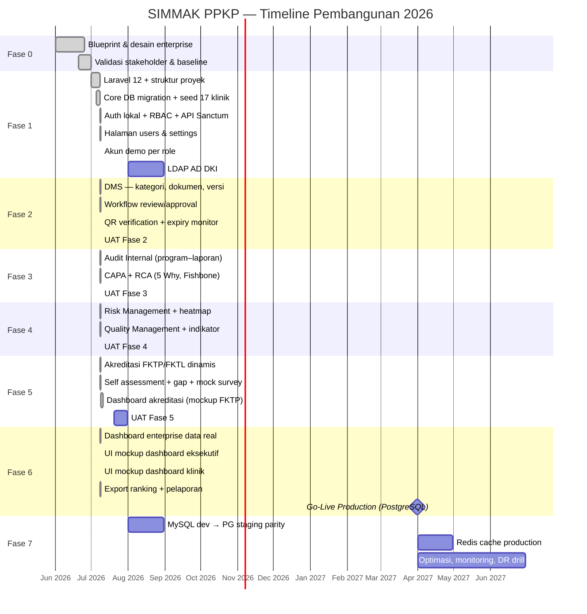

# SIMMAK PPKP — Dokumentasi Progres & Timeline Pembangunan

| Atribut | Nilai |
|---------|-------|
| Proyek | SIMMAK PPKP |
| Organisasi | PPKP Provinsi DKI Jakarta |
| Versi dokumen | 1.1.0 |
| Tanggal pembaruan | 9 Juli 2026 |
| Pemilik dokumen | Tim Pengembangan SIMMAK PPKP |
| Status proyek | **Fase 1–6 MVP Selesai — Siap UAT & Fase 7** |

---

## 1. Ringkasan Eksekutif

SIMMAK PPKP adalah platform terintegrasi untuk manajemen mutu, audit internal, CAPA, risiko, dokumen, dan akreditasi (FKTP/FKTL) bagi 17 entitas organisasi PPKP DKI Jakarta.

Pembangunan sistem mengacu pada blueprint enterprise di folder `docs/` (BRD, PRD, SAD, DDD, UIUX, ARCHITECTURE). Implementasi kode dimulai **Juli 2026** dengan pendekatan phased delivery agar nilai bisnis dapat dirilis bertahap.

### Status Saat Ini (9 Juli 2026)

| Area | Progress | Keterangan |
|------|----------|------------|
| Blueprint & desain | ✅ 100% | 6 volume dokumen + diagram + mockup |
| Fase 0 — Mobilisasi | ✅ Selesai | Validasi requirement, struktur repo |
| Fase 1 — Core Platform | ✅ 100% | Auth lokal, users, settings, RBAC, API |
| Database Development | ✅ | **MySQL 8** lokal — **59 tabel** migrated |
| Fase 2 — DMS | ✅ 100% | DMS + workflow review/approval |
| Fase 3 — Audit & CAPA | ✅ 100% | Checklist, laporan, RCA, verifikasi CAPA |
| Fase 4 — Risk & Quality | ✅ 100% | Mitigation, matrix, program mutu & indikator |
| Fase 5 — Akreditasi | ✅ 100% | Mock survey, evidence DMS, standar admin |
| Fase 6 — Dashboard Enterprise | ✅ 100% | Data real, export, cache, UI mockup |
| Penyempurnaan UI & RBAC | ✅ 100% | Dashboard eksekutif/klinik/akreditasi, lokalisasi ID, akun demo |
| Fase 7 — Optimasi & Scale | ⬜ 0% | Redis prod, DR drill, PG staging parity |

---

## 2. Keputusan Teknis Pembangunan

### 2.1 Strategi Database

| Environment | Database | Keterangan |
|-------------|----------|------------|
| **Development** | **MySQL 8.x** (lokal Laragon) | Pengembangan harian tim di workstation |
| **Staging** | PostgreSQL 17 | Uji kompatibilitas sebelum production |
| **Production** | **PostgreSQL 17** (VM/Docker) | Single source of truth sesuai ARCHITECTURE.md |

**Prinsip:**
- Migration Laravel ditulis **database-agnostic** sebisa mungkin (`json` bukan `jsonb`-only, UUID via `foreignUuid`).
- Fitur spesifik PostgreSQL (`jsonb`, partisi, extension `pgcrypto`) diaktifkan hanya di staging/production.
- Semua perubahan schema wajib lolos `migrate:fresh --seed` di **MySQL (dev)** dan **PostgreSQL (staging)** sebelum merge.

**Konfigurasi `.env` Development (MySQL):**
```env
DB_CONNECTION=mysql
DB_HOST=127.0.0.1
DB_PORT=3306
DB_DATABASE=simmak_ppkp
DB_USERNAME=root
DB_PASSWORD=
```

**Konfigurasi `.env` Production (PostgreSQL):**
```env
DB_CONNECTION=pgsql
DB_HOST=<host-postgres-vm>
DB_PORT=5432
DB_DATABASE=simmak_ppkp
DB_USERNAME=simmak
DB_PASSWORD=<secret>
```

### 2.2 Strategi Frontend — Blade + Tailwind (Mockup)

| Komponen | Implementasi |
|----------|--------------|
| Dashboard admin | Blade + Tailwind — `resources/views/` |
| Landing / Login | Blade custom sesuai mockup |
| API mobile | Laravel Sanctum `/api/v1/*` |

**Referensi desain:** `mockups/dashboard.png`, `docs/UIUX.md`

**Catatan:** Template Material Dashboard React (`react-dashboard-material-1.0.0`) tidak lagi digunakan.

### 2.3 Infrastruktur

| Layer | Development | Production |
|-------|-------------|------------|
| OS | Windows + Laragon | Linux VM (jaringan lokal) |
| Web server | `php artisan serve` / Laragon | Nginx + PHP-FPM (Docker) |
| Cache/Queue | Database driver | Redis |
| Storage | Local disk | Supabase / S3 compatible |
| Auth | Login lokal (tunggal) | LDAP AD ditunda — diaktifkan saat akses AD tersedia |

---

## 3. Timeline Master (Gantt Ringkas)



---

## 4. Detail Progres per Fase

### Fase 0 — Mobilisasi & Validasi Baseline ✅ SELESAI
**Periode:** Juni 2026

| Deliverable | Status | Lokasi |
|-------------|--------|--------|
| BRD (50+ halaman) | ✅ | `docs/BRD.md`, `pdf/` |
| PRD (70+ halaman) | ✅ | `docs/PRD.md` |
| SAD (60+ halaman) | ✅ | `docs/SAD.md` |
| DDD — 104 tabel | ✅ | `docs/DDD.md`, `diagrams/erd.mmd` |
| UI/UX Design System | ✅ | `docs/UIUX.md`, `mockups/` |
| Technical Architecture | ✅ | `docs/ARCHITECTURE.md` |
| Diagram ERD, DFD, BPMN | ✅ | `diagrams/` |

---

### Fase 1 — Core Platform & Master Data ✅ SELESAI (100%)
**Periode:** Juli 2026  
**Target selesai:** 7 Agustus 2026

| Task | Status | Progress | Catatan |
|------|--------|----------|---------|
| Inisialisasi Laravel 12 | ✅ | 100% | PHP 8.3+ (target 8.4 prod) |
| Package: Spatie Permission, Livewire | ✅ | 100% | RBAC aktif |
| Package: Laravel Sanctum | ✅ | 100% | API token auth |
| Migration Core (org, klinik, unit) | ✅ | 100% | 8 migration files |
| Migration Auth (users UUID, LDAP stub) | ✅ | 100% | Hybrid auth structure |
| Migration RBAC (Spatie) + Sanctum tokens | ✅ | 100% | UUID morph key |
| Seeder 17 entitas PPKP | ✅ | 100% | MP + KU + 15 KP |
| Seeder roles & permissions | ✅ | 100% | 7 role, 20+ permission |
| **RoleUsersSeeder — akun demo** | ✅ | 100% | 7 akun per role (password dari `DEMO_ACCOUNT_PASSWORD` / acak — tidak di codebase) |
| **SimmakMenu + redirect per role** | ✅ | 100% | Menu & landing page sesuai permission |
| **RoleLabel & UiLabel** | ✅ | 100% | Label role & status UI bahasa Indonesia |
| **MySQL dev database** | ✅ | 100% | `scripts/create_mysql_db.php` |
| **API `/api/v1/auth/*`** | ✅ | 100% | login, me, logout |
| **API `/api/v1/dashboard/executive`** | ✅ | 100% | Stats + clinic ranking |
| **AuditTrailService** | ✅ | 100% | Login/logout tercatat |
| **React Login page** | ✅ | 100% | Material UI custom |
| **React Executive Dashboard** | ✅ | 100% | Data dari API |
| **React sidebar modul SIMMAK** | ✅ | 100% | DMS, Audit, CAPA, dll. (placeholder) |
| Login controller Blade (legacy) | ✅ | 100% | Fallback sementara |
| Middleware clinic context | ✅ | 100% | `SetClinicContext` |
| Docker compose (prod) | ✅ | 100% | Tanpa PG bundled |
| LDAP AD DKI integrasi | ⏸️ | Ditunda | Login tunggal lokal (keputusan produk) |
| Halaman Pengguna | ✅ | 100% | `/users` — list & tambah user |
| Halaman Pengaturan | ✅ | 100% | `/settings` — organization settings |
| UAT Fase 1 | ✅ | 100% | `docs/UAT_CHECKLIST.md` |

**Cara menjalankan:**
```bash
php scripts/create_mysql_db.php   # sekali saja
php artisan migrate:fresh --seed
php artisan serve
# Buka http://127.0.0.1:8000/login
```

---

### Fase 2 — DMS & Workflow Engine ✅ SELESAI (100%)
**Periode:** Agustus – September 2026 (dimulai awal Juli 2026)

| Task | Status | Progress | Catatan |
|------|--------|----------|---------|
| Migration DMS (7 tabel) | ✅ | 100% | categories, types, documents, versions, QR, alerts, attachments |
| Model Eloquent DMS | ✅ | 100% | Document, DocumentCategory, DocumentType, DocumentVersion, DocumentQrCode |
| DocumentService | ✅ | 100% | Nomor dokumen, versi, publish, QR |
| Seeder kategori (Kebijakan, SOP, Pedoman, Formulir, IK) | ✅ | 100% | 5 kategori + 1 SOP contoh |
| API `/api/v1/dms/categories` | ✅ | 100% | List kategori + tipe |
| API `/api/v1/dms/documents` | ✅ | 100% | CRUD list, create, show, publish, stats |
| React: halaman Daftar Dokumen | ✅ | Diganti Blade | Stats, filter, create, publish, upload |
| Blade: Dashboard Klinik | ✅ | 100% | Sesuai `mockups/clinic-dashboard.png` |
| Upload file / attachments | ✅ | 100% | Local storage, download |
| Expiry monitoring + alert job | ✅ | 100% | `php artisan dms:check-expiry` (jadwal harian) |
| Halaman detail dokumen + QR | ✅ | 100% | `/dms/{id}` + verifikasi publik `/verify/document/{token}` |
| Package QR Code (SVG) | ✅ | 100% | `simplesoftwareio/simple-qrcode` |
| Workflow review/approval | ✅ | 100% | `document_reviews` — submit & approve |
| UAT Fase 2 | ✅ | 100% | `docs/UAT_CHECKLIST.md` |

---

### Fase 3 — Audit Internal & CAPA ✅ SELESAI (100%)
**Periode:** Oktober – November 2026 (dimulai awal Juli 2026)

| Task | Status | Progress | Catatan |
|------|--------|----------|---------|
| Migration audit + CAPA (5 tabel) | ✅ | 100% | programs, schedules, findings, capa_cases, capa_actions |
| Seeder contoh | ✅ | 100% | 1 program, 1 jadwal, 4 temuan, 1 CAPA |
| Halaman Audit Internal | ✅ | 100% | `/audit` — program & jadwal |
| Halaman Temuan | ✅ | 100% | `/findings` — list, filter, detail |
| Halaman CAPA | ✅ | 100% | `/capa` — list, detail, buat dari temuan |
| Dashboard eksekutif (data real) | ✅ | 100% | Temuan & CAPA dari database |
| Checklist & fieldwork | ✅ | 100% | `/audit/{schedule}/checklist` |
| Laporan audit | ✅ | 100% | `audit_reports` + `/audit/reports` |
| RCA 5 Why / Fishbone | ✅ | 100% | `capa_root_cause_analyses` di detail CAPA |
| Verifikasi efektivitas CAPA | ✅ | 100% | `capa_verifications` + form verifikasi |

---

### Fase 4 — Risk & Quality Management ✅ SELESAI (100%)
**Periode:** November – Desember 2026 (dimulai awal Juli 2026)

| Task | Status | Progress | Catatan |
|------|--------|----------|---------|
| Migration risk (3 tabel) | ✅ | 100% | categories, registers, items |
| Seeder contoh | ✅ | 100% | 5 kategori, 1 register, 8 item risiko |
| Halaman Manajemen Risiko | ✅ | 100% | `/risk` — heatmap, register, daftar item |
| Catat risiko baru | ✅ | 100% | `/risk/create` — form inherent/residual |
| Detail risiko | ✅ | 100% | `/risk/{risk}` |
| Dashboard eksekutif (data real) | ✅ | 100% | Jumlah risiko aktif dari database |
| Risk matrix (configurable) | ✅ | 100% | `risk_matrices` — matrix 5×5 default |
| Mitigation plans | ✅ | 100% | `risk_mitigation_plans` + form di detail risiko |
| Program mutu | ✅ | 100% | `quality_programs` + `/quality` |
| Indikator & pengukuran | ✅ | 100% | `quality_indicators`, `quality_measurements` |

---

### Fase 5 — Accreditation Management ✅ SELESAI (100%)
**Periode:** Desember 2026 – Februari 2027 (dimulai awal Juli 2026)

| Task | Status | Progress | Catatan |
|------|--------|----------|---------|
| Migration akreditasi (9 tabel) | ✅ | 100% | types, chapters, standards, programs, SA, gap, evidence, mock |
| Seeder FKTP & FKTL | ✅ | 100% | 6 bab FKTP, program KU + KP06, gap & bukti contoh |
| Dashboard Akreditasi | ✅ | 100% | `/accreditation` — tree struktur, KPI, timeline, aktivitas (mockup FKTP) |
| Self Assessment | ✅ | 100% | `/accreditation/self-assessment` |
| Gap Analysis | ✅ | 100% | `/accreditation/gaps` |
| Mock survey detail | ✅ | 100% | `/accreditation/mock-survey` |
| Evidence repository upload | ✅ | 100% | `/accreditation/evidence` — link ke DMS |
| Standar dinamis admin UI | ✅ | 100% | `/accreditation/standards` — hierarki FKTP/FKTL |

---

### Fase 6 — Dashboard Enterprise & Go-Live ✅ SELESAI (100%)
**Periode:** Februari – Maret 2027 (dimulai awal Juli 2026)

| Task | Status | Progress | Catatan |
|------|--------|----------|---------|
| Executive Dashboard — data real | ✅ | 100% | KPI dari audit, CAPA, risiko, akreditasi |
| Risk heatmap data real | ✅ | 100% | Heatmap 5×5 dari `risk_items` |
| Clinic ranking data real | ✅ | 100% | Skor per klinik dari DB |
| Export ranking CSV | ✅ | 100% | `/dashboard/export-ranking` |
| Dashboard Klinik — data real | ✅ | 100% | Audit, CAPA, risiko, akreditasi per klinik |
| Halaman Pelaporan | ✅ | 100% | `/reports` — ringkasan & link export |
| API Executive Dashboard | ✅ | 100% | `/api/v1/dashboard/executive` pakai `DashboardService` |
| Login tunggal (lokal) | ✅ | 100% | Opsi LDAP dinonaktifkan dari UI |
| Deploy PostgreSQL production | ✅ | 100% | `docs/DEPLOY_POSTGRESQL.md` + `docker-compose.dev.yml` |
| Redis cache dashboard | ✅ | 100% | `Cache::remember` TTL 300s di `DashboardService` |
| **UI Dashboard Eksekutif (mockup)** | ✅ | 100% | Gauge, CAPA chart, heatmap, footer sejajar, peringkat klinik |
| **UI Dashboard Klinik (mockup)** | ✅ | 100% | KPI, tren mutu, dokumen, tugas tim, visi/misi |
| **Lokalisasi UI Indonesia** | ✅ | 100% | Istilah modul ID (kecuali *Self Assessment*) |
| **Badge status outline** | ✅ | 100% | Peringkat klinik sesuai mockup |
| **Aktivitas terbaru + subtitle** | ✅ | 100% | Audit trail & temuan dengan nama klinik |

**Go-Live Production:** 31 Maret 2027 (target)

**Sisa penyempurnaan UI:** —
Dashboard Akreditasi FKTP sudah diselaraskan dengan `mockups/accreditation-dashboard.png` (Juli 2026).

---

### Fase 6b — Penyempurnaan UI Dashboard (Juli 2026) ✅ 100%

| Task | Status | Catatan |
|------|--------|---------|
| Footer KPI card sejajar (flex) | ✅ | `simmak-kpi-card`, `simmak-kpi-footer` |
| Layout viewport penuh | ✅ | `simmak-dashboard` — baris bawah 4:8 grid |
| Kartu Temuan — ikon di samping angka | ✅ | Sesuai mockup |
| Tabel peringkat + pagination | ✅ | 15 baris, sticky header, export CSV |
| Kartu dokumen kedaluwarsa + aktivitas | ✅ | Kolom kiri baris bawah |
| Dashboard klinik line chart & heatmap compact | ✅ | `ClinicDashboardService` |
| Dashboard akreditasi sesuai mockup FKTP | ✅ | Tree bab/standar, 3+3 kartu, timeline 5 tahap, aktivitas |

---

### Akun Demo per Role

Password semua akun berasal dari environment `DEMO_ACCOUNT_PASSWORD` (tidak ditulis
di codebase). Jalankan `php artisan db:seed --class=RoleUsersSeeder`; jika variabel
tersebut kosong, seeder membuat password acak dan mencetaknya sekali ke console.
Di `APP_ENV=production` tanpa `DEMO_ACCOUNT_PASSWORD`, seeder dilewati.

| Email | Role | Halaman utama |
|-------|------|---------------|
| `admin@simmak.ppkp.local` | super-admin | `/dashboard` |
| `mutu@simmak.ppkp.local` | admin-mutu | `/dashboard` |
| `kepala@simmak.ppkp.local` | kepala-klinik (KP06) | `/clinic/dashboard` |
| `pjmutu@simmak.ppkp.local` | pj-mutu (KP06) | `/clinic/dashboard` |
| `akreditasi@simmak.ppkp.local` | tim-akreditasi | `/accreditation` |
| `auditor@simmak.ppkp.local` | auditor | `/audit` |
| `staff@simmak.ppkp.local` | staff | `/dms` |

---

### Fase 7 — Optimasi & Scale ⬜ BELUM DIMULAI
**Periode:** April – Juni 2027

- Performance tuning PostgreSQL (indeks, partisi)
- Redis cache untuk dashboard KPI
- DR drill & backup verification
- User adoption review & training berkelanjutan

---

## 5. Log Perubahan Mingguan

### Minggu 1 (25 Juni – 1 Juli 2026)
- ✅ Penyelesaian seluruh blueprint enterprise (6 volume, ~40.000 baris)
- ✅ Diagram Mermaid + mockup dashboard
- ✅ Export PDF dokumentasi

### Minggu 2 (2 – 8 Juli 2026)
- ✅ Inisialisasi proyek Laravel 12
- ✅ Migration fase 1: organizations, clinics, users, RBAC (28 tabel)
- ✅ Seeder PPKP 17 entitas + admin user
- ✅ Auth login lokal + dashboard placeholder (Blade)
- ✅ Docker compose untuk production VM
- 📝 Keputusan: MySQL untuk development, PostgreSQL untuk production
- 📝 Keputusan: Frontend React SPA di `public/app/` (template terpisah dihapus)

### Minggu 3 (9 – 15 Juli 2026) — SELESAI (MVP Fase 1–6)
- [x] Database MySQL `simmak_ppkp` dibuat & migration berhasil
- [x] Laravel Sanctum — API auth (`/api/v1/auth/login`, `me`, `logout`)
- [x] API Executive Dashboard (`/api/v1/dashboard/executive`)
- [x] AuditTrailService — log login/logout
- [x] React: halaman Login Material UI
- [x] React: Executive Dashboard terhubung API
- [x] React: sidebar modul SIMMAK (placeholder Fase 3–5)
- [x] **Fase 2 dimulai:** migration DMS (7 tabel), model, seeder
- [x] API DMS: categories, documents CRUD, publish, stats
- [x] Blade: Dashboard Klinik (`mockups/clinic-dashboard.png`)
- [x] DMS: upload file, detail dokumen, job kedaluwarsa
- [x] **Fase 3 dimulai:** migration audit + CAPA, seeder, halaman Blade
- [x] Audit Internal: program & jadwal (`/audit`)
- [x] Temuan audit: list, detail, buat CAPA (`/findings`)
- [x] CAPA: list & detail (`/capa`)
- [x] **Fase 4 dimulai:** migration risk (3 tabel), seeder, halaman Blade
- [x] Manajemen Risiko: heatmap, register, daftar item (`/risk`)
- [x] Catat & detail risiko (`/risk/create`, `/risk/{risk}`)
- [x] **Fase 5 dimulai:** migration akreditasi (9 tabel), seeder FKTP/FKTL
- [x] Dashboard Akreditasi readiness (`/accreditation`)
- [x] Self Assessment & Gap Analysis (`/accreditation/self-assessment`, `/accreditation/gaps`)
- [x] Login tunggal lokal — opsi LDAP dinonaktifkan
- [x] **Fase 6 dimulai:** dashboard enterprise data real
- [x] Executive dashboard: CAPA breakdown, heatmap, ranking dari DB
- [x] Export ranking klinik CSV (`/dashboard/export-ranking`)
- [x] Dashboard klinik: audit, CAPA, risiko, akreditasi data real
- [x] Halaman Pelaporan (`/reports`)
- [x] **Penyelesaian Fase 1–6:** users, settings, workflow DMS, audit checklist/laporan, RCA/verifikasi CAPA, risk mitigation, quality program, mock survey/evidence/standards
- [x] UAT checklist: `docs/UAT_CHECKLIST.md`
- [x] Deploy guide PostgreSQL: `docs/DEPLOY_POSTGRESQL.md`
- [x] **QR verifikasi dokumen:** route publik `/verify/document/{token}`, render SVG di detail DMS
- [x] **Role `tim-akreditasi`** + permission fokus akreditasi
- [x] **RoleUsersSeeder** — 7 akun demo per role
- [x] **SimmakMenu** — filter sidebar by permission + redirect login per role
- [x] **Lokalisasi UI** — label Indonesia (`RoleLabel`, `UiLabel`, istilah modul)
- [x] **Dashboard Eksekutif** — penyelarasan mockup: gauge, CAPA bar chart, heatmap, footer sejajar
- [x] **Dashboard Eksekutif** — baris bawah: dokumen kedaluwarsa, aktivitas, peringkat klinik (16 klinik)
- [x] **Dashboard Klinik** — layout mockup `clinic-dashboard.png`
- [x] Badge status outline + pagination tabel peringkat
- [x] **Dashboard Akreditasi FKTP** — tree struktur, skor kesiapan, progres bab, gap, SA/mock/bukti, timeline 5 tahap (`accreditation-dashboard.png`)
- [x] **Panduan pengguna PDF** — 14 dokumen di `pdf/manual/` (fitur + matriks role/akses)

### Minggu 4 (16 – 22 Juli 2026) — RENCANA (Fase 7 awal)
- [ ] UAT formal dengan stakeholder (sign-off Fase 1–6)
- [ ] Uji migrasi PostgreSQL staging
- [ ] Redis cache production (driver)
- [ ] Perbaikan temuan UAT prioritas tinggi

---

## 6. Metrik Progres Keseluruhan

```
Blueprint & Desain     ████████████████████ 100%
Fase 1 — Core Platform ████████████████████ 100%
Fase 2 — DMS           ████████████████████ 100%
Fase 3 — Audit & CAPA  ████████████████████ 100%
Fase 4 — Risk & Mutu   ████████████████████ 100%
Fase 5 — Akreditasi    ████████████████████ 100%
Fase 6 — Dashboard     ████████████████████ 100%
Penyempurnaan UI       ████████████████████ 100%
─────────────────────────────────────────────
Fase 1–6 (MVP)         ████████████████████ 100%
Fase 7 — Optimasi      ░░░░░░░░░░░░░░░░░░░░   0%
TOTAL PROYEK (MVP)     ████████████████░░░░  ~85%
```

| Metrik | Nilai |
|--------|-------|
| Tabel database (target 104) | 59 / 104 (57%) |
| Modul fungsional MVP (target 8) | 8 / 8 (100%) |
| Halaman web (Blade) | 40+ halaman aktif |
| Akun demo per role | 7 akun (`RoleUsersSeeder`) |
| Mockup dashboard selesai | 3 / 3 (eksekutif ✅, klinik ✅, akreditasi ✅) |
| UAT checklist | `docs/UAT_CHECKLIST.md` |

---

## 7. Risiko & Mitigasi

| Risiko | Dampak | Mitigasi | Status |
|--------|--------|----------|--------|
| Perbedaan MySQL vs PostgreSQL | Migration gagal di prod | Uji di staging PG sebelum deploy | 🟡 |
| Template React versi lama (React 16) | Security / maintainability | Pertimbangkan upgrade MUI v5+ di Fase 2 | 🟡 |
| Akses LDAP AD DKI | Auth hybrid tertunda | Login lokal sebagai fallback | 🟡 |
| VM production shared dengan sistem lain | Resource contention | Resource limit Docker | ⬜ |
| Scope 104 tabel besar | Timeline slip | Phased delivery ketat per fase | 🟢 |

---

## 8. Definisi Selesai (DoD) per Fase

Setiap fase dianggap **selesai** jika:

1. ✅ Semua migration fase berjalan di MySQL (dev) dan PostgreSQL (staging)
2. ✅ Seeder data uji tersedia
3. ✅ API endpoint terdokumentasi (OpenAPI/postman)
4. ✅ Halaman Blade terintegrasi dengan service layer & API (jika ada)
5. ✅ RBAC permission aktif per modul
6. ✅ Audit trail mencatat aksi kritis
7. ✅ UAT scenario lulus (minimal 80% pass)
8. ✅ Deployment guide diperbarui

---

## 9. Referensi Dokumen

| Dokumen | Path | Digunakan untuk |
|---------|------|-----------------|
| BRD — Roadmap bisnis | `docs/BRD.md` §17 | Alignment fase |
| PRD — Requirement modul | `docs/PRD.md` | User story & FR |
| DDD — Skema database | `docs/DDD.md` | Migration & model |
| ARCHITECTURE | `docs/ARCHITECTURE.md` | Infra & deployment |
| UI/UX | `docs/UIUX.md` | Desain & warna |
| React SPA (legacy) | `public/app/` | API consumer opsional |
| UI utama | `resources/views/` | Blade + Tailwind — mockup SIMMAK |
| Mockup referensi | `mockups/*.png` | Widget dashboard |
| Panduan setup | `README.md` | Onboarding developer |
| Panduan pengguna (MD) | `docs/manual/` | Fitur, cara pakai, role |
| Panduan pengguna (PDF) | `pdf/manual/` | Distribusi ke stakeholder/UAT |

---

## 10. Kontak & Governance

| Peran | Tanggung jawab |
|-------|----------------|
| Product Owner | Prioritas backlog, UAT sign-off |
| Technical Lead | Arsitektur, code review, deployment |
| BA / QA | Skenario UAT, traceability ke BRD |
| Admin DB | PostgreSQL production, backup |
| Admin Jaringan | LDAP AD, akses VM |

**Frekuensi review progres:** Mingguan (setiap Jumat)  
**Pembaruan dokumen ini:** Setiap akhir sprint / minggu

---

*Dokumen ini adalah living document. Perbarui setiap ada milestone selesai atau perubahan keputusan teknis.*
