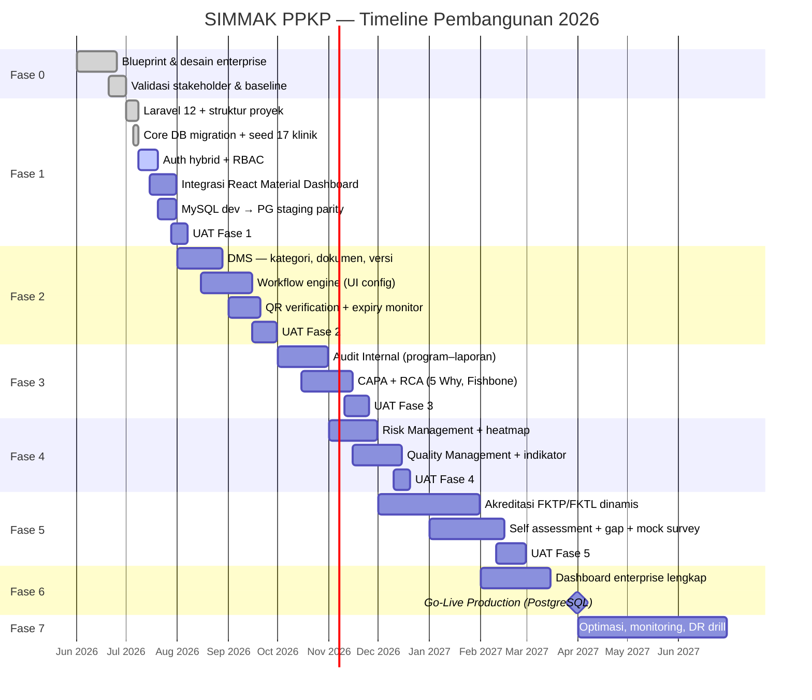

# SIMMAK PPKP — Dokumentasi Progres & Timeline Pembangunan

| Atribut | Nilai |
|---------|-------|
| Proyek | SIMMAK PPKP |
| Organisasi | PPKP Provinsi DKI Jakarta |
| Versi dokumen | 1.0.0 |
| Tanggal pembaruan | 9 Juli 2026 |
| Pemilik dokumen | Tim Pengembangan SIMMAK PPKP |
| Status proyek | **Development — Fase 1 (Core Platform)** |

---

## 1. Ringkasan Eksekutif

SIMMAK PPKP adalah platform terintegrasi untuk manajemen mutu, audit internal, CAPA, risiko, dokumen, dan akreditasi (FKTP/FKTL) bagi 17 entitas organisasi PPKP DKI Jakarta.

Pembangunan sistem mengacu pada blueprint enterprise di folder `docs/` (BRD, PRD, SAD, DDD, UIUX, ARCHITECTURE). Implementasi kode dimulai **Juli 2026** dengan pendekatan phased delivery agar nilai bisnis dapat dirilis bertahap.

### Status Saat Ini (8 Juli 2026)

| Area | Progress | Keterangan |
|------|----------|------------|
| Blueprint & desain | ✅ 100% | 6 volume dokumen + diagram + mockup |
| Fase 0 — Mobilisasi | ✅ Selesai | Validasi requirement, struktur repo |
| Fase 1 — Core Platform | 🟡 ~85% | Laravel 12, API Sanctum, React login + dashboard |
| Frontend React (Material) | 🟡 ~70% | Login, auth, executive dashboard terhubung API |
| Database Development | ✅ | **MySQL 8** lokal (`simmak_ppkp`) — migration & seed OK |
| Database Production | ⬜ Belum deploy | **PostgreSQL 17** di VM/Docker |
| Modul bisnis (DMS–Mutu) | ⬜ 0% | Fase 2–6 |

---

## 2. Keputusan Teknis Pembangunan

### 2.1 Strategi Database

| Environment | Database | Keterangan |
|-------------|----------|------------|
| **Development** | **MySQL 8.x** (lokal Laragon) | Pengembangan harian tim di workstation |
| **Staging** | PostgreSQL 17 | Uji kompatibilitas sebelum production |
| **Production** | **PostgreSQL 17** (VM/Docker) | Single source of truth sesuai ARCHITECTURE.md |

**Prinsip:**
- Migration Laravel ditulis **database-agnostic** sebisa mungkin (`json` bukan `jsonb`-only, UUID via `foreignUuid`).
- Fitur spesifik PostgreSQL (`jsonb`, partisi, extension `pgcrypto`) diaktifkan hanya di staging/production.
- Semua perubahan schema wajib lolos `migrate:fresh --seed` di **MySQL (dev)** dan **PostgreSQL (staging)** sebelum merge.

**Konfigurasi `.env` Development (MySQL):**
```env
DB_CONNECTION=mysql
DB_HOST=127.0.0.1
DB_PORT=3306
DB_DATABASE=simmak_ppkp
DB_USERNAME=root
DB_PASSWORD=
```

**Konfigurasi `.env` Production (PostgreSQL):**
```env
DB_CONNECTION=pgsql
DB_HOST=<host-postgres-vm>
DB_PORT=5432
DB_DATABASE=simmak_ppkp
DB_USERNAME=simmak
DB_PASSWORD=<secret>
```

### 2.2 Strategi Frontend — React Material Dashboard

| Komponen | Template | Lokasi |
|----------|----------|--------|
| Dashboard admin | **react-dashboard-material-1.0.0** | `react-dashboard-material-1.0.0/` |
| Landing / Login | Turunan Material Dashboard + custom SIMMAK branding | Akan dibuat Fase 1b |
| API Backend | Laravel 12 REST + Sanctum | `app/`, `routes/api.php` |

**Template:** Creative Tim Material Dashboard React v1.9.0  
**Stack template:** React 16, Material-UI v4, React Router v5, Chartist

**Arsitektur frontend target:**
```
┌─────────────────────────────────────────────────────────┐
│  React SPA (Material Dashboard)                         │
│  ├── /login          → Halaman landing & autentikasi    │
│  ├── /admin/dashboard → Executive Dashboard             │
│  ├── /admin/clinic    → Dashboard Klinik                │
│  ├── /admin/accreditation → Dashboard Akreditasi        │
│  └── /admin/{modul}  → DMS, Audit, CAPA, dll.         │
└──────────────────────┬──────────────────────────────────┘
                       │ REST API (JSON) + Sanctum token
┌──────────────────────▼──────────────────────────────────┐
│  Laravel 12 API + Business Logic                        │
│  PostgreSQL (prod) / MySQL (dev)                        │
└─────────────────────────────────────────────────────────┘
```

**Catatan:** Template asli tidak menyertakan halaman login — halaman landing/login akan dibuat dengan komponen Material-UI yang sama (`CustomInput`, `Button`, layout card) agar konsisten visual dengan dashboard.

**Fase integrasi React:** 1b (paralel penyelesaian Fase 1, target akhir Juli 2026)

### 2.3 Infrastruktur

| Layer | Development | Production |
|-------|-------------|------------|
| OS | Windows + Laragon | Linux VM (jaringan lokal) |
| Web server | `php artisan serve` / Laragon | Nginx + PHP-FPM (Docker) |
| Cache/Queue | Database driver | Redis |
| Storage | Local disk | Supabase / S3 compatible |
| Auth | Local + LDAP (stub) | LDAP AD Pemprov DKI Jakarta |

---

## 3. Timeline Master (Gantt Ringkas)



---

## 4. Detail Progres per Fase

### Fase 0 — Mobilisasi & Validasi Baseline ✅ SELESAI
**Periode:** Juni 2026

| Deliverable | Status | Lokasi |
|-------------|--------|--------|
| BRD (50+ halaman) | ✅ | `docs/BRD.md`, `pdf/` |
| PRD (70+ halaman) | ✅ | `docs/PRD.md` |
| SAD (60+ halaman) | ✅ | `docs/SAD.md` |
| DDD — 104 tabel | ✅ | `docs/DDD.md`, `diagrams/erd.mmd` |
| UI/UX Design System | ✅ | `docs/UIUX.md`, `mockups/` |
| Technical Architecture | ✅ | `docs/ARCHITECTURE.md` |
| Diagram ERD, DFD, BPMN | ✅ | `diagrams/` |

---

### Fase 1 — Core Platform & Master Data 🟡 BERJALAN (~85%)
**Periode:** Juli 2026  
**Target selesai:** 7 Agustus 2026

| Task | Status | Progress | Catatan |
|------|--------|----------|---------|
| Inisialisasi Laravel 12 | ✅ | 100% | PHP 8.3+ (target 8.4 prod) |
| Package: Spatie Permission, Livewire | ✅ | 100% | RBAC aktif |
| Package: Laravel Sanctum | ✅ | 100% | API token auth |
| Migration Core (org, klinik, unit) | ✅ | 100% | 8 migration files |
| Migration Auth (users UUID, LDAP stub) | ✅ | 100% | Hybrid auth structure |
| Migration RBAC (Spatie) + Sanctum tokens | ✅ | 100% | UUID morph key |
| Seeder 17 entitas PPKP | ✅ | 100% | MP + KU + 15 KP |
| Seeder roles & permissions | ✅ | 100% | 6 role, 20+ permission |
| **MySQL dev database** | ✅ | 100% | `scripts/create_mysql_db.php` |
| **API `/api/v1/auth/*`** | ✅ | 100% | login, me, logout |
| **API `/api/v1/dashboard/executive`** | ✅ | 100% | Stats + clinic ranking |
| **AuditTrailService** | ✅ | 100% | Login/logout tercatat |
| **React Login page** | ✅ | 100% | Material UI custom |
| **React Executive Dashboard** | ✅ | 100% | Data dari API |
| **React sidebar modul SIMMAK** | ✅ | 100% | DMS, Audit, CAPA, dll. (placeholder) |
| Login controller Blade (legacy) | ✅ | 100% | Fallback sementara |
| Middleware clinic context | ✅ | 100% | `SetClinicContext` |
| Docker compose (prod) | ✅ | 100% | Tanpa PG bundled |
| LDAP AD DKI integrasi | ⬜ | 0% | Butuh akses jaringan AD |
| UAT Fase 1 | ⬜ | 0% | Target awal Agustus |

**Cara menjalankan (Fase 1b):**
```bash
# Terminal 1 — API Backend
php scripts/create_mysql_db.php   # sekali saja
php artisan migrate:fresh --seed
php artisan serve

# Terminal 2 — React Dashboard
cd react-dashboard-material-1.0.0
npm install
npm start
# Buka http://localhost:3000/login
```

---

### Fase 2 — DMS & Workflow Engine ⬜ BELUM DIMULAI
**Periode:** Agustus – September 2026

| Task | Estimasi | Tabel DDD |
|------|----------|-----------|
| Kategori & tipe dokumen | 1 minggu | `document_categories`, `document_types` |
| CRUD dokumen + versi | 2 minggu | `documents`, `document_versions` |
| Review / approval / publish | 2 minggu | `document_reviews`, `document_approvals` |
| Workflow engine (UI config) | 3 minggu | `workflow_definitions`, `workflow_steps`, ... |
| QR verification | 1 minggu | `document_qr_codes` |
| Expiry monitoring + alert | 1 minggu | `document_expiry_alerts` |
| Storage integration (S3) | 1 minggu | `attachments` |
| UI React: modul DMS | 2 minggu | Sidebar route + pages |

---

### Fase 3 — Audit Internal & CAPA ⬜ BELUM DIMULAI
**Periode:** Oktober – November 2026

| Modul | Tabel utama | Estimasi |
|-------|-------------|----------|
| Program & jadwal audit | `audit_programs`, `audit_schedules` | 3 minggu |
| Checklist & fieldwork | `audit_checklist_items`, `audit_checklist_responses` | 2 minggu |
| Temuan & laporan | `audit_findings`, `audit_reports` | 2 minggu |
| CAPA case management | `capa_cases` | 2 minggu |
| RCA — 5 Why, Fishbone | `capa_five_whys`, `capa_fishbone_diagrams` | 2 minggu |
| Verifikasi & efektivitas | `capa_verifications`, `capa_effectiveness_reviews` | 2 minggu |

---

### Fase 4 — Risk & Quality Management ⬜ BELUM DIMULAI
**Periode:** November – Desember 2026

| Modul | Deliverable kunci |
|-------|-------------------|
| Risk register & assessment | Risk heatmap dashboard |
| Risk matrix (configurable) | Matrix UI admin |
| Program mutu | `quality_programs` |
| Indikator & pengukuran | `quality_indicators`, `quality_measurements` |
| Evaluasi mutu | `quality_evaluations` |

---

### Fase 5 — Accreditation Management ⬜ BELUM DIMULAI
**Periode:** Desember 2026 – Februari 2027

| Fitur | Prioritas |
|-------|-----------|
| Standar FKTP/FKTL dinamis (Bab→Standar→Kriteria→Elemen) | Kritis |
| Self assessment | Kritis |
| Gap analysis | Kritis |
| Mock survey | Tinggi |
| Evidence repository | Kritis |
| Readiness dashboard | Tinggi |

---

### Fase 6 — Dashboard Enterprise & Go-Live ⬜ BELUM DIMULAI
**Periode:** Februari – Maret 2027

| Dashboard | Template React |
|-----------|------------------|
| Executive Dashboard | `Dashboard.js` — disesuaikan SIMMAK |
| Dashboard Klinik | Custom page — referensi `mockups/clinic-dashboard.png` |
| Dashboard Akreditasi | Custom page — referensi `mockups/accreditation-dashboard.png` |
| Clinic ranking & export | API + Chartist/Recharts |

**Go-Live Production:** 31 Maret 2027 (target)

---

### Fase 7 — Optimasi & Scale ⬜ BELUM DIMULAI
**Periode:** April – Juni 2027

- Performance tuning PostgreSQL (indeks, partisi)
- Redis cache untuk dashboard KPI
- DR drill & backup verification
- User adoption review & training berkelanjutan

---

## 5. Log Perubahan Mingguan

### Minggu 1 (25 Juni – 1 Juli 2026)
- ✅ Penyelesaian seluruh blueprint enterprise (6 volume, ~40.000 baris)
- ✅ Diagram Mermaid + mockup dashboard
- ✅ Export PDF dokumentasi

### Minggu 2 (2 – 8 Juli 2026)
- ✅ Inisialisasi proyek Laravel 12
- ✅ Migration fase 1: organizations, clinics, users, RBAC (28 tabel)
- ✅ Seeder PPKP 17 entitas + admin user
- ✅ Auth login lokal + dashboard placeholder (Blade)
- ✅ Docker compose untuk production VM
- 📝 Keputusan: MySQL untuk development, PostgreSQL untuk production
- 📝 Keputusan: Frontend menggunakan `react-dashboard-material-1.0.0`

### Minggu 3 (9 – 15 Juli 2026) — BERJALAN
- [x] Database MySQL `simmak_ppkp` dibuat & migration berhasil
- [x] Laravel Sanctum — API auth (`/api/v1/auth/login`, `me`, `logout`)
- [x] API Executive Dashboard (`/api/v1/dashboard/executive`)
- [x] AuditTrailService — log login/logout
- [x] React: halaman Login Material UI
- [x] React: Executive Dashboard terhubung API
- [x] React: sidebar modul SIMMAK (placeholder Fase 2–5)
- [ ] Clinic dashboard React page
- [ ] Accreditation dashboard React page
- [ ] UAT skenario Fase 1

---

## 6. Metrik Progres Keseluruhan

```
Blueprint & Desain     ████████████████████ 100%
Fase 1 — Core Platform █████████████████░░░  85%
Fase 2 — DMS           ░░░░░░░░░░░░░░░░░░░░   0%
Fase 3 — Audit & CAPA  ░░░░░░░░░░░░░░░░░░░░   0%
Fase 4 — Risk & Mutu   ░░░░░░░░░░░░░░░░░░░░   0%
Fase 5 — Akreditasi    ░░░░░░░░░░░░░░░░░░░░   0%
Fase 6 — Dashboard     ████░░░░░░░░░░░░░░░░  20%
Frontend React         ██████████████░░░░░░  70%
─────────────────────────────────────────────
TOTAL PROYEK           ██████░░░░░░░░░░░░░░  ~28%
```

| Metrik | Nilai |
|--------|-------|
| Tabel database (target 104) | 29 / 104 (28%) |
| Modul fungsional (target 8) | 1 / 8 (12.5%) |
| API endpoints (estimasi 200+) | 4 / 200 (2%) |
| Halaman React (estimasi 40+) | 9 (login + dashboard + 7 placeholder) |

---

## 7. Risiko & Mitigasi

| Risiko | Dampak | Mitigasi | Status |
|--------|--------|----------|--------|
| Perbedaan MySQL vs PostgreSQL | Migration gagal di prod | Uji di staging PG sebelum deploy | 🟡 |
| Template React versi lama (React 16) | Security / maintainability | Pertimbangkan upgrade MUI v5+ di Fase 2 | 🟡 |
| Akses LDAP AD DKI | Auth hybrid tertunda | Login lokal sebagai fallback | 🟡 |
| VM production shared dengan sistem lain | Resource contention | Resource limit Docker | ⬜ |
| Scope 104 tabel besar | Timeline slip | Phased delivery ketat per fase | 🟢 |

---

## 8. Definisi Selesai (DoD) per Fase

Setiap fase dianggap **selesai** jika:

1. ✅ Semua migration fase berjalan di MySQL (dev) dan PostgreSQL (staging)
2. ✅ Seeder data uji tersedia
3. ✅ API endpoint terdokumentasi (OpenAPI/postman)
4. ✅ Halaman React terintegrasi dengan API
5. ✅ RBAC permission aktif per modul
6. ✅ Audit trail mencatat aksi kritis
7. ✅ UAT scenario lulus (minimal 80% pass)
8. ✅ Deployment guide diperbarui

---

## 9. Referensi Dokumen

| Dokumen | Path | Digunakan untuk |
|---------|------|-----------------|
| BRD — Roadmap bisnis | `docs/BRD.md` §17 | Alignment fase |
| PRD — Requirement modul | `docs/PRD.md` | User story & FR |
| DDD — Skema database | `docs/DDD.md` | Migration & model |
| ARCHITECTURE | `docs/ARCHITECTURE.md` | Infra & deployment |
| UI/UX | `docs/UIUX.md` | Desain & warna |
| React Template | `react-dashboard-material-1.0.0/` | Dashboard & layout |
| Mockup referensi | `mockups/*.png` | Widget dashboard |
| Panduan setup | `README.md` | Onboarding developer |

---

## 10. Kontak & Governance

| Peran | Tanggung jawab |
|-------|----------------|
| Product Owner | Prioritas backlog, UAT sign-off |
| Technical Lead | Arsitektur, code review, deployment |
| BA / QA | Skenario UAT, traceability ke BRD |
| Admin DB | PostgreSQL production, backup |
| Admin Jaringan | LDAP AD, akses VM |

**Frekuensi review progres:** Mingguan (setiap Jumat)  
**Pembaruan dokumen ini:** Setiap akhir sprint / minggu

---

*Dokumen ini adalah living document. Perbarui setiap ada milestone selesai atau perubahan keputusan teknis.*
