# System Analysis Document (SAD) SIMMAK PPKP

**Sistem Informasi Manajemen Mutu, Audit Internal, Risiko, CAPA, dan Akreditasi PPKP Provinsi DKI Jakarta**

Dokumen ini disusun sebagai SAD enterprise untuk menjelaskan konteks bisnis, batas sistem, aktor, proses, aliran data, integrasi, pengecualian, dan rancangan analitis SIMMAK PPKP.

- Dokumen: System Analysis Document
- Sistem: SIMMAK PPKP
- Organisasi: PPKP Provinsi DKI Jakarta
- Cakupan Organisasi: 17 entitas dengan scoping `organization_id`, `clinic_id`, dan `unit_id`
- Target Pembaca: Manajemen, Tim Mutu, Auditor, Pengembang, Admin Sistem, dan Pemangku Kepentingan Akreditasi
- Bahasa: Indonesia
- Status: Baseline Analisis Enterprise
- Lokasi Diagram Referensi: `/diagrams`

> Catatan: Diagram utama juga dirujuk ke file `/diagrams/architecture.mmd`, `/diagrams/dfd.mmd`, `/diagrams/bpmn.mmd`, dan `/diagrams/erd.mmd`. Diagram Mermaid pada dokumen ini digunakan sebagai paket analisis SAD yang dapat dibaca langsung di Markdown.

---

## 1. Ringkasan Eksekutif
SIMMAK PPKP adalah platform enterprise untuk mendukung tata kelola mutu, audit internal, CAPA, risiko, akreditasi, dashboard, dan fondasi core platform bagi PPKP Provinsi DKI Jakarta.

Sistem dirancang untuk mengonsolidasikan proses mutu dari 17 entitas klinik atau unit layanan dalam satu platform terpusat, tanpa menghilangkan kebutuhan segmentasi akses per organisasi, klinik, dan unit.

Dokumen ini menempatkan SIMMAK PPKP sebagai sistem yang mendukung siklus PDCA: perencanaan mutu, pengendalian dokumen, pelaksanaan audit, koreksi temuan, pemantauan risiko, persiapan akreditasi, pengukuran indikator, dan pelaporan manajemen.

Analisis menekankan traceability antar modul: dokumen menjadi bukti audit dan akreditasi, temuan audit menjadi CAPA, risiko tinggi dapat menjadi CAPA, gap akreditasi dapat menjadi CAPA, dan hasil CAPA kembali memengaruhi risiko serta readiness.

Arsitektur logis mengacu pada aplikasi web Laravel, database PostgreSQL, cache/queue Redis, integrasi LDAP/Active Directory, dan object storage untuk dokumen serta evidence. Detail teknis mengikuti diagram referensi di folder `/diagrams`.

### 1.1 Tujuan SAD
1. Menjelaskan ruang lingkup fungsional dan non-fungsional SIMMAK PPKP.
2. Mendefinisikan batas sistem, aktor, data store, dan aliran data antar proses.
3. Menyediakan diagram konteks, DFD, use case, activity, sequence, dan BPMN untuk modul utama.
4. Menjadi baseline komunikasi antara pemilik proses, analis sistem, arsitek, developer, QA, auditor internal, dan tim implementasi.
5. Mendukung keputusan desain terkait integrasi LDAP, storage, scoping organisasi, workflow, audit trail, dan exception handling.

### 1.2 Ruang Lingkup Modul
- `DMS` - Document Management System: Dokumen terkendali, versi, QR verification, distribusi, dan expiry monitoring.
- `Audit` - Internal Audit: Program audit, jadwal, checklist, temuan, laporan, dan trigger CAPA.
- `CAPA` - Corrective and Preventive Action: RCA, corrective action, preventive action, verification, effectiveness review.
- `Risk` - Risk Management: Risk register, assessment, matrix, mitigation, monitoring, heatmap.
- `Accreditation` - Accreditation Management: Standar dinamis, self assessment, evidence, gap analysis, mock survey, readiness score.
- `Quality` - Quality Management: Program mutu, indikator, target, pengukuran, monitoring, evaluasi.
- `Dashboard` - Dashboard and Reporting: Executive dashboard, clinic dashboard, report generator, KPI cache, export.
- `Core` - Core Platform: Authentication, RBAC, organization scope, workflow, notification, audit trail, settings.

---

## 2. Referensi Diagram dan Artefak
- `/diagrams/architecture.mmd`: Diagram arsitektur solusi end-to-end: client, edge, application, data, external services, infrastructure, dan security boundary.
- `/diagrams/dfd.mmd`: Diagram DFD context, level 1, dan level 2 untuk DMS, Audit, CAPA, Risk, dan Accreditation.
- `/diagrams/bpmn.mmd`: Diagram BPMN-style untuk document workflow, internal audit, CAPA, risk assessment, self assessment, gap analysis, dan integration overview.
- `/diagrams/erd.mmd`: Enterprise ERD yang memetakan domain core platform, auth, DMS, audit, CAPA, risk, accreditation, quality, workflow, dan notification.

Diagram di dalam SAD ini bersifat analitis dan dapat digunakan untuk validasi bisnis. Diagram referensi di `/diagrams` bersifat artefak teknis yang dapat dipakai untuk pembahasan implementasi dan dokumentasi visual terpisah.

---

## 3. Konteks Organisasi dan Operating Model
SIMMAK PPKP digunakan oleh PPKP Provinsi DKI Jakarta untuk mengelola mutu layanan pada 17 entitas. Setiap transaksi wajib memiliki konteks organisasi yang jelas agar pelaporan pusat dapat terkonsolidasi dan operasional klinik tetap terisolasi sesuai hak akses.

### 3.1 Daftar 17 Entitas
1. Klinik PPKP Balai Kota
2. Klinik PPKP Jakarta Pusat
3. Klinik PPKP Jakarta Utara
4. Klinik PPKP Jakarta Barat
5. Klinik PPKP Jakarta Selatan
6. Klinik PPKP Jakarta Timur
7. Klinik PPKP Kepulauan Seribu
8. Klinik PPKP Cempaka Putih
9. Klinik PPKP Tanah Abang
10. Klinik PPKP Tanjung Priok
11. Klinik PPKP Kebon Jeruk
12. Klinik PPKP Tebet
13. Klinik PPKP Matraman
14. Klinik PPKP Pasar Minggu
15. Klinik PPKP Duren Sawit
16. Klinik PPKP Koja
17. Klinik PPKP Pusat Rujukan Mutu

### 3.2 Prinsip Scoping
- `organization_id` digunakan untuk mengikat data ke organisasi induk dan konfigurasi enterprise.
- `clinic_id` digunakan untuk membatasi data operasional per klinik atau entitas layanan.
- `unit_id` digunakan untuk mempersempit tanggung jawab ke poli, laboratorium, farmasi, administrasi, atau unit kerja lain.
- Data yang bersifat pusat dapat memiliki `clinic_id` null tetapi tetap wajib memiliki `organization_id`.
- Akses lintas klinik hanya diberikan kepada role pusat atau user dengan assignment eksplisit pada `user_clinic_scopes`.
- Semua dashboard harus menghormati scope pengguna dan tidak menampilkan data klinik lain tanpa izin.
- Audit trail harus menyimpan scope saat event terjadi agar investigasi historis tidak berubah ketika struktur organisasi berubah.

---

## 4. Definisi Batas Sistem
### 4.1 Di Dalam Batas Sistem
- Autentikasi aplikasi, session management, dan RBAC internal.
- Manajemen user, role, permission, scope organisasi, klinik, dan unit.
- Pengendalian dokumen, workflow approval, versi, publikasi, QR verification, distribusi, dan expiry monitoring.
- Program audit, jadwal, tim, checklist, fieldwork, evidence, temuan, laporan, dan follow-up.
- CAPA dari temuan audit, risiko, gap akreditasi, masalah mutu, keluhan, atau insiden.
- Risk register, assessment, risk matrix, mitigation plan, monitoring, review, dan heatmap.
- Akreditasi berbasis standar dinamis: bab, standar, kriteria, elemen penilaian, self assessment, evidence, gap, mock survey, readiness.
- Program mutu, indikator, target, pengukuran, monitoring, evaluasi, dan laporan mutu.
- Dashboard eksekutif dan dashboard klinik dengan agregasi KPI lintas modul.
- Workflow engine, notification engine, audit trail, activity log, reference data, settings, dan report export.

### 4.2 Di Luar Batas Sistem
- Pembuatan akun sumber di Active Directory Pemprov DKI, kecuali sinkronisasi dan mapping ke user SIMMAK.
- Operasional klinis langsung seperti rekam medis, resep, billing, antrian, dan layanan pasien.
- Penerbitan regulasi eksternal dan standar akreditasi resmi di luar proses konfigurasi ke sistem.
- Manajemen infrastruktur fisik server, jaringan, domain, dan sertifikat di luar konfigurasi aplikasi.
- Pengelolaan object storage sebagai produk eksternal; SIMMAK hanya menggunakan API untuk file lifecycle.
- Layanan email gateway atau monitoring eksternal; SIMMAK hanya mengirim event dan mencatat status.

### 4.3 Boundary Diagram
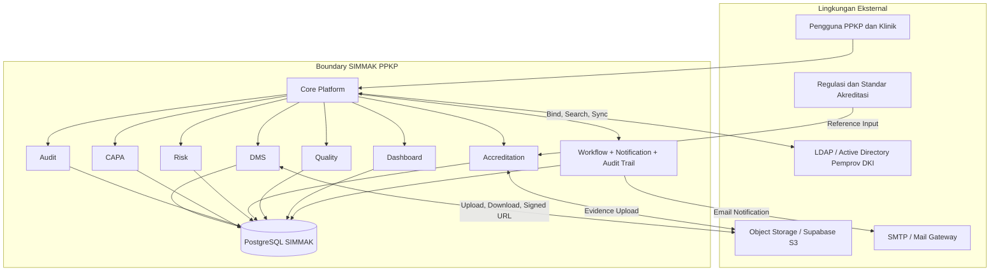

---

## 5. Actor Catalog
### 5.1 Executive / Manajemen Pusat
- Deskripsi: Pemilik kebutuhan strategis; memantau kesiapan akreditasi, risiko, CAPA, audit, dan mutu lintas 17 entitas.
- Hak akses ditentukan oleh kombinasi role, permission, `organization_id`, `clinic_id`, `unit_id`, dan assignment workflow.
- Semua aksi penting harus masuk ke audit trail atau activity log sesuai tingkat kritikalitas proses.
- Aktor dapat memiliki lebih dari satu peran pada klinik yang berbeda selama tercatat pada user scope.

### 5.2 Kepala Klinik
- Deskripsi: Penanggung jawab operasional entitas; menyetujui dokumen, laporan audit, CAPA, self assessment, dan rencana mutu.
- Hak akses ditentukan oleh kombinasi role, permission, `organization_id`, `clinic_id`, `unit_id`, dan assignment workflow.
- Semua aksi penting harus masuk ke audit trail atau activity log sesuai tingkat kritikalitas proses.
- Aktor dapat memiliki lebih dari satu peran pada klinik yang berbeda selama tercatat pada user scope.

### 5.3 PJ Mutu / Quality Officer
- Deskripsi: Pengelola mutu klinik; mengoordinasikan dokumen, indikator, audit follow-up, gap, dan readiness.
- Hak akses ditentukan oleh kombinasi role, permission, `organization_id`, `clinic_id`, `unit_id`, dan assignment workflow.
- Semua aksi penting harus masuk ke audit trail atau activity log sesuai tingkat kritikalitas proses.
- Aktor dapat memiliki lebih dari satu peran pada klinik yang berbeda selama tercatat pada user scope.

### 5.4 Auditor Internal
- Deskripsi: Pelaksana audit internal; membuat checklist, merekam evidence, menulis temuan, dan menyusun laporan.
- Hak akses ditentukan oleh kombinasi role, permission, `organization_id`, `clinic_id`, `unit_id`, dan assignment workflow.
- Semua aksi penting harus masuk ke audit trail atau activity log sesuai tingkat kritikalitas proses.
- Aktor dapat memiliki lebih dari satu peran pada klinik yang berbeda selama tercatat pada user scope.

### 5.5 Lead Auditor
- Deskripsi: Koordinator audit; menetapkan scope, tim, checklist, opening/closing meeting, dan kualitas laporan.
- Hak akses ditentukan oleh kombinasi role, permission, `organization_id`, `clinic_id`, `unit_id`, dan assignment workflow.
- Semua aksi penting harus masuk ke audit trail atau activity log sesuai tingkat kritikalitas proses.
- Aktor dapat memiliki lebih dari satu peran pada klinik yang berbeda selama tercatat pada user scope.

### 5.6 CAPA Owner / PIC Unit
- Deskripsi: Pemilik tindakan korektif dan preventif; melakukan RCA, implementasi, dan unggah evidence.
- Hak akses ditentukan oleh kombinasi role, permission, `organization_id`, `clinic_id`, `unit_id`, dan assignment workflow.
- Semua aksi penting harus masuk ke audit trail atau activity log sesuai tingkat kritikalitas proses.
- Aktor dapat memiliki lebih dari satu peran pada klinik yang berbeda selama tercatat pada user scope.

### 5.7 Risk Owner
- Deskripsi: Pemilik risiko di unit/klinik; mengidentifikasi, menilai, memitigasi, dan memantau risiko.
- Hak akses ditentukan oleh kombinasi role, permission, `organization_id`, `clinic_id`, `unit_id`, dan assignment workflow.
- Semua aksi penting harus masuk ke audit trail atau activity log sesuai tingkat kritikalitas proses.
- Aktor dapat memiliki lebih dari satu peran pada klinik yang berbeda selama tercatat pada user scope.

### 5.8 Accreditation Admin
- Deskripsi: Admin standar akreditasi; mengelola hierarki bab, standar, kriteria, elemen, dan campaign assessment.
- Hak akses ditentukan oleh kombinasi role, permission, `organization_id`, `clinic_id`, `unit_id`, dan assignment workflow.
- Semua aksi penting harus masuk ke audit trail atau activity log sesuai tingkat kritikalitas proses.
- Aktor dapat memiliki lebih dari satu peran pada klinik yang berbeda selama tercatat pada user scope.

### 5.9 Unit Staff
- Deskripsi: Kontributor data operasional; membaca dokumen, upload evidence, input risiko, dan mengisi indikator.
- Hak akses ditentukan oleh kombinasi role, permission, `organization_id`, `clinic_id`, `unit_id`, dan assignment workflow.
- Semua aksi penting harus masuk ke audit trail atau activity log sesuai tingkat kritikalitas proses.
- Aktor dapat memiliki lebih dari satu peran pada klinik yang berbeda selama tercatat pada user scope.

### 5.10 System Administrator
- Deskripsi: Mengelola master data, pengguna, role, permission, workflow, setting LDAP, storage, dan audit policy.
- Hak akses ditentukan oleh kombinasi role, permission, `organization_id`, `clinic_id`, `unit_id`, dan assignment workflow.
- Semua aksi penting harus masuk ke audit trail atau activity log sesuai tingkat kritikalitas proses.
- Aktor dapat memiliki lebih dari satu peran pada klinik yang berbeda selama tercatat pada user scope.

### 5.11 LDAP / Active Directory
- Deskripsi: Sistem eksternal untuk autentikasi, provisioning user, group mapping, dan validasi status pegawai.
- Hak akses ditentukan oleh kombinasi role, permission, `organization_id`, `clinic_id`, `unit_id`, dan assignment workflow.
- Semua aksi penting harus masuk ke audit trail atau activity log sesuai tingkat kritikalitas proses.
- Aktor dapat memiliki lebih dari satu peran pada klinik yang berbeda selama tercatat pada user scope.

### 5.12 Object Storage
- Deskripsi: Layanan eksternal untuk menyimpan dokumen, evidence, attachment, QR image, dan report export.
- Hak akses ditentukan oleh kombinasi role, permission, `organization_id`, `clinic_id`, `unit_id`, dan assignment workflow.
- Semua aksi penting harus masuk ke audit trail atau activity log sesuai tingkat kritikalitas proses.
- Aktor dapat memiliki lebih dari satu peran pada klinik yang berbeda selama tercatat pada user scope.


---

## 6. Enterprise Context Diagram
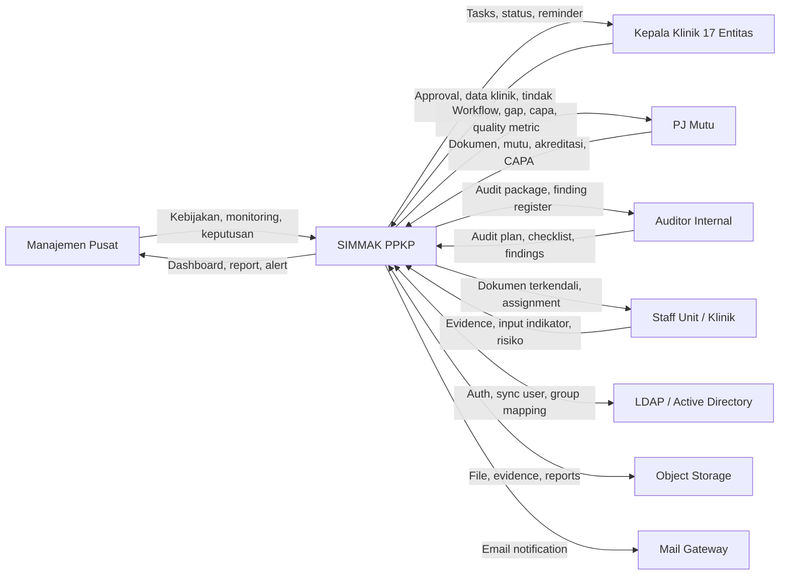

---

## 7. DFD Level 0 Enterprise
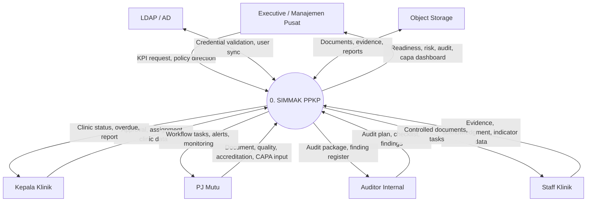

---

## 8. DFD Level 1 Enterprise
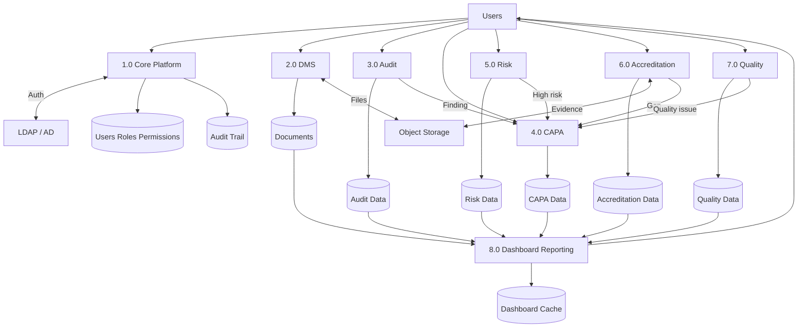

---

## 9. Modul Document Management System (DMS)
Mengendalikan siklus hidup Kebijakan, SOP, Pedoman, Formulir, dan Instruksi Kerja.

Tema analisis: Dokumen terkendali, versi, QR verification, distribusi, dan expiry monitoring.

### 9.1 Scope Modul
- Buat draft dokumen.
- Review dokumen.
- Approval berjenjang.
- Publikasi dokumen.
- Distribusi dan acknowledgment.
- Monitoring masa berlaku.

### 9.2 Context Diagram DMS
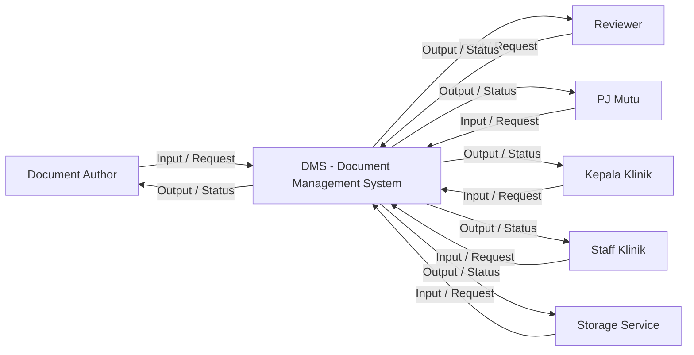

### 9.3 DFD Level 0 DMS
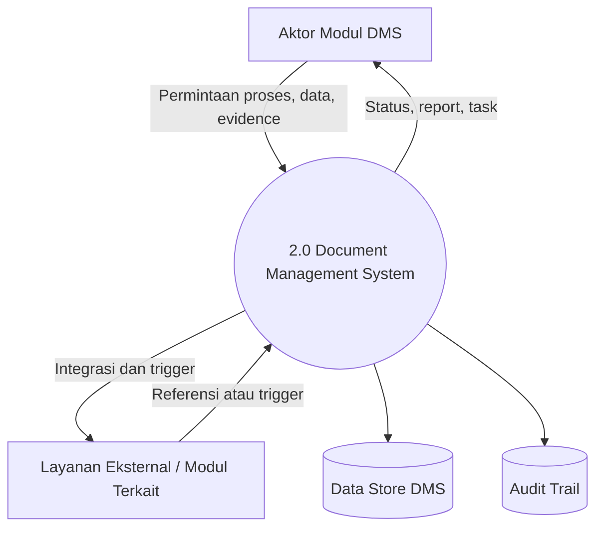

### 9.4 DFD Level 1 DMS
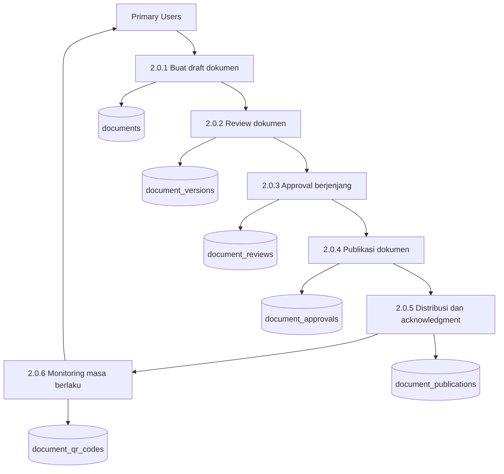

### 9.5 DFD Level 2 DMS
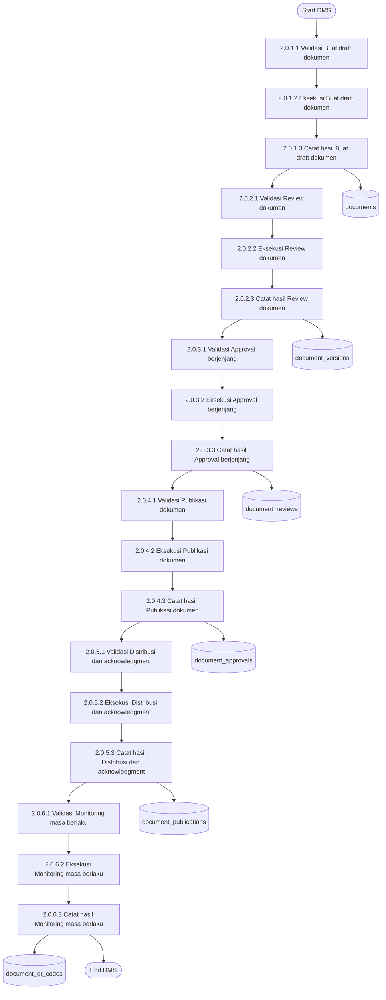

### 9.6 Use Case Diagram DMS
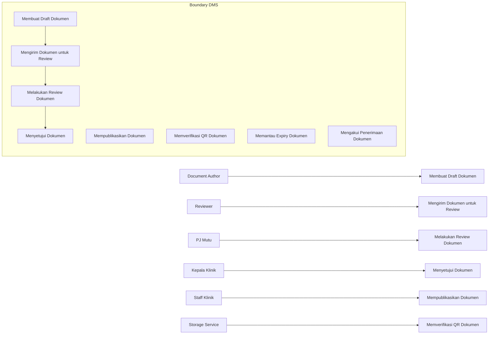

### 9.7 Activity Diagram DMS


### 9.8 Sequence Diagram DMS
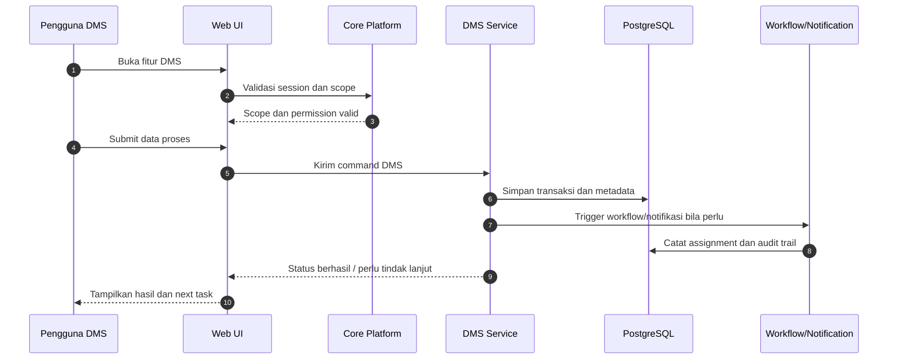

### 9.9 BPMN DMS
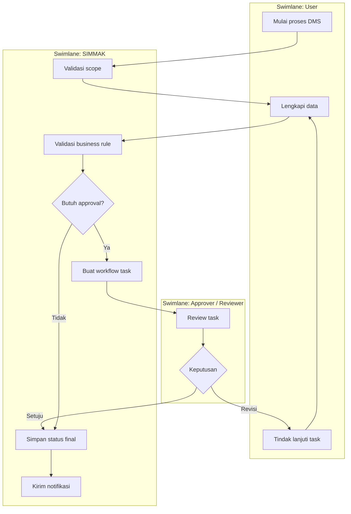

### 9.10 Analisis Data Flow DMS
- Flow DMS-1: Buat draft dokumen menerima input dari aktor berwenang, memvalidasi `organization_id`, `clinic_id`, `unit_id`, menulis ke data store terkait, dan mengirim status ke dashboard atau task list.
- Flow DMS-2: Review dokumen menerima input dari aktor berwenang, memvalidasi `organization_id`, `clinic_id`, `unit_id`, menulis ke data store terkait, dan mengirim status ke dashboard atau task list.
- Flow DMS-3: Approval berjenjang menerima input dari aktor berwenang, memvalidasi `organization_id`, `clinic_id`, `unit_id`, menulis ke data store terkait, dan mengirim status ke dashboard atau task list.
- Flow DMS-4: Publikasi dokumen menerima input dari aktor berwenang, memvalidasi `organization_id`, `clinic_id`, `unit_id`, menulis ke data store terkait, dan mengirim status ke dashboard atau task list.
- Flow DMS-5: Distribusi dan acknowledgment menerima input dari aktor berwenang, memvalidasi `organization_id`, `clinic_id`, `unit_id`, menulis ke data store terkait, dan mengirim status ke dashboard atau task list.
- Flow DMS-6: Monitoring masa berlaku menerima input dari aktor berwenang, memvalidasi `organization_id`, `clinic_id`, `unit_id`, menulis ke data store terkait, dan mengirim status ke dashboard atau task list.

### 9.11 Aturan Bisnis Utama DMS
- BR-DMS-01: Setiap transaksi modul DMS harus memiliki scope organisasi yang dapat diaudit dan tidak boleh melanggar hak akses pengguna.
- BR-DMS-02: Setiap transaksi modul DMS harus memiliki scope organisasi yang dapat diaudit dan tidak boleh melanggar hak akses pengguna.
- BR-DMS-03: Setiap transaksi modul DMS harus memiliki scope organisasi yang dapat diaudit dan tidak boleh melanggar hak akses pengguna.
- BR-DMS-04: Setiap transaksi modul DMS harus memiliki scope organisasi yang dapat diaudit dan tidak boleh melanggar hak akses pengguna.
- BR-DMS-05: Setiap transaksi modul DMS harus memiliki scope organisasi yang dapat diaudit dan tidak boleh melanggar hak akses pengguna.
- BR-DMS-06: Setiap transaksi modul DMS harus memiliki scope organisasi yang dapat diaudit dan tidak boleh melanggar hak akses pengguna.
- BR-DMS-07: Setiap transaksi modul DMS harus memiliki scope organisasi yang dapat diaudit dan tidak boleh melanggar hak akses pengguna.
- BR-DMS-08: Setiap transaksi modul DMS harus memiliki scope organisasi yang dapat diaudit dan tidak boleh melanggar hak akses pengguna.
- BR-DMS-09: Setiap transaksi modul DMS harus memiliki scope organisasi yang dapat diaudit dan tidak boleh melanggar hak akses pengguna.
- BR-DMS-10: Setiap transaksi modul DMS harus memiliki scope organisasi yang dapat diaudit dan tidak boleh melanggar hak akses pengguna.
- BR-DMS-11: Setiap transaksi modul DMS harus memiliki scope organisasi yang dapat diaudit dan tidak boleh melanggar hak akses pengguna.
- BR-DMS-12: Setiap transaksi modul DMS harus memiliki scope organisasi yang dapat diaudit dan tidak boleh melanggar hak akses pengguna.

### 9.12 Exception Handling DMS
- EX-DMS-01: Akses ditolak karena scope klinik tidak sesuai. Sistem harus menampilkan pesan jelas, mencatat error context, dan menyediakan retry atau eskalasi sesuai dampak.
- EX-DMS-02: Workflow assignee tidak ditemukan atau role approver belum dikonfigurasi. Sistem harus menampilkan pesan jelas, mencatat error context, dan menyediakan retry atau eskalasi sesuai dampak.
- EX-DMS-03: Data mandatory belum lengkap atau format tidak valid. Sistem harus menampilkan pesan jelas, mencatat error context, dan menyediakan retry atau eskalasi sesuai dampak.
- EX-DMS-04: File evidence gagal diunggah ke storage eksternal. Sistem harus menampilkan pesan jelas, mencatat error context, dan menyediakan retry atau eskalasi sesuai dampak.
- EX-DMS-05: Transaksi bersamaan menimbulkan konflik status. Sistem harus menampilkan pesan jelas, mencatat error context, dan menyediakan retry atau eskalasi sesuai dampak.
- EX-DMS-06: Notifikasi gagal terkirim namun transaksi utama sudah tersimpan. Sistem harus menampilkan pesan jelas, mencatat error context, dan menyediakan retry atau eskalasi sesuai dampak.
- EX-DMS-07: Data referensi tidak aktif saat transaksi dibuat. Sistem harus menampilkan pesan jelas, mencatat error context, dan menyediakan retry atau eskalasi sesuai dampak.
- EX-DMS-08: Dashboard cache belum sinkron dengan transaksi terbaru. Sistem harus menampilkan pesan jelas, mencatat error context, dan menyediakan retry atau eskalasi sesuai dampak.

---

## 10. Modul Internal Audit (Audit)
Mengelola audit internal lintas klinik dan unit sebagai mekanisme assurance mutu.

Tema analisis: Program audit, jadwal, checklist, temuan, laporan, dan trigger CAPA.

### 10.1 Scope Modul
- Susun program audit.
- Jadwalkan audit.
- Siapkan checklist.
- Laksanakan fieldwork.
- Catat temuan.
- Terbitkan laporan.

### 10.2 Context Diagram Audit
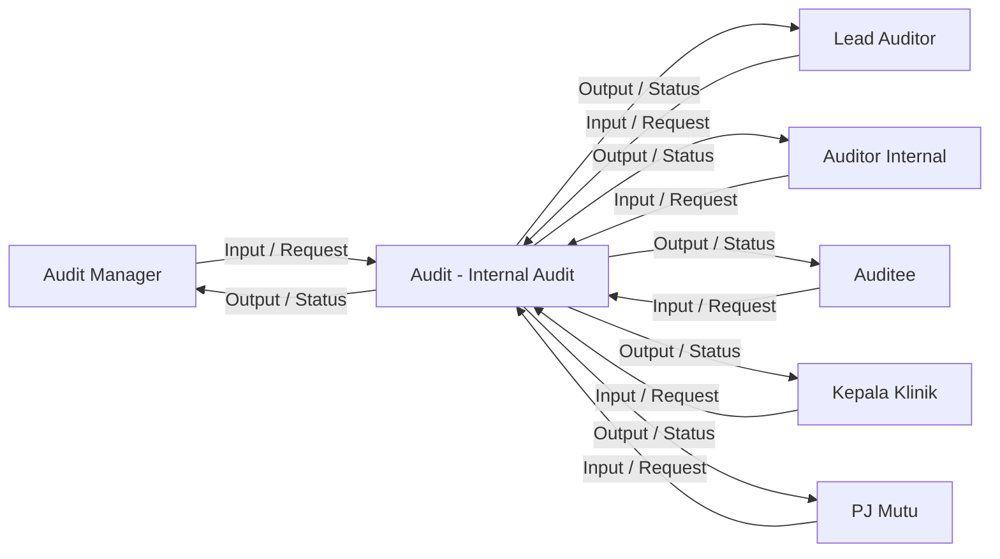

### 10.3 DFD Level 0 Audit
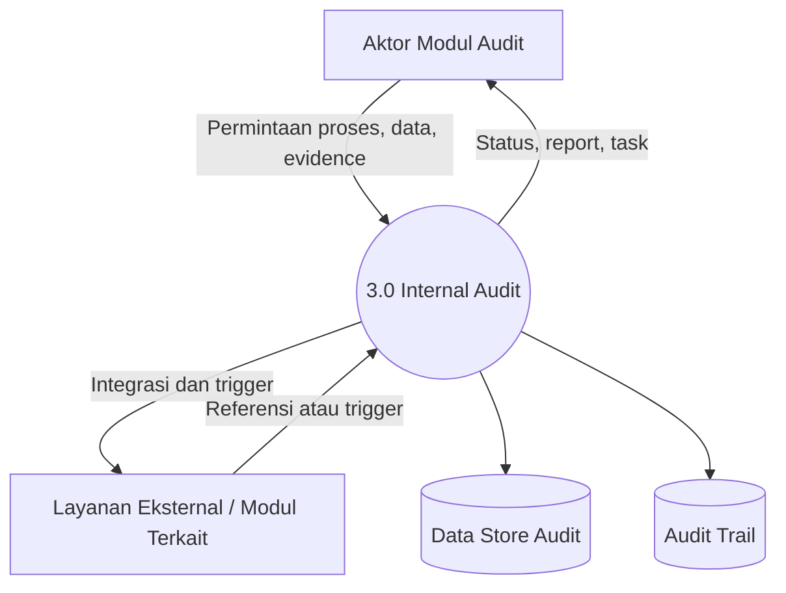

### 10.4 DFD Level 1 Audit
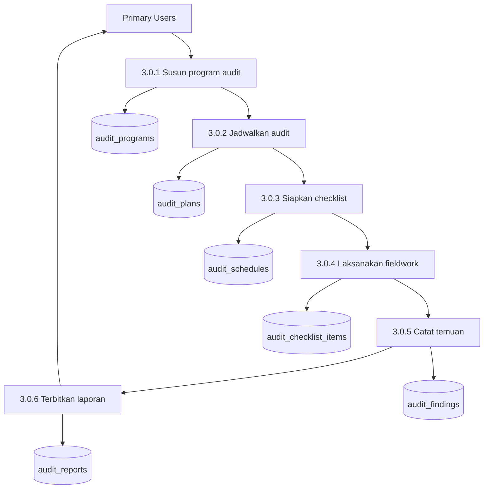

### 10.5 DFD Level 2 Audit
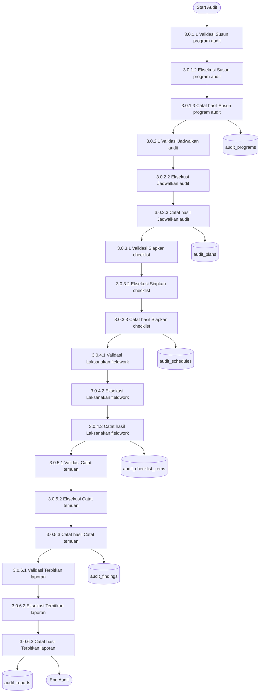

### 10.6 Use Case Diagram Audit
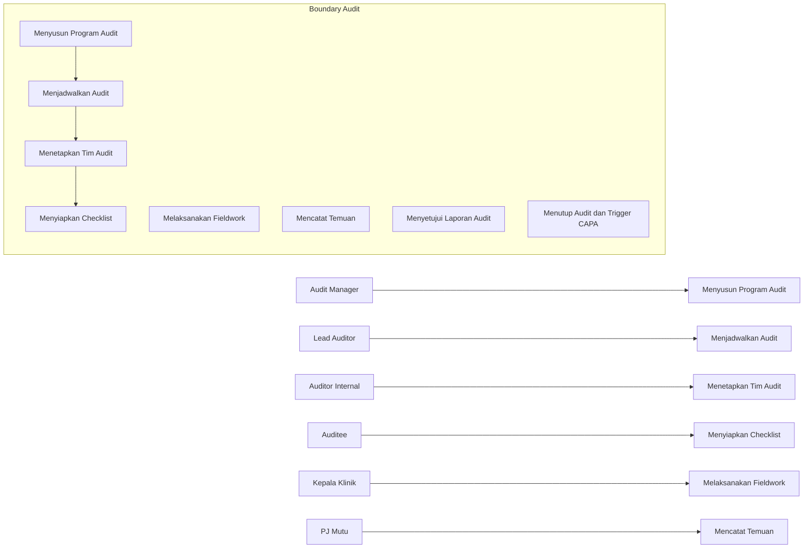

### 10.7 Activity Diagram Audit
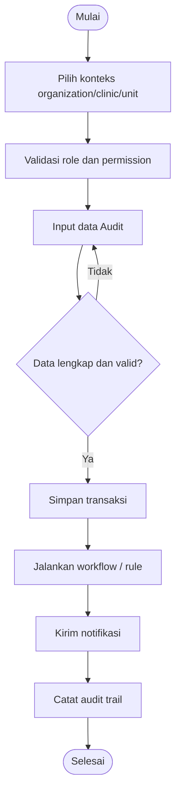

### 10.8 Sequence Diagram Audit


### 10.9 BPMN Audit


### 10.10 Analisis Data Flow Audit
- Flow Audit-1: Susun program audit menerima input dari aktor berwenang, memvalidasi `organization_id`, `clinic_id`, `unit_id`, menulis ke data store terkait, dan mengirim status ke dashboard atau task list.
- Flow Audit-2: Jadwalkan audit menerima input dari aktor berwenang, memvalidasi `organization_id`, `clinic_id`, `unit_id`, menulis ke data store terkait, dan mengirim status ke dashboard atau task list.
- Flow Audit-3: Siapkan checklist menerima input dari aktor berwenang, memvalidasi `organization_id`, `clinic_id`, `unit_id`, menulis ke data store terkait, dan mengirim status ke dashboard atau task list.
- Flow Audit-4: Laksanakan fieldwork menerima input dari aktor berwenang, memvalidasi `organization_id`, `clinic_id`, `unit_id`, menulis ke data store terkait, dan mengirim status ke dashboard atau task list.
- Flow Audit-5: Catat temuan menerima input dari aktor berwenang, memvalidasi `organization_id`, `clinic_id`, `unit_id`, menulis ke data store terkait, dan mengirim status ke dashboard atau task list.
- Flow Audit-6: Terbitkan laporan menerima input dari aktor berwenang, memvalidasi `organization_id`, `clinic_id`, `unit_id`, menulis ke data store terkait, dan mengirim status ke dashboard atau task list.

### 10.11 Aturan Bisnis Utama Audit
- BR-Audit-01: Setiap transaksi modul Audit harus memiliki scope organisasi yang dapat diaudit dan tidak boleh melanggar hak akses pengguna.
- BR-Audit-02: Setiap transaksi modul Audit harus memiliki scope organisasi yang dapat diaudit dan tidak boleh melanggar hak akses pengguna.
- BR-Audit-03: Setiap transaksi modul Audit harus memiliki scope organisasi yang dapat diaudit dan tidak boleh melanggar hak akses pengguna.
- BR-Audit-04: Setiap transaksi modul Audit harus memiliki scope organisasi yang dapat diaudit dan tidak boleh melanggar hak akses pengguna.
- BR-Audit-05: Setiap transaksi modul Audit harus memiliki scope organisasi yang dapat diaudit dan tidak boleh melanggar hak akses pengguna.
- BR-Audit-06: Setiap transaksi modul Audit harus memiliki scope organisasi yang dapat diaudit dan tidak boleh melanggar hak akses pengguna.
- BR-Audit-07: Setiap transaksi modul Audit harus memiliki scope organisasi yang dapat diaudit dan tidak boleh melanggar hak akses pengguna.
- BR-Audit-08: Setiap transaksi modul Audit harus memiliki scope organisasi yang dapat diaudit dan tidak boleh melanggar hak akses pengguna.
- BR-Audit-09: Setiap transaksi modul Audit harus memiliki scope organisasi yang dapat diaudit dan tidak boleh melanggar hak akses pengguna.
- BR-Audit-10: Setiap transaksi modul Audit harus memiliki scope organisasi yang dapat diaudit dan tidak boleh melanggar hak akses pengguna.
- BR-Audit-11: Setiap transaksi modul Audit harus memiliki scope organisasi yang dapat diaudit dan tidak boleh melanggar hak akses pengguna.
- BR-Audit-12: Setiap transaksi modul Audit harus memiliki scope organisasi yang dapat diaudit dan tidak boleh melanggar hak akses pengguna.

### 10.12 Exception Handling Audit
- EX-Audit-01: Akses ditolak karena scope klinik tidak sesuai. Sistem harus menampilkan pesan jelas, mencatat error context, dan menyediakan retry atau eskalasi sesuai dampak.
- EX-Audit-02: Workflow assignee tidak ditemukan atau role approver belum dikonfigurasi. Sistem harus menampilkan pesan jelas, mencatat error context, dan menyediakan retry atau eskalasi sesuai dampak.
- EX-Audit-03: Data mandatory belum lengkap atau format tidak valid. Sistem harus menampilkan pesan jelas, mencatat error context, dan menyediakan retry atau eskalasi sesuai dampak.
- EX-Audit-04: File evidence gagal diunggah ke storage eksternal. Sistem harus menampilkan pesan jelas, mencatat error context, dan menyediakan retry atau eskalasi sesuai dampak.
- EX-Audit-05: Transaksi bersamaan menimbulkan konflik status. Sistem harus menampilkan pesan jelas, mencatat error context, dan menyediakan retry atau eskalasi sesuai dampak.
- EX-Audit-06: Notifikasi gagal terkirim namun transaksi utama sudah tersimpan. Sistem harus menampilkan pesan jelas, mencatat error context, dan menyediakan retry atau eskalasi sesuai dampak.
- EX-Audit-07: Data referensi tidak aktif saat transaksi dibuat. Sistem harus menampilkan pesan jelas, mencatat error context, dan menyediakan retry atau eskalasi sesuai dampak.
- EX-Audit-08: Dashboard cache belum sinkron dengan transaksi terbaru. Sistem harus menampilkan pesan jelas, mencatat error context, dan menyediakan retry atau eskalasi sesuai dampak.

---

## 11. Modul Corrective and Preventive Action (CAPA)
Menutup temuan dan masalah mutu secara sistematis sampai efektif dan terdokumentasi.

Tema analisis: RCA, corrective action, preventive action, verification, effectiveness review.

### 11.1 Scope Modul
- Registrasi CAPA.
- Penugasan owner.
- Analisis akar masalah.
- Rencana tindakan.
- Implementasi.
- Verifikasi dan penutupan.

### 11.2 Context Diagram CAPA
```mermaid
flowchart LR
    A1["CAPA Coordinator"]
    A2["CAPA Owner"]
    A3["Root Cause Analyst"]
    A4["Verifier"]
    A5["Kepala Klinik"]
    A6["Finding Source"]
    SYS["CAPA - Corrective and Preventive Action"]
    A1 -->|"Input / Request"| SYS
    A2 -->|"Input / Request"| SYS
    A3 -->|"Input / Request"| SYS
    A4 -->|"Input / Request"| SYS
    A5 -->|"Input / Request"| SYS
    A6 -->|"Input / Request"| SYS
    SYS -->|"Output / Status"| A1
    SYS -->|"Output / Status"| A2
    SYS -->|"Output / Status"| A3
    SYS -->|"Output / Status"| A4
    SYS -->|"Output / Status"| A5
    SYS -->|"Output / Status"| A6
```

### 11.3 DFD Level 0 CAPA
```mermaid
flowchart TB
    USER["Aktor Modul CAPA"]
    EXT["Layanan Eksternal / Modul Terkait"]
    P0(("4.0 Corrective and Preventive Action"))
    DB[("Data Store CAPA")]
    LOG[("Audit Trail")]
    USER -->|"Permintaan proses, data, evidence"| P0
    EXT -->|"Referensi atau trigger"| P0
    P0 -->|"Status, report, task"| USER
    P0 -->|"Integrasi dan trigger"| EXT
    P0 --> DB
    P0 --> LOG
```

### 11.4 DFD Level 1 CAPA
```mermaid
flowchart TB
    USER["Primary Users"]
    P1["4.0.1 Registrasi CAPA"]
    P2["4.0.2 Penugasan owner"]
    P3["4.0.3 Analisis akar masalah"]
    P4["4.0.4 Rencana tindakan"]
    P5["4.0.5 Implementasi"]
    P6["4.0.6 Verifikasi dan penutupan"]
    D1[("capa_cases")]
    D2[("capa_root_cause_analyses")]
    D3[("capa_five_whys")]
    D4[("capa_fishbone_diagrams")]
    D5[("capa_corrective_actions")]
    D6[("capa_preventive_actions")]
    USER --> P1
    P1 --> P2
    P2 --> P3
    P3 --> P4
    P4 --> P5
    P5 --> P6
    P1 --> D1
    P2 --> D2
    P3 --> D3
    P4 --> D4
    P5 --> D5
    P6 --> D6
    P6 --> USER
```

### 11.5 DFD Level 2 CAPA
```mermaid
flowchart TB
    START(["Start CAPA"])
    P1a["4.0.1.1 Validasi Registrasi CAPA"]
    P1b["4.0.1.2 Eksekusi Registrasi CAPA"]
    P1c["4.0.1.3 Catat hasil Registrasi CAPA"]
    P2a["4.0.2.1 Validasi Penugasan owner"]
    P2b["4.0.2.2 Eksekusi Penugasan owner"]
    P2c["4.0.2.3 Catat hasil Penugasan owner"]
    P3a["4.0.3.1 Validasi Analisis akar masalah"]
    P3b["4.0.3.2 Eksekusi Analisis akar masalah"]
    P3c["4.0.3.3 Catat hasil Analisis akar masalah"]
    P4a["4.0.4.1 Validasi Rencana tindakan"]
    P4b["4.0.4.2 Eksekusi Rencana tindakan"]
    P4c["4.0.4.3 Catat hasil Rencana tindakan"]
    P5a["4.0.5.1 Validasi Implementasi"]
    P5b["4.0.5.2 Eksekusi Implementasi"]
    P5c["4.0.5.3 Catat hasil Implementasi"]
    P6a["4.0.6.1 Validasi Verifikasi dan penutupan"]
    P6b["4.0.6.2 Eksekusi Verifikasi dan penutupan"]
    P6c["4.0.6.3 Catat hasil Verifikasi dan penutupan"]
    D1[("capa_cases")]
    D2[("capa_root_cause_analyses")]
    D3[("capa_five_whys")]
    D4[("capa_fishbone_diagrams")]
    D5[("capa_corrective_actions")]
    D6[("capa_preventive_actions")]
    END(["End CAPA"])
    START --> P1a
    P1a --> P1b --> P1c
    P1c --> P2a
    P2a --> P2b --> P2c
    P2c --> P3a
    P3a --> P3b --> P3c
    P3c --> P4a
    P4a --> P4b --> P4c
    P4c --> P5a
    P5a --> P5b --> P5c
    P5c --> P6a
    P6a --> P6b --> P6c
    P1c --> D1
    P2c --> D2
    P3c --> D3
    P4c --> D4
    P5c --> D5
    P6c --> D6
    P6c --> END
```

### 11.6 Use Case Diagram CAPA
```mermaid
flowchart LR
    subgraph BOUND["Boundary CAPA"]
    UCX1["Mendaftarkan CAPA"]
    UCX2["Menetapkan Owner dan Due Date"]
    UCX3["Melakukan RCA"]
    UCX4["Menyusun Corrective Action"]
    UCX5["Menyusun Preventive Action"]
    UCX6["Mengunggah Evidence Implementasi"]
    UCX7["Memverifikasi Tindakan"]
    UCX8["Menilai Efektivitas dan Menutup CAPA"]
    end
    ACT1["CAPA Coordinator"] --> UC1["Mendaftarkan CAPA"]
    ACT2["CAPA Owner"] --> UC2["Menetapkan Owner dan Due Date"]
    ACT3["Root Cause Analyst"] --> UC3["Melakukan RCA"]
    ACT4["Verifier"] --> UC4["Menyusun Corrective Action"]
    ACT5["Kepala Klinik"] --> UC5["Menyusun Preventive Action"]
    ACT6["Finding Source"] --> UC6["Mengunggah Evidence Implementasi"]
    UCX1 --> UCX2
    UCX2 --> UCX3
    UCX3 --> UCX4
```

### 11.7 Activity Diagram CAPA
```mermaid
flowchart TB
    S(["Mulai"])
    A1["Pilih konteks organization/clinic/unit"]
    A2["Validasi role dan permission"]
    A3["Input data CAPA"]
    G1{"Data lengkap dan valid?"}
    A4["Simpan transaksi"]
    A5["Jalankan workflow / rule"]
    A6["Kirim notifikasi"]
    A7["Catat audit trail"]
    E(["Selesai"])
    S --> A1 --> A2 --> A3 --> G1
    G1 -->|"Tidak"| A3
    G1 -->|"Ya"| A4 --> A5 --> A6 --> A7 --> E
```

### 11.8 Sequence Diagram CAPA
```mermaid
sequenceDiagram
    autonumber
    participant User as Pengguna CAPA
    participant UI as Web UI
    participant Core as Core Platform
    participant Service as CAPA Service
    participant DB as PostgreSQL
    participant WF as Workflow/Notification
    User->>UI: Buka fitur CAPA
    UI->>Core: Validasi session dan scope
    Core-->>UI: Scope dan permission valid
    User->>UI: Submit data proses
    UI->>Service: Kirim command CAPA
    Service->>DB: Simpan transaksi dan metadata
    Service->>WF: Trigger workflow/notifikasi bila perlu
    WF->>DB: Catat assignment dan audit trail
    Service-->>UI: Status berhasil / perlu tindak lanjut
    UI-->>User: Tampilkan hasil dan next task
```

### 11.9 BPMN CAPA
```mermaid
flowchart TB
    subgraph L1["Swimlane: User"]
        U1["Mulai proses CAPA"]
        U2["Lengkapi data"]
        U3["Tindak lanjuti task"]
    end
    subgraph L2["Swimlane: SIMMAK"]
        S1["Validasi scope"]
        S2["Validasi business rule"]
        S3{"Butuh approval?"}
        S4["Buat workflow task"]
        S5["Simpan status final"]
        S6["Kirim notifikasi"]
    end
    subgraph L3["Swimlane: Approver / Reviewer"]
        R1["Review task"]
        R2{"Keputusan"}
    end
    U1 --> S1 --> U2 --> S2 --> S3
    S3 -->|"Ya"| S4 --> R1 --> R2
    R2 -->|"Revisi"| U3 --> U2
    R2 -->|"Setuju"| S5
    S3 -->|"Tidak"| S5
    S5 --> S6
```

### 11.10 Analisis Data Flow CAPA
- Flow CAPA-1: Registrasi CAPA menerima input dari aktor berwenang, memvalidasi `organization_id`, `clinic_id`, `unit_id`, menulis ke data store terkait, dan mengirim status ke dashboard atau task list.
- Flow CAPA-2: Penugasan owner menerima input dari aktor berwenang, memvalidasi `organization_id`, `clinic_id`, `unit_id`, menulis ke data store terkait, dan mengirim status ke dashboard atau task list.
- Flow CAPA-3: Analisis akar masalah menerima input dari aktor berwenang, memvalidasi `organization_id`, `clinic_id`, `unit_id`, menulis ke data store terkait, dan mengirim status ke dashboard atau task list.
- Flow CAPA-4: Rencana tindakan menerima input dari aktor berwenang, memvalidasi `organization_id`, `clinic_id`, `unit_id`, menulis ke data store terkait, dan mengirim status ke dashboard atau task list.
- Flow CAPA-5: Implementasi menerima input dari aktor berwenang, memvalidasi `organization_id`, `clinic_id`, `unit_id`, menulis ke data store terkait, dan mengirim status ke dashboard atau task list.
- Flow CAPA-6: Verifikasi dan penutupan menerima input dari aktor berwenang, memvalidasi `organization_id`, `clinic_id`, `unit_id`, menulis ke data store terkait, dan mengirim status ke dashboard atau task list.

### 11.11 Aturan Bisnis Utama CAPA
- BR-CAPA-01: Setiap transaksi modul CAPA harus memiliki scope organisasi yang dapat diaudit dan tidak boleh melanggar hak akses pengguna.
- BR-CAPA-02: Setiap transaksi modul CAPA harus memiliki scope organisasi yang dapat diaudit dan tidak boleh melanggar hak akses pengguna.
- BR-CAPA-03: Setiap transaksi modul CAPA harus memiliki scope organisasi yang dapat diaudit dan tidak boleh melanggar hak akses pengguna.
- BR-CAPA-04: Setiap transaksi modul CAPA harus memiliki scope organisasi yang dapat diaudit dan tidak boleh melanggar hak akses pengguna.
- BR-CAPA-05: Setiap transaksi modul CAPA harus memiliki scope organisasi yang dapat diaudit dan tidak boleh melanggar hak akses pengguna.
- BR-CAPA-06: Setiap transaksi modul CAPA harus memiliki scope organisasi yang dapat diaudit dan tidak boleh melanggar hak akses pengguna.
- BR-CAPA-07: Setiap transaksi modul CAPA harus memiliki scope organisasi yang dapat diaudit dan tidak boleh melanggar hak akses pengguna.
- BR-CAPA-08: Setiap transaksi modul CAPA harus memiliki scope organisasi yang dapat diaudit dan tidak boleh melanggar hak akses pengguna.
- BR-CAPA-09: Setiap transaksi modul CAPA harus memiliki scope organisasi yang dapat diaudit dan tidak boleh melanggar hak akses pengguna.
- BR-CAPA-10: Setiap transaksi modul CAPA harus memiliki scope organisasi yang dapat diaudit dan tidak boleh melanggar hak akses pengguna.
- BR-CAPA-11: Setiap transaksi modul CAPA harus memiliki scope organisasi yang dapat diaudit dan tidak boleh melanggar hak akses pengguna.
- BR-CAPA-12: Setiap transaksi modul CAPA harus memiliki scope organisasi yang dapat diaudit dan tidak boleh melanggar hak akses pengguna.

### 11.12 Exception Handling CAPA
- EX-CAPA-01: Akses ditolak karena scope klinik tidak sesuai. Sistem harus menampilkan pesan jelas, mencatat error context, dan menyediakan retry atau eskalasi sesuai dampak.
- EX-CAPA-02: Workflow assignee tidak ditemukan atau role approver belum dikonfigurasi. Sistem harus menampilkan pesan jelas, mencatat error context, dan menyediakan retry atau eskalasi sesuai dampak.
- EX-CAPA-03: Data mandatory belum lengkap atau format tidak valid. Sistem harus menampilkan pesan jelas, mencatat error context, dan menyediakan retry atau eskalasi sesuai dampak.
- EX-CAPA-04: File evidence gagal diunggah ke storage eksternal. Sistem harus menampilkan pesan jelas, mencatat error context, dan menyediakan retry atau eskalasi sesuai dampak.
- EX-CAPA-05: Transaksi bersamaan menimbulkan konflik status. Sistem harus menampilkan pesan jelas, mencatat error context, dan menyediakan retry atau eskalasi sesuai dampak.
- EX-CAPA-06: Notifikasi gagal terkirim namun transaksi utama sudah tersimpan. Sistem harus menampilkan pesan jelas, mencatat error context, dan menyediakan retry atau eskalasi sesuai dampak.
- EX-CAPA-07: Data referensi tidak aktif saat transaksi dibuat. Sistem harus menampilkan pesan jelas, mencatat error context, dan menyediakan retry atau eskalasi sesuai dampak.
- EX-CAPA-08: Dashboard cache belum sinkron dengan transaksi terbaru. Sistem harus menampilkan pesan jelas, mencatat error context, dan menyediakan retry atau eskalasi sesuai dampak.

---

## 12. Modul Risk Management (Risk)
Mengelola risiko klinis, operasional, kepatuhan, SDM, sarana, dan reputasi.

Tema analisis: Risk register, assessment, matrix, mitigation, monitoring, heatmap.

### 12.1 Scope Modul
- Identifikasi risiko.
- Assessment likelihood-impact.
- Klasifikasi matriks.
- Mitigasi.
- Monitoring residual risk.
- Eskalasi CAPA.

### 12.2 Context Diagram Risk
```mermaid
flowchart LR
    A1["Risk Owner"]
    A2["Risk Committee"]
    A3["PJ Mutu"]
    A4["Staff Unit"]
    A5["Manajemen Pusat"]
    A6["CAPA Coordinator"]
    SYS["Risk - Risk Management"]
    A1 -->|"Input / Request"| SYS
    A2 -->|"Input / Request"| SYS
    A3 -->|"Input / Request"| SYS
    A4 -->|"Input / Request"| SYS
    A5 -->|"Input / Request"| SYS
    A6 -->|"Input / Request"| SYS
    SYS -->|"Output / Status"| A1
    SYS -->|"Output / Status"| A2
    SYS -->|"Output / Status"| A3
    SYS -->|"Output / Status"| A4
    SYS -->|"Output / Status"| A5
    SYS -->|"Output / Status"| A6
```

### 12.3 DFD Level 0 Risk
```mermaid
flowchart TB
    USER["Aktor Modul Risk"]
    EXT["Layanan Eksternal / Modul Terkait"]
    P0(("5.0 Risk Management"))
    DB[("Data Store Risk")]
    LOG[("Audit Trail")]
    USER -->|"Permintaan proses, data, evidence"| P0
    EXT -->|"Referensi atau trigger"| P0
    P0 -->|"Status, report, task"| USER
    P0 -->|"Integrasi dan trigger"| EXT
    P0 --> DB
    P0 --> LOG
```

### 12.4 DFD Level 1 Risk
```mermaid
flowchart TB
    USER["Primary Users"]
    P1["5.0.1 Identifikasi risiko"]
    P2["5.0.2 Assessment likelihood-impact"]
    P3["5.0.3 Klasifikasi matriks"]
    P4["5.0.4 Mitigasi"]
    P5["5.0.5 Monitoring residual risk"]
    P6["5.0.6 Eskalasi CAPA"]
    D1[("risk_registers")]
    D2[("risk_items")]
    D3[("risk_assessments")]
    D4[("risk_matrices")]
    D5[("risk_mitigation_plans")]
    D6[("risk_monitoring_logs")]
    USER --> P1
    P1 --> P2
    P2 --> P3
    P3 --> P4
    P4 --> P5
    P5 --> P6
    P1 --> D1
    P2 --> D2
    P3 --> D3
    P4 --> D4
    P5 --> D5
    P6 --> D6
    P6 --> USER
```

### 12.5 DFD Level 2 Risk
```mermaid
flowchart TB
    START(["Start Risk"])
    P1a["5.0.1.1 Validasi Identifikasi risiko"]
    P1b["5.0.1.2 Eksekusi Identifikasi risiko"]
    P1c["5.0.1.3 Catat hasil Identifikasi risiko"]
    P2a["5.0.2.1 Validasi Assessment likelihood-impact"]
    P2b["5.0.2.2 Eksekusi Assessment likelihood-impact"]
    P2c["5.0.2.3 Catat hasil Assessment likelihood-impact"]
    P3a["5.0.3.1 Validasi Klasifikasi matriks"]
    P3b["5.0.3.2 Eksekusi Klasifikasi matriks"]
    P3c["5.0.3.3 Catat hasil Klasifikasi matriks"]
    P4a["5.0.4.1 Validasi Mitigasi"]
    P4b["5.0.4.2 Eksekusi Mitigasi"]
    P4c["5.0.4.3 Catat hasil Mitigasi"]
    P5a["5.0.5.1 Validasi Monitoring residual risk"]
    P5b["5.0.5.2 Eksekusi Monitoring residual risk"]
    P5c["5.0.5.3 Catat hasil Monitoring residual risk"]
    P6a["5.0.6.1 Validasi Eskalasi CAPA"]
    P6b["5.0.6.2 Eksekusi Eskalasi CAPA"]
    P6c["5.0.6.3 Catat hasil Eskalasi CAPA"]
    D1[("risk_registers")]
    D2[("risk_items")]
    D3[("risk_assessments")]
    D4[("risk_matrices")]
    D5[("risk_mitigation_plans")]
    D6[("risk_monitoring_logs")]
    END(["End Risk"])
    START --> P1a
    P1a --> P1b --> P1c
    P1c --> P2a
    P2a --> P2b --> P2c
    P2c --> P3a
    P3a --> P3b --> P3c
    P3c --> P4a
    P4a --> P4b --> P4c
    P4c --> P5a
    P5a --> P5b --> P5c
    P5c --> P6a
    P6a --> P6b --> P6c
    P1c --> D1
    P2c --> D2
    P3c --> D3
    P4c --> D4
    P5c --> D5
    P6c --> D6
    P6c --> END
```

### 12.6 Use Case Diagram Risk
```mermaid
flowchart LR
    subgraph BOUND["Boundary Risk"]
    UCX1["Mendaftarkan Risiko"]
    UCX2["Menilai Inherent Risk"]
    UCX3["Menetapkan Mitigasi"]
    UCX4["Melakukan Monitoring"]
    UCX5["Menilai Residual Risk"]
    UCX6["Menerima Risiko"]
    UCX7["Mengeskalasi Risiko ke CAPA"]
    UCX8["Membuat Risk Heatmap"]
    end
    ACT1["Risk Owner"] --> UC1["Mendaftarkan Risiko"]
    ACT2["Risk Committee"] --> UC2["Menilai Inherent Risk"]
    ACT3["PJ Mutu"] --> UC3["Menetapkan Mitigasi"]
    ACT4["Staff Unit"] --> UC4["Melakukan Monitoring"]
    ACT5["Manajemen Pusat"] --> UC5["Menilai Residual Risk"]
    ACT6["CAPA Coordinator"] --> UC6["Menerima Risiko"]
    UCX1 --> UCX2
    UCX2 --> UCX3
    UCX3 --> UCX4
```

### 12.7 Activity Diagram Risk
```mermaid
flowchart TB
    S(["Mulai"])
    A1["Pilih konteks organization/clinic/unit"]
    A2["Validasi role dan permission"]
    A3["Input data Risk"]
    G1{"Data lengkap dan valid?"}
    A4["Simpan transaksi"]
    A5["Jalankan workflow / rule"]
    A6["Kirim notifikasi"]
    A7["Catat audit trail"]
    E(["Selesai"])
    S --> A1 --> A2 --> A3 --> G1
    G1 -->|"Tidak"| A3
    G1 -->|"Ya"| A4 --> A5 --> A6 --> A7 --> E
```

### 12.8 Sequence Diagram Risk
```mermaid
sequenceDiagram
    autonumber
    participant User as Pengguna Risk
    participant UI as Web UI
    participant Core as Core Platform
    participant Service as Risk Service
    participant DB as PostgreSQL
    participant WF as Workflow/Notification
    User->>UI: Buka fitur Risk
    UI->>Core: Validasi session dan scope
    Core-->>UI: Scope dan permission valid
    User->>UI: Submit data proses
    UI->>Service: Kirim command Risk
    Service->>DB: Simpan transaksi dan metadata
    Service->>WF: Trigger workflow/notifikasi bila perlu
    WF->>DB: Catat assignment dan audit trail
    Service-->>UI: Status berhasil / perlu tindak lanjut
    UI-->>User: Tampilkan hasil dan next task
```

### 12.9 BPMN Risk
```mermaid
flowchart TB
    subgraph L1["Swimlane: User"]
        U1["Mulai proses Risk"]
        U2["Lengkapi data"]
        U3["Tindak lanjuti task"]
    end
    subgraph L2["Swimlane: SIMMAK"]
        S1["Validasi scope"]
        S2["Validasi business rule"]
        S3{"Butuh approval?"}
        S4["Buat workflow task"]
        S5["Simpan status final"]
        S6["Kirim notifikasi"]
    end
    subgraph L3["Swimlane: Approver / Reviewer"]
        R1["Review task"]
        R2{"Keputusan"}
    end
    U1 --> S1 --> U2 --> S2 --> S3
    S3 -->|"Ya"| S4 --> R1 --> R2
    R2 -->|"Revisi"| U3 --> U2
    R2 -->|"Setuju"| S5
    S3 -->|"Tidak"| S5
    S5 --> S6
```

### 12.10 Analisis Data Flow Risk
- Flow Risk-1: Identifikasi risiko menerima input dari aktor berwenang, memvalidasi `organization_id`, `clinic_id`, `unit_id`, menulis ke data store terkait, dan mengirim status ke dashboard atau task list.
- Flow Risk-2: Assessment likelihood-impact menerima input dari aktor berwenang, memvalidasi `organization_id`, `clinic_id`, `unit_id`, menulis ke data store terkait, dan mengirim status ke dashboard atau task list.
- Flow Risk-3: Klasifikasi matriks menerima input dari aktor berwenang, memvalidasi `organization_id`, `clinic_id`, `unit_id`, menulis ke data store terkait, dan mengirim status ke dashboard atau task list.
- Flow Risk-4: Mitigasi menerima input dari aktor berwenang, memvalidasi `organization_id`, `clinic_id`, `unit_id`, menulis ke data store terkait, dan mengirim status ke dashboard atau task list.
- Flow Risk-5: Monitoring residual risk menerima input dari aktor berwenang, memvalidasi `organization_id`, `clinic_id`, `unit_id`, menulis ke data store terkait, dan mengirim status ke dashboard atau task list.
- Flow Risk-6: Eskalasi CAPA menerima input dari aktor berwenang, memvalidasi `organization_id`, `clinic_id`, `unit_id`, menulis ke data store terkait, dan mengirim status ke dashboard atau task list.

### 12.11 Aturan Bisnis Utama Risk
- BR-Risk-01: Setiap transaksi modul Risk harus memiliki scope organisasi yang dapat diaudit dan tidak boleh melanggar hak akses pengguna.
- BR-Risk-02: Setiap transaksi modul Risk harus memiliki scope organisasi yang dapat diaudit dan tidak boleh melanggar hak akses pengguna.
- BR-Risk-03: Setiap transaksi modul Risk harus memiliki scope organisasi yang dapat diaudit dan tidak boleh melanggar hak akses pengguna.
- BR-Risk-04: Setiap transaksi modul Risk harus memiliki scope organisasi yang dapat diaudit dan tidak boleh melanggar hak akses pengguna.
- BR-Risk-05: Setiap transaksi modul Risk harus memiliki scope organisasi yang dapat diaudit dan tidak boleh melanggar hak akses pengguna.
- BR-Risk-06: Setiap transaksi modul Risk harus memiliki scope organisasi yang dapat diaudit dan tidak boleh melanggar hak akses pengguna.
- BR-Risk-07: Setiap transaksi modul Risk harus memiliki scope organisasi yang dapat diaudit dan tidak boleh melanggar hak akses pengguna.
- BR-Risk-08: Setiap transaksi modul Risk harus memiliki scope organisasi yang dapat diaudit dan tidak boleh melanggar hak akses pengguna.
- BR-Risk-09: Setiap transaksi modul Risk harus memiliki scope organisasi yang dapat diaudit dan tidak boleh melanggar hak akses pengguna.
- BR-Risk-10: Setiap transaksi modul Risk harus memiliki scope organisasi yang dapat diaudit dan tidak boleh melanggar hak akses pengguna.
- BR-Risk-11: Setiap transaksi modul Risk harus memiliki scope organisasi yang dapat diaudit dan tidak boleh melanggar hak akses pengguna.
- BR-Risk-12: Setiap transaksi modul Risk harus memiliki scope organisasi yang dapat diaudit dan tidak boleh melanggar hak akses pengguna.

### 12.12 Exception Handling Risk
- EX-Risk-01: Akses ditolak karena scope klinik tidak sesuai. Sistem harus menampilkan pesan jelas, mencatat error context, dan menyediakan retry atau eskalasi sesuai dampak.
- EX-Risk-02: Workflow assignee tidak ditemukan atau role approver belum dikonfigurasi. Sistem harus menampilkan pesan jelas, mencatat error context, dan menyediakan retry atau eskalasi sesuai dampak.
- EX-Risk-03: Data mandatory belum lengkap atau format tidak valid. Sistem harus menampilkan pesan jelas, mencatat error context, dan menyediakan retry atau eskalasi sesuai dampak.
- EX-Risk-04: File evidence gagal diunggah ke storage eksternal. Sistem harus menampilkan pesan jelas, mencatat error context, dan menyediakan retry atau eskalasi sesuai dampak.
- EX-Risk-05: Transaksi bersamaan menimbulkan konflik status. Sistem harus menampilkan pesan jelas, mencatat error context, dan menyediakan retry atau eskalasi sesuai dampak.
- EX-Risk-06: Notifikasi gagal terkirim namun transaksi utama sudah tersimpan. Sistem harus menampilkan pesan jelas, mencatat error context, dan menyediakan retry atau eskalasi sesuai dampak.
- EX-Risk-07: Data referensi tidak aktif saat transaksi dibuat. Sistem harus menampilkan pesan jelas, mencatat error context, dan menyediakan retry atau eskalasi sesuai dampak.
- EX-Risk-08: Dashboard cache belum sinkron dengan transaksi terbaru. Sistem harus menampilkan pesan jelas, mencatat error context, dan menyediakan retry atau eskalasi sesuai dampak.

---

## 13. Modul Accreditation Management (Accreditation)
Menyiapkan akreditasi FKTP/FKTL berbasis standar dinamis dan bukti terstruktur.

Tema analisis: Standar dinamis, self assessment, evidence, gap analysis, mock survey, readiness score.

### 13.1 Scope Modul
- Konfigurasi standar.
- Aktivasi program.
- Self assessment.
- Unggah evidence.
- Gap analysis.
- Mock survey dan readiness.

### 13.2 Context Diagram Accreditation
```mermaid
flowchart LR
    A1["Accreditation Admin"]
    A2["PJ Mutu Klinik"]
    A3["Unit Staff"]
    A4["Mock Surveyor"]
    A5["Kepala Klinik"]
    A6["Manajemen Pusat"]
    SYS["Accreditation - Accreditation Management"]
    A1 -->|"Input / Request"| SYS
    A2 -->|"Input / Request"| SYS
    A3 -->|"Input / Request"| SYS
    A4 -->|"Input / Request"| SYS
    A5 -->|"Input / Request"| SYS
    A6 -->|"Input / Request"| SYS
    SYS -->|"Output / Status"| A1
    SYS -->|"Output / Status"| A2
    SYS -->|"Output / Status"| A3
    SYS -->|"Output / Status"| A4
    SYS -->|"Output / Status"| A5
    SYS -->|"Output / Status"| A6
```

### 13.3 DFD Level 0 Accreditation
```mermaid
flowchart TB
    USER["Aktor Modul Accreditation"]
    EXT["Layanan Eksternal / Modul Terkait"]
    P0(("6.0 Accreditation Management"))
    DB[("Data Store Accreditation")]
    LOG[("Audit Trail")]
    USER -->|"Permintaan proses, data, evidence"| P0
    EXT -->|"Referensi atau trigger"| P0
    P0 -->|"Status, report, task"| USER
    P0 -->|"Integrasi dan trigger"| EXT
    P0 --> DB
    P0 --> LOG
```

### 13.4 DFD Level 1 Accreditation
```mermaid
flowchart TB
    USER["Primary Users"]
    P1["6.0.1 Konfigurasi standar"]
    P2["6.0.2 Aktivasi program"]
    P3["6.0.3 Self assessment"]
    P4["6.0.4 Unggah evidence"]
    P5["6.0.5 Gap analysis"]
    P6["6.0.6 Mock survey dan readiness"]
    D1[("accreditation_types")]
    D2[("accreditation_chapters")]
    D3[("accreditation_standards")]
    D4[("accreditation_elements")]
    D5[("self_assessments")]
    D6[("gap_analyses")]
    USER --> P1
    P1 --> P2
    P2 --> P3
    P3 --> P4
    P4 --> P5
    P5 --> P6
    P1 --> D1
    P2 --> D2
    P3 --> D3
    P4 --> D4
    P5 --> D5
    P6 --> D6
    P6 --> USER
```

### 13.5 DFD Level 2 Accreditation
```mermaid
flowchart TB
    START(["Start Accreditation"])
    P1a["6.0.1.1 Validasi Konfigurasi standar"]
    P1b["6.0.1.2 Eksekusi Konfigurasi standar"]
    P1c["6.0.1.3 Catat hasil Konfigurasi standar"]
    P2a["6.0.2.1 Validasi Aktivasi program"]
    P2b["6.0.2.2 Eksekusi Aktivasi program"]
    P2c["6.0.2.3 Catat hasil Aktivasi program"]
    P3a["6.0.3.1 Validasi Self assessment"]
    P3b["6.0.3.2 Eksekusi Self assessment"]
    P3c["6.0.3.3 Catat hasil Self assessment"]
    P4a["6.0.4.1 Validasi Unggah evidence"]
    P4b["6.0.4.2 Eksekusi Unggah evidence"]
    P4c["6.0.4.3 Catat hasil Unggah evidence"]
    P5a["6.0.5.1 Validasi Gap analysis"]
    P5b["6.0.5.2 Eksekusi Gap analysis"]
    P5c["6.0.5.3 Catat hasil Gap analysis"]
    P6a["6.0.6.1 Validasi Mock survey dan readiness"]
    P6b["6.0.6.2 Eksekusi Mock survey dan readiness"]
    P6c["6.0.6.3 Catat hasil Mock survey dan readiness"]
    D1[("accreditation_types")]
    D2[("accreditation_chapters")]
    D3[("accreditation_standards")]
    D4[("accreditation_elements")]
    D5[("self_assessments")]
    D6[("gap_analyses")]
    END(["End Accreditation"])
    START --> P1a
    P1a --> P1b --> P1c
    P1c --> P2a
    P2a --> P2b --> P2c
    P2c --> P3a
    P3a --> P3b --> P3c
    P3c --> P4a
    P4a --> P4b --> P4c
    P4c --> P5a
    P5a --> P5b --> P5c
    P5c --> P6a
    P6a --> P6b --> P6c
    P1c --> D1
    P2c --> D2
    P3c --> D3
    P4c --> D4
    P5c --> D5
    P6c --> D6
    P6c --> END
```

### 13.6 Use Case Diagram Accreditation
```mermaid
flowchart LR
    subgraph BOUND["Boundary Accreditation"]
    UCX1["Mengelola Standar Akreditasi"]
    UCX2["Mengaktifkan Program Akreditasi"]
    UCX3["Melakukan Self Assessment"]
    UCX4["Mengunggah Evidence"]
    UCX5["Menyusun Gap Analysis"]
    UCX6["Menjalankan Mock Survey"]
    UCX7["Menghitung Readiness Score"]
    UCX8["Menyetujui Laporan Kesiapan"]
    end
    ACT1["Accreditation Admin"] --> UC1["Mengelola Standar Akreditasi"]
    ACT2["PJ Mutu Klinik"] --> UC2["Mengaktifkan Program Akreditasi"]
    ACT3["Unit Staff"] --> UC3["Melakukan Self Assessment"]
    ACT4["Mock Surveyor"] --> UC4["Mengunggah Evidence"]
    ACT5["Kepala Klinik"] --> UC5["Menyusun Gap Analysis"]
    ACT6["Manajemen Pusat"] --> UC6["Menjalankan Mock Survey"]
    UCX1 --> UCX2
    UCX2 --> UCX3
    UCX3 --> UCX4
```

### 13.7 Activity Diagram Accreditation
```mermaid
flowchart TB
    S(["Mulai"])
    A1["Pilih konteks organization/clinic/unit"]
    A2["Validasi role dan permission"]
    A3["Input data Accreditation"]
    G1{"Data lengkap dan valid?"}
    A4["Simpan transaksi"]
    A5["Jalankan workflow / rule"]
    A6["Kirim notifikasi"]
    A7["Catat audit trail"]
    E(["Selesai"])
    S --> A1 --> A2 --> A3 --> G1
    G1 -->|"Tidak"| A3
    G1 -->|"Ya"| A4 --> A5 --> A6 --> A7 --> E
```

### 13.8 Sequence Diagram Accreditation
```mermaid
sequenceDiagram
    autonumber
    participant User as Pengguna Accreditation
    participant UI as Web UI
    participant Core as Core Platform
    participant Service as Accreditation Service
    participant DB as PostgreSQL
    participant WF as Workflow/Notification
    User->>UI: Buka fitur Accreditation
    UI->>Core: Validasi session dan scope
    Core-->>UI: Scope dan permission valid
    User->>UI: Submit data proses
    UI->>Service: Kirim command Accreditation
    Service->>DB: Simpan transaksi dan metadata
    Service->>WF: Trigger workflow/notifikasi bila perlu
    WF->>DB: Catat assignment dan audit trail
    Service-->>UI: Status berhasil / perlu tindak lanjut
    UI-->>User: Tampilkan hasil dan next task
```

### 13.9 BPMN Accreditation
```mermaid
flowchart TB
    subgraph L1["Swimlane: User"]
        U1["Mulai proses Accreditation"]
        U2["Lengkapi data"]
        U3["Tindak lanjuti task"]
    end
    subgraph L2["Swimlane: SIMMAK"]
        S1["Validasi scope"]
        S2["Validasi business rule"]
        S3{"Butuh approval?"}
        S4["Buat workflow task"]
        S5["Simpan status final"]
        S6["Kirim notifikasi"]
    end
    subgraph L3["Swimlane: Approver / Reviewer"]
        R1["Review task"]
        R2{"Keputusan"}
    end
    U1 --> S1 --> U2 --> S2 --> S3
    S3 -->|"Ya"| S4 --> R1 --> R2
    R2 -->|"Revisi"| U3 --> U2
    R2 -->|"Setuju"| S5
    S3 -->|"Tidak"| S5
    S5 --> S6
```

### 13.10 Analisis Data Flow Accreditation
- Flow Accreditation-1: Konfigurasi standar menerima input dari aktor berwenang, memvalidasi `organization_id`, `clinic_id`, `unit_id`, menulis ke data store terkait, dan mengirim status ke dashboard atau task list.
- Flow Accreditation-2: Aktivasi program menerima input dari aktor berwenang, memvalidasi `organization_id`, `clinic_id`, `unit_id`, menulis ke data store terkait, dan mengirim status ke dashboard atau task list.
- Flow Accreditation-3: Self assessment menerima input dari aktor berwenang, memvalidasi `organization_id`, `clinic_id`, `unit_id`, menulis ke data store terkait, dan mengirim status ke dashboard atau task list.
- Flow Accreditation-4: Unggah evidence menerima input dari aktor berwenang, memvalidasi `organization_id`, `clinic_id`, `unit_id`, menulis ke data store terkait, dan mengirim status ke dashboard atau task list.
- Flow Accreditation-5: Gap analysis menerima input dari aktor berwenang, memvalidasi `organization_id`, `clinic_id`, `unit_id`, menulis ke data store terkait, dan mengirim status ke dashboard atau task list.
- Flow Accreditation-6: Mock survey dan readiness menerima input dari aktor berwenang, memvalidasi `organization_id`, `clinic_id`, `unit_id`, menulis ke data store terkait, dan mengirim status ke dashboard atau task list.

### 13.11 Aturan Bisnis Utama Accreditation
- BR-Accreditation-01: Setiap transaksi modul Accreditation harus memiliki scope organisasi yang dapat diaudit dan tidak boleh melanggar hak akses pengguna.
- BR-Accreditation-02: Setiap transaksi modul Accreditation harus memiliki scope organisasi yang dapat diaudit dan tidak boleh melanggar hak akses pengguna.
- BR-Accreditation-03: Setiap transaksi modul Accreditation harus memiliki scope organisasi yang dapat diaudit dan tidak boleh melanggar hak akses pengguna.
- BR-Accreditation-04: Setiap transaksi modul Accreditation harus memiliki scope organisasi yang dapat diaudit dan tidak boleh melanggar hak akses pengguna.
- BR-Accreditation-05: Setiap transaksi modul Accreditation harus memiliki scope organisasi yang dapat diaudit dan tidak boleh melanggar hak akses pengguna.
- BR-Accreditation-06: Setiap transaksi modul Accreditation harus memiliki scope organisasi yang dapat diaudit dan tidak boleh melanggar hak akses pengguna.
- BR-Accreditation-07: Setiap transaksi modul Accreditation harus memiliki scope organisasi yang dapat diaudit dan tidak boleh melanggar hak akses pengguna.
- BR-Accreditation-08: Setiap transaksi modul Accreditation harus memiliki scope organisasi yang dapat diaudit dan tidak boleh melanggar hak akses pengguna.
- BR-Accreditation-09: Setiap transaksi modul Accreditation harus memiliki scope organisasi yang dapat diaudit dan tidak boleh melanggar hak akses pengguna.
- BR-Accreditation-10: Setiap transaksi modul Accreditation harus memiliki scope organisasi yang dapat diaudit dan tidak boleh melanggar hak akses pengguna.
- BR-Accreditation-11: Setiap transaksi modul Accreditation harus memiliki scope organisasi yang dapat diaudit dan tidak boleh melanggar hak akses pengguna.
- BR-Accreditation-12: Setiap transaksi modul Accreditation harus memiliki scope organisasi yang dapat diaudit dan tidak boleh melanggar hak akses pengguna.

### 13.12 Exception Handling Accreditation
- EX-Accreditation-01: Akses ditolak karena scope klinik tidak sesuai. Sistem harus menampilkan pesan jelas, mencatat error context, dan menyediakan retry atau eskalasi sesuai dampak.
- EX-Accreditation-02: Workflow assignee tidak ditemukan atau role approver belum dikonfigurasi. Sistem harus menampilkan pesan jelas, mencatat error context, dan menyediakan retry atau eskalasi sesuai dampak.
- EX-Accreditation-03: Data mandatory belum lengkap atau format tidak valid. Sistem harus menampilkan pesan jelas, mencatat error context, dan menyediakan retry atau eskalasi sesuai dampak.
- EX-Accreditation-04: File evidence gagal diunggah ke storage eksternal. Sistem harus menampilkan pesan jelas, mencatat error context, dan menyediakan retry atau eskalasi sesuai dampak.
- EX-Accreditation-05: Transaksi bersamaan menimbulkan konflik status. Sistem harus menampilkan pesan jelas, mencatat error context, dan menyediakan retry atau eskalasi sesuai dampak.
- EX-Accreditation-06: Notifikasi gagal terkirim namun transaksi utama sudah tersimpan. Sistem harus menampilkan pesan jelas, mencatat error context, dan menyediakan retry atau eskalasi sesuai dampak.
- EX-Accreditation-07: Data referensi tidak aktif saat transaksi dibuat. Sistem harus menampilkan pesan jelas, mencatat error context, dan menyediakan retry atau eskalasi sesuai dampak.
- EX-Accreditation-08: Dashboard cache belum sinkron dengan transaksi terbaru. Sistem harus menampilkan pesan jelas, mencatat error context, dan menyediakan retry atau eskalasi sesuai dampak.

---

## 14. Modul Quality Management (Quality)
Memantau performa mutu dan keselamatan pelayanan melalui indikator terukur.

Tema analisis: Program mutu, indikator, target, pengukuran, monitoring, evaluasi.

### 14.1 Scope Modul
- Susun program mutu.
- Definisikan indikator.
- Tetapkan target.
- Input capaian.
- Monitoring.
- Evaluasi program.

### 14.2 Context Diagram Quality
```mermaid
flowchart LR
    A1["Quality Manager"]
    A2["PJ Mutu"]
    A3["PIC Indikator"]
    A4["Kepala Klinik"]
    A5["Manajemen Pusat"]
    A6["Staff Unit"]
    SYS["Quality - Quality Management"]
    A1 -->|"Input / Request"| SYS
    A2 -->|"Input / Request"| SYS
    A3 -->|"Input / Request"| SYS
    A4 -->|"Input / Request"| SYS
    A5 -->|"Input / Request"| SYS
    A6 -->|"Input / Request"| SYS
    SYS -->|"Output / Status"| A1
    SYS -->|"Output / Status"| A2
    SYS -->|"Output / Status"| A3
    SYS -->|"Output / Status"| A4
    SYS -->|"Output / Status"| A5
    SYS -->|"Output / Status"| A6
```

### 14.3 DFD Level 0 Quality
```mermaid
flowchart TB
    USER["Aktor Modul Quality"]
    EXT["Layanan Eksternal / Modul Terkait"]
    P0(("7.0 Quality Management"))
    DB[("Data Store Quality")]
    LOG[("Audit Trail")]
    USER -->|"Permintaan proses, data, evidence"| P0
    EXT -->|"Referensi atau trigger"| P0
    P0 -->|"Status, report, task"| USER
    P0 -->|"Integrasi dan trigger"| EXT
    P0 --> DB
    P0 --> LOG
```

### 14.4 DFD Level 1 Quality
```mermaid
flowchart TB
    USER["Primary Users"]
    P1["7.0.1 Susun program mutu"]
    P2["7.0.2 Definisikan indikator"]
    P3["7.0.3 Tetapkan target"]
    P4["7.0.4 Input capaian"]
    P5["7.0.5 Monitoring"]
    P6["7.0.6 Evaluasi program"]
    D1[("quality_programs")]
    D2[("quality_indicators")]
    D3[("quality_indicator_targets")]
    D4[("quality_measurements")]
    D5[("quality_monitoring_sessions")]
    D6[("quality_evaluations")]
    USER --> P1
    P1 --> P2
    P2 --> P3
    P3 --> P4
    P4 --> P5
    P5 --> P6
    P1 --> D1
    P2 --> D2
    P3 --> D3
    P4 --> D4
    P5 --> D5
    P6 --> D6
    P6 --> USER
```

### 14.5 DFD Level 2 Quality
DFD Level 2 tidak diwajibkan untuk modul Quality pada target dokumen ini. Detail proses modul tetap dijelaskan pada dekomposisi proses dan use case specifications.

### 14.6 Use Case Diagram Quality
```mermaid
flowchart LR
    subgraph BOUND["Boundary Quality"]
    UCX1["Menyusun Program Mutu"]
    UCX2["Mendefinisikan Indikator"]
    UCX3["Menetapkan Target Klinik"]
    UCX4["Menginput Pengukuran"]
    UCX5["Memvalidasi Capaian"]
    UCX6["Monitoring Evaluasi"]
    UCX7["Menerbitkan Laporan Mutu"]
    UCX8["Menghubungkan Isu Mutu ke CAPA"]
    end
    ACT1["Quality Manager"] --> UC1["Menyusun Program Mutu"]
    ACT2["PJ Mutu"] --> UC2["Mendefinisikan Indikator"]
    ACT3["PIC Indikator"] --> UC3["Menetapkan Target Klinik"]
    ACT4["Kepala Klinik"] --> UC4["Menginput Pengukuran"]
    ACT5["Manajemen Pusat"] --> UC5["Memvalidasi Capaian"]
    ACT6["Staff Unit"] --> UC6["Monitoring Evaluasi"]
    UCX1 --> UCX2
    UCX2 --> UCX3
    UCX3 --> UCX4
```

### 14.7 Activity Diagram Quality
```mermaid
flowchart TB
    S(["Mulai"])
    A1["Pilih konteks organization/clinic/unit"]
    A2["Validasi role dan permission"]
    A3["Input data Quality"]
    G1{"Data lengkap dan valid?"}
    A4["Simpan transaksi"]
    A5["Jalankan workflow / rule"]
    A6["Kirim notifikasi"]
    A7["Catat audit trail"]
    E(["Selesai"])
    S --> A1 --> A2 --> A3 --> G1
    G1 -->|"Tidak"| A3
    G1 -->|"Ya"| A4 --> A5 --> A6 --> A7 --> E
```

### 14.8 Sequence Diagram Quality
```mermaid
sequenceDiagram
    autonumber
    participant User as Pengguna Quality
    participant UI as Web UI
    participant Core as Core Platform
    participant Service as Quality Service
    participant DB as PostgreSQL
    participant WF as Workflow/Notification
    User->>UI: Buka fitur Quality
    UI->>Core: Validasi session dan scope
    Core-->>UI: Scope dan permission valid
    User->>UI: Submit data proses
    UI->>Service: Kirim command Quality
    Service->>DB: Simpan transaksi dan metadata
    Service->>WF: Trigger workflow/notifikasi bila perlu
    WF->>DB: Catat assignment dan audit trail
    Service-->>UI: Status berhasil / perlu tindak lanjut
    UI-->>User: Tampilkan hasil dan next task
```

### 14.9 BPMN Quality
```mermaid
flowchart TB
    subgraph L1["Swimlane: User"]
        U1["Mulai proses Quality"]
        U2["Lengkapi data"]
        U3["Tindak lanjuti task"]
    end
    subgraph L2["Swimlane: SIMMAK"]
        S1["Validasi scope"]
        S2["Validasi business rule"]
        S3{"Butuh approval?"}
        S4["Buat workflow task"]
        S5["Simpan status final"]
        S6["Kirim notifikasi"]
    end
    subgraph L3["Swimlane: Approver / Reviewer"]
        R1["Review task"]
        R2{"Keputusan"}
    end
    U1 --> S1 --> U2 --> S2 --> S3
    S3 -->|"Ya"| S4 --> R1 --> R2
    R2 -->|"Revisi"| U3 --> U2
    R2 -->|"Setuju"| S5
    S3 -->|"Tidak"| S5
    S5 --> S6
```

### 14.10 Analisis Data Flow Quality
- Flow Quality-1: Susun program mutu menerima input dari aktor berwenang, memvalidasi `organization_id`, `clinic_id`, `unit_id`, menulis ke data store terkait, dan mengirim status ke dashboard atau task list.
- Flow Quality-2: Definisikan indikator menerima input dari aktor berwenang, memvalidasi `organization_id`, `clinic_id`, `unit_id`, menulis ke data store terkait, dan mengirim status ke dashboard atau task list.
- Flow Quality-3: Tetapkan target menerima input dari aktor berwenang, memvalidasi `organization_id`, `clinic_id`, `unit_id`, menulis ke data store terkait, dan mengirim status ke dashboard atau task list.
- Flow Quality-4: Input capaian menerima input dari aktor berwenang, memvalidasi `organization_id`, `clinic_id`, `unit_id`, menulis ke data store terkait, dan mengirim status ke dashboard atau task list.
- Flow Quality-5: Monitoring menerima input dari aktor berwenang, memvalidasi `organization_id`, `clinic_id`, `unit_id`, menulis ke data store terkait, dan mengirim status ke dashboard atau task list.
- Flow Quality-6: Evaluasi program menerima input dari aktor berwenang, memvalidasi `organization_id`, `clinic_id`, `unit_id`, menulis ke data store terkait, dan mengirim status ke dashboard atau task list.

### 14.11 Aturan Bisnis Utama Quality
- BR-Quality-01: Setiap transaksi modul Quality harus memiliki scope organisasi yang dapat diaudit dan tidak boleh melanggar hak akses pengguna.
- BR-Quality-02: Setiap transaksi modul Quality harus memiliki scope organisasi yang dapat diaudit dan tidak boleh melanggar hak akses pengguna.
- BR-Quality-03: Setiap transaksi modul Quality harus memiliki scope organisasi yang dapat diaudit dan tidak boleh melanggar hak akses pengguna.
- BR-Quality-04: Setiap transaksi modul Quality harus memiliki scope organisasi yang dapat diaudit dan tidak boleh melanggar hak akses pengguna.
- BR-Quality-05: Setiap transaksi modul Quality harus memiliki scope organisasi yang dapat diaudit dan tidak boleh melanggar hak akses pengguna.
- BR-Quality-06: Setiap transaksi modul Quality harus memiliki scope organisasi yang dapat diaudit dan tidak boleh melanggar hak akses pengguna.
- BR-Quality-07: Setiap transaksi modul Quality harus memiliki scope organisasi yang dapat diaudit dan tidak boleh melanggar hak akses pengguna.
- BR-Quality-08: Setiap transaksi modul Quality harus memiliki scope organisasi yang dapat diaudit dan tidak boleh melanggar hak akses pengguna.
- BR-Quality-09: Setiap transaksi modul Quality harus memiliki scope organisasi yang dapat diaudit dan tidak boleh melanggar hak akses pengguna.
- BR-Quality-10: Setiap transaksi modul Quality harus memiliki scope organisasi yang dapat diaudit dan tidak boleh melanggar hak akses pengguna.
- BR-Quality-11: Setiap transaksi modul Quality harus memiliki scope organisasi yang dapat diaudit dan tidak boleh melanggar hak akses pengguna.
- BR-Quality-12: Setiap transaksi modul Quality harus memiliki scope organisasi yang dapat diaudit dan tidak boleh melanggar hak akses pengguna.

### 14.12 Exception Handling Quality
- EX-Quality-01: Akses ditolak karena scope klinik tidak sesuai. Sistem harus menampilkan pesan jelas, mencatat error context, dan menyediakan retry atau eskalasi sesuai dampak.
- EX-Quality-02: Workflow assignee tidak ditemukan atau role approver belum dikonfigurasi. Sistem harus menampilkan pesan jelas, mencatat error context, dan menyediakan retry atau eskalasi sesuai dampak.
- EX-Quality-03: Data mandatory belum lengkap atau format tidak valid. Sistem harus menampilkan pesan jelas, mencatat error context, dan menyediakan retry atau eskalasi sesuai dampak.
- EX-Quality-04: File evidence gagal diunggah ke storage eksternal. Sistem harus menampilkan pesan jelas, mencatat error context, dan menyediakan retry atau eskalasi sesuai dampak.
- EX-Quality-05: Transaksi bersamaan menimbulkan konflik status. Sistem harus menampilkan pesan jelas, mencatat error context, dan menyediakan retry atau eskalasi sesuai dampak.
- EX-Quality-06: Notifikasi gagal terkirim namun transaksi utama sudah tersimpan. Sistem harus menampilkan pesan jelas, mencatat error context, dan menyediakan retry atau eskalasi sesuai dampak.
- EX-Quality-07: Data referensi tidak aktif saat transaksi dibuat. Sistem harus menampilkan pesan jelas, mencatat error context, dan menyediakan retry atau eskalasi sesuai dampak.
- EX-Quality-08: Dashboard cache belum sinkron dengan transaksi terbaru. Sistem harus menampilkan pesan jelas, mencatat error context, dan menyediakan retry atau eskalasi sesuai dampak.

---

## 15. Modul Dashboard and Reporting (Dashboard)
Menyediakan pandangan manajerial lintas modul untuk pengambilan keputusan.

Tema analisis: Executive dashboard, clinic dashboard, report generator, KPI cache, export.

### 15.1 Scope Modul
- Konsolidasi KPI.
- Hitung readiness.
- Tampilkan heatmap.
- Generate laporan.
- Export PDF/Excel.
- Drill-down per klinik.

### 15.2 Context Diagram Dashboard
```mermaid
flowchart LR
    A1["Executive"]
    A2["Kepala Klinik"]
    A3["PJ Mutu"]
    A4["Auditor"]
    A5["Admin"]
    A6["Report Consumer"]
    SYS["Dashboard - Dashboard and Reporting"]
    A1 -->|"Input / Request"| SYS
    A2 -->|"Input / Request"| SYS
    A3 -->|"Input / Request"| SYS
    A4 -->|"Input / Request"| SYS
    A5 -->|"Input / Request"| SYS
    A6 -->|"Input / Request"| SYS
    SYS -->|"Output / Status"| A1
    SYS -->|"Output / Status"| A2
    SYS -->|"Output / Status"| A3
    SYS -->|"Output / Status"| A4
    SYS -->|"Output / Status"| A5
    SYS -->|"Output / Status"| A6
```

### 15.3 DFD Level 0 Dashboard
```mermaid
flowchart TB
    USER["Aktor Modul Dashboard"]
    EXT["Layanan Eksternal / Modul Terkait"]
    P0(("8.0 Dashboard and Reporting"))
    DB[("Data Store Dashboard")]
    LOG[("Audit Trail")]
    USER -->|"Permintaan proses, data, evidence"| P0
    EXT -->|"Referensi atau trigger"| P0
    P0 -->|"Status, report, task"| USER
    P0 -->|"Integrasi dan trigger"| EXT
    P0 --> DB
    P0 --> LOG
```

### 15.4 DFD Level 1 Dashboard
```mermaid
flowchart TB
    USER["Primary Users"]
    P1["8.0.1 Konsolidasi KPI"]
    P2["8.0.2 Hitung readiness"]
    P3["8.0.3 Tampilkan heatmap"]
    P4["8.0.4 Generate laporan"]
    P5["8.0.5 Export PDF/Excel"]
    P6["8.0.6 Drill-down per klinik"]
    D1[("dashboard_cache")]
    D2[("report_snapshots")]
    D3[("quality_measurements")]
    D4[("audit_findings")]
    D5[("capa_cases")]
    D6[("risk_items")]
    USER --> P1
    P1 --> P2
    P2 --> P3
    P3 --> P4
    P4 --> P5
    P5 --> P6
    P1 --> D1
    P2 --> D2
    P3 --> D3
    P4 --> D4
    P5 --> D5
    P6 --> D6
    P6 --> USER
```

### 15.5 DFD Level 2 Dashboard
DFD Level 2 tidak diwajibkan untuk modul Dashboard pada target dokumen ini. Detail proses modul tetap dijelaskan pada dekomposisi proses dan use case specifications.

### 15.6 Use Case Diagram Dashboard
```mermaid
flowchart LR
    subgraph BOUND["Boundary Dashboard"]
    UCX1["Melihat Dashboard Eksekutif"]
    UCX2["Melihat Dashboard Klinik"]
    UCX3["Drill-down KPI"]
    UCX4["Generate Laporan"]
    UCX5["Export Laporan"]
    UCX6["Membandingkan Klinik"]
    UCX7["Melihat Alert Overdue"]
    UCX8["Mengakses Snapshot Historis"]
    end
    ACT1["Executive"] --> UC1["Melihat Dashboard Eksekutif"]
    ACT2["Kepala Klinik"] --> UC2["Melihat Dashboard Klinik"]
    ACT3["PJ Mutu"] --> UC3["Drill-down KPI"]
    ACT4["Auditor"] --> UC4["Generate Laporan"]
    ACT5["Admin"] --> UC5["Export Laporan"]
    ACT6["Report Consumer"] --> UC6["Membandingkan Klinik"]
    UCX1 --> UCX2
    UCX2 --> UCX3
    UCX3 --> UCX4
```

### 15.7 Activity Diagram Dashboard
```mermaid
flowchart TB
    S(["Mulai"])
    A1["Pilih konteks organization/clinic/unit"]
    A2["Validasi role dan permission"]
    A3["Input data Dashboard"]
    G1{"Data lengkap dan valid?"}
    A4["Simpan transaksi"]
    A5["Jalankan workflow / rule"]
    A6["Kirim notifikasi"]
    A7["Catat audit trail"]
    E(["Selesai"])
    S --> A1 --> A2 --> A3 --> G1
    G1 -->|"Tidak"| A3
    G1 -->|"Ya"| A4 --> A5 --> A6 --> A7 --> E
```

### 15.8 Sequence Diagram Dashboard
```mermaid
sequenceDiagram
    autonumber
    participant User as Pengguna Dashboard
    participant UI as Web UI
    participant Core as Core Platform
    participant Service as Dashboard Service
    participant DB as PostgreSQL
    participant WF as Workflow/Notification
    User->>UI: Buka fitur Dashboard
    UI->>Core: Validasi session dan scope
    Core-->>UI: Scope dan permission valid
    User->>UI: Submit data proses
    UI->>Service: Kirim command Dashboard
    Service->>DB: Simpan transaksi dan metadata
    Service->>WF: Trigger workflow/notifikasi bila perlu
    WF->>DB: Catat assignment dan audit trail
    Service-->>UI: Status berhasil / perlu tindak lanjut
    UI-->>User: Tampilkan hasil dan next task
```

### 15.9 BPMN Dashboard
```mermaid
flowchart TB
    subgraph L1["Swimlane: User"]
        U1["Mulai proses Dashboard"]
        U2["Lengkapi data"]
        U3["Tindak lanjuti task"]
    end
    subgraph L2["Swimlane: SIMMAK"]
        S1["Validasi scope"]
        S2["Validasi business rule"]
        S3{"Butuh approval?"}
        S4["Buat workflow task"]
        S5["Simpan status final"]
        S6["Kirim notifikasi"]
    end
    subgraph L3["Swimlane: Approver / Reviewer"]
        R1["Review task"]
        R2{"Keputusan"}
    end
    U1 --> S1 --> U2 --> S2 --> S3
    S3 -->|"Ya"| S4 --> R1 --> R2
    R2 -->|"Revisi"| U3 --> U2
    R2 -->|"Setuju"| S5
    S3 -->|"Tidak"| S5
    S5 --> S6
```

### 15.10 Analisis Data Flow Dashboard
- Flow Dashboard-1: Konsolidasi KPI menerima input dari aktor berwenang, memvalidasi `organization_id`, `clinic_id`, `unit_id`, menulis ke data store terkait, dan mengirim status ke dashboard atau task list.
- Flow Dashboard-2: Hitung readiness menerima input dari aktor berwenang, memvalidasi `organization_id`, `clinic_id`, `unit_id`, menulis ke data store terkait, dan mengirim status ke dashboard atau task list.
- Flow Dashboard-3: Tampilkan heatmap menerima input dari aktor berwenang, memvalidasi `organization_id`, `clinic_id`, `unit_id`, menulis ke data store terkait, dan mengirim status ke dashboard atau task list.
- Flow Dashboard-4: Generate laporan menerima input dari aktor berwenang, memvalidasi `organization_id`, `clinic_id`, `unit_id`, menulis ke data store terkait, dan mengirim status ke dashboard atau task list.
- Flow Dashboard-5: Export PDF/Excel menerima input dari aktor berwenang, memvalidasi `organization_id`, `clinic_id`, `unit_id`, menulis ke data store terkait, dan mengirim status ke dashboard atau task list.
- Flow Dashboard-6: Drill-down per klinik menerima input dari aktor berwenang, memvalidasi `organization_id`, `clinic_id`, `unit_id`, menulis ke data store terkait, dan mengirim status ke dashboard atau task list.

### 15.11 Aturan Bisnis Utama Dashboard
- BR-Dashboard-01: Setiap transaksi modul Dashboard harus memiliki scope organisasi yang dapat diaudit dan tidak boleh melanggar hak akses pengguna.
- BR-Dashboard-02: Setiap transaksi modul Dashboard harus memiliki scope organisasi yang dapat diaudit dan tidak boleh melanggar hak akses pengguna.
- BR-Dashboard-03: Setiap transaksi modul Dashboard harus memiliki scope organisasi yang dapat diaudit dan tidak boleh melanggar hak akses pengguna.
- BR-Dashboard-04: Setiap transaksi modul Dashboard harus memiliki scope organisasi yang dapat diaudit dan tidak boleh melanggar hak akses pengguna.
- BR-Dashboard-05: Setiap transaksi modul Dashboard harus memiliki scope organisasi yang dapat diaudit dan tidak boleh melanggar hak akses pengguna.
- BR-Dashboard-06: Setiap transaksi modul Dashboard harus memiliki scope organisasi yang dapat diaudit dan tidak boleh melanggar hak akses pengguna.
- BR-Dashboard-07: Setiap transaksi modul Dashboard harus memiliki scope organisasi yang dapat diaudit dan tidak boleh melanggar hak akses pengguna.
- BR-Dashboard-08: Setiap transaksi modul Dashboard harus memiliki scope organisasi yang dapat diaudit dan tidak boleh melanggar hak akses pengguna.
- BR-Dashboard-09: Setiap transaksi modul Dashboard harus memiliki scope organisasi yang dapat diaudit dan tidak boleh melanggar hak akses pengguna.
- BR-Dashboard-10: Setiap transaksi modul Dashboard harus memiliki scope organisasi yang dapat diaudit dan tidak boleh melanggar hak akses pengguna.
- BR-Dashboard-11: Setiap transaksi modul Dashboard harus memiliki scope organisasi yang dapat diaudit dan tidak boleh melanggar hak akses pengguna.
- BR-Dashboard-12: Setiap transaksi modul Dashboard harus memiliki scope organisasi yang dapat diaudit dan tidak boleh melanggar hak akses pengguna.

### 15.12 Exception Handling Dashboard
- EX-Dashboard-01: Akses ditolak karena scope klinik tidak sesuai. Sistem harus menampilkan pesan jelas, mencatat error context, dan menyediakan retry atau eskalasi sesuai dampak.
- EX-Dashboard-02: Workflow assignee tidak ditemukan atau role approver belum dikonfigurasi. Sistem harus menampilkan pesan jelas, mencatat error context, dan menyediakan retry atau eskalasi sesuai dampak.
- EX-Dashboard-03: Data mandatory belum lengkap atau format tidak valid. Sistem harus menampilkan pesan jelas, mencatat error context, dan menyediakan retry atau eskalasi sesuai dampak.
- EX-Dashboard-04: File evidence gagal diunggah ke storage eksternal. Sistem harus menampilkan pesan jelas, mencatat error context, dan menyediakan retry atau eskalasi sesuai dampak.
- EX-Dashboard-05: Transaksi bersamaan menimbulkan konflik status. Sistem harus menampilkan pesan jelas, mencatat error context, dan menyediakan retry atau eskalasi sesuai dampak.
- EX-Dashboard-06: Notifikasi gagal terkirim namun transaksi utama sudah tersimpan. Sistem harus menampilkan pesan jelas, mencatat error context, dan menyediakan retry atau eskalasi sesuai dampak.
- EX-Dashboard-07: Data referensi tidak aktif saat transaksi dibuat. Sistem harus menampilkan pesan jelas, mencatat error context, dan menyediakan retry atau eskalasi sesuai dampak.
- EX-Dashboard-08: Dashboard cache belum sinkron dengan transaksi terbaru. Sistem harus menampilkan pesan jelas, mencatat error context, dan menyediakan retry atau eskalasi sesuai dampak.

---

## 16. Modul Core Platform (Core)
Menyediakan fondasi keamanan, workflow, notifikasi, audit trail, dan multi-scope organisasi.

Tema analisis: Authentication, RBAC, organization scope, workflow, notification, audit trail, settings.

### 16.1 Scope Modul
- Authentication.
- RBAC authorization.
- Scope enforcement.
- Workflow routing.
- Notification.
- Audit logging.

### 16.2 Context Diagram Core
```mermaid
flowchart LR
    A1["System Admin"]
    A2["LDAP/AD"]
    A3["All Users"]
    A4["Workflow Engine"]
    A5["Notification Service"]
    A6["Storage Service"]
    SYS["Core - Core Platform"]
    A1 -->|"Input / Request"| SYS
    A2 -->|"Input / Request"| SYS
    A3 -->|"Input / Request"| SYS
    A4 -->|"Input / Request"| SYS
    A5 -->|"Input / Request"| SYS
    A6 -->|"Input / Request"| SYS
    SYS -->|"Output / Status"| A1
    SYS -->|"Output / Status"| A2
    SYS -->|"Output / Status"| A3
    SYS -->|"Output / Status"| A4
    SYS -->|"Output / Status"| A5
    SYS -->|"Output / Status"| A6
```

### 16.3 DFD Level 0 Core
```mermaid
flowchart TB
    USER["Aktor Modul Core"]
    EXT["Layanan Eksternal / Modul Terkait"]
    P0(("1.0 Core Platform"))
    DB[("Data Store Core")]
    LOG[("Audit Trail")]
    USER -->|"Permintaan proses, data, evidence"| P0
    EXT -->|"Referensi atau trigger"| P0
    P0 -->|"Status, report, task"| USER
    P0 -->|"Integrasi dan trigger"| EXT
    P0 --> DB
    P0 --> LOG
```

### 16.4 DFD Level 1 Core
```mermaid
flowchart TB
    USER["Primary Users"]
    P1["1.0.1 Authentication"]
    P2["1.0.2 RBAC authorization"]
    P3["1.0.3 Scope enforcement"]
    P4["1.0.4 Workflow routing"]
    P5["1.0.5 Notification"]
    P6["1.0.6 Audit logging"]
    D1[("users")]
    D2[("roles")]
    D3[("permissions")]
    D4[("user_roles")]
    D5[("workflow_definitions")]
    D6[("workflow_instances")]
    USER --> P1
    P1 --> P2
    P2 --> P3
    P3 --> P4
    P4 --> P5
    P5 --> P6
    P1 --> D1
    P2 --> D2
    P3 --> D3
    P4 --> D4
    P5 --> D5
    P6 --> D6
    P6 --> USER
```

### 16.5 DFD Level 2 Core
DFD Level 2 tidak diwajibkan untuk modul Core pada target dokumen ini. Detail proses modul tetap dijelaskan pada dekomposisi proses dan use case specifications.

### 16.6 Use Case Diagram Core
```mermaid
flowchart LR
    subgraph BOUND["Boundary Core"]
    UCX1["Login LDAP/Local"]
    UCX2["Mengelola User"]
    UCX3["Mengelola Role Permission"]
    UCX4["Menentukan Scope Klinik"]
    UCX5["Mengelola Workflow"]
    UCX6["Mengirim Notifikasi"]
    UCX7["Merekam Audit Trail"]
    UCX8["Mengelola Setting Sistem"]
    end
    ACT1["System Admin"] --> UC1["Login LDAP/Local"]
    ACT2["LDAP/AD"] --> UC2["Mengelola User"]
    ACT3["All Users"] --> UC3["Mengelola Role Permission"]
    ACT4["Workflow Engine"] --> UC4["Menentukan Scope Klinik"]
    ACT5["Notification Service"] --> UC5["Mengelola Workflow"]
    ACT6["Storage Service"] --> UC6["Mengirim Notifikasi"]
    UCX1 --> UCX2
    UCX2 --> UCX3
    UCX3 --> UCX4
```

### 16.7 Activity Diagram Core
```mermaid
flowchart TB
    S(["Mulai"])
    A1["Pilih konteks organization/clinic/unit"]
    A2["Validasi role dan permission"]
    A3["Input data Core"]
    G1{"Data lengkap dan valid?"}
    A4["Simpan transaksi"]
    A5["Jalankan workflow / rule"]
    A6["Kirim notifikasi"]
    A7["Catat audit trail"]
    E(["Selesai"])
    S --> A1 --> A2 --> A3 --> G1
    G1 -->|"Tidak"| A3
    G1 -->|"Ya"| A4 --> A5 --> A6 --> A7 --> E
```

### 16.8 Sequence Diagram Core
```mermaid
sequenceDiagram
    autonumber
    participant User as Pengguna Core
    participant UI as Web UI
    participant Core as Core Platform
    participant Service as Core Service
    participant DB as PostgreSQL
    participant WF as Workflow/Notification
    User->>UI: Buka fitur Core
    UI->>Core: Validasi session dan scope
    Core-->>UI: Scope dan permission valid
    User->>UI: Submit data proses
    UI->>Service: Kirim command Core
    Service->>DB: Simpan transaksi dan metadata
    Service->>WF: Trigger workflow/notifikasi bila perlu
    WF->>DB: Catat assignment dan audit trail
    Service-->>UI: Status berhasil / perlu tindak lanjut
    UI-->>User: Tampilkan hasil dan next task
```

### 16.9 BPMN Core
```mermaid
flowchart TB
    subgraph L1["Swimlane: User"]
        U1["Mulai proses Core"]
        U2["Lengkapi data"]
        U3["Tindak lanjuti task"]
    end
    subgraph L2["Swimlane: SIMMAK"]
        S1["Validasi scope"]
        S2["Validasi business rule"]
        S3{"Butuh approval?"}
        S4["Buat workflow task"]
        S5["Simpan status final"]
        S6["Kirim notifikasi"]
    end
    subgraph L3["Swimlane: Approver / Reviewer"]
        R1["Review task"]
        R2{"Keputusan"}
    end
    U1 --> S1 --> U2 --> S2 --> S3
    S3 -->|"Ya"| S4 --> R1 --> R2
    R2 -->|"Revisi"| U3 --> U2
    R2 -->|"Setuju"| S5
    S3 -->|"Tidak"| S5
    S5 --> S6
```

### 16.10 Analisis Data Flow Core
- Flow Core-1: Authentication menerima input dari aktor berwenang, memvalidasi `organization_id`, `clinic_id`, `unit_id`, menulis ke data store terkait, dan mengirim status ke dashboard atau task list.
- Flow Core-2: RBAC authorization menerima input dari aktor berwenang, memvalidasi `organization_id`, `clinic_id`, `unit_id`, menulis ke data store terkait, dan mengirim status ke dashboard atau task list.
- Flow Core-3: Scope enforcement menerima input dari aktor berwenang, memvalidasi `organization_id`, `clinic_id`, `unit_id`, menulis ke data store terkait, dan mengirim status ke dashboard atau task list.
- Flow Core-4: Workflow routing menerima input dari aktor berwenang, memvalidasi `organization_id`, `clinic_id`, `unit_id`, menulis ke data store terkait, dan mengirim status ke dashboard atau task list.
- Flow Core-5: Notification menerima input dari aktor berwenang, memvalidasi `organization_id`, `clinic_id`, `unit_id`, menulis ke data store terkait, dan mengirim status ke dashboard atau task list.
- Flow Core-6: Audit logging menerima input dari aktor berwenang, memvalidasi `organization_id`, `clinic_id`, `unit_id`, menulis ke data store terkait, dan mengirim status ke dashboard atau task list.

### 16.11 Aturan Bisnis Utama Core
- BR-Core-01: Setiap transaksi modul Core harus memiliki scope organisasi yang dapat diaudit dan tidak boleh melanggar hak akses pengguna.
- BR-Core-02: Setiap transaksi modul Core harus memiliki scope organisasi yang dapat diaudit dan tidak boleh melanggar hak akses pengguna.
- BR-Core-03: Setiap transaksi modul Core harus memiliki scope organisasi yang dapat diaudit dan tidak boleh melanggar hak akses pengguna.
- BR-Core-04: Setiap transaksi modul Core harus memiliki scope organisasi yang dapat diaudit dan tidak boleh melanggar hak akses pengguna.
- BR-Core-05: Setiap transaksi modul Core harus memiliki scope organisasi yang dapat diaudit dan tidak boleh melanggar hak akses pengguna.
- BR-Core-06: Setiap transaksi modul Core harus memiliki scope organisasi yang dapat diaudit dan tidak boleh melanggar hak akses pengguna.
- BR-Core-07: Setiap transaksi modul Core harus memiliki scope organisasi yang dapat diaudit dan tidak boleh melanggar hak akses pengguna.
- BR-Core-08: Setiap transaksi modul Core harus memiliki scope organisasi yang dapat diaudit dan tidak boleh melanggar hak akses pengguna.
- BR-Core-09: Setiap transaksi modul Core harus memiliki scope organisasi yang dapat diaudit dan tidak boleh melanggar hak akses pengguna.
- BR-Core-10: Setiap transaksi modul Core harus memiliki scope organisasi yang dapat diaudit dan tidak boleh melanggar hak akses pengguna.
- BR-Core-11: Setiap transaksi modul Core harus memiliki scope organisasi yang dapat diaudit dan tidak boleh melanggar hak akses pengguna.
- BR-Core-12: Setiap transaksi modul Core harus memiliki scope organisasi yang dapat diaudit dan tidak boleh melanggar hak akses pengguna.

### 16.12 Exception Handling Core
- EX-Core-01: Akses ditolak karena scope klinik tidak sesuai. Sistem harus menampilkan pesan jelas, mencatat error context, dan menyediakan retry atau eskalasi sesuai dampak.
- EX-Core-02: Workflow assignee tidak ditemukan atau role approver belum dikonfigurasi. Sistem harus menampilkan pesan jelas, mencatat error context, dan menyediakan retry atau eskalasi sesuai dampak.
- EX-Core-03: Data mandatory belum lengkap atau format tidak valid. Sistem harus menampilkan pesan jelas, mencatat error context, dan menyediakan retry atau eskalasi sesuai dampak.
- EX-Core-04: File evidence gagal diunggah ke storage eksternal. Sistem harus menampilkan pesan jelas, mencatat error context, dan menyediakan retry atau eskalasi sesuai dampak.
- EX-Core-05: Transaksi bersamaan menimbulkan konflik status. Sistem harus menampilkan pesan jelas, mencatat error context, dan menyediakan retry atau eskalasi sesuai dampak.
- EX-Core-06: Notifikasi gagal terkirim namun transaksi utama sudah tersimpan. Sistem harus menampilkan pesan jelas, mencatat error context, dan menyediakan retry atau eskalasi sesuai dampak.
- EX-Core-07: Data referensi tidak aktif saat transaksi dibuat. Sistem harus menampilkan pesan jelas, mencatat error context, dan menyediakan retry atau eskalasi sesuai dampak.
- EX-Core-08: Dashboard cache belum sinkron dengan transaksi terbaru. Sistem harus menampilkan pesan jelas, mencatat error context, dan menyediakan retry atau eskalasi sesuai dampak.

---

## 17. Use Case Specifications Detail
### 17.1 Use Case Modul DMS
#### UC-DMS-001 - Membuat Draft Dokumen
- Tujuan: Memungkinkan aktor berwenang menjalankan proses `Membuat Draft Dokumen` pada modul Document Management System secara terkontrol dan dapat diaudit.
- Aktor Utama: Document Author.
- Aktor Pendukung: Reviewer, PJ Mutu, Kepala Klinik, Staff Klinik, Storage Service.
- Trigger: Pengguna membuka fitur, menerima assignment workflow, atau sistem membuat event otomatis berdasarkan jadwal atau kondisi data.
- Precondition 1: Pengguna telah terautentikasi melalui local login atau LDAP dan session masih aktif.
- Precondition 2: Pengguna memiliki permission yang sesuai dengan modul, aksi, dan scope organisasi/klinik/unit.
- Precondition 3: Master data yang diperlukan, seperti fiscal year, reference data, workflow definition, dan role assignment, telah aktif.
- Main Flow 1: Pengguna memilih konteks klinik atau unit bila memiliki akses multi-scope.
- Main Flow 2: Sistem memuat form, data referensi, dan batasan input sesuai permission pengguna.
- Main Flow 3: Pengguna mengisi data proses, memilih relasi data, dan melampirkan evidence bila diperlukan.
- Main Flow 4: Sistem melakukan validasi field, validasi business rule, validasi scope, dan validasi workflow.
- Main Flow 5: Sistem menyimpan transaksi dalam database utama dan menghubungkan file ke object storage bila ada attachment.
- Main Flow 6: Sistem membuat workflow task, notifikasi, dashboard event, dan audit trail sesuai konfigurasi.
- Main Flow 7: Pengguna menerima status berhasil, nomor referensi, dan daftar tindakan lanjutan.
- Alternate Flow A: Jika data belum lengkap, sistem mengembalikan form dengan pesan validasi dan tidak membuat transaksi final.
- Alternate Flow B: Jika workflow tidak memiliki approver aktif, sistem menyimpan draft/error state dan memberi alert ke System Administrator.
- Alternate Flow C: Jika storage gagal, sistem menandai attachment pending dan menyediakan retry tanpa menggandakan transaksi bisnis.
- Exception Flow 1: Jika permission berubah saat proses berlangsung, sistem membatalkan submit dan mencatat security event.
- Exception Flow 2: Jika terjadi konflik status, sistem meminta pengguna memuat ulang data terbaru sebelum melanjutkan.
- Postcondition 1: Data tersimpan dengan `organization_id`, `clinic_id`, dan/atau `unit_id` sesuai konteks.
- Postcondition 2: Audit trail menyimpan user, timestamp, IP address, subject, event, old values, dan new values bila relevan.
- Postcondition 3: Dashboard dan report snapshot akan diperbarui secara sinkron atau asynchronous sesuai prioritas proses.
- Data Input: Metadata proses, referensi master, catatan naratif, status, assignment, evidence, tanggal target, dan komentar workflow.
- Data Output: Status proses, nomor dokumen/kasus/laporan, task list, notifikasi, KPI, dan riwayat perubahan.
- Frekuensi: Harian untuk proses operasional, mingguan/bulanan untuk review, dan tahunan untuk siklus audit/akreditasi.
- Prioritas: Tinggi untuk proses yang berdampak pada akreditasi, compliance, keselamatan, risiko tinggi, dan temuan mayor.
- Acceptance Criteria 1: Pengguna tanpa scope tidak dapat melihat atau mengubah data klinik lain.
- Acceptance Criteria 2: Semua perubahan status penting memiliki timestamp dan aktor yang jelas.
- Acceptance Criteria 3: Laporan dan dashboard konsisten dengan data transaksi setelah proses refresh.
- Acceptance Criteria 4: Error yang dapat dipulihkan memiliki mekanisme retry atau eskalasi.

#### UC-DMS-002 - Mengirim Dokumen untuk Review
- Tujuan: Memungkinkan aktor berwenang menjalankan proses `Mengirim Dokumen untuk Review` pada modul Document Management System secara terkontrol dan dapat diaudit.
- Aktor Utama: Document Author.
- Aktor Pendukung: Reviewer, PJ Mutu, Kepala Klinik, Staff Klinik, Storage Service.
- Trigger: Pengguna membuka fitur, menerima assignment workflow, atau sistem membuat event otomatis berdasarkan jadwal atau kondisi data.
- Precondition 1: Pengguna telah terautentikasi melalui local login atau LDAP dan session masih aktif.
- Precondition 2: Pengguna memiliki permission yang sesuai dengan modul, aksi, dan scope organisasi/klinik/unit.
- Precondition 3: Master data yang diperlukan, seperti fiscal year, reference data, workflow definition, dan role assignment, telah aktif.
- Main Flow 1: Pengguna memilih konteks klinik atau unit bila memiliki akses multi-scope.
- Main Flow 2: Sistem memuat form, data referensi, dan batasan input sesuai permission pengguna.
- Main Flow 3: Pengguna mengisi data proses, memilih relasi data, dan melampirkan evidence bila diperlukan.
- Main Flow 4: Sistem melakukan validasi field, validasi business rule, validasi scope, dan validasi workflow.
- Main Flow 5: Sistem menyimpan transaksi dalam database utama dan menghubungkan file ke object storage bila ada attachment.
- Main Flow 6: Sistem membuat workflow task, notifikasi, dashboard event, dan audit trail sesuai konfigurasi.
- Main Flow 7: Pengguna menerima status berhasil, nomor referensi, dan daftar tindakan lanjutan.
- Alternate Flow A: Jika data belum lengkap, sistem mengembalikan form dengan pesan validasi dan tidak membuat transaksi final.
- Alternate Flow B: Jika workflow tidak memiliki approver aktif, sistem menyimpan draft/error state dan memberi alert ke System Administrator.
- Alternate Flow C: Jika storage gagal, sistem menandai attachment pending dan menyediakan retry tanpa menggandakan transaksi bisnis.
- Exception Flow 1: Jika permission berubah saat proses berlangsung, sistem membatalkan submit dan mencatat security event.
- Exception Flow 2: Jika terjadi konflik status, sistem meminta pengguna memuat ulang data terbaru sebelum melanjutkan.
- Postcondition 1: Data tersimpan dengan `organization_id`, `clinic_id`, dan/atau `unit_id` sesuai konteks.
- Postcondition 2: Audit trail menyimpan user, timestamp, IP address, subject, event, old values, dan new values bila relevan.
- Postcondition 3: Dashboard dan report snapshot akan diperbarui secara sinkron atau asynchronous sesuai prioritas proses.
- Data Input: Metadata proses, referensi master, catatan naratif, status, assignment, evidence, tanggal target, dan komentar workflow.
- Data Output: Status proses, nomor dokumen/kasus/laporan, task list, notifikasi, KPI, dan riwayat perubahan.
- Frekuensi: Harian untuk proses operasional, mingguan/bulanan untuk review, dan tahunan untuk siklus audit/akreditasi.
- Prioritas: Tinggi untuk proses yang berdampak pada akreditasi, compliance, keselamatan, risiko tinggi, dan temuan mayor.
- Acceptance Criteria 1: Pengguna tanpa scope tidak dapat melihat atau mengubah data klinik lain.
- Acceptance Criteria 2: Semua perubahan status penting memiliki timestamp dan aktor yang jelas.
- Acceptance Criteria 3: Laporan dan dashboard konsisten dengan data transaksi setelah proses refresh.
- Acceptance Criteria 4: Error yang dapat dipulihkan memiliki mekanisme retry atau eskalasi.

#### UC-DMS-003 - Melakukan Review Dokumen
- Tujuan: Memungkinkan aktor berwenang menjalankan proses `Melakukan Review Dokumen` pada modul Document Management System secara terkontrol dan dapat diaudit.
- Aktor Utama: Document Author.
- Aktor Pendukung: Reviewer, PJ Mutu, Kepala Klinik, Staff Klinik, Storage Service.
- Trigger: Pengguna membuka fitur, menerima assignment workflow, atau sistem membuat event otomatis berdasarkan jadwal atau kondisi data.
- Precondition 1: Pengguna telah terautentikasi melalui local login atau LDAP dan session masih aktif.
- Precondition 2: Pengguna memiliki permission yang sesuai dengan modul, aksi, dan scope organisasi/klinik/unit.
- Precondition 3: Master data yang diperlukan, seperti fiscal year, reference data, workflow definition, dan role assignment, telah aktif.
- Main Flow 1: Pengguna memilih konteks klinik atau unit bila memiliki akses multi-scope.
- Main Flow 2: Sistem memuat form, data referensi, dan batasan input sesuai permission pengguna.
- Main Flow 3: Pengguna mengisi data proses, memilih relasi data, dan melampirkan evidence bila diperlukan.
- Main Flow 4: Sistem melakukan validasi field, validasi business rule, validasi scope, dan validasi workflow.
- Main Flow 5: Sistem menyimpan transaksi dalam database utama dan menghubungkan file ke object storage bila ada attachment.
- Main Flow 6: Sistem membuat workflow task, notifikasi, dashboard event, dan audit trail sesuai konfigurasi.
- Main Flow 7: Pengguna menerima status berhasil, nomor referensi, dan daftar tindakan lanjutan.
- Alternate Flow A: Jika data belum lengkap, sistem mengembalikan form dengan pesan validasi dan tidak membuat transaksi final.
- Alternate Flow B: Jika workflow tidak memiliki approver aktif, sistem menyimpan draft/error state dan memberi alert ke System Administrator.
- Alternate Flow C: Jika storage gagal, sistem menandai attachment pending dan menyediakan retry tanpa menggandakan transaksi bisnis.
- Exception Flow 1: Jika permission berubah saat proses berlangsung, sistem membatalkan submit dan mencatat security event.
- Exception Flow 2: Jika terjadi konflik status, sistem meminta pengguna memuat ulang data terbaru sebelum melanjutkan.
- Postcondition 1: Data tersimpan dengan `organization_id`, `clinic_id`, dan/atau `unit_id` sesuai konteks.
- Postcondition 2: Audit trail menyimpan user, timestamp, IP address, subject, event, old values, dan new values bila relevan.
- Postcondition 3: Dashboard dan report snapshot akan diperbarui secara sinkron atau asynchronous sesuai prioritas proses.
- Data Input: Metadata proses, referensi master, catatan naratif, status, assignment, evidence, tanggal target, dan komentar workflow.
- Data Output: Status proses, nomor dokumen/kasus/laporan, task list, notifikasi, KPI, dan riwayat perubahan.
- Frekuensi: Harian untuk proses operasional, mingguan/bulanan untuk review, dan tahunan untuk siklus audit/akreditasi.
- Prioritas: Tinggi untuk proses yang berdampak pada akreditasi, compliance, keselamatan, risiko tinggi, dan temuan mayor.
- Acceptance Criteria 1: Pengguna tanpa scope tidak dapat melihat atau mengubah data klinik lain.
- Acceptance Criteria 2: Semua perubahan status penting memiliki timestamp dan aktor yang jelas.
- Acceptance Criteria 3: Laporan dan dashboard konsisten dengan data transaksi setelah proses refresh.
- Acceptance Criteria 4: Error yang dapat dipulihkan memiliki mekanisme retry atau eskalasi.

#### UC-DMS-004 - Menyetujui Dokumen
- Tujuan: Memungkinkan aktor berwenang menjalankan proses `Menyetujui Dokumen` pada modul Document Management System secara terkontrol dan dapat diaudit.
- Aktor Utama: Document Author.
- Aktor Pendukung: Reviewer, PJ Mutu, Kepala Klinik, Staff Klinik, Storage Service.
- Trigger: Pengguna membuka fitur, menerima assignment workflow, atau sistem membuat event otomatis berdasarkan jadwal atau kondisi data.
- Precondition 1: Pengguna telah terautentikasi melalui local login atau LDAP dan session masih aktif.
- Precondition 2: Pengguna memiliki permission yang sesuai dengan modul, aksi, dan scope organisasi/klinik/unit.
- Precondition 3: Master data yang diperlukan, seperti fiscal year, reference data, workflow definition, dan role assignment, telah aktif.
- Main Flow 1: Pengguna memilih konteks klinik atau unit bila memiliki akses multi-scope.
- Main Flow 2: Sistem memuat form, data referensi, dan batasan input sesuai permission pengguna.
- Main Flow 3: Pengguna mengisi data proses, memilih relasi data, dan melampirkan evidence bila diperlukan.
- Main Flow 4: Sistem melakukan validasi field, validasi business rule, validasi scope, dan validasi workflow.
- Main Flow 5: Sistem menyimpan transaksi dalam database utama dan menghubungkan file ke object storage bila ada attachment.
- Main Flow 6: Sistem membuat workflow task, notifikasi, dashboard event, dan audit trail sesuai konfigurasi.
- Main Flow 7: Pengguna menerima status berhasil, nomor referensi, dan daftar tindakan lanjutan.
- Alternate Flow A: Jika data belum lengkap, sistem mengembalikan form dengan pesan validasi dan tidak membuat transaksi final.
- Alternate Flow B: Jika workflow tidak memiliki approver aktif, sistem menyimpan draft/error state dan memberi alert ke System Administrator.
- Alternate Flow C: Jika storage gagal, sistem menandai attachment pending dan menyediakan retry tanpa menggandakan transaksi bisnis.
- Exception Flow 1: Jika permission berubah saat proses berlangsung, sistem membatalkan submit dan mencatat security event.
- Exception Flow 2: Jika terjadi konflik status, sistem meminta pengguna memuat ulang data terbaru sebelum melanjutkan.
- Postcondition 1: Data tersimpan dengan `organization_id`, `clinic_id`, dan/atau `unit_id` sesuai konteks.
- Postcondition 2: Audit trail menyimpan user, timestamp, IP address, subject, event, old values, dan new values bila relevan.
- Postcondition 3: Dashboard dan report snapshot akan diperbarui secara sinkron atau asynchronous sesuai prioritas proses.
- Data Input: Metadata proses, referensi master, catatan naratif, status, assignment, evidence, tanggal target, dan komentar workflow.
- Data Output: Status proses, nomor dokumen/kasus/laporan, task list, notifikasi, KPI, dan riwayat perubahan.
- Frekuensi: Harian untuk proses operasional, mingguan/bulanan untuk review, dan tahunan untuk siklus audit/akreditasi.
- Prioritas: Tinggi untuk proses yang berdampak pada akreditasi, compliance, keselamatan, risiko tinggi, dan temuan mayor.
- Acceptance Criteria 1: Pengguna tanpa scope tidak dapat melihat atau mengubah data klinik lain.
- Acceptance Criteria 2: Semua perubahan status penting memiliki timestamp dan aktor yang jelas.
- Acceptance Criteria 3: Laporan dan dashboard konsisten dengan data transaksi setelah proses refresh.
- Acceptance Criteria 4: Error yang dapat dipulihkan memiliki mekanisme retry atau eskalasi.

#### UC-DMS-005 - Mempublikasikan Dokumen
- Tujuan: Memungkinkan aktor berwenang menjalankan proses `Mempublikasikan Dokumen` pada modul Document Management System secara terkontrol dan dapat diaudit.
- Aktor Utama: Document Author.
- Aktor Pendukung: Reviewer, PJ Mutu, Kepala Klinik, Staff Klinik, Storage Service.
- Trigger: Pengguna membuka fitur, menerima assignment workflow, atau sistem membuat event otomatis berdasarkan jadwal atau kondisi data.
- Precondition 1: Pengguna telah terautentikasi melalui local login atau LDAP dan session masih aktif.
- Precondition 2: Pengguna memiliki permission yang sesuai dengan modul, aksi, dan scope organisasi/klinik/unit.
- Precondition 3: Master data yang diperlukan, seperti fiscal year, reference data, workflow definition, dan role assignment, telah aktif.
- Main Flow 1: Pengguna memilih konteks klinik atau unit bila memiliki akses multi-scope.
- Main Flow 2: Sistem memuat form, data referensi, dan batasan input sesuai permission pengguna.
- Main Flow 3: Pengguna mengisi data proses, memilih relasi data, dan melampirkan evidence bila diperlukan.
- Main Flow 4: Sistem melakukan validasi field, validasi business rule, validasi scope, dan validasi workflow.
- Main Flow 5: Sistem menyimpan transaksi dalam database utama dan menghubungkan file ke object storage bila ada attachment.
- Main Flow 6: Sistem membuat workflow task, notifikasi, dashboard event, dan audit trail sesuai konfigurasi.
- Main Flow 7: Pengguna menerima status berhasil, nomor referensi, dan daftar tindakan lanjutan.
- Alternate Flow A: Jika data belum lengkap, sistem mengembalikan form dengan pesan validasi dan tidak membuat transaksi final.
- Alternate Flow B: Jika workflow tidak memiliki approver aktif, sistem menyimpan draft/error state dan memberi alert ke System Administrator.
- Alternate Flow C: Jika storage gagal, sistem menandai attachment pending dan menyediakan retry tanpa menggandakan transaksi bisnis.
- Exception Flow 1: Jika permission berubah saat proses berlangsung, sistem membatalkan submit dan mencatat security event.
- Exception Flow 2: Jika terjadi konflik status, sistem meminta pengguna memuat ulang data terbaru sebelum melanjutkan.
- Postcondition 1: Data tersimpan dengan `organization_id`, `clinic_id`, dan/atau `unit_id` sesuai konteks.
- Postcondition 2: Audit trail menyimpan user, timestamp, IP address, subject, event, old values, dan new values bila relevan.
- Postcondition 3: Dashboard dan report snapshot akan diperbarui secara sinkron atau asynchronous sesuai prioritas proses.
- Data Input: Metadata proses, referensi master, catatan naratif, status, assignment, evidence, tanggal target, dan komentar workflow.
- Data Output: Status proses, nomor dokumen/kasus/laporan, task list, notifikasi, KPI, dan riwayat perubahan.
- Frekuensi: Harian untuk proses operasional, mingguan/bulanan untuk review, dan tahunan untuk siklus audit/akreditasi.
- Prioritas: Tinggi untuk proses yang berdampak pada akreditasi, compliance, keselamatan, risiko tinggi, dan temuan mayor.
- Acceptance Criteria 1: Pengguna tanpa scope tidak dapat melihat atau mengubah data klinik lain.
- Acceptance Criteria 2: Semua perubahan status penting memiliki timestamp dan aktor yang jelas.
- Acceptance Criteria 3: Laporan dan dashboard konsisten dengan data transaksi setelah proses refresh.
- Acceptance Criteria 4: Error yang dapat dipulihkan memiliki mekanisme retry atau eskalasi.

#### UC-DMS-006 - Memverifikasi QR Dokumen
- Tujuan: Memungkinkan aktor berwenang menjalankan proses `Memverifikasi QR Dokumen` pada modul Document Management System secara terkontrol dan dapat diaudit.
- Aktor Utama: Document Author.
- Aktor Pendukung: Reviewer, PJ Mutu, Kepala Klinik, Staff Klinik, Storage Service.
- Trigger: Pengguna membuka fitur, menerima assignment workflow, atau sistem membuat event otomatis berdasarkan jadwal atau kondisi data.
- Precondition 1: Pengguna telah terautentikasi melalui local login atau LDAP dan session masih aktif.
- Precondition 2: Pengguna memiliki permission yang sesuai dengan modul, aksi, dan scope organisasi/klinik/unit.
- Precondition 3: Master data yang diperlukan, seperti fiscal year, reference data, workflow definition, dan role assignment, telah aktif.
- Main Flow 1: Pengguna memilih konteks klinik atau unit bila memiliki akses multi-scope.
- Main Flow 2: Sistem memuat form, data referensi, dan batasan input sesuai permission pengguna.
- Main Flow 3: Pengguna mengisi data proses, memilih relasi data, dan melampirkan evidence bila diperlukan.
- Main Flow 4: Sistem melakukan validasi field, validasi business rule, validasi scope, dan validasi workflow.
- Main Flow 5: Sistem menyimpan transaksi dalam database utama dan menghubungkan file ke object storage bila ada attachment.
- Main Flow 6: Sistem membuat workflow task, notifikasi, dashboard event, dan audit trail sesuai konfigurasi.
- Main Flow 7: Pengguna menerima status berhasil, nomor referensi, dan daftar tindakan lanjutan.
- Alternate Flow A: Jika data belum lengkap, sistem mengembalikan form dengan pesan validasi dan tidak membuat transaksi final.
- Alternate Flow B: Jika workflow tidak memiliki approver aktif, sistem menyimpan draft/error state dan memberi alert ke System Administrator.
- Alternate Flow C: Jika storage gagal, sistem menandai attachment pending dan menyediakan retry tanpa menggandakan transaksi bisnis.
- Exception Flow 1: Jika permission berubah saat proses berlangsung, sistem membatalkan submit dan mencatat security event.
- Exception Flow 2: Jika terjadi konflik status, sistem meminta pengguna memuat ulang data terbaru sebelum melanjutkan.
- Postcondition 1: Data tersimpan dengan `organization_id`, `clinic_id`, dan/atau `unit_id` sesuai konteks.
- Postcondition 2: Audit trail menyimpan user, timestamp, IP address, subject, event, old values, dan new values bila relevan.
- Postcondition 3: Dashboard dan report snapshot akan diperbarui secara sinkron atau asynchronous sesuai prioritas proses.
- Data Input: Metadata proses, referensi master, catatan naratif, status, assignment, evidence, tanggal target, dan komentar workflow.
- Data Output: Status proses, nomor dokumen/kasus/laporan, task list, notifikasi, KPI, dan riwayat perubahan.
- Frekuensi: Harian untuk proses operasional, mingguan/bulanan untuk review, dan tahunan untuk siklus audit/akreditasi.
- Prioritas: Tinggi untuk proses yang berdampak pada akreditasi, compliance, keselamatan, risiko tinggi, dan temuan mayor.
- Acceptance Criteria 1: Pengguna tanpa scope tidak dapat melihat atau mengubah data klinik lain.
- Acceptance Criteria 2: Semua perubahan status penting memiliki timestamp dan aktor yang jelas.
- Acceptance Criteria 3: Laporan dan dashboard konsisten dengan data transaksi setelah proses refresh.
- Acceptance Criteria 4: Error yang dapat dipulihkan memiliki mekanisme retry atau eskalasi.

#### UC-DMS-007 - Memantau Expiry Dokumen
- Tujuan: Memungkinkan aktor berwenang menjalankan proses `Memantau Expiry Dokumen` pada modul Document Management System secara terkontrol dan dapat diaudit.
- Aktor Utama: Document Author.
- Aktor Pendukung: Reviewer, PJ Mutu, Kepala Klinik, Staff Klinik, Storage Service.
- Trigger: Pengguna membuka fitur, menerima assignment workflow, atau sistem membuat event otomatis berdasarkan jadwal atau kondisi data.
- Precondition 1: Pengguna telah terautentikasi melalui local login atau LDAP dan session masih aktif.
- Precondition 2: Pengguna memiliki permission yang sesuai dengan modul, aksi, dan scope organisasi/klinik/unit.
- Precondition 3: Master data yang diperlukan, seperti fiscal year, reference data, workflow definition, dan role assignment, telah aktif.
- Main Flow 1: Pengguna memilih konteks klinik atau unit bila memiliki akses multi-scope.
- Main Flow 2: Sistem memuat form, data referensi, dan batasan input sesuai permission pengguna.
- Main Flow 3: Pengguna mengisi data proses, memilih relasi data, dan melampirkan evidence bila diperlukan.
- Main Flow 4: Sistem melakukan validasi field, validasi business rule, validasi scope, dan validasi workflow.
- Main Flow 5: Sistem menyimpan transaksi dalam database utama dan menghubungkan file ke object storage bila ada attachment.
- Main Flow 6: Sistem membuat workflow task, notifikasi, dashboard event, dan audit trail sesuai konfigurasi.
- Main Flow 7: Pengguna menerima status berhasil, nomor referensi, dan daftar tindakan lanjutan.
- Alternate Flow A: Jika data belum lengkap, sistem mengembalikan form dengan pesan validasi dan tidak membuat transaksi final.
- Alternate Flow B: Jika workflow tidak memiliki approver aktif, sistem menyimpan draft/error state dan memberi alert ke System Administrator.
- Alternate Flow C: Jika storage gagal, sistem menandai attachment pending dan menyediakan retry tanpa menggandakan transaksi bisnis.
- Exception Flow 1: Jika permission berubah saat proses berlangsung, sistem membatalkan submit dan mencatat security event.
- Exception Flow 2: Jika terjadi konflik status, sistem meminta pengguna memuat ulang data terbaru sebelum melanjutkan.
- Postcondition 1: Data tersimpan dengan `organization_id`, `clinic_id`, dan/atau `unit_id` sesuai konteks.
- Postcondition 2: Audit trail menyimpan user, timestamp, IP address, subject, event, old values, dan new values bila relevan.
- Postcondition 3: Dashboard dan report snapshot akan diperbarui secara sinkron atau asynchronous sesuai prioritas proses.
- Data Input: Metadata proses, referensi master, catatan naratif, status, assignment, evidence, tanggal target, dan komentar workflow.
- Data Output: Status proses, nomor dokumen/kasus/laporan, task list, notifikasi, KPI, dan riwayat perubahan.
- Frekuensi: Harian untuk proses operasional, mingguan/bulanan untuk review, dan tahunan untuk siklus audit/akreditasi.
- Prioritas: Tinggi untuk proses yang berdampak pada akreditasi, compliance, keselamatan, risiko tinggi, dan temuan mayor.
- Acceptance Criteria 1: Pengguna tanpa scope tidak dapat melihat atau mengubah data klinik lain.
- Acceptance Criteria 2: Semua perubahan status penting memiliki timestamp dan aktor yang jelas.
- Acceptance Criteria 3: Laporan dan dashboard konsisten dengan data transaksi setelah proses refresh.
- Acceptance Criteria 4: Error yang dapat dipulihkan memiliki mekanisme retry atau eskalasi.

#### UC-DMS-008 - Mengakui Penerimaan Dokumen
- Tujuan: Memungkinkan aktor berwenang menjalankan proses `Mengakui Penerimaan Dokumen` pada modul Document Management System secara terkontrol dan dapat diaudit.
- Aktor Utama: Document Author.
- Aktor Pendukung: Reviewer, PJ Mutu, Kepala Klinik, Staff Klinik, Storage Service.
- Trigger: Pengguna membuka fitur, menerima assignment workflow, atau sistem membuat event otomatis berdasarkan jadwal atau kondisi data.
- Precondition 1: Pengguna telah terautentikasi melalui local login atau LDAP dan session masih aktif.
- Precondition 2: Pengguna memiliki permission yang sesuai dengan modul, aksi, dan scope organisasi/klinik/unit.
- Precondition 3: Master data yang diperlukan, seperti fiscal year, reference data, workflow definition, dan role assignment, telah aktif.
- Main Flow 1: Pengguna memilih konteks klinik atau unit bila memiliki akses multi-scope.
- Main Flow 2: Sistem memuat form, data referensi, dan batasan input sesuai permission pengguna.
- Main Flow 3: Pengguna mengisi data proses, memilih relasi data, dan melampirkan evidence bila diperlukan.
- Main Flow 4: Sistem melakukan validasi field, validasi business rule, validasi scope, dan validasi workflow.
- Main Flow 5: Sistem menyimpan transaksi dalam database utama dan menghubungkan file ke object storage bila ada attachment.
- Main Flow 6: Sistem membuat workflow task, notifikasi, dashboard event, dan audit trail sesuai konfigurasi.
- Main Flow 7: Pengguna menerima status berhasil, nomor referensi, dan daftar tindakan lanjutan.
- Alternate Flow A: Jika data belum lengkap, sistem mengembalikan form dengan pesan validasi dan tidak membuat transaksi final.
- Alternate Flow B: Jika workflow tidak memiliki approver aktif, sistem menyimpan draft/error state dan memberi alert ke System Administrator.
- Alternate Flow C: Jika storage gagal, sistem menandai attachment pending dan menyediakan retry tanpa menggandakan transaksi bisnis.
- Exception Flow 1: Jika permission berubah saat proses berlangsung, sistem membatalkan submit dan mencatat security event.
- Exception Flow 2: Jika terjadi konflik status, sistem meminta pengguna memuat ulang data terbaru sebelum melanjutkan.
- Postcondition 1: Data tersimpan dengan `organization_id`, `clinic_id`, dan/atau `unit_id` sesuai konteks.
- Postcondition 2: Audit trail menyimpan user, timestamp, IP address, subject, event, old values, dan new values bila relevan.
- Postcondition 3: Dashboard dan report snapshot akan diperbarui secara sinkron atau asynchronous sesuai prioritas proses.
- Data Input: Metadata proses, referensi master, catatan naratif, status, assignment, evidence, tanggal target, dan komentar workflow.
- Data Output: Status proses, nomor dokumen/kasus/laporan, task list, notifikasi, KPI, dan riwayat perubahan.
- Frekuensi: Harian untuk proses operasional, mingguan/bulanan untuk review, dan tahunan untuk siklus audit/akreditasi.
- Prioritas: Tinggi untuk proses yang berdampak pada akreditasi, compliance, keselamatan, risiko tinggi, dan temuan mayor.
- Acceptance Criteria 1: Pengguna tanpa scope tidak dapat melihat atau mengubah data klinik lain.
- Acceptance Criteria 2: Semua perubahan status penting memiliki timestamp dan aktor yang jelas.
- Acceptance Criteria 3: Laporan dan dashboard konsisten dengan data transaksi setelah proses refresh.
- Acceptance Criteria 4: Error yang dapat dipulihkan memiliki mekanisme retry atau eskalasi.

### 17.2 Use Case Modul Audit
#### UC-Audit-009 - Menyusun Program Audit
- Tujuan: Memungkinkan aktor berwenang menjalankan proses `Menyusun Program Audit` pada modul Internal Audit secara terkontrol dan dapat diaudit.
- Aktor Utama: Audit Manager.
- Aktor Pendukung: Lead Auditor, Auditor Internal, Auditee, Kepala Klinik, PJ Mutu.
- Trigger: Pengguna membuka fitur, menerima assignment workflow, atau sistem membuat event otomatis berdasarkan jadwal atau kondisi data.
- Precondition 1: Pengguna telah terautentikasi melalui local login atau LDAP dan session masih aktif.
- Precondition 2: Pengguna memiliki permission yang sesuai dengan modul, aksi, dan scope organisasi/klinik/unit.
- Precondition 3: Master data yang diperlukan, seperti fiscal year, reference data, workflow definition, dan role assignment, telah aktif.
- Main Flow 1: Pengguna memilih konteks klinik atau unit bila memiliki akses multi-scope.
- Main Flow 2: Sistem memuat form, data referensi, dan batasan input sesuai permission pengguna.
- Main Flow 3: Pengguna mengisi data proses, memilih relasi data, dan melampirkan evidence bila diperlukan.
- Main Flow 4: Sistem melakukan validasi field, validasi business rule, validasi scope, dan validasi workflow.
- Main Flow 5: Sistem menyimpan transaksi dalam database utama dan menghubungkan file ke object storage bila ada attachment.
- Main Flow 6: Sistem membuat workflow task, notifikasi, dashboard event, dan audit trail sesuai konfigurasi.
- Main Flow 7: Pengguna menerima status berhasil, nomor referensi, dan daftar tindakan lanjutan.
- Alternate Flow A: Jika data belum lengkap, sistem mengembalikan form dengan pesan validasi dan tidak membuat transaksi final.
- Alternate Flow B: Jika workflow tidak memiliki approver aktif, sistem menyimpan draft/error state dan memberi alert ke System Administrator.
- Alternate Flow C: Jika storage gagal, sistem menandai attachment pending dan menyediakan retry tanpa menggandakan transaksi bisnis.
- Exception Flow 1: Jika permission berubah saat proses berlangsung, sistem membatalkan submit dan mencatat security event.
- Exception Flow 2: Jika terjadi konflik status, sistem meminta pengguna memuat ulang data terbaru sebelum melanjutkan.
- Postcondition 1: Data tersimpan dengan `organization_id`, `clinic_id`, dan/atau `unit_id` sesuai konteks.
- Postcondition 2: Audit trail menyimpan user, timestamp, IP address, subject, event, old values, dan new values bila relevan.
- Postcondition 3: Dashboard dan report snapshot akan diperbarui secara sinkron atau asynchronous sesuai prioritas proses.
- Data Input: Metadata proses, referensi master, catatan naratif, status, assignment, evidence, tanggal target, dan komentar workflow.
- Data Output: Status proses, nomor dokumen/kasus/laporan, task list, notifikasi, KPI, dan riwayat perubahan.
- Frekuensi: Harian untuk proses operasional, mingguan/bulanan untuk review, dan tahunan untuk siklus audit/akreditasi.
- Prioritas: Tinggi untuk proses yang berdampak pada akreditasi, compliance, keselamatan, risiko tinggi, dan temuan mayor.
- Acceptance Criteria 1: Pengguna tanpa scope tidak dapat melihat atau mengubah data klinik lain.
- Acceptance Criteria 2: Semua perubahan status penting memiliki timestamp dan aktor yang jelas.
- Acceptance Criteria 3: Laporan dan dashboard konsisten dengan data transaksi setelah proses refresh.
- Acceptance Criteria 4: Error yang dapat dipulihkan memiliki mekanisme retry atau eskalasi.

#### UC-Audit-010 - Menjadwalkan Audit
- Tujuan: Memungkinkan aktor berwenang menjalankan proses `Menjadwalkan Audit` pada modul Internal Audit secara terkontrol dan dapat diaudit.
- Aktor Utama: Audit Manager.
- Aktor Pendukung: Lead Auditor, Auditor Internal, Auditee, Kepala Klinik, PJ Mutu.
- Trigger: Pengguna membuka fitur, menerima assignment workflow, atau sistem membuat event otomatis berdasarkan jadwal atau kondisi data.
- Precondition 1: Pengguna telah terautentikasi melalui local login atau LDAP dan session masih aktif.
- Precondition 2: Pengguna memiliki permission yang sesuai dengan modul, aksi, dan scope organisasi/klinik/unit.
- Precondition 3: Master data yang diperlukan, seperti fiscal year, reference data, workflow definition, dan role assignment, telah aktif.
- Main Flow 1: Pengguna memilih konteks klinik atau unit bila memiliki akses multi-scope.
- Main Flow 2: Sistem memuat form, data referensi, dan batasan input sesuai permission pengguna.
- Main Flow 3: Pengguna mengisi data proses, memilih relasi data, dan melampirkan evidence bila diperlukan.
- Main Flow 4: Sistem melakukan validasi field, validasi business rule, validasi scope, dan validasi workflow.
- Main Flow 5: Sistem menyimpan transaksi dalam database utama dan menghubungkan file ke object storage bila ada attachment.
- Main Flow 6: Sistem membuat workflow task, notifikasi, dashboard event, dan audit trail sesuai konfigurasi.
- Main Flow 7: Pengguna menerima status berhasil, nomor referensi, dan daftar tindakan lanjutan.
- Alternate Flow A: Jika data belum lengkap, sistem mengembalikan form dengan pesan validasi dan tidak membuat transaksi final.
- Alternate Flow B: Jika workflow tidak memiliki approver aktif, sistem menyimpan draft/error state dan memberi alert ke System Administrator.
- Alternate Flow C: Jika storage gagal, sistem menandai attachment pending dan menyediakan retry tanpa menggandakan transaksi bisnis.
- Exception Flow 1: Jika permission berubah saat proses berlangsung, sistem membatalkan submit dan mencatat security event.
- Exception Flow 2: Jika terjadi konflik status, sistem meminta pengguna memuat ulang data terbaru sebelum melanjutkan.
- Postcondition 1: Data tersimpan dengan `organization_id`, `clinic_id`, dan/atau `unit_id` sesuai konteks.
- Postcondition 2: Audit trail menyimpan user, timestamp, IP address, subject, event, old values, dan new values bila relevan.
- Postcondition 3: Dashboard dan report snapshot akan diperbarui secara sinkron atau asynchronous sesuai prioritas proses.
- Data Input: Metadata proses, referensi master, catatan naratif, status, assignment, evidence, tanggal target, dan komentar workflow.
- Data Output: Status proses, nomor dokumen/kasus/laporan, task list, notifikasi, KPI, dan riwayat perubahan.
- Frekuensi: Harian untuk proses operasional, mingguan/bulanan untuk review, dan tahunan untuk siklus audit/akreditasi.
- Prioritas: Tinggi untuk proses yang berdampak pada akreditasi, compliance, keselamatan, risiko tinggi, dan temuan mayor.
- Acceptance Criteria 1: Pengguna tanpa scope tidak dapat melihat atau mengubah data klinik lain.
- Acceptance Criteria 2: Semua perubahan status penting memiliki timestamp dan aktor yang jelas.
- Acceptance Criteria 3: Laporan dan dashboard konsisten dengan data transaksi setelah proses refresh.
- Acceptance Criteria 4: Error yang dapat dipulihkan memiliki mekanisme retry atau eskalasi.

#### UC-Audit-011 - Menetapkan Tim Audit
- Tujuan: Memungkinkan aktor berwenang menjalankan proses `Menetapkan Tim Audit` pada modul Internal Audit secara terkontrol dan dapat diaudit.
- Aktor Utama: Audit Manager.
- Aktor Pendukung: Lead Auditor, Auditor Internal, Auditee, Kepala Klinik, PJ Mutu.
- Trigger: Pengguna membuka fitur, menerima assignment workflow, atau sistem membuat event otomatis berdasarkan jadwal atau kondisi data.
- Precondition 1: Pengguna telah terautentikasi melalui local login atau LDAP dan session masih aktif.
- Precondition 2: Pengguna memiliki permission yang sesuai dengan modul, aksi, dan scope organisasi/klinik/unit.
- Precondition 3: Master data yang diperlukan, seperti fiscal year, reference data, workflow definition, dan role assignment, telah aktif.
- Main Flow 1: Pengguna memilih konteks klinik atau unit bila memiliki akses multi-scope.
- Main Flow 2: Sistem memuat form, data referensi, dan batasan input sesuai permission pengguna.
- Main Flow 3: Pengguna mengisi data proses, memilih relasi data, dan melampirkan evidence bila diperlukan.
- Main Flow 4: Sistem melakukan validasi field, validasi business rule, validasi scope, dan validasi workflow.
- Main Flow 5: Sistem menyimpan transaksi dalam database utama dan menghubungkan file ke object storage bila ada attachment.
- Main Flow 6: Sistem membuat workflow task, notifikasi, dashboard event, dan audit trail sesuai konfigurasi.
- Main Flow 7: Pengguna menerima status berhasil, nomor referensi, dan daftar tindakan lanjutan.
- Alternate Flow A: Jika data belum lengkap, sistem mengembalikan form dengan pesan validasi dan tidak membuat transaksi final.
- Alternate Flow B: Jika workflow tidak memiliki approver aktif, sistem menyimpan draft/error state dan memberi alert ke System Administrator.
- Alternate Flow C: Jika storage gagal, sistem menandai attachment pending dan menyediakan retry tanpa menggandakan transaksi bisnis.
- Exception Flow 1: Jika permission berubah saat proses berlangsung, sistem membatalkan submit dan mencatat security event.
- Exception Flow 2: Jika terjadi konflik status, sistem meminta pengguna memuat ulang data terbaru sebelum melanjutkan.
- Postcondition 1: Data tersimpan dengan `organization_id`, `clinic_id`, dan/atau `unit_id` sesuai konteks.
- Postcondition 2: Audit trail menyimpan user, timestamp, IP address, subject, event, old values, dan new values bila relevan.
- Postcondition 3: Dashboard dan report snapshot akan diperbarui secara sinkron atau asynchronous sesuai prioritas proses.
- Data Input: Metadata proses, referensi master, catatan naratif, status, assignment, evidence, tanggal target, dan komentar workflow.
- Data Output: Status proses, nomor dokumen/kasus/laporan, task list, notifikasi, KPI, dan riwayat perubahan.
- Frekuensi: Harian untuk proses operasional, mingguan/bulanan untuk review, dan tahunan untuk siklus audit/akreditasi.
- Prioritas: Tinggi untuk proses yang berdampak pada akreditasi, compliance, keselamatan, risiko tinggi, dan temuan mayor.
- Acceptance Criteria 1: Pengguna tanpa scope tidak dapat melihat atau mengubah data klinik lain.
- Acceptance Criteria 2: Semua perubahan status penting memiliki timestamp dan aktor yang jelas.
- Acceptance Criteria 3: Laporan dan dashboard konsisten dengan data transaksi setelah proses refresh.
- Acceptance Criteria 4: Error yang dapat dipulihkan memiliki mekanisme retry atau eskalasi.

#### UC-Audit-012 - Menyiapkan Checklist
- Tujuan: Memungkinkan aktor berwenang menjalankan proses `Menyiapkan Checklist` pada modul Internal Audit secara terkontrol dan dapat diaudit.
- Aktor Utama: Audit Manager.
- Aktor Pendukung: Lead Auditor, Auditor Internal, Auditee, Kepala Klinik, PJ Mutu.
- Trigger: Pengguna membuka fitur, menerima assignment workflow, atau sistem membuat event otomatis berdasarkan jadwal atau kondisi data.
- Precondition 1: Pengguna telah terautentikasi melalui local login atau LDAP dan session masih aktif.
- Precondition 2: Pengguna memiliki permission yang sesuai dengan modul, aksi, dan scope organisasi/klinik/unit.
- Precondition 3: Master data yang diperlukan, seperti fiscal year, reference data, workflow definition, dan role assignment, telah aktif.
- Main Flow 1: Pengguna memilih konteks klinik atau unit bila memiliki akses multi-scope.
- Main Flow 2: Sistem memuat form, data referensi, dan batasan input sesuai permission pengguna.
- Main Flow 3: Pengguna mengisi data proses, memilih relasi data, dan melampirkan evidence bila diperlukan.
- Main Flow 4: Sistem melakukan validasi field, validasi business rule, validasi scope, dan validasi workflow.
- Main Flow 5: Sistem menyimpan transaksi dalam database utama dan menghubungkan file ke object storage bila ada attachment.
- Main Flow 6: Sistem membuat workflow task, notifikasi, dashboard event, dan audit trail sesuai konfigurasi.
- Main Flow 7: Pengguna menerima status berhasil, nomor referensi, dan daftar tindakan lanjutan.
- Alternate Flow A: Jika data belum lengkap, sistem mengembalikan form dengan pesan validasi dan tidak membuat transaksi final.
- Alternate Flow B: Jika workflow tidak memiliki approver aktif, sistem menyimpan draft/error state dan memberi alert ke System Administrator.
- Alternate Flow C: Jika storage gagal, sistem menandai attachment pending dan menyediakan retry tanpa menggandakan transaksi bisnis.
- Exception Flow 1: Jika permission berubah saat proses berlangsung, sistem membatalkan submit dan mencatat security event.
- Exception Flow 2: Jika terjadi konflik status, sistem meminta pengguna memuat ulang data terbaru sebelum melanjutkan.
- Postcondition 1: Data tersimpan dengan `organization_id`, `clinic_id`, dan/atau `unit_id` sesuai konteks.
- Postcondition 2: Audit trail menyimpan user, timestamp, IP address, subject, event, old values, dan new values bila relevan.
- Postcondition 3: Dashboard dan report snapshot akan diperbarui secara sinkron atau asynchronous sesuai prioritas proses.
- Data Input: Metadata proses, referensi master, catatan naratif, status, assignment, evidence, tanggal target, dan komentar workflow.
- Data Output: Status proses, nomor dokumen/kasus/laporan, task list, notifikasi, KPI, dan riwayat perubahan.
- Frekuensi: Harian untuk proses operasional, mingguan/bulanan untuk review, dan tahunan untuk siklus audit/akreditasi.
- Prioritas: Tinggi untuk proses yang berdampak pada akreditasi, compliance, keselamatan, risiko tinggi, dan temuan mayor.
- Acceptance Criteria 1: Pengguna tanpa scope tidak dapat melihat atau mengubah data klinik lain.
- Acceptance Criteria 2: Semua perubahan status penting memiliki timestamp dan aktor yang jelas.
- Acceptance Criteria 3: Laporan dan dashboard konsisten dengan data transaksi setelah proses refresh.
- Acceptance Criteria 4: Error yang dapat dipulihkan memiliki mekanisme retry atau eskalasi.

#### UC-Audit-013 - Melaksanakan Fieldwork
- Tujuan: Memungkinkan aktor berwenang menjalankan proses `Melaksanakan Fieldwork` pada modul Internal Audit secara terkontrol dan dapat diaudit.
- Aktor Utama: Audit Manager.
- Aktor Pendukung: Lead Auditor, Auditor Internal, Auditee, Kepala Klinik, PJ Mutu.
- Trigger: Pengguna membuka fitur, menerima assignment workflow, atau sistem membuat event otomatis berdasarkan jadwal atau kondisi data.
- Precondition 1: Pengguna telah terautentikasi melalui local login atau LDAP dan session masih aktif.
- Precondition 2: Pengguna memiliki permission yang sesuai dengan modul, aksi, dan scope organisasi/klinik/unit.
- Precondition 3: Master data yang diperlukan, seperti fiscal year, reference data, workflow definition, dan role assignment, telah aktif.
- Main Flow 1: Pengguna memilih konteks klinik atau unit bila memiliki akses multi-scope.
- Main Flow 2: Sistem memuat form, data referensi, dan batasan input sesuai permission pengguna.
- Main Flow 3: Pengguna mengisi data proses, memilih relasi data, dan melampirkan evidence bila diperlukan.
- Main Flow 4: Sistem melakukan validasi field, validasi business rule, validasi scope, dan validasi workflow.
- Main Flow 5: Sistem menyimpan transaksi dalam database utama dan menghubungkan file ke object storage bila ada attachment.
- Main Flow 6: Sistem membuat workflow task, notifikasi, dashboard event, dan audit trail sesuai konfigurasi.
- Main Flow 7: Pengguna menerima status berhasil, nomor referensi, dan daftar tindakan lanjutan.
- Alternate Flow A: Jika data belum lengkap, sistem mengembalikan form dengan pesan validasi dan tidak membuat transaksi final.
- Alternate Flow B: Jika workflow tidak memiliki approver aktif, sistem menyimpan draft/error state dan memberi alert ke System Administrator.
- Alternate Flow C: Jika storage gagal, sistem menandai attachment pending dan menyediakan retry tanpa menggandakan transaksi bisnis.
- Exception Flow 1: Jika permission berubah saat proses berlangsung, sistem membatalkan submit dan mencatat security event.
- Exception Flow 2: Jika terjadi konflik status, sistem meminta pengguna memuat ulang data terbaru sebelum melanjutkan.
- Postcondition 1: Data tersimpan dengan `organization_id`, `clinic_id`, dan/atau `unit_id` sesuai konteks.
- Postcondition 2: Audit trail menyimpan user, timestamp, IP address, subject, event, old values, dan new values bila relevan.
- Postcondition 3: Dashboard dan report snapshot akan diperbarui secara sinkron atau asynchronous sesuai prioritas proses.
- Data Input: Metadata proses, referensi master, catatan naratif, status, assignment, evidence, tanggal target, dan komentar workflow.
- Data Output: Status proses, nomor dokumen/kasus/laporan, task list, notifikasi, KPI, dan riwayat perubahan.
- Frekuensi: Harian untuk proses operasional, mingguan/bulanan untuk review, dan tahunan untuk siklus audit/akreditasi.
- Prioritas: Tinggi untuk proses yang berdampak pada akreditasi, compliance, keselamatan, risiko tinggi, dan temuan mayor.
- Acceptance Criteria 1: Pengguna tanpa scope tidak dapat melihat atau mengubah data klinik lain.
- Acceptance Criteria 2: Semua perubahan status penting memiliki timestamp dan aktor yang jelas.
- Acceptance Criteria 3: Laporan dan dashboard konsisten dengan data transaksi setelah proses refresh.
- Acceptance Criteria 4: Error yang dapat dipulihkan memiliki mekanisme retry atau eskalasi.

#### UC-Audit-014 - Mencatat Temuan
- Tujuan: Memungkinkan aktor berwenang menjalankan proses `Mencatat Temuan` pada modul Internal Audit secara terkontrol dan dapat diaudit.
- Aktor Utama: Audit Manager.
- Aktor Pendukung: Lead Auditor, Auditor Internal, Auditee, Kepala Klinik, PJ Mutu.
- Trigger: Pengguna membuka fitur, menerima assignment workflow, atau sistem membuat event otomatis berdasarkan jadwal atau kondisi data.
- Precondition 1: Pengguna telah terautentikasi melalui local login atau LDAP dan session masih aktif.
- Precondition 2: Pengguna memiliki permission yang sesuai dengan modul, aksi, dan scope organisasi/klinik/unit.
- Precondition 3: Master data yang diperlukan, seperti fiscal year, reference data, workflow definition, dan role assignment, telah aktif.
- Main Flow 1: Pengguna memilih konteks klinik atau unit bila memiliki akses multi-scope.
- Main Flow 2: Sistem memuat form, data referensi, dan batasan input sesuai permission pengguna.
- Main Flow 3: Pengguna mengisi data proses, memilih relasi data, dan melampirkan evidence bila diperlukan.
- Main Flow 4: Sistem melakukan validasi field, validasi business rule, validasi scope, dan validasi workflow.
- Main Flow 5: Sistem menyimpan transaksi dalam database utama dan menghubungkan file ke object storage bila ada attachment.
- Main Flow 6: Sistem membuat workflow task, notifikasi, dashboard event, dan audit trail sesuai konfigurasi.
- Main Flow 7: Pengguna menerima status berhasil, nomor referensi, dan daftar tindakan lanjutan.
- Alternate Flow A: Jika data belum lengkap, sistem mengembalikan form dengan pesan validasi dan tidak membuat transaksi final.
- Alternate Flow B: Jika workflow tidak memiliki approver aktif, sistem menyimpan draft/error state dan memberi alert ke System Administrator.
- Alternate Flow C: Jika storage gagal, sistem menandai attachment pending dan menyediakan retry tanpa menggandakan transaksi bisnis.
- Exception Flow 1: Jika permission berubah saat proses berlangsung, sistem membatalkan submit dan mencatat security event.
- Exception Flow 2: Jika terjadi konflik status, sistem meminta pengguna memuat ulang data terbaru sebelum melanjutkan.
- Postcondition 1: Data tersimpan dengan `organization_id`, `clinic_id`, dan/atau `unit_id` sesuai konteks.
- Postcondition 2: Audit trail menyimpan user, timestamp, IP address, subject, event, old values, dan new values bila relevan.
- Postcondition 3: Dashboard dan report snapshot akan diperbarui secara sinkron atau asynchronous sesuai prioritas proses.
- Data Input: Metadata proses, referensi master, catatan naratif, status, assignment, evidence, tanggal target, dan komentar workflow.
- Data Output: Status proses, nomor dokumen/kasus/laporan, task list, notifikasi, KPI, dan riwayat perubahan.
- Frekuensi: Harian untuk proses operasional, mingguan/bulanan untuk review, dan tahunan untuk siklus audit/akreditasi.
- Prioritas: Tinggi untuk proses yang berdampak pada akreditasi, compliance, keselamatan, risiko tinggi, dan temuan mayor.
- Acceptance Criteria 1: Pengguna tanpa scope tidak dapat melihat atau mengubah data klinik lain.
- Acceptance Criteria 2: Semua perubahan status penting memiliki timestamp dan aktor yang jelas.
- Acceptance Criteria 3: Laporan dan dashboard konsisten dengan data transaksi setelah proses refresh.
- Acceptance Criteria 4: Error yang dapat dipulihkan memiliki mekanisme retry atau eskalasi.

#### UC-Audit-015 - Menyetujui Laporan Audit
- Tujuan: Memungkinkan aktor berwenang menjalankan proses `Menyetujui Laporan Audit` pada modul Internal Audit secara terkontrol dan dapat diaudit.
- Aktor Utama: Audit Manager.
- Aktor Pendukung: Lead Auditor, Auditor Internal, Auditee, Kepala Klinik, PJ Mutu.
- Trigger: Pengguna membuka fitur, menerima assignment workflow, atau sistem membuat event otomatis berdasarkan jadwal atau kondisi data.
- Precondition 1: Pengguna telah terautentikasi melalui local login atau LDAP dan session masih aktif.
- Precondition 2: Pengguna memiliki permission yang sesuai dengan modul, aksi, dan scope organisasi/klinik/unit.
- Precondition 3: Master data yang diperlukan, seperti fiscal year, reference data, workflow definition, dan role assignment, telah aktif.
- Main Flow 1: Pengguna memilih konteks klinik atau unit bila memiliki akses multi-scope.
- Main Flow 2: Sistem memuat form, data referensi, dan batasan input sesuai permission pengguna.
- Main Flow 3: Pengguna mengisi data proses, memilih relasi data, dan melampirkan evidence bila diperlukan.
- Main Flow 4: Sistem melakukan validasi field, validasi business rule, validasi scope, dan validasi workflow.
- Main Flow 5: Sistem menyimpan transaksi dalam database utama dan menghubungkan file ke object storage bila ada attachment.
- Main Flow 6: Sistem membuat workflow task, notifikasi, dashboard event, dan audit trail sesuai konfigurasi.
- Main Flow 7: Pengguna menerima status berhasil, nomor referensi, dan daftar tindakan lanjutan.
- Alternate Flow A: Jika data belum lengkap, sistem mengembalikan form dengan pesan validasi dan tidak membuat transaksi final.
- Alternate Flow B: Jika workflow tidak memiliki approver aktif, sistem menyimpan draft/error state dan memberi alert ke System Administrator.
- Alternate Flow C: Jika storage gagal, sistem menandai attachment pending dan menyediakan retry tanpa menggandakan transaksi bisnis.
- Exception Flow 1: Jika permission berubah saat proses berlangsung, sistem membatalkan submit dan mencatat security event.
- Exception Flow 2: Jika terjadi konflik status, sistem meminta pengguna memuat ulang data terbaru sebelum melanjutkan.
- Postcondition 1: Data tersimpan dengan `organization_id`, `clinic_id`, dan/atau `unit_id` sesuai konteks.
- Postcondition 2: Audit trail menyimpan user, timestamp, IP address, subject, event, old values, dan new values bila relevan.
- Postcondition 3: Dashboard dan report snapshot akan diperbarui secara sinkron atau asynchronous sesuai prioritas proses.
- Data Input: Metadata proses, referensi master, catatan naratif, status, assignment, evidence, tanggal target, dan komentar workflow.
- Data Output: Status proses, nomor dokumen/kasus/laporan, task list, notifikasi, KPI, dan riwayat perubahan.
- Frekuensi: Harian untuk proses operasional, mingguan/bulanan untuk review, dan tahunan untuk siklus audit/akreditasi.
- Prioritas: Tinggi untuk proses yang berdampak pada akreditasi, compliance, keselamatan, risiko tinggi, dan temuan mayor.
- Acceptance Criteria 1: Pengguna tanpa scope tidak dapat melihat atau mengubah data klinik lain.
- Acceptance Criteria 2: Semua perubahan status penting memiliki timestamp dan aktor yang jelas.
- Acceptance Criteria 3: Laporan dan dashboard konsisten dengan data transaksi setelah proses refresh.
- Acceptance Criteria 4: Error yang dapat dipulihkan memiliki mekanisme retry atau eskalasi.

#### UC-Audit-016 - Menutup Audit dan Trigger CAPA
- Tujuan: Memungkinkan aktor berwenang menjalankan proses `Menutup Audit dan Trigger CAPA` pada modul Internal Audit secara terkontrol dan dapat diaudit.
- Aktor Utama: Audit Manager.
- Aktor Pendukung: Lead Auditor, Auditor Internal, Auditee, Kepala Klinik, PJ Mutu.
- Trigger: Pengguna membuka fitur, menerima assignment workflow, atau sistem membuat event otomatis berdasarkan jadwal atau kondisi data.
- Precondition 1: Pengguna telah terautentikasi melalui local login atau LDAP dan session masih aktif.
- Precondition 2: Pengguna memiliki permission yang sesuai dengan modul, aksi, dan scope organisasi/klinik/unit.
- Precondition 3: Master data yang diperlukan, seperti fiscal year, reference data, workflow definition, dan role assignment, telah aktif.
- Main Flow 1: Pengguna memilih konteks klinik atau unit bila memiliki akses multi-scope.
- Main Flow 2: Sistem memuat form, data referensi, dan batasan input sesuai permission pengguna.
- Main Flow 3: Pengguna mengisi data proses, memilih relasi data, dan melampirkan evidence bila diperlukan.
- Main Flow 4: Sistem melakukan validasi field, validasi business rule, validasi scope, dan validasi workflow.
- Main Flow 5: Sistem menyimpan transaksi dalam database utama dan menghubungkan file ke object storage bila ada attachment.
- Main Flow 6: Sistem membuat workflow task, notifikasi, dashboard event, dan audit trail sesuai konfigurasi.
- Main Flow 7: Pengguna menerima status berhasil, nomor referensi, dan daftar tindakan lanjutan.
- Alternate Flow A: Jika data belum lengkap, sistem mengembalikan form dengan pesan validasi dan tidak membuat transaksi final.
- Alternate Flow B: Jika workflow tidak memiliki approver aktif, sistem menyimpan draft/error state dan memberi alert ke System Administrator.
- Alternate Flow C: Jika storage gagal, sistem menandai attachment pending dan menyediakan retry tanpa menggandakan transaksi bisnis.
- Exception Flow 1: Jika permission berubah saat proses berlangsung, sistem membatalkan submit dan mencatat security event.
- Exception Flow 2: Jika terjadi konflik status, sistem meminta pengguna memuat ulang data terbaru sebelum melanjutkan.
- Postcondition 1: Data tersimpan dengan `organization_id`, `clinic_id`, dan/atau `unit_id` sesuai konteks.
- Postcondition 2: Audit trail menyimpan user, timestamp, IP address, subject, event, old values, dan new values bila relevan.
- Postcondition 3: Dashboard dan report snapshot akan diperbarui secara sinkron atau asynchronous sesuai prioritas proses.
- Data Input: Metadata proses, referensi master, catatan naratif, status, assignment, evidence, tanggal target, dan komentar workflow.
- Data Output: Status proses, nomor dokumen/kasus/laporan, task list, notifikasi, KPI, dan riwayat perubahan.
- Frekuensi: Harian untuk proses operasional, mingguan/bulanan untuk review, dan tahunan untuk siklus audit/akreditasi.
- Prioritas: Tinggi untuk proses yang berdampak pada akreditasi, compliance, keselamatan, risiko tinggi, dan temuan mayor.
- Acceptance Criteria 1: Pengguna tanpa scope tidak dapat melihat atau mengubah data klinik lain.
- Acceptance Criteria 2: Semua perubahan status penting memiliki timestamp dan aktor yang jelas.
- Acceptance Criteria 3: Laporan dan dashboard konsisten dengan data transaksi setelah proses refresh.
- Acceptance Criteria 4: Error yang dapat dipulihkan memiliki mekanisme retry atau eskalasi.

### 17.3 Use Case Modul CAPA
#### UC-CAPA-017 - Mendaftarkan CAPA
- Tujuan: Memungkinkan aktor berwenang menjalankan proses `Mendaftarkan CAPA` pada modul Corrective and Preventive Action secara terkontrol dan dapat diaudit.
- Aktor Utama: CAPA Coordinator.
- Aktor Pendukung: CAPA Owner, Root Cause Analyst, Verifier, Kepala Klinik, Finding Source.
- Trigger: Pengguna membuka fitur, menerima assignment workflow, atau sistem membuat event otomatis berdasarkan jadwal atau kondisi data.
- Precondition 1: Pengguna telah terautentikasi melalui local login atau LDAP dan session masih aktif.
- Precondition 2: Pengguna memiliki permission yang sesuai dengan modul, aksi, dan scope organisasi/klinik/unit.
- Precondition 3: Master data yang diperlukan, seperti fiscal year, reference data, workflow definition, dan role assignment, telah aktif.
- Main Flow 1: Pengguna memilih konteks klinik atau unit bila memiliki akses multi-scope.
- Main Flow 2: Sistem memuat form, data referensi, dan batasan input sesuai permission pengguna.
- Main Flow 3: Pengguna mengisi data proses, memilih relasi data, dan melampirkan evidence bila diperlukan.
- Main Flow 4: Sistem melakukan validasi field, validasi business rule, validasi scope, dan validasi workflow.
- Main Flow 5: Sistem menyimpan transaksi dalam database utama dan menghubungkan file ke object storage bila ada attachment.
- Main Flow 6: Sistem membuat workflow task, notifikasi, dashboard event, dan audit trail sesuai konfigurasi.
- Main Flow 7: Pengguna menerima status berhasil, nomor referensi, dan daftar tindakan lanjutan.
- Alternate Flow A: Jika data belum lengkap, sistem mengembalikan form dengan pesan validasi dan tidak membuat transaksi final.
- Alternate Flow B: Jika workflow tidak memiliki approver aktif, sistem menyimpan draft/error state dan memberi alert ke System Administrator.
- Alternate Flow C: Jika storage gagal, sistem menandai attachment pending dan menyediakan retry tanpa menggandakan transaksi bisnis.
- Exception Flow 1: Jika permission berubah saat proses berlangsung, sistem membatalkan submit dan mencatat security event.
- Exception Flow 2: Jika terjadi konflik status, sistem meminta pengguna memuat ulang data terbaru sebelum melanjutkan.
- Postcondition 1: Data tersimpan dengan `organization_id`, `clinic_id`, dan/atau `unit_id` sesuai konteks.
- Postcondition 2: Audit trail menyimpan user, timestamp, IP address, subject, event, old values, dan new values bila relevan.
- Postcondition 3: Dashboard dan report snapshot akan diperbarui secara sinkron atau asynchronous sesuai prioritas proses.
- Data Input: Metadata proses, referensi master, catatan naratif, status, assignment, evidence, tanggal target, dan komentar workflow.
- Data Output: Status proses, nomor dokumen/kasus/laporan, task list, notifikasi, KPI, dan riwayat perubahan.
- Frekuensi: Harian untuk proses operasional, mingguan/bulanan untuk review, dan tahunan untuk siklus audit/akreditasi.
- Prioritas: Tinggi untuk proses yang berdampak pada akreditasi, compliance, keselamatan, risiko tinggi, dan temuan mayor.
- Acceptance Criteria 1: Pengguna tanpa scope tidak dapat melihat atau mengubah data klinik lain.
- Acceptance Criteria 2: Semua perubahan status penting memiliki timestamp dan aktor yang jelas.
- Acceptance Criteria 3: Laporan dan dashboard konsisten dengan data transaksi setelah proses refresh.
- Acceptance Criteria 4: Error yang dapat dipulihkan memiliki mekanisme retry atau eskalasi.

#### UC-CAPA-018 - Menetapkan Owner dan Due Date
- Tujuan: Memungkinkan aktor berwenang menjalankan proses `Menetapkan Owner dan Due Date` pada modul Corrective and Preventive Action secara terkontrol dan dapat diaudit.
- Aktor Utama: CAPA Coordinator.
- Aktor Pendukung: CAPA Owner, Root Cause Analyst, Verifier, Kepala Klinik, Finding Source.
- Trigger: Pengguna membuka fitur, menerima assignment workflow, atau sistem membuat event otomatis berdasarkan jadwal atau kondisi data.
- Precondition 1: Pengguna telah terautentikasi melalui local login atau LDAP dan session masih aktif.
- Precondition 2: Pengguna memiliki permission yang sesuai dengan modul, aksi, dan scope organisasi/klinik/unit.
- Precondition 3: Master data yang diperlukan, seperti fiscal year, reference data, workflow definition, dan role assignment, telah aktif.
- Main Flow 1: Pengguna memilih konteks klinik atau unit bila memiliki akses multi-scope.
- Main Flow 2: Sistem memuat form, data referensi, dan batasan input sesuai permission pengguna.
- Main Flow 3: Pengguna mengisi data proses, memilih relasi data, dan melampirkan evidence bila diperlukan.
- Main Flow 4: Sistem melakukan validasi field, validasi business rule, validasi scope, dan validasi workflow.
- Main Flow 5: Sistem menyimpan transaksi dalam database utama dan menghubungkan file ke object storage bila ada attachment.
- Main Flow 6: Sistem membuat workflow task, notifikasi, dashboard event, dan audit trail sesuai konfigurasi.
- Main Flow 7: Pengguna menerima status berhasil, nomor referensi, dan daftar tindakan lanjutan.
- Alternate Flow A: Jika data belum lengkap, sistem mengembalikan form dengan pesan validasi dan tidak membuat transaksi final.
- Alternate Flow B: Jika workflow tidak memiliki approver aktif, sistem menyimpan draft/error state dan memberi alert ke System Administrator.
- Alternate Flow C: Jika storage gagal, sistem menandai attachment pending dan menyediakan retry tanpa menggandakan transaksi bisnis.
- Exception Flow 1: Jika permission berubah saat proses berlangsung, sistem membatalkan submit dan mencatat security event.
- Exception Flow 2: Jika terjadi konflik status, sistem meminta pengguna memuat ulang data terbaru sebelum melanjutkan.
- Postcondition 1: Data tersimpan dengan `organization_id`, `clinic_id`, dan/atau `unit_id` sesuai konteks.
- Postcondition 2: Audit trail menyimpan user, timestamp, IP address, subject, event, old values, dan new values bila relevan.
- Postcondition 3: Dashboard dan report snapshot akan diperbarui secara sinkron atau asynchronous sesuai prioritas proses.
- Data Input: Metadata proses, referensi master, catatan naratif, status, assignment, evidence, tanggal target, dan komentar workflow.
- Data Output: Status proses, nomor dokumen/kasus/laporan, task list, notifikasi, KPI, dan riwayat perubahan.
- Frekuensi: Harian untuk proses operasional, mingguan/bulanan untuk review, dan tahunan untuk siklus audit/akreditasi.
- Prioritas: Tinggi untuk proses yang berdampak pada akreditasi, compliance, keselamatan, risiko tinggi, dan temuan mayor.
- Acceptance Criteria 1: Pengguna tanpa scope tidak dapat melihat atau mengubah data klinik lain.
- Acceptance Criteria 2: Semua perubahan status penting memiliki timestamp dan aktor yang jelas.
- Acceptance Criteria 3: Laporan dan dashboard konsisten dengan data transaksi setelah proses refresh.
- Acceptance Criteria 4: Error yang dapat dipulihkan memiliki mekanisme retry atau eskalasi.

#### UC-CAPA-019 - Melakukan RCA
- Tujuan: Memungkinkan aktor berwenang menjalankan proses `Melakukan RCA` pada modul Corrective and Preventive Action secara terkontrol dan dapat diaudit.
- Aktor Utama: CAPA Coordinator.
- Aktor Pendukung: CAPA Owner, Root Cause Analyst, Verifier, Kepala Klinik, Finding Source.
- Trigger: Pengguna membuka fitur, menerima assignment workflow, atau sistem membuat event otomatis berdasarkan jadwal atau kondisi data.
- Precondition 1: Pengguna telah terautentikasi melalui local login atau LDAP dan session masih aktif.
- Precondition 2: Pengguna memiliki permission yang sesuai dengan modul, aksi, dan scope organisasi/klinik/unit.
- Precondition 3: Master data yang diperlukan, seperti fiscal year, reference data, workflow definition, dan role assignment, telah aktif.
- Main Flow 1: Pengguna memilih konteks klinik atau unit bila memiliki akses multi-scope.
- Main Flow 2: Sistem memuat form, data referensi, dan batasan input sesuai permission pengguna.
- Main Flow 3: Pengguna mengisi data proses, memilih relasi data, dan melampirkan evidence bila diperlukan.
- Main Flow 4: Sistem melakukan validasi field, validasi business rule, validasi scope, dan validasi workflow.
- Main Flow 5: Sistem menyimpan transaksi dalam database utama dan menghubungkan file ke object storage bila ada attachment.
- Main Flow 6: Sistem membuat workflow task, notifikasi, dashboard event, dan audit trail sesuai konfigurasi.
- Main Flow 7: Pengguna menerima status berhasil, nomor referensi, dan daftar tindakan lanjutan.
- Alternate Flow A: Jika data belum lengkap, sistem mengembalikan form dengan pesan validasi dan tidak membuat transaksi final.
- Alternate Flow B: Jika workflow tidak memiliki approver aktif, sistem menyimpan draft/error state dan memberi alert ke System Administrator.
- Alternate Flow C: Jika storage gagal, sistem menandai attachment pending dan menyediakan retry tanpa menggandakan transaksi bisnis.
- Exception Flow 1: Jika permission berubah saat proses berlangsung, sistem membatalkan submit dan mencatat security event.
- Exception Flow 2: Jika terjadi konflik status, sistem meminta pengguna memuat ulang data terbaru sebelum melanjutkan.
- Postcondition 1: Data tersimpan dengan `organization_id`, `clinic_id`, dan/atau `unit_id` sesuai konteks.
- Postcondition 2: Audit trail menyimpan user, timestamp, IP address, subject, event, old values, dan new values bila relevan.
- Postcondition 3: Dashboard dan report snapshot akan diperbarui secara sinkron atau asynchronous sesuai prioritas proses.
- Data Input: Metadata proses, referensi master, catatan naratif, status, assignment, evidence, tanggal target, dan komentar workflow.
- Data Output: Status proses, nomor dokumen/kasus/laporan, task list, notifikasi, KPI, dan riwayat perubahan.
- Frekuensi: Harian untuk proses operasional, mingguan/bulanan untuk review, dan tahunan untuk siklus audit/akreditasi.
- Prioritas: Tinggi untuk proses yang berdampak pada akreditasi, compliance, keselamatan, risiko tinggi, dan temuan mayor.
- Acceptance Criteria 1: Pengguna tanpa scope tidak dapat melihat atau mengubah data klinik lain.
- Acceptance Criteria 2: Semua perubahan status penting memiliki timestamp dan aktor yang jelas.
- Acceptance Criteria 3: Laporan dan dashboard konsisten dengan data transaksi setelah proses refresh.
- Acceptance Criteria 4: Error yang dapat dipulihkan memiliki mekanisme retry atau eskalasi.

#### UC-CAPA-020 - Menyusun Corrective Action
- Tujuan: Memungkinkan aktor berwenang menjalankan proses `Menyusun Corrective Action` pada modul Corrective and Preventive Action secara terkontrol dan dapat diaudit.
- Aktor Utama: CAPA Coordinator.
- Aktor Pendukung: CAPA Owner, Root Cause Analyst, Verifier, Kepala Klinik, Finding Source.
- Trigger: Pengguna membuka fitur, menerima assignment workflow, atau sistem membuat event otomatis berdasarkan jadwal atau kondisi data.
- Precondition 1: Pengguna telah terautentikasi melalui local login atau LDAP dan session masih aktif.
- Precondition 2: Pengguna memiliki permission yang sesuai dengan modul, aksi, dan scope organisasi/klinik/unit.
- Precondition 3: Master data yang diperlukan, seperti fiscal year, reference data, workflow definition, dan role assignment, telah aktif.
- Main Flow 1: Pengguna memilih konteks klinik atau unit bila memiliki akses multi-scope.
- Main Flow 2: Sistem memuat form, data referensi, dan batasan input sesuai permission pengguna.
- Main Flow 3: Pengguna mengisi data proses, memilih relasi data, dan melampirkan evidence bila diperlukan.
- Main Flow 4: Sistem melakukan validasi field, validasi business rule, validasi scope, dan validasi workflow.
- Main Flow 5: Sistem menyimpan transaksi dalam database utama dan menghubungkan file ke object storage bila ada attachment.
- Main Flow 6: Sistem membuat workflow task, notifikasi, dashboard event, dan audit trail sesuai konfigurasi.
- Main Flow 7: Pengguna menerima status berhasil, nomor referensi, dan daftar tindakan lanjutan.
- Alternate Flow A: Jika data belum lengkap, sistem mengembalikan form dengan pesan validasi dan tidak membuat transaksi final.
- Alternate Flow B: Jika workflow tidak memiliki approver aktif, sistem menyimpan draft/error state dan memberi alert ke System Administrator.
- Alternate Flow C: Jika storage gagal, sistem menandai attachment pending dan menyediakan retry tanpa menggandakan transaksi bisnis.
- Exception Flow 1: Jika permission berubah saat proses berlangsung, sistem membatalkan submit dan mencatat security event.
- Exception Flow 2: Jika terjadi konflik status, sistem meminta pengguna memuat ulang data terbaru sebelum melanjutkan.
- Postcondition 1: Data tersimpan dengan `organization_id`, `clinic_id`, dan/atau `unit_id` sesuai konteks.
- Postcondition 2: Audit trail menyimpan user, timestamp, IP address, subject, event, old values, dan new values bila relevan.
- Postcondition 3: Dashboard dan report snapshot akan diperbarui secara sinkron atau asynchronous sesuai prioritas proses.
- Data Input: Metadata proses, referensi master, catatan naratif, status, assignment, evidence, tanggal target, dan komentar workflow.
- Data Output: Status proses, nomor dokumen/kasus/laporan, task list, notifikasi, KPI, dan riwayat perubahan.
- Frekuensi: Harian untuk proses operasional, mingguan/bulanan untuk review, dan tahunan untuk siklus audit/akreditasi.
- Prioritas: Tinggi untuk proses yang berdampak pada akreditasi, compliance, keselamatan, risiko tinggi, dan temuan mayor.
- Acceptance Criteria 1: Pengguna tanpa scope tidak dapat melihat atau mengubah data klinik lain.
- Acceptance Criteria 2: Semua perubahan status penting memiliki timestamp dan aktor yang jelas.
- Acceptance Criteria 3: Laporan dan dashboard konsisten dengan data transaksi setelah proses refresh.
- Acceptance Criteria 4: Error yang dapat dipulihkan memiliki mekanisme retry atau eskalasi.

#### UC-CAPA-021 - Menyusun Preventive Action
- Tujuan: Memungkinkan aktor berwenang menjalankan proses `Menyusun Preventive Action` pada modul Corrective and Preventive Action secara terkontrol dan dapat diaudit.
- Aktor Utama: CAPA Coordinator.
- Aktor Pendukung: CAPA Owner, Root Cause Analyst, Verifier, Kepala Klinik, Finding Source.
- Trigger: Pengguna membuka fitur, menerima assignment workflow, atau sistem membuat event otomatis berdasarkan jadwal atau kondisi data.
- Precondition 1: Pengguna telah terautentikasi melalui local login atau LDAP dan session masih aktif.
- Precondition 2: Pengguna memiliki permission yang sesuai dengan modul, aksi, dan scope organisasi/klinik/unit.
- Precondition 3: Master data yang diperlukan, seperti fiscal year, reference data, workflow definition, dan role assignment, telah aktif.
- Main Flow 1: Pengguna memilih konteks klinik atau unit bila memiliki akses multi-scope.
- Main Flow 2: Sistem memuat form, data referensi, dan batasan input sesuai permission pengguna.
- Main Flow 3: Pengguna mengisi data proses, memilih relasi data, dan melampirkan evidence bila diperlukan.
- Main Flow 4: Sistem melakukan validasi field, validasi business rule, validasi scope, dan validasi workflow.
- Main Flow 5: Sistem menyimpan transaksi dalam database utama dan menghubungkan file ke object storage bila ada attachment.
- Main Flow 6: Sistem membuat workflow task, notifikasi, dashboard event, dan audit trail sesuai konfigurasi.
- Main Flow 7: Pengguna menerima status berhasil, nomor referensi, dan daftar tindakan lanjutan.
- Alternate Flow A: Jika data belum lengkap, sistem mengembalikan form dengan pesan validasi dan tidak membuat transaksi final.
- Alternate Flow B: Jika workflow tidak memiliki approver aktif, sistem menyimpan draft/error state dan memberi alert ke System Administrator.
- Alternate Flow C: Jika storage gagal, sistem menandai attachment pending dan menyediakan retry tanpa menggandakan transaksi bisnis.
- Exception Flow 1: Jika permission berubah saat proses berlangsung, sistem membatalkan submit dan mencatat security event.
- Exception Flow 2: Jika terjadi konflik status, sistem meminta pengguna memuat ulang data terbaru sebelum melanjutkan.
- Postcondition 1: Data tersimpan dengan `organization_id`, `clinic_id`, dan/atau `unit_id` sesuai konteks.
- Postcondition 2: Audit trail menyimpan user, timestamp, IP address, subject, event, old values, dan new values bila relevan.
- Postcondition 3: Dashboard dan report snapshot akan diperbarui secara sinkron atau asynchronous sesuai prioritas proses.
- Data Input: Metadata proses, referensi master, catatan naratif, status, assignment, evidence, tanggal target, dan komentar workflow.
- Data Output: Status proses, nomor dokumen/kasus/laporan, task list, notifikasi, KPI, dan riwayat perubahan.
- Frekuensi: Harian untuk proses operasional, mingguan/bulanan untuk review, dan tahunan untuk siklus audit/akreditasi.
- Prioritas: Tinggi untuk proses yang berdampak pada akreditasi, compliance, keselamatan, risiko tinggi, dan temuan mayor.
- Acceptance Criteria 1: Pengguna tanpa scope tidak dapat melihat atau mengubah data klinik lain.
- Acceptance Criteria 2: Semua perubahan status penting memiliki timestamp dan aktor yang jelas.
- Acceptance Criteria 3: Laporan dan dashboard konsisten dengan data transaksi setelah proses refresh.
- Acceptance Criteria 4: Error yang dapat dipulihkan memiliki mekanisme retry atau eskalasi.

#### UC-CAPA-022 - Mengunggah Evidence Implementasi
- Tujuan: Memungkinkan aktor berwenang menjalankan proses `Mengunggah Evidence Implementasi` pada modul Corrective and Preventive Action secara terkontrol dan dapat diaudit.
- Aktor Utama: CAPA Coordinator.
- Aktor Pendukung: CAPA Owner, Root Cause Analyst, Verifier, Kepala Klinik, Finding Source.
- Trigger: Pengguna membuka fitur, menerima assignment workflow, atau sistem membuat event otomatis berdasarkan jadwal atau kondisi data.
- Precondition 1: Pengguna telah terautentikasi melalui local login atau LDAP dan session masih aktif.
- Precondition 2: Pengguna memiliki permission yang sesuai dengan modul, aksi, dan scope organisasi/klinik/unit.
- Precondition 3: Master data yang diperlukan, seperti fiscal year, reference data, workflow definition, dan role assignment, telah aktif.
- Main Flow 1: Pengguna memilih konteks klinik atau unit bila memiliki akses multi-scope.
- Main Flow 2: Sistem memuat form, data referensi, dan batasan input sesuai permission pengguna.
- Main Flow 3: Pengguna mengisi data proses, memilih relasi data, dan melampirkan evidence bila diperlukan.
- Main Flow 4: Sistem melakukan validasi field, validasi business rule, validasi scope, dan validasi workflow.
- Main Flow 5: Sistem menyimpan transaksi dalam database utama dan menghubungkan file ke object storage bila ada attachment.
- Main Flow 6: Sistem membuat workflow task, notifikasi, dashboard event, dan audit trail sesuai konfigurasi.
- Main Flow 7: Pengguna menerima status berhasil, nomor referensi, dan daftar tindakan lanjutan.
- Alternate Flow A: Jika data belum lengkap, sistem mengembalikan form dengan pesan validasi dan tidak membuat transaksi final.
- Alternate Flow B: Jika workflow tidak memiliki approver aktif, sistem menyimpan draft/error state dan memberi alert ke System Administrator.
- Alternate Flow C: Jika storage gagal, sistem menandai attachment pending dan menyediakan retry tanpa menggandakan transaksi bisnis.
- Exception Flow 1: Jika permission berubah saat proses berlangsung, sistem membatalkan submit dan mencatat security event.
- Exception Flow 2: Jika terjadi konflik status, sistem meminta pengguna memuat ulang data terbaru sebelum melanjutkan.
- Postcondition 1: Data tersimpan dengan `organization_id`, `clinic_id`, dan/atau `unit_id` sesuai konteks.
- Postcondition 2: Audit trail menyimpan user, timestamp, IP address, subject, event, old values, dan new values bila relevan.
- Postcondition 3: Dashboard dan report snapshot akan diperbarui secara sinkron atau asynchronous sesuai prioritas proses.
- Data Input: Metadata proses, referensi master, catatan naratif, status, assignment, evidence, tanggal target, dan komentar workflow.
- Data Output: Status proses, nomor dokumen/kasus/laporan, task list, notifikasi, KPI, dan riwayat perubahan.
- Frekuensi: Harian untuk proses operasional, mingguan/bulanan untuk review, dan tahunan untuk siklus audit/akreditasi.
- Prioritas: Tinggi untuk proses yang berdampak pada akreditasi, compliance, keselamatan, risiko tinggi, dan temuan mayor.
- Acceptance Criteria 1: Pengguna tanpa scope tidak dapat melihat atau mengubah data klinik lain.
- Acceptance Criteria 2: Semua perubahan status penting memiliki timestamp dan aktor yang jelas.
- Acceptance Criteria 3: Laporan dan dashboard konsisten dengan data transaksi setelah proses refresh.
- Acceptance Criteria 4: Error yang dapat dipulihkan memiliki mekanisme retry atau eskalasi.

#### UC-CAPA-023 - Memverifikasi Tindakan
- Tujuan: Memungkinkan aktor berwenang menjalankan proses `Memverifikasi Tindakan` pada modul Corrective and Preventive Action secara terkontrol dan dapat diaudit.
- Aktor Utama: CAPA Coordinator.
- Aktor Pendukung: CAPA Owner, Root Cause Analyst, Verifier, Kepala Klinik, Finding Source.
- Trigger: Pengguna membuka fitur, menerima assignment workflow, atau sistem membuat event otomatis berdasarkan jadwal atau kondisi data.
- Precondition 1: Pengguna telah terautentikasi melalui local login atau LDAP dan session masih aktif.
- Precondition 2: Pengguna memiliki permission yang sesuai dengan modul, aksi, dan scope organisasi/klinik/unit.
- Precondition 3: Master data yang diperlukan, seperti fiscal year, reference data, workflow definition, dan role assignment, telah aktif.
- Main Flow 1: Pengguna memilih konteks klinik atau unit bila memiliki akses multi-scope.
- Main Flow 2: Sistem memuat form, data referensi, dan batasan input sesuai permission pengguna.
- Main Flow 3: Pengguna mengisi data proses, memilih relasi data, dan melampirkan evidence bila diperlukan.
- Main Flow 4: Sistem melakukan validasi field, validasi business rule, validasi scope, dan validasi workflow.
- Main Flow 5: Sistem menyimpan transaksi dalam database utama dan menghubungkan file ke object storage bila ada attachment.
- Main Flow 6: Sistem membuat workflow task, notifikasi, dashboard event, dan audit trail sesuai konfigurasi.
- Main Flow 7: Pengguna menerima status berhasil, nomor referensi, dan daftar tindakan lanjutan.
- Alternate Flow A: Jika data belum lengkap, sistem mengembalikan form dengan pesan validasi dan tidak membuat transaksi final.
- Alternate Flow B: Jika workflow tidak memiliki approver aktif, sistem menyimpan draft/error state dan memberi alert ke System Administrator.
- Alternate Flow C: Jika storage gagal, sistem menandai attachment pending dan menyediakan retry tanpa menggandakan transaksi bisnis.
- Exception Flow 1: Jika permission berubah saat proses berlangsung, sistem membatalkan submit dan mencatat security event.
- Exception Flow 2: Jika terjadi konflik status, sistem meminta pengguna memuat ulang data terbaru sebelum melanjutkan.
- Postcondition 1: Data tersimpan dengan `organization_id`, `clinic_id`, dan/atau `unit_id` sesuai konteks.
- Postcondition 2: Audit trail menyimpan user, timestamp, IP address, subject, event, old values, dan new values bila relevan.
- Postcondition 3: Dashboard dan report snapshot akan diperbarui secara sinkron atau asynchronous sesuai prioritas proses.
- Data Input: Metadata proses, referensi master, catatan naratif, status, assignment, evidence, tanggal target, dan komentar workflow.
- Data Output: Status proses, nomor dokumen/kasus/laporan, task list, notifikasi, KPI, dan riwayat perubahan.
- Frekuensi: Harian untuk proses operasional, mingguan/bulanan untuk review, dan tahunan untuk siklus audit/akreditasi.
- Prioritas: Tinggi untuk proses yang berdampak pada akreditasi, compliance, keselamatan, risiko tinggi, dan temuan mayor.
- Acceptance Criteria 1: Pengguna tanpa scope tidak dapat melihat atau mengubah data klinik lain.
- Acceptance Criteria 2: Semua perubahan status penting memiliki timestamp dan aktor yang jelas.
- Acceptance Criteria 3: Laporan dan dashboard konsisten dengan data transaksi setelah proses refresh.
- Acceptance Criteria 4: Error yang dapat dipulihkan memiliki mekanisme retry atau eskalasi.

#### UC-CAPA-024 - Menilai Efektivitas dan Menutup CAPA
- Tujuan: Memungkinkan aktor berwenang menjalankan proses `Menilai Efektivitas dan Menutup CAPA` pada modul Corrective and Preventive Action secara terkontrol dan dapat diaudit.
- Aktor Utama: CAPA Coordinator.
- Aktor Pendukung: CAPA Owner, Root Cause Analyst, Verifier, Kepala Klinik, Finding Source.
- Trigger: Pengguna membuka fitur, menerima assignment workflow, atau sistem membuat event otomatis berdasarkan jadwal atau kondisi data.
- Precondition 1: Pengguna telah terautentikasi melalui local login atau LDAP dan session masih aktif.
- Precondition 2: Pengguna memiliki permission yang sesuai dengan modul, aksi, dan scope organisasi/klinik/unit.
- Precondition 3: Master data yang diperlukan, seperti fiscal year, reference data, workflow definition, dan role assignment, telah aktif.
- Main Flow 1: Pengguna memilih konteks klinik atau unit bila memiliki akses multi-scope.
- Main Flow 2: Sistem memuat form, data referensi, dan batasan input sesuai permission pengguna.
- Main Flow 3: Pengguna mengisi data proses, memilih relasi data, dan melampirkan evidence bila diperlukan.
- Main Flow 4: Sistem melakukan validasi field, validasi business rule, validasi scope, dan validasi workflow.
- Main Flow 5: Sistem menyimpan transaksi dalam database utama dan menghubungkan file ke object storage bila ada attachment.
- Main Flow 6: Sistem membuat workflow task, notifikasi, dashboard event, dan audit trail sesuai konfigurasi.
- Main Flow 7: Pengguna menerima status berhasil, nomor referensi, dan daftar tindakan lanjutan.
- Alternate Flow A: Jika data belum lengkap, sistem mengembalikan form dengan pesan validasi dan tidak membuat transaksi final.
- Alternate Flow B: Jika workflow tidak memiliki approver aktif, sistem menyimpan draft/error state dan memberi alert ke System Administrator.
- Alternate Flow C: Jika storage gagal, sistem menandai attachment pending dan menyediakan retry tanpa menggandakan transaksi bisnis.
- Exception Flow 1: Jika permission berubah saat proses berlangsung, sistem membatalkan submit dan mencatat security event.
- Exception Flow 2: Jika terjadi konflik status, sistem meminta pengguna memuat ulang data terbaru sebelum melanjutkan.
- Postcondition 1: Data tersimpan dengan `organization_id`, `clinic_id`, dan/atau `unit_id` sesuai konteks.
- Postcondition 2: Audit trail menyimpan user, timestamp, IP address, subject, event, old values, dan new values bila relevan.
- Postcondition 3: Dashboard dan report snapshot akan diperbarui secara sinkron atau asynchronous sesuai prioritas proses.
- Data Input: Metadata proses, referensi master, catatan naratif, status, assignment, evidence, tanggal target, dan komentar workflow.
- Data Output: Status proses, nomor dokumen/kasus/laporan, task list, notifikasi, KPI, dan riwayat perubahan.
- Frekuensi: Harian untuk proses operasional, mingguan/bulanan untuk review, dan tahunan untuk siklus audit/akreditasi.
- Prioritas: Tinggi untuk proses yang berdampak pada akreditasi, compliance, keselamatan, risiko tinggi, dan temuan mayor.
- Acceptance Criteria 1: Pengguna tanpa scope tidak dapat melihat atau mengubah data klinik lain.
- Acceptance Criteria 2: Semua perubahan status penting memiliki timestamp dan aktor yang jelas.
- Acceptance Criteria 3: Laporan dan dashboard konsisten dengan data transaksi setelah proses refresh.
- Acceptance Criteria 4: Error yang dapat dipulihkan memiliki mekanisme retry atau eskalasi.

### 17.4 Use Case Modul Risk
#### UC-Risk-025 - Mendaftarkan Risiko
- Tujuan: Memungkinkan aktor berwenang menjalankan proses `Mendaftarkan Risiko` pada modul Risk Management secara terkontrol dan dapat diaudit.
- Aktor Utama: Risk Owner.
- Aktor Pendukung: Risk Committee, PJ Mutu, Staff Unit, Manajemen Pusat, CAPA Coordinator.
- Trigger: Pengguna membuka fitur, menerima assignment workflow, atau sistem membuat event otomatis berdasarkan jadwal atau kondisi data.
- Precondition 1: Pengguna telah terautentikasi melalui local login atau LDAP dan session masih aktif.
- Precondition 2: Pengguna memiliki permission yang sesuai dengan modul, aksi, dan scope organisasi/klinik/unit.
- Precondition 3: Master data yang diperlukan, seperti fiscal year, reference data, workflow definition, dan role assignment, telah aktif.
- Main Flow 1: Pengguna memilih konteks klinik atau unit bila memiliki akses multi-scope.
- Main Flow 2: Sistem memuat form, data referensi, dan batasan input sesuai permission pengguna.
- Main Flow 3: Pengguna mengisi data proses, memilih relasi data, dan melampirkan evidence bila diperlukan.
- Main Flow 4: Sistem melakukan validasi field, validasi business rule, validasi scope, dan validasi workflow.
- Main Flow 5: Sistem menyimpan transaksi dalam database utama dan menghubungkan file ke object storage bila ada attachment.
- Main Flow 6: Sistem membuat workflow task, notifikasi, dashboard event, dan audit trail sesuai konfigurasi.
- Main Flow 7: Pengguna menerima status berhasil, nomor referensi, dan daftar tindakan lanjutan.
- Alternate Flow A: Jika data belum lengkap, sistem mengembalikan form dengan pesan validasi dan tidak membuat transaksi final.
- Alternate Flow B: Jika workflow tidak memiliki approver aktif, sistem menyimpan draft/error state dan memberi alert ke System Administrator.
- Alternate Flow C: Jika storage gagal, sistem menandai attachment pending dan menyediakan retry tanpa menggandakan transaksi bisnis.
- Exception Flow 1: Jika permission berubah saat proses berlangsung, sistem membatalkan submit dan mencatat security event.
- Exception Flow 2: Jika terjadi konflik status, sistem meminta pengguna memuat ulang data terbaru sebelum melanjutkan.
- Postcondition 1: Data tersimpan dengan `organization_id`, `clinic_id`, dan/atau `unit_id` sesuai konteks.
- Postcondition 2: Audit trail menyimpan user, timestamp, IP address, subject, event, old values, dan new values bila relevan.
- Postcondition 3: Dashboard dan report snapshot akan diperbarui secara sinkron atau asynchronous sesuai prioritas proses.
- Data Input: Metadata proses, referensi master, catatan naratif, status, assignment, evidence, tanggal target, dan komentar workflow.
- Data Output: Status proses, nomor dokumen/kasus/laporan, task list, notifikasi, KPI, dan riwayat perubahan.
- Frekuensi: Harian untuk proses operasional, mingguan/bulanan untuk review, dan tahunan untuk siklus audit/akreditasi.
- Prioritas: Tinggi untuk proses yang berdampak pada akreditasi, compliance, keselamatan, risiko tinggi, dan temuan mayor.
- Acceptance Criteria 1: Pengguna tanpa scope tidak dapat melihat atau mengubah data klinik lain.
- Acceptance Criteria 2: Semua perubahan status penting memiliki timestamp dan aktor yang jelas.
- Acceptance Criteria 3: Laporan dan dashboard konsisten dengan data transaksi setelah proses refresh.
- Acceptance Criteria 4: Error yang dapat dipulihkan memiliki mekanisme retry atau eskalasi.

#### UC-Risk-026 - Menilai Inherent Risk
- Tujuan: Memungkinkan aktor berwenang menjalankan proses `Menilai Inherent Risk` pada modul Risk Management secara terkontrol dan dapat diaudit.
- Aktor Utama: Risk Owner.
- Aktor Pendukung: Risk Committee, PJ Mutu, Staff Unit, Manajemen Pusat, CAPA Coordinator.
- Trigger: Pengguna membuka fitur, menerima assignment workflow, atau sistem membuat event otomatis berdasarkan jadwal atau kondisi data.
- Precondition 1: Pengguna telah terautentikasi melalui local login atau LDAP dan session masih aktif.
- Precondition 2: Pengguna memiliki permission yang sesuai dengan modul, aksi, dan scope organisasi/klinik/unit.
- Precondition 3: Master data yang diperlukan, seperti fiscal year, reference data, workflow definition, dan role assignment, telah aktif.
- Main Flow 1: Pengguna memilih konteks klinik atau unit bila memiliki akses multi-scope.
- Main Flow 2: Sistem memuat form, data referensi, dan batasan input sesuai permission pengguna.
- Main Flow 3: Pengguna mengisi data proses, memilih relasi data, dan melampirkan evidence bila diperlukan.
- Main Flow 4: Sistem melakukan validasi field, validasi business rule, validasi scope, dan validasi workflow.
- Main Flow 5: Sistem menyimpan transaksi dalam database utama dan menghubungkan file ke object storage bila ada attachment.
- Main Flow 6: Sistem membuat workflow task, notifikasi, dashboard event, dan audit trail sesuai konfigurasi.
- Main Flow 7: Pengguna menerima status berhasil, nomor referensi, dan daftar tindakan lanjutan.
- Alternate Flow A: Jika data belum lengkap, sistem mengembalikan form dengan pesan validasi dan tidak membuat transaksi final.
- Alternate Flow B: Jika workflow tidak memiliki approver aktif, sistem menyimpan draft/error state dan memberi alert ke System Administrator.
- Alternate Flow C: Jika storage gagal, sistem menandai attachment pending dan menyediakan retry tanpa menggandakan transaksi bisnis.
- Exception Flow 1: Jika permission berubah saat proses berlangsung, sistem membatalkan submit dan mencatat security event.
- Exception Flow 2: Jika terjadi konflik status, sistem meminta pengguna memuat ulang data terbaru sebelum melanjutkan.
- Postcondition 1: Data tersimpan dengan `organization_id`, `clinic_id`, dan/atau `unit_id` sesuai konteks.
- Postcondition 2: Audit trail menyimpan user, timestamp, IP address, subject, event, old values, dan new values bila relevan.
- Postcondition 3: Dashboard dan report snapshot akan diperbarui secara sinkron atau asynchronous sesuai prioritas proses.
- Data Input: Metadata proses, referensi master, catatan naratif, status, assignment, evidence, tanggal target, dan komentar workflow.
- Data Output: Status proses, nomor dokumen/kasus/laporan, task list, notifikasi, KPI, dan riwayat perubahan.
- Frekuensi: Harian untuk proses operasional, mingguan/bulanan untuk review, dan tahunan untuk siklus audit/akreditasi.
- Prioritas: Tinggi untuk proses yang berdampak pada akreditasi, compliance, keselamatan, risiko tinggi, dan temuan mayor.
- Acceptance Criteria 1: Pengguna tanpa scope tidak dapat melihat atau mengubah data klinik lain.
- Acceptance Criteria 2: Semua perubahan status penting memiliki timestamp dan aktor yang jelas.
- Acceptance Criteria 3: Laporan dan dashboard konsisten dengan data transaksi setelah proses refresh.
- Acceptance Criteria 4: Error yang dapat dipulihkan memiliki mekanisme retry atau eskalasi.

#### UC-Risk-027 - Menetapkan Mitigasi
- Tujuan: Memungkinkan aktor berwenang menjalankan proses `Menetapkan Mitigasi` pada modul Risk Management secara terkontrol dan dapat diaudit.
- Aktor Utama: Risk Owner.
- Aktor Pendukung: Risk Committee, PJ Mutu, Staff Unit, Manajemen Pusat, CAPA Coordinator.
- Trigger: Pengguna membuka fitur, menerima assignment workflow, atau sistem membuat event otomatis berdasarkan jadwal atau kondisi data.
- Precondition 1: Pengguna telah terautentikasi melalui local login atau LDAP dan session masih aktif.
- Precondition 2: Pengguna memiliki permission yang sesuai dengan modul, aksi, dan scope organisasi/klinik/unit.
- Precondition 3: Master data yang diperlukan, seperti fiscal year, reference data, workflow definition, dan role assignment, telah aktif.
- Main Flow 1: Pengguna memilih konteks klinik atau unit bila memiliki akses multi-scope.
- Main Flow 2: Sistem memuat form, data referensi, dan batasan input sesuai permission pengguna.
- Main Flow 3: Pengguna mengisi data proses, memilih relasi data, dan melampirkan evidence bila diperlukan.
- Main Flow 4: Sistem melakukan validasi field, validasi business rule, validasi scope, dan validasi workflow.
- Main Flow 5: Sistem menyimpan transaksi dalam database utama dan menghubungkan file ke object storage bila ada attachment.
- Main Flow 6: Sistem membuat workflow task, notifikasi, dashboard event, dan audit trail sesuai konfigurasi.
- Main Flow 7: Pengguna menerima status berhasil, nomor referensi, dan daftar tindakan lanjutan.
- Alternate Flow A: Jika data belum lengkap, sistem mengembalikan form dengan pesan validasi dan tidak membuat transaksi final.
- Alternate Flow B: Jika workflow tidak memiliki approver aktif, sistem menyimpan draft/error state dan memberi alert ke System Administrator.
- Alternate Flow C: Jika storage gagal, sistem menandai attachment pending dan menyediakan retry tanpa menggandakan transaksi bisnis.
- Exception Flow 1: Jika permission berubah saat proses berlangsung, sistem membatalkan submit dan mencatat security event.
- Exception Flow 2: Jika terjadi konflik status, sistem meminta pengguna memuat ulang data terbaru sebelum melanjutkan.
- Postcondition 1: Data tersimpan dengan `organization_id`, `clinic_id`, dan/atau `unit_id` sesuai konteks.
- Postcondition 2: Audit trail menyimpan user, timestamp, IP address, subject, event, old values, dan new values bila relevan.
- Postcondition 3: Dashboard dan report snapshot akan diperbarui secara sinkron atau asynchronous sesuai prioritas proses.
- Data Input: Metadata proses, referensi master, catatan naratif, status, assignment, evidence, tanggal target, dan komentar workflow.
- Data Output: Status proses, nomor dokumen/kasus/laporan, task list, notifikasi, KPI, dan riwayat perubahan.
- Frekuensi: Harian untuk proses operasional, mingguan/bulanan untuk review, dan tahunan untuk siklus audit/akreditasi.
- Prioritas: Tinggi untuk proses yang berdampak pada akreditasi, compliance, keselamatan, risiko tinggi, dan temuan mayor.
- Acceptance Criteria 1: Pengguna tanpa scope tidak dapat melihat atau mengubah data klinik lain.
- Acceptance Criteria 2: Semua perubahan status penting memiliki timestamp dan aktor yang jelas.
- Acceptance Criteria 3: Laporan dan dashboard konsisten dengan data transaksi setelah proses refresh.
- Acceptance Criteria 4: Error yang dapat dipulihkan memiliki mekanisme retry atau eskalasi.

#### UC-Risk-028 - Melakukan Monitoring
- Tujuan: Memungkinkan aktor berwenang menjalankan proses `Melakukan Monitoring` pada modul Risk Management secara terkontrol dan dapat diaudit.
- Aktor Utama: Risk Owner.
- Aktor Pendukung: Risk Committee, PJ Mutu, Staff Unit, Manajemen Pusat, CAPA Coordinator.
- Trigger: Pengguna membuka fitur, menerima assignment workflow, atau sistem membuat event otomatis berdasarkan jadwal atau kondisi data.
- Precondition 1: Pengguna telah terautentikasi melalui local login atau LDAP dan session masih aktif.
- Precondition 2: Pengguna memiliki permission yang sesuai dengan modul, aksi, dan scope organisasi/klinik/unit.
- Precondition 3: Master data yang diperlukan, seperti fiscal year, reference data, workflow definition, dan role assignment, telah aktif.
- Main Flow 1: Pengguna memilih konteks klinik atau unit bila memiliki akses multi-scope.
- Main Flow 2: Sistem memuat form, data referensi, dan batasan input sesuai permission pengguna.
- Main Flow 3: Pengguna mengisi data proses, memilih relasi data, dan melampirkan evidence bila diperlukan.
- Main Flow 4: Sistem melakukan validasi field, validasi business rule, validasi scope, dan validasi workflow.
- Main Flow 5: Sistem menyimpan transaksi dalam database utama dan menghubungkan file ke object storage bila ada attachment.
- Main Flow 6: Sistem membuat workflow task, notifikasi, dashboard event, dan audit trail sesuai konfigurasi.
- Main Flow 7: Pengguna menerima status berhasil, nomor referensi, dan daftar tindakan lanjutan.
- Alternate Flow A: Jika data belum lengkap, sistem mengembalikan form dengan pesan validasi dan tidak membuat transaksi final.
- Alternate Flow B: Jika workflow tidak memiliki approver aktif, sistem menyimpan draft/error state dan memberi alert ke System Administrator.
- Alternate Flow C: Jika storage gagal, sistem menandai attachment pending dan menyediakan retry tanpa menggandakan transaksi bisnis.
- Exception Flow 1: Jika permission berubah saat proses berlangsung, sistem membatalkan submit dan mencatat security event.
- Exception Flow 2: Jika terjadi konflik status, sistem meminta pengguna memuat ulang data terbaru sebelum melanjutkan.
- Postcondition 1: Data tersimpan dengan `organization_id`, `clinic_id`, dan/atau `unit_id` sesuai konteks.
- Postcondition 2: Audit trail menyimpan user, timestamp, IP address, subject, event, old values, dan new values bila relevan.
- Postcondition 3: Dashboard dan report snapshot akan diperbarui secara sinkron atau asynchronous sesuai prioritas proses.
- Data Input: Metadata proses, referensi master, catatan naratif, status, assignment, evidence, tanggal target, dan komentar workflow.
- Data Output: Status proses, nomor dokumen/kasus/laporan, task list, notifikasi, KPI, dan riwayat perubahan.
- Frekuensi: Harian untuk proses operasional, mingguan/bulanan untuk review, dan tahunan untuk siklus audit/akreditasi.
- Prioritas: Tinggi untuk proses yang berdampak pada akreditasi, compliance, keselamatan, risiko tinggi, dan temuan mayor.
- Acceptance Criteria 1: Pengguna tanpa scope tidak dapat melihat atau mengubah data klinik lain.
- Acceptance Criteria 2: Semua perubahan status penting memiliki timestamp dan aktor yang jelas.
- Acceptance Criteria 3: Laporan dan dashboard konsisten dengan data transaksi setelah proses refresh.
- Acceptance Criteria 4: Error yang dapat dipulihkan memiliki mekanisme retry atau eskalasi.

#### UC-Risk-029 - Menilai Residual Risk
- Tujuan: Memungkinkan aktor berwenang menjalankan proses `Menilai Residual Risk` pada modul Risk Management secara terkontrol dan dapat diaudit.
- Aktor Utama: Risk Owner.
- Aktor Pendukung: Risk Committee, PJ Mutu, Staff Unit, Manajemen Pusat, CAPA Coordinator.
- Trigger: Pengguna membuka fitur, menerima assignment workflow, atau sistem membuat event otomatis berdasarkan jadwal atau kondisi data.
- Precondition 1: Pengguna telah terautentikasi melalui local login atau LDAP dan session masih aktif.
- Precondition 2: Pengguna memiliki permission yang sesuai dengan modul, aksi, dan scope organisasi/klinik/unit.
- Precondition 3: Master data yang diperlukan, seperti fiscal year, reference data, workflow definition, dan role assignment, telah aktif.
- Main Flow 1: Pengguna memilih konteks klinik atau unit bila memiliki akses multi-scope.
- Main Flow 2: Sistem memuat form, data referensi, dan batasan input sesuai permission pengguna.
- Main Flow 3: Pengguna mengisi data proses, memilih relasi data, dan melampirkan evidence bila diperlukan.
- Main Flow 4: Sistem melakukan validasi field, validasi business rule, validasi scope, dan validasi workflow.
- Main Flow 5: Sistem menyimpan transaksi dalam database utama dan menghubungkan file ke object storage bila ada attachment.
- Main Flow 6: Sistem membuat workflow task, notifikasi, dashboard event, dan audit trail sesuai konfigurasi.
- Main Flow 7: Pengguna menerima status berhasil, nomor referensi, dan daftar tindakan lanjutan.
- Alternate Flow A: Jika data belum lengkap, sistem mengembalikan form dengan pesan validasi dan tidak membuat transaksi final.
- Alternate Flow B: Jika workflow tidak memiliki approver aktif, sistem menyimpan draft/error state dan memberi alert ke System Administrator.
- Alternate Flow C: Jika storage gagal, sistem menandai attachment pending dan menyediakan retry tanpa menggandakan transaksi bisnis.
- Exception Flow 1: Jika permission berubah saat proses berlangsung, sistem membatalkan submit dan mencatat security event.
- Exception Flow 2: Jika terjadi konflik status, sistem meminta pengguna memuat ulang data terbaru sebelum melanjutkan.
- Postcondition 1: Data tersimpan dengan `organization_id`, `clinic_id`, dan/atau `unit_id` sesuai konteks.
- Postcondition 2: Audit trail menyimpan user, timestamp, IP address, subject, event, old values, dan new values bila relevan.
- Postcondition 3: Dashboard dan report snapshot akan diperbarui secara sinkron atau asynchronous sesuai prioritas proses.
- Data Input: Metadata proses, referensi master, catatan naratif, status, assignment, evidence, tanggal target, dan komentar workflow.
- Data Output: Status proses, nomor dokumen/kasus/laporan, task list, notifikasi, KPI, dan riwayat perubahan.
- Frekuensi: Harian untuk proses operasional, mingguan/bulanan untuk review, dan tahunan untuk siklus audit/akreditasi.
- Prioritas: Tinggi untuk proses yang berdampak pada akreditasi, compliance, keselamatan, risiko tinggi, dan temuan mayor.
- Acceptance Criteria 1: Pengguna tanpa scope tidak dapat melihat atau mengubah data klinik lain.
- Acceptance Criteria 2: Semua perubahan status penting memiliki timestamp dan aktor yang jelas.
- Acceptance Criteria 3: Laporan dan dashboard konsisten dengan data transaksi setelah proses refresh.
- Acceptance Criteria 4: Error yang dapat dipulihkan memiliki mekanisme retry atau eskalasi.

#### UC-Risk-030 - Menerima Risiko
- Tujuan: Memungkinkan aktor berwenang menjalankan proses `Menerima Risiko` pada modul Risk Management secara terkontrol dan dapat diaudit.
- Aktor Utama: Risk Owner.
- Aktor Pendukung: Risk Committee, PJ Mutu, Staff Unit, Manajemen Pusat, CAPA Coordinator.
- Trigger: Pengguna membuka fitur, menerima assignment workflow, atau sistem membuat event otomatis berdasarkan jadwal atau kondisi data.
- Precondition 1: Pengguna telah terautentikasi melalui local login atau LDAP dan session masih aktif.
- Precondition 2: Pengguna memiliki permission yang sesuai dengan modul, aksi, dan scope organisasi/klinik/unit.
- Precondition 3: Master data yang diperlukan, seperti fiscal year, reference data, workflow definition, dan role assignment, telah aktif.
- Main Flow 1: Pengguna memilih konteks klinik atau unit bila memiliki akses multi-scope.
- Main Flow 2: Sistem memuat form, data referensi, dan batasan input sesuai permission pengguna.
- Main Flow 3: Pengguna mengisi data proses, memilih relasi data, dan melampirkan evidence bila diperlukan.
- Main Flow 4: Sistem melakukan validasi field, validasi business rule, validasi scope, dan validasi workflow.
- Main Flow 5: Sistem menyimpan transaksi dalam database utama dan menghubungkan file ke object storage bila ada attachment.
- Main Flow 6: Sistem membuat workflow task, notifikasi, dashboard event, dan audit trail sesuai konfigurasi.
- Main Flow 7: Pengguna menerima status berhasil, nomor referensi, dan daftar tindakan lanjutan.
- Alternate Flow A: Jika data belum lengkap, sistem mengembalikan form dengan pesan validasi dan tidak membuat transaksi final.
- Alternate Flow B: Jika workflow tidak memiliki approver aktif, sistem menyimpan draft/error state dan memberi alert ke System Administrator.
- Alternate Flow C: Jika storage gagal, sistem menandai attachment pending dan menyediakan retry tanpa menggandakan transaksi bisnis.
- Exception Flow 1: Jika permission berubah saat proses berlangsung, sistem membatalkan submit dan mencatat security event.
- Exception Flow 2: Jika terjadi konflik status, sistem meminta pengguna memuat ulang data terbaru sebelum melanjutkan.
- Postcondition 1: Data tersimpan dengan `organization_id`, `clinic_id`, dan/atau `unit_id` sesuai konteks.
- Postcondition 2: Audit trail menyimpan user, timestamp, IP address, subject, event, old values, dan new values bila relevan.
- Postcondition 3: Dashboard dan report snapshot akan diperbarui secara sinkron atau asynchronous sesuai prioritas proses.
- Data Input: Metadata proses, referensi master, catatan naratif, status, assignment, evidence, tanggal target, dan komentar workflow.
- Data Output: Status proses, nomor dokumen/kasus/laporan, task list, notifikasi, KPI, dan riwayat perubahan.
- Frekuensi: Harian untuk proses operasional, mingguan/bulanan untuk review, dan tahunan untuk siklus audit/akreditasi.
- Prioritas: Tinggi untuk proses yang berdampak pada akreditasi, compliance, keselamatan, risiko tinggi, dan temuan mayor.
- Acceptance Criteria 1: Pengguna tanpa scope tidak dapat melihat atau mengubah data klinik lain.
- Acceptance Criteria 2: Semua perubahan status penting memiliki timestamp dan aktor yang jelas.
- Acceptance Criteria 3: Laporan dan dashboard konsisten dengan data transaksi setelah proses refresh.
- Acceptance Criteria 4: Error yang dapat dipulihkan memiliki mekanisme retry atau eskalasi.

#### UC-Risk-031 - Mengeskalasi Risiko ke CAPA
- Tujuan: Memungkinkan aktor berwenang menjalankan proses `Mengeskalasi Risiko ke CAPA` pada modul Risk Management secara terkontrol dan dapat diaudit.
- Aktor Utama: Risk Owner.
- Aktor Pendukung: Risk Committee, PJ Mutu, Staff Unit, Manajemen Pusat, CAPA Coordinator.
- Trigger: Pengguna membuka fitur, menerima assignment workflow, atau sistem membuat event otomatis berdasarkan jadwal atau kondisi data.
- Precondition 1: Pengguna telah terautentikasi melalui local login atau LDAP dan session masih aktif.
- Precondition 2: Pengguna memiliki permission yang sesuai dengan modul, aksi, dan scope organisasi/klinik/unit.
- Precondition 3: Master data yang diperlukan, seperti fiscal year, reference data, workflow definition, dan role assignment, telah aktif.
- Main Flow 1: Pengguna memilih konteks klinik atau unit bila memiliki akses multi-scope.
- Main Flow 2: Sistem memuat form, data referensi, dan batasan input sesuai permission pengguna.
- Main Flow 3: Pengguna mengisi data proses, memilih relasi data, dan melampirkan evidence bila diperlukan.
- Main Flow 4: Sistem melakukan validasi field, validasi business rule, validasi scope, dan validasi workflow.
- Main Flow 5: Sistem menyimpan transaksi dalam database utama dan menghubungkan file ke object storage bila ada attachment.
- Main Flow 6: Sistem membuat workflow task, notifikasi, dashboard event, dan audit trail sesuai konfigurasi.
- Main Flow 7: Pengguna menerima status berhasil, nomor referensi, dan daftar tindakan lanjutan.
- Alternate Flow A: Jika data belum lengkap, sistem mengembalikan form dengan pesan validasi dan tidak membuat transaksi final.
- Alternate Flow B: Jika workflow tidak memiliki approver aktif, sistem menyimpan draft/error state dan memberi alert ke System Administrator.
- Alternate Flow C: Jika storage gagal, sistem menandai attachment pending dan menyediakan retry tanpa menggandakan transaksi bisnis.
- Exception Flow 1: Jika permission berubah saat proses berlangsung, sistem membatalkan submit dan mencatat security event.
- Exception Flow 2: Jika terjadi konflik status, sistem meminta pengguna memuat ulang data terbaru sebelum melanjutkan.
- Postcondition 1: Data tersimpan dengan `organization_id`, `clinic_id`, dan/atau `unit_id` sesuai konteks.
- Postcondition 2: Audit trail menyimpan user, timestamp, IP address, subject, event, old values, dan new values bila relevan.
- Postcondition 3: Dashboard dan report snapshot akan diperbarui secara sinkron atau asynchronous sesuai prioritas proses.
- Data Input: Metadata proses, referensi master, catatan naratif, status, assignment, evidence, tanggal target, dan komentar workflow.
- Data Output: Status proses, nomor dokumen/kasus/laporan, task list, notifikasi, KPI, dan riwayat perubahan.
- Frekuensi: Harian untuk proses operasional, mingguan/bulanan untuk review, dan tahunan untuk siklus audit/akreditasi.
- Prioritas: Tinggi untuk proses yang berdampak pada akreditasi, compliance, keselamatan, risiko tinggi, dan temuan mayor.
- Acceptance Criteria 1: Pengguna tanpa scope tidak dapat melihat atau mengubah data klinik lain.
- Acceptance Criteria 2: Semua perubahan status penting memiliki timestamp dan aktor yang jelas.
- Acceptance Criteria 3: Laporan dan dashboard konsisten dengan data transaksi setelah proses refresh.
- Acceptance Criteria 4: Error yang dapat dipulihkan memiliki mekanisme retry atau eskalasi.

#### UC-Risk-032 - Membuat Risk Heatmap
- Tujuan: Memungkinkan aktor berwenang menjalankan proses `Membuat Risk Heatmap` pada modul Risk Management secara terkontrol dan dapat diaudit.
- Aktor Utama: Risk Owner.
- Aktor Pendukung: Risk Committee, PJ Mutu, Staff Unit, Manajemen Pusat, CAPA Coordinator.
- Trigger: Pengguna membuka fitur, menerima assignment workflow, atau sistem membuat event otomatis berdasarkan jadwal atau kondisi data.
- Precondition 1: Pengguna telah terautentikasi melalui local login atau LDAP dan session masih aktif.
- Precondition 2: Pengguna memiliki permission yang sesuai dengan modul, aksi, dan scope organisasi/klinik/unit.
- Precondition 3: Master data yang diperlukan, seperti fiscal year, reference data, workflow definition, dan role assignment, telah aktif.
- Main Flow 1: Pengguna memilih konteks klinik atau unit bila memiliki akses multi-scope.
- Main Flow 2: Sistem memuat form, data referensi, dan batasan input sesuai permission pengguna.
- Main Flow 3: Pengguna mengisi data proses, memilih relasi data, dan melampirkan evidence bila diperlukan.
- Main Flow 4: Sistem melakukan validasi field, validasi business rule, validasi scope, dan validasi workflow.
- Main Flow 5: Sistem menyimpan transaksi dalam database utama dan menghubungkan file ke object storage bila ada attachment.
- Main Flow 6: Sistem membuat workflow task, notifikasi, dashboard event, dan audit trail sesuai konfigurasi.
- Main Flow 7: Pengguna menerima status berhasil, nomor referensi, dan daftar tindakan lanjutan.
- Alternate Flow A: Jika data belum lengkap, sistem mengembalikan form dengan pesan validasi dan tidak membuat transaksi final.
- Alternate Flow B: Jika workflow tidak memiliki approver aktif, sistem menyimpan draft/error state dan memberi alert ke System Administrator.
- Alternate Flow C: Jika storage gagal, sistem menandai attachment pending dan menyediakan retry tanpa menggandakan transaksi bisnis.
- Exception Flow 1: Jika permission berubah saat proses berlangsung, sistem membatalkan submit dan mencatat security event.
- Exception Flow 2: Jika terjadi konflik status, sistem meminta pengguna memuat ulang data terbaru sebelum melanjutkan.
- Postcondition 1: Data tersimpan dengan `organization_id`, `clinic_id`, dan/atau `unit_id` sesuai konteks.
- Postcondition 2: Audit trail menyimpan user, timestamp, IP address, subject, event, old values, dan new values bila relevan.
- Postcondition 3: Dashboard dan report snapshot akan diperbarui secara sinkron atau asynchronous sesuai prioritas proses.
- Data Input: Metadata proses, referensi master, catatan naratif, status, assignment, evidence, tanggal target, dan komentar workflow.
- Data Output: Status proses, nomor dokumen/kasus/laporan, task list, notifikasi, KPI, dan riwayat perubahan.
- Frekuensi: Harian untuk proses operasional, mingguan/bulanan untuk review, dan tahunan untuk siklus audit/akreditasi.
- Prioritas: Tinggi untuk proses yang berdampak pada akreditasi, compliance, keselamatan, risiko tinggi, dan temuan mayor.
- Acceptance Criteria 1: Pengguna tanpa scope tidak dapat melihat atau mengubah data klinik lain.
- Acceptance Criteria 2: Semua perubahan status penting memiliki timestamp dan aktor yang jelas.
- Acceptance Criteria 3: Laporan dan dashboard konsisten dengan data transaksi setelah proses refresh.
- Acceptance Criteria 4: Error yang dapat dipulihkan memiliki mekanisme retry atau eskalasi.

### 17.5 Use Case Modul Accreditation
#### UC-Accreditation-033 - Mengelola Standar Akreditasi
- Tujuan: Memungkinkan aktor berwenang menjalankan proses `Mengelola Standar Akreditasi` pada modul Accreditation Management secara terkontrol dan dapat diaudit.
- Aktor Utama: Accreditation Admin.
- Aktor Pendukung: PJ Mutu Klinik, Unit Staff, Mock Surveyor, Kepala Klinik, Manajemen Pusat.
- Trigger: Pengguna membuka fitur, menerima assignment workflow, atau sistem membuat event otomatis berdasarkan jadwal atau kondisi data.
- Precondition 1: Pengguna telah terautentikasi melalui local login atau LDAP dan session masih aktif.
- Precondition 2: Pengguna memiliki permission yang sesuai dengan modul, aksi, dan scope organisasi/klinik/unit.
- Precondition 3: Master data yang diperlukan, seperti fiscal year, reference data, workflow definition, dan role assignment, telah aktif.
- Main Flow 1: Pengguna memilih konteks klinik atau unit bila memiliki akses multi-scope.
- Main Flow 2: Sistem memuat form, data referensi, dan batasan input sesuai permission pengguna.
- Main Flow 3: Pengguna mengisi data proses, memilih relasi data, dan melampirkan evidence bila diperlukan.
- Main Flow 4: Sistem melakukan validasi field, validasi business rule, validasi scope, dan validasi workflow.
- Main Flow 5: Sistem menyimpan transaksi dalam database utama dan menghubungkan file ke object storage bila ada attachment.
- Main Flow 6: Sistem membuat workflow task, notifikasi, dashboard event, dan audit trail sesuai konfigurasi.
- Main Flow 7: Pengguna menerima status berhasil, nomor referensi, dan daftar tindakan lanjutan.
- Alternate Flow A: Jika data belum lengkap, sistem mengembalikan form dengan pesan validasi dan tidak membuat transaksi final.
- Alternate Flow B: Jika workflow tidak memiliki approver aktif, sistem menyimpan draft/error state dan memberi alert ke System Administrator.
- Alternate Flow C: Jika storage gagal, sistem menandai attachment pending dan menyediakan retry tanpa menggandakan transaksi bisnis.
- Exception Flow 1: Jika permission berubah saat proses berlangsung, sistem membatalkan submit dan mencatat security event.
- Exception Flow 2: Jika terjadi konflik status, sistem meminta pengguna memuat ulang data terbaru sebelum melanjutkan.
- Postcondition 1: Data tersimpan dengan `organization_id`, `clinic_id`, dan/atau `unit_id` sesuai konteks.
- Postcondition 2: Audit trail menyimpan user, timestamp, IP address, subject, event, old values, dan new values bila relevan.
- Postcondition 3: Dashboard dan report snapshot akan diperbarui secara sinkron atau asynchronous sesuai prioritas proses.
- Data Input: Metadata proses, referensi master, catatan naratif, status, assignment, evidence, tanggal target, dan komentar workflow.
- Data Output: Status proses, nomor dokumen/kasus/laporan, task list, notifikasi, KPI, dan riwayat perubahan.
- Frekuensi: Harian untuk proses operasional, mingguan/bulanan untuk review, dan tahunan untuk siklus audit/akreditasi.
- Prioritas: Tinggi untuk proses yang berdampak pada akreditasi, compliance, keselamatan, risiko tinggi, dan temuan mayor.
- Acceptance Criteria 1: Pengguna tanpa scope tidak dapat melihat atau mengubah data klinik lain.
- Acceptance Criteria 2: Semua perubahan status penting memiliki timestamp dan aktor yang jelas.
- Acceptance Criteria 3: Laporan dan dashboard konsisten dengan data transaksi setelah proses refresh.
- Acceptance Criteria 4: Error yang dapat dipulihkan memiliki mekanisme retry atau eskalasi.

#### UC-Accreditation-034 - Mengaktifkan Program Akreditasi
- Tujuan: Memungkinkan aktor berwenang menjalankan proses `Mengaktifkan Program Akreditasi` pada modul Accreditation Management secara terkontrol dan dapat diaudit.
- Aktor Utama: Accreditation Admin.
- Aktor Pendukung: PJ Mutu Klinik, Unit Staff, Mock Surveyor, Kepala Klinik, Manajemen Pusat.
- Trigger: Pengguna membuka fitur, menerima assignment workflow, atau sistem membuat event otomatis berdasarkan jadwal atau kondisi data.
- Precondition 1: Pengguna telah terautentikasi melalui local login atau LDAP dan session masih aktif.
- Precondition 2: Pengguna memiliki permission yang sesuai dengan modul, aksi, dan scope organisasi/klinik/unit.
- Precondition 3: Master data yang diperlukan, seperti fiscal year, reference data, workflow definition, dan role assignment, telah aktif.
- Main Flow 1: Pengguna memilih konteks klinik atau unit bila memiliki akses multi-scope.
- Main Flow 2: Sistem memuat form, data referensi, dan batasan input sesuai permission pengguna.
- Main Flow 3: Pengguna mengisi data proses, memilih relasi data, dan melampirkan evidence bila diperlukan.
- Main Flow 4: Sistem melakukan validasi field, validasi business rule, validasi scope, dan validasi workflow.
- Main Flow 5: Sistem menyimpan transaksi dalam database utama dan menghubungkan file ke object storage bila ada attachment.
- Main Flow 6: Sistem membuat workflow task, notifikasi, dashboard event, dan audit trail sesuai konfigurasi.
- Main Flow 7: Pengguna menerima status berhasil, nomor referensi, dan daftar tindakan lanjutan.
- Alternate Flow A: Jika data belum lengkap, sistem mengembalikan form dengan pesan validasi dan tidak membuat transaksi final.
- Alternate Flow B: Jika workflow tidak memiliki approver aktif, sistem menyimpan draft/error state dan memberi alert ke System Administrator.
- Alternate Flow C: Jika storage gagal, sistem menandai attachment pending dan menyediakan retry tanpa menggandakan transaksi bisnis.
- Exception Flow 1: Jika permission berubah saat proses berlangsung, sistem membatalkan submit dan mencatat security event.
- Exception Flow 2: Jika terjadi konflik status, sistem meminta pengguna memuat ulang data terbaru sebelum melanjutkan.
- Postcondition 1: Data tersimpan dengan `organization_id`, `clinic_id`, dan/atau `unit_id` sesuai konteks.
- Postcondition 2: Audit trail menyimpan user, timestamp, IP address, subject, event, old values, dan new values bila relevan.
- Postcondition 3: Dashboard dan report snapshot akan diperbarui secara sinkron atau asynchronous sesuai prioritas proses.
- Data Input: Metadata proses, referensi master, catatan naratif, status, assignment, evidence, tanggal target, dan komentar workflow.
- Data Output: Status proses, nomor dokumen/kasus/laporan, task list, notifikasi, KPI, dan riwayat perubahan.
- Frekuensi: Harian untuk proses operasional, mingguan/bulanan untuk review, dan tahunan untuk siklus audit/akreditasi.
- Prioritas: Tinggi untuk proses yang berdampak pada akreditasi, compliance, keselamatan, risiko tinggi, dan temuan mayor.
- Acceptance Criteria 1: Pengguna tanpa scope tidak dapat melihat atau mengubah data klinik lain.
- Acceptance Criteria 2: Semua perubahan status penting memiliki timestamp dan aktor yang jelas.
- Acceptance Criteria 3: Laporan dan dashboard konsisten dengan data transaksi setelah proses refresh.
- Acceptance Criteria 4: Error yang dapat dipulihkan memiliki mekanisme retry atau eskalasi.

#### UC-Accreditation-035 - Melakukan Self Assessment
- Tujuan: Memungkinkan aktor berwenang menjalankan proses `Melakukan Self Assessment` pada modul Accreditation Management secara terkontrol dan dapat diaudit.
- Aktor Utama: Accreditation Admin.
- Aktor Pendukung: PJ Mutu Klinik, Unit Staff, Mock Surveyor, Kepala Klinik, Manajemen Pusat.
- Trigger: Pengguna membuka fitur, menerima assignment workflow, atau sistem membuat event otomatis berdasarkan jadwal atau kondisi data.
- Precondition 1: Pengguna telah terautentikasi melalui local login atau LDAP dan session masih aktif.
- Precondition 2: Pengguna memiliki permission yang sesuai dengan modul, aksi, dan scope organisasi/klinik/unit.
- Precondition 3: Master data yang diperlukan, seperti fiscal year, reference data, workflow definition, dan role assignment, telah aktif.
- Main Flow 1: Pengguna memilih konteks klinik atau unit bila memiliki akses multi-scope.
- Main Flow 2: Sistem memuat form, data referensi, dan batasan input sesuai permission pengguna.
- Main Flow 3: Pengguna mengisi data proses, memilih relasi data, dan melampirkan evidence bila diperlukan.
- Main Flow 4: Sistem melakukan validasi field, validasi business rule, validasi scope, dan validasi workflow.
- Main Flow 5: Sistem menyimpan transaksi dalam database utama dan menghubungkan file ke object storage bila ada attachment.
- Main Flow 6: Sistem membuat workflow task, notifikasi, dashboard event, dan audit trail sesuai konfigurasi.
- Main Flow 7: Pengguna menerima status berhasil, nomor referensi, dan daftar tindakan lanjutan.
- Alternate Flow A: Jika data belum lengkap, sistem mengembalikan form dengan pesan validasi dan tidak membuat transaksi final.
- Alternate Flow B: Jika workflow tidak memiliki approver aktif, sistem menyimpan draft/error state dan memberi alert ke System Administrator.
- Alternate Flow C: Jika storage gagal, sistem menandai attachment pending dan menyediakan retry tanpa menggandakan transaksi bisnis.
- Exception Flow 1: Jika permission berubah saat proses berlangsung, sistem membatalkan submit dan mencatat security event.
- Exception Flow 2: Jika terjadi konflik status, sistem meminta pengguna memuat ulang data terbaru sebelum melanjutkan.
- Postcondition 1: Data tersimpan dengan `organization_id`, `clinic_id`, dan/atau `unit_id` sesuai konteks.
- Postcondition 2: Audit trail menyimpan user, timestamp, IP address, subject, event, old values, dan new values bila relevan.
- Postcondition 3: Dashboard dan report snapshot akan diperbarui secara sinkron atau asynchronous sesuai prioritas proses.
- Data Input: Metadata proses, referensi master, catatan naratif, status, assignment, evidence, tanggal target, dan komentar workflow.
- Data Output: Status proses, nomor dokumen/kasus/laporan, task list, notifikasi, KPI, dan riwayat perubahan.
- Frekuensi: Harian untuk proses operasional, mingguan/bulanan untuk review, dan tahunan untuk siklus audit/akreditasi.
- Prioritas: Tinggi untuk proses yang berdampak pada akreditasi, compliance, keselamatan, risiko tinggi, dan temuan mayor.
- Acceptance Criteria 1: Pengguna tanpa scope tidak dapat melihat atau mengubah data klinik lain.
- Acceptance Criteria 2: Semua perubahan status penting memiliki timestamp dan aktor yang jelas.
- Acceptance Criteria 3: Laporan dan dashboard konsisten dengan data transaksi setelah proses refresh.
- Acceptance Criteria 4: Error yang dapat dipulihkan memiliki mekanisme retry atau eskalasi.

#### UC-Accreditation-036 - Mengunggah Evidence
- Tujuan: Memungkinkan aktor berwenang menjalankan proses `Mengunggah Evidence` pada modul Accreditation Management secara terkontrol dan dapat diaudit.
- Aktor Utama: Accreditation Admin.
- Aktor Pendukung: PJ Mutu Klinik, Unit Staff, Mock Surveyor, Kepala Klinik, Manajemen Pusat.
- Trigger: Pengguna membuka fitur, menerima assignment workflow, atau sistem membuat event otomatis berdasarkan jadwal atau kondisi data.
- Precondition 1: Pengguna telah terautentikasi melalui local login atau LDAP dan session masih aktif.
- Precondition 2: Pengguna memiliki permission yang sesuai dengan modul, aksi, dan scope organisasi/klinik/unit.
- Precondition 3: Master data yang diperlukan, seperti fiscal year, reference data, workflow definition, dan role assignment, telah aktif.
- Main Flow 1: Pengguna memilih konteks klinik atau unit bila memiliki akses multi-scope.
- Main Flow 2: Sistem memuat form, data referensi, dan batasan input sesuai permission pengguna.
- Main Flow 3: Pengguna mengisi data proses, memilih relasi data, dan melampirkan evidence bila diperlukan.
- Main Flow 4: Sistem melakukan validasi field, validasi business rule, validasi scope, dan validasi workflow.
- Main Flow 5: Sistem menyimpan transaksi dalam database utama dan menghubungkan file ke object storage bila ada attachment.
- Main Flow 6: Sistem membuat workflow task, notifikasi, dashboard event, dan audit trail sesuai konfigurasi.
- Main Flow 7: Pengguna menerima status berhasil, nomor referensi, dan daftar tindakan lanjutan.
- Alternate Flow A: Jika data belum lengkap, sistem mengembalikan form dengan pesan validasi dan tidak membuat transaksi final.
- Alternate Flow B: Jika workflow tidak memiliki approver aktif, sistem menyimpan draft/error state dan memberi alert ke System Administrator.
- Alternate Flow C: Jika storage gagal, sistem menandai attachment pending dan menyediakan retry tanpa menggandakan transaksi bisnis.
- Exception Flow 1: Jika permission berubah saat proses berlangsung, sistem membatalkan submit dan mencatat security event.
- Exception Flow 2: Jika terjadi konflik status, sistem meminta pengguna memuat ulang data terbaru sebelum melanjutkan.
- Postcondition 1: Data tersimpan dengan `organization_id`, `clinic_id`, dan/atau `unit_id` sesuai konteks.
- Postcondition 2: Audit trail menyimpan user, timestamp, IP address, subject, event, old values, dan new values bila relevan.
- Postcondition 3: Dashboard dan report snapshot akan diperbarui secara sinkron atau asynchronous sesuai prioritas proses.
- Data Input: Metadata proses, referensi master, catatan naratif, status, assignment, evidence, tanggal target, dan komentar workflow.
- Data Output: Status proses, nomor dokumen/kasus/laporan, task list, notifikasi, KPI, dan riwayat perubahan.
- Frekuensi: Harian untuk proses operasional, mingguan/bulanan untuk review, dan tahunan untuk siklus audit/akreditasi.
- Prioritas: Tinggi untuk proses yang berdampak pada akreditasi, compliance, keselamatan, risiko tinggi, dan temuan mayor.
- Acceptance Criteria 1: Pengguna tanpa scope tidak dapat melihat atau mengubah data klinik lain.
- Acceptance Criteria 2: Semua perubahan status penting memiliki timestamp dan aktor yang jelas.
- Acceptance Criteria 3: Laporan dan dashboard konsisten dengan data transaksi setelah proses refresh.
- Acceptance Criteria 4: Error yang dapat dipulihkan memiliki mekanisme retry atau eskalasi.

#### UC-Accreditation-037 - Menyusun Gap Analysis
- Tujuan: Memungkinkan aktor berwenang menjalankan proses `Menyusun Gap Analysis` pada modul Accreditation Management secara terkontrol dan dapat diaudit.
- Aktor Utama: Accreditation Admin.
- Aktor Pendukung: PJ Mutu Klinik, Unit Staff, Mock Surveyor, Kepala Klinik, Manajemen Pusat.
- Trigger: Pengguna membuka fitur, menerima assignment workflow, atau sistem membuat event otomatis berdasarkan jadwal atau kondisi data.
- Precondition 1: Pengguna telah terautentikasi melalui local login atau LDAP dan session masih aktif.
- Precondition 2: Pengguna memiliki permission yang sesuai dengan modul, aksi, dan scope organisasi/klinik/unit.
- Precondition 3: Master data yang diperlukan, seperti fiscal year, reference data, workflow definition, dan role assignment, telah aktif.
- Main Flow 1: Pengguna memilih konteks klinik atau unit bila memiliki akses multi-scope.
- Main Flow 2: Sistem memuat form, data referensi, dan batasan input sesuai permission pengguna.
- Main Flow 3: Pengguna mengisi data proses, memilih relasi data, dan melampirkan evidence bila diperlukan.
- Main Flow 4: Sistem melakukan validasi field, validasi business rule, validasi scope, dan validasi workflow.
- Main Flow 5: Sistem menyimpan transaksi dalam database utama dan menghubungkan file ke object storage bila ada attachment.
- Main Flow 6: Sistem membuat workflow task, notifikasi, dashboard event, dan audit trail sesuai konfigurasi.
- Main Flow 7: Pengguna menerima status berhasil, nomor referensi, dan daftar tindakan lanjutan.
- Alternate Flow A: Jika data belum lengkap, sistem mengembalikan form dengan pesan validasi dan tidak membuat transaksi final.
- Alternate Flow B: Jika workflow tidak memiliki approver aktif, sistem menyimpan draft/error state dan memberi alert ke System Administrator.
- Alternate Flow C: Jika storage gagal, sistem menandai attachment pending dan menyediakan retry tanpa menggandakan transaksi bisnis.
- Exception Flow 1: Jika permission berubah saat proses berlangsung, sistem membatalkan submit dan mencatat security event.
- Exception Flow 2: Jika terjadi konflik status, sistem meminta pengguna memuat ulang data terbaru sebelum melanjutkan.
- Postcondition 1: Data tersimpan dengan `organization_id`, `clinic_id`, dan/atau `unit_id` sesuai konteks.
- Postcondition 2: Audit trail menyimpan user, timestamp, IP address, subject, event, old values, dan new values bila relevan.
- Postcondition 3: Dashboard dan report snapshot akan diperbarui secara sinkron atau asynchronous sesuai prioritas proses.
- Data Input: Metadata proses, referensi master, catatan naratif, status, assignment, evidence, tanggal target, dan komentar workflow.
- Data Output: Status proses, nomor dokumen/kasus/laporan, task list, notifikasi, KPI, dan riwayat perubahan.
- Frekuensi: Harian untuk proses operasional, mingguan/bulanan untuk review, dan tahunan untuk siklus audit/akreditasi.
- Prioritas: Tinggi untuk proses yang berdampak pada akreditasi, compliance, keselamatan, risiko tinggi, dan temuan mayor.
- Acceptance Criteria 1: Pengguna tanpa scope tidak dapat melihat atau mengubah data klinik lain.
- Acceptance Criteria 2: Semua perubahan status penting memiliki timestamp dan aktor yang jelas.
- Acceptance Criteria 3: Laporan dan dashboard konsisten dengan data transaksi setelah proses refresh.
- Acceptance Criteria 4: Error yang dapat dipulihkan memiliki mekanisme retry atau eskalasi.

#### UC-Accreditation-038 - Menjalankan Mock Survey
- Tujuan: Memungkinkan aktor berwenang menjalankan proses `Menjalankan Mock Survey` pada modul Accreditation Management secara terkontrol dan dapat diaudit.
- Aktor Utama: Accreditation Admin.
- Aktor Pendukung: PJ Mutu Klinik, Unit Staff, Mock Surveyor, Kepala Klinik, Manajemen Pusat.
- Trigger: Pengguna membuka fitur, menerima assignment workflow, atau sistem membuat event otomatis berdasarkan jadwal atau kondisi data.
- Precondition 1: Pengguna telah terautentikasi melalui local login atau LDAP dan session masih aktif.
- Precondition 2: Pengguna memiliki permission yang sesuai dengan modul, aksi, dan scope organisasi/klinik/unit.
- Precondition 3: Master data yang diperlukan, seperti fiscal year, reference data, workflow definition, dan role assignment, telah aktif.
- Main Flow 1: Pengguna memilih konteks klinik atau unit bila memiliki akses multi-scope.
- Main Flow 2: Sistem memuat form, data referensi, dan batasan input sesuai permission pengguna.
- Main Flow 3: Pengguna mengisi data proses, memilih relasi data, dan melampirkan evidence bila diperlukan.
- Main Flow 4: Sistem melakukan validasi field, validasi business rule, validasi scope, dan validasi workflow.
- Main Flow 5: Sistem menyimpan transaksi dalam database utama dan menghubungkan file ke object storage bila ada attachment.
- Main Flow 6: Sistem membuat workflow task, notifikasi, dashboard event, dan audit trail sesuai konfigurasi.
- Main Flow 7: Pengguna menerima status berhasil, nomor referensi, dan daftar tindakan lanjutan.
- Alternate Flow A: Jika data belum lengkap, sistem mengembalikan form dengan pesan validasi dan tidak membuat transaksi final.
- Alternate Flow B: Jika workflow tidak memiliki approver aktif, sistem menyimpan draft/error state dan memberi alert ke System Administrator.
- Alternate Flow C: Jika storage gagal, sistem menandai attachment pending dan menyediakan retry tanpa menggandakan transaksi bisnis.
- Exception Flow 1: Jika permission berubah saat proses berlangsung, sistem membatalkan submit dan mencatat security event.
- Exception Flow 2: Jika terjadi konflik status, sistem meminta pengguna memuat ulang data terbaru sebelum melanjutkan.
- Postcondition 1: Data tersimpan dengan `organization_id`, `clinic_id`, dan/atau `unit_id` sesuai konteks.
- Postcondition 2: Audit trail menyimpan user, timestamp, IP address, subject, event, old values, dan new values bila relevan.
- Postcondition 3: Dashboard dan report snapshot akan diperbarui secara sinkron atau asynchronous sesuai prioritas proses.
- Data Input: Metadata proses, referensi master, catatan naratif, status, assignment, evidence, tanggal target, dan komentar workflow.
- Data Output: Status proses, nomor dokumen/kasus/laporan, task list, notifikasi, KPI, dan riwayat perubahan.
- Frekuensi: Harian untuk proses operasional, mingguan/bulanan untuk review, dan tahunan untuk siklus audit/akreditasi.
- Prioritas: Tinggi untuk proses yang berdampak pada akreditasi, compliance, keselamatan, risiko tinggi, dan temuan mayor.
- Acceptance Criteria 1: Pengguna tanpa scope tidak dapat melihat atau mengubah data klinik lain.
- Acceptance Criteria 2: Semua perubahan status penting memiliki timestamp dan aktor yang jelas.
- Acceptance Criteria 3: Laporan dan dashboard konsisten dengan data transaksi setelah proses refresh.
- Acceptance Criteria 4: Error yang dapat dipulihkan memiliki mekanisme retry atau eskalasi.

#### UC-Accreditation-039 - Menghitung Readiness Score
- Tujuan: Memungkinkan aktor berwenang menjalankan proses `Menghitung Readiness Score` pada modul Accreditation Management secara terkontrol dan dapat diaudit.
- Aktor Utama: Accreditation Admin.
- Aktor Pendukung: PJ Mutu Klinik, Unit Staff, Mock Surveyor, Kepala Klinik, Manajemen Pusat.
- Trigger: Pengguna membuka fitur, menerima assignment workflow, atau sistem membuat event otomatis berdasarkan jadwal atau kondisi data.
- Precondition 1: Pengguna telah terautentikasi melalui local login atau LDAP dan session masih aktif.
- Precondition 2: Pengguna memiliki permission yang sesuai dengan modul, aksi, dan scope organisasi/klinik/unit.
- Precondition 3: Master data yang diperlukan, seperti fiscal year, reference data, workflow definition, dan role assignment, telah aktif.
- Main Flow 1: Pengguna memilih konteks klinik atau unit bila memiliki akses multi-scope.
- Main Flow 2: Sistem memuat form, data referensi, dan batasan input sesuai permission pengguna.
- Main Flow 3: Pengguna mengisi data proses, memilih relasi data, dan melampirkan evidence bila diperlukan.
- Main Flow 4: Sistem melakukan validasi field, validasi business rule, validasi scope, dan validasi workflow.
- Main Flow 5: Sistem menyimpan transaksi dalam database utama dan menghubungkan file ke object storage bila ada attachment.
- Main Flow 6: Sistem membuat workflow task, notifikasi, dashboard event, dan audit trail sesuai konfigurasi.
- Main Flow 7: Pengguna menerima status berhasil, nomor referensi, dan daftar tindakan lanjutan.
- Alternate Flow A: Jika data belum lengkap, sistem mengembalikan form dengan pesan validasi dan tidak membuat transaksi final.
- Alternate Flow B: Jika workflow tidak memiliki approver aktif, sistem menyimpan draft/error state dan memberi alert ke System Administrator.
- Alternate Flow C: Jika storage gagal, sistem menandai attachment pending dan menyediakan retry tanpa menggandakan transaksi bisnis.
- Exception Flow 1: Jika permission berubah saat proses berlangsung, sistem membatalkan submit dan mencatat security event.
- Exception Flow 2: Jika terjadi konflik status, sistem meminta pengguna memuat ulang data terbaru sebelum melanjutkan.
- Postcondition 1: Data tersimpan dengan `organization_id`, `clinic_id`, dan/atau `unit_id` sesuai konteks.
- Postcondition 2: Audit trail menyimpan user, timestamp, IP address, subject, event, old values, dan new values bila relevan.
- Postcondition 3: Dashboard dan report snapshot akan diperbarui secara sinkron atau asynchronous sesuai prioritas proses.
- Data Input: Metadata proses, referensi master, catatan naratif, status, assignment, evidence, tanggal target, dan komentar workflow.
- Data Output: Status proses, nomor dokumen/kasus/laporan, task list, notifikasi, KPI, dan riwayat perubahan.
- Frekuensi: Harian untuk proses operasional, mingguan/bulanan untuk review, dan tahunan untuk siklus audit/akreditasi.
- Prioritas: Tinggi untuk proses yang berdampak pada akreditasi, compliance, keselamatan, risiko tinggi, dan temuan mayor.
- Acceptance Criteria 1: Pengguna tanpa scope tidak dapat melihat atau mengubah data klinik lain.
- Acceptance Criteria 2: Semua perubahan status penting memiliki timestamp dan aktor yang jelas.
- Acceptance Criteria 3: Laporan dan dashboard konsisten dengan data transaksi setelah proses refresh.
- Acceptance Criteria 4: Error yang dapat dipulihkan memiliki mekanisme retry atau eskalasi.

#### UC-Accreditation-040 - Menyetujui Laporan Kesiapan
- Tujuan: Memungkinkan aktor berwenang menjalankan proses `Menyetujui Laporan Kesiapan` pada modul Accreditation Management secara terkontrol dan dapat diaudit.
- Aktor Utama: Accreditation Admin.
- Aktor Pendukung: PJ Mutu Klinik, Unit Staff, Mock Surveyor, Kepala Klinik, Manajemen Pusat.
- Trigger: Pengguna membuka fitur, menerima assignment workflow, atau sistem membuat event otomatis berdasarkan jadwal atau kondisi data.
- Precondition 1: Pengguna telah terautentikasi melalui local login atau LDAP dan session masih aktif.
- Precondition 2: Pengguna memiliki permission yang sesuai dengan modul, aksi, dan scope organisasi/klinik/unit.
- Precondition 3: Master data yang diperlukan, seperti fiscal year, reference data, workflow definition, dan role assignment, telah aktif.
- Main Flow 1: Pengguna memilih konteks klinik atau unit bila memiliki akses multi-scope.
- Main Flow 2: Sistem memuat form, data referensi, dan batasan input sesuai permission pengguna.
- Main Flow 3: Pengguna mengisi data proses, memilih relasi data, dan melampirkan evidence bila diperlukan.
- Main Flow 4: Sistem melakukan validasi field, validasi business rule, validasi scope, dan validasi workflow.
- Main Flow 5: Sistem menyimpan transaksi dalam database utama dan menghubungkan file ke object storage bila ada attachment.
- Main Flow 6: Sistem membuat workflow task, notifikasi, dashboard event, dan audit trail sesuai konfigurasi.
- Main Flow 7: Pengguna menerima status berhasil, nomor referensi, dan daftar tindakan lanjutan.
- Alternate Flow A: Jika data belum lengkap, sistem mengembalikan form dengan pesan validasi dan tidak membuat transaksi final.
- Alternate Flow B: Jika workflow tidak memiliki approver aktif, sistem menyimpan draft/error state dan memberi alert ke System Administrator.
- Alternate Flow C: Jika storage gagal, sistem menandai attachment pending dan menyediakan retry tanpa menggandakan transaksi bisnis.
- Exception Flow 1: Jika permission berubah saat proses berlangsung, sistem membatalkan submit dan mencatat security event.
- Exception Flow 2: Jika terjadi konflik status, sistem meminta pengguna memuat ulang data terbaru sebelum melanjutkan.
- Postcondition 1: Data tersimpan dengan `organization_id`, `clinic_id`, dan/atau `unit_id` sesuai konteks.
- Postcondition 2: Audit trail menyimpan user, timestamp, IP address, subject, event, old values, dan new values bila relevan.
- Postcondition 3: Dashboard dan report snapshot akan diperbarui secara sinkron atau asynchronous sesuai prioritas proses.
- Data Input: Metadata proses, referensi master, catatan naratif, status, assignment, evidence, tanggal target, dan komentar workflow.
- Data Output: Status proses, nomor dokumen/kasus/laporan, task list, notifikasi, KPI, dan riwayat perubahan.
- Frekuensi: Harian untuk proses operasional, mingguan/bulanan untuk review, dan tahunan untuk siklus audit/akreditasi.
- Prioritas: Tinggi untuk proses yang berdampak pada akreditasi, compliance, keselamatan, risiko tinggi, dan temuan mayor.
- Acceptance Criteria 1: Pengguna tanpa scope tidak dapat melihat atau mengubah data klinik lain.
- Acceptance Criteria 2: Semua perubahan status penting memiliki timestamp dan aktor yang jelas.
- Acceptance Criteria 3: Laporan dan dashboard konsisten dengan data transaksi setelah proses refresh.
- Acceptance Criteria 4: Error yang dapat dipulihkan memiliki mekanisme retry atau eskalasi.

### 17.6 Use Case Modul Quality
#### UC-Quality-041 - Menyusun Program Mutu
- Tujuan: Memungkinkan aktor berwenang menjalankan proses `Menyusun Program Mutu` pada modul Quality Management secara terkontrol dan dapat diaudit.
- Aktor Utama: Quality Manager.
- Aktor Pendukung: PJ Mutu, PIC Indikator, Kepala Klinik, Manajemen Pusat, Staff Unit.
- Trigger: Pengguna membuka fitur, menerima assignment workflow, atau sistem membuat event otomatis berdasarkan jadwal atau kondisi data.
- Precondition 1: Pengguna telah terautentikasi melalui local login atau LDAP dan session masih aktif.
- Precondition 2: Pengguna memiliki permission yang sesuai dengan modul, aksi, dan scope organisasi/klinik/unit.
- Precondition 3: Master data yang diperlukan, seperti fiscal year, reference data, workflow definition, dan role assignment, telah aktif.
- Main Flow 1: Pengguna memilih konteks klinik atau unit bila memiliki akses multi-scope.
- Main Flow 2: Sistem memuat form, data referensi, dan batasan input sesuai permission pengguna.
- Main Flow 3: Pengguna mengisi data proses, memilih relasi data, dan melampirkan evidence bila diperlukan.
- Main Flow 4: Sistem melakukan validasi field, validasi business rule, validasi scope, dan validasi workflow.
- Main Flow 5: Sistem menyimpan transaksi dalam database utama dan menghubungkan file ke object storage bila ada attachment.
- Main Flow 6: Sistem membuat workflow task, notifikasi, dashboard event, dan audit trail sesuai konfigurasi.
- Main Flow 7: Pengguna menerima status berhasil, nomor referensi, dan daftar tindakan lanjutan.
- Alternate Flow A: Jika data belum lengkap, sistem mengembalikan form dengan pesan validasi dan tidak membuat transaksi final.
- Alternate Flow B: Jika workflow tidak memiliki approver aktif, sistem menyimpan draft/error state dan memberi alert ke System Administrator.
- Alternate Flow C: Jika storage gagal, sistem menandai attachment pending dan menyediakan retry tanpa menggandakan transaksi bisnis.
- Exception Flow 1: Jika permission berubah saat proses berlangsung, sistem membatalkan submit dan mencatat security event.
- Exception Flow 2: Jika terjadi konflik status, sistem meminta pengguna memuat ulang data terbaru sebelum melanjutkan.
- Postcondition 1: Data tersimpan dengan `organization_id`, `clinic_id`, dan/atau `unit_id` sesuai konteks.
- Postcondition 2: Audit trail menyimpan user, timestamp, IP address, subject, event, old values, dan new values bila relevan.
- Postcondition 3: Dashboard dan report snapshot akan diperbarui secara sinkron atau asynchronous sesuai prioritas proses.
- Data Input: Metadata proses, referensi master, catatan naratif, status, assignment, evidence, tanggal target, dan komentar workflow.
- Data Output: Status proses, nomor dokumen/kasus/laporan, task list, notifikasi, KPI, dan riwayat perubahan.
- Frekuensi: Harian untuk proses operasional, mingguan/bulanan untuk review, dan tahunan untuk siklus audit/akreditasi.
- Prioritas: Tinggi untuk proses yang berdampak pada akreditasi, compliance, keselamatan, risiko tinggi, dan temuan mayor.
- Acceptance Criteria 1: Pengguna tanpa scope tidak dapat melihat atau mengubah data klinik lain.
- Acceptance Criteria 2: Semua perubahan status penting memiliki timestamp dan aktor yang jelas.
- Acceptance Criteria 3: Laporan dan dashboard konsisten dengan data transaksi setelah proses refresh.
- Acceptance Criteria 4: Error yang dapat dipulihkan memiliki mekanisme retry atau eskalasi.

#### UC-Quality-042 - Mendefinisikan Indikator
- Tujuan: Memungkinkan aktor berwenang menjalankan proses `Mendefinisikan Indikator` pada modul Quality Management secara terkontrol dan dapat diaudit.
- Aktor Utama: Quality Manager.
- Aktor Pendukung: PJ Mutu, PIC Indikator, Kepala Klinik, Manajemen Pusat, Staff Unit.
- Trigger: Pengguna membuka fitur, menerima assignment workflow, atau sistem membuat event otomatis berdasarkan jadwal atau kondisi data.
- Precondition 1: Pengguna telah terautentikasi melalui local login atau LDAP dan session masih aktif.
- Precondition 2: Pengguna memiliki permission yang sesuai dengan modul, aksi, dan scope organisasi/klinik/unit.
- Precondition 3: Master data yang diperlukan, seperti fiscal year, reference data, workflow definition, dan role assignment, telah aktif.
- Main Flow 1: Pengguna memilih konteks klinik atau unit bila memiliki akses multi-scope.
- Main Flow 2: Sistem memuat form, data referensi, dan batasan input sesuai permission pengguna.
- Main Flow 3: Pengguna mengisi data proses, memilih relasi data, dan melampirkan evidence bila diperlukan.
- Main Flow 4: Sistem melakukan validasi field, validasi business rule, validasi scope, dan validasi workflow.
- Main Flow 5: Sistem menyimpan transaksi dalam database utama dan menghubungkan file ke object storage bila ada attachment.
- Main Flow 6: Sistem membuat workflow task, notifikasi, dashboard event, dan audit trail sesuai konfigurasi.
- Main Flow 7: Pengguna menerima status berhasil, nomor referensi, dan daftar tindakan lanjutan.
- Alternate Flow A: Jika data belum lengkap, sistem mengembalikan form dengan pesan validasi dan tidak membuat transaksi final.
- Alternate Flow B: Jika workflow tidak memiliki approver aktif, sistem menyimpan draft/error state dan memberi alert ke System Administrator.
- Alternate Flow C: Jika storage gagal, sistem menandai attachment pending dan menyediakan retry tanpa menggandakan transaksi bisnis.
- Exception Flow 1: Jika permission berubah saat proses berlangsung, sistem membatalkan submit dan mencatat security event.
- Exception Flow 2: Jika terjadi konflik status, sistem meminta pengguna memuat ulang data terbaru sebelum melanjutkan.
- Postcondition 1: Data tersimpan dengan `organization_id`, `clinic_id`, dan/atau `unit_id` sesuai konteks.
- Postcondition 2: Audit trail menyimpan user, timestamp, IP address, subject, event, old values, dan new values bila relevan.
- Postcondition 3: Dashboard dan report snapshot akan diperbarui secara sinkron atau asynchronous sesuai prioritas proses.
- Data Input: Metadata proses, referensi master, catatan naratif, status, assignment, evidence, tanggal target, dan komentar workflow.
- Data Output: Status proses, nomor dokumen/kasus/laporan, task list, notifikasi, KPI, dan riwayat perubahan.
- Frekuensi: Harian untuk proses operasional, mingguan/bulanan untuk review, dan tahunan untuk siklus audit/akreditasi.
- Prioritas: Tinggi untuk proses yang berdampak pada akreditasi, compliance, keselamatan, risiko tinggi, dan temuan mayor.
- Acceptance Criteria 1: Pengguna tanpa scope tidak dapat melihat atau mengubah data klinik lain.
- Acceptance Criteria 2: Semua perubahan status penting memiliki timestamp dan aktor yang jelas.
- Acceptance Criteria 3: Laporan dan dashboard konsisten dengan data transaksi setelah proses refresh.
- Acceptance Criteria 4: Error yang dapat dipulihkan memiliki mekanisme retry atau eskalasi.

#### UC-Quality-043 - Menetapkan Target Klinik
- Tujuan: Memungkinkan aktor berwenang menjalankan proses `Menetapkan Target Klinik` pada modul Quality Management secara terkontrol dan dapat diaudit.
- Aktor Utama: Quality Manager.
- Aktor Pendukung: PJ Mutu, PIC Indikator, Kepala Klinik, Manajemen Pusat, Staff Unit.
- Trigger: Pengguna membuka fitur, menerima assignment workflow, atau sistem membuat event otomatis berdasarkan jadwal atau kondisi data.
- Precondition 1: Pengguna telah terautentikasi melalui local login atau LDAP dan session masih aktif.
- Precondition 2: Pengguna memiliki permission yang sesuai dengan modul, aksi, dan scope organisasi/klinik/unit.
- Precondition 3: Master data yang diperlukan, seperti fiscal year, reference data, workflow definition, dan role assignment, telah aktif.
- Main Flow 1: Pengguna memilih konteks klinik atau unit bila memiliki akses multi-scope.
- Main Flow 2: Sistem memuat form, data referensi, dan batasan input sesuai permission pengguna.
- Main Flow 3: Pengguna mengisi data proses, memilih relasi data, dan melampirkan evidence bila diperlukan.
- Main Flow 4: Sistem melakukan validasi field, validasi business rule, validasi scope, dan validasi workflow.
- Main Flow 5: Sistem menyimpan transaksi dalam database utama dan menghubungkan file ke object storage bila ada attachment.
- Main Flow 6: Sistem membuat workflow task, notifikasi, dashboard event, dan audit trail sesuai konfigurasi.
- Main Flow 7: Pengguna menerima status berhasil, nomor referensi, dan daftar tindakan lanjutan.
- Alternate Flow A: Jika data belum lengkap, sistem mengembalikan form dengan pesan validasi dan tidak membuat transaksi final.
- Alternate Flow B: Jika workflow tidak memiliki approver aktif, sistem menyimpan draft/error state dan memberi alert ke System Administrator.
- Alternate Flow C: Jika storage gagal, sistem menandai attachment pending dan menyediakan retry tanpa menggandakan transaksi bisnis.
- Exception Flow 1: Jika permission berubah saat proses berlangsung, sistem membatalkan submit dan mencatat security event.
- Exception Flow 2: Jika terjadi konflik status, sistem meminta pengguna memuat ulang data terbaru sebelum melanjutkan.
- Postcondition 1: Data tersimpan dengan `organization_id`, `clinic_id`, dan/atau `unit_id` sesuai konteks.
- Postcondition 2: Audit trail menyimpan user, timestamp, IP address, subject, event, old values, dan new values bila relevan.
- Postcondition 3: Dashboard dan report snapshot akan diperbarui secara sinkron atau asynchronous sesuai prioritas proses.
- Data Input: Metadata proses, referensi master, catatan naratif, status, assignment, evidence, tanggal target, dan komentar workflow.
- Data Output: Status proses, nomor dokumen/kasus/laporan, task list, notifikasi, KPI, dan riwayat perubahan.
- Frekuensi: Harian untuk proses operasional, mingguan/bulanan untuk review, dan tahunan untuk siklus audit/akreditasi.
- Prioritas: Tinggi untuk proses yang berdampak pada akreditasi, compliance, keselamatan, risiko tinggi, dan temuan mayor.
- Acceptance Criteria 1: Pengguna tanpa scope tidak dapat melihat atau mengubah data klinik lain.
- Acceptance Criteria 2: Semua perubahan status penting memiliki timestamp dan aktor yang jelas.
- Acceptance Criteria 3: Laporan dan dashboard konsisten dengan data transaksi setelah proses refresh.
- Acceptance Criteria 4: Error yang dapat dipulihkan memiliki mekanisme retry atau eskalasi.

#### UC-Quality-044 - Menginput Pengukuran
- Tujuan: Memungkinkan aktor berwenang menjalankan proses `Menginput Pengukuran` pada modul Quality Management secara terkontrol dan dapat diaudit.
- Aktor Utama: Quality Manager.
- Aktor Pendukung: PJ Mutu, PIC Indikator, Kepala Klinik, Manajemen Pusat, Staff Unit.
- Trigger: Pengguna membuka fitur, menerima assignment workflow, atau sistem membuat event otomatis berdasarkan jadwal atau kondisi data.
- Precondition 1: Pengguna telah terautentikasi melalui local login atau LDAP dan session masih aktif.
- Precondition 2: Pengguna memiliki permission yang sesuai dengan modul, aksi, dan scope organisasi/klinik/unit.
- Precondition 3: Master data yang diperlukan, seperti fiscal year, reference data, workflow definition, dan role assignment, telah aktif.
- Main Flow 1: Pengguna memilih konteks klinik atau unit bila memiliki akses multi-scope.
- Main Flow 2: Sistem memuat form, data referensi, dan batasan input sesuai permission pengguna.
- Main Flow 3: Pengguna mengisi data proses, memilih relasi data, dan melampirkan evidence bila diperlukan.
- Main Flow 4: Sistem melakukan validasi field, validasi business rule, validasi scope, dan validasi workflow.
- Main Flow 5: Sistem menyimpan transaksi dalam database utama dan menghubungkan file ke object storage bila ada attachment.
- Main Flow 6: Sistem membuat workflow task, notifikasi, dashboard event, dan audit trail sesuai konfigurasi.
- Main Flow 7: Pengguna menerima status berhasil, nomor referensi, dan daftar tindakan lanjutan.
- Alternate Flow A: Jika data belum lengkap, sistem mengembalikan form dengan pesan validasi dan tidak membuat transaksi final.
- Alternate Flow B: Jika workflow tidak memiliki approver aktif, sistem menyimpan draft/error state dan memberi alert ke System Administrator.
- Alternate Flow C: Jika storage gagal, sistem menandai attachment pending dan menyediakan retry tanpa menggandakan transaksi bisnis.
- Exception Flow 1: Jika permission berubah saat proses berlangsung, sistem membatalkan submit dan mencatat security event.
- Exception Flow 2: Jika terjadi konflik status, sistem meminta pengguna memuat ulang data terbaru sebelum melanjutkan.
- Postcondition 1: Data tersimpan dengan `organization_id`, `clinic_id`, dan/atau `unit_id` sesuai konteks.
- Postcondition 2: Audit trail menyimpan user, timestamp, IP address, subject, event, old values, dan new values bila relevan.
- Postcondition 3: Dashboard dan report snapshot akan diperbarui secara sinkron atau asynchronous sesuai prioritas proses.
- Data Input: Metadata proses, referensi master, catatan naratif, status, assignment, evidence, tanggal target, dan komentar workflow.
- Data Output: Status proses, nomor dokumen/kasus/laporan, task list, notifikasi, KPI, dan riwayat perubahan.
- Frekuensi: Harian untuk proses operasional, mingguan/bulanan untuk review, dan tahunan untuk siklus audit/akreditasi.
- Prioritas: Tinggi untuk proses yang berdampak pada akreditasi, compliance, keselamatan, risiko tinggi, dan temuan mayor.
- Acceptance Criteria 1: Pengguna tanpa scope tidak dapat melihat atau mengubah data klinik lain.
- Acceptance Criteria 2: Semua perubahan status penting memiliki timestamp dan aktor yang jelas.
- Acceptance Criteria 3: Laporan dan dashboard konsisten dengan data transaksi setelah proses refresh.
- Acceptance Criteria 4: Error yang dapat dipulihkan memiliki mekanisme retry atau eskalasi.

#### UC-Quality-045 - Memvalidasi Capaian
- Tujuan: Memungkinkan aktor berwenang menjalankan proses `Memvalidasi Capaian` pada modul Quality Management secara terkontrol dan dapat diaudit.
- Aktor Utama: Quality Manager.
- Aktor Pendukung: PJ Mutu, PIC Indikator, Kepala Klinik, Manajemen Pusat, Staff Unit.
- Trigger: Pengguna membuka fitur, menerima assignment workflow, atau sistem membuat event otomatis berdasarkan jadwal atau kondisi data.
- Precondition 1: Pengguna telah terautentikasi melalui local login atau LDAP dan session masih aktif.
- Precondition 2: Pengguna memiliki permission yang sesuai dengan modul, aksi, dan scope organisasi/klinik/unit.
- Precondition 3: Master data yang diperlukan, seperti fiscal year, reference data, workflow definition, dan role assignment, telah aktif.
- Main Flow 1: Pengguna memilih konteks klinik atau unit bila memiliki akses multi-scope.
- Main Flow 2: Sistem memuat form, data referensi, dan batasan input sesuai permission pengguna.
- Main Flow 3: Pengguna mengisi data proses, memilih relasi data, dan melampirkan evidence bila diperlukan.
- Main Flow 4: Sistem melakukan validasi field, validasi business rule, validasi scope, dan validasi workflow.
- Main Flow 5: Sistem menyimpan transaksi dalam database utama dan menghubungkan file ke object storage bila ada attachment.
- Main Flow 6: Sistem membuat workflow task, notifikasi, dashboard event, dan audit trail sesuai konfigurasi.
- Main Flow 7: Pengguna menerima status berhasil, nomor referensi, dan daftar tindakan lanjutan.
- Alternate Flow A: Jika data belum lengkap, sistem mengembalikan form dengan pesan validasi dan tidak membuat transaksi final.
- Alternate Flow B: Jika workflow tidak memiliki approver aktif, sistem menyimpan draft/error state dan memberi alert ke System Administrator.
- Alternate Flow C: Jika storage gagal, sistem menandai attachment pending dan menyediakan retry tanpa menggandakan transaksi bisnis.
- Exception Flow 1: Jika permission berubah saat proses berlangsung, sistem membatalkan submit dan mencatat security event.
- Exception Flow 2: Jika terjadi konflik status, sistem meminta pengguna memuat ulang data terbaru sebelum melanjutkan.
- Postcondition 1: Data tersimpan dengan `organization_id`, `clinic_id`, dan/atau `unit_id` sesuai konteks.
- Postcondition 2: Audit trail menyimpan user, timestamp, IP address, subject, event, old values, dan new values bila relevan.
- Postcondition 3: Dashboard dan report snapshot akan diperbarui secara sinkron atau asynchronous sesuai prioritas proses.
- Data Input: Metadata proses, referensi master, catatan naratif, status, assignment, evidence, tanggal target, dan komentar workflow.
- Data Output: Status proses, nomor dokumen/kasus/laporan, task list, notifikasi, KPI, dan riwayat perubahan.
- Frekuensi: Harian untuk proses operasional, mingguan/bulanan untuk review, dan tahunan untuk siklus audit/akreditasi.
- Prioritas: Tinggi untuk proses yang berdampak pada akreditasi, compliance, keselamatan, risiko tinggi, dan temuan mayor.
- Acceptance Criteria 1: Pengguna tanpa scope tidak dapat melihat atau mengubah data klinik lain.
- Acceptance Criteria 2: Semua perubahan status penting memiliki timestamp dan aktor yang jelas.
- Acceptance Criteria 3: Laporan dan dashboard konsisten dengan data transaksi setelah proses refresh.
- Acceptance Criteria 4: Error yang dapat dipulihkan memiliki mekanisme retry atau eskalasi.

#### UC-Quality-046 - Monitoring Evaluasi
- Tujuan: Memungkinkan aktor berwenang menjalankan proses `Monitoring Evaluasi` pada modul Quality Management secara terkontrol dan dapat diaudit.
- Aktor Utama: Quality Manager.
- Aktor Pendukung: PJ Mutu, PIC Indikator, Kepala Klinik, Manajemen Pusat, Staff Unit.
- Trigger: Pengguna membuka fitur, menerima assignment workflow, atau sistem membuat event otomatis berdasarkan jadwal atau kondisi data.
- Precondition 1: Pengguna telah terautentikasi melalui local login atau LDAP dan session masih aktif.
- Precondition 2: Pengguna memiliki permission yang sesuai dengan modul, aksi, dan scope organisasi/klinik/unit.
- Precondition 3: Master data yang diperlukan, seperti fiscal year, reference data, workflow definition, dan role assignment, telah aktif.
- Main Flow 1: Pengguna memilih konteks klinik atau unit bila memiliki akses multi-scope.
- Main Flow 2: Sistem memuat form, data referensi, dan batasan input sesuai permission pengguna.
- Main Flow 3: Pengguna mengisi data proses, memilih relasi data, dan melampirkan evidence bila diperlukan.
- Main Flow 4: Sistem melakukan validasi field, validasi business rule, validasi scope, dan validasi workflow.
- Main Flow 5: Sistem menyimpan transaksi dalam database utama dan menghubungkan file ke object storage bila ada attachment.
- Main Flow 6: Sistem membuat workflow task, notifikasi, dashboard event, dan audit trail sesuai konfigurasi.
- Main Flow 7: Pengguna menerima status berhasil, nomor referensi, dan daftar tindakan lanjutan.
- Alternate Flow A: Jika data belum lengkap, sistem mengembalikan form dengan pesan validasi dan tidak membuat transaksi final.
- Alternate Flow B: Jika workflow tidak memiliki approver aktif, sistem menyimpan draft/error state dan memberi alert ke System Administrator.
- Alternate Flow C: Jika storage gagal, sistem menandai attachment pending dan menyediakan retry tanpa menggandakan transaksi bisnis.
- Exception Flow 1: Jika permission berubah saat proses berlangsung, sistem membatalkan submit dan mencatat security event.
- Exception Flow 2: Jika terjadi konflik status, sistem meminta pengguna memuat ulang data terbaru sebelum melanjutkan.
- Postcondition 1: Data tersimpan dengan `organization_id`, `clinic_id`, dan/atau `unit_id` sesuai konteks.
- Postcondition 2: Audit trail menyimpan user, timestamp, IP address, subject, event, old values, dan new values bila relevan.
- Postcondition 3: Dashboard dan report snapshot akan diperbarui secara sinkron atau asynchronous sesuai prioritas proses.
- Data Input: Metadata proses, referensi master, catatan naratif, status, assignment, evidence, tanggal target, dan komentar workflow.
- Data Output: Status proses, nomor dokumen/kasus/laporan, task list, notifikasi, KPI, dan riwayat perubahan.
- Frekuensi: Harian untuk proses operasional, mingguan/bulanan untuk review, dan tahunan untuk siklus audit/akreditasi.
- Prioritas: Tinggi untuk proses yang berdampak pada akreditasi, compliance, keselamatan, risiko tinggi, dan temuan mayor.
- Acceptance Criteria 1: Pengguna tanpa scope tidak dapat melihat atau mengubah data klinik lain.
- Acceptance Criteria 2: Semua perubahan status penting memiliki timestamp dan aktor yang jelas.
- Acceptance Criteria 3: Laporan dan dashboard konsisten dengan data transaksi setelah proses refresh.
- Acceptance Criteria 4: Error yang dapat dipulihkan memiliki mekanisme retry atau eskalasi.

#### UC-Quality-047 - Menerbitkan Laporan Mutu
- Tujuan: Memungkinkan aktor berwenang menjalankan proses `Menerbitkan Laporan Mutu` pada modul Quality Management secara terkontrol dan dapat diaudit.
- Aktor Utama: Quality Manager.
- Aktor Pendukung: PJ Mutu, PIC Indikator, Kepala Klinik, Manajemen Pusat, Staff Unit.
- Trigger: Pengguna membuka fitur, menerima assignment workflow, atau sistem membuat event otomatis berdasarkan jadwal atau kondisi data.
- Precondition 1: Pengguna telah terautentikasi melalui local login atau LDAP dan session masih aktif.
- Precondition 2: Pengguna memiliki permission yang sesuai dengan modul, aksi, dan scope organisasi/klinik/unit.
- Precondition 3: Master data yang diperlukan, seperti fiscal year, reference data, workflow definition, dan role assignment, telah aktif.
- Main Flow 1: Pengguna memilih konteks klinik atau unit bila memiliki akses multi-scope.
- Main Flow 2: Sistem memuat form, data referensi, dan batasan input sesuai permission pengguna.
- Main Flow 3: Pengguna mengisi data proses, memilih relasi data, dan melampirkan evidence bila diperlukan.
- Main Flow 4: Sistem melakukan validasi field, validasi business rule, validasi scope, dan validasi workflow.
- Main Flow 5: Sistem menyimpan transaksi dalam database utama dan menghubungkan file ke object storage bila ada attachment.
- Main Flow 6: Sistem membuat workflow task, notifikasi, dashboard event, dan audit trail sesuai konfigurasi.
- Main Flow 7: Pengguna menerima status berhasil, nomor referensi, dan daftar tindakan lanjutan.
- Alternate Flow A: Jika data belum lengkap, sistem mengembalikan form dengan pesan validasi dan tidak membuat transaksi final.
- Alternate Flow B: Jika workflow tidak memiliki approver aktif, sistem menyimpan draft/error state dan memberi alert ke System Administrator.
- Alternate Flow C: Jika storage gagal, sistem menandai attachment pending dan menyediakan retry tanpa menggandakan transaksi bisnis.
- Exception Flow 1: Jika permission berubah saat proses berlangsung, sistem membatalkan submit dan mencatat security event.
- Exception Flow 2: Jika terjadi konflik status, sistem meminta pengguna memuat ulang data terbaru sebelum melanjutkan.
- Postcondition 1: Data tersimpan dengan `organization_id`, `clinic_id`, dan/atau `unit_id` sesuai konteks.
- Postcondition 2: Audit trail menyimpan user, timestamp, IP address, subject, event, old values, dan new values bila relevan.
- Postcondition 3: Dashboard dan report snapshot akan diperbarui secara sinkron atau asynchronous sesuai prioritas proses.
- Data Input: Metadata proses, referensi master, catatan naratif, status, assignment, evidence, tanggal target, dan komentar workflow.
- Data Output: Status proses, nomor dokumen/kasus/laporan, task list, notifikasi, KPI, dan riwayat perubahan.
- Frekuensi: Harian untuk proses operasional, mingguan/bulanan untuk review, dan tahunan untuk siklus audit/akreditasi.
- Prioritas: Tinggi untuk proses yang berdampak pada akreditasi, compliance, keselamatan, risiko tinggi, dan temuan mayor.
- Acceptance Criteria 1: Pengguna tanpa scope tidak dapat melihat atau mengubah data klinik lain.
- Acceptance Criteria 2: Semua perubahan status penting memiliki timestamp dan aktor yang jelas.
- Acceptance Criteria 3: Laporan dan dashboard konsisten dengan data transaksi setelah proses refresh.
- Acceptance Criteria 4: Error yang dapat dipulihkan memiliki mekanisme retry atau eskalasi.

#### UC-Quality-048 - Menghubungkan Isu Mutu ke CAPA
- Tujuan: Memungkinkan aktor berwenang menjalankan proses `Menghubungkan Isu Mutu ke CAPA` pada modul Quality Management secara terkontrol dan dapat diaudit.
- Aktor Utama: Quality Manager.
- Aktor Pendukung: PJ Mutu, PIC Indikator, Kepala Klinik, Manajemen Pusat, Staff Unit.
- Trigger: Pengguna membuka fitur, menerima assignment workflow, atau sistem membuat event otomatis berdasarkan jadwal atau kondisi data.
- Precondition 1: Pengguna telah terautentikasi melalui local login atau LDAP dan session masih aktif.
- Precondition 2: Pengguna memiliki permission yang sesuai dengan modul, aksi, dan scope organisasi/klinik/unit.
- Precondition 3: Master data yang diperlukan, seperti fiscal year, reference data, workflow definition, dan role assignment, telah aktif.
- Main Flow 1: Pengguna memilih konteks klinik atau unit bila memiliki akses multi-scope.
- Main Flow 2: Sistem memuat form, data referensi, dan batasan input sesuai permission pengguna.
- Main Flow 3: Pengguna mengisi data proses, memilih relasi data, dan melampirkan evidence bila diperlukan.
- Main Flow 4: Sistem melakukan validasi field, validasi business rule, validasi scope, dan validasi workflow.
- Main Flow 5: Sistem menyimpan transaksi dalam database utama dan menghubungkan file ke object storage bila ada attachment.
- Main Flow 6: Sistem membuat workflow task, notifikasi, dashboard event, dan audit trail sesuai konfigurasi.
- Main Flow 7: Pengguna menerima status berhasil, nomor referensi, dan daftar tindakan lanjutan.
- Alternate Flow A: Jika data belum lengkap, sistem mengembalikan form dengan pesan validasi dan tidak membuat transaksi final.
- Alternate Flow B: Jika workflow tidak memiliki approver aktif, sistem menyimpan draft/error state dan memberi alert ke System Administrator.
- Alternate Flow C: Jika storage gagal, sistem menandai attachment pending dan menyediakan retry tanpa menggandakan transaksi bisnis.
- Exception Flow 1: Jika permission berubah saat proses berlangsung, sistem membatalkan submit dan mencatat security event.
- Exception Flow 2: Jika terjadi konflik status, sistem meminta pengguna memuat ulang data terbaru sebelum melanjutkan.
- Postcondition 1: Data tersimpan dengan `organization_id`, `clinic_id`, dan/atau `unit_id` sesuai konteks.
- Postcondition 2: Audit trail menyimpan user, timestamp, IP address, subject, event, old values, dan new values bila relevan.
- Postcondition 3: Dashboard dan report snapshot akan diperbarui secara sinkron atau asynchronous sesuai prioritas proses.
- Data Input: Metadata proses, referensi master, catatan naratif, status, assignment, evidence, tanggal target, dan komentar workflow.
- Data Output: Status proses, nomor dokumen/kasus/laporan, task list, notifikasi, KPI, dan riwayat perubahan.
- Frekuensi: Harian untuk proses operasional, mingguan/bulanan untuk review, dan tahunan untuk siklus audit/akreditasi.
- Prioritas: Tinggi untuk proses yang berdampak pada akreditasi, compliance, keselamatan, risiko tinggi, dan temuan mayor.
- Acceptance Criteria 1: Pengguna tanpa scope tidak dapat melihat atau mengubah data klinik lain.
- Acceptance Criteria 2: Semua perubahan status penting memiliki timestamp dan aktor yang jelas.
- Acceptance Criteria 3: Laporan dan dashboard konsisten dengan data transaksi setelah proses refresh.
- Acceptance Criteria 4: Error yang dapat dipulihkan memiliki mekanisme retry atau eskalasi.

### 17.7 Use Case Modul Dashboard
#### UC-Dashboard-049 - Melihat Dashboard Eksekutif
- Tujuan: Memungkinkan aktor berwenang menjalankan proses `Melihat Dashboard Eksekutif` pada modul Dashboard and Reporting secara terkontrol dan dapat diaudit.
- Aktor Utama: Executive.
- Aktor Pendukung: Kepala Klinik, PJ Mutu, Auditor, Admin, Report Consumer.
- Trigger: Pengguna membuka fitur, menerima assignment workflow, atau sistem membuat event otomatis berdasarkan jadwal atau kondisi data.
- Precondition 1: Pengguna telah terautentikasi melalui local login atau LDAP dan session masih aktif.
- Precondition 2: Pengguna memiliki permission yang sesuai dengan modul, aksi, dan scope organisasi/klinik/unit.
- Precondition 3: Master data yang diperlukan, seperti fiscal year, reference data, workflow definition, dan role assignment, telah aktif.
- Main Flow 1: Pengguna memilih konteks klinik atau unit bila memiliki akses multi-scope.
- Main Flow 2: Sistem memuat form, data referensi, dan batasan input sesuai permission pengguna.
- Main Flow 3: Pengguna mengisi data proses, memilih relasi data, dan melampirkan evidence bila diperlukan.
- Main Flow 4: Sistem melakukan validasi field, validasi business rule, validasi scope, dan validasi workflow.
- Main Flow 5: Sistem menyimpan transaksi dalam database utama dan menghubungkan file ke object storage bila ada attachment.
- Main Flow 6: Sistem membuat workflow task, notifikasi, dashboard event, dan audit trail sesuai konfigurasi.
- Main Flow 7: Pengguna menerima status berhasil, nomor referensi, dan daftar tindakan lanjutan.
- Alternate Flow A: Jika data belum lengkap, sistem mengembalikan form dengan pesan validasi dan tidak membuat transaksi final.
- Alternate Flow B: Jika workflow tidak memiliki approver aktif, sistem menyimpan draft/error state dan memberi alert ke System Administrator.
- Alternate Flow C: Jika storage gagal, sistem menandai attachment pending dan menyediakan retry tanpa menggandakan transaksi bisnis.
- Exception Flow 1: Jika permission berubah saat proses berlangsung, sistem membatalkan submit dan mencatat security event.
- Exception Flow 2: Jika terjadi konflik status, sistem meminta pengguna memuat ulang data terbaru sebelum melanjutkan.
- Postcondition 1: Data tersimpan dengan `organization_id`, `clinic_id`, dan/atau `unit_id` sesuai konteks.
- Postcondition 2: Audit trail menyimpan user, timestamp, IP address, subject, event, old values, dan new values bila relevan.
- Postcondition 3: Dashboard dan report snapshot akan diperbarui secara sinkron atau asynchronous sesuai prioritas proses.
- Data Input: Metadata proses, referensi master, catatan naratif, status, assignment, evidence, tanggal target, dan komentar workflow.
- Data Output: Status proses, nomor dokumen/kasus/laporan, task list, notifikasi, KPI, dan riwayat perubahan.
- Frekuensi: Harian untuk proses operasional, mingguan/bulanan untuk review, dan tahunan untuk siklus audit/akreditasi.
- Prioritas: Tinggi untuk proses yang berdampak pada akreditasi, compliance, keselamatan, risiko tinggi, dan temuan mayor.
- Acceptance Criteria 1: Pengguna tanpa scope tidak dapat melihat atau mengubah data klinik lain.
- Acceptance Criteria 2: Semua perubahan status penting memiliki timestamp dan aktor yang jelas.
- Acceptance Criteria 3: Laporan dan dashboard konsisten dengan data transaksi setelah proses refresh.
- Acceptance Criteria 4: Error yang dapat dipulihkan memiliki mekanisme retry atau eskalasi.

#### UC-Dashboard-050 - Melihat Dashboard Klinik
- Tujuan: Memungkinkan aktor berwenang menjalankan proses `Melihat Dashboard Klinik` pada modul Dashboard and Reporting secara terkontrol dan dapat diaudit.
- Aktor Utama: Executive.
- Aktor Pendukung: Kepala Klinik, PJ Mutu, Auditor, Admin, Report Consumer.
- Trigger: Pengguna membuka fitur, menerima assignment workflow, atau sistem membuat event otomatis berdasarkan jadwal atau kondisi data.
- Precondition 1: Pengguna telah terautentikasi melalui local login atau LDAP dan session masih aktif.
- Precondition 2: Pengguna memiliki permission yang sesuai dengan modul, aksi, dan scope organisasi/klinik/unit.
- Precondition 3: Master data yang diperlukan, seperti fiscal year, reference data, workflow definition, dan role assignment, telah aktif.
- Main Flow 1: Pengguna memilih konteks klinik atau unit bila memiliki akses multi-scope.
- Main Flow 2: Sistem memuat form, data referensi, dan batasan input sesuai permission pengguna.
- Main Flow 3: Pengguna mengisi data proses, memilih relasi data, dan melampirkan evidence bila diperlukan.
- Main Flow 4: Sistem melakukan validasi field, validasi business rule, validasi scope, dan validasi workflow.
- Main Flow 5: Sistem menyimpan transaksi dalam database utama dan menghubungkan file ke object storage bila ada attachment.
- Main Flow 6: Sistem membuat workflow task, notifikasi, dashboard event, dan audit trail sesuai konfigurasi.
- Main Flow 7: Pengguna menerima status berhasil, nomor referensi, dan daftar tindakan lanjutan.
- Alternate Flow A: Jika data belum lengkap, sistem mengembalikan form dengan pesan validasi dan tidak membuat transaksi final.
- Alternate Flow B: Jika workflow tidak memiliki approver aktif, sistem menyimpan draft/error state dan memberi alert ke System Administrator.
- Alternate Flow C: Jika storage gagal, sistem menandai attachment pending dan menyediakan retry tanpa menggandakan transaksi bisnis.
- Exception Flow 1: Jika permission berubah saat proses berlangsung, sistem membatalkan submit dan mencatat security event.
- Exception Flow 2: Jika terjadi konflik status, sistem meminta pengguna memuat ulang data terbaru sebelum melanjutkan.
- Postcondition 1: Data tersimpan dengan `organization_id`, `clinic_id`, dan/atau `unit_id` sesuai konteks.
- Postcondition 2: Audit trail menyimpan user, timestamp, IP address, subject, event, old values, dan new values bila relevan.
- Postcondition 3: Dashboard dan report snapshot akan diperbarui secara sinkron atau asynchronous sesuai prioritas proses.
- Data Input: Metadata proses, referensi master, catatan naratif, status, assignment, evidence, tanggal target, dan komentar workflow.
- Data Output: Status proses, nomor dokumen/kasus/laporan, task list, notifikasi, KPI, dan riwayat perubahan.
- Frekuensi: Harian untuk proses operasional, mingguan/bulanan untuk review, dan tahunan untuk siklus audit/akreditasi.
- Prioritas: Tinggi untuk proses yang berdampak pada akreditasi, compliance, keselamatan, risiko tinggi, dan temuan mayor.
- Acceptance Criteria 1: Pengguna tanpa scope tidak dapat melihat atau mengubah data klinik lain.
- Acceptance Criteria 2: Semua perubahan status penting memiliki timestamp dan aktor yang jelas.
- Acceptance Criteria 3: Laporan dan dashboard konsisten dengan data transaksi setelah proses refresh.
- Acceptance Criteria 4: Error yang dapat dipulihkan memiliki mekanisme retry atau eskalasi.

#### UC-Dashboard-051 - Drill-down KPI
- Tujuan: Memungkinkan aktor berwenang menjalankan proses `Drill-down KPI` pada modul Dashboard and Reporting secara terkontrol dan dapat diaudit.
- Aktor Utama: Executive.
- Aktor Pendukung: Kepala Klinik, PJ Mutu, Auditor, Admin, Report Consumer.
- Trigger: Pengguna membuka fitur, menerima assignment workflow, atau sistem membuat event otomatis berdasarkan jadwal atau kondisi data.
- Precondition 1: Pengguna telah terautentikasi melalui local login atau LDAP dan session masih aktif.
- Precondition 2: Pengguna memiliki permission yang sesuai dengan modul, aksi, dan scope organisasi/klinik/unit.
- Precondition 3: Master data yang diperlukan, seperti fiscal year, reference data, workflow definition, dan role assignment, telah aktif.
- Main Flow 1: Pengguna memilih konteks klinik atau unit bila memiliki akses multi-scope.
- Main Flow 2: Sistem memuat form, data referensi, dan batasan input sesuai permission pengguna.
- Main Flow 3: Pengguna mengisi data proses, memilih relasi data, dan melampirkan evidence bila diperlukan.
- Main Flow 4: Sistem melakukan validasi field, validasi business rule, validasi scope, dan validasi workflow.
- Main Flow 5: Sistem menyimpan transaksi dalam database utama dan menghubungkan file ke object storage bila ada attachment.
- Main Flow 6: Sistem membuat workflow task, notifikasi, dashboard event, dan audit trail sesuai konfigurasi.
- Main Flow 7: Pengguna menerima status berhasil, nomor referensi, dan daftar tindakan lanjutan.
- Alternate Flow A: Jika data belum lengkap, sistem mengembalikan form dengan pesan validasi dan tidak membuat transaksi final.
- Alternate Flow B: Jika workflow tidak memiliki approver aktif, sistem menyimpan draft/error state dan memberi alert ke System Administrator.
- Alternate Flow C: Jika storage gagal, sistem menandai attachment pending dan menyediakan retry tanpa menggandakan transaksi bisnis.
- Exception Flow 1: Jika permission berubah saat proses berlangsung, sistem membatalkan submit dan mencatat security event.
- Exception Flow 2: Jika terjadi konflik status, sistem meminta pengguna memuat ulang data terbaru sebelum melanjutkan.
- Postcondition 1: Data tersimpan dengan `organization_id`, `clinic_id`, dan/atau `unit_id` sesuai konteks.
- Postcondition 2: Audit trail menyimpan user, timestamp, IP address, subject, event, old values, dan new values bila relevan.
- Postcondition 3: Dashboard dan report snapshot akan diperbarui secara sinkron atau asynchronous sesuai prioritas proses.
- Data Input: Metadata proses, referensi master, catatan naratif, status, assignment, evidence, tanggal target, dan komentar workflow.
- Data Output: Status proses, nomor dokumen/kasus/laporan, task list, notifikasi, KPI, dan riwayat perubahan.
- Frekuensi: Harian untuk proses operasional, mingguan/bulanan untuk review, dan tahunan untuk siklus audit/akreditasi.
- Prioritas: Tinggi untuk proses yang berdampak pada akreditasi, compliance, keselamatan, risiko tinggi, dan temuan mayor.
- Acceptance Criteria 1: Pengguna tanpa scope tidak dapat melihat atau mengubah data klinik lain.
- Acceptance Criteria 2: Semua perubahan status penting memiliki timestamp dan aktor yang jelas.
- Acceptance Criteria 3: Laporan dan dashboard konsisten dengan data transaksi setelah proses refresh.
- Acceptance Criteria 4: Error yang dapat dipulihkan memiliki mekanisme retry atau eskalasi.

#### UC-Dashboard-052 - Generate Laporan
- Tujuan: Memungkinkan aktor berwenang menjalankan proses `Generate Laporan` pada modul Dashboard and Reporting secara terkontrol dan dapat diaudit.
- Aktor Utama: Executive.
- Aktor Pendukung: Kepala Klinik, PJ Mutu, Auditor, Admin, Report Consumer.
- Trigger: Pengguna membuka fitur, menerima assignment workflow, atau sistem membuat event otomatis berdasarkan jadwal atau kondisi data.
- Precondition 1: Pengguna telah terautentikasi melalui local login atau LDAP dan session masih aktif.
- Precondition 2: Pengguna memiliki permission yang sesuai dengan modul, aksi, dan scope organisasi/klinik/unit.
- Precondition 3: Master data yang diperlukan, seperti fiscal year, reference data, workflow definition, dan role assignment, telah aktif.
- Main Flow 1: Pengguna memilih konteks klinik atau unit bila memiliki akses multi-scope.
- Main Flow 2: Sistem memuat form, data referensi, dan batasan input sesuai permission pengguna.
- Main Flow 3: Pengguna mengisi data proses, memilih relasi data, dan melampirkan evidence bila diperlukan.
- Main Flow 4: Sistem melakukan validasi field, validasi business rule, validasi scope, dan validasi workflow.
- Main Flow 5: Sistem menyimpan transaksi dalam database utama dan menghubungkan file ke object storage bila ada attachment.
- Main Flow 6: Sistem membuat workflow task, notifikasi, dashboard event, dan audit trail sesuai konfigurasi.
- Main Flow 7: Pengguna menerima status berhasil, nomor referensi, dan daftar tindakan lanjutan.
- Alternate Flow A: Jika data belum lengkap, sistem mengembalikan form dengan pesan validasi dan tidak membuat transaksi final.
- Alternate Flow B: Jika workflow tidak memiliki approver aktif, sistem menyimpan draft/error state dan memberi alert ke System Administrator.
- Alternate Flow C: Jika storage gagal, sistem menandai attachment pending dan menyediakan retry tanpa menggandakan transaksi bisnis.
- Exception Flow 1: Jika permission berubah saat proses berlangsung, sistem membatalkan submit dan mencatat security event.
- Exception Flow 2: Jika terjadi konflik status, sistem meminta pengguna memuat ulang data terbaru sebelum melanjutkan.
- Postcondition 1: Data tersimpan dengan `organization_id`, `clinic_id`, dan/atau `unit_id` sesuai konteks.
- Postcondition 2: Audit trail menyimpan user, timestamp, IP address, subject, event, old values, dan new values bila relevan.
- Postcondition 3: Dashboard dan report snapshot akan diperbarui secara sinkron atau asynchronous sesuai prioritas proses.
- Data Input: Metadata proses, referensi master, catatan naratif, status, assignment, evidence, tanggal target, dan komentar workflow.
- Data Output: Status proses, nomor dokumen/kasus/laporan, task list, notifikasi, KPI, dan riwayat perubahan.
- Frekuensi: Harian untuk proses operasional, mingguan/bulanan untuk review, dan tahunan untuk siklus audit/akreditasi.
- Prioritas: Tinggi untuk proses yang berdampak pada akreditasi, compliance, keselamatan, risiko tinggi, dan temuan mayor.
- Acceptance Criteria 1: Pengguna tanpa scope tidak dapat melihat atau mengubah data klinik lain.
- Acceptance Criteria 2: Semua perubahan status penting memiliki timestamp dan aktor yang jelas.
- Acceptance Criteria 3: Laporan dan dashboard konsisten dengan data transaksi setelah proses refresh.
- Acceptance Criteria 4: Error yang dapat dipulihkan memiliki mekanisme retry atau eskalasi.

#### UC-Dashboard-053 - Export Laporan
- Tujuan: Memungkinkan aktor berwenang menjalankan proses `Export Laporan` pada modul Dashboard and Reporting secara terkontrol dan dapat diaudit.
- Aktor Utama: Executive.
- Aktor Pendukung: Kepala Klinik, PJ Mutu, Auditor, Admin, Report Consumer.
- Trigger: Pengguna membuka fitur, menerima assignment workflow, atau sistem membuat event otomatis berdasarkan jadwal atau kondisi data.
- Precondition 1: Pengguna telah terautentikasi melalui local login atau LDAP dan session masih aktif.
- Precondition 2: Pengguna memiliki permission yang sesuai dengan modul, aksi, dan scope organisasi/klinik/unit.
- Precondition 3: Master data yang diperlukan, seperti fiscal year, reference data, workflow definition, dan role assignment, telah aktif.
- Main Flow 1: Pengguna memilih konteks klinik atau unit bila memiliki akses multi-scope.
- Main Flow 2: Sistem memuat form, data referensi, dan batasan input sesuai permission pengguna.
- Main Flow 3: Pengguna mengisi data proses, memilih relasi data, dan melampirkan evidence bila diperlukan.
- Main Flow 4: Sistem melakukan validasi field, validasi business rule, validasi scope, dan validasi workflow.
- Main Flow 5: Sistem menyimpan transaksi dalam database utama dan menghubungkan file ke object storage bila ada attachment.
- Main Flow 6: Sistem membuat workflow task, notifikasi, dashboard event, dan audit trail sesuai konfigurasi.
- Main Flow 7: Pengguna menerima status berhasil, nomor referensi, dan daftar tindakan lanjutan.
- Alternate Flow A: Jika data belum lengkap, sistem mengembalikan form dengan pesan validasi dan tidak membuat transaksi final.
- Alternate Flow B: Jika workflow tidak memiliki approver aktif, sistem menyimpan draft/error state dan memberi alert ke System Administrator.
- Alternate Flow C: Jika storage gagal, sistem menandai attachment pending dan menyediakan retry tanpa menggandakan transaksi bisnis.
- Exception Flow 1: Jika permission berubah saat proses berlangsung, sistem membatalkan submit dan mencatat security event.
- Exception Flow 2: Jika terjadi konflik status, sistem meminta pengguna memuat ulang data terbaru sebelum melanjutkan.
- Postcondition 1: Data tersimpan dengan `organization_id`, `clinic_id`, dan/atau `unit_id` sesuai konteks.
- Postcondition 2: Audit trail menyimpan user, timestamp, IP address, subject, event, old values, dan new values bila relevan.
- Postcondition 3: Dashboard dan report snapshot akan diperbarui secara sinkron atau asynchronous sesuai prioritas proses.
- Data Input: Metadata proses, referensi master, catatan naratif, status, assignment, evidence, tanggal target, dan komentar workflow.
- Data Output: Status proses, nomor dokumen/kasus/laporan, task list, notifikasi, KPI, dan riwayat perubahan.
- Frekuensi: Harian untuk proses operasional, mingguan/bulanan untuk review, dan tahunan untuk siklus audit/akreditasi.
- Prioritas: Tinggi untuk proses yang berdampak pada akreditasi, compliance, keselamatan, risiko tinggi, dan temuan mayor.
- Acceptance Criteria 1: Pengguna tanpa scope tidak dapat melihat atau mengubah data klinik lain.
- Acceptance Criteria 2: Semua perubahan status penting memiliki timestamp dan aktor yang jelas.
- Acceptance Criteria 3: Laporan dan dashboard konsisten dengan data transaksi setelah proses refresh.
- Acceptance Criteria 4: Error yang dapat dipulihkan memiliki mekanisme retry atau eskalasi.

#### UC-Dashboard-054 - Membandingkan Klinik
- Tujuan: Memungkinkan aktor berwenang menjalankan proses `Membandingkan Klinik` pada modul Dashboard and Reporting secara terkontrol dan dapat diaudit.
- Aktor Utama: Executive.
- Aktor Pendukung: Kepala Klinik, PJ Mutu, Auditor, Admin, Report Consumer.
- Trigger: Pengguna membuka fitur, menerima assignment workflow, atau sistem membuat event otomatis berdasarkan jadwal atau kondisi data.
- Precondition 1: Pengguna telah terautentikasi melalui local login atau LDAP dan session masih aktif.
- Precondition 2: Pengguna memiliki permission yang sesuai dengan modul, aksi, dan scope organisasi/klinik/unit.
- Precondition 3: Master data yang diperlukan, seperti fiscal year, reference data, workflow definition, dan role assignment, telah aktif.
- Main Flow 1: Pengguna memilih konteks klinik atau unit bila memiliki akses multi-scope.
- Main Flow 2: Sistem memuat form, data referensi, dan batasan input sesuai permission pengguna.
- Main Flow 3: Pengguna mengisi data proses, memilih relasi data, dan melampirkan evidence bila diperlukan.
- Main Flow 4: Sistem melakukan validasi field, validasi business rule, validasi scope, dan validasi workflow.
- Main Flow 5: Sistem menyimpan transaksi dalam database utama dan menghubungkan file ke object storage bila ada attachment.
- Main Flow 6: Sistem membuat workflow task, notifikasi, dashboard event, dan audit trail sesuai konfigurasi.
- Main Flow 7: Pengguna menerima status berhasil, nomor referensi, dan daftar tindakan lanjutan.
- Alternate Flow A: Jika data belum lengkap, sistem mengembalikan form dengan pesan validasi dan tidak membuat transaksi final.
- Alternate Flow B: Jika workflow tidak memiliki approver aktif, sistem menyimpan draft/error state dan memberi alert ke System Administrator.
- Alternate Flow C: Jika storage gagal, sistem menandai attachment pending dan menyediakan retry tanpa menggandakan transaksi bisnis.
- Exception Flow 1: Jika permission berubah saat proses berlangsung, sistem membatalkan submit dan mencatat security event.
- Exception Flow 2: Jika terjadi konflik status, sistem meminta pengguna memuat ulang data terbaru sebelum melanjutkan.
- Postcondition 1: Data tersimpan dengan `organization_id`, `clinic_id`, dan/atau `unit_id` sesuai konteks.
- Postcondition 2: Audit trail menyimpan user, timestamp, IP address, subject, event, old values, dan new values bila relevan.
- Postcondition 3: Dashboard dan report snapshot akan diperbarui secara sinkron atau asynchronous sesuai prioritas proses.
- Data Input: Metadata proses, referensi master, catatan naratif, status, assignment, evidence, tanggal target, dan komentar workflow.
- Data Output: Status proses, nomor dokumen/kasus/laporan, task list, notifikasi, KPI, dan riwayat perubahan.
- Frekuensi: Harian untuk proses operasional, mingguan/bulanan untuk review, dan tahunan untuk siklus audit/akreditasi.
- Prioritas: Tinggi untuk proses yang berdampak pada akreditasi, compliance, keselamatan, risiko tinggi, dan temuan mayor.
- Acceptance Criteria 1: Pengguna tanpa scope tidak dapat melihat atau mengubah data klinik lain.
- Acceptance Criteria 2: Semua perubahan status penting memiliki timestamp dan aktor yang jelas.
- Acceptance Criteria 3: Laporan dan dashboard konsisten dengan data transaksi setelah proses refresh.
- Acceptance Criteria 4: Error yang dapat dipulihkan memiliki mekanisme retry atau eskalasi.

#### UC-Dashboard-055 - Melihat Alert Overdue
- Tujuan: Memungkinkan aktor berwenang menjalankan proses `Melihat Alert Overdue` pada modul Dashboard and Reporting secara terkontrol dan dapat diaudit.
- Aktor Utama: Executive.
- Aktor Pendukung: Kepala Klinik, PJ Mutu, Auditor, Admin, Report Consumer.
- Trigger: Pengguna membuka fitur, menerima assignment workflow, atau sistem membuat event otomatis berdasarkan jadwal atau kondisi data.
- Precondition 1: Pengguna telah terautentikasi melalui local login atau LDAP dan session masih aktif.
- Precondition 2: Pengguna memiliki permission yang sesuai dengan modul, aksi, dan scope organisasi/klinik/unit.
- Precondition 3: Master data yang diperlukan, seperti fiscal year, reference data, workflow definition, dan role assignment, telah aktif.
- Main Flow 1: Pengguna memilih konteks klinik atau unit bila memiliki akses multi-scope.
- Main Flow 2: Sistem memuat form, data referensi, dan batasan input sesuai permission pengguna.
- Main Flow 3: Pengguna mengisi data proses, memilih relasi data, dan melampirkan evidence bila diperlukan.
- Main Flow 4: Sistem melakukan validasi field, validasi business rule, validasi scope, dan validasi workflow.
- Main Flow 5: Sistem menyimpan transaksi dalam database utama dan menghubungkan file ke object storage bila ada attachment.
- Main Flow 6: Sistem membuat workflow task, notifikasi, dashboard event, dan audit trail sesuai konfigurasi.
- Main Flow 7: Pengguna menerima status berhasil, nomor referensi, dan daftar tindakan lanjutan.
- Alternate Flow A: Jika data belum lengkap, sistem mengembalikan form dengan pesan validasi dan tidak membuat transaksi final.
- Alternate Flow B: Jika workflow tidak memiliki approver aktif, sistem menyimpan draft/error state dan memberi alert ke System Administrator.
- Alternate Flow C: Jika storage gagal, sistem menandai attachment pending dan menyediakan retry tanpa menggandakan transaksi bisnis.
- Exception Flow 1: Jika permission berubah saat proses berlangsung, sistem membatalkan submit dan mencatat security event.
- Exception Flow 2: Jika terjadi konflik status, sistem meminta pengguna memuat ulang data terbaru sebelum melanjutkan.
- Postcondition 1: Data tersimpan dengan `organization_id`, `clinic_id`, dan/atau `unit_id` sesuai konteks.
- Postcondition 2: Audit trail menyimpan user, timestamp, IP address, subject, event, old values, dan new values bila relevan.
- Postcondition 3: Dashboard dan report snapshot akan diperbarui secara sinkron atau asynchronous sesuai prioritas proses.
- Data Input: Metadata proses, referensi master, catatan naratif, status, assignment, evidence, tanggal target, dan komentar workflow.
- Data Output: Status proses, nomor dokumen/kasus/laporan, task list, notifikasi, KPI, dan riwayat perubahan.
- Frekuensi: Harian untuk proses operasional, mingguan/bulanan untuk review, dan tahunan untuk siklus audit/akreditasi.
- Prioritas: Tinggi untuk proses yang berdampak pada akreditasi, compliance, keselamatan, risiko tinggi, dan temuan mayor.
- Acceptance Criteria 1: Pengguna tanpa scope tidak dapat melihat atau mengubah data klinik lain.
- Acceptance Criteria 2: Semua perubahan status penting memiliki timestamp dan aktor yang jelas.
- Acceptance Criteria 3: Laporan dan dashboard konsisten dengan data transaksi setelah proses refresh.
- Acceptance Criteria 4: Error yang dapat dipulihkan memiliki mekanisme retry atau eskalasi.

#### UC-Dashboard-056 - Mengakses Snapshot Historis
- Tujuan: Memungkinkan aktor berwenang menjalankan proses `Mengakses Snapshot Historis` pada modul Dashboard and Reporting secara terkontrol dan dapat diaudit.
- Aktor Utama: Executive.
- Aktor Pendukung: Kepala Klinik, PJ Mutu, Auditor, Admin, Report Consumer.
- Trigger: Pengguna membuka fitur, menerima assignment workflow, atau sistem membuat event otomatis berdasarkan jadwal atau kondisi data.
- Precondition 1: Pengguna telah terautentikasi melalui local login atau LDAP dan session masih aktif.
- Precondition 2: Pengguna memiliki permission yang sesuai dengan modul, aksi, dan scope organisasi/klinik/unit.
- Precondition 3: Master data yang diperlukan, seperti fiscal year, reference data, workflow definition, dan role assignment, telah aktif.
- Main Flow 1: Pengguna memilih konteks klinik atau unit bila memiliki akses multi-scope.
- Main Flow 2: Sistem memuat form, data referensi, dan batasan input sesuai permission pengguna.
- Main Flow 3: Pengguna mengisi data proses, memilih relasi data, dan melampirkan evidence bila diperlukan.
- Main Flow 4: Sistem melakukan validasi field, validasi business rule, validasi scope, dan validasi workflow.
- Main Flow 5: Sistem menyimpan transaksi dalam database utama dan menghubungkan file ke object storage bila ada attachment.
- Main Flow 6: Sistem membuat workflow task, notifikasi, dashboard event, dan audit trail sesuai konfigurasi.
- Main Flow 7: Pengguna menerima status berhasil, nomor referensi, dan daftar tindakan lanjutan.
- Alternate Flow A: Jika data belum lengkap, sistem mengembalikan form dengan pesan validasi dan tidak membuat transaksi final.
- Alternate Flow B: Jika workflow tidak memiliki approver aktif, sistem menyimpan draft/error state dan memberi alert ke System Administrator.
- Alternate Flow C: Jika storage gagal, sistem menandai attachment pending dan menyediakan retry tanpa menggandakan transaksi bisnis.
- Exception Flow 1: Jika permission berubah saat proses berlangsung, sistem membatalkan submit dan mencatat security event.
- Exception Flow 2: Jika terjadi konflik status, sistem meminta pengguna memuat ulang data terbaru sebelum melanjutkan.
- Postcondition 1: Data tersimpan dengan `organization_id`, `clinic_id`, dan/atau `unit_id` sesuai konteks.
- Postcondition 2: Audit trail menyimpan user, timestamp, IP address, subject, event, old values, dan new values bila relevan.
- Postcondition 3: Dashboard dan report snapshot akan diperbarui secara sinkron atau asynchronous sesuai prioritas proses.
- Data Input: Metadata proses, referensi master, catatan naratif, status, assignment, evidence, tanggal target, dan komentar workflow.
- Data Output: Status proses, nomor dokumen/kasus/laporan, task list, notifikasi, KPI, dan riwayat perubahan.
- Frekuensi: Harian untuk proses operasional, mingguan/bulanan untuk review, dan tahunan untuk siklus audit/akreditasi.
- Prioritas: Tinggi untuk proses yang berdampak pada akreditasi, compliance, keselamatan, risiko tinggi, dan temuan mayor.
- Acceptance Criteria 1: Pengguna tanpa scope tidak dapat melihat atau mengubah data klinik lain.
- Acceptance Criteria 2: Semua perubahan status penting memiliki timestamp dan aktor yang jelas.
- Acceptance Criteria 3: Laporan dan dashboard konsisten dengan data transaksi setelah proses refresh.
- Acceptance Criteria 4: Error yang dapat dipulihkan memiliki mekanisme retry atau eskalasi.

### 17.8 Use Case Modul Core
#### UC-Core-057 - Login LDAP/Local
- Tujuan: Memungkinkan aktor berwenang menjalankan proses `Login LDAP/Local` pada modul Core Platform secara terkontrol dan dapat diaudit.
- Aktor Utama: System Admin.
- Aktor Pendukung: LDAP/AD, All Users, Workflow Engine, Notification Service, Storage Service.
- Trigger: Pengguna membuka fitur, menerima assignment workflow, atau sistem membuat event otomatis berdasarkan jadwal atau kondisi data.
- Precondition 1: Pengguna telah terautentikasi melalui local login atau LDAP dan session masih aktif.
- Precondition 2: Pengguna memiliki permission yang sesuai dengan modul, aksi, dan scope organisasi/klinik/unit.
- Precondition 3: Master data yang diperlukan, seperti fiscal year, reference data, workflow definition, dan role assignment, telah aktif.
- Main Flow 1: Pengguna memilih konteks klinik atau unit bila memiliki akses multi-scope.
- Main Flow 2: Sistem memuat form, data referensi, dan batasan input sesuai permission pengguna.
- Main Flow 3: Pengguna mengisi data proses, memilih relasi data, dan melampirkan evidence bila diperlukan.
- Main Flow 4: Sistem melakukan validasi field, validasi business rule, validasi scope, dan validasi workflow.
- Main Flow 5: Sistem menyimpan transaksi dalam database utama dan menghubungkan file ke object storage bila ada attachment.
- Main Flow 6: Sistem membuat workflow task, notifikasi, dashboard event, dan audit trail sesuai konfigurasi.
- Main Flow 7: Pengguna menerima status berhasil, nomor referensi, dan daftar tindakan lanjutan.
- Alternate Flow A: Jika data belum lengkap, sistem mengembalikan form dengan pesan validasi dan tidak membuat transaksi final.
- Alternate Flow B: Jika workflow tidak memiliki approver aktif, sistem menyimpan draft/error state dan memberi alert ke System Administrator.
- Alternate Flow C: Jika storage gagal, sistem menandai attachment pending dan menyediakan retry tanpa menggandakan transaksi bisnis.
- Exception Flow 1: Jika permission berubah saat proses berlangsung, sistem membatalkan submit dan mencatat security event.
- Exception Flow 2: Jika terjadi konflik status, sistem meminta pengguna memuat ulang data terbaru sebelum melanjutkan.
- Postcondition 1: Data tersimpan dengan `organization_id`, `clinic_id`, dan/atau `unit_id` sesuai konteks.
- Postcondition 2: Audit trail menyimpan user, timestamp, IP address, subject, event, old values, dan new values bila relevan.
- Postcondition 3: Dashboard dan report snapshot akan diperbarui secara sinkron atau asynchronous sesuai prioritas proses.
- Data Input: Metadata proses, referensi master, catatan naratif, status, assignment, evidence, tanggal target, dan komentar workflow.
- Data Output: Status proses, nomor dokumen/kasus/laporan, task list, notifikasi, KPI, dan riwayat perubahan.
- Frekuensi: Harian untuk proses operasional, mingguan/bulanan untuk review, dan tahunan untuk siklus audit/akreditasi.
- Prioritas: Tinggi untuk proses yang berdampak pada akreditasi, compliance, keselamatan, risiko tinggi, dan temuan mayor.
- Acceptance Criteria 1: Pengguna tanpa scope tidak dapat melihat atau mengubah data klinik lain.
- Acceptance Criteria 2: Semua perubahan status penting memiliki timestamp dan aktor yang jelas.
- Acceptance Criteria 3: Laporan dan dashboard konsisten dengan data transaksi setelah proses refresh.
- Acceptance Criteria 4: Error yang dapat dipulihkan memiliki mekanisme retry atau eskalasi.

#### UC-Core-058 - Mengelola User
- Tujuan: Memungkinkan aktor berwenang menjalankan proses `Mengelola User` pada modul Core Platform secara terkontrol dan dapat diaudit.
- Aktor Utama: System Admin.
- Aktor Pendukung: LDAP/AD, All Users, Workflow Engine, Notification Service, Storage Service.
- Trigger: Pengguna membuka fitur, menerima assignment workflow, atau sistem membuat event otomatis berdasarkan jadwal atau kondisi data.
- Precondition 1: Pengguna telah terautentikasi melalui local login atau LDAP dan session masih aktif.
- Precondition 2: Pengguna memiliki permission yang sesuai dengan modul, aksi, dan scope organisasi/klinik/unit.
- Precondition 3: Master data yang diperlukan, seperti fiscal year, reference data, workflow definition, dan role assignment, telah aktif.
- Main Flow 1: Pengguna memilih konteks klinik atau unit bila memiliki akses multi-scope.
- Main Flow 2: Sistem memuat form, data referensi, dan batasan input sesuai permission pengguna.
- Main Flow 3: Pengguna mengisi data proses, memilih relasi data, dan melampirkan evidence bila diperlukan.
- Main Flow 4: Sistem melakukan validasi field, validasi business rule, validasi scope, dan validasi workflow.
- Main Flow 5: Sistem menyimpan transaksi dalam database utama dan menghubungkan file ke object storage bila ada attachment.
- Main Flow 6: Sistem membuat workflow task, notifikasi, dashboard event, dan audit trail sesuai konfigurasi.
- Main Flow 7: Pengguna menerima status berhasil, nomor referensi, dan daftar tindakan lanjutan.
- Alternate Flow A: Jika data belum lengkap, sistem mengembalikan form dengan pesan validasi dan tidak membuat transaksi final.
- Alternate Flow B: Jika workflow tidak memiliki approver aktif, sistem menyimpan draft/error state dan memberi alert ke System Administrator.
- Alternate Flow C: Jika storage gagal, sistem menandai attachment pending dan menyediakan retry tanpa menggandakan transaksi bisnis.
- Exception Flow 1: Jika permission berubah saat proses berlangsung, sistem membatalkan submit dan mencatat security event.
- Exception Flow 2: Jika terjadi konflik status, sistem meminta pengguna memuat ulang data terbaru sebelum melanjutkan.
- Postcondition 1: Data tersimpan dengan `organization_id`, `clinic_id`, dan/atau `unit_id` sesuai konteks.
- Postcondition 2: Audit trail menyimpan user, timestamp, IP address, subject, event, old values, dan new values bila relevan.
- Postcondition 3: Dashboard dan report snapshot akan diperbarui secara sinkron atau asynchronous sesuai prioritas proses.
- Data Input: Metadata proses, referensi master, catatan naratif, status, assignment, evidence, tanggal target, dan komentar workflow.
- Data Output: Status proses, nomor dokumen/kasus/laporan, task list, notifikasi, KPI, dan riwayat perubahan.
- Frekuensi: Harian untuk proses operasional, mingguan/bulanan untuk review, dan tahunan untuk siklus audit/akreditasi.
- Prioritas: Tinggi untuk proses yang berdampak pada akreditasi, compliance, keselamatan, risiko tinggi, dan temuan mayor.
- Acceptance Criteria 1: Pengguna tanpa scope tidak dapat melihat atau mengubah data klinik lain.
- Acceptance Criteria 2: Semua perubahan status penting memiliki timestamp dan aktor yang jelas.
- Acceptance Criteria 3: Laporan dan dashboard konsisten dengan data transaksi setelah proses refresh.
- Acceptance Criteria 4: Error yang dapat dipulihkan memiliki mekanisme retry atau eskalasi.

#### UC-Core-059 - Mengelola Role Permission
- Tujuan: Memungkinkan aktor berwenang menjalankan proses `Mengelola Role Permission` pada modul Core Platform secara terkontrol dan dapat diaudit.
- Aktor Utama: System Admin.
- Aktor Pendukung: LDAP/AD, All Users, Workflow Engine, Notification Service, Storage Service.
- Trigger: Pengguna membuka fitur, menerima assignment workflow, atau sistem membuat event otomatis berdasarkan jadwal atau kondisi data.
- Precondition 1: Pengguna telah terautentikasi melalui local login atau LDAP dan session masih aktif.
- Precondition 2: Pengguna memiliki permission yang sesuai dengan modul, aksi, dan scope organisasi/klinik/unit.
- Precondition 3: Master data yang diperlukan, seperti fiscal year, reference data, workflow definition, dan role assignment, telah aktif.
- Main Flow 1: Pengguna memilih konteks klinik atau unit bila memiliki akses multi-scope.
- Main Flow 2: Sistem memuat form, data referensi, dan batasan input sesuai permission pengguna.
- Main Flow 3: Pengguna mengisi data proses, memilih relasi data, dan melampirkan evidence bila diperlukan.
- Main Flow 4: Sistem melakukan validasi field, validasi business rule, validasi scope, dan validasi workflow.
- Main Flow 5: Sistem menyimpan transaksi dalam database utama dan menghubungkan file ke object storage bila ada attachment.
- Main Flow 6: Sistem membuat workflow task, notifikasi, dashboard event, dan audit trail sesuai konfigurasi.
- Main Flow 7: Pengguna menerima status berhasil, nomor referensi, dan daftar tindakan lanjutan.
- Alternate Flow A: Jika data belum lengkap, sistem mengembalikan form dengan pesan validasi dan tidak membuat transaksi final.
- Alternate Flow B: Jika workflow tidak memiliki approver aktif, sistem menyimpan draft/error state dan memberi alert ke System Administrator.
- Alternate Flow C: Jika storage gagal, sistem menandai attachment pending dan menyediakan retry tanpa menggandakan transaksi bisnis.
- Exception Flow 1: Jika permission berubah saat proses berlangsung, sistem membatalkan submit dan mencatat security event.
- Exception Flow 2: Jika terjadi konflik status, sistem meminta pengguna memuat ulang data terbaru sebelum melanjutkan.
- Postcondition 1: Data tersimpan dengan `organization_id`, `clinic_id`, dan/atau `unit_id` sesuai konteks.
- Postcondition 2: Audit trail menyimpan user, timestamp, IP address, subject, event, old values, dan new values bila relevan.
- Postcondition 3: Dashboard dan report snapshot akan diperbarui secara sinkron atau asynchronous sesuai prioritas proses.
- Data Input: Metadata proses, referensi master, catatan naratif, status, assignment, evidence, tanggal target, dan komentar workflow.
- Data Output: Status proses, nomor dokumen/kasus/laporan, task list, notifikasi, KPI, dan riwayat perubahan.
- Frekuensi: Harian untuk proses operasional, mingguan/bulanan untuk review, dan tahunan untuk siklus audit/akreditasi.
- Prioritas: Tinggi untuk proses yang berdampak pada akreditasi, compliance, keselamatan, risiko tinggi, dan temuan mayor.
- Acceptance Criteria 1: Pengguna tanpa scope tidak dapat melihat atau mengubah data klinik lain.
- Acceptance Criteria 2: Semua perubahan status penting memiliki timestamp dan aktor yang jelas.
- Acceptance Criteria 3: Laporan dan dashboard konsisten dengan data transaksi setelah proses refresh.
- Acceptance Criteria 4: Error yang dapat dipulihkan memiliki mekanisme retry atau eskalasi.

#### UC-Core-060 - Menentukan Scope Klinik
- Tujuan: Memungkinkan aktor berwenang menjalankan proses `Menentukan Scope Klinik` pada modul Core Platform secara terkontrol dan dapat diaudit.
- Aktor Utama: System Admin.
- Aktor Pendukung: LDAP/AD, All Users, Workflow Engine, Notification Service, Storage Service.
- Trigger: Pengguna membuka fitur, menerima assignment workflow, atau sistem membuat event otomatis berdasarkan jadwal atau kondisi data.
- Precondition 1: Pengguna telah terautentikasi melalui local login atau LDAP dan session masih aktif.
- Precondition 2: Pengguna memiliki permission yang sesuai dengan modul, aksi, dan scope organisasi/klinik/unit.
- Precondition 3: Master data yang diperlukan, seperti fiscal year, reference data, workflow definition, dan role assignment, telah aktif.
- Main Flow 1: Pengguna memilih konteks klinik atau unit bila memiliki akses multi-scope.
- Main Flow 2: Sistem memuat form, data referensi, dan batasan input sesuai permission pengguna.
- Main Flow 3: Pengguna mengisi data proses, memilih relasi data, dan melampirkan evidence bila diperlukan.
- Main Flow 4: Sistem melakukan validasi field, validasi business rule, validasi scope, dan validasi workflow.
- Main Flow 5: Sistem menyimpan transaksi dalam database utama dan menghubungkan file ke object storage bila ada attachment.
- Main Flow 6: Sistem membuat workflow task, notifikasi, dashboard event, dan audit trail sesuai konfigurasi.
- Main Flow 7: Pengguna menerima status berhasil, nomor referensi, dan daftar tindakan lanjutan.
- Alternate Flow A: Jika data belum lengkap, sistem mengembalikan form dengan pesan validasi dan tidak membuat transaksi final.
- Alternate Flow B: Jika workflow tidak memiliki approver aktif, sistem menyimpan draft/error state dan memberi alert ke System Administrator.
- Alternate Flow C: Jika storage gagal, sistem menandai attachment pending dan menyediakan retry tanpa menggandakan transaksi bisnis.
- Exception Flow 1: Jika permission berubah saat proses berlangsung, sistem membatalkan submit dan mencatat security event.
- Exception Flow 2: Jika terjadi konflik status, sistem meminta pengguna memuat ulang data terbaru sebelum melanjutkan.
- Postcondition 1: Data tersimpan dengan `organization_id`, `clinic_id`, dan/atau `unit_id` sesuai konteks.
- Postcondition 2: Audit trail menyimpan user, timestamp, IP address, subject, event, old values, dan new values bila relevan.
- Postcondition 3: Dashboard dan report snapshot akan diperbarui secara sinkron atau asynchronous sesuai prioritas proses.
- Data Input: Metadata proses, referensi master, catatan naratif, status, assignment, evidence, tanggal target, dan komentar workflow.
- Data Output: Status proses, nomor dokumen/kasus/laporan, task list, notifikasi, KPI, dan riwayat perubahan.
- Frekuensi: Harian untuk proses operasional, mingguan/bulanan untuk review, dan tahunan untuk siklus audit/akreditasi.
- Prioritas: Tinggi untuk proses yang berdampak pada akreditasi, compliance, keselamatan, risiko tinggi, dan temuan mayor.
- Acceptance Criteria 1: Pengguna tanpa scope tidak dapat melihat atau mengubah data klinik lain.
- Acceptance Criteria 2: Semua perubahan status penting memiliki timestamp dan aktor yang jelas.
- Acceptance Criteria 3: Laporan dan dashboard konsisten dengan data transaksi setelah proses refresh.
- Acceptance Criteria 4: Error yang dapat dipulihkan memiliki mekanisme retry atau eskalasi.

#### UC-Core-061 - Mengelola Workflow
- Tujuan: Memungkinkan aktor berwenang menjalankan proses `Mengelola Workflow` pada modul Core Platform secara terkontrol dan dapat diaudit.
- Aktor Utama: System Admin.
- Aktor Pendukung: LDAP/AD, All Users, Workflow Engine, Notification Service, Storage Service.
- Trigger: Pengguna membuka fitur, menerima assignment workflow, atau sistem membuat event otomatis berdasarkan jadwal atau kondisi data.
- Precondition 1: Pengguna telah terautentikasi melalui local login atau LDAP dan session masih aktif.
- Precondition 2: Pengguna memiliki permission yang sesuai dengan modul, aksi, dan scope organisasi/klinik/unit.
- Precondition 3: Master data yang diperlukan, seperti fiscal year, reference data, workflow definition, dan role assignment, telah aktif.
- Main Flow 1: Pengguna memilih konteks klinik atau unit bila memiliki akses multi-scope.
- Main Flow 2: Sistem memuat form, data referensi, dan batasan input sesuai permission pengguna.
- Main Flow 3: Pengguna mengisi data proses, memilih relasi data, dan melampirkan evidence bila diperlukan.
- Main Flow 4: Sistem melakukan validasi field, validasi business rule, validasi scope, dan validasi workflow.
- Main Flow 5: Sistem menyimpan transaksi dalam database utama dan menghubungkan file ke object storage bila ada attachment.
- Main Flow 6: Sistem membuat workflow task, notifikasi, dashboard event, dan audit trail sesuai konfigurasi.
- Main Flow 7: Pengguna menerima status berhasil, nomor referensi, dan daftar tindakan lanjutan.
- Alternate Flow A: Jika data belum lengkap, sistem mengembalikan form dengan pesan validasi dan tidak membuat transaksi final.
- Alternate Flow B: Jika workflow tidak memiliki approver aktif, sistem menyimpan draft/error state dan memberi alert ke System Administrator.
- Alternate Flow C: Jika storage gagal, sistem menandai attachment pending dan menyediakan retry tanpa menggandakan transaksi bisnis.
- Exception Flow 1: Jika permission berubah saat proses berlangsung, sistem membatalkan submit dan mencatat security event.
- Exception Flow 2: Jika terjadi konflik status, sistem meminta pengguna memuat ulang data terbaru sebelum melanjutkan.
- Postcondition 1: Data tersimpan dengan `organization_id`, `clinic_id`, dan/atau `unit_id` sesuai konteks.
- Postcondition 2: Audit trail menyimpan user, timestamp, IP address, subject, event, old values, dan new values bila relevan.
- Postcondition 3: Dashboard dan report snapshot akan diperbarui secara sinkron atau asynchronous sesuai prioritas proses.
- Data Input: Metadata proses, referensi master, catatan naratif, status, assignment, evidence, tanggal target, dan komentar workflow.
- Data Output: Status proses, nomor dokumen/kasus/laporan, task list, notifikasi, KPI, dan riwayat perubahan.
- Frekuensi: Harian untuk proses operasional, mingguan/bulanan untuk review, dan tahunan untuk siklus audit/akreditasi.
- Prioritas: Tinggi untuk proses yang berdampak pada akreditasi, compliance, keselamatan, risiko tinggi, dan temuan mayor.
- Acceptance Criteria 1: Pengguna tanpa scope tidak dapat melihat atau mengubah data klinik lain.
- Acceptance Criteria 2: Semua perubahan status penting memiliki timestamp dan aktor yang jelas.
- Acceptance Criteria 3: Laporan dan dashboard konsisten dengan data transaksi setelah proses refresh.
- Acceptance Criteria 4: Error yang dapat dipulihkan memiliki mekanisme retry atau eskalasi.

#### UC-Core-062 - Mengirim Notifikasi
- Tujuan: Memungkinkan aktor berwenang menjalankan proses `Mengirim Notifikasi` pada modul Core Platform secara terkontrol dan dapat diaudit.
- Aktor Utama: System Admin.
- Aktor Pendukung: LDAP/AD, All Users, Workflow Engine, Notification Service, Storage Service.
- Trigger: Pengguna membuka fitur, menerima assignment workflow, atau sistem membuat event otomatis berdasarkan jadwal atau kondisi data.
- Precondition 1: Pengguna telah terautentikasi melalui local login atau LDAP dan session masih aktif.
- Precondition 2: Pengguna memiliki permission yang sesuai dengan modul, aksi, dan scope organisasi/klinik/unit.
- Precondition 3: Master data yang diperlukan, seperti fiscal year, reference data, workflow definition, dan role assignment, telah aktif.
- Main Flow 1: Pengguna memilih konteks klinik atau unit bila memiliki akses multi-scope.
- Main Flow 2: Sistem memuat form, data referensi, dan batasan input sesuai permission pengguna.
- Main Flow 3: Pengguna mengisi data proses, memilih relasi data, dan melampirkan evidence bila diperlukan.
- Main Flow 4: Sistem melakukan validasi field, validasi business rule, validasi scope, dan validasi workflow.
- Main Flow 5: Sistem menyimpan transaksi dalam database utama dan menghubungkan file ke object storage bila ada attachment.
- Main Flow 6: Sistem membuat workflow task, notifikasi, dashboard event, dan audit trail sesuai konfigurasi.
- Main Flow 7: Pengguna menerima status berhasil, nomor referensi, dan daftar tindakan lanjutan.
- Alternate Flow A: Jika data belum lengkap, sistem mengembalikan form dengan pesan validasi dan tidak membuat transaksi final.
- Alternate Flow B: Jika workflow tidak memiliki approver aktif, sistem menyimpan draft/error state dan memberi alert ke System Administrator.
- Alternate Flow C: Jika storage gagal, sistem menandai attachment pending dan menyediakan retry tanpa menggandakan transaksi bisnis.
- Exception Flow 1: Jika permission berubah saat proses berlangsung, sistem membatalkan submit dan mencatat security event.
- Exception Flow 2: Jika terjadi konflik status, sistem meminta pengguna memuat ulang data terbaru sebelum melanjutkan.
- Postcondition 1: Data tersimpan dengan `organization_id`, `clinic_id`, dan/atau `unit_id` sesuai konteks.
- Postcondition 2: Audit trail menyimpan user, timestamp, IP address, subject, event, old values, dan new values bila relevan.
- Postcondition 3: Dashboard dan report snapshot akan diperbarui secara sinkron atau asynchronous sesuai prioritas proses.
- Data Input: Metadata proses, referensi master, catatan naratif, status, assignment, evidence, tanggal target, dan komentar workflow.
- Data Output: Status proses, nomor dokumen/kasus/laporan, task list, notifikasi, KPI, dan riwayat perubahan.
- Frekuensi: Harian untuk proses operasional, mingguan/bulanan untuk review, dan tahunan untuk siklus audit/akreditasi.
- Prioritas: Tinggi untuk proses yang berdampak pada akreditasi, compliance, keselamatan, risiko tinggi, dan temuan mayor.
- Acceptance Criteria 1: Pengguna tanpa scope tidak dapat melihat atau mengubah data klinik lain.
- Acceptance Criteria 2: Semua perubahan status penting memiliki timestamp dan aktor yang jelas.
- Acceptance Criteria 3: Laporan dan dashboard konsisten dengan data transaksi setelah proses refresh.
- Acceptance Criteria 4: Error yang dapat dipulihkan memiliki mekanisme retry atau eskalasi.

#### UC-Core-063 - Merekam Audit Trail
- Tujuan: Memungkinkan aktor berwenang menjalankan proses `Merekam Audit Trail` pada modul Core Platform secara terkontrol dan dapat diaudit.
- Aktor Utama: System Admin.
- Aktor Pendukung: LDAP/AD, All Users, Workflow Engine, Notification Service, Storage Service.
- Trigger: Pengguna membuka fitur, menerima assignment workflow, atau sistem membuat event otomatis berdasarkan jadwal atau kondisi data.
- Precondition 1: Pengguna telah terautentikasi melalui local login atau LDAP dan session masih aktif.
- Precondition 2: Pengguna memiliki permission yang sesuai dengan modul, aksi, dan scope organisasi/klinik/unit.
- Precondition 3: Master data yang diperlukan, seperti fiscal year, reference data, workflow definition, dan role assignment, telah aktif.
- Main Flow 1: Pengguna memilih konteks klinik atau unit bila memiliki akses multi-scope.
- Main Flow 2: Sistem memuat form, data referensi, dan batasan input sesuai permission pengguna.
- Main Flow 3: Pengguna mengisi data proses, memilih relasi data, dan melampirkan evidence bila diperlukan.
- Main Flow 4: Sistem melakukan validasi field, validasi business rule, validasi scope, dan validasi workflow.
- Main Flow 5: Sistem menyimpan transaksi dalam database utama dan menghubungkan file ke object storage bila ada attachment.
- Main Flow 6: Sistem membuat workflow task, notifikasi, dashboard event, dan audit trail sesuai konfigurasi.
- Main Flow 7: Pengguna menerima status berhasil, nomor referensi, dan daftar tindakan lanjutan.
- Alternate Flow A: Jika data belum lengkap, sistem mengembalikan form dengan pesan validasi dan tidak membuat transaksi final.
- Alternate Flow B: Jika workflow tidak memiliki approver aktif, sistem menyimpan draft/error state dan memberi alert ke System Administrator.
- Alternate Flow C: Jika storage gagal, sistem menandai attachment pending dan menyediakan retry tanpa menggandakan transaksi bisnis.
- Exception Flow 1: Jika permission berubah saat proses berlangsung, sistem membatalkan submit dan mencatat security event.
- Exception Flow 2: Jika terjadi konflik status, sistem meminta pengguna memuat ulang data terbaru sebelum melanjutkan.
- Postcondition 1: Data tersimpan dengan `organization_id`, `clinic_id`, dan/atau `unit_id` sesuai konteks.
- Postcondition 2: Audit trail menyimpan user, timestamp, IP address, subject, event, old values, dan new values bila relevan.
- Postcondition 3: Dashboard dan report snapshot akan diperbarui secara sinkron atau asynchronous sesuai prioritas proses.
- Data Input: Metadata proses, referensi master, catatan naratif, status, assignment, evidence, tanggal target, dan komentar workflow.
- Data Output: Status proses, nomor dokumen/kasus/laporan, task list, notifikasi, KPI, dan riwayat perubahan.
- Frekuensi: Harian untuk proses operasional, mingguan/bulanan untuk review, dan tahunan untuk siklus audit/akreditasi.
- Prioritas: Tinggi untuk proses yang berdampak pada akreditasi, compliance, keselamatan, risiko tinggi, dan temuan mayor.
- Acceptance Criteria 1: Pengguna tanpa scope tidak dapat melihat atau mengubah data klinik lain.
- Acceptance Criteria 2: Semua perubahan status penting memiliki timestamp dan aktor yang jelas.
- Acceptance Criteria 3: Laporan dan dashboard konsisten dengan data transaksi setelah proses refresh.
- Acceptance Criteria 4: Error yang dapat dipulihkan memiliki mekanisme retry atau eskalasi.

#### UC-Core-064 - Mengelola Setting Sistem
- Tujuan: Memungkinkan aktor berwenang menjalankan proses `Mengelola Setting Sistem` pada modul Core Platform secara terkontrol dan dapat diaudit.
- Aktor Utama: System Admin.
- Aktor Pendukung: LDAP/AD, All Users, Workflow Engine, Notification Service, Storage Service.
- Trigger: Pengguna membuka fitur, menerima assignment workflow, atau sistem membuat event otomatis berdasarkan jadwal atau kondisi data.
- Precondition 1: Pengguna telah terautentikasi melalui local login atau LDAP dan session masih aktif.
- Precondition 2: Pengguna memiliki permission yang sesuai dengan modul, aksi, dan scope organisasi/klinik/unit.
- Precondition 3: Master data yang diperlukan, seperti fiscal year, reference data, workflow definition, dan role assignment, telah aktif.
- Main Flow 1: Pengguna memilih konteks klinik atau unit bila memiliki akses multi-scope.
- Main Flow 2: Sistem memuat form, data referensi, dan batasan input sesuai permission pengguna.
- Main Flow 3: Pengguna mengisi data proses, memilih relasi data, dan melampirkan evidence bila diperlukan.
- Main Flow 4: Sistem melakukan validasi field, validasi business rule, validasi scope, dan validasi workflow.
- Main Flow 5: Sistem menyimpan transaksi dalam database utama dan menghubungkan file ke object storage bila ada attachment.
- Main Flow 6: Sistem membuat workflow task, notifikasi, dashboard event, dan audit trail sesuai konfigurasi.
- Main Flow 7: Pengguna menerima status berhasil, nomor referensi, dan daftar tindakan lanjutan.
- Alternate Flow A: Jika data belum lengkap, sistem mengembalikan form dengan pesan validasi dan tidak membuat transaksi final.
- Alternate Flow B: Jika workflow tidak memiliki approver aktif, sistem menyimpan draft/error state dan memberi alert ke System Administrator.
- Alternate Flow C: Jika storage gagal, sistem menandai attachment pending dan menyediakan retry tanpa menggandakan transaksi bisnis.
- Exception Flow 1: Jika permission berubah saat proses berlangsung, sistem membatalkan submit dan mencatat security event.
- Exception Flow 2: Jika terjadi konflik status, sistem meminta pengguna memuat ulang data terbaru sebelum melanjutkan.
- Postcondition 1: Data tersimpan dengan `organization_id`, `clinic_id`, dan/atau `unit_id` sesuai konteks.
- Postcondition 2: Audit trail menyimpan user, timestamp, IP address, subject, event, old values, dan new values bila relevan.
- Postcondition 3: Dashboard dan report snapshot akan diperbarui secara sinkron atau asynchronous sesuai prioritas proses.
- Data Input: Metadata proses, referensi master, catatan naratif, status, assignment, evidence, tanggal target, dan komentar workflow.
- Data Output: Status proses, nomor dokumen/kasus/laporan, task list, notifikasi, KPI, dan riwayat perubahan.
- Frekuensi: Harian untuk proses operasional, mingguan/bulanan untuk review, dan tahunan untuk siklus audit/akreditasi.
- Prioritas: Tinggi untuk proses yang berdampak pada akreditasi, compliance, keselamatan, risiko tinggi, dan temuan mayor.
- Acceptance Criteria 1: Pengguna tanpa scope tidak dapat melihat atau mengubah data klinik lain.
- Acceptance Criteria 2: Semua perubahan status penting memiliki timestamp dan aktor yang jelas.
- Acceptance Criteria 3: Laporan dan dashboard konsisten dengan data transaksi setelah proses refresh.
- Acceptance Criteria 4: Error yang dapat dipulihkan memiliki mekanisme retry atau eskalasi.


---

## 18. Process Decomposition Enterprise
### 18.1 Dekomposisi Document Management System
#### 2.0.1 Buat draft dokumen
- Objective: Menjalankan tahap `Buat draft dokumen` sebagai bagian dari modul DMS dengan kontrol scope, workflow, dan auditability.
- Input Utama: Data operasional dari aktor Document Author, Reviewer, PJ Mutu, referensi master, dan status proses sebelumnya.
- Validasi: Permission, scope `organization_id/clinic_id/unit_id`, kelengkapan mandatory field, status lifecycle, dan konfigurasi workflow.
- Transformasi: Data input dikonversi menjadi record domain, assignment, status, log, notifikasi, dan indikator dashboard.
- Output Utama: Record pada documents, document_versions, document_reviews, task lanjutan, notifikasi, dan audit trail.
- Kontrol: Segregation of duties, approval bila relevan, locking untuk perubahan status, dan immutable history.
- Risiko Proses: Salah scope, approval terlewat, attachment hilang, data tidak sinkron, atau SLA melewati batas.
- Mitigasi: Validasi server-side, constraint database, queue retry, dashboard overdue, dan escalation notification.

#### 2.0.2 Review dokumen
- Objective: Menjalankan tahap `Review dokumen` sebagai bagian dari modul DMS dengan kontrol scope, workflow, dan auditability.
- Input Utama: Data operasional dari aktor Document Author, Reviewer, PJ Mutu, referensi master, dan status proses sebelumnya.
- Validasi: Permission, scope `organization_id/clinic_id/unit_id`, kelengkapan mandatory field, status lifecycle, dan konfigurasi workflow.
- Transformasi: Data input dikonversi menjadi record domain, assignment, status, log, notifikasi, dan indikator dashboard.
- Output Utama: Record pada documents, document_versions, document_reviews, task lanjutan, notifikasi, dan audit trail.
- Kontrol: Segregation of duties, approval bila relevan, locking untuk perubahan status, dan immutable history.
- Risiko Proses: Salah scope, approval terlewat, attachment hilang, data tidak sinkron, atau SLA melewati batas.
- Mitigasi: Validasi server-side, constraint database, queue retry, dashboard overdue, dan escalation notification.

#### 2.0.3 Approval berjenjang
- Objective: Menjalankan tahap `Approval berjenjang` sebagai bagian dari modul DMS dengan kontrol scope, workflow, dan auditability.
- Input Utama: Data operasional dari aktor Document Author, Reviewer, PJ Mutu, referensi master, dan status proses sebelumnya.
- Validasi: Permission, scope `organization_id/clinic_id/unit_id`, kelengkapan mandatory field, status lifecycle, dan konfigurasi workflow.
- Transformasi: Data input dikonversi menjadi record domain, assignment, status, log, notifikasi, dan indikator dashboard.
- Output Utama: Record pada documents, document_versions, document_reviews, task lanjutan, notifikasi, dan audit trail.
- Kontrol: Segregation of duties, approval bila relevan, locking untuk perubahan status, dan immutable history.
- Risiko Proses: Salah scope, approval terlewat, attachment hilang, data tidak sinkron, atau SLA melewati batas.
- Mitigasi: Validasi server-side, constraint database, queue retry, dashboard overdue, dan escalation notification.

#### 2.0.4 Publikasi dokumen
- Objective: Menjalankan tahap `Publikasi dokumen` sebagai bagian dari modul DMS dengan kontrol scope, workflow, dan auditability.
- Input Utama: Data operasional dari aktor Document Author, Reviewer, PJ Mutu, referensi master, dan status proses sebelumnya.
- Validasi: Permission, scope `organization_id/clinic_id/unit_id`, kelengkapan mandatory field, status lifecycle, dan konfigurasi workflow.
- Transformasi: Data input dikonversi menjadi record domain, assignment, status, log, notifikasi, dan indikator dashboard.
- Output Utama: Record pada documents, document_versions, document_reviews, task lanjutan, notifikasi, dan audit trail.
- Kontrol: Segregation of duties, approval bila relevan, locking untuk perubahan status, dan immutable history.
- Risiko Proses: Salah scope, approval terlewat, attachment hilang, data tidak sinkron, atau SLA melewati batas.
- Mitigasi: Validasi server-side, constraint database, queue retry, dashboard overdue, dan escalation notification.

#### 2.0.5 Distribusi dan acknowledgment
- Objective: Menjalankan tahap `Distribusi dan acknowledgment` sebagai bagian dari modul DMS dengan kontrol scope, workflow, dan auditability.
- Input Utama: Data operasional dari aktor Document Author, Reviewer, PJ Mutu, referensi master, dan status proses sebelumnya.
- Validasi: Permission, scope `organization_id/clinic_id/unit_id`, kelengkapan mandatory field, status lifecycle, dan konfigurasi workflow.
- Transformasi: Data input dikonversi menjadi record domain, assignment, status, log, notifikasi, dan indikator dashboard.
- Output Utama: Record pada documents, document_versions, document_reviews, task lanjutan, notifikasi, dan audit trail.
- Kontrol: Segregation of duties, approval bila relevan, locking untuk perubahan status, dan immutable history.
- Risiko Proses: Salah scope, approval terlewat, attachment hilang, data tidak sinkron, atau SLA melewati batas.
- Mitigasi: Validasi server-side, constraint database, queue retry, dashboard overdue, dan escalation notification.

#### 2.0.6 Monitoring masa berlaku
- Objective: Menjalankan tahap `Monitoring masa berlaku` sebagai bagian dari modul DMS dengan kontrol scope, workflow, dan auditability.
- Input Utama: Data operasional dari aktor Document Author, Reviewer, PJ Mutu, referensi master, dan status proses sebelumnya.
- Validasi: Permission, scope `organization_id/clinic_id/unit_id`, kelengkapan mandatory field, status lifecycle, dan konfigurasi workflow.
- Transformasi: Data input dikonversi menjadi record domain, assignment, status, log, notifikasi, dan indikator dashboard.
- Output Utama: Record pada documents, document_versions, document_reviews, task lanjutan, notifikasi, dan audit trail.
- Kontrol: Segregation of duties, approval bila relevan, locking untuk perubahan status, dan immutable history.
- Risiko Proses: Salah scope, approval terlewat, attachment hilang, data tidak sinkron, atau SLA melewati batas.
- Mitigasi: Validasi server-side, constraint database, queue retry, dashboard overdue, dan escalation notification.

### 18.2 Dekomposisi Internal Audit
#### 3.0.1 Susun program audit
- Objective: Menjalankan tahap `Susun program audit` sebagai bagian dari modul Audit dengan kontrol scope, workflow, dan auditability.
- Input Utama: Data operasional dari aktor Audit Manager, Lead Auditor, Auditor Internal, referensi master, dan status proses sebelumnya.
- Validasi: Permission, scope `organization_id/clinic_id/unit_id`, kelengkapan mandatory field, status lifecycle, dan konfigurasi workflow.
- Transformasi: Data input dikonversi menjadi record domain, assignment, status, log, notifikasi, dan indikator dashboard.
- Output Utama: Record pada audit_programs, audit_plans, audit_schedules, task lanjutan, notifikasi, dan audit trail.
- Kontrol: Segregation of duties, approval bila relevan, locking untuk perubahan status, dan immutable history.
- Risiko Proses: Salah scope, approval terlewat, attachment hilang, data tidak sinkron, atau SLA melewati batas.
- Mitigasi: Validasi server-side, constraint database, queue retry, dashboard overdue, dan escalation notification.

#### 3.0.2 Jadwalkan audit
- Objective: Menjalankan tahap `Jadwalkan audit` sebagai bagian dari modul Audit dengan kontrol scope, workflow, dan auditability.
- Input Utama: Data operasional dari aktor Audit Manager, Lead Auditor, Auditor Internal, referensi master, dan status proses sebelumnya.
- Validasi: Permission, scope `organization_id/clinic_id/unit_id`, kelengkapan mandatory field, status lifecycle, dan konfigurasi workflow.
- Transformasi: Data input dikonversi menjadi record domain, assignment, status, log, notifikasi, dan indikator dashboard.
- Output Utama: Record pada audit_programs, audit_plans, audit_schedules, task lanjutan, notifikasi, dan audit trail.
- Kontrol: Segregation of duties, approval bila relevan, locking untuk perubahan status, dan immutable history.
- Risiko Proses: Salah scope, approval terlewat, attachment hilang, data tidak sinkron, atau SLA melewati batas.
- Mitigasi: Validasi server-side, constraint database, queue retry, dashboard overdue, dan escalation notification.

#### 3.0.3 Siapkan checklist
- Objective: Menjalankan tahap `Siapkan checklist` sebagai bagian dari modul Audit dengan kontrol scope, workflow, dan auditability.
- Input Utama: Data operasional dari aktor Audit Manager, Lead Auditor, Auditor Internal, referensi master, dan status proses sebelumnya.
- Validasi: Permission, scope `organization_id/clinic_id/unit_id`, kelengkapan mandatory field, status lifecycle, dan konfigurasi workflow.
- Transformasi: Data input dikonversi menjadi record domain, assignment, status, log, notifikasi, dan indikator dashboard.
- Output Utama: Record pada audit_programs, audit_plans, audit_schedules, task lanjutan, notifikasi, dan audit trail.
- Kontrol: Segregation of duties, approval bila relevan, locking untuk perubahan status, dan immutable history.
- Risiko Proses: Salah scope, approval terlewat, attachment hilang, data tidak sinkron, atau SLA melewati batas.
- Mitigasi: Validasi server-side, constraint database, queue retry, dashboard overdue, dan escalation notification.

#### 3.0.4 Laksanakan fieldwork
- Objective: Menjalankan tahap `Laksanakan fieldwork` sebagai bagian dari modul Audit dengan kontrol scope, workflow, dan auditability.
- Input Utama: Data operasional dari aktor Audit Manager, Lead Auditor, Auditor Internal, referensi master, dan status proses sebelumnya.
- Validasi: Permission, scope `organization_id/clinic_id/unit_id`, kelengkapan mandatory field, status lifecycle, dan konfigurasi workflow.
- Transformasi: Data input dikonversi menjadi record domain, assignment, status, log, notifikasi, dan indikator dashboard.
- Output Utama: Record pada audit_programs, audit_plans, audit_schedules, task lanjutan, notifikasi, dan audit trail.
- Kontrol: Segregation of duties, approval bila relevan, locking untuk perubahan status, dan immutable history.
- Risiko Proses: Salah scope, approval terlewat, attachment hilang, data tidak sinkron, atau SLA melewati batas.
- Mitigasi: Validasi server-side, constraint database, queue retry, dashboard overdue, dan escalation notification.

#### 3.0.5 Catat temuan
- Objective: Menjalankan tahap `Catat temuan` sebagai bagian dari modul Audit dengan kontrol scope, workflow, dan auditability.
- Input Utama: Data operasional dari aktor Audit Manager, Lead Auditor, Auditor Internal, referensi master, dan status proses sebelumnya.
- Validasi: Permission, scope `organization_id/clinic_id/unit_id`, kelengkapan mandatory field, status lifecycle, dan konfigurasi workflow.
- Transformasi: Data input dikonversi menjadi record domain, assignment, status, log, notifikasi, dan indikator dashboard.
- Output Utama: Record pada audit_programs, audit_plans, audit_schedules, task lanjutan, notifikasi, dan audit trail.
- Kontrol: Segregation of duties, approval bila relevan, locking untuk perubahan status, dan immutable history.
- Risiko Proses: Salah scope, approval terlewat, attachment hilang, data tidak sinkron, atau SLA melewati batas.
- Mitigasi: Validasi server-side, constraint database, queue retry, dashboard overdue, dan escalation notification.

#### 3.0.6 Terbitkan laporan
- Objective: Menjalankan tahap `Terbitkan laporan` sebagai bagian dari modul Audit dengan kontrol scope, workflow, dan auditability.
- Input Utama: Data operasional dari aktor Audit Manager, Lead Auditor, Auditor Internal, referensi master, dan status proses sebelumnya.
- Validasi: Permission, scope `organization_id/clinic_id/unit_id`, kelengkapan mandatory field, status lifecycle, dan konfigurasi workflow.
- Transformasi: Data input dikonversi menjadi record domain, assignment, status, log, notifikasi, dan indikator dashboard.
- Output Utama: Record pada audit_programs, audit_plans, audit_schedules, task lanjutan, notifikasi, dan audit trail.
- Kontrol: Segregation of duties, approval bila relevan, locking untuk perubahan status, dan immutable history.
- Risiko Proses: Salah scope, approval terlewat, attachment hilang, data tidak sinkron, atau SLA melewati batas.
- Mitigasi: Validasi server-side, constraint database, queue retry, dashboard overdue, dan escalation notification.

### 18.3 Dekomposisi Corrective and Preventive Action
#### 4.0.1 Registrasi CAPA
- Objective: Menjalankan tahap `Registrasi CAPA` sebagai bagian dari modul CAPA dengan kontrol scope, workflow, dan auditability.
- Input Utama: Data operasional dari aktor CAPA Coordinator, CAPA Owner, Root Cause Analyst, referensi master, dan status proses sebelumnya.
- Validasi: Permission, scope `organization_id/clinic_id/unit_id`, kelengkapan mandatory field, status lifecycle, dan konfigurasi workflow.
- Transformasi: Data input dikonversi menjadi record domain, assignment, status, log, notifikasi, dan indikator dashboard.
- Output Utama: Record pada capa_cases, capa_root_cause_analyses, capa_five_whys, task lanjutan, notifikasi, dan audit trail.
- Kontrol: Segregation of duties, approval bila relevan, locking untuk perubahan status, dan immutable history.
- Risiko Proses: Salah scope, approval terlewat, attachment hilang, data tidak sinkron, atau SLA melewati batas.
- Mitigasi: Validasi server-side, constraint database, queue retry, dashboard overdue, dan escalation notification.

#### 4.0.2 Penugasan owner
- Objective: Menjalankan tahap `Penugasan owner` sebagai bagian dari modul CAPA dengan kontrol scope, workflow, dan auditability.
- Input Utama: Data operasional dari aktor CAPA Coordinator, CAPA Owner, Root Cause Analyst, referensi master, dan status proses sebelumnya.
- Validasi: Permission, scope `organization_id/clinic_id/unit_id`, kelengkapan mandatory field, status lifecycle, dan konfigurasi workflow.
- Transformasi: Data input dikonversi menjadi record domain, assignment, status, log, notifikasi, dan indikator dashboard.
- Output Utama: Record pada capa_cases, capa_root_cause_analyses, capa_five_whys, task lanjutan, notifikasi, dan audit trail.
- Kontrol: Segregation of duties, approval bila relevan, locking untuk perubahan status, dan immutable history.
- Risiko Proses: Salah scope, approval terlewat, attachment hilang, data tidak sinkron, atau SLA melewati batas.
- Mitigasi: Validasi server-side, constraint database, queue retry, dashboard overdue, dan escalation notification.

#### 4.0.3 Analisis akar masalah
- Objective: Menjalankan tahap `Analisis akar masalah` sebagai bagian dari modul CAPA dengan kontrol scope, workflow, dan auditability.
- Input Utama: Data operasional dari aktor CAPA Coordinator, CAPA Owner, Root Cause Analyst, referensi master, dan status proses sebelumnya.
- Validasi: Permission, scope `organization_id/clinic_id/unit_id`, kelengkapan mandatory field, status lifecycle, dan konfigurasi workflow.
- Transformasi: Data input dikonversi menjadi record domain, assignment, status, log, notifikasi, dan indikator dashboard.
- Output Utama: Record pada capa_cases, capa_root_cause_analyses, capa_five_whys, task lanjutan, notifikasi, dan audit trail.
- Kontrol: Segregation of duties, approval bila relevan, locking untuk perubahan status, dan immutable history.
- Risiko Proses: Salah scope, approval terlewat, attachment hilang, data tidak sinkron, atau SLA melewati batas.
- Mitigasi: Validasi server-side, constraint database, queue retry, dashboard overdue, dan escalation notification.

#### 4.0.4 Rencana tindakan
- Objective: Menjalankan tahap `Rencana tindakan` sebagai bagian dari modul CAPA dengan kontrol scope, workflow, dan auditability.
- Input Utama: Data operasional dari aktor CAPA Coordinator, CAPA Owner, Root Cause Analyst, referensi master, dan status proses sebelumnya.
- Validasi: Permission, scope `organization_id/clinic_id/unit_id`, kelengkapan mandatory field, status lifecycle, dan konfigurasi workflow.
- Transformasi: Data input dikonversi menjadi record domain, assignment, status, log, notifikasi, dan indikator dashboard.
- Output Utama: Record pada capa_cases, capa_root_cause_analyses, capa_five_whys, task lanjutan, notifikasi, dan audit trail.
- Kontrol: Segregation of duties, approval bila relevan, locking untuk perubahan status, dan immutable history.
- Risiko Proses: Salah scope, approval terlewat, attachment hilang, data tidak sinkron, atau SLA melewati batas.
- Mitigasi: Validasi server-side, constraint database, queue retry, dashboard overdue, dan escalation notification.

#### 4.0.5 Implementasi
- Objective: Menjalankan tahap `Implementasi` sebagai bagian dari modul CAPA dengan kontrol scope, workflow, dan auditability.
- Input Utama: Data operasional dari aktor CAPA Coordinator, CAPA Owner, Root Cause Analyst, referensi master, dan status proses sebelumnya.
- Validasi: Permission, scope `organization_id/clinic_id/unit_id`, kelengkapan mandatory field, status lifecycle, dan konfigurasi workflow.
- Transformasi: Data input dikonversi menjadi record domain, assignment, status, log, notifikasi, dan indikator dashboard.
- Output Utama: Record pada capa_cases, capa_root_cause_analyses, capa_five_whys, task lanjutan, notifikasi, dan audit trail.
- Kontrol: Segregation of duties, approval bila relevan, locking untuk perubahan status, dan immutable history.
- Risiko Proses: Salah scope, approval terlewat, attachment hilang, data tidak sinkron, atau SLA melewati batas.
- Mitigasi: Validasi server-side, constraint database, queue retry, dashboard overdue, dan escalation notification.

#### 4.0.6 Verifikasi dan penutupan
- Objective: Menjalankan tahap `Verifikasi dan penutupan` sebagai bagian dari modul CAPA dengan kontrol scope, workflow, dan auditability.
- Input Utama: Data operasional dari aktor CAPA Coordinator, CAPA Owner, Root Cause Analyst, referensi master, dan status proses sebelumnya.
- Validasi: Permission, scope `organization_id/clinic_id/unit_id`, kelengkapan mandatory field, status lifecycle, dan konfigurasi workflow.
- Transformasi: Data input dikonversi menjadi record domain, assignment, status, log, notifikasi, dan indikator dashboard.
- Output Utama: Record pada capa_cases, capa_root_cause_analyses, capa_five_whys, task lanjutan, notifikasi, dan audit trail.
- Kontrol: Segregation of duties, approval bila relevan, locking untuk perubahan status, dan immutable history.
- Risiko Proses: Salah scope, approval terlewat, attachment hilang, data tidak sinkron, atau SLA melewati batas.
- Mitigasi: Validasi server-side, constraint database, queue retry, dashboard overdue, dan escalation notification.

### 18.4 Dekomposisi Risk Management
#### 5.0.1 Identifikasi risiko
- Objective: Menjalankan tahap `Identifikasi risiko` sebagai bagian dari modul Risk dengan kontrol scope, workflow, dan auditability.
- Input Utama: Data operasional dari aktor Risk Owner, Risk Committee, PJ Mutu, referensi master, dan status proses sebelumnya.
- Validasi: Permission, scope `organization_id/clinic_id/unit_id`, kelengkapan mandatory field, status lifecycle, dan konfigurasi workflow.
- Transformasi: Data input dikonversi menjadi record domain, assignment, status, log, notifikasi, dan indikator dashboard.
- Output Utama: Record pada risk_registers, risk_items, risk_assessments, task lanjutan, notifikasi, dan audit trail.
- Kontrol: Segregation of duties, approval bila relevan, locking untuk perubahan status, dan immutable history.
- Risiko Proses: Salah scope, approval terlewat, attachment hilang, data tidak sinkron, atau SLA melewati batas.
- Mitigasi: Validasi server-side, constraint database, queue retry, dashboard overdue, dan escalation notification.

#### 5.0.2 Assessment likelihood-impact
- Objective: Menjalankan tahap `Assessment likelihood-impact` sebagai bagian dari modul Risk dengan kontrol scope, workflow, dan auditability.
- Input Utama: Data operasional dari aktor Risk Owner, Risk Committee, PJ Mutu, referensi master, dan status proses sebelumnya.
- Validasi: Permission, scope `organization_id/clinic_id/unit_id`, kelengkapan mandatory field, status lifecycle, dan konfigurasi workflow.
- Transformasi: Data input dikonversi menjadi record domain, assignment, status, log, notifikasi, dan indikator dashboard.
- Output Utama: Record pada risk_registers, risk_items, risk_assessments, task lanjutan, notifikasi, dan audit trail.
- Kontrol: Segregation of duties, approval bila relevan, locking untuk perubahan status, dan immutable history.
- Risiko Proses: Salah scope, approval terlewat, attachment hilang, data tidak sinkron, atau SLA melewati batas.
- Mitigasi: Validasi server-side, constraint database, queue retry, dashboard overdue, dan escalation notification.

#### 5.0.3 Klasifikasi matriks
- Objective: Menjalankan tahap `Klasifikasi matriks` sebagai bagian dari modul Risk dengan kontrol scope, workflow, dan auditability.
- Input Utama: Data operasional dari aktor Risk Owner, Risk Committee, PJ Mutu, referensi master, dan status proses sebelumnya.
- Validasi: Permission, scope `organization_id/clinic_id/unit_id`, kelengkapan mandatory field, status lifecycle, dan konfigurasi workflow.
- Transformasi: Data input dikonversi menjadi record domain, assignment, status, log, notifikasi, dan indikator dashboard.
- Output Utama: Record pada risk_registers, risk_items, risk_assessments, task lanjutan, notifikasi, dan audit trail.
- Kontrol: Segregation of duties, approval bila relevan, locking untuk perubahan status, dan immutable history.
- Risiko Proses: Salah scope, approval terlewat, attachment hilang, data tidak sinkron, atau SLA melewati batas.
- Mitigasi: Validasi server-side, constraint database, queue retry, dashboard overdue, dan escalation notification.

#### 5.0.4 Mitigasi
- Objective: Menjalankan tahap `Mitigasi` sebagai bagian dari modul Risk dengan kontrol scope, workflow, dan auditability.
- Input Utama: Data operasional dari aktor Risk Owner, Risk Committee, PJ Mutu, referensi master, dan status proses sebelumnya.
- Validasi: Permission, scope `organization_id/clinic_id/unit_id`, kelengkapan mandatory field, status lifecycle, dan konfigurasi workflow.
- Transformasi: Data input dikonversi menjadi record domain, assignment, status, log, notifikasi, dan indikator dashboard.
- Output Utama: Record pada risk_registers, risk_items, risk_assessments, task lanjutan, notifikasi, dan audit trail.
- Kontrol: Segregation of duties, approval bila relevan, locking untuk perubahan status, dan immutable history.
- Risiko Proses: Salah scope, approval terlewat, attachment hilang, data tidak sinkron, atau SLA melewati batas.
- Mitigasi: Validasi server-side, constraint database, queue retry, dashboard overdue, dan escalation notification.

#### 5.0.5 Monitoring residual risk
- Objective: Menjalankan tahap `Monitoring residual risk` sebagai bagian dari modul Risk dengan kontrol scope, workflow, dan auditability.
- Input Utama: Data operasional dari aktor Risk Owner, Risk Committee, PJ Mutu, referensi master, dan status proses sebelumnya.
- Validasi: Permission, scope `organization_id/clinic_id/unit_id`, kelengkapan mandatory field, status lifecycle, dan konfigurasi workflow.
- Transformasi: Data input dikonversi menjadi record domain, assignment, status, log, notifikasi, dan indikator dashboard.
- Output Utama: Record pada risk_registers, risk_items, risk_assessments, task lanjutan, notifikasi, dan audit trail.
- Kontrol: Segregation of duties, approval bila relevan, locking untuk perubahan status, dan immutable history.
- Risiko Proses: Salah scope, approval terlewat, attachment hilang, data tidak sinkron, atau SLA melewati batas.
- Mitigasi: Validasi server-side, constraint database, queue retry, dashboard overdue, dan escalation notification.

#### 5.0.6 Eskalasi CAPA
- Objective: Menjalankan tahap `Eskalasi CAPA` sebagai bagian dari modul Risk dengan kontrol scope, workflow, dan auditability.
- Input Utama: Data operasional dari aktor Risk Owner, Risk Committee, PJ Mutu, referensi master, dan status proses sebelumnya.
- Validasi: Permission, scope `organization_id/clinic_id/unit_id`, kelengkapan mandatory field, status lifecycle, dan konfigurasi workflow.
- Transformasi: Data input dikonversi menjadi record domain, assignment, status, log, notifikasi, dan indikator dashboard.
- Output Utama: Record pada risk_registers, risk_items, risk_assessments, task lanjutan, notifikasi, dan audit trail.
- Kontrol: Segregation of duties, approval bila relevan, locking untuk perubahan status, dan immutable history.
- Risiko Proses: Salah scope, approval terlewat, attachment hilang, data tidak sinkron, atau SLA melewati batas.
- Mitigasi: Validasi server-side, constraint database, queue retry, dashboard overdue, dan escalation notification.

### 18.5 Dekomposisi Accreditation Management
#### 6.0.1 Konfigurasi standar
- Objective: Menjalankan tahap `Konfigurasi standar` sebagai bagian dari modul Accreditation dengan kontrol scope, workflow, dan auditability.
- Input Utama: Data operasional dari aktor Accreditation Admin, PJ Mutu Klinik, Unit Staff, referensi master, dan status proses sebelumnya.
- Validasi: Permission, scope `organization_id/clinic_id/unit_id`, kelengkapan mandatory field, status lifecycle, dan konfigurasi workflow.
- Transformasi: Data input dikonversi menjadi record domain, assignment, status, log, notifikasi, dan indikator dashboard.
- Output Utama: Record pada accreditation_types, accreditation_chapters, accreditation_standards, task lanjutan, notifikasi, dan audit trail.
- Kontrol: Segregation of duties, approval bila relevan, locking untuk perubahan status, dan immutable history.
- Risiko Proses: Salah scope, approval terlewat, attachment hilang, data tidak sinkron, atau SLA melewati batas.
- Mitigasi: Validasi server-side, constraint database, queue retry, dashboard overdue, dan escalation notification.

#### 6.0.2 Aktivasi program
- Objective: Menjalankan tahap `Aktivasi program` sebagai bagian dari modul Accreditation dengan kontrol scope, workflow, dan auditability.
- Input Utama: Data operasional dari aktor Accreditation Admin, PJ Mutu Klinik, Unit Staff, referensi master, dan status proses sebelumnya.
- Validasi: Permission, scope `organization_id/clinic_id/unit_id`, kelengkapan mandatory field, status lifecycle, dan konfigurasi workflow.
- Transformasi: Data input dikonversi menjadi record domain, assignment, status, log, notifikasi, dan indikator dashboard.
- Output Utama: Record pada accreditation_types, accreditation_chapters, accreditation_standards, task lanjutan, notifikasi, dan audit trail.
- Kontrol: Segregation of duties, approval bila relevan, locking untuk perubahan status, dan immutable history.
- Risiko Proses: Salah scope, approval terlewat, attachment hilang, data tidak sinkron, atau SLA melewati batas.
- Mitigasi: Validasi server-side, constraint database, queue retry, dashboard overdue, dan escalation notification.

#### 6.0.3 Self assessment
- Objective: Menjalankan tahap `Self assessment` sebagai bagian dari modul Accreditation dengan kontrol scope, workflow, dan auditability.
- Input Utama: Data operasional dari aktor Accreditation Admin, PJ Mutu Klinik, Unit Staff, referensi master, dan status proses sebelumnya.
- Validasi: Permission, scope `organization_id/clinic_id/unit_id`, kelengkapan mandatory field, status lifecycle, dan konfigurasi workflow.
- Transformasi: Data input dikonversi menjadi record domain, assignment, status, log, notifikasi, dan indikator dashboard.
- Output Utama: Record pada accreditation_types, accreditation_chapters, accreditation_standards, task lanjutan, notifikasi, dan audit trail.
- Kontrol: Segregation of duties, approval bila relevan, locking untuk perubahan status, dan immutable history.
- Risiko Proses: Salah scope, approval terlewat, attachment hilang, data tidak sinkron, atau SLA melewati batas.
- Mitigasi: Validasi server-side, constraint database, queue retry, dashboard overdue, dan escalation notification.

#### 6.0.4 Unggah evidence
- Objective: Menjalankan tahap `Unggah evidence` sebagai bagian dari modul Accreditation dengan kontrol scope, workflow, dan auditability.
- Input Utama: Data operasional dari aktor Accreditation Admin, PJ Mutu Klinik, Unit Staff, referensi master, dan status proses sebelumnya.
- Validasi: Permission, scope `organization_id/clinic_id/unit_id`, kelengkapan mandatory field, status lifecycle, dan konfigurasi workflow.
- Transformasi: Data input dikonversi menjadi record domain, assignment, status, log, notifikasi, dan indikator dashboard.
- Output Utama: Record pada accreditation_types, accreditation_chapters, accreditation_standards, task lanjutan, notifikasi, dan audit trail.
- Kontrol: Segregation of duties, approval bila relevan, locking untuk perubahan status, dan immutable history.
- Risiko Proses: Salah scope, approval terlewat, attachment hilang, data tidak sinkron, atau SLA melewati batas.
- Mitigasi: Validasi server-side, constraint database, queue retry, dashboard overdue, dan escalation notification.

#### 6.0.5 Gap analysis
- Objective: Menjalankan tahap `Gap analysis` sebagai bagian dari modul Accreditation dengan kontrol scope, workflow, dan auditability.
- Input Utama: Data operasional dari aktor Accreditation Admin, PJ Mutu Klinik, Unit Staff, referensi master, dan status proses sebelumnya.
- Validasi: Permission, scope `organization_id/clinic_id/unit_id`, kelengkapan mandatory field, status lifecycle, dan konfigurasi workflow.
- Transformasi: Data input dikonversi menjadi record domain, assignment, status, log, notifikasi, dan indikator dashboard.
- Output Utama: Record pada accreditation_types, accreditation_chapters, accreditation_standards, task lanjutan, notifikasi, dan audit trail.
- Kontrol: Segregation of duties, approval bila relevan, locking untuk perubahan status, dan immutable history.
- Risiko Proses: Salah scope, approval terlewat, attachment hilang, data tidak sinkron, atau SLA melewati batas.
- Mitigasi: Validasi server-side, constraint database, queue retry, dashboard overdue, dan escalation notification.

#### 6.0.6 Mock survey dan readiness
- Objective: Menjalankan tahap `Mock survey dan readiness` sebagai bagian dari modul Accreditation dengan kontrol scope, workflow, dan auditability.
- Input Utama: Data operasional dari aktor Accreditation Admin, PJ Mutu Klinik, Unit Staff, referensi master, dan status proses sebelumnya.
- Validasi: Permission, scope `organization_id/clinic_id/unit_id`, kelengkapan mandatory field, status lifecycle, dan konfigurasi workflow.
- Transformasi: Data input dikonversi menjadi record domain, assignment, status, log, notifikasi, dan indikator dashboard.
- Output Utama: Record pada accreditation_types, accreditation_chapters, accreditation_standards, task lanjutan, notifikasi, dan audit trail.
- Kontrol: Segregation of duties, approval bila relevan, locking untuk perubahan status, dan immutable history.
- Risiko Proses: Salah scope, approval terlewat, attachment hilang, data tidak sinkron, atau SLA melewati batas.
- Mitigasi: Validasi server-side, constraint database, queue retry, dashboard overdue, dan escalation notification.

### 18.6 Dekomposisi Quality Management
#### 7.0.1 Susun program mutu
- Objective: Menjalankan tahap `Susun program mutu` sebagai bagian dari modul Quality dengan kontrol scope, workflow, dan auditability.
- Input Utama: Data operasional dari aktor Quality Manager, PJ Mutu, PIC Indikator, referensi master, dan status proses sebelumnya.
- Validasi: Permission, scope `organization_id/clinic_id/unit_id`, kelengkapan mandatory field, status lifecycle, dan konfigurasi workflow.
- Transformasi: Data input dikonversi menjadi record domain, assignment, status, log, notifikasi, dan indikator dashboard.
- Output Utama: Record pada quality_programs, quality_indicators, quality_indicator_targets, task lanjutan, notifikasi, dan audit trail.
- Kontrol: Segregation of duties, approval bila relevan, locking untuk perubahan status, dan immutable history.
- Risiko Proses: Salah scope, approval terlewat, attachment hilang, data tidak sinkron, atau SLA melewati batas.
- Mitigasi: Validasi server-side, constraint database, queue retry, dashboard overdue, dan escalation notification.

#### 7.0.2 Definisikan indikator
- Objective: Menjalankan tahap `Definisikan indikator` sebagai bagian dari modul Quality dengan kontrol scope, workflow, dan auditability.
- Input Utama: Data operasional dari aktor Quality Manager, PJ Mutu, PIC Indikator, referensi master, dan status proses sebelumnya.
- Validasi: Permission, scope `organization_id/clinic_id/unit_id`, kelengkapan mandatory field, status lifecycle, dan konfigurasi workflow.
- Transformasi: Data input dikonversi menjadi record domain, assignment, status, log, notifikasi, dan indikator dashboard.
- Output Utama: Record pada quality_programs, quality_indicators, quality_indicator_targets, task lanjutan, notifikasi, dan audit trail.
- Kontrol: Segregation of duties, approval bila relevan, locking untuk perubahan status, dan immutable history.
- Risiko Proses: Salah scope, approval terlewat, attachment hilang, data tidak sinkron, atau SLA melewati batas.
- Mitigasi: Validasi server-side, constraint database, queue retry, dashboard overdue, dan escalation notification.

#### 7.0.3 Tetapkan target
- Objective: Menjalankan tahap `Tetapkan target` sebagai bagian dari modul Quality dengan kontrol scope, workflow, dan auditability.
- Input Utama: Data operasional dari aktor Quality Manager, PJ Mutu, PIC Indikator, referensi master, dan status proses sebelumnya.
- Validasi: Permission, scope `organization_id/clinic_id/unit_id`, kelengkapan mandatory field, status lifecycle, dan konfigurasi workflow.
- Transformasi: Data input dikonversi menjadi record domain, assignment, status, log, notifikasi, dan indikator dashboard.
- Output Utama: Record pada quality_programs, quality_indicators, quality_indicator_targets, task lanjutan, notifikasi, dan audit trail.
- Kontrol: Segregation of duties, approval bila relevan, locking untuk perubahan status, dan immutable history.
- Risiko Proses: Salah scope, approval terlewat, attachment hilang, data tidak sinkron, atau SLA melewati batas.
- Mitigasi: Validasi server-side, constraint database, queue retry, dashboard overdue, dan escalation notification.

#### 7.0.4 Input capaian
- Objective: Menjalankan tahap `Input capaian` sebagai bagian dari modul Quality dengan kontrol scope, workflow, dan auditability.
- Input Utama: Data operasional dari aktor Quality Manager, PJ Mutu, PIC Indikator, referensi master, dan status proses sebelumnya.
- Validasi: Permission, scope `organization_id/clinic_id/unit_id`, kelengkapan mandatory field, status lifecycle, dan konfigurasi workflow.
- Transformasi: Data input dikonversi menjadi record domain, assignment, status, log, notifikasi, dan indikator dashboard.
- Output Utama: Record pada quality_programs, quality_indicators, quality_indicator_targets, task lanjutan, notifikasi, dan audit trail.
- Kontrol: Segregation of duties, approval bila relevan, locking untuk perubahan status, dan immutable history.
- Risiko Proses: Salah scope, approval terlewat, attachment hilang, data tidak sinkron, atau SLA melewati batas.
- Mitigasi: Validasi server-side, constraint database, queue retry, dashboard overdue, dan escalation notification.

#### 7.0.5 Monitoring
- Objective: Menjalankan tahap `Monitoring` sebagai bagian dari modul Quality dengan kontrol scope, workflow, dan auditability.
- Input Utama: Data operasional dari aktor Quality Manager, PJ Mutu, PIC Indikator, referensi master, dan status proses sebelumnya.
- Validasi: Permission, scope `organization_id/clinic_id/unit_id`, kelengkapan mandatory field, status lifecycle, dan konfigurasi workflow.
- Transformasi: Data input dikonversi menjadi record domain, assignment, status, log, notifikasi, dan indikator dashboard.
- Output Utama: Record pada quality_programs, quality_indicators, quality_indicator_targets, task lanjutan, notifikasi, dan audit trail.
- Kontrol: Segregation of duties, approval bila relevan, locking untuk perubahan status, dan immutable history.
- Risiko Proses: Salah scope, approval terlewat, attachment hilang, data tidak sinkron, atau SLA melewati batas.
- Mitigasi: Validasi server-side, constraint database, queue retry, dashboard overdue, dan escalation notification.

#### 7.0.6 Evaluasi program
- Objective: Menjalankan tahap `Evaluasi program` sebagai bagian dari modul Quality dengan kontrol scope, workflow, dan auditability.
- Input Utama: Data operasional dari aktor Quality Manager, PJ Mutu, PIC Indikator, referensi master, dan status proses sebelumnya.
- Validasi: Permission, scope `organization_id/clinic_id/unit_id`, kelengkapan mandatory field, status lifecycle, dan konfigurasi workflow.
- Transformasi: Data input dikonversi menjadi record domain, assignment, status, log, notifikasi, dan indikator dashboard.
- Output Utama: Record pada quality_programs, quality_indicators, quality_indicator_targets, task lanjutan, notifikasi, dan audit trail.
- Kontrol: Segregation of duties, approval bila relevan, locking untuk perubahan status, dan immutable history.
- Risiko Proses: Salah scope, approval terlewat, attachment hilang, data tidak sinkron, atau SLA melewati batas.
- Mitigasi: Validasi server-side, constraint database, queue retry, dashboard overdue, dan escalation notification.

### 18.7 Dekomposisi Dashboard and Reporting
#### 8.0.1 Konsolidasi KPI
- Objective: Menjalankan tahap `Konsolidasi KPI` sebagai bagian dari modul Dashboard dengan kontrol scope, workflow, dan auditability.
- Input Utama: Data operasional dari aktor Executive, Kepala Klinik, PJ Mutu, referensi master, dan status proses sebelumnya.
- Validasi: Permission, scope `organization_id/clinic_id/unit_id`, kelengkapan mandatory field, status lifecycle, dan konfigurasi workflow.
- Transformasi: Data input dikonversi menjadi record domain, assignment, status, log, notifikasi, dan indikator dashboard.
- Output Utama: Record pada dashboard_cache, report_snapshots, quality_measurements, task lanjutan, notifikasi, dan audit trail.
- Kontrol: Segregation of duties, approval bila relevan, locking untuk perubahan status, dan immutable history.
- Risiko Proses: Salah scope, approval terlewat, attachment hilang, data tidak sinkron, atau SLA melewati batas.
- Mitigasi: Validasi server-side, constraint database, queue retry, dashboard overdue, dan escalation notification.

#### 8.0.2 Hitung readiness
- Objective: Menjalankan tahap `Hitung readiness` sebagai bagian dari modul Dashboard dengan kontrol scope, workflow, dan auditability.
- Input Utama: Data operasional dari aktor Executive, Kepala Klinik, PJ Mutu, referensi master, dan status proses sebelumnya.
- Validasi: Permission, scope `organization_id/clinic_id/unit_id`, kelengkapan mandatory field, status lifecycle, dan konfigurasi workflow.
- Transformasi: Data input dikonversi menjadi record domain, assignment, status, log, notifikasi, dan indikator dashboard.
- Output Utama: Record pada dashboard_cache, report_snapshots, quality_measurements, task lanjutan, notifikasi, dan audit trail.
- Kontrol: Segregation of duties, approval bila relevan, locking untuk perubahan status, dan immutable history.
- Risiko Proses: Salah scope, approval terlewat, attachment hilang, data tidak sinkron, atau SLA melewati batas.
- Mitigasi: Validasi server-side, constraint database, queue retry, dashboard overdue, dan escalation notification.

#### 8.0.3 Tampilkan heatmap
- Objective: Menjalankan tahap `Tampilkan heatmap` sebagai bagian dari modul Dashboard dengan kontrol scope, workflow, dan auditability.
- Input Utama: Data operasional dari aktor Executive, Kepala Klinik, PJ Mutu, referensi master, dan status proses sebelumnya.
- Validasi: Permission, scope `organization_id/clinic_id/unit_id`, kelengkapan mandatory field, status lifecycle, dan konfigurasi workflow.
- Transformasi: Data input dikonversi menjadi record domain, assignment, status, log, notifikasi, dan indikator dashboard.
- Output Utama: Record pada dashboard_cache, report_snapshots, quality_measurements, task lanjutan, notifikasi, dan audit trail.
- Kontrol: Segregation of duties, approval bila relevan, locking untuk perubahan status, dan immutable history.
- Risiko Proses: Salah scope, approval terlewat, attachment hilang, data tidak sinkron, atau SLA melewati batas.
- Mitigasi: Validasi server-side, constraint database, queue retry, dashboard overdue, dan escalation notification.

#### 8.0.4 Generate laporan
- Objective: Menjalankan tahap `Generate laporan` sebagai bagian dari modul Dashboard dengan kontrol scope, workflow, dan auditability.
- Input Utama: Data operasional dari aktor Executive, Kepala Klinik, PJ Mutu, referensi master, dan status proses sebelumnya.
- Validasi: Permission, scope `organization_id/clinic_id/unit_id`, kelengkapan mandatory field, status lifecycle, dan konfigurasi workflow.
- Transformasi: Data input dikonversi menjadi record domain, assignment, status, log, notifikasi, dan indikator dashboard.
- Output Utama: Record pada dashboard_cache, report_snapshots, quality_measurements, task lanjutan, notifikasi, dan audit trail.
- Kontrol: Segregation of duties, approval bila relevan, locking untuk perubahan status, dan immutable history.
- Risiko Proses: Salah scope, approval terlewat, attachment hilang, data tidak sinkron, atau SLA melewati batas.
- Mitigasi: Validasi server-side, constraint database, queue retry, dashboard overdue, dan escalation notification.

#### 8.0.5 Export PDF/Excel
- Objective: Menjalankan tahap `Export PDF/Excel` sebagai bagian dari modul Dashboard dengan kontrol scope, workflow, dan auditability.
- Input Utama: Data operasional dari aktor Executive, Kepala Klinik, PJ Mutu, referensi master, dan status proses sebelumnya.
- Validasi: Permission, scope `organization_id/clinic_id/unit_id`, kelengkapan mandatory field, status lifecycle, dan konfigurasi workflow.
- Transformasi: Data input dikonversi menjadi record domain, assignment, status, log, notifikasi, dan indikator dashboard.
- Output Utama: Record pada dashboard_cache, report_snapshots, quality_measurements, task lanjutan, notifikasi, dan audit trail.
- Kontrol: Segregation of duties, approval bila relevan, locking untuk perubahan status, dan immutable history.
- Risiko Proses: Salah scope, approval terlewat, attachment hilang, data tidak sinkron, atau SLA melewati batas.
- Mitigasi: Validasi server-side, constraint database, queue retry, dashboard overdue, dan escalation notification.

#### 8.0.6 Drill-down per klinik
- Objective: Menjalankan tahap `Drill-down per klinik` sebagai bagian dari modul Dashboard dengan kontrol scope, workflow, dan auditability.
- Input Utama: Data operasional dari aktor Executive, Kepala Klinik, PJ Mutu, referensi master, dan status proses sebelumnya.
- Validasi: Permission, scope `organization_id/clinic_id/unit_id`, kelengkapan mandatory field, status lifecycle, dan konfigurasi workflow.
- Transformasi: Data input dikonversi menjadi record domain, assignment, status, log, notifikasi, dan indikator dashboard.
- Output Utama: Record pada dashboard_cache, report_snapshots, quality_measurements, task lanjutan, notifikasi, dan audit trail.
- Kontrol: Segregation of duties, approval bila relevan, locking untuk perubahan status, dan immutable history.
- Risiko Proses: Salah scope, approval terlewat, attachment hilang, data tidak sinkron, atau SLA melewati batas.
- Mitigasi: Validasi server-side, constraint database, queue retry, dashboard overdue, dan escalation notification.

### 18.8 Dekomposisi Core Platform
#### 1.0.1 Authentication
- Objective: Menjalankan tahap `Authentication` sebagai bagian dari modul Core dengan kontrol scope, workflow, dan auditability.
- Input Utama: Data operasional dari aktor System Admin, LDAP/AD, All Users, referensi master, dan status proses sebelumnya.
- Validasi: Permission, scope `organization_id/clinic_id/unit_id`, kelengkapan mandatory field, status lifecycle, dan konfigurasi workflow.
- Transformasi: Data input dikonversi menjadi record domain, assignment, status, log, notifikasi, dan indikator dashboard.
- Output Utama: Record pada users, roles, permissions, task lanjutan, notifikasi, dan audit trail.
- Kontrol: Segregation of duties, approval bila relevan, locking untuk perubahan status, dan immutable history.
- Risiko Proses: Salah scope, approval terlewat, attachment hilang, data tidak sinkron, atau SLA melewati batas.
- Mitigasi: Validasi server-side, constraint database, queue retry, dashboard overdue, dan escalation notification.

#### 1.0.2 RBAC authorization
- Objective: Menjalankan tahap `RBAC authorization` sebagai bagian dari modul Core dengan kontrol scope, workflow, dan auditability.
- Input Utama: Data operasional dari aktor System Admin, LDAP/AD, All Users, referensi master, dan status proses sebelumnya.
- Validasi: Permission, scope `organization_id/clinic_id/unit_id`, kelengkapan mandatory field, status lifecycle, dan konfigurasi workflow.
- Transformasi: Data input dikonversi menjadi record domain, assignment, status, log, notifikasi, dan indikator dashboard.
- Output Utama: Record pada users, roles, permissions, task lanjutan, notifikasi, dan audit trail.
- Kontrol: Segregation of duties, approval bila relevan, locking untuk perubahan status, dan immutable history.
- Risiko Proses: Salah scope, approval terlewat, attachment hilang, data tidak sinkron, atau SLA melewati batas.
- Mitigasi: Validasi server-side, constraint database, queue retry, dashboard overdue, dan escalation notification.

#### 1.0.3 Scope enforcement
- Objective: Menjalankan tahap `Scope enforcement` sebagai bagian dari modul Core dengan kontrol scope, workflow, dan auditability.
- Input Utama: Data operasional dari aktor System Admin, LDAP/AD, All Users, referensi master, dan status proses sebelumnya.
- Validasi: Permission, scope `organization_id/clinic_id/unit_id`, kelengkapan mandatory field, status lifecycle, dan konfigurasi workflow.
- Transformasi: Data input dikonversi menjadi record domain, assignment, status, log, notifikasi, dan indikator dashboard.
- Output Utama: Record pada users, roles, permissions, task lanjutan, notifikasi, dan audit trail.
- Kontrol: Segregation of duties, approval bila relevan, locking untuk perubahan status, dan immutable history.
- Risiko Proses: Salah scope, approval terlewat, attachment hilang, data tidak sinkron, atau SLA melewati batas.
- Mitigasi: Validasi server-side, constraint database, queue retry, dashboard overdue, dan escalation notification.

#### 1.0.4 Workflow routing
- Objective: Menjalankan tahap `Workflow routing` sebagai bagian dari modul Core dengan kontrol scope, workflow, dan auditability.
- Input Utama: Data operasional dari aktor System Admin, LDAP/AD, All Users, referensi master, dan status proses sebelumnya.
- Validasi: Permission, scope `organization_id/clinic_id/unit_id`, kelengkapan mandatory field, status lifecycle, dan konfigurasi workflow.
- Transformasi: Data input dikonversi menjadi record domain, assignment, status, log, notifikasi, dan indikator dashboard.
- Output Utama: Record pada users, roles, permissions, task lanjutan, notifikasi, dan audit trail.
- Kontrol: Segregation of duties, approval bila relevan, locking untuk perubahan status, dan immutable history.
- Risiko Proses: Salah scope, approval terlewat, attachment hilang, data tidak sinkron, atau SLA melewati batas.
- Mitigasi: Validasi server-side, constraint database, queue retry, dashboard overdue, dan escalation notification.

#### 1.0.5 Notification
- Objective: Menjalankan tahap `Notification` sebagai bagian dari modul Core dengan kontrol scope, workflow, dan auditability.
- Input Utama: Data operasional dari aktor System Admin, LDAP/AD, All Users, referensi master, dan status proses sebelumnya.
- Validasi: Permission, scope `organization_id/clinic_id/unit_id`, kelengkapan mandatory field, status lifecycle, dan konfigurasi workflow.
- Transformasi: Data input dikonversi menjadi record domain, assignment, status, log, notifikasi, dan indikator dashboard.
- Output Utama: Record pada users, roles, permissions, task lanjutan, notifikasi, dan audit trail.
- Kontrol: Segregation of duties, approval bila relevan, locking untuk perubahan status, dan immutable history.
- Risiko Proses: Salah scope, approval terlewat, attachment hilang, data tidak sinkron, atau SLA melewati batas.
- Mitigasi: Validasi server-side, constraint database, queue retry, dashboard overdue, dan escalation notification.

#### 1.0.6 Audit logging
- Objective: Menjalankan tahap `Audit logging` sebagai bagian dari modul Core dengan kontrol scope, workflow, dan auditability.
- Input Utama: Data operasional dari aktor System Admin, LDAP/AD, All Users, referensi master, dan status proses sebelumnya.
- Validasi: Permission, scope `organization_id/clinic_id/unit_id`, kelengkapan mandatory field, status lifecycle, dan konfigurasi workflow.
- Transformasi: Data input dikonversi menjadi record domain, assignment, status, log, notifikasi, dan indikator dashboard.
- Output Utama: Record pada users, roles, permissions, task lanjutan, notifikasi, dan audit trail.
- Kontrol: Segregation of duties, approval bila relevan, locking untuk perubahan status, dan immutable history.
- Risiko Proses: Salah scope, approval terlewat, attachment hilang, data tidak sinkron, atau SLA melewati batas.
- Mitigasi: Validasi server-side, constraint database, queue retry, dashboard overdue, dan escalation notification.


---

## 19. Data Flow Analysis
Analisis aliran data SIMMAK PPKP mengikuti prinsip bahwa database menyimpan metadata terstruktur, object storage menyimpan file besar, workflow engine menyimpan state proses, dan audit trail menyimpan jejak perubahan yang tidak boleh dihapus sembarangan.

### 19.1 Data Flow DMS
- DS-DMS-01 `documents`: Menyimpan data utama/pendukung modul DMS; harus memiliki foreign key scope atau relasi ke entitas yang scoped bila data bersifat operasional.
- DS-DMS-02 `document_versions`: Menyimpan data utama/pendukung modul DMS; harus memiliki foreign key scope atau relasi ke entitas yang scoped bila data bersifat operasional.
- DS-DMS-03 `document_reviews`: Menyimpan data utama/pendukung modul DMS; harus memiliki foreign key scope atau relasi ke entitas yang scoped bila data bersifat operasional.
- DS-DMS-04 `document_approvals`: Menyimpan data utama/pendukung modul DMS; harus memiliki foreign key scope atau relasi ke entitas yang scoped bila data bersifat operasional.
- DS-DMS-05 `document_publications`: Menyimpan data utama/pendukung modul DMS; harus memiliki foreign key scope atau relasi ke entitas yang scoped bila data bersifat operasional.
- DS-DMS-06 `document_qr_codes`: Menyimpan data utama/pendukung modul DMS; harus memiliki foreign key scope atau relasi ke entitas yang scoped bila data bersifat operasional.
- DS-DMS-07 `document_expiry_alerts`: Menyimpan data utama/pendukung modul DMS; harus memiliki foreign key scope atau relasi ke entitas yang scoped bila data bersifat operasional.
- External Flow DMS-01: `Document Author` berinteraksi dengan modul melalui UI/API yang divalidasi oleh Core Platform sebelum data masuk ke service domain.
- External Flow DMS-02: `Reviewer` berinteraksi dengan modul melalui UI/API yang divalidasi oleh Core Platform sebelum data masuk ke service domain.
- External Flow DMS-03: `PJ Mutu` berinteraksi dengan modul melalui UI/API yang divalidasi oleh Core Platform sebelum data masuk ke service domain.
- External Flow DMS-04: `Kepala Klinik` berinteraksi dengan modul melalui UI/API yang divalidasi oleh Core Platform sebelum data masuk ke service domain.
- External Flow DMS-05: `Staff Klinik` berinteraksi dengan modul melalui UI/API yang divalidasi oleh Core Platform sebelum data masuk ke service domain.
- External Flow DMS-06: `Storage Service` berinteraksi dengan modul melalui UI/API yang divalidasi oleh Core Platform sebelum data masuk ke service domain.
- Cross Module Flow: Modul DMS mengirim event ke Dashboard, Notification, Audit Trail, dan modul terkait sesuai trigger bisnis.

### 19.2 Data Flow Audit
- DS-Audit-01 `audit_programs`: Menyimpan data utama/pendukung modul Audit; harus memiliki foreign key scope atau relasi ke entitas yang scoped bila data bersifat operasional.
- DS-Audit-02 `audit_plans`: Menyimpan data utama/pendukung modul Audit; harus memiliki foreign key scope atau relasi ke entitas yang scoped bila data bersifat operasional.
- DS-Audit-03 `audit_schedules`: Menyimpan data utama/pendukung modul Audit; harus memiliki foreign key scope atau relasi ke entitas yang scoped bila data bersifat operasional.
- DS-Audit-04 `audit_checklist_items`: Menyimpan data utama/pendukung modul Audit; harus memiliki foreign key scope atau relasi ke entitas yang scoped bila data bersifat operasional.
- DS-Audit-05 `audit_findings`: Menyimpan data utama/pendukung modul Audit; harus memiliki foreign key scope atau relasi ke entitas yang scoped bila data bersifat operasional.
- DS-Audit-06 `audit_reports`: Menyimpan data utama/pendukung modul Audit; harus memiliki foreign key scope atau relasi ke entitas yang scoped bila data bersifat operasional.
- DS-Audit-07 `audit_evidence`: Menyimpan data utama/pendukung modul Audit; harus memiliki foreign key scope atau relasi ke entitas yang scoped bila data bersifat operasional.
- External Flow Audit-01: `Audit Manager` berinteraksi dengan modul melalui UI/API yang divalidasi oleh Core Platform sebelum data masuk ke service domain.
- External Flow Audit-02: `Lead Auditor` berinteraksi dengan modul melalui UI/API yang divalidasi oleh Core Platform sebelum data masuk ke service domain.
- External Flow Audit-03: `Auditor Internal` berinteraksi dengan modul melalui UI/API yang divalidasi oleh Core Platform sebelum data masuk ke service domain.
- External Flow Audit-04: `Auditee` berinteraksi dengan modul melalui UI/API yang divalidasi oleh Core Platform sebelum data masuk ke service domain.
- External Flow Audit-05: `Kepala Klinik` berinteraksi dengan modul melalui UI/API yang divalidasi oleh Core Platform sebelum data masuk ke service domain.
- External Flow Audit-06: `PJ Mutu` berinteraksi dengan modul melalui UI/API yang divalidasi oleh Core Platform sebelum data masuk ke service domain.
- Cross Module Flow: Modul Audit mengirim event ke Dashboard, Notification, Audit Trail, dan modul terkait sesuai trigger bisnis.

### 19.3 Data Flow CAPA
- DS-CAPA-01 `capa_cases`: Menyimpan data utama/pendukung modul CAPA; harus memiliki foreign key scope atau relasi ke entitas yang scoped bila data bersifat operasional.
- DS-CAPA-02 `capa_root_cause_analyses`: Menyimpan data utama/pendukung modul CAPA; harus memiliki foreign key scope atau relasi ke entitas yang scoped bila data bersifat operasional.
- DS-CAPA-03 `capa_five_whys`: Menyimpan data utama/pendukung modul CAPA; harus memiliki foreign key scope atau relasi ke entitas yang scoped bila data bersifat operasional.
- DS-CAPA-04 `capa_fishbone_diagrams`: Menyimpan data utama/pendukung modul CAPA; harus memiliki foreign key scope atau relasi ke entitas yang scoped bila data bersifat operasional.
- DS-CAPA-05 `capa_corrective_actions`: Menyimpan data utama/pendukung modul CAPA; harus memiliki foreign key scope atau relasi ke entitas yang scoped bila data bersifat operasional.
- DS-CAPA-06 `capa_preventive_actions`: Menyimpan data utama/pendukung modul CAPA; harus memiliki foreign key scope atau relasi ke entitas yang scoped bila data bersifat operasional.
- DS-CAPA-07 `capa_verifications`: Menyimpan data utama/pendukung modul CAPA; harus memiliki foreign key scope atau relasi ke entitas yang scoped bila data bersifat operasional.
- External Flow CAPA-01: `CAPA Coordinator` berinteraksi dengan modul melalui UI/API yang divalidasi oleh Core Platform sebelum data masuk ke service domain.
- External Flow CAPA-02: `CAPA Owner` berinteraksi dengan modul melalui UI/API yang divalidasi oleh Core Platform sebelum data masuk ke service domain.
- External Flow CAPA-03: `Root Cause Analyst` berinteraksi dengan modul melalui UI/API yang divalidasi oleh Core Platform sebelum data masuk ke service domain.
- External Flow CAPA-04: `Verifier` berinteraksi dengan modul melalui UI/API yang divalidasi oleh Core Platform sebelum data masuk ke service domain.
- External Flow CAPA-05: `Kepala Klinik` berinteraksi dengan modul melalui UI/API yang divalidasi oleh Core Platform sebelum data masuk ke service domain.
- External Flow CAPA-06: `Finding Source` berinteraksi dengan modul melalui UI/API yang divalidasi oleh Core Platform sebelum data masuk ke service domain.
- Cross Module Flow: Modul CAPA mengirim event ke Dashboard, Notification, Audit Trail, dan modul terkait sesuai trigger bisnis.

### 19.4 Data Flow Risk
- DS-Risk-01 `risk_registers`: Menyimpan data utama/pendukung modul Risk; harus memiliki foreign key scope atau relasi ke entitas yang scoped bila data bersifat operasional.
- DS-Risk-02 `risk_items`: Menyimpan data utama/pendukung modul Risk; harus memiliki foreign key scope atau relasi ke entitas yang scoped bila data bersifat operasional.
- DS-Risk-03 `risk_assessments`: Menyimpan data utama/pendukung modul Risk; harus memiliki foreign key scope atau relasi ke entitas yang scoped bila data bersifat operasional.
- DS-Risk-04 `risk_matrices`: Menyimpan data utama/pendukung modul Risk; harus memiliki foreign key scope atau relasi ke entitas yang scoped bila data bersifat operasional.
- DS-Risk-05 `risk_mitigation_plans`: Menyimpan data utama/pendukung modul Risk; harus memiliki foreign key scope atau relasi ke entitas yang scoped bila data bersifat operasional.
- DS-Risk-06 `risk_monitoring_logs`: Menyimpan data utama/pendukung modul Risk; harus memiliki foreign key scope atau relasi ke entitas yang scoped bila data bersifat operasional.
- DS-Risk-07 `risk_reviews`: Menyimpan data utama/pendukung modul Risk; harus memiliki foreign key scope atau relasi ke entitas yang scoped bila data bersifat operasional.
- External Flow Risk-01: `Risk Owner` berinteraksi dengan modul melalui UI/API yang divalidasi oleh Core Platform sebelum data masuk ke service domain.
- External Flow Risk-02: `Risk Committee` berinteraksi dengan modul melalui UI/API yang divalidasi oleh Core Platform sebelum data masuk ke service domain.
- External Flow Risk-03: `PJ Mutu` berinteraksi dengan modul melalui UI/API yang divalidasi oleh Core Platform sebelum data masuk ke service domain.
- External Flow Risk-04: `Staff Unit` berinteraksi dengan modul melalui UI/API yang divalidasi oleh Core Platform sebelum data masuk ke service domain.
- External Flow Risk-05: `Manajemen Pusat` berinteraksi dengan modul melalui UI/API yang divalidasi oleh Core Platform sebelum data masuk ke service domain.
- External Flow Risk-06: `CAPA Coordinator` berinteraksi dengan modul melalui UI/API yang divalidasi oleh Core Platform sebelum data masuk ke service domain.
- Cross Module Flow: Modul Risk mengirim event ke Dashboard, Notification, Audit Trail, dan modul terkait sesuai trigger bisnis.

### 19.5 Data Flow Accreditation
- DS-Accreditation-01 `accreditation_types`: Menyimpan data utama/pendukung modul Accreditation; harus memiliki foreign key scope atau relasi ke entitas yang scoped bila data bersifat operasional.
- DS-Accreditation-02 `accreditation_chapters`: Menyimpan data utama/pendukung modul Accreditation; harus memiliki foreign key scope atau relasi ke entitas yang scoped bila data bersifat operasional.
- DS-Accreditation-03 `accreditation_standards`: Menyimpan data utama/pendukung modul Accreditation; harus memiliki foreign key scope atau relasi ke entitas yang scoped bila data bersifat operasional.
- DS-Accreditation-04 `accreditation_elements`: Menyimpan data utama/pendukung modul Accreditation; harus memiliki foreign key scope atau relasi ke entitas yang scoped bila data bersifat operasional.
- DS-Accreditation-05 `self_assessments`: Menyimpan data utama/pendukung modul Accreditation; harus memiliki foreign key scope atau relasi ke entitas yang scoped bila data bersifat operasional.
- DS-Accreditation-06 `gap_analyses`: Menyimpan data utama/pendukung modul Accreditation; harus memiliki foreign key scope atau relasi ke entitas yang scoped bila data bersifat operasional.
- DS-Accreditation-07 `mock_surveys`: Menyimpan data utama/pendukung modul Accreditation; harus memiliki foreign key scope atau relasi ke entitas yang scoped bila data bersifat operasional.
- DS-Accreditation-08 `accreditation_evidence`: Menyimpan data utama/pendukung modul Accreditation; harus memiliki foreign key scope atau relasi ke entitas yang scoped bila data bersifat operasional.
- External Flow Accreditation-01: `Accreditation Admin` berinteraksi dengan modul melalui UI/API yang divalidasi oleh Core Platform sebelum data masuk ke service domain.
- External Flow Accreditation-02: `PJ Mutu Klinik` berinteraksi dengan modul melalui UI/API yang divalidasi oleh Core Platform sebelum data masuk ke service domain.
- External Flow Accreditation-03: `Unit Staff` berinteraksi dengan modul melalui UI/API yang divalidasi oleh Core Platform sebelum data masuk ke service domain.
- External Flow Accreditation-04: `Mock Surveyor` berinteraksi dengan modul melalui UI/API yang divalidasi oleh Core Platform sebelum data masuk ke service domain.
- External Flow Accreditation-05: `Kepala Klinik` berinteraksi dengan modul melalui UI/API yang divalidasi oleh Core Platform sebelum data masuk ke service domain.
- External Flow Accreditation-06: `Manajemen Pusat` berinteraksi dengan modul melalui UI/API yang divalidasi oleh Core Platform sebelum data masuk ke service domain.
- Cross Module Flow: Modul Accreditation mengirim event ke Dashboard, Notification, Audit Trail, dan modul terkait sesuai trigger bisnis.

### 19.6 Data Flow Quality
- DS-Quality-01 `quality_programs`: Menyimpan data utama/pendukung modul Quality; harus memiliki foreign key scope atau relasi ke entitas yang scoped bila data bersifat operasional.
- DS-Quality-02 `quality_indicators`: Menyimpan data utama/pendukung modul Quality; harus memiliki foreign key scope atau relasi ke entitas yang scoped bila data bersifat operasional.
- DS-Quality-03 `quality_indicator_targets`: Menyimpan data utama/pendukung modul Quality; harus memiliki foreign key scope atau relasi ke entitas yang scoped bila data bersifat operasional.
- DS-Quality-04 `quality_measurements`: Menyimpan data utama/pendukung modul Quality; harus memiliki foreign key scope atau relasi ke entitas yang scoped bila data bersifat operasional.
- DS-Quality-05 `quality_monitoring_sessions`: Menyimpan data utama/pendukung modul Quality; harus memiliki foreign key scope atau relasi ke entitas yang scoped bila data bersifat operasional.
- DS-Quality-06 `quality_evaluations`: Menyimpan data utama/pendukung modul Quality; harus memiliki foreign key scope atau relasi ke entitas yang scoped bila data bersifat operasional.
- DS-Quality-07 `quality_reports`: Menyimpan data utama/pendukung modul Quality; harus memiliki foreign key scope atau relasi ke entitas yang scoped bila data bersifat operasional.
- External Flow Quality-01: `Quality Manager` berinteraksi dengan modul melalui UI/API yang divalidasi oleh Core Platform sebelum data masuk ke service domain.
- External Flow Quality-02: `PJ Mutu` berinteraksi dengan modul melalui UI/API yang divalidasi oleh Core Platform sebelum data masuk ke service domain.
- External Flow Quality-03: `PIC Indikator` berinteraksi dengan modul melalui UI/API yang divalidasi oleh Core Platform sebelum data masuk ke service domain.
- External Flow Quality-04: `Kepala Klinik` berinteraksi dengan modul melalui UI/API yang divalidasi oleh Core Platform sebelum data masuk ke service domain.
- External Flow Quality-05: `Manajemen Pusat` berinteraksi dengan modul melalui UI/API yang divalidasi oleh Core Platform sebelum data masuk ke service domain.
- External Flow Quality-06: `Staff Unit` berinteraksi dengan modul melalui UI/API yang divalidasi oleh Core Platform sebelum data masuk ke service domain.
- Cross Module Flow: Modul Quality mengirim event ke Dashboard, Notification, Audit Trail, dan modul terkait sesuai trigger bisnis.

### 19.7 Data Flow Dashboard
- DS-Dashboard-01 `dashboard_cache`: Menyimpan data utama/pendukung modul Dashboard; harus memiliki foreign key scope atau relasi ke entitas yang scoped bila data bersifat operasional.
- DS-Dashboard-02 `report_snapshots`: Menyimpan data utama/pendukung modul Dashboard; harus memiliki foreign key scope atau relasi ke entitas yang scoped bila data bersifat operasional.
- DS-Dashboard-03 `quality_measurements`: Menyimpan data utama/pendukung modul Dashboard; harus memiliki foreign key scope atau relasi ke entitas yang scoped bila data bersifat operasional.
- DS-Dashboard-04 `audit_findings`: Menyimpan data utama/pendukung modul Dashboard; harus memiliki foreign key scope atau relasi ke entitas yang scoped bila data bersifat operasional.
- DS-Dashboard-05 `capa_cases`: Menyimpan data utama/pendukung modul Dashboard; harus memiliki foreign key scope atau relasi ke entitas yang scoped bila data bersifat operasional.
- DS-Dashboard-06 `risk_items`: Menyimpan data utama/pendukung modul Dashboard; harus memiliki foreign key scope atau relasi ke entitas yang scoped bila data bersifat operasional.
- DS-Dashboard-07 `readiness_scores`: Menyimpan data utama/pendukung modul Dashboard; harus memiliki foreign key scope atau relasi ke entitas yang scoped bila data bersifat operasional.
- External Flow Dashboard-01: `Executive` berinteraksi dengan modul melalui UI/API yang divalidasi oleh Core Platform sebelum data masuk ke service domain.
- External Flow Dashboard-02: `Kepala Klinik` berinteraksi dengan modul melalui UI/API yang divalidasi oleh Core Platform sebelum data masuk ke service domain.
- External Flow Dashboard-03: `PJ Mutu` berinteraksi dengan modul melalui UI/API yang divalidasi oleh Core Platform sebelum data masuk ke service domain.
- External Flow Dashboard-04: `Auditor` berinteraksi dengan modul melalui UI/API yang divalidasi oleh Core Platform sebelum data masuk ke service domain.
- External Flow Dashboard-05: `Admin` berinteraksi dengan modul melalui UI/API yang divalidasi oleh Core Platform sebelum data masuk ke service domain.
- External Flow Dashboard-06: `Report Consumer` berinteraksi dengan modul melalui UI/API yang divalidasi oleh Core Platform sebelum data masuk ke service domain.
- Cross Module Flow: Modul Dashboard mengirim event ke Dashboard, Notification, Audit Trail, dan modul terkait sesuai trigger bisnis.

### 19.8 Data Flow Core
- DS-Core-01 `users`: Menyimpan data utama/pendukung modul Core; harus memiliki foreign key scope atau relasi ke entitas yang scoped bila data bersifat operasional.
- DS-Core-02 `roles`: Menyimpan data utama/pendukung modul Core; harus memiliki foreign key scope atau relasi ke entitas yang scoped bila data bersifat operasional.
- DS-Core-03 `permissions`: Menyimpan data utama/pendukung modul Core; harus memiliki foreign key scope atau relasi ke entitas yang scoped bila data bersifat operasional.
- DS-Core-04 `user_roles`: Menyimpan data utama/pendukung modul Core; harus memiliki foreign key scope atau relasi ke entitas yang scoped bila data bersifat operasional.
- DS-Core-05 `workflow_definitions`: Menyimpan data utama/pendukung modul Core; harus memiliki foreign key scope atau relasi ke entitas yang scoped bila data bersifat operasional.
- DS-Core-06 `workflow_instances`: Menyimpan data utama/pendukung modul Core; harus memiliki foreign key scope atau relasi ke entitas yang scoped bila data bersifat operasional.
- DS-Core-07 `notifications`: Menyimpan data utama/pendukung modul Core; harus memiliki foreign key scope atau relasi ke entitas yang scoped bila data bersifat operasional.
- DS-Core-08 `audit_trails`: Menyimpan data utama/pendukung modul Core; harus memiliki foreign key scope atau relasi ke entitas yang scoped bila data bersifat operasional.
- DS-Core-09 `organizations`: Menyimpan data utama/pendukung modul Core; harus memiliki foreign key scope atau relasi ke entitas yang scoped bila data bersifat operasional.
- DS-Core-10 `clinics`: Menyimpan data utama/pendukung modul Core; harus memiliki foreign key scope atau relasi ke entitas yang scoped bila data bersifat operasional.
- DS-Core-11 `units`: Menyimpan data utama/pendukung modul Core; harus memiliki foreign key scope atau relasi ke entitas yang scoped bila data bersifat operasional.
- External Flow Core-01: `System Admin` berinteraksi dengan modul melalui UI/API yang divalidasi oleh Core Platform sebelum data masuk ke service domain.
- External Flow Core-02: `LDAP/AD` berinteraksi dengan modul melalui UI/API yang divalidasi oleh Core Platform sebelum data masuk ke service domain.
- External Flow Core-03: `All Users` berinteraksi dengan modul melalui UI/API yang divalidasi oleh Core Platform sebelum data masuk ke service domain.
- External Flow Core-04: `Workflow Engine` berinteraksi dengan modul melalui UI/API yang divalidasi oleh Core Platform sebelum data masuk ke service domain.
- External Flow Core-05: `Notification Service` berinteraksi dengan modul melalui UI/API yang divalidasi oleh Core Platform sebelum data masuk ke service domain.
- External Flow Core-06: `Storage Service` berinteraksi dengan modul melalui UI/API yang divalidasi oleh Core Platform sebelum data masuk ke service domain.
- Cross Module Flow: Modul Core mengirim event ke Dashboard, Notification, Audit Trail, dan modul terkait sesuai trigger bisnis.


---

## 20. Integration Points
### 20.1 Integrasi LDAP / Active Directory
- SIMMAK melakukan bind ke LDAP/AD untuk memvalidasi kredensial pengguna yang menggunakan auth provider `ldap` atau `hybrid`.
- Sistem melakukan search user berdasarkan filter yang dikonfigurasi, misalnya email, username, NIP, atau GUID AD.
- Atribut LDAP dipetakan ke `users`, `employees`, dan assignment awal bila group mapping dikonfigurasi.
- Group AD dapat dipetakan ke role SIMMAK, tetapi permission final tetap ditentukan oleh RBAC internal.
- Sinkronisasi user dapat berjalan scheduled atau on-demand, dengan pencatatan pada `ldap_sync_logs`.
- Jika LDAP tidak tersedia, user local tetap dapat login bila auth provider dan policy organisasi mengizinkan fallback.
- Akun yang dinonaktifkan di AD harus ditandai tidak aktif pada SIMMAK saat sync berikutnya atau saat login gagal karena disabled.
- Kredensial bind DN harus disimpan terenkripsi dan tidak boleh muncul pada log aplikasi.

```mermaid
sequenceDiagram
    autonumber
    participant User as User
    participant UI as SIMMAK UI
    participant Auth as Auth Service
    participant LDAP as LDAP / AD
    participant DB as PostgreSQL
    User->>UI: Submit username/password
    UI->>Auth: Login request
    Auth->>LDAP: Bind service account
    LDAP-->>Auth: Bind OK
    Auth->>LDAP: Search user and validate bind
    LDAP-->>Auth: User attributes / failure
    Auth->>DB: Upsert user profile and scope mapping
    Auth->>DB: Create session and login audit
    Auth-->>UI: Authenticated session
    UI-->>User: Redirect dashboard sesuai role
```

### 20.2 Integrasi Object Storage
- Object storage menyimpan dokumen, versi dokumen, evidence audit, evidence akreditasi, attachment CAPA, QR image, dan report export.
- Database hanya menyimpan metadata file, storage path, MIME type, checksum, ukuran, uploader, dan relasi subject.
- Upload harus menggunakan validasi ukuran, ekstensi, MIME type, antivirus scanning bila tersedia, dan checksum untuk integritas.
- Download file sensitif menggunakan signed URL dengan TTL terbatas dan validasi authorization sebelum URL dibuat.
- Deletion mengikuti policy retention; soft delete metadata tidak selalu berarti physical delete file sebelum masa retensi berakhir.
- Kegagalan upload harus menghasilkan status pending dan retry, bukan membuat record bisnis terlihat final tanpa evidence.
- File evidence yang digunakan dalam akreditasi atau audit tidak boleh diganti diam-diam; penggantian harus menjadi versi baru atau attachment baru.
- Audit trail harus mencatat view, download, print, upload, replacement, dan delete request untuk file kritikal.

```mermaid
sequenceDiagram
    autonumber
    participant User as User
    participant UI as SIMMAK UI
    participant Svc as Domain Service
    participant Store as Object Storage
    participant DB as PostgreSQL
    User->>UI: Pilih file evidence
    UI->>Svc: Upload request + metadata
    Svc->>Svc: Validate permission, scope, type, size
    Svc->>Store: Upload object
    Store-->>Svc: Storage path + checksum
    Svc->>DB: Save attachment metadata
    Svc->>DB: Link attachment to subject
    Svc-->>UI: Upload success and reference ID
    UI-->>User: Evidence tersedia pada record
```

---

## 21. Exception Handling Flows
### 21.1 AUTH-001 - LDAP tidak tersedia
- Kondisi: LDAP tidak tersedia.
- Penanganan: Sistem mencoba koneksi sesuai timeout, mencatat kegagalan, menampilkan pesan layanan autentikasi belum tersedia, dan membuka fallback local hanya jika policy mengizinkan.
- Logging: Catat user, scope, subject, request id, correlation id, timestamp, dan stack/error code bila tersedia.
- Pemulihan: Sediakan retry, perbaikan data, atau eskalasi admin sesuai tipe kegagalan.

### 21.2 AUTH-002 - User tidak memiliki scope
- Kondisi: User tidak memiliki scope.
- Penanganan: Login berhasil tetapi akses modul dibatasi; user diarahkan ke halaman informasi agar admin menetapkan clinic scope.
- Logging: Catat user, scope, subject, request id, correlation id, timestamp, dan stack/error code bila tersedia.
- Pemulihan: Sediakan retry, perbaikan data, atau eskalasi admin sesuai tipe kegagalan.

### 21.3 AUTH-003 - Permission dicabut saat session aktif
- Kondisi: Permission dicabut saat session aktif.
- Penanganan: Server menolak aksi berikutnya, mencatat security event, dan meminta user memuat ulang session.
- Logging: Catat user, scope, subject, request id, correlation id, timestamp, dan stack/error code bila tersedia.
- Pemulihan: Sediakan retry, perbaikan data, atau eskalasi admin sesuai tipe kegagalan.

### 21.4 DMS-001 - Storage gagal saat upload dokumen
- Kondisi: Storage gagal saat upload dokumen.
- Penanganan: Metadata draft disimpan sebagai pending upload; workflow tidak boleh berlanjut sampai file tersedia atau pengguna memilih retry.
- Logging: Catat user, scope, subject, request id, correlation id, timestamp, dan stack/error code bila tersedia.
- Pemulihan: Sediakan retry, perbaikan data, atau eskalasi admin sesuai tipe kegagalan.

### 21.5 DMS-002 - Dokumen expired tetapi masih digunakan
- Kondisi: Dokumen expired tetapi masih digunakan.
- Penanganan: Sistem memberi warning, memblokir penggunaan sebagai evidence baru bila policy mewajibkan dokumen aktif, dan membuat expiry alert.
- Logging: Catat user, scope, subject, request id, correlation id, timestamp, dan stack/error code bila tersedia.
- Pemulihan: Sediakan retry, perbaikan data, atau eskalasi admin sesuai tipe kegagalan.

### 21.6 AUD-001 - Audit schedule bentrok
- Kondisi: Audit schedule bentrok.
- Penanganan: Sistem menolak jadwal atau meminta approval override dengan alasan yang terekam pada audit trail.
- Logging: Catat user, scope, subject, request id, correlation id, timestamp, dan stack/error code bila tersedia.
- Pemulihan: Sediakan retry, perbaikan data, atau eskalasi admin sesuai tipe kegagalan.

### 21.7 AUD-002 - Checklist belum lengkap
- Kondisi: Checklist belum lengkap.
- Penanganan: Laporan audit tidak dapat diajukan sebelum semua item mandatory dijawab atau diberi alasan N/A.
- Logging: Catat user, scope, subject, request id, correlation id, timestamp, dan stack/error code bila tersedia.
- Pemulihan: Sediakan retry, perbaikan data, atau eskalasi admin sesuai tipe kegagalan.

### 21.8 CAPA-001 - CAPA overdue
- Kondisi: CAPA overdue.
- Penanganan: Sistem mengirim reminder, menaikkan prioritas bila melewati threshold, dan menampilkan pada dashboard overdue.
- Logging: Catat user, scope, subject, request id, correlation id, timestamp, dan stack/error code bila tersedia.
- Pemulihan: Sediakan retry, perbaikan data, atau eskalasi admin sesuai tipe kegagalan.

### 21.9 CAPA-002 - Verification failed
- Kondisi: Verification failed.
- Penanganan: Status kembali ke action/RCA sesuai keputusan verifier dan reason wajib diisi.
- Logging: Catat user, scope, subject, request id, correlation id, timestamp, dan stack/error code bila tersedia.
- Pemulihan: Sediakan retry, perbaikan data, atau eskalasi admin sesuai tipe kegagalan.

### 21.10 RISK-001 - Risk score di atas appetite
- Kondisi: Risk score di atas appetite.
- Penanganan: Sistem mewajibkan review risk committee atau eskalasi CAPA sebelum risiko dapat diterima.
- Logging: Catat user, scope, subject, request id, correlation id, timestamp, dan stack/error code bila tersedia.
- Pemulihan: Sediakan retry, perbaikan data, atau eskalasi admin sesuai tipe kegagalan.

### 21.11 ACC-001 - Evidence tidak valid
- Kondisi: Evidence tidak valid.
- Penanganan: Elemen assessment tetap non-compliant/partial sampai evidence diperbaiki atau approver menerima justifikasi.
- Logging: Catat user, scope, subject, request id, correlation id, timestamp, dan stack/error code bila tersedia.
- Pemulihan: Sediakan retry, perbaikan data, atau eskalasi admin sesuai tipe kegagalan.

### 21.12 ACC-002 - Standar berubah di tengah assessment
- Kondisi: Standar berubah di tengah assessment.
- Penanganan: Assessment aktif tetap memakai versi standar yang dibekukan; versi baru berlaku untuk campaign berikutnya.
- Logging: Catat user, scope, subject, request id, correlation id, timestamp, dan stack/error code bila tersedia.
- Pemulihan: Sediakan retry, perbaikan data, atau eskalasi admin sesuai tipe kegagalan.

### 21.13 QMS-001 - Data indikator terlambat
- Kondisi: Data indikator terlambat.
- Penanganan: Sistem menandai missing measurement dan mengirim alert ke PIC indikator serta PJ Mutu.
- Logging: Catat user, scope, subject, request id, correlation id, timestamp, dan stack/error code bila tersedia.
- Pemulihan: Sediakan retry, perbaikan data, atau eskalasi admin sesuai tipe kegagalan.

### 21.14 DASH-001 - Dashboard cache stale
- Kondisi: Dashboard cache stale.
- Penanganan: Sistem menampilkan timestamp refresh dan menyediakan job refresh ulang tanpa mengubah transaksi sumber.
- Logging: Catat user, scope, subject, request id, correlation id, timestamp, dan stack/error code bila tersedia.
- Pemulihan: Sediakan retry, perbaikan data, atau eskalasi admin sesuai tipe kegagalan.

### 21.15 CORE-001 - Workflow definition tidak aktif
- Kondisi: Workflow definition tidak aktif.
- Penanganan: Submit diblokir untuk proses yang membutuhkan workflow; admin menerima alert konfigurasi.
- Logging: Catat user, scope, subject, request id, correlation id, timestamp, dan stack/error code bila tersedia.
- Pemulihan: Sediakan retry, perbaikan data, atau eskalasi admin sesuai tipe kegagalan.

### 21.16 CORE-002 - Concurrent update
- Kondisi: Concurrent update.
- Penanganan: Sistem menerapkan optimistic locking dan meminta pengguna memuat data terbaru.
- Logging: Catat user, scope, subject, request id, correlation id, timestamp, dan stack/error code bila tersedia.
- Pemulihan: Sediakan retry, perbaikan data, atau eskalasi admin sesuai tipe kegagalan.


---

## 22. Non-Functional Requirements
### 22.1 Security
- NFR-SECURITY-01: TLS wajib untuk semua koneksi eksternal dan kredensial sensitif harus terenkripsi saat tersimpan. Ketentuan ini berlaku pada seluruh modul dan harus diverifikasi melalui review desain, pengujian, atau audit konfigurasi.
- NFR-SECURITY-02: TLS wajib untuk semua koneksi eksternal dan kredensial sensitif harus terenkripsi saat tersimpan. Ketentuan ini berlaku pada seluruh modul dan harus diverifikasi melalui review desain, pengujian, atau audit konfigurasi.
- NFR-SECURITY-03: TLS wajib untuk semua koneksi eksternal dan kredensial sensitif harus terenkripsi saat tersimpan. Ketentuan ini berlaku pada seluruh modul dan harus diverifikasi melalui review desain, pengujian, atau audit konfigurasi.
- NFR-SECURITY-04: TLS wajib untuk semua koneksi eksternal dan kredensial sensitif harus terenkripsi saat tersimpan. Ketentuan ini berlaku pada seluruh modul dan harus diverifikasi melalui review desain, pengujian, atau audit konfigurasi.
- NFR-SECURITY-05: TLS wajib untuk semua koneksi eksternal dan kredensial sensitif harus terenkripsi saat tersimpan. Ketentuan ini berlaku pada seluruh modul dan harus diverifikasi melalui review desain, pengujian, atau audit konfigurasi.
- NFR-SECURITY-06: TLS wajib untuk semua koneksi eksternal dan kredensial sensitif harus terenkripsi saat tersimpan. Ketentuan ini berlaku pada seluruh modul dan harus diverifikasi melalui review desain, pengujian, atau audit konfigurasi.
- NFR-SECURITY-07: TLS wajib untuk semua koneksi eksternal dan kredensial sensitif harus terenkripsi saat tersimpan. Ketentuan ini berlaku pada seluruh modul dan harus diverifikasi melalui review desain, pengujian, atau audit konfigurasi.

### 22.2 Authorization
- NFR-AUTHORIZATION-01: Semua akses data harus divalidasi server-side menggunakan RBAC dan scope organisasi/klinik/unit. Ketentuan ini berlaku pada seluruh modul dan harus diverifikasi melalui review desain, pengujian, atau audit konfigurasi.
- NFR-AUTHORIZATION-02: Semua akses data harus divalidasi server-side menggunakan RBAC dan scope organisasi/klinik/unit. Ketentuan ini berlaku pada seluruh modul dan harus diverifikasi melalui review desain, pengujian, atau audit konfigurasi.
- NFR-AUTHORIZATION-03: Semua akses data harus divalidasi server-side menggunakan RBAC dan scope organisasi/klinik/unit. Ketentuan ini berlaku pada seluruh modul dan harus diverifikasi melalui review desain, pengujian, atau audit konfigurasi.
- NFR-AUTHORIZATION-04: Semua akses data harus divalidasi server-side menggunakan RBAC dan scope organisasi/klinik/unit. Ketentuan ini berlaku pada seluruh modul dan harus diverifikasi melalui review desain, pengujian, atau audit konfigurasi.
- NFR-AUTHORIZATION-05: Semua akses data harus divalidasi server-side menggunakan RBAC dan scope organisasi/klinik/unit. Ketentuan ini berlaku pada seluruh modul dan harus diverifikasi melalui review desain, pengujian, atau audit konfigurasi.
- NFR-AUTHORIZATION-06: Semua akses data harus divalidasi server-side menggunakan RBAC dan scope organisasi/klinik/unit. Ketentuan ini berlaku pada seluruh modul dan harus diverifikasi melalui review desain, pengujian, atau audit konfigurasi.
- NFR-AUTHORIZATION-07: Semua akses data harus divalidasi server-side menggunakan RBAC dan scope organisasi/klinik/unit. Ketentuan ini berlaku pada seluruh modul dan harus diverifikasi melalui review desain, pengujian, atau audit konfigurasi.

### 22.3 Auditability
- NFR-AUDITABILITY-01: Event kritikal harus memiliki audit trail immutable dengan before-after values bila relevan. Ketentuan ini berlaku pada seluruh modul dan harus diverifikasi melalui review desain, pengujian, atau audit konfigurasi.
- NFR-AUDITABILITY-02: Event kritikal harus memiliki audit trail immutable dengan before-after values bila relevan. Ketentuan ini berlaku pada seluruh modul dan harus diverifikasi melalui review desain, pengujian, atau audit konfigurasi.
- NFR-AUDITABILITY-03: Event kritikal harus memiliki audit trail immutable dengan before-after values bila relevan. Ketentuan ini berlaku pada seluruh modul dan harus diverifikasi melalui review desain, pengujian, atau audit konfigurasi.
- NFR-AUDITABILITY-04: Event kritikal harus memiliki audit trail immutable dengan before-after values bila relevan. Ketentuan ini berlaku pada seluruh modul dan harus diverifikasi melalui review desain, pengujian, atau audit konfigurasi.
- NFR-AUDITABILITY-05: Event kritikal harus memiliki audit trail immutable dengan before-after values bila relevan. Ketentuan ini berlaku pada seluruh modul dan harus diverifikasi melalui review desain, pengujian, atau audit konfigurasi.
- NFR-AUDITABILITY-06: Event kritikal harus memiliki audit trail immutable dengan before-after values bila relevan. Ketentuan ini berlaku pada seluruh modul dan harus diverifikasi melalui review desain, pengujian, atau audit konfigurasi.
- NFR-AUDITABILITY-07: Event kritikal harus memiliki audit trail immutable dengan before-after values bila relevan. Ketentuan ini berlaku pada seluruh modul dan harus diverifikasi melalui review desain, pengujian, atau audit konfigurasi.

### 22.4 Availability
- NFR-AVAILABILITY-01: Sistem harus mendukung operasional jam kerja klinik dan job terjadwal di luar jam sibuk. Ketentuan ini berlaku pada seluruh modul dan harus diverifikasi melalui review desain, pengujian, atau audit konfigurasi.
- NFR-AVAILABILITY-02: Sistem harus mendukung operasional jam kerja klinik dan job terjadwal di luar jam sibuk. Ketentuan ini berlaku pada seluruh modul dan harus diverifikasi melalui review desain, pengujian, atau audit konfigurasi.
- NFR-AVAILABILITY-03: Sistem harus mendukung operasional jam kerja klinik dan job terjadwal di luar jam sibuk. Ketentuan ini berlaku pada seluruh modul dan harus diverifikasi melalui review desain, pengujian, atau audit konfigurasi.
- NFR-AVAILABILITY-04: Sistem harus mendukung operasional jam kerja klinik dan job terjadwal di luar jam sibuk. Ketentuan ini berlaku pada seluruh modul dan harus diverifikasi melalui review desain, pengujian, atau audit konfigurasi.
- NFR-AVAILABILITY-05: Sistem harus mendukung operasional jam kerja klinik dan job terjadwal di luar jam sibuk. Ketentuan ini berlaku pada seluruh modul dan harus diverifikasi melalui review desain, pengujian, atau audit konfigurasi.
- NFR-AVAILABILITY-06: Sistem harus mendukung operasional jam kerja klinik dan job terjadwal di luar jam sibuk. Ketentuan ini berlaku pada seluruh modul dan harus diverifikasi melalui review desain, pengujian, atau audit konfigurasi.
- NFR-AVAILABILITY-07: Sistem harus mendukung operasional jam kerja klinik dan job terjadwal di luar jam sibuk. Ketentuan ini berlaku pada seluruh modul dan harus diverifikasi melalui review desain, pengujian, atau audit konfigurasi.

### 22.5 Performance
- NFR-PERFORMANCE-01: Dashboard utama harus menggunakan cache/snapshot untuk query agregasi berat. Ketentuan ini berlaku pada seluruh modul dan harus diverifikasi melalui review desain, pengujian, atau audit konfigurasi.
- NFR-PERFORMANCE-02: Dashboard utama harus menggunakan cache/snapshot untuk query agregasi berat. Ketentuan ini berlaku pada seluruh modul dan harus diverifikasi melalui review desain, pengujian, atau audit konfigurasi.
- NFR-PERFORMANCE-03: Dashboard utama harus menggunakan cache/snapshot untuk query agregasi berat. Ketentuan ini berlaku pada seluruh modul dan harus diverifikasi melalui review desain, pengujian, atau audit konfigurasi.
- NFR-PERFORMANCE-04: Dashboard utama harus menggunakan cache/snapshot untuk query agregasi berat. Ketentuan ini berlaku pada seluruh modul dan harus diverifikasi melalui review desain, pengujian, atau audit konfigurasi.
- NFR-PERFORMANCE-05: Dashboard utama harus menggunakan cache/snapshot untuk query agregasi berat. Ketentuan ini berlaku pada seluruh modul dan harus diverifikasi melalui review desain, pengujian, atau audit konfigurasi.
- NFR-PERFORMANCE-06: Dashboard utama harus menggunakan cache/snapshot untuk query agregasi berat. Ketentuan ini berlaku pada seluruh modul dan harus diverifikasi melalui review desain, pengujian, atau audit konfigurasi.
- NFR-PERFORMANCE-07: Dashboard utama harus menggunakan cache/snapshot untuk query agregasi berat. Ketentuan ini berlaku pada seluruh modul dan harus diverifikasi melalui review desain, pengujian, atau audit konfigurasi.

### 22.6 Scalability
- NFR-SCALABILITY-01: Struktur data harus mendukung penambahan klinik, unit, standar, role, dan workflow tanpa perubahan kode besar. Ketentuan ini berlaku pada seluruh modul dan harus diverifikasi melalui review desain, pengujian, atau audit konfigurasi.
- NFR-SCALABILITY-02: Struktur data harus mendukung penambahan klinik, unit, standar, role, dan workflow tanpa perubahan kode besar. Ketentuan ini berlaku pada seluruh modul dan harus diverifikasi melalui review desain, pengujian, atau audit konfigurasi.
- NFR-SCALABILITY-03: Struktur data harus mendukung penambahan klinik, unit, standar, role, dan workflow tanpa perubahan kode besar. Ketentuan ini berlaku pada seluruh modul dan harus diverifikasi melalui review desain, pengujian, atau audit konfigurasi.
- NFR-SCALABILITY-04: Struktur data harus mendukung penambahan klinik, unit, standar, role, dan workflow tanpa perubahan kode besar. Ketentuan ini berlaku pada seluruh modul dan harus diverifikasi melalui review desain, pengujian, atau audit konfigurasi.
- NFR-SCALABILITY-05: Struktur data harus mendukung penambahan klinik, unit, standar, role, dan workflow tanpa perubahan kode besar. Ketentuan ini berlaku pada seluruh modul dan harus diverifikasi melalui review desain, pengujian, atau audit konfigurasi.
- NFR-SCALABILITY-06: Struktur data harus mendukung penambahan klinik, unit, standar, role, dan workflow tanpa perubahan kode besar. Ketentuan ini berlaku pada seluruh modul dan harus diverifikasi melalui review desain, pengujian, atau audit konfigurasi.
- NFR-SCALABILITY-07: Struktur data harus mendukung penambahan klinik, unit, standar, role, dan workflow tanpa perubahan kode besar. Ketentuan ini berlaku pada seluruh modul dan harus diverifikasi melalui review desain, pengujian, atau audit konfigurasi.

### 22.7 Maintainability
- NFR-MAINTAINABILITY-01: Business rule harus dikelompokkan pada service/domain layer, bukan tersebar pada view. Ketentuan ini berlaku pada seluruh modul dan harus diverifikasi melalui review desain, pengujian, atau audit konfigurasi.
- NFR-MAINTAINABILITY-02: Business rule harus dikelompokkan pada service/domain layer, bukan tersebar pada view. Ketentuan ini berlaku pada seluruh modul dan harus diverifikasi melalui review desain, pengujian, atau audit konfigurasi.
- NFR-MAINTAINABILITY-03: Business rule harus dikelompokkan pada service/domain layer, bukan tersebar pada view. Ketentuan ini berlaku pada seluruh modul dan harus diverifikasi melalui review desain, pengujian, atau audit konfigurasi.
- NFR-MAINTAINABILITY-04: Business rule harus dikelompokkan pada service/domain layer, bukan tersebar pada view. Ketentuan ini berlaku pada seluruh modul dan harus diverifikasi melalui review desain, pengujian, atau audit konfigurasi.
- NFR-MAINTAINABILITY-05: Business rule harus dikelompokkan pada service/domain layer, bukan tersebar pada view. Ketentuan ini berlaku pada seluruh modul dan harus diverifikasi melalui review desain, pengujian, atau audit konfigurasi.
- NFR-MAINTAINABILITY-06: Business rule harus dikelompokkan pada service/domain layer, bukan tersebar pada view. Ketentuan ini berlaku pada seluruh modul dan harus diverifikasi melalui review desain, pengujian, atau audit konfigurasi.
- NFR-MAINTAINABILITY-07: Business rule harus dikelompokkan pada service/domain layer, bukan tersebar pada view. Ketentuan ini berlaku pada seluruh modul dan harus diverifikasi melalui review desain, pengujian, atau audit konfigurasi.

### 22.8 Observability
- NFR-OBSERVABILITY-01: Error, job failure, queue delay, LDAP failure, storage failure, dan slow query harus dapat dimonitor. Ketentuan ini berlaku pada seluruh modul dan harus diverifikasi melalui review desain, pengujian, atau audit konfigurasi.
- NFR-OBSERVABILITY-02: Error, job failure, queue delay, LDAP failure, storage failure, dan slow query harus dapat dimonitor. Ketentuan ini berlaku pada seluruh modul dan harus diverifikasi melalui review desain, pengujian, atau audit konfigurasi.
- NFR-OBSERVABILITY-03: Error, job failure, queue delay, LDAP failure, storage failure, dan slow query harus dapat dimonitor. Ketentuan ini berlaku pada seluruh modul dan harus diverifikasi melalui review desain, pengujian, atau audit konfigurasi.
- NFR-OBSERVABILITY-04: Error, job failure, queue delay, LDAP failure, storage failure, dan slow query harus dapat dimonitor. Ketentuan ini berlaku pada seluruh modul dan harus diverifikasi melalui review desain, pengujian, atau audit konfigurasi.
- NFR-OBSERVABILITY-05: Error, job failure, queue delay, LDAP failure, storage failure, dan slow query harus dapat dimonitor. Ketentuan ini berlaku pada seluruh modul dan harus diverifikasi melalui review desain, pengujian, atau audit konfigurasi.
- NFR-OBSERVABILITY-06: Error, job failure, queue delay, LDAP failure, storage failure, dan slow query harus dapat dimonitor. Ketentuan ini berlaku pada seluruh modul dan harus diverifikasi melalui review desain, pengujian, atau audit konfigurasi.
- NFR-OBSERVABILITY-07: Error, job failure, queue delay, LDAP failure, storage failure, dan slow query harus dapat dimonitor. Ketentuan ini berlaku pada seluruh modul dan harus diverifikasi melalui review desain, pengujian, atau audit konfigurasi.

### 22.9 Data Integrity
- NFR-DATA INTEGRITY-01: Foreign key, unique key, status lifecycle, dan checksum file harus menjaga konsistensi transaksi. Ketentuan ini berlaku pada seluruh modul dan harus diverifikasi melalui review desain, pengujian, atau audit konfigurasi.
- NFR-DATA INTEGRITY-02: Foreign key, unique key, status lifecycle, dan checksum file harus menjaga konsistensi transaksi. Ketentuan ini berlaku pada seluruh modul dan harus diverifikasi melalui review desain, pengujian, atau audit konfigurasi.
- NFR-DATA INTEGRITY-03: Foreign key, unique key, status lifecycle, dan checksum file harus menjaga konsistensi transaksi. Ketentuan ini berlaku pada seluruh modul dan harus diverifikasi melalui review desain, pengujian, atau audit konfigurasi.
- NFR-DATA INTEGRITY-04: Foreign key, unique key, status lifecycle, dan checksum file harus menjaga konsistensi transaksi. Ketentuan ini berlaku pada seluruh modul dan harus diverifikasi melalui review desain, pengujian, atau audit konfigurasi.
- NFR-DATA INTEGRITY-05: Foreign key, unique key, status lifecycle, dan checksum file harus menjaga konsistensi transaksi. Ketentuan ini berlaku pada seluruh modul dan harus diverifikasi melalui review desain, pengujian, atau audit konfigurasi.
- NFR-DATA INTEGRITY-06: Foreign key, unique key, status lifecycle, dan checksum file harus menjaga konsistensi transaksi. Ketentuan ini berlaku pada seluruh modul dan harus diverifikasi melalui review desain, pengujian, atau audit konfigurasi.
- NFR-DATA INTEGRITY-07: Foreign key, unique key, status lifecycle, dan checksum file harus menjaga konsistensi transaksi. Ketentuan ini berlaku pada seluruh modul dan harus diverifikasi melalui review desain, pengujian, atau audit konfigurasi.

### 22.10 Privacy
- NFR-PRIVACY-01: Data personal pegawai dan aktivitas user harus diakses hanya berdasarkan kebutuhan proses. Ketentuan ini berlaku pada seluruh modul dan harus diverifikasi melalui review desain, pengujian, atau audit konfigurasi.
- NFR-PRIVACY-02: Data personal pegawai dan aktivitas user harus diakses hanya berdasarkan kebutuhan proses. Ketentuan ini berlaku pada seluruh modul dan harus diverifikasi melalui review desain, pengujian, atau audit konfigurasi.
- NFR-PRIVACY-03: Data personal pegawai dan aktivitas user harus diakses hanya berdasarkan kebutuhan proses. Ketentuan ini berlaku pada seluruh modul dan harus diverifikasi melalui review desain, pengujian, atau audit konfigurasi.
- NFR-PRIVACY-04: Data personal pegawai dan aktivitas user harus diakses hanya berdasarkan kebutuhan proses. Ketentuan ini berlaku pada seluruh modul dan harus diverifikasi melalui review desain, pengujian, atau audit konfigurasi.
- NFR-PRIVACY-05: Data personal pegawai dan aktivitas user harus diakses hanya berdasarkan kebutuhan proses. Ketentuan ini berlaku pada seluruh modul dan harus diverifikasi melalui review desain, pengujian, atau audit konfigurasi.
- NFR-PRIVACY-06: Data personal pegawai dan aktivitas user harus diakses hanya berdasarkan kebutuhan proses. Ketentuan ini berlaku pada seluruh modul dan harus diverifikasi melalui review desain, pengujian, atau audit konfigurasi.
- NFR-PRIVACY-07: Data personal pegawai dan aktivitas user harus diakses hanya berdasarkan kebutuhan proses. Ketentuan ini berlaku pada seluruh modul dan harus diverifikasi melalui review desain, pengujian, atau audit konfigurasi.


---

## 23. Data Governance dan Retention
- DG-001: Dokumen terkendali harus memiliki status lifecycle yang jelas: draft, review, approved, published, expired, archived.
- DG-002: Evidence audit dan akreditasi harus dipertahankan sesuai siklus akreditasi dan kebutuhan pembuktian historis.
- DG-003: Audit trail tidak boleh dihapus melalui UI operasional dan hanya dapat diarsipkan melalui prosedur admin yang disetujui.
- DG-004: Data user yang tidak aktif tetap dipertahankan sebagai referensi historis untuk approval, audit, dan activity log.
- DG-005: Reference data yang sudah digunakan transaksi tidak boleh hard delete; gunakan status inactive.
- DG-006: Report snapshot harus menyimpan parameter filter, timestamp, pembuat laporan, dan scope agar dapat direkonstruksi.
- DG-007: Data klinik yang digabung atau berubah struktur harus dimigrasi dengan mapping historis agar laporan lama tetap valid.
- DG-008: File object storage harus memiliki metadata checksum untuk mendeteksi perubahan tidak sah.
- DG-009: Akses download dokumen harus dicatat untuk dokumen kritikal, dokumen terpublikasi, dan evidence sensitif.
- DG-010: Klasifikasi data minimal mencakup publik internal, terbatas, rahasia, dan sangat rahasia.

---

## 24. Security and Control Matrix
### 24.1 Authentication
- CTRL-01-01: Kontrol Authentication harus diterapkan pada desain, implementasi, konfigurasi, dan operasi SIMMAK PPKP. Bukti kontrol mencakup konfigurasi, log, hasil uji, dan review approval.
- CTRL-01-02: Kontrol Authentication harus diterapkan pada desain, implementasi, konfigurasi, dan operasi SIMMAK PPKP. Bukti kontrol mencakup konfigurasi, log, hasil uji, dan review approval.
- CTRL-01-03: Kontrol Authentication harus diterapkan pada desain, implementasi, konfigurasi, dan operasi SIMMAK PPKP. Bukti kontrol mencakup konfigurasi, log, hasil uji, dan review approval.
- CTRL-01-04: Kontrol Authentication harus diterapkan pada desain, implementasi, konfigurasi, dan operasi SIMMAK PPKP. Bukti kontrol mencakup konfigurasi, log, hasil uji, dan review approval.
- CTRL-01-05: Kontrol Authentication harus diterapkan pada desain, implementasi, konfigurasi, dan operasi SIMMAK PPKP. Bukti kontrol mencakup konfigurasi, log, hasil uji, dan review approval.
- CTRL-01-06: Kontrol Authentication harus diterapkan pada desain, implementasi, konfigurasi, dan operasi SIMMAK PPKP. Bukti kontrol mencakup konfigurasi, log, hasil uji, dan review approval.
- CTRL-01-07: Kontrol Authentication harus diterapkan pada desain, implementasi, konfigurasi, dan operasi SIMMAK PPKP. Bukti kontrol mencakup konfigurasi, log, hasil uji, dan review approval.
- CTRL-01-08: Kontrol Authentication harus diterapkan pada desain, implementasi, konfigurasi, dan operasi SIMMAK PPKP. Bukti kontrol mencakup konfigurasi, log, hasil uji, dan review approval.
- CTRL-01-09: Kontrol Authentication harus diterapkan pada desain, implementasi, konfigurasi, dan operasi SIMMAK PPKP. Bukti kontrol mencakup konfigurasi, log, hasil uji, dan review approval.

### 24.2 Authorization
- CTRL-02-01: Kontrol Authorization harus diterapkan pada desain, implementasi, konfigurasi, dan operasi SIMMAK PPKP. Bukti kontrol mencakup konfigurasi, log, hasil uji, dan review approval.
- CTRL-02-02: Kontrol Authorization harus diterapkan pada desain, implementasi, konfigurasi, dan operasi SIMMAK PPKP. Bukti kontrol mencakup konfigurasi, log, hasil uji, dan review approval.
- CTRL-02-03: Kontrol Authorization harus diterapkan pada desain, implementasi, konfigurasi, dan operasi SIMMAK PPKP. Bukti kontrol mencakup konfigurasi, log, hasil uji, dan review approval.
- CTRL-02-04: Kontrol Authorization harus diterapkan pada desain, implementasi, konfigurasi, dan operasi SIMMAK PPKP. Bukti kontrol mencakup konfigurasi, log, hasil uji, dan review approval.
- CTRL-02-05: Kontrol Authorization harus diterapkan pada desain, implementasi, konfigurasi, dan operasi SIMMAK PPKP. Bukti kontrol mencakup konfigurasi, log, hasil uji, dan review approval.
- CTRL-02-06: Kontrol Authorization harus diterapkan pada desain, implementasi, konfigurasi, dan operasi SIMMAK PPKP. Bukti kontrol mencakup konfigurasi, log, hasil uji, dan review approval.
- CTRL-02-07: Kontrol Authorization harus diterapkan pada desain, implementasi, konfigurasi, dan operasi SIMMAK PPKP. Bukti kontrol mencakup konfigurasi, log, hasil uji, dan review approval.
- CTRL-02-08: Kontrol Authorization harus diterapkan pada desain, implementasi, konfigurasi, dan operasi SIMMAK PPKP. Bukti kontrol mencakup konfigurasi, log, hasil uji, dan review approval.
- CTRL-02-09: Kontrol Authorization harus diterapkan pada desain, implementasi, konfigurasi, dan operasi SIMMAK PPKP. Bukti kontrol mencakup konfigurasi, log, hasil uji, dan review approval.

### 24.3 Scope Enforcement
- CTRL-03-01: Kontrol Scope Enforcement harus diterapkan pada desain, implementasi, konfigurasi, dan operasi SIMMAK PPKP. Bukti kontrol mencakup konfigurasi, log, hasil uji, dan review approval.
- CTRL-03-02: Kontrol Scope Enforcement harus diterapkan pada desain, implementasi, konfigurasi, dan operasi SIMMAK PPKP. Bukti kontrol mencakup konfigurasi, log, hasil uji, dan review approval.
- CTRL-03-03: Kontrol Scope Enforcement harus diterapkan pada desain, implementasi, konfigurasi, dan operasi SIMMAK PPKP. Bukti kontrol mencakup konfigurasi, log, hasil uji, dan review approval.
- CTRL-03-04: Kontrol Scope Enforcement harus diterapkan pada desain, implementasi, konfigurasi, dan operasi SIMMAK PPKP. Bukti kontrol mencakup konfigurasi, log, hasil uji, dan review approval.
- CTRL-03-05: Kontrol Scope Enforcement harus diterapkan pada desain, implementasi, konfigurasi, dan operasi SIMMAK PPKP. Bukti kontrol mencakup konfigurasi, log, hasil uji, dan review approval.
- CTRL-03-06: Kontrol Scope Enforcement harus diterapkan pada desain, implementasi, konfigurasi, dan operasi SIMMAK PPKP. Bukti kontrol mencakup konfigurasi, log, hasil uji, dan review approval.
- CTRL-03-07: Kontrol Scope Enforcement harus diterapkan pada desain, implementasi, konfigurasi, dan operasi SIMMAK PPKP. Bukti kontrol mencakup konfigurasi, log, hasil uji, dan review approval.
- CTRL-03-08: Kontrol Scope Enforcement harus diterapkan pada desain, implementasi, konfigurasi, dan operasi SIMMAK PPKP. Bukti kontrol mencakup konfigurasi, log, hasil uji, dan review approval.
- CTRL-03-09: Kontrol Scope Enforcement harus diterapkan pada desain, implementasi, konfigurasi, dan operasi SIMMAK PPKP. Bukti kontrol mencakup konfigurasi, log, hasil uji, dan review approval.

### 24.4 Segregation of Duties
- CTRL-04-01: Kontrol Segregation of Duties harus diterapkan pada desain, implementasi, konfigurasi, dan operasi SIMMAK PPKP. Bukti kontrol mencakup konfigurasi, log, hasil uji, dan review approval.
- CTRL-04-02: Kontrol Segregation of Duties harus diterapkan pada desain, implementasi, konfigurasi, dan operasi SIMMAK PPKP. Bukti kontrol mencakup konfigurasi, log, hasil uji, dan review approval.
- CTRL-04-03: Kontrol Segregation of Duties harus diterapkan pada desain, implementasi, konfigurasi, dan operasi SIMMAK PPKP. Bukti kontrol mencakup konfigurasi, log, hasil uji, dan review approval.
- CTRL-04-04: Kontrol Segregation of Duties harus diterapkan pada desain, implementasi, konfigurasi, dan operasi SIMMAK PPKP. Bukti kontrol mencakup konfigurasi, log, hasil uji, dan review approval.
- CTRL-04-05: Kontrol Segregation of Duties harus diterapkan pada desain, implementasi, konfigurasi, dan operasi SIMMAK PPKP. Bukti kontrol mencakup konfigurasi, log, hasil uji, dan review approval.
- CTRL-04-06: Kontrol Segregation of Duties harus diterapkan pada desain, implementasi, konfigurasi, dan operasi SIMMAK PPKP. Bukti kontrol mencakup konfigurasi, log, hasil uji, dan review approval.
- CTRL-04-07: Kontrol Segregation of Duties harus diterapkan pada desain, implementasi, konfigurasi, dan operasi SIMMAK PPKP. Bukti kontrol mencakup konfigurasi, log, hasil uji, dan review approval.
- CTRL-04-08: Kontrol Segregation of Duties harus diterapkan pada desain, implementasi, konfigurasi, dan operasi SIMMAK PPKP. Bukti kontrol mencakup konfigurasi, log, hasil uji, dan review approval.
- CTRL-04-09: Kontrol Segregation of Duties harus diterapkan pada desain, implementasi, konfigurasi, dan operasi SIMMAK PPKP. Bukti kontrol mencakup konfigurasi, log, hasil uji, dan review approval.

### 24.5 Audit Trail
- CTRL-05-01: Kontrol Audit Trail harus diterapkan pada desain, implementasi, konfigurasi, dan operasi SIMMAK PPKP. Bukti kontrol mencakup konfigurasi, log, hasil uji, dan review approval.
- CTRL-05-02: Kontrol Audit Trail harus diterapkan pada desain, implementasi, konfigurasi, dan operasi SIMMAK PPKP. Bukti kontrol mencakup konfigurasi, log, hasil uji, dan review approval.
- CTRL-05-03: Kontrol Audit Trail harus diterapkan pada desain, implementasi, konfigurasi, dan operasi SIMMAK PPKP. Bukti kontrol mencakup konfigurasi, log, hasil uji, dan review approval.
- CTRL-05-04: Kontrol Audit Trail harus diterapkan pada desain, implementasi, konfigurasi, dan operasi SIMMAK PPKP. Bukti kontrol mencakup konfigurasi, log, hasil uji, dan review approval.
- CTRL-05-05: Kontrol Audit Trail harus diterapkan pada desain, implementasi, konfigurasi, dan operasi SIMMAK PPKP. Bukti kontrol mencakup konfigurasi, log, hasil uji, dan review approval.
- CTRL-05-06: Kontrol Audit Trail harus diterapkan pada desain, implementasi, konfigurasi, dan operasi SIMMAK PPKP. Bukti kontrol mencakup konfigurasi, log, hasil uji, dan review approval.
- CTRL-05-07: Kontrol Audit Trail harus diterapkan pada desain, implementasi, konfigurasi, dan operasi SIMMAK PPKP. Bukti kontrol mencakup konfigurasi, log, hasil uji, dan review approval.
- CTRL-05-08: Kontrol Audit Trail harus diterapkan pada desain, implementasi, konfigurasi, dan operasi SIMMAK PPKP. Bukti kontrol mencakup konfigurasi, log, hasil uji, dan review approval.
- CTRL-05-09: Kontrol Audit Trail harus diterapkan pada desain, implementasi, konfigurasi, dan operasi SIMMAK PPKP. Bukti kontrol mencakup konfigurasi, log, hasil uji, dan review approval.

### 24.6 Workflow Approval
- CTRL-06-01: Kontrol Workflow Approval harus diterapkan pada desain, implementasi, konfigurasi, dan operasi SIMMAK PPKP. Bukti kontrol mencakup konfigurasi, log, hasil uji, dan review approval.
- CTRL-06-02: Kontrol Workflow Approval harus diterapkan pada desain, implementasi, konfigurasi, dan operasi SIMMAK PPKP. Bukti kontrol mencakup konfigurasi, log, hasil uji, dan review approval.
- CTRL-06-03: Kontrol Workflow Approval harus diterapkan pada desain, implementasi, konfigurasi, dan operasi SIMMAK PPKP. Bukti kontrol mencakup konfigurasi, log, hasil uji, dan review approval.
- CTRL-06-04: Kontrol Workflow Approval harus diterapkan pada desain, implementasi, konfigurasi, dan operasi SIMMAK PPKP. Bukti kontrol mencakup konfigurasi, log, hasil uji, dan review approval.
- CTRL-06-05: Kontrol Workflow Approval harus diterapkan pada desain, implementasi, konfigurasi, dan operasi SIMMAK PPKP. Bukti kontrol mencakup konfigurasi, log, hasil uji, dan review approval.
- CTRL-06-06: Kontrol Workflow Approval harus diterapkan pada desain, implementasi, konfigurasi, dan operasi SIMMAK PPKP. Bukti kontrol mencakup konfigurasi, log, hasil uji, dan review approval.
- CTRL-06-07: Kontrol Workflow Approval harus diterapkan pada desain, implementasi, konfigurasi, dan operasi SIMMAK PPKP. Bukti kontrol mencakup konfigurasi, log, hasil uji, dan review approval.
- CTRL-06-08: Kontrol Workflow Approval harus diterapkan pada desain, implementasi, konfigurasi, dan operasi SIMMAK PPKP. Bukti kontrol mencakup konfigurasi, log, hasil uji, dan review approval.
- CTRL-06-09: Kontrol Workflow Approval harus diterapkan pada desain, implementasi, konfigurasi, dan operasi SIMMAK PPKP. Bukti kontrol mencakup konfigurasi, log, hasil uji, dan review approval.

### 24.7 Data Validation
- CTRL-07-01: Kontrol Data Validation harus diterapkan pada desain, implementasi, konfigurasi, dan operasi SIMMAK PPKP. Bukti kontrol mencakup konfigurasi, log, hasil uji, dan review approval.
- CTRL-07-02: Kontrol Data Validation harus diterapkan pada desain, implementasi, konfigurasi, dan operasi SIMMAK PPKP. Bukti kontrol mencakup konfigurasi, log, hasil uji, dan review approval.
- CTRL-07-03: Kontrol Data Validation harus diterapkan pada desain, implementasi, konfigurasi, dan operasi SIMMAK PPKP. Bukti kontrol mencakup konfigurasi, log, hasil uji, dan review approval.
- CTRL-07-04: Kontrol Data Validation harus diterapkan pada desain, implementasi, konfigurasi, dan operasi SIMMAK PPKP. Bukti kontrol mencakup konfigurasi, log, hasil uji, dan review approval.
- CTRL-07-05: Kontrol Data Validation harus diterapkan pada desain, implementasi, konfigurasi, dan operasi SIMMAK PPKP. Bukti kontrol mencakup konfigurasi, log, hasil uji, dan review approval.
- CTRL-07-06: Kontrol Data Validation harus diterapkan pada desain, implementasi, konfigurasi, dan operasi SIMMAK PPKP. Bukti kontrol mencakup konfigurasi, log, hasil uji, dan review approval.
- CTRL-07-07: Kontrol Data Validation harus diterapkan pada desain, implementasi, konfigurasi, dan operasi SIMMAK PPKP. Bukti kontrol mencakup konfigurasi, log, hasil uji, dan review approval.
- CTRL-07-08: Kontrol Data Validation harus diterapkan pada desain, implementasi, konfigurasi, dan operasi SIMMAK PPKP. Bukti kontrol mencakup konfigurasi, log, hasil uji, dan review approval.
- CTRL-07-09: Kontrol Data Validation harus diterapkan pada desain, implementasi, konfigurasi, dan operasi SIMMAK PPKP. Bukti kontrol mencakup konfigurasi, log, hasil uji, dan review approval.

### 24.8 Attachment Control
- CTRL-08-01: Kontrol Attachment Control harus diterapkan pada desain, implementasi, konfigurasi, dan operasi SIMMAK PPKP. Bukti kontrol mencakup konfigurasi, log, hasil uji, dan review approval.
- CTRL-08-02: Kontrol Attachment Control harus diterapkan pada desain, implementasi, konfigurasi, dan operasi SIMMAK PPKP. Bukti kontrol mencakup konfigurasi, log, hasil uji, dan review approval.
- CTRL-08-03: Kontrol Attachment Control harus diterapkan pada desain, implementasi, konfigurasi, dan operasi SIMMAK PPKP. Bukti kontrol mencakup konfigurasi, log, hasil uji, dan review approval.
- CTRL-08-04: Kontrol Attachment Control harus diterapkan pada desain, implementasi, konfigurasi, dan operasi SIMMAK PPKP. Bukti kontrol mencakup konfigurasi, log, hasil uji, dan review approval.
- CTRL-08-05: Kontrol Attachment Control harus diterapkan pada desain, implementasi, konfigurasi, dan operasi SIMMAK PPKP. Bukti kontrol mencakup konfigurasi, log, hasil uji, dan review approval.
- CTRL-08-06: Kontrol Attachment Control harus diterapkan pada desain, implementasi, konfigurasi, dan operasi SIMMAK PPKP. Bukti kontrol mencakup konfigurasi, log, hasil uji, dan review approval.
- CTRL-08-07: Kontrol Attachment Control harus diterapkan pada desain, implementasi, konfigurasi, dan operasi SIMMAK PPKP. Bukti kontrol mencakup konfigurasi, log, hasil uji, dan review approval.
- CTRL-08-08: Kontrol Attachment Control harus diterapkan pada desain, implementasi, konfigurasi, dan operasi SIMMAK PPKP. Bukti kontrol mencakup konfigurasi, log, hasil uji, dan review approval.
- CTRL-08-09: Kontrol Attachment Control harus diterapkan pada desain, implementasi, konfigurasi, dan operasi SIMMAK PPKP. Bukti kontrol mencakup konfigurasi, log, hasil uji, dan review approval.

### 24.9 Notification Control
- CTRL-09-01: Kontrol Notification Control harus diterapkan pada desain, implementasi, konfigurasi, dan operasi SIMMAK PPKP. Bukti kontrol mencakup konfigurasi, log, hasil uji, dan review approval.
- CTRL-09-02: Kontrol Notification Control harus diterapkan pada desain, implementasi, konfigurasi, dan operasi SIMMAK PPKP. Bukti kontrol mencakup konfigurasi, log, hasil uji, dan review approval.
- CTRL-09-03: Kontrol Notification Control harus diterapkan pada desain, implementasi, konfigurasi, dan operasi SIMMAK PPKP. Bukti kontrol mencakup konfigurasi, log, hasil uji, dan review approval.
- CTRL-09-04: Kontrol Notification Control harus diterapkan pada desain, implementasi, konfigurasi, dan operasi SIMMAK PPKP. Bukti kontrol mencakup konfigurasi, log, hasil uji, dan review approval.
- CTRL-09-05: Kontrol Notification Control harus diterapkan pada desain, implementasi, konfigurasi, dan operasi SIMMAK PPKP. Bukti kontrol mencakup konfigurasi, log, hasil uji, dan review approval.
- CTRL-09-06: Kontrol Notification Control harus diterapkan pada desain, implementasi, konfigurasi, dan operasi SIMMAK PPKP. Bukti kontrol mencakup konfigurasi, log, hasil uji, dan review approval.
- CTRL-09-07: Kontrol Notification Control harus diterapkan pada desain, implementasi, konfigurasi, dan operasi SIMMAK PPKP. Bukti kontrol mencakup konfigurasi, log, hasil uji, dan review approval.
- CTRL-09-08: Kontrol Notification Control harus diterapkan pada desain, implementasi, konfigurasi, dan operasi SIMMAK PPKP. Bukti kontrol mencakup konfigurasi, log, hasil uji, dan review approval.
- CTRL-09-09: Kontrol Notification Control harus diterapkan pada desain, implementasi, konfigurasi, dan operasi SIMMAK PPKP. Bukti kontrol mencakup konfigurasi, log, hasil uji, dan review approval.

### 24.10 Dashboard Privacy
- CTRL-10-01: Kontrol Dashboard Privacy harus diterapkan pada desain, implementasi, konfigurasi, dan operasi SIMMAK PPKP. Bukti kontrol mencakup konfigurasi, log, hasil uji, dan review approval.
- CTRL-10-02: Kontrol Dashboard Privacy harus diterapkan pada desain, implementasi, konfigurasi, dan operasi SIMMAK PPKP. Bukti kontrol mencakup konfigurasi, log, hasil uji, dan review approval.
- CTRL-10-03: Kontrol Dashboard Privacy harus diterapkan pada desain, implementasi, konfigurasi, dan operasi SIMMAK PPKP. Bukti kontrol mencakup konfigurasi, log, hasil uji, dan review approval.
- CTRL-10-04: Kontrol Dashboard Privacy harus diterapkan pada desain, implementasi, konfigurasi, dan operasi SIMMAK PPKP. Bukti kontrol mencakup konfigurasi, log, hasil uji, dan review approval.
- CTRL-10-05: Kontrol Dashboard Privacy harus diterapkan pada desain, implementasi, konfigurasi, dan operasi SIMMAK PPKP. Bukti kontrol mencakup konfigurasi, log, hasil uji, dan review approval.
- CTRL-10-06: Kontrol Dashboard Privacy harus diterapkan pada desain, implementasi, konfigurasi, dan operasi SIMMAK PPKP. Bukti kontrol mencakup konfigurasi, log, hasil uji, dan review approval.
- CTRL-10-07: Kontrol Dashboard Privacy harus diterapkan pada desain, implementasi, konfigurasi, dan operasi SIMMAK PPKP. Bukti kontrol mencakup konfigurasi, log, hasil uji, dan review approval.
- CTRL-10-08: Kontrol Dashboard Privacy harus diterapkan pada desain, implementasi, konfigurasi, dan operasi SIMMAK PPKP. Bukti kontrol mencakup konfigurasi, log, hasil uji, dan review approval.
- CTRL-10-09: Kontrol Dashboard Privacy harus diterapkan pada desain, implementasi, konfigurasi, dan operasi SIMMAK PPKP. Bukti kontrol mencakup konfigurasi, log, hasil uji, dan review approval.

### 24.11 Configuration Control
- CTRL-11-01: Kontrol Configuration Control harus diterapkan pada desain, implementasi, konfigurasi, dan operasi SIMMAK PPKP. Bukti kontrol mencakup konfigurasi, log, hasil uji, dan review approval.
- CTRL-11-02: Kontrol Configuration Control harus diterapkan pada desain, implementasi, konfigurasi, dan operasi SIMMAK PPKP. Bukti kontrol mencakup konfigurasi, log, hasil uji, dan review approval.
- CTRL-11-03: Kontrol Configuration Control harus diterapkan pada desain, implementasi, konfigurasi, dan operasi SIMMAK PPKP. Bukti kontrol mencakup konfigurasi, log, hasil uji, dan review approval.
- CTRL-11-04: Kontrol Configuration Control harus diterapkan pada desain, implementasi, konfigurasi, dan operasi SIMMAK PPKP. Bukti kontrol mencakup konfigurasi, log, hasil uji, dan review approval.
- CTRL-11-05: Kontrol Configuration Control harus diterapkan pada desain, implementasi, konfigurasi, dan operasi SIMMAK PPKP. Bukti kontrol mencakup konfigurasi, log, hasil uji, dan review approval.
- CTRL-11-06: Kontrol Configuration Control harus diterapkan pada desain, implementasi, konfigurasi, dan operasi SIMMAK PPKP. Bukti kontrol mencakup konfigurasi, log, hasil uji, dan review approval.
- CTRL-11-07: Kontrol Configuration Control harus diterapkan pada desain, implementasi, konfigurasi, dan operasi SIMMAK PPKP. Bukti kontrol mencakup konfigurasi, log, hasil uji, dan review approval.
- CTRL-11-08: Kontrol Configuration Control harus diterapkan pada desain, implementasi, konfigurasi, dan operasi SIMMAK PPKP. Bukti kontrol mencakup konfigurasi, log, hasil uji, dan review approval.
- CTRL-11-09: Kontrol Configuration Control harus diterapkan pada desain, implementasi, konfigurasi, dan operasi SIMMAK PPKP. Bukti kontrol mencakup konfigurasi, log, hasil uji, dan review approval.

### 24.12 Backup and Recovery
- CTRL-12-01: Kontrol Backup and Recovery harus diterapkan pada desain, implementasi, konfigurasi, dan operasi SIMMAK PPKP. Bukti kontrol mencakup konfigurasi, log, hasil uji, dan review approval.
- CTRL-12-02: Kontrol Backup and Recovery harus diterapkan pada desain, implementasi, konfigurasi, dan operasi SIMMAK PPKP. Bukti kontrol mencakup konfigurasi, log, hasil uji, dan review approval.
- CTRL-12-03: Kontrol Backup and Recovery harus diterapkan pada desain, implementasi, konfigurasi, dan operasi SIMMAK PPKP. Bukti kontrol mencakup konfigurasi, log, hasil uji, dan review approval.
- CTRL-12-04: Kontrol Backup and Recovery harus diterapkan pada desain, implementasi, konfigurasi, dan operasi SIMMAK PPKP. Bukti kontrol mencakup konfigurasi, log, hasil uji, dan review approval.
- CTRL-12-05: Kontrol Backup and Recovery harus diterapkan pada desain, implementasi, konfigurasi, dan operasi SIMMAK PPKP. Bukti kontrol mencakup konfigurasi, log, hasil uji, dan review approval.
- CTRL-12-06: Kontrol Backup and Recovery harus diterapkan pada desain, implementasi, konfigurasi, dan operasi SIMMAK PPKP. Bukti kontrol mencakup konfigurasi, log, hasil uji, dan review approval.
- CTRL-12-07: Kontrol Backup and Recovery harus diterapkan pada desain, implementasi, konfigurasi, dan operasi SIMMAK PPKP. Bukti kontrol mencakup konfigurasi, log, hasil uji, dan review approval.
- CTRL-12-08: Kontrol Backup and Recovery harus diterapkan pada desain, implementasi, konfigurasi, dan operasi SIMMAK PPKP. Bukti kontrol mencakup konfigurasi, log, hasil uji, dan review approval.
- CTRL-12-09: Kontrol Backup and Recovery harus diterapkan pada desain, implementasi, konfigurasi, dan operasi SIMMAK PPKP. Bukti kontrol mencakup konfigurasi, log, hasil uji, dan review approval.


---

## 25. Requirement Traceability Matrix
Bagian ini menyediakan baseline requirement yang dapat ditelusuri ke modul, proses, data store, aktor, dan kontrol. Nomor requirement dapat digunakan oleh BA, QA, developer, dan auditor untuk validasi cakupan.

### REQ-DMS-001
- Modul: Document Management System (DMS).
- Pernyataan: Sistem harus mendukung kebutuhan bisnis nomor 1 pada modul DMS dengan validasi scope, lifecycle status, audit trail, dan notifikasi bila relevan.
- Aktor Terkait: Document Author, Reviewer, PJ Mutu, Kepala Klinik.
- Data Store Terkait: documents, document_versions, document_reviews, document_approvals.
- Proses Terkait: Buat draft dokumen.
- Acceptance Criteria: Requirement dianggap terpenuhi bila proses berhasil untuk user berwenang, ditolak untuk user tidak berwenang, dan perubahan tercatat pada audit trail.
- Verification Method: Review desain, test case fungsional, test permission, inspeksi database, dan simulasi exception flow.

### REQ-DMS-002
- Modul: Document Management System (DMS).
- Pernyataan: Sistem harus mendukung kebutuhan bisnis nomor 2 pada modul DMS dengan validasi scope, lifecycle status, audit trail, dan notifikasi bila relevan.
- Aktor Terkait: Document Author, Reviewer, PJ Mutu, Kepala Klinik.
- Data Store Terkait: documents, document_versions, document_reviews, document_approvals.
- Proses Terkait: Review dokumen.
- Acceptance Criteria: Requirement dianggap terpenuhi bila proses berhasil untuk user berwenang, ditolak untuk user tidak berwenang, dan perubahan tercatat pada audit trail.
- Verification Method: Review desain, test case fungsional, test permission, inspeksi database, dan simulasi exception flow.

### REQ-DMS-003
- Modul: Document Management System (DMS).
- Pernyataan: Sistem harus mendukung kebutuhan bisnis nomor 3 pada modul DMS dengan validasi scope, lifecycle status, audit trail, dan notifikasi bila relevan.
- Aktor Terkait: Document Author, Reviewer, PJ Mutu, Kepala Klinik.
- Data Store Terkait: documents, document_versions, document_reviews, document_approvals.
- Proses Terkait: Approval berjenjang.
- Acceptance Criteria: Requirement dianggap terpenuhi bila proses berhasil untuk user berwenang, ditolak untuk user tidak berwenang, dan perubahan tercatat pada audit trail.
- Verification Method: Review desain, test case fungsional, test permission, inspeksi database, dan simulasi exception flow.

### REQ-DMS-004
- Modul: Document Management System (DMS).
- Pernyataan: Sistem harus mendukung kebutuhan bisnis nomor 4 pada modul DMS dengan validasi scope, lifecycle status, audit trail, dan notifikasi bila relevan.
- Aktor Terkait: Document Author, Reviewer, PJ Mutu, Kepala Klinik.
- Data Store Terkait: documents, document_versions, document_reviews, document_approvals.
- Proses Terkait: Publikasi dokumen.
- Acceptance Criteria: Requirement dianggap terpenuhi bila proses berhasil untuk user berwenang, ditolak untuk user tidak berwenang, dan perubahan tercatat pada audit trail.
- Verification Method: Review desain, test case fungsional, test permission, inspeksi database, dan simulasi exception flow.

### REQ-DMS-005
- Modul: Document Management System (DMS).
- Pernyataan: Sistem harus mendukung kebutuhan bisnis nomor 5 pada modul DMS dengan validasi scope, lifecycle status, audit trail, dan notifikasi bila relevan.
- Aktor Terkait: Document Author, Reviewer, PJ Mutu, Kepala Klinik.
- Data Store Terkait: documents, document_versions, document_reviews, document_approvals.
- Proses Terkait: Distribusi dan acknowledgment.
- Acceptance Criteria: Requirement dianggap terpenuhi bila proses berhasil untuk user berwenang, ditolak untuk user tidak berwenang, dan perubahan tercatat pada audit trail.
- Verification Method: Review desain, test case fungsional, test permission, inspeksi database, dan simulasi exception flow.

### REQ-DMS-006
- Modul: Document Management System (DMS).
- Pernyataan: Sistem harus mendukung kebutuhan bisnis nomor 6 pada modul DMS dengan validasi scope, lifecycle status, audit trail, dan notifikasi bila relevan.
- Aktor Terkait: Document Author, Reviewer, PJ Mutu, Kepala Klinik.
- Data Store Terkait: documents, document_versions, document_reviews, document_approvals.
- Proses Terkait: Monitoring masa berlaku.
- Acceptance Criteria: Requirement dianggap terpenuhi bila proses berhasil untuk user berwenang, ditolak untuk user tidak berwenang, dan perubahan tercatat pada audit trail.
- Verification Method: Review desain, test case fungsional, test permission, inspeksi database, dan simulasi exception flow.

### REQ-DMS-007
- Modul: Document Management System (DMS).
- Pernyataan: Sistem harus mendukung kebutuhan bisnis nomor 7 pada modul DMS dengan validasi scope, lifecycle status, audit trail, dan notifikasi bila relevan.
- Aktor Terkait: Document Author, Reviewer, PJ Mutu, Kepala Klinik.
- Data Store Terkait: documents, document_versions, document_reviews, document_approvals.
- Proses Terkait: Buat draft dokumen.
- Acceptance Criteria: Requirement dianggap terpenuhi bila proses berhasil untuk user berwenang, ditolak untuk user tidak berwenang, dan perubahan tercatat pada audit trail.
- Verification Method: Review desain, test case fungsional, test permission, inspeksi database, dan simulasi exception flow.

### REQ-DMS-008
- Modul: Document Management System (DMS).
- Pernyataan: Sistem harus mendukung kebutuhan bisnis nomor 8 pada modul DMS dengan validasi scope, lifecycle status, audit trail, dan notifikasi bila relevan.
- Aktor Terkait: Document Author, Reviewer, PJ Mutu, Kepala Klinik.
- Data Store Terkait: documents, document_versions, document_reviews, document_approvals.
- Proses Terkait: Review dokumen.
- Acceptance Criteria: Requirement dianggap terpenuhi bila proses berhasil untuk user berwenang, ditolak untuk user tidak berwenang, dan perubahan tercatat pada audit trail.
- Verification Method: Review desain, test case fungsional, test permission, inspeksi database, dan simulasi exception flow.

### REQ-DMS-009
- Modul: Document Management System (DMS).
- Pernyataan: Sistem harus mendukung kebutuhan bisnis nomor 9 pada modul DMS dengan validasi scope, lifecycle status, audit trail, dan notifikasi bila relevan.
- Aktor Terkait: Document Author, Reviewer, PJ Mutu, Kepala Klinik.
- Data Store Terkait: documents, document_versions, document_reviews, document_approvals.
- Proses Terkait: Approval berjenjang.
- Acceptance Criteria: Requirement dianggap terpenuhi bila proses berhasil untuk user berwenang, ditolak untuk user tidak berwenang, dan perubahan tercatat pada audit trail.
- Verification Method: Review desain, test case fungsional, test permission, inspeksi database, dan simulasi exception flow.

### REQ-DMS-010
- Modul: Document Management System (DMS).
- Pernyataan: Sistem harus mendukung kebutuhan bisnis nomor 10 pada modul DMS dengan validasi scope, lifecycle status, audit trail, dan notifikasi bila relevan.
- Aktor Terkait: Document Author, Reviewer, PJ Mutu, Kepala Klinik.
- Data Store Terkait: documents, document_versions, document_reviews, document_approvals.
- Proses Terkait: Publikasi dokumen.
- Acceptance Criteria: Requirement dianggap terpenuhi bila proses berhasil untuk user berwenang, ditolak untuk user tidak berwenang, dan perubahan tercatat pada audit trail.
- Verification Method: Review desain, test case fungsional, test permission, inspeksi database, dan simulasi exception flow.

### REQ-DMS-011
- Modul: Document Management System (DMS).
- Pernyataan: Sistem harus mendukung kebutuhan bisnis nomor 11 pada modul DMS dengan validasi scope, lifecycle status, audit trail, dan notifikasi bila relevan.
- Aktor Terkait: Document Author, Reviewer, PJ Mutu, Kepala Klinik.
- Data Store Terkait: documents, document_versions, document_reviews, document_approvals.
- Proses Terkait: Distribusi dan acknowledgment.
- Acceptance Criteria: Requirement dianggap terpenuhi bila proses berhasil untuk user berwenang, ditolak untuk user tidak berwenang, dan perubahan tercatat pada audit trail.
- Verification Method: Review desain, test case fungsional, test permission, inspeksi database, dan simulasi exception flow.

### REQ-DMS-012
- Modul: Document Management System (DMS).
- Pernyataan: Sistem harus mendukung kebutuhan bisnis nomor 12 pada modul DMS dengan validasi scope, lifecycle status, audit trail, dan notifikasi bila relevan.
- Aktor Terkait: Document Author, Reviewer, PJ Mutu, Kepala Klinik.
- Data Store Terkait: documents, document_versions, document_reviews, document_approvals.
- Proses Terkait: Monitoring masa berlaku.
- Acceptance Criteria: Requirement dianggap terpenuhi bila proses berhasil untuk user berwenang, ditolak untuk user tidak berwenang, dan perubahan tercatat pada audit trail.
- Verification Method: Review desain, test case fungsional, test permission, inspeksi database, dan simulasi exception flow.

### REQ-DMS-013
- Modul: Document Management System (DMS).
- Pernyataan: Sistem harus mendukung kebutuhan bisnis nomor 13 pada modul DMS dengan validasi scope, lifecycle status, audit trail, dan notifikasi bila relevan.
- Aktor Terkait: Document Author, Reviewer, PJ Mutu, Kepala Klinik.
- Data Store Terkait: documents, document_versions, document_reviews, document_approvals.
- Proses Terkait: Buat draft dokumen.
- Acceptance Criteria: Requirement dianggap terpenuhi bila proses berhasil untuk user berwenang, ditolak untuk user tidak berwenang, dan perubahan tercatat pada audit trail.
- Verification Method: Review desain, test case fungsional, test permission, inspeksi database, dan simulasi exception flow.

### REQ-DMS-014
- Modul: Document Management System (DMS).
- Pernyataan: Sistem harus mendukung kebutuhan bisnis nomor 14 pada modul DMS dengan validasi scope, lifecycle status, audit trail, dan notifikasi bila relevan.
- Aktor Terkait: Document Author, Reviewer, PJ Mutu, Kepala Klinik.
- Data Store Terkait: documents, document_versions, document_reviews, document_approvals.
- Proses Terkait: Review dokumen.
- Acceptance Criteria: Requirement dianggap terpenuhi bila proses berhasil untuk user berwenang, ditolak untuk user tidak berwenang, dan perubahan tercatat pada audit trail.
- Verification Method: Review desain, test case fungsional, test permission, inspeksi database, dan simulasi exception flow.

### REQ-DMS-015
- Modul: Document Management System (DMS).
- Pernyataan: Sistem harus mendukung kebutuhan bisnis nomor 15 pada modul DMS dengan validasi scope, lifecycle status, audit trail, dan notifikasi bila relevan.
- Aktor Terkait: Document Author, Reviewer, PJ Mutu, Kepala Klinik.
- Data Store Terkait: documents, document_versions, document_reviews, document_approvals.
- Proses Terkait: Approval berjenjang.
- Acceptance Criteria: Requirement dianggap terpenuhi bila proses berhasil untuk user berwenang, ditolak untuk user tidak berwenang, dan perubahan tercatat pada audit trail.
- Verification Method: Review desain, test case fungsional, test permission, inspeksi database, dan simulasi exception flow.

### REQ-DMS-016
- Modul: Document Management System (DMS).
- Pernyataan: Sistem harus mendukung kebutuhan bisnis nomor 16 pada modul DMS dengan validasi scope, lifecycle status, audit trail, dan notifikasi bila relevan.
- Aktor Terkait: Document Author, Reviewer, PJ Mutu, Kepala Klinik.
- Data Store Terkait: documents, document_versions, document_reviews, document_approvals.
- Proses Terkait: Publikasi dokumen.
- Acceptance Criteria: Requirement dianggap terpenuhi bila proses berhasil untuk user berwenang, ditolak untuk user tidak berwenang, dan perubahan tercatat pada audit trail.
- Verification Method: Review desain, test case fungsional, test permission, inspeksi database, dan simulasi exception flow.

### REQ-DMS-017
- Modul: Document Management System (DMS).
- Pernyataan: Sistem harus mendukung kebutuhan bisnis nomor 17 pada modul DMS dengan validasi scope, lifecycle status, audit trail, dan notifikasi bila relevan.
- Aktor Terkait: Document Author, Reviewer, PJ Mutu, Kepala Klinik.
- Data Store Terkait: documents, document_versions, document_reviews, document_approvals.
- Proses Terkait: Distribusi dan acknowledgment.
- Acceptance Criteria: Requirement dianggap terpenuhi bila proses berhasil untuk user berwenang, ditolak untuk user tidak berwenang, dan perubahan tercatat pada audit trail.
- Verification Method: Review desain, test case fungsional, test permission, inspeksi database, dan simulasi exception flow.

### REQ-DMS-018
- Modul: Document Management System (DMS).
- Pernyataan: Sistem harus mendukung kebutuhan bisnis nomor 18 pada modul DMS dengan validasi scope, lifecycle status, audit trail, dan notifikasi bila relevan.
- Aktor Terkait: Document Author, Reviewer, PJ Mutu, Kepala Klinik.
- Data Store Terkait: documents, document_versions, document_reviews, document_approvals.
- Proses Terkait: Monitoring masa berlaku.
- Acceptance Criteria: Requirement dianggap terpenuhi bila proses berhasil untuk user berwenang, ditolak untuk user tidak berwenang, dan perubahan tercatat pada audit trail.
- Verification Method: Review desain, test case fungsional, test permission, inspeksi database, dan simulasi exception flow.

### REQ-DMS-019
- Modul: Document Management System (DMS).
- Pernyataan: Sistem harus mendukung kebutuhan bisnis nomor 19 pada modul DMS dengan validasi scope, lifecycle status, audit trail, dan notifikasi bila relevan.
- Aktor Terkait: Document Author, Reviewer, PJ Mutu, Kepala Klinik.
- Data Store Terkait: documents, document_versions, document_reviews, document_approvals.
- Proses Terkait: Buat draft dokumen.
- Acceptance Criteria: Requirement dianggap terpenuhi bila proses berhasil untuk user berwenang, ditolak untuk user tidak berwenang, dan perubahan tercatat pada audit trail.
- Verification Method: Review desain, test case fungsional, test permission, inspeksi database, dan simulasi exception flow.

### REQ-DMS-020
- Modul: Document Management System (DMS).
- Pernyataan: Sistem harus mendukung kebutuhan bisnis nomor 20 pada modul DMS dengan validasi scope, lifecycle status, audit trail, dan notifikasi bila relevan.
- Aktor Terkait: Document Author, Reviewer, PJ Mutu, Kepala Klinik.
- Data Store Terkait: documents, document_versions, document_reviews, document_approvals.
- Proses Terkait: Review dokumen.
- Acceptance Criteria: Requirement dianggap terpenuhi bila proses berhasil untuk user berwenang, ditolak untuk user tidak berwenang, dan perubahan tercatat pada audit trail.
- Verification Method: Review desain, test case fungsional, test permission, inspeksi database, dan simulasi exception flow.

### REQ-DMS-021
- Modul: Document Management System (DMS).
- Pernyataan: Sistem harus mendukung kebutuhan bisnis nomor 21 pada modul DMS dengan validasi scope, lifecycle status, audit trail, dan notifikasi bila relevan.
- Aktor Terkait: Document Author, Reviewer, PJ Mutu, Kepala Klinik.
- Data Store Terkait: documents, document_versions, document_reviews, document_approvals.
- Proses Terkait: Approval berjenjang.
- Acceptance Criteria: Requirement dianggap terpenuhi bila proses berhasil untuk user berwenang, ditolak untuk user tidak berwenang, dan perubahan tercatat pada audit trail.
- Verification Method: Review desain, test case fungsional, test permission, inspeksi database, dan simulasi exception flow.

### REQ-DMS-022
- Modul: Document Management System (DMS).
- Pernyataan: Sistem harus mendukung kebutuhan bisnis nomor 22 pada modul DMS dengan validasi scope, lifecycle status, audit trail, dan notifikasi bila relevan.
- Aktor Terkait: Document Author, Reviewer, PJ Mutu, Kepala Klinik.
- Data Store Terkait: documents, document_versions, document_reviews, document_approvals.
- Proses Terkait: Publikasi dokumen.
- Acceptance Criteria: Requirement dianggap terpenuhi bila proses berhasil untuk user berwenang, ditolak untuk user tidak berwenang, dan perubahan tercatat pada audit trail.
- Verification Method: Review desain, test case fungsional, test permission, inspeksi database, dan simulasi exception flow.

### REQ-DMS-023
- Modul: Document Management System (DMS).
- Pernyataan: Sistem harus mendukung kebutuhan bisnis nomor 23 pada modul DMS dengan validasi scope, lifecycle status, audit trail, dan notifikasi bila relevan.
- Aktor Terkait: Document Author, Reviewer, PJ Mutu, Kepala Klinik.
- Data Store Terkait: documents, document_versions, document_reviews, document_approvals.
- Proses Terkait: Distribusi dan acknowledgment.
- Acceptance Criteria: Requirement dianggap terpenuhi bila proses berhasil untuk user berwenang, ditolak untuk user tidak berwenang, dan perubahan tercatat pada audit trail.
- Verification Method: Review desain, test case fungsional, test permission, inspeksi database, dan simulasi exception flow.

### REQ-DMS-024
- Modul: Document Management System (DMS).
- Pernyataan: Sistem harus mendukung kebutuhan bisnis nomor 24 pada modul DMS dengan validasi scope, lifecycle status, audit trail, dan notifikasi bila relevan.
- Aktor Terkait: Document Author, Reviewer, PJ Mutu, Kepala Klinik.
- Data Store Terkait: documents, document_versions, document_reviews, document_approvals.
- Proses Terkait: Monitoring masa berlaku.
- Acceptance Criteria: Requirement dianggap terpenuhi bila proses berhasil untuk user berwenang, ditolak untuk user tidak berwenang, dan perubahan tercatat pada audit trail.
- Verification Method: Review desain, test case fungsional, test permission, inspeksi database, dan simulasi exception flow.

### REQ-DMS-025
- Modul: Document Management System (DMS).
- Pernyataan: Sistem harus mendukung kebutuhan bisnis nomor 25 pada modul DMS dengan validasi scope, lifecycle status, audit trail, dan notifikasi bila relevan.
- Aktor Terkait: Document Author, Reviewer, PJ Mutu, Kepala Klinik.
- Data Store Terkait: documents, document_versions, document_reviews, document_approvals.
- Proses Terkait: Buat draft dokumen.
- Acceptance Criteria: Requirement dianggap terpenuhi bila proses berhasil untuk user berwenang, ditolak untuk user tidak berwenang, dan perubahan tercatat pada audit trail.
- Verification Method: Review desain, test case fungsional, test permission, inspeksi database, dan simulasi exception flow.

### REQ-DMS-026
- Modul: Document Management System (DMS).
- Pernyataan: Sistem harus mendukung kebutuhan bisnis nomor 26 pada modul DMS dengan validasi scope, lifecycle status, audit trail, dan notifikasi bila relevan.
- Aktor Terkait: Document Author, Reviewer, PJ Mutu, Kepala Klinik.
- Data Store Terkait: documents, document_versions, document_reviews, document_approvals.
- Proses Terkait: Review dokumen.
- Acceptance Criteria: Requirement dianggap terpenuhi bila proses berhasil untuk user berwenang, ditolak untuk user tidak berwenang, dan perubahan tercatat pada audit trail.
- Verification Method: Review desain, test case fungsional, test permission, inspeksi database, dan simulasi exception flow.

### REQ-DMS-027
- Modul: Document Management System (DMS).
- Pernyataan: Sistem harus mendukung kebutuhan bisnis nomor 27 pada modul DMS dengan validasi scope, lifecycle status, audit trail, dan notifikasi bila relevan.
- Aktor Terkait: Document Author, Reviewer, PJ Mutu, Kepala Klinik.
- Data Store Terkait: documents, document_versions, document_reviews, document_approvals.
- Proses Terkait: Approval berjenjang.
- Acceptance Criteria: Requirement dianggap terpenuhi bila proses berhasil untuk user berwenang, ditolak untuk user tidak berwenang, dan perubahan tercatat pada audit trail.
- Verification Method: Review desain, test case fungsional, test permission, inspeksi database, dan simulasi exception flow.

### REQ-DMS-028
- Modul: Document Management System (DMS).
- Pernyataan: Sistem harus mendukung kebutuhan bisnis nomor 28 pada modul DMS dengan validasi scope, lifecycle status, audit trail, dan notifikasi bila relevan.
- Aktor Terkait: Document Author, Reviewer, PJ Mutu, Kepala Klinik.
- Data Store Terkait: documents, document_versions, document_reviews, document_approvals.
- Proses Terkait: Publikasi dokumen.
- Acceptance Criteria: Requirement dianggap terpenuhi bila proses berhasil untuk user berwenang, ditolak untuk user tidak berwenang, dan perubahan tercatat pada audit trail.
- Verification Method: Review desain, test case fungsional, test permission, inspeksi database, dan simulasi exception flow.

### REQ-DMS-029
- Modul: Document Management System (DMS).
- Pernyataan: Sistem harus mendukung kebutuhan bisnis nomor 29 pada modul DMS dengan validasi scope, lifecycle status, audit trail, dan notifikasi bila relevan.
- Aktor Terkait: Document Author, Reviewer, PJ Mutu, Kepala Klinik.
- Data Store Terkait: documents, document_versions, document_reviews, document_approvals.
- Proses Terkait: Distribusi dan acknowledgment.
- Acceptance Criteria: Requirement dianggap terpenuhi bila proses berhasil untuk user berwenang, ditolak untuk user tidak berwenang, dan perubahan tercatat pada audit trail.
- Verification Method: Review desain, test case fungsional, test permission, inspeksi database, dan simulasi exception flow.

### REQ-DMS-030
- Modul: Document Management System (DMS).
- Pernyataan: Sistem harus mendukung kebutuhan bisnis nomor 30 pada modul DMS dengan validasi scope, lifecycle status, audit trail, dan notifikasi bila relevan.
- Aktor Terkait: Document Author, Reviewer, PJ Mutu, Kepala Klinik.
- Data Store Terkait: documents, document_versions, document_reviews, document_approvals.
- Proses Terkait: Monitoring masa berlaku.
- Acceptance Criteria: Requirement dianggap terpenuhi bila proses berhasil untuk user berwenang, ditolak untuk user tidak berwenang, dan perubahan tercatat pada audit trail.
- Verification Method: Review desain, test case fungsional, test permission, inspeksi database, dan simulasi exception flow.

### REQ-Audit-001
- Modul: Internal Audit (Audit).
- Pernyataan: Sistem harus mendukung kebutuhan bisnis nomor 1 pada modul Audit dengan validasi scope, lifecycle status, audit trail, dan notifikasi bila relevan.
- Aktor Terkait: Audit Manager, Lead Auditor, Auditor Internal, Auditee.
- Data Store Terkait: audit_programs, audit_plans, audit_schedules, audit_checklist_items.
- Proses Terkait: Susun program audit.
- Acceptance Criteria: Requirement dianggap terpenuhi bila proses berhasil untuk user berwenang, ditolak untuk user tidak berwenang, dan perubahan tercatat pada audit trail.
- Verification Method: Review desain, test case fungsional, test permission, inspeksi database, dan simulasi exception flow.

### REQ-Audit-002
- Modul: Internal Audit (Audit).
- Pernyataan: Sistem harus mendukung kebutuhan bisnis nomor 2 pada modul Audit dengan validasi scope, lifecycle status, audit trail, dan notifikasi bila relevan.
- Aktor Terkait: Audit Manager, Lead Auditor, Auditor Internal, Auditee.
- Data Store Terkait: audit_programs, audit_plans, audit_schedules, audit_checklist_items.
- Proses Terkait: Jadwalkan audit.
- Acceptance Criteria: Requirement dianggap terpenuhi bila proses berhasil untuk user berwenang, ditolak untuk user tidak berwenang, dan perubahan tercatat pada audit trail.
- Verification Method: Review desain, test case fungsional, test permission, inspeksi database, dan simulasi exception flow.

### REQ-Audit-003
- Modul: Internal Audit (Audit).
- Pernyataan: Sistem harus mendukung kebutuhan bisnis nomor 3 pada modul Audit dengan validasi scope, lifecycle status, audit trail, dan notifikasi bila relevan.
- Aktor Terkait: Audit Manager, Lead Auditor, Auditor Internal, Auditee.
- Data Store Terkait: audit_programs, audit_plans, audit_schedules, audit_checklist_items.
- Proses Terkait: Siapkan checklist.
- Acceptance Criteria: Requirement dianggap terpenuhi bila proses berhasil untuk user berwenang, ditolak untuk user tidak berwenang, dan perubahan tercatat pada audit trail.
- Verification Method: Review desain, test case fungsional, test permission, inspeksi database, dan simulasi exception flow.

### REQ-Audit-004
- Modul: Internal Audit (Audit).
- Pernyataan: Sistem harus mendukung kebutuhan bisnis nomor 4 pada modul Audit dengan validasi scope, lifecycle status, audit trail, dan notifikasi bila relevan.
- Aktor Terkait: Audit Manager, Lead Auditor, Auditor Internal, Auditee.
- Data Store Terkait: audit_programs, audit_plans, audit_schedules, audit_checklist_items.
- Proses Terkait: Laksanakan fieldwork.
- Acceptance Criteria: Requirement dianggap terpenuhi bila proses berhasil untuk user berwenang, ditolak untuk user tidak berwenang, dan perubahan tercatat pada audit trail.
- Verification Method: Review desain, test case fungsional, test permission, inspeksi database, dan simulasi exception flow.

### REQ-Audit-005
- Modul: Internal Audit (Audit).
- Pernyataan: Sistem harus mendukung kebutuhan bisnis nomor 5 pada modul Audit dengan validasi scope, lifecycle status, audit trail, dan notifikasi bila relevan.
- Aktor Terkait: Audit Manager, Lead Auditor, Auditor Internal, Auditee.
- Data Store Terkait: audit_programs, audit_plans, audit_schedules, audit_checklist_items.
- Proses Terkait: Catat temuan.
- Acceptance Criteria: Requirement dianggap terpenuhi bila proses berhasil untuk user berwenang, ditolak untuk user tidak berwenang, dan perubahan tercatat pada audit trail.
- Verification Method: Review desain, test case fungsional, test permission, inspeksi database, dan simulasi exception flow.

### REQ-Audit-006
- Modul: Internal Audit (Audit).
- Pernyataan: Sistem harus mendukung kebutuhan bisnis nomor 6 pada modul Audit dengan validasi scope, lifecycle status, audit trail, dan notifikasi bila relevan.
- Aktor Terkait: Audit Manager, Lead Auditor, Auditor Internal, Auditee.
- Data Store Terkait: audit_programs, audit_plans, audit_schedules, audit_checklist_items.
- Proses Terkait: Terbitkan laporan.
- Acceptance Criteria: Requirement dianggap terpenuhi bila proses berhasil untuk user berwenang, ditolak untuk user tidak berwenang, dan perubahan tercatat pada audit trail.
- Verification Method: Review desain, test case fungsional, test permission, inspeksi database, dan simulasi exception flow.

### REQ-Audit-007
- Modul: Internal Audit (Audit).
- Pernyataan: Sistem harus mendukung kebutuhan bisnis nomor 7 pada modul Audit dengan validasi scope, lifecycle status, audit trail, dan notifikasi bila relevan.
- Aktor Terkait: Audit Manager, Lead Auditor, Auditor Internal, Auditee.
- Data Store Terkait: audit_programs, audit_plans, audit_schedules, audit_checklist_items.
- Proses Terkait: Susun program audit.
- Acceptance Criteria: Requirement dianggap terpenuhi bila proses berhasil untuk user berwenang, ditolak untuk user tidak berwenang, dan perubahan tercatat pada audit trail.
- Verification Method: Review desain, test case fungsional, test permission, inspeksi database, dan simulasi exception flow.

### REQ-Audit-008
- Modul: Internal Audit (Audit).
- Pernyataan: Sistem harus mendukung kebutuhan bisnis nomor 8 pada modul Audit dengan validasi scope, lifecycle status, audit trail, dan notifikasi bila relevan.
- Aktor Terkait: Audit Manager, Lead Auditor, Auditor Internal, Auditee.
- Data Store Terkait: audit_programs, audit_plans, audit_schedules, audit_checklist_items.
- Proses Terkait: Jadwalkan audit.
- Acceptance Criteria: Requirement dianggap terpenuhi bila proses berhasil untuk user berwenang, ditolak untuk user tidak berwenang, dan perubahan tercatat pada audit trail.
- Verification Method: Review desain, test case fungsional, test permission, inspeksi database, dan simulasi exception flow.

### REQ-Audit-009
- Modul: Internal Audit (Audit).
- Pernyataan: Sistem harus mendukung kebutuhan bisnis nomor 9 pada modul Audit dengan validasi scope, lifecycle status, audit trail, dan notifikasi bila relevan.
- Aktor Terkait: Audit Manager, Lead Auditor, Auditor Internal, Auditee.
- Data Store Terkait: audit_programs, audit_plans, audit_schedules, audit_checklist_items.
- Proses Terkait: Siapkan checklist.
- Acceptance Criteria: Requirement dianggap terpenuhi bila proses berhasil untuk user berwenang, ditolak untuk user tidak berwenang, dan perubahan tercatat pada audit trail.
- Verification Method: Review desain, test case fungsional, test permission, inspeksi database, dan simulasi exception flow.

### REQ-Audit-010
- Modul: Internal Audit (Audit).
- Pernyataan: Sistem harus mendukung kebutuhan bisnis nomor 10 pada modul Audit dengan validasi scope, lifecycle status, audit trail, dan notifikasi bila relevan.
- Aktor Terkait: Audit Manager, Lead Auditor, Auditor Internal, Auditee.
- Data Store Terkait: audit_programs, audit_plans, audit_schedules, audit_checklist_items.
- Proses Terkait: Laksanakan fieldwork.
- Acceptance Criteria: Requirement dianggap terpenuhi bila proses berhasil untuk user berwenang, ditolak untuk user tidak berwenang, dan perubahan tercatat pada audit trail.
- Verification Method: Review desain, test case fungsional, test permission, inspeksi database, dan simulasi exception flow.

### REQ-Audit-011
- Modul: Internal Audit (Audit).
- Pernyataan: Sistem harus mendukung kebutuhan bisnis nomor 11 pada modul Audit dengan validasi scope, lifecycle status, audit trail, dan notifikasi bila relevan.
- Aktor Terkait: Audit Manager, Lead Auditor, Auditor Internal, Auditee.
- Data Store Terkait: audit_programs, audit_plans, audit_schedules, audit_checklist_items.
- Proses Terkait: Catat temuan.
- Acceptance Criteria: Requirement dianggap terpenuhi bila proses berhasil untuk user berwenang, ditolak untuk user tidak berwenang, dan perubahan tercatat pada audit trail.
- Verification Method: Review desain, test case fungsional, test permission, inspeksi database, dan simulasi exception flow.

### REQ-Audit-012
- Modul: Internal Audit (Audit).
- Pernyataan: Sistem harus mendukung kebutuhan bisnis nomor 12 pada modul Audit dengan validasi scope, lifecycle status, audit trail, dan notifikasi bila relevan.
- Aktor Terkait: Audit Manager, Lead Auditor, Auditor Internal, Auditee.
- Data Store Terkait: audit_programs, audit_plans, audit_schedules, audit_checklist_items.
- Proses Terkait: Terbitkan laporan.
- Acceptance Criteria: Requirement dianggap terpenuhi bila proses berhasil untuk user berwenang, ditolak untuk user tidak berwenang, dan perubahan tercatat pada audit trail.
- Verification Method: Review desain, test case fungsional, test permission, inspeksi database, dan simulasi exception flow.

### REQ-Audit-013
- Modul: Internal Audit (Audit).
- Pernyataan: Sistem harus mendukung kebutuhan bisnis nomor 13 pada modul Audit dengan validasi scope, lifecycle status, audit trail, dan notifikasi bila relevan.
- Aktor Terkait: Audit Manager, Lead Auditor, Auditor Internal, Auditee.
- Data Store Terkait: audit_programs, audit_plans, audit_schedules, audit_checklist_items.
- Proses Terkait: Susun program audit.
- Acceptance Criteria: Requirement dianggap terpenuhi bila proses berhasil untuk user berwenang, ditolak untuk user tidak berwenang, dan perubahan tercatat pada audit trail.
- Verification Method: Review desain, test case fungsional, test permission, inspeksi database, dan simulasi exception flow.

### REQ-Audit-014
- Modul: Internal Audit (Audit).
- Pernyataan: Sistem harus mendukung kebutuhan bisnis nomor 14 pada modul Audit dengan validasi scope, lifecycle status, audit trail, dan notifikasi bila relevan.
- Aktor Terkait: Audit Manager, Lead Auditor, Auditor Internal, Auditee.
- Data Store Terkait: audit_programs, audit_plans, audit_schedules, audit_checklist_items.
- Proses Terkait: Jadwalkan audit.
- Acceptance Criteria: Requirement dianggap terpenuhi bila proses berhasil untuk user berwenang, ditolak untuk user tidak berwenang, dan perubahan tercatat pada audit trail.
- Verification Method: Review desain, test case fungsional, test permission, inspeksi database, dan simulasi exception flow.

### REQ-Audit-015
- Modul: Internal Audit (Audit).
- Pernyataan: Sistem harus mendukung kebutuhan bisnis nomor 15 pada modul Audit dengan validasi scope, lifecycle status, audit trail, dan notifikasi bila relevan.
- Aktor Terkait: Audit Manager, Lead Auditor, Auditor Internal, Auditee.
- Data Store Terkait: audit_programs, audit_plans, audit_schedules, audit_checklist_items.
- Proses Terkait: Siapkan checklist.
- Acceptance Criteria: Requirement dianggap terpenuhi bila proses berhasil untuk user berwenang, ditolak untuk user tidak berwenang, dan perubahan tercatat pada audit trail.
- Verification Method: Review desain, test case fungsional, test permission, inspeksi database, dan simulasi exception flow.

### REQ-Audit-016
- Modul: Internal Audit (Audit).
- Pernyataan: Sistem harus mendukung kebutuhan bisnis nomor 16 pada modul Audit dengan validasi scope, lifecycle status, audit trail, dan notifikasi bila relevan.
- Aktor Terkait: Audit Manager, Lead Auditor, Auditor Internal, Auditee.
- Data Store Terkait: audit_programs, audit_plans, audit_schedules, audit_checklist_items.
- Proses Terkait: Laksanakan fieldwork.
- Acceptance Criteria: Requirement dianggap terpenuhi bila proses berhasil untuk user berwenang, ditolak untuk user tidak berwenang, dan perubahan tercatat pada audit trail.
- Verification Method: Review desain, test case fungsional, test permission, inspeksi database, dan simulasi exception flow.

### REQ-Audit-017
- Modul: Internal Audit (Audit).
- Pernyataan: Sistem harus mendukung kebutuhan bisnis nomor 17 pada modul Audit dengan validasi scope, lifecycle status, audit trail, dan notifikasi bila relevan.
- Aktor Terkait: Audit Manager, Lead Auditor, Auditor Internal, Auditee.
- Data Store Terkait: audit_programs, audit_plans, audit_schedules, audit_checklist_items.
- Proses Terkait: Catat temuan.
- Acceptance Criteria: Requirement dianggap terpenuhi bila proses berhasil untuk user berwenang, ditolak untuk user tidak berwenang, dan perubahan tercatat pada audit trail.
- Verification Method: Review desain, test case fungsional, test permission, inspeksi database, dan simulasi exception flow.

### REQ-Audit-018
- Modul: Internal Audit (Audit).
- Pernyataan: Sistem harus mendukung kebutuhan bisnis nomor 18 pada modul Audit dengan validasi scope, lifecycle status, audit trail, dan notifikasi bila relevan.
- Aktor Terkait: Audit Manager, Lead Auditor, Auditor Internal, Auditee.
- Data Store Terkait: audit_programs, audit_plans, audit_schedules, audit_checklist_items.
- Proses Terkait: Terbitkan laporan.
- Acceptance Criteria: Requirement dianggap terpenuhi bila proses berhasil untuk user berwenang, ditolak untuk user tidak berwenang, dan perubahan tercatat pada audit trail.
- Verification Method: Review desain, test case fungsional, test permission, inspeksi database, dan simulasi exception flow.

### REQ-Audit-019
- Modul: Internal Audit (Audit).
- Pernyataan: Sistem harus mendukung kebutuhan bisnis nomor 19 pada modul Audit dengan validasi scope, lifecycle status, audit trail, dan notifikasi bila relevan.
- Aktor Terkait: Audit Manager, Lead Auditor, Auditor Internal, Auditee.
- Data Store Terkait: audit_programs, audit_plans, audit_schedules, audit_checklist_items.
- Proses Terkait: Susun program audit.
- Acceptance Criteria: Requirement dianggap terpenuhi bila proses berhasil untuk user berwenang, ditolak untuk user tidak berwenang, dan perubahan tercatat pada audit trail.
- Verification Method: Review desain, test case fungsional, test permission, inspeksi database, dan simulasi exception flow.

### REQ-Audit-020
- Modul: Internal Audit (Audit).
- Pernyataan: Sistem harus mendukung kebutuhan bisnis nomor 20 pada modul Audit dengan validasi scope, lifecycle status, audit trail, dan notifikasi bila relevan.
- Aktor Terkait: Audit Manager, Lead Auditor, Auditor Internal, Auditee.
- Data Store Terkait: audit_programs, audit_plans, audit_schedules, audit_checklist_items.
- Proses Terkait: Jadwalkan audit.
- Acceptance Criteria: Requirement dianggap terpenuhi bila proses berhasil untuk user berwenang, ditolak untuk user tidak berwenang, dan perubahan tercatat pada audit trail.
- Verification Method: Review desain, test case fungsional, test permission, inspeksi database, dan simulasi exception flow.

### REQ-Audit-021
- Modul: Internal Audit (Audit).
- Pernyataan: Sistem harus mendukung kebutuhan bisnis nomor 21 pada modul Audit dengan validasi scope, lifecycle status, audit trail, dan notifikasi bila relevan.
- Aktor Terkait: Audit Manager, Lead Auditor, Auditor Internal, Auditee.
- Data Store Terkait: audit_programs, audit_plans, audit_schedules, audit_checklist_items.
- Proses Terkait: Siapkan checklist.
- Acceptance Criteria: Requirement dianggap terpenuhi bila proses berhasil untuk user berwenang, ditolak untuk user tidak berwenang, dan perubahan tercatat pada audit trail.
- Verification Method: Review desain, test case fungsional, test permission, inspeksi database, dan simulasi exception flow.

### REQ-Audit-022
- Modul: Internal Audit (Audit).
- Pernyataan: Sistem harus mendukung kebutuhan bisnis nomor 22 pada modul Audit dengan validasi scope, lifecycle status, audit trail, dan notifikasi bila relevan.
- Aktor Terkait: Audit Manager, Lead Auditor, Auditor Internal, Auditee.
- Data Store Terkait: audit_programs, audit_plans, audit_schedules, audit_checklist_items.
- Proses Terkait: Laksanakan fieldwork.
- Acceptance Criteria: Requirement dianggap terpenuhi bila proses berhasil untuk user berwenang, ditolak untuk user tidak berwenang, dan perubahan tercatat pada audit trail.
- Verification Method: Review desain, test case fungsional, test permission, inspeksi database, dan simulasi exception flow.

### REQ-Audit-023
- Modul: Internal Audit (Audit).
- Pernyataan: Sistem harus mendukung kebutuhan bisnis nomor 23 pada modul Audit dengan validasi scope, lifecycle status, audit trail, dan notifikasi bila relevan.
- Aktor Terkait: Audit Manager, Lead Auditor, Auditor Internal, Auditee.
- Data Store Terkait: audit_programs, audit_plans, audit_schedules, audit_checklist_items.
- Proses Terkait: Catat temuan.
- Acceptance Criteria: Requirement dianggap terpenuhi bila proses berhasil untuk user berwenang, ditolak untuk user tidak berwenang, dan perubahan tercatat pada audit trail.
- Verification Method: Review desain, test case fungsional, test permission, inspeksi database, dan simulasi exception flow.

### REQ-Audit-024
- Modul: Internal Audit (Audit).
- Pernyataan: Sistem harus mendukung kebutuhan bisnis nomor 24 pada modul Audit dengan validasi scope, lifecycle status, audit trail, dan notifikasi bila relevan.
- Aktor Terkait: Audit Manager, Lead Auditor, Auditor Internal, Auditee.
- Data Store Terkait: audit_programs, audit_plans, audit_schedules, audit_checklist_items.
- Proses Terkait: Terbitkan laporan.
- Acceptance Criteria: Requirement dianggap terpenuhi bila proses berhasil untuk user berwenang, ditolak untuk user tidak berwenang, dan perubahan tercatat pada audit trail.
- Verification Method: Review desain, test case fungsional, test permission, inspeksi database, dan simulasi exception flow.

### REQ-Audit-025
- Modul: Internal Audit (Audit).
- Pernyataan: Sistem harus mendukung kebutuhan bisnis nomor 25 pada modul Audit dengan validasi scope, lifecycle status, audit trail, dan notifikasi bila relevan.
- Aktor Terkait: Audit Manager, Lead Auditor, Auditor Internal, Auditee.
- Data Store Terkait: audit_programs, audit_plans, audit_schedules, audit_checklist_items.
- Proses Terkait: Susun program audit.
- Acceptance Criteria: Requirement dianggap terpenuhi bila proses berhasil untuk user berwenang, ditolak untuk user tidak berwenang, dan perubahan tercatat pada audit trail.
- Verification Method: Review desain, test case fungsional, test permission, inspeksi database, dan simulasi exception flow.

### REQ-Audit-026
- Modul: Internal Audit (Audit).
- Pernyataan: Sistem harus mendukung kebutuhan bisnis nomor 26 pada modul Audit dengan validasi scope, lifecycle status, audit trail, dan notifikasi bila relevan.
- Aktor Terkait: Audit Manager, Lead Auditor, Auditor Internal, Auditee.
- Data Store Terkait: audit_programs, audit_plans, audit_schedules, audit_checklist_items.
- Proses Terkait: Jadwalkan audit.
- Acceptance Criteria: Requirement dianggap terpenuhi bila proses berhasil untuk user berwenang, ditolak untuk user tidak berwenang, dan perubahan tercatat pada audit trail.
- Verification Method: Review desain, test case fungsional, test permission, inspeksi database, dan simulasi exception flow.

### REQ-Audit-027
- Modul: Internal Audit (Audit).
- Pernyataan: Sistem harus mendukung kebutuhan bisnis nomor 27 pada modul Audit dengan validasi scope, lifecycle status, audit trail, dan notifikasi bila relevan.
- Aktor Terkait: Audit Manager, Lead Auditor, Auditor Internal, Auditee.
- Data Store Terkait: audit_programs, audit_plans, audit_schedules, audit_checklist_items.
- Proses Terkait: Siapkan checklist.
- Acceptance Criteria: Requirement dianggap terpenuhi bila proses berhasil untuk user berwenang, ditolak untuk user tidak berwenang, dan perubahan tercatat pada audit trail.
- Verification Method: Review desain, test case fungsional, test permission, inspeksi database, dan simulasi exception flow.

### REQ-Audit-028
- Modul: Internal Audit (Audit).
- Pernyataan: Sistem harus mendukung kebutuhan bisnis nomor 28 pada modul Audit dengan validasi scope, lifecycle status, audit trail, dan notifikasi bila relevan.
- Aktor Terkait: Audit Manager, Lead Auditor, Auditor Internal, Auditee.
- Data Store Terkait: audit_programs, audit_plans, audit_schedules, audit_checklist_items.
- Proses Terkait: Laksanakan fieldwork.
- Acceptance Criteria: Requirement dianggap terpenuhi bila proses berhasil untuk user berwenang, ditolak untuk user tidak berwenang, dan perubahan tercatat pada audit trail.
- Verification Method: Review desain, test case fungsional, test permission, inspeksi database, dan simulasi exception flow.

### REQ-Audit-029
- Modul: Internal Audit (Audit).
- Pernyataan: Sistem harus mendukung kebutuhan bisnis nomor 29 pada modul Audit dengan validasi scope, lifecycle status, audit trail, dan notifikasi bila relevan.
- Aktor Terkait: Audit Manager, Lead Auditor, Auditor Internal, Auditee.
- Data Store Terkait: audit_programs, audit_plans, audit_schedules, audit_checklist_items.
- Proses Terkait: Catat temuan.
- Acceptance Criteria: Requirement dianggap terpenuhi bila proses berhasil untuk user berwenang, ditolak untuk user tidak berwenang, dan perubahan tercatat pada audit trail.
- Verification Method: Review desain, test case fungsional, test permission, inspeksi database, dan simulasi exception flow.

### REQ-Audit-030
- Modul: Internal Audit (Audit).
- Pernyataan: Sistem harus mendukung kebutuhan bisnis nomor 30 pada modul Audit dengan validasi scope, lifecycle status, audit trail, dan notifikasi bila relevan.
- Aktor Terkait: Audit Manager, Lead Auditor, Auditor Internal, Auditee.
- Data Store Terkait: audit_programs, audit_plans, audit_schedules, audit_checklist_items.
- Proses Terkait: Terbitkan laporan.
- Acceptance Criteria: Requirement dianggap terpenuhi bila proses berhasil untuk user berwenang, ditolak untuk user tidak berwenang, dan perubahan tercatat pada audit trail.
- Verification Method: Review desain, test case fungsional, test permission, inspeksi database, dan simulasi exception flow.

### REQ-CAPA-001
- Modul: Corrective and Preventive Action (CAPA).
- Pernyataan: Sistem harus mendukung kebutuhan bisnis nomor 1 pada modul CAPA dengan validasi scope, lifecycle status, audit trail, dan notifikasi bila relevan.
- Aktor Terkait: CAPA Coordinator, CAPA Owner, Root Cause Analyst, Verifier.
- Data Store Terkait: capa_cases, capa_root_cause_analyses, capa_five_whys, capa_fishbone_diagrams.
- Proses Terkait: Registrasi CAPA.
- Acceptance Criteria: Requirement dianggap terpenuhi bila proses berhasil untuk user berwenang, ditolak untuk user tidak berwenang, dan perubahan tercatat pada audit trail.
- Verification Method: Review desain, test case fungsional, test permission, inspeksi database, dan simulasi exception flow.

### REQ-CAPA-002
- Modul: Corrective and Preventive Action (CAPA).
- Pernyataan: Sistem harus mendukung kebutuhan bisnis nomor 2 pada modul CAPA dengan validasi scope, lifecycle status, audit trail, dan notifikasi bila relevan.
- Aktor Terkait: CAPA Coordinator, CAPA Owner, Root Cause Analyst, Verifier.
- Data Store Terkait: capa_cases, capa_root_cause_analyses, capa_five_whys, capa_fishbone_diagrams.
- Proses Terkait: Penugasan owner.
- Acceptance Criteria: Requirement dianggap terpenuhi bila proses berhasil untuk user berwenang, ditolak untuk user tidak berwenang, dan perubahan tercatat pada audit trail.
- Verification Method: Review desain, test case fungsional, test permission, inspeksi database, dan simulasi exception flow.

### REQ-CAPA-003
- Modul: Corrective and Preventive Action (CAPA).
- Pernyataan: Sistem harus mendukung kebutuhan bisnis nomor 3 pada modul CAPA dengan validasi scope, lifecycle status, audit trail, dan notifikasi bila relevan.
- Aktor Terkait: CAPA Coordinator, CAPA Owner, Root Cause Analyst, Verifier.
- Data Store Terkait: capa_cases, capa_root_cause_analyses, capa_five_whys, capa_fishbone_diagrams.
- Proses Terkait: Analisis akar masalah.
- Acceptance Criteria: Requirement dianggap terpenuhi bila proses berhasil untuk user berwenang, ditolak untuk user tidak berwenang, dan perubahan tercatat pada audit trail.
- Verification Method: Review desain, test case fungsional, test permission, inspeksi database, dan simulasi exception flow.

### REQ-CAPA-004
- Modul: Corrective and Preventive Action (CAPA).
- Pernyataan: Sistem harus mendukung kebutuhan bisnis nomor 4 pada modul CAPA dengan validasi scope, lifecycle status, audit trail, dan notifikasi bila relevan.
- Aktor Terkait: CAPA Coordinator, CAPA Owner, Root Cause Analyst, Verifier.
- Data Store Terkait: capa_cases, capa_root_cause_analyses, capa_five_whys, capa_fishbone_diagrams.
- Proses Terkait: Rencana tindakan.
- Acceptance Criteria: Requirement dianggap terpenuhi bila proses berhasil untuk user berwenang, ditolak untuk user tidak berwenang, dan perubahan tercatat pada audit trail.
- Verification Method: Review desain, test case fungsional, test permission, inspeksi database, dan simulasi exception flow.

### REQ-CAPA-005
- Modul: Corrective and Preventive Action (CAPA).
- Pernyataan: Sistem harus mendukung kebutuhan bisnis nomor 5 pada modul CAPA dengan validasi scope, lifecycle status, audit trail, dan notifikasi bila relevan.
- Aktor Terkait: CAPA Coordinator, CAPA Owner, Root Cause Analyst, Verifier.
- Data Store Terkait: capa_cases, capa_root_cause_analyses, capa_five_whys, capa_fishbone_diagrams.
- Proses Terkait: Implementasi.
- Acceptance Criteria: Requirement dianggap terpenuhi bila proses berhasil untuk user berwenang, ditolak untuk user tidak berwenang, dan perubahan tercatat pada audit trail.
- Verification Method: Review desain, test case fungsional, test permission, inspeksi database, dan simulasi exception flow.

### REQ-CAPA-006
- Modul: Corrective and Preventive Action (CAPA).
- Pernyataan: Sistem harus mendukung kebutuhan bisnis nomor 6 pada modul CAPA dengan validasi scope, lifecycle status, audit trail, dan notifikasi bila relevan.
- Aktor Terkait: CAPA Coordinator, CAPA Owner, Root Cause Analyst, Verifier.
- Data Store Terkait: capa_cases, capa_root_cause_analyses, capa_five_whys, capa_fishbone_diagrams.
- Proses Terkait: Verifikasi dan penutupan.
- Acceptance Criteria: Requirement dianggap terpenuhi bila proses berhasil untuk user berwenang, ditolak untuk user tidak berwenang, dan perubahan tercatat pada audit trail.
- Verification Method: Review desain, test case fungsional, test permission, inspeksi database, dan simulasi exception flow.

### REQ-CAPA-007
- Modul: Corrective and Preventive Action (CAPA).
- Pernyataan: Sistem harus mendukung kebutuhan bisnis nomor 7 pada modul CAPA dengan validasi scope, lifecycle status, audit trail, dan notifikasi bila relevan.
- Aktor Terkait: CAPA Coordinator, CAPA Owner, Root Cause Analyst, Verifier.
- Data Store Terkait: capa_cases, capa_root_cause_analyses, capa_five_whys, capa_fishbone_diagrams.
- Proses Terkait: Registrasi CAPA.
- Acceptance Criteria: Requirement dianggap terpenuhi bila proses berhasil untuk user berwenang, ditolak untuk user tidak berwenang, dan perubahan tercatat pada audit trail.
- Verification Method: Review desain, test case fungsional, test permission, inspeksi database, dan simulasi exception flow.

### REQ-CAPA-008
- Modul: Corrective and Preventive Action (CAPA).
- Pernyataan: Sistem harus mendukung kebutuhan bisnis nomor 8 pada modul CAPA dengan validasi scope, lifecycle status, audit trail, dan notifikasi bila relevan.
- Aktor Terkait: CAPA Coordinator, CAPA Owner, Root Cause Analyst, Verifier.
- Data Store Terkait: capa_cases, capa_root_cause_analyses, capa_five_whys, capa_fishbone_diagrams.
- Proses Terkait: Penugasan owner.
- Acceptance Criteria: Requirement dianggap terpenuhi bila proses berhasil untuk user berwenang, ditolak untuk user tidak berwenang, dan perubahan tercatat pada audit trail.
- Verification Method: Review desain, test case fungsional, test permission, inspeksi database, dan simulasi exception flow.

### REQ-CAPA-009
- Modul: Corrective and Preventive Action (CAPA).
- Pernyataan: Sistem harus mendukung kebutuhan bisnis nomor 9 pada modul CAPA dengan validasi scope, lifecycle status, audit trail, dan notifikasi bila relevan.
- Aktor Terkait: CAPA Coordinator, CAPA Owner, Root Cause Analyst, Verifier.
- Data Store Terkait: capa_cases, capa_root_cause_analyses, capa_five_whys, capa_fishbone_diagrams.
- Proses Terkait: Analisis akar masalah.
- Acceptance Criteria: Requirement dianggap terpenuhi bila proses berhasil untuk user berwenang, ditolak untuk user tidak berwenang, dan perubahan tercatat pada audit trail.
- Verification Method: Review desain, test case fungsional, test permission, inspeksi database, dan simulasi exception flow.

### REQ-CAPA-010
- Modul: Corrective and Preventive Action (CAPA).
- Pernyataan: Sistem harus mendukung kebutuhan bisnis nomor 10 pada modul CAPA dengan validasi scope, lifecycle status, audit trail, dan notifikasi bila relevan.
- Aktor Terkait: CAPA Coordinator, CAPA Owner, Root Cause Analyst, Verifier.
- Data Store Terkait: capa_cases, capa_root_cause_analyses, capa_five_whys, capa_fishbone_diagrams.
- Proses Terkait: Rencana tindakan.
- Acceptance Criteria: Requirement dianggap terpenuhi bila proses berhasil untuk user berwenang, ditolak untuk user tidak berwenang, dan perubahan tercatat pada audit trail.
- Verification Method: Review desain, test case fungsional, test permission, inspeksi database, dan simulasi exception flow.

### REQ-CAPA-011
- Modul: Corrective and Preventive Action (CAPA).
- Pernyataan: Sistem harus mendukung kebutuhan bisnis nomor 11 pada modul CAPA dengan validasi scope, lifecycle status, audit trail, dan notifikasi bila relevan.
- Aktor Terkait: CAPA Coordinator, CAPA Owner, Root Cause Analyst, Verifier.
- Data Store Terkait: capa_cases, capa_root_cause_analyses, capa_five_whys, capa_fishbone_diagrams.
- Proses Terkait: Implementasi.
- Acceptance Criteria: Requirement dianggap terpenuhi bila proses berhasil untuk user berwenang, ditolak untuk user tidak berwenang, dan perubahan tercatat pada audit trail.
- Verification Method: Review desain, test case fungsional, test permission, inspeksi database, dan simulasi exception flow.

### REQ-CAPA-012
- Modul: Corrective and Preventive Action (CAPA).
- Pernyataan: Sistem harus mendukung kebutuhan bisnis nomor 12 pada modul CAPA dengan validasi scope, lifecycle status, audit trail, dan notifikasi bila relevan.
- Aktor Terkait: CAPA Coordinator, CAPA Owner, Root Cause Analyst, Verifier.
- Data Store Terkait: capa_cases, capa_root_cause_analyses, capa_five_whys, capa_fishbone_diagrams.
- Proses Terkait: Verifikasi dan penutupan.
- Acceptance Criteria: Requirement dianggap terpenuhi bila proses berhasil untuk user berwenang, ditolak untuk user tidak berwenang, dan perubahan tercatat pada audit trail.
- Verification Method: Review desain, test case fungsional, test permission, inspeksi database, dan simulasi exception flow.

### REQ-CAPA-013
- Modul: Corrective and Preventive Action (CAPA).
- Pernyataan: Sistem harus mendukung kebutuhan bisnis nomor 13 pada modul CAPA dengan validasi scope, lifecycle status, audit trail, dan notifikasi bila relevan.
- Aktor Terkait: CAPA Coordinator, CAPA Owner, Root Cause Analyst, Verifier.
- Data Store Terkait: capa_cases, capa_root_cause_analyses, capa_five_whys, capa_fishbone_diagrams.
- Proses Terkait: Registrasi CAPA.
- Acceptance Criteria: Requirement dianggap terpenuhi bila proses berhasil untuk user berwenang, ditolak untuk user tidak berwenang, dan perubahan tercatat pada audit trail.
- Verification Method: Review desain, test case fungsional, test permission, inspeksi database, dan simulasi exception flow.

### REQ-CAPA-014
- Modul: Corrective and Preventive Action (CAPA).
- Pernyataan: Sistem harus mendukung kebutuhan bisnis nomor 14 pada modul CAPA dengan validasi scope, lifecycle status, audit trail, dan notifikasi bila relevan.
- Aktor Terkait: CAPA Coordinator, CAPA Owner, Root Cause Analyst, Verifier.
- Data Store Terkait: capa_cases, capa_root_cause_analyses, capa_five_whys, capa_fishbone_diagrams.
- Proses Terkait: Penugasan owner.
- Acceptance Criteria: Requirement dianggap terpenuhi bila proses berhasil untuk user berwenang, ditolak untuk user tidak berwenang, dan perubahan tercatat pada audit trail.
- Verification Method: Review desain, test case fungsional, test permission, inspeksi database, dan simulasi exception flow.

### REQ-CAPA-015
- Modul: Corrective and Preventive Action (CAPA).
- Pernyataan: Sistem harus mendukung kebutuhan bisnis nomor 15 pada modul CAPA dengan validasi scope, lifecycle status, audit trail, dan notifikasi bila relevan.
- Aktor Terkait: CAPA Coordinator, CAPA Owner, Root Cause Analyst, Verifier.
- Data Store Terkait: capa_cases, capa_root_cause_analyses, capa_five_whys, capa_fishbone_diagrams.
- Proses Terkait: Analisis akar masalah.
- Acceptance Criteria: Requirement dianggap terpenuhi bila proses berhasil untuk user berwenang, ditolak untuk user tidak berwenang, dan perubahan tercatat pada audit trail.
- Verification Method: Review desain, test case fungsional, test permission, inspeksi database, dan simulasi exception flow.

### REQ-CAPA-016
- Modul: Corrective and Preventive Action (CAPA).
- Pernyataan: Sistem harus mendukung kebutuhan bisnis nomor 16 pada modul CAPA dengan validasi scope, lifecycle status, audit trail, dan notifikasi bila relevan.
- Aktor Terkait: CAPA Coordinator, CAPA Owner, Root Cause Analyst, Verifier.
- Data Store Terkait: capa_cases, capa_root_cause_analyses, capa_five_whys, capa_fishbone_diagrams.
- Proses Terkait: Rencana tindakan.
- Acceptance Criteria: Requirement dianggap terpenuhi bila proses berhasil untuk user berwenang, ditolak untuk user tidak berwenang, dan perubahan tercatat pada audit trail.
- Verification Method: Review desain, test case fungsional, test permission, inspeksi database, dan simulasi exception flow.

### REQ-CAPA-017
- Modul: Corrective and Preventive Action (CAPA).
- Pernyataan: Sistem harus mendukung kebutuhan bisnis nomor 17 pada modul CAPA dengan validasi scope, lifecycle status, audit trail, dan notifikasi bila relevan.
- Aktor Terkait: CAPA Coordinator, CAPA Owner, Root Cause Analyst, Verifier.
- Data Store Terkait: capa_cases, capa_root_cause_analyses, capa_five_whys, capa_fishbone_diagrams.
- Proses Terkait: Implementasi.
- Acceptance Criteria: Requirement dianggap terpenuhi bila proses berhasil untuk user berwenang, ditolak untuk user tidak berwenang, dan perubahan tercatat pada audit trail.
- Verification Method: Review desain, test case fungsional, test permission, inspeksi database, dan simulasi exception flow.

### REQ-CAPA-018
- Modul: Corrective and Preventive Action (CAPA).
- Pernyataan: Sistem harus mendukung kebutuhan bisnis nomor 18 pada modul CAPA dengan validasi scope, lifecycle status, audit trail, dan notifikasi bila relevan.
- Aktor Terkait: CAPA Coordinator, CAPA Owner, Root Cause Analyst, Verifier.
- Data Store Terkait: capa_cases, capa_root_cause_analyses, capa_five_whys, capa_fishbone_diagrams.
- Proses Terkait: Verifikasi dan penutupan.
- Acceptance Criteria: Requirement dianggap terpenuhi bila proses berhasil untuk user berwenang, ditolak untuk user tidak berwenang, dan perubahan tercatat pada audit trail.
- Verification Method: Review desain, test case fungsional, test permission, inspeksi database, dan simulasi exception flow.

### REQ-CAPA-019
- Modul: Corrective and Preventive Action (CAPA).
- Pernyataan: Sistem harus mendukung kebutuhan bisnis nomor 19 pada modul CAPA dengan validasi scope, lifecycle status, audit trail, dan notifikasi bila relevan.
- Aktor Terkait: CAPA Coordinator, CAPA Owner, Root Cause Analyst, Verifier.
- Data Store Terkait: capa_cases, capa_root_cause_analyses, capa_five_whys, capa_fishbone_diagrams.
- Proses Terkait: Registrasi CAPA.
- Acceptance Criteria: Requirement dianggap terpenuhi bila proses berhasil untuk user berwenang, ditolak untuk user tidak berwenang, dan perubahan tercatat pada audit trail.
- Verification Method: Review desain, test case fungsional, test permission, inspeksi database, dan simulasi exception flow.

### REQ-CAPA-020
- Modul: Corrective and Preventive Action (CAPA).
- Pernyataan: Sistem harus mendukung kebutuhan bisnis nomor 20 pada modul CAPA dengan validasi scope, lifecycle status, audit trail, dan notifikasi bila relevan.
- Aktor Terkait: CAPA Coordinator, CAPA Owner, Root Cause Analyst, Verifier.
- Data Store Terkait: capa_cases, capa_root_cause_analyses, capa_five_whys, capa_fishbone_diagrams.
- Proses Terkait: Penugasan owner.
- Acceptance Criteria: Requirement dianggap terpenuhi bila proses berhasil untuk user berwenang, ditolak untuk user tidak berwenang, dan perubahan tercatat pada audit trail.
- Verification Method: Review desain, test case fungsional, test permission, inspeksi database, dan simulasi exception flow.

### REQ-CAPA-021
- Modul: Corrective and Preventive Action (CAPA).
- Pernyataan: Sistem harus mendukung kebutuhan bisnis nomor 21 pada modul CAPA dengan validasi scope, lifecycle status, audit trail, dan notifikasi bila relevan.
- Aktor Terkait: CAPA Coordinator, CAPA Owner, Root Cause Analyst, Verifier.
- Data Store Terkait: capa_cases, capa_root_cause_analyses, capa_five_whys, capa_fishbone_diagrams.
- Proses Terkait: Analisis akar masalah.
- Acceptance Criteria: Requirement dianggap terpenuhi bila proses berhasil untuk user berwenang, ditolak untuk user tidak berwenang, dan perubahan tercatat pada audit trail.
- Verification Method: Review desain, test case fungsional, test permission, inspeksi database, dan simulasi exception flow.

### REQ-CAPA-022
- Modul: Corrective and Preventive Action (CAPA).
- Pernyataan: Sistem harus mendukung kebutuhan bisnis nomor 22 pada modul CAPA dengan validasi scope, lifecycle status, audit trail, dan notifikasi bila relevan.
- Aktor Terkait: CAPA Coordinator, CAPA Owner, Root Cause Analyst, Verifier.
- Data Store Terkait: capa_cases, capa_root_cause_analyses, capa_five_whys, capa_fishbone_diagrams.
- Proses Terkait: Rencana tindakan.
- Acceptance Criteria: Requirement dianggap terpenuhi bila proses berhasil untuk user berwenang, ditolak untuk user tidak berwenang, dan perubahan tercatat pada audit trail.
- Verification Method: Review desain, test case fungsional, test permission, inspeksi database, dan simulasi exception flow.

### REQ-CAPA-023
- Modul: Corrective and Preventive Action (CAPA).
- Pernyataan: Sistem harus mendukung kebutuhan bisnis nomor 23 pada modul CAPA dengan validasi scope, lifecycle status, audit trail, dan notifikasi bila relevan.
- Aktor Terkait: CAPA Coordinator, CAPA Owner, Root Cause Analyst, Verifier.
- Data Store Terkait: capa_cases, capa_root_cause_analyses, capa_five_whys, capa_fishbone_diagrams.
- Proses Terkait: Implementasi.
- Acceptance Criteria: Requirement dianggap terpenuhi bila proses berhasil untuk user berwenang, ditolak untuk user tidak berwenang, dan perubahan tercatat pada audit trail.
- Verification Method: Review desain, test case fungsional, test permission, inspeksi database, dan simulasi exception flow.

### REQ-CAPA-024
- Modul: Corrective and Preventive Action (CAPA).
- Pernyataan: Sistem harus mendukung kebutuhan bisnis nomor 24 pada modul CAPA dengan validasi scope, lifecycle status, audit trail, dan notifikasi bila relevan.
- Aktor Terkait: CAPA Coordinator, CAPA Owner, Root Cause Analyst, Verifier.
- Data Store Terkait: capa_cases, capa_root_cause_analyses, capa_five_whys, capa_fishbone_diagrams.
- Proses Terkait: Verifikasi dan penutupan.
- Acceptance Criteria: Requirement dianggap terpenuhi bila proses berhasil untuk user berwenang, ditolak untuk user tidak berwenang, dan perubahan tercatat pada audit trail.
- Verification Method: Review desain, test case fungsional, test permission, inspeksi database, dan simulasi exception flow.

### REQ-CAPA-025
- Modul: Corrective and Preventive Action (CAPA).
- Pernyataan: Sistem harus mendukung kebutuhan bisnis nomor 25 pada modul CAPA dengan validasi scope, lifecycle status, audit trail, dan notifikasi bila relevan.
- Aktor Terkait: CAPA Coordinator, CAPA Owner, Root Cause Analyst, Verifier.
- Data Store Terkait: capa_cases, capa_root_cause_analyses, capa_five_whys, capa_fishbone_diagrams.
- Proses Terkait: Registrasi CAPA.
- Acceptance Criteria: Requirement dianggap terpenuhi bila proses berhasil untuk user berwenang, ditolak untuk user tidak berwenang, dan perubahan tercatat pada audit trail.
- Verification Method: Review desain, test case fungsional, test permission, inspeksi database, dan simulasi exception flow.

### REQ-CAPA-026
- Modul: Corrective and Preventive Action (CAPA).
- Pernyataan: Sistem harus mendukung kebutuhan bisnis nomor 26 pada modul CAPA dengan validasi scope, lifecycle status, audit trail, dan notifikasi bila relevan.
- Aktor Terkait: CAPA Coordinator, CAPA Owner, Root Cause Analyst, Verifier.
- Data Store Terkait: capa_cases, capa_root_cause_analyses, capa_five_whys, capa_fishbone_diagrams.
- Proses Terkait: Penugasan owner.
- Acceptance Criteria: Requirement dianggap terpenuhi bila proses berhasil untuk user berwenang, ditolak untuk user tidak berwenang, dan perubahan tercatat pada audit trail.
- Verification Method: Review desain, test case fungsional, test permission, inspeksi database, dan simulasi exception flow.

### REQ-CAPA-027
- Modul: Corrective and Preventive Action (CAPA).
- Pernyataan: Sistem harus mendukung kebutuhan bisnis nomor 27 pada modul CAPA dengan validasi scope, lifecycle status, audit trail, dan notifikasi bila relevan.
- Aktor Terkait: CAPA Coordinator, CAPA Owner, Root Cause Analyst, Verifier.
- Data Store Terkait: capa_cases, capa_root_cause_analyses, capa_five_whys, capa_fishbone_diagrams.
- Proses Terkait: Analisis akar masalah.
- Acceptance Criteria: Requirement dianggap terpenuhi bila proses berhasil untuk user berwenang, ditolak untuk user tidak berwenang, dan perubahan tercatat pada audit trail.
- Verification Method: Review desain, test case fungsional, test permission, inspeksi database, dan simulasi exception flow.

### REQ-CAPA-028
- Modul: Corrective and Preventive Action (CAPA).
- Pernyataan: Sistem harus mendukung kebutuhan bisnis nomor 28 pada modul CAPA dengan validasi scope, lifecycle status, audit trail, dan notifikasi bila relevan.
- Aktor Terkait: CAPA Coordinator, CAPA Owner, Root Cause Analyst, Verifier.
- Data Store Terkait: capa_cases, capa_root_cause_analyses, capa_five_whys, capa_fishbone_diagrams.
- Proses Terkait: Rencana tindakan.
- Acceptance Criteria: Requirement dianggap terpenuhi bila proses berhasil untuk user berwenang, ditolak untuk user tidak berwenang, dan perubahan tercatat pada audit trail.
- Verification Method: Review desain, test case fungsional, test permission, inspeksi database, dan simulasi exception flow.

### REQ-CAPA-029
- Modul: Corrective and Preventive Action (CAPA).
- Pernyataan: Sistem harus mendukung kebutuhan bisnis nomor 29 pada modul CAPA dengan validasi scope, lifecycle status, audit trail, dan notifikasi bila relevan.
- Aktor Terkait: CAPA Coordinator, CAPA Owner, Root Cause Analyst, Verifier.
- Data Store Terkait: capa_cases, capa_root_cause_analyses, capa_five_whys, capa_fishbone_diagrams.
- Proses Terkait: Implementasi.
- Acceptance Criteria: Requirement dianggap terpenuhi bila proses berhasil untuk user berwenang, ditolak untuk user tidak berwenang, dan perubahan tercatat pada audit trail.
- Verification Method: Review desain, test case fungsional, test permission, inspeksi database, dan simulasi exception flow.

### REQ-CAPA-030
- Modul: Corrective and Preventive Action (CAPA).
- Pernyataan: Sistem harus mendukung kebutuhan bisnis nomor 30 pada modul CAPA dengan validasi scope, lifecycle status, audit trail, dan notifikasi bila relevan.
- Aktor Terkait: CAPA Coordinator, CAPA Owner, Root Cause Analyst, Verifier.
- Data Store Terkait: capa_cases, capa_root_cause_analyses, capa_five_whys, capa_fishbone_diagrams.
- Proses Terkait: Verifikasi dan penutupan.
- Acceptance Criteria: Requirement dianggap terpenuhi bila proses berhasil untuk user berwenang, ditolak untuk user tidak berwenang, dan perubahan tercatat pada audit trail.
- Verification Method: Review desain, test case fungsional, test permission, inspeksi database, dan simulasi exception flow.

### REQ-Risk-001
- Modul: Risk Management (Risk).
- Pernyataan: Sistem harus mendukung kebutuhan bisnis nomor 1 pada modul Risk dengan validasi scope, lifecycle status, audit trail, dan notifikasi bila relevan.
- Aktor Terkait: Risk Owner, Risk Committee, PJ Mutu, Staff Unit.
- Data Store Terkait: risk_registers, risk_items, risk_assessments, risk_matrices.
- Proses Terkait: Identifikasi risiko.
- Acceptance Criteria: Requirement dianggap terpenuhi bila proses berhasil untuk user berwenang, ditolak untuk user tidak berwenang, dan perubahan tercatat pada audit trail.
- Verification Method: Review desain, test case fungsional, test permission, inspeksi database, dan simulasi exception flow.

### REQ-Risk-002
- Modul: Risk Management (Risk).
- Pernyataan: Sistem harus mendukung kebutuhan bisnis nomor 2 pada modul Risk dengan validasi scope, lifecycle status, audit trail, dan notifikasi bila relevan.
- Aktor Terkait: Risk Owner, Risk Committee, PJ Mutu, Staff Unit.
- Data Store Terkait: risk_registers, risk_items, risk_assessments, risk_matrices.
- Proses Terkait: Assessment likelihood-impact.
- Acceptance Criteria: Requirement dianggap terpenuhi bila proses berhasil untuk user berwenang, ditolak untuk user tidak berwenang, dan perubahan tercatat pada audit trail.
- Verification Method: Review desain, test case fungsional, test permission, inspeksi database, dan simulasi exception flow.

### REQ-Risk-003
- Modul: Risk Management (Risk).
- Pernyataan: Sistem harus mendukung kebutuhan bisnis nomor 3 pada modul Risk dengan validasi scope, lifecycle status, audit trail, dan notifikasi bila relevan.
- Aktor Terkait: Risk Owner, Risk Committee, PJ Mutu, Staff Unit.
- Data Store Terkait: risk_registers, risk_items, risk_assessments, risk_matrices.
- Proses Terkait: Klasifikasi matriks.
- Acceptance Criteria: Requirement dianggap terpenuhi bila proses berhasil untuk user berwenang, ditolak untuk user tidak berwenang, dan perubahan tercatat pada audit trail.
- Verification Method: Review desain, test case fungsional, test permission, inspeksi database, dan simulasi exception flow.

### REQ-Risk-004
- Modul: Risk Management (Risk).
- Pernyataan: Sistem harus mendukung kebutuhan bisnis nomor 4 pada modul Risk dengan validasi scope, lifecycle status, audit trail, dan notifikasi bila relevan.
- Aktor Terkait: Risk Owner, Risk Committee, PJ Mutu, Staff Unit.
- Data Store Terkait: risk_registers, risk_items, risk_assessments, risk_matrices.
- Proses Terkait: Mitigasi.
- Acceptance Criteria: Requirement dianggap terpenuhi bila proses berhasil untuk user berwenang, ditolak untuk user tidak berwenang, dan perubahan tercatat pada audit trail.
- Verification Method: Review desain, test case fungsional, test permission, inspeksi database, dan simulasi exception flow.

### REQ-Risk-005
- Modul: Risk Management (Risk).
- Pernyataan: Sistem harus mendukung kebutuhan bisnis nomor 5 pada modul Risk dengan validasi scope, lifecycle status, audit trail, dan notifikasi bila relevan.
- Aktor Terkait: Risk Owner, Risk Committee, PJ Mutu, Staff Unit.
- Data Store Terkait: risk_registers, risk_items, risk_assessments, risk_matrices.
- Proses Terkait: Monitoring residual risk.
- Acceptance Criteria: Requirement dianggap terpenuhi bila proses berhasil untuk user berwenang, ditolak untuk user tidak berwenang, dan perubahan tercatat pada audit trail.
- Verification Method: Review desain, test case fungsional, test permission, inspeksi database, dan simulasi exception flow.

### REQ-Risk-006
- Modul: Risk Management (Risk).
- Pernyataan: Sistem harus mendukung kebutuhan bisnis nomor 6 pada modul Risk dengan validasi scope, lifecycle status, audit trail, dan notifikasi bila relevan.
- Aktor Terkait: Risk Owner, Risk Committee, PJ Mutu, Staff Unit.
- Data Store Terkait: risk_registers, risk_items, risk_assessments, risk_matrices.
- Proses Terkait: Eskalasi CAPA.
- Acceptance Criteria: Requirement dianggap terpenuhi bila proses berhasil untuk user berwenang, ditolak untuk user tidak berwenang, dan perubahan tercatat pada audit trail.
- Verification Method: Review desain, test case fungsional, test permission, inspeksi database, dan simulasi exception flow.

### REQ-Risk-007
- Modul: Risk Management (Risk).
- Pernyataan: Sistem harus mendukung kebutuhan bisnis nomor 7 pada modul Risk dengan validasi scope, lifecycle status, audit trail, dan notifikasi bila relevan.
- Aktor Terkait: Risk Owner, Risk Committee, PJ Mutu, Staff Unit.
- Data Store Terkait: risk_registers, risk_items, risk_assessments, risk_matrices.
- Proses Terkait: Identifikasi risiko.
- Acceptance Criteria: Requirement dianggap terpenuhi bila proses berhasil untuk user berwenang, ditolak untuk user tidak berwenang, dan perubahan tercatat pada audit trail.
- Verification Method: Review desain, test case fungsional, test permission, inspeksi database, dan simulasi exception flow.

### REQ-Risk-008
- Modul: Risk Management (Risk).
- Pernyataan: Sistem harus mendukung kebutuhan bisnis nomor 8 pada modul Risk dengan validasi scope, lifecycle status, audit trail, dan notifikasi bila relevan.
- Aktor Terkait: Risk Owner, Risk Committee, PJ Mutu, Staff Unit.
- Data Store Terkait: risk_registers, risk_items, risk_assessments, risk_matrices.
- Proses Terkait: Assessment likelihood-impact.
- Acceptance Criteria: Requirement dianggap terpenuhi bila proses berhasil untuk user berwenang, ditolak untuk user tidak berwenang, dan perubahan tercatat pada audit trail.
- Verification Method: Review desain, test case fungsional, test permission, inspeksi database, dan simulasi exception flow.

### REQ-Risk-009
- Modul: Risk Management (Risk).
- Pernyataan: Sistem harus mendukung kebutuhan bisnis nomor 9 pada modul Risk dengan validasi scope, lifecycle status, audit trail, dan notifikasi bila relevan.
- Aktor Terkait: Risk Owner, Risk Committee, PJ Mutu, Staff Unit.
- Data Store Terkait: risk_registers, risk_items, risk_assessments, risk_matrices.
- Proses Terkait: Klasifikasi matriks.
- Acceptance Criteria: Requirement dianggap terpenuhi bila proses berhasil untuk user berwenang, ditolak untuk user tidak berwenang, dan perubahan tercatat pada audit trail.
- Verification Method: Review desain, test case fungsional, test permission, inspeksi database, dan simulasi exception flow.

### REQ-Risk-010
- Modul: Risk Management (Risk).
- Pernyataan: Sistem harus mendukung kebutuhan bisnis nomor 10 pada modul Risk dengan validasi scope, lifecycle status, audit trail, dan notifikasi bila relevan.
- Aktor Terkait: Risk Owner, Risk Committee, PJ Mutu, Staff Unit.
- Data Store Terkait: risk_registers, risk_items, risk_assessments, risk_matrices.
- Proses Terkait: Mitigasi.
- Acceptance Criteria: Requirement dianggap terpenuhi bila proses berhasil untuk user berwenang, ditolak untuk user tidak berwenang, dan perubahan tercatat pada audit trail.
- Verification Method: Review desain, test case fungsional, test permission, inspeksi database, dan simulasi exception flow.

### REQ-Risk-011
- Modul: Risk Management (Risk).
- Pernyataan: Sistem harus mendukung kebutuhan bisnis nomor 11 pada modul Risk dengan validasi scope, lifecycle status, audit trail, dan notifikasi bila relevan.
- Aktor Terkait: Risk Owner, Risk Committee, PJ Mutu, Staff Unit.
- Data Store Terkait: risk_registers, risk_items, risk_assessments, risk_matrices.
- Proses Terkait: Monitoring residual risk.
- Acceptance Criteria: Requirement dianggap terpenuhi bila proses berhasil untuk user berwenang, ditolak untuk user tidak berwenang, dan perubahan tercatat pada audit trail.
- Verification Method: Review desain, test case fungsional, test permission, inspeksi database, dan simulasi exception flow.

### REQ-Risk-012
- Modul: Risk Management (Risk).
- Pernyataan: Sistem harus mendukung kebutuhan bisnis nomor 12 pada modul Risk dengan validasi scope, lifecycle status, audit trail, dan notifikasi bila relevan.
- Aktor Terkait: Risk Owner, Risk Committee, PJ Mutu, Staff Unit.
- Data Store Terkait: risk_registers, risk_items, risk_assessments, risk_matrices.
- Proses Terkait: Eskalasi CAPA.
- Acceptance Criteria: Requirement dianggap terpenuhi bila proses berhasil untuk user berwenang, ditolak untuk user tidak berwenang, dan perubahan tercatat pada audit trail.
- Verification Method: Review desain, test case fungsional, test permission, inspeksi database, dan simulasi exception flow.

### REQ-Risk-013
- Modul: Risk Management (Risk).
- Pernyataan: Sistem harus mendukung kebutuhan bisnis nomor 13 pada modul Risk dengan validasi scope, lifecycle status, audit trail, dan notifikasi bila relevan.
- Aktor Terkait: Risk Owner, Risk Committee, PJ Mutu, Staff Unit.
- Data Store Terkait: risk_registers, risk_items, risk_assessments, risk_matrices.
- Proses Terkait: Identifikasi risiko.
- Acceptance Criteria: Requirement dianggap terpenuhi bila proses berhasil untuk user berwenang, ditolak untuk user tidak berwenang, dan perubahan tercatat pada audit trail.
- Verification Method: Review desain, test case fungsional, test permission, inspeksi database, dan simulasi exception flow.

### REQ-Risk-014
- Modul: Risk Management (Risk).
- Pernyataan: Sistem harus mendukung kebutuhan bisnis nomor 14 pada modul Risk dengan validasi scope, lifecycle status, audit trail, dan notifikasi bila relevan.
- Aktor Terkait: Risk Owner, Risk Committee, PJ Mutu, Staff Unit.
- Data Store Terkait: risk_registers, risk_items, risk_assessments, risk_matrices.
- Proses Terkait: Assessment likelihood-impact.
- Acceptance Criteria: Requirement dianggap terpenuhi bila proses berhasil untuk user berwenang, ditolak untuk user tidak berwenang, dan perubahan tercatat pada audit trail.
- Verification Method: Review desain, test case fungsional, test permission, inspeksi database, dan simulasi exception flow.

### REQ-Risk-015
- Modul: Risk Management (Risk).
- Pernyataan: Sistem harus mendukung kebutuhan bisnis nomor 15 pada modul Risk dengan validasi scope, lifecycle status, audit trail, dan notifikasi bila relevan.
- Aktor Terkait: Risk Owner, Risk Committee, PJ Mutu, Staff Unit.
- Data Store Terkait: risk_registers, risk_items, risk_assessments, risk_matrices.
- Proses Terkait: Klasifikasi matriks.
- Acceptance Criteria: Requirement dianggap terpenuhi bila proses berhasil untuk user berwenang, ditolak untuk user tidak berwenang, dan perubahan tercatat pada audit trail.
- Verification Method: Review desain, test case fungsional, test permission, inspeksi database, dan simulasi exception flow.

### REQ-Risk-016
- Modul: Risk Management (Risk).
- Pernyataan: Sistem harus mendukung kebutuhan bisnis nomor 16 pada modul Risk dengan validasi scope, lifecycle status, audit trail, dan notifikasi bila relevan.
- Aktor Terkait: Risk Owner, Risk Committee, PJ Mutu, Staff Unit.
- Data Store Terkait: risk_registers, risk_items, risk_assessments, risk_matrices.
- Proses Terkait: Mitigasi.
- Acceptance Criteria: Requirement dianggap terpenuhi bila proses berhasil untuk user berwenang, ditolak untuk user tidak berwenang, dan perubahan tercatat pada audit trail.
- Verification Method: Review desain, test case fungsional, test permission, inspeksi database, dan simulasi exception flow.

### REQ-Risk-017
- Modul: Risk Management (Risk).
- Pernyataan: Sistem harus mendukung kebutuhan bisnis nomor 17 pada modul Risk dengan validasi scope, lifecycle status, audit trail, dan notifikasi bila relevan.
- Aktor Terkait: Risk Owner, Risk Committee, PJ Mutu, Staff Unit.
- Data Store Terkait: risk_registers, risk_items, risk_assessments, risk_matrices.
- Proses Terkait: Monitoring residual risk.
- Acceptance Criteria: Requirement dianggap terpenuhi bila proses berhasil untuk user berwenang, ditolak untuk user tidak berwenang, dan perubahan tercatat pada audit trail.
- Verification Method: Review desain, test case fungsional, test permission, inspeksi database, dan simulasi exception flow.

### REQ-Risk-018
- Modul: Risk Management (Risk).
- Pernyataan: Sistem harus mendukung kebutuhan bisnis nomor 18 pada modul Risk dengan validasi scope, lifecycle status, audit trail, dan notifikasi bila relevan.
- Aktor Terkait: Risk Owner, Risk Committee, PJ Mutu, Staff Unit.
- Data Store Terkait: risk_registers, risk_items, risk_assessments, risk_matrices.
- Proses Terkait: Eskalasi CAPA.
- Acceptance Criteria: Requirement dianggap terpenuhi bila proses berhasil untuk user berwenang, ditolak untuk user tidak berwenang, dan perubahan tercatat pada audit trail.
- Verification Method: Review desain, test case fungsional, test permission, inspeksi database, dan simulasi exception flow.

### REQ-Risk-019
- Modul: Risk Management (Risk).
- Pernyataan: Sistem harus mendukung kebutuhan bisnis nomor 19 pada modul Risk dengan validasi scope, lifecycle status, audit trail, dan notifikasi bila relevan.
- Aktor Terkait: Risk Owner, Risk Committee, PJ Mutu, Staff Unit.
- Data Store Terkait: risk_registers, risk_items, risk_assessments, risk_matrices.
- Proses Terkait: Identifikasi risiko.
- Acceptance Criteria: Requirement dianggap terpenuhi bila proses berhasil untuk user berwenang, ditolak untuk user tidak berwenang, dan perubahan tercatat pada audit trail.
- Verification Method: Review desain, test case fungsional, test permission, inspeksi database, dan simulasi exception flow.

### REQ-Risk-020
- Modul: Risk Management (Risk).
- Pernyataan: Sistem harus mendukung kebutuhan bisnis nomor 20 pada modul Risk dengan validasi scope, lifecycle status, audit trail, dan notifikasi bila relevan.
- Aktor Terkait: Risk Owner, Risk Committee, PJ Mutu, Staff Unit.
- Data Store Terkait: risk_registers, risk_items, risk_assessments, risk_matrices.
- Proses Terkait: Assessment likelihood-impact.
- Acceptance Criteria: Requirement dianggap terpenuhi bila proses berhasil untuk user berwenang, ditolak untuk user tidak berwenang, dan perubahan tercatat pada audit trail.
- Verification Method: Review desain, test case fungsional, test permission, inspeksi database, dan simulasi exception flow.

### REQ-Risk-021
- Modul: Risk Management (Risk).
- Pernyataan: Sistem harus mendukung kebutuhan bisnis nomor 21 pada modul Risk dengan validasi scope, lifecycle status, audit trail, dan notifikasi bila relevan.
- Aktor Terkait: Risk Owner, Risk Committee, PJ Mutu, Staff Unit.
- Data Store Terkait: risk_registers, risk_items, risk_assessments, risk_matrices.
- Proses Terkait: Klasifikasi matriks.
- Acceptance Criteria: Requirement dianggap terpenuhi bila proses berhasil untuk user berwenang, ditolak untuk user tidak berwenang, dan perubahan tercatat pada audit trail.
- Verification Method: Review desain, test case fungsional, test permission, inspeksi database, dan simulasi exception flow.

### REQ-Risk-022
- Modul: Risk Management (Risk).
- Pernyataan: Sistem harus mendukung kebutuhan bisnis nomor 22 pada modul Risk dengan validasi scope, lifecycle status, audit trail, dan notifikasi bila relevan.
- Aktor Terkait: Risk Owner, Risk Committee, PJ Mutu, Staff Unit.
- Data Store Terkait: risk_registers, risk_items, risk_assessments, risk_matrices.
- Proses Terkait: Mitigasi.
- Acceptance Criteria: Requirement dianggap terpenuhi bila proses berhasil untuk user berwenang, ditolak untuk user tidak berwenang, dan perubahan tercatat pada audit trail.
- Verification Method: Review desain, test case fungsional, test permission, inspeksi database, dan simulasi exception flow.

### REQ-Risk-023
- Modul: Risk Management (Risk).
- Pernyataan: Sistem harus mendukung kebutuhan bisnis nomor 23 pada modul Risk dengan validasi scope, lifecycle status, audit trail, dan notifikasi bila relevan.
- Aktor Terkait: Risk Owner, Risk Committee, PJ Mutu, Staff Unit.
- Data Store Terkait: risk_registers, risk_items, risk_assessments, risk_matrices.
- Proses Terkait: Monitoring residual risk.
- Acceptance Criteria: Requirement dianggap terpenuhi bila proses berhasil untuk user berwenang, ditolak untuk user tidak berwenang, dan perubahan tercatat pada audit trail.
- Verification Method: Review desain, test case fungsional, test permission, inspeksi database, dan simulasi exception flow.

### REQ-Risk-024
- Modul: Risk Management (Risk).
- Pernyataan: Sistem harus mendukung kebutuhan bisnis nomor 24 pada modul Risk dengan validasi scope, lifecycle status, audit trail, dan notifikasi bila relevan.
- Aktor Terkait: Risk Owner, Risk Committee, PJ Mutu, Staff Unit.
- Data Store Terkait: risk_registers, risk_items, risk_assessments, risk_matrices.
- Proses Terkait: Eskalasi CAPA.
- Acceptance Criteria: Requirement dianggap terpenuhi bila proses berhasil untuk user berwenang, ditolak untuk user tidak berwenang, dan perubahan tercatat pada audit trail.
- Verification Method: Review desain, test case fungsional, test permission, inspeksi database, dan simulasi exception flow.

### REQ-Risk-025
- Modul: Risk Management (Risk).
- Pernyataan: Sistem harus mendukung kebutuhan bisnis nomor 25 pada modul Risk dengan validasi scope, lifecycle status, audit trail, dan notifikasi bila relevan.
- Aktor Terkait: Risk Owner, Risk Committee, PJ Mutu, Staff Unit.
- Data Store Terkait: risk_registers, risk_items, risk_assessments, risk_matrices.
- Proses Terkait: Identifikasi risiko.
- Acceptance Criteria: Requirement dianggap terpenuhi bila proses berhasil untuk user berwenang, ditolak untuk user tidak berwenang, dan perubahan tercatat pada audit trail.
- Verification Method: Review desain, test case fungsional, test permission, inspeksi database, dan simulasi exception flow.

### REQ-Risk-026
- Modul: Risk Management (Risk).
- Pernyataan: Sistem harus mendukung kebutuhan bisnis nomor 26 pada modul Risk dengan validasi scope, lifecycle status, audit trail, dan notifikasi bila relevan.
- Aktor Terkait: Risk Owner, Risk Committee, PJ Mutu, Staff Unit.
- Data Store Terkait: risk_registers, risk_items, risk_assessments, risk_matrices.
- Proses Terkait: Assessment likelihood-impact.
- Acceptance Criteria: Requirement dianggap terpenuhi bila proses berhasil untuk user berwenang, ditolak untuk user tidak berwenang, dan perubahan tercatat pada audit trail.
- Verification Method: Review desain, test case fungsional, test permission, inspeksi database, dan simulasi exception flow.

### REQ-Risk-027
- Modul: Risk Management (Risk).
- Pernyataan: Sistem harus mendukung kebutuhan bisnis nomor 27 pada modul Risk dengan validasi scope, lifecycle status, audit trail, dan notifikasi bila relevan.
- Aktor Terkait: Risk Owner, Risk Committee, PJ Mutu, Staff Unit.
- Data Store Terkait: risk_registers, risk_items, risk_assessments, risk_matrices.
- Proses Terkait: Klasifikasi matriks.
- Acceptance Criteria: Requirement dianggap terpenuhi bila proses berhasil untuk user berwenang, ditolak untuk user tidak berwenang, dan perubahan tercatat pada audit trail.
- Verification Method: Review desain, test case fungsional, test permission, inspeksi database, dan simulasi exception flow.

### REQ-Risk-028
- Modul: Risk Management (Risk).
- Pernyataan: Sistem harus mendukung kebutuhan bisnis nomor 28 pada modul Risk dengan validasi scope, lifecycle status, audit trail, dan notifikasi bila relevan.
- Aktor Terkait: Risk Owner, Risk Committee, PJ Mutu, Staff Unit.
- Data Store Terkait: risk_registers, risk_items, risk_assessments, risk_matrices.
- Proses Terkait: Mitigasi.
- Acceptance Criteria: Requirement dianggap terpenuhi bila proses berhasil untuk user berwenang, ditolak untuk user tidak berwenang, dan perubahan tercatat pada audit trail.
- Verification Method: Review desain, test case fungsional, test permission, inspeksi database, dan simulasi exception flow.

### REQ-Risk-029
- Modul: Risk Management (Risk).
- Pernyataan: Sistem harus mendukung kebutuhan bisnis nomor 29 pada modul Risk dengan validasi scope, lifecycle status, audit trail, dan notifikasi bila relevan.
- Aktor Terkait: Risk Owner, Risk Committee, PJ Mutu, Staff Unit.
- Data Store Terkait: risk_registers, risk_items, risk_assessments, risk_matrices.
- Proses Terkait: Monitoring residual risk.
- Acceptance Criteria: Requirement dianggap terpenuhi bila proses berhasil untuk user berwenang, ditolak untuk user tidak berwenang, dan perubahan tercatat pada audit trail.
- Verification Method: Review desain, test case fungsional, test permission, inspeksi database, dan simulasi exception flow.

### REQ-Risk-030
- Modul: Risk Management (Risk).
- Pernyataan: Sistem harus mendukung kebutuhan bisnis nomor 30 pada modul Risk dengan validasi scope, lifecycle status, audit trail, dan notifikasi bila relevan.
- Aktor Terkait: Risk Owner, Risk Committee, PJ Mutu, Staff Unit.
- Data Store Terkait: risk_registers, risk_items, risk_assessments, risk_matrices.
- Proses Terkait: Eskalasi CAPA.
- Acceptance Criteria: Requirement dianggap terpenuhi bila proses berhasil untuk user berwenang, ditolak untuk user tidak berwenang, dan perubahan tercatat pada audit trail.
- Verification Method: Review desain, test case fungsional, test permission, inspeksi database, dan simulasi exception flow.

### REQ-Accreditation-001
- Modul: Accreditation Management (Accreditation).
- Pernyataan: Sistem harus mendukung kebutuhan bisnis nomor 1 pada modul Accreditation dengan validasi scope, lifecycle status, audit trail, dan notifikasi bila relevan.
- Aktor Terkait: Accreditation Admin, PJ Mutu Klinik, Unit Staff, Mock Surveyor.
- Data Store Terkait: accreditation_types, accreditation_chapters, accreditation_standards, accreditation_elements.
- Proses Terkait: Konfigurasi standar.
- Acceptance Criteria: Requirement dianggap terpenuhi bila proses berhasil untuk user berwenang, ditolak untuk user tidak berwenang, dan perubahan tercatat pada audit trail.
- Verification Method: Review desain, test case fungsional, test permission, inspeksi database, dan simulasi exception flow.

### REQ-Accreditation-002
- Modul: Accreditation Management (Accreditation).
- Pernyataan: Sistem harus mendukung kebutuhan bisnis nomor 2 pada modul Accreditation dengan validasi scope, lifecycle status, audit trail, dan notifikasi bila relevan.
- Aktor Terkait: Accreditation Admin, PJ Mutu Klinik, Unit Staff, Mock Surveyor.
- Data Store Terkait: accreditation_types, accreditation_chapters, accreditation_standards, accreditation_elements.
- Proses Terkait: Aktivasi program.
- Acceptance Criteria: Requirement dianggap terpenuhi bila proses berhasil untuk user berwenang, ditolak untuk user tidak berwenang, dan perubahan tercatat pada audit trail.
- Verification Method: Review desain, test case fungsional, test permission, inspeksi database, dan simulasi exception flow.

### REQ-Accreditation-003
- Modul: Accreditation Management (Accreditation).
- Pernyataan: Sistem harus mendukung kebutuhan bisnis nomor 3 pada modul Accreditation dengan validasi scope, lifecycle status, audit trail, dan notifikasi bila relevan.
- Aktor Terkait: Accreditation Admin, PJ Mutu Klinik, Unit Staff, Mock Surveyor.
- Data Store Terkait: accreditation_types, accreditation_chapters, accreditation_standards, accreditation_elements.
- Proses Terkait: Self assessment.
- Acceptance Criteria: Requirement dianggap terpenuhi bila proses berhasil untuk user berwenang, ditolak untuk user tidak berwenang, dan perubahan tercatat pada audit trail.
- Verification Method: Review desain, test case fungsional, test permission, inspeksi database, dan simulasi exception flow.

### REQ-Accreditation-004
- Modul: Accreditation Management (Accreditation).
- Pernyataan: Sistem harus mendukung kebutuhan bisnis nomor 4 pada modul Accreditation dengan validasi scope, lifecycle status, audit trail, dan notifikasi bila relevan.
- Aktor Terkait: Accreditation Admin, PJ Mutu Klinik, Unit Staff, Mock Surveyor.
- Data Store Terkait: accreditation_types, accreditation_chapters, accreditation_standards, accreditation_elements.
- Proses Terkait: Unggah evidence.
- Acceptance Criteria: Requirement dianggap terpenuhi bila proses berhasil untuk user berwenang, ditolak untuk user tidak berwenang, dan perubahan tercatat pada audit trail.
- Verification Method: Review desain, test case fungsional, test permission, inspeksi database, dan simulasi exception flow.

### REQ-Accreditation-005
- Modul: Accreditation Management (Accreditation).
- Pernyataan: Sistem harus mendukung kebutuhan bisnis nomor 5 pada modul Accreditation dengan validasi scope, lifecycle status, audit trail, dan notifikasi bila relevan.
- Aktor Terkait: Accreditation Admin, PJ Mutu Klinik, Unit Staff, Mock Surveyor.
- Data Store Terkait: accreditation_types, accreditation_chapters, accreditation_standards, accreditation_elements.
- Proses Terkait: Gap analysis.
- Acceptance Criteria: Requirement dianggap terpenuhi bila proses berhasil untuk user berwenang, ditolak untuk user tidak berwenang, dan perubahan tercatat pada audit trail.
- Verification Method: Review desain, test case fungsional, test permission, inspeksi database, dan simulasi exception flow.

### REQ-Accreditation-006
- Modul: Accreditation Management (Accreditation).
- Pernyataan: Sistem harus mendukung kebutuhan bisnis nomor 6 pada modul Accreditation dengan validasi scope, lifecycle status, audit trail, dan notifikasi bila relevan.
- Aktor Terkait: Accreditation Admin, PJ Mutu Klinik, Unit Staff, Mock Surveyor.
- Data Store Terkait: accreditation_types, accreditation_chapters, accreditation_standards, accreditation_elements.
- Proses Terkait: Mock survey dan readiness.
- Acceptance Criteria: Requirement dianggap terpenuhi bila proses berhasil untuk user berwenang, ditolak untuk user tidak berwenang, dan perubahan tercatat pada audit trail.
- Verification Method: Review desain, test case fungsional, test permission, inspeksi database, dan simulasi exception flow.

### REQ-Accreditation-007
- Modul: Accreditation Management (Accreditation).
- Pernyataan: Sistem harus mendukung kebutuhan bisnis nomor 7 pada modul Accreditation dengan validasi scope, lifecycle status, audit trail, dan notifikasi bila relevan.
- Aktor Terkait: Accreditation Admin, PJ Mutu Klinik, Unit Staff, Mock Surveyor.
- Data Store Terkait: accreditation_types, accreditation_chapters, accreditation_standards, accreditation_elements.
- Proses Terkait: Konfigurasi standar.
- Acceptance Criteria: Requirement dianggap terpenuhi bila proses berhasil untuk user berwenang, ditolak untuk user tidak berwenang, dan perubahan tercatat pada audit trail.
- Verification Method: Review desain, test case fungsional, test permission, inspeksi database, dan simulasi exception flow.

### REQ-Accreditation-008
- Modul: Accreditation Management (Accreditation).
- Pernyataan: Sistem harus mendukung kebutuhan bisnis nomor 8 pada modul Accreditation dengan validasi scope, lifecycle status, audit trail, dan notifikasi bila relevan.
- Aktor Terkait: Accreditation Admin, PJ Mutu Klinik, Unit Staff, Mock Surveyor.
- Data Store Terkait: accreditation_types, accreditation_chapters, accreditation_standards, accreditation_elements.
- Proses Terkait: Aktivasi program.
- Acceptance Criteria: Requirement dianggap terpenuhi bila proses berhasil untuk user berwenang, ditolak untuk user tidak berwenang, dan perubahan tercatat pada audit trail.
- Verification Method: Review desain, test case fungsional, test permission, inspeksi database, dan simulasi exception flow.

### REQ-Accreditation-009
- Modul: Accreditation Management (Accreditation).
- Pernyataan: Sistem harus mendukung kebutuhan bisnis nomor 9 pada modul Accreditation dengan validasi scope, lifecycle status, audit trail, dan notifikasi bila relevan.
- Aktor Terkait: Accreditation Admin, PJ Mutu Klinik, Unit Staff, Mock Surveyor.
- Data Store Terkait: accreditation_types, accreditation_chapters, accreditation_standards, accreditation_elements.
- Proses Terkait: Self assessment.
- Acceptance Criteria: Requirement dianggap terpenuhi bila proses berhasil untuk user berwenang, ditolak untuk user tidak berwenang, dan perubahan tercatat pada audit trail.
- Verification Method: Review desain, test case fungsional, test permission, inspeksi database, dan simulasi exception flow.

### REQ-Accreditation-010
- Modul: Accreditation Management (Accreditation).
- Pernyataan: Sistem harus mendukung kebutuhan bisnis nomor 10 pada modul Accreditation dengan validasi scope, lifecycle status, audit trail, dan notifikasi bila relevan.
- Aktor Terkait: Accreditation Admin, PJ Mutu Klinik, Unit Staff, Mock Surveyor.
- Data Store Terkait: accreditation_types, accreditation_chapters, accreditation_standards, accreditation_elements.
- Proses Terkait: Unggah evidence.
- Acceptance Criteria: Requirement dianggap terpenuhi bila proses berhasil untuk user berwenang, ditolak untuk user tidak berwenang, dan perubahan tercatat pada audit trail.
- Verification Method: Review desain, test case fungsional, test permission, inspeksi database, dan simulasi exception flow.

### REQ-Accreditation-011
- Modul: Accreditation Management (Accreditation).
- Pernyataan: Sistem harus mendukung kebutuhan bisnis nomor 11 pada modul Accreditation dengan validasi scope, lifecycle status, audit trail, dan notifikasi bila relevan.
- Aktor Terkait: Accreditation Admin, PJ Mutu Klinik, Unit Staff, Mock Surveyor.
- Data Store Terkait: accreditation_types, accreditation_chapters, accreditation_standards, accreditation_elements.
- Proses Terkait: Gap analysis.
- Acceptance Criteria: Requirement dianggap terpenuhi bila proses berhasil untuk user berwenang, ditolak untuk user tidak berwenang, dan perubahan tercatat pada audit trail.
- Verification Method: Review desain, test case fungsional, test permission, inspeksi database, dan simulasi exception flow.

### REQ-Accreditation-012
- Modul: Accreditation Management (Accreditation).
- Pernyataan: Sistem harus mendukung kebutuhan bisnis nomor 12 pada modul Accreditation dengan validasi scope, lifecycle status, audit trail, dan notifikasi bila relevan.
- Aktor Terkait: Accreditation Admin, PJ Mutu Klinik, Unit Staff, Mock Surveyor.
- Data Store Terkait: accreditation_types, accreditation_chapters, accreditation_standards, accreditation_elements.
- Proses Terkait: Mock survey dan readiness.
- Acceptance Criteria: Requirement dianggap terpenuhi bila proses berhasil untuk user berwenang, ditolak untuk user tidak berwenang, dan perubahan tercatat pada audit trail.
- Verification Method: Review desain, test case fungsional, test permission, inspeksi database, dan simulasi exception flow.

### REQ-Accreditation-013
- Modul: Accreditation Management (Accreditation).
- Pernyataan: Sistem harus mendukung kebutuhan bisnis nomor 13 pada modul Accreditation dengan validasi scope, lifecycle status, audit trail, dan notifikasi bila relevan.
- Aktor Terkait: Accreditation Admin, PJ Mutu Klinik, Unit Staff, Mock Surveyor.
- Data Store Terkait: accreditation_types, accreditation_chapters, accreditation_standards, accreditation_elements.
- Proses Terkait: Konfigurasi standar.
- Acceptance Criteria: Requirement dianggap terpenuhi bila proses berhasil untuk user berwenang, ditolak untuk user tidak berwenang, dan perubahan tercatat pada audit trail.
- Verification Method: Review desain, test case fungsional, test permission, inspeksi database, dan simulasi exception flow.

### REQ-Accreditation-014
- Modul: Accreditation Management (Accreditation).
- Pernyataan: Sistem harus mendukung kebutuhan bisnis nomor 14 pada modul Accreditation dengan validasi scope, lifecycle status, audit trail, dan notifikasi bila relevan.
- Aktor Terkait: Accreditation Admin, PJ Mutu Klinik, Unit Staff, Mock Surveyor.
- Data Store Terkait: accreditation_types, accreditation_chapters, accreditation_standards, accreditation_elements.
- Proses Terkait: Aktivasi program.
- Acceptance Criteria: Requirement dianggap terpenuhi bila proses berhasil untuk user berwenang, ditolak untuk user tidak berwenang, dan perubahan tercatat pada audit trail.
- Verification Method: Review desain, test case fungsional, test permission, inspeksi database, dan simulasi exception flow.

### REQ-Accreditation-015
- Modul: Accreditation Management (Accreditation).
- Pernyataan: Sistem harus mendukung kebutuhan bisnis nomor 15 pada modul Accreditation dengan validasi scope, lifecycle status, audit trail, dan notifikasi bila relevan.
- Aktor Terkait: Accreditation Admin, PJ Mutu Klinik, Unit Staff, Mock Surveyor.
- Data Store Terkait: accreditation_types, accreditation_chapters, accreditation_standards, accreditation_elements.
- Proses Terkait: Self assessment.
- Acceptance Criteria: Requirement dianggap terpenuhi bila proses berhasil untuk user berwenang, ditolak untuk user tidak berwenang, dan perubahan tercatat pada audit trail.
- Verification Method: Review desain, test case fungsional, test permission, inspeksi database, dan simulasi exception flow.

### REQ-Accreditation-016
- Modul: Accreditation Management (Accreditation).
- Pernyataan: Sistem harus mendukung kebutuhan bisnis nomor 16 pada modul Accreditation dengan validasi scope, lifecycle status, audit trail, dan notifikasi bila relevan.
- Aktor Terkait: Accreditation Admin, PJ Mutu Klinik, Unit Staff, Mock Surveyor.
- Data Store Terkait: accreditation_types, accreditation_chapters, accreditation_standards, accreditation_elements.
- Proses Terkait: Unggah evidence.
- Acceptance Criteria: Requirement dianggap terpenuhi bila proses berhasil untuk user berwenang, ditolak untuk user tidak berwenang, dan perubahan tercatat pada audit trail.
- Verification Method: Review desain, test case fungsional, test permission, inspeksi database, dan simulasi exception flow.

### REQ-Accreditation-017
- Modul: Accreditation Management (Accreditation).
- Pernyataan: Sistem harus mendukung kebutuhan bisnis nomor 17 pada modul Accreditation dengan validasi scope, lifecycle status, audit trail, dan notifikasi bila relevan.
- Aktor Terkait: Accreditation Admin, PJ Mutu Klinik, Unit Staff, Mock Surveyor.
- Data Store Terkait: accreditation_types, accreditation_chapters, accreditation_standards, accreditation_elements.
- Proses Terkait: Gap analysis.
- Acceptance Criteria: Requirement dianggap terpenuhi bila proses berhasil untuk user berwenang, ditolak untuk user tidak berwenang, dan perubahan tercatat pada audit trail.
- Verification Method: Review desain, test case fungsional, test permission, inspeksi database, dan simulasi exception flow.

### REQ-Accreditation-018
- Modul: Accreditation Management (Accreditation).
- Pernyataan: Sistem harus mendukung kebutuhan bisnis nomor 18 pada modul Accreditation dengan validasi scope, lifecycle status, audit trail, dan notifikasi bila relevan.
- Aktor Terkait: Accreditation Admin, PJ Mutu Klinik, Unit Staff, Mock Surveyor.
- Data Store Terkait: accreditation_types, accreditation_chapters, accreditation_standards, accreditation_elements.
- Proses Terkait: Mock survey dan readiness.
- Acceptance Criteria: Requirement dianggap terpenuhi bila proses berhasil untuk user berwenang, ditolak untuk user tidak berwenang, dan perubahan tercatat pada audit trail.
- Verification Method: Review desain, test case fungsional, test permission, inspeksi database, dan simulasi exception flow.

### REQ-Accreditation-019
- Modul: Accreditation Management (Accreditation).
- Pernyataan: Sistem harus mendukung kebutuhan bisnis nomor 19 pada modul Accreditation dengan validasi scope, lifecycle status, audit trail, dan notifikasi bila relevan.
- Aktor Terkait: Accreditation Admin, PJ Mutu Klinik, Unit Staff, Mock Surveyor.
- Data Store Terkait: accreditation_types, accreditation_chapters, accreditation_standards, accreditation_elements.
- Proses Terkait: Konfigurasi standar.
- Acceptance Criteria: Requirement dianggap terpenuhi bila proses berhasil untuk user berwenang, ditolak untuk user tidak berwenang, dan perubahan tercatat pada audit trail.
- Verification Method: Review desain, test case fungsional, test permission, inspeksi database, dan simulasi exception flow.

### REQ-Accreditation-020
- Modul: Accreditation Management (Accreditation).
- Pernyataan: Sistem harus mendukung kebutuhan bisnis nomor 20 pada modul Accreditation dengan validasi scope, lifecycle status, audit trail, dan notifikasi bila relevan.
- Aktor Terkait: Accreditation Admin, PJ Mutu Klinik, Unit Staff, Mock Surveyor.
- Data Store Terkait: accreditation_types, accreditation_chapters, accreditation_standards, accreditation_elements.
- Proses Terkait: Aktivasi program.
- Acceptance Criteria: Requirement dianggap terpenuhi bila proses berhasil untuk user berwenang, ditolak untuk user tidak berwenang, dan perubahan tercatat pada audit trail.
- Verification Method: Review desain, test case fungsional, test permission, inspeksi database, dan simulasi exception flow.

### REQ-Accreditation-021
- Modul: Accreditation Management (Accreditation).
- Pernyataan: Sistem harus mendukung kebutuhan bisnis nomor 21 pada modul Accreditation dengan validasi scope, lifecycle status, audit trail, dan notifikasi bila relevan.
- Aktor Terkait: Accreditation Admin, PJ Mutu Klinik, Unit Staff, Mock Surveyor.
- Data Store Terkait: accreditation_types, accreditation_chapters, accreditation_standards, accreditation_elements.
- Proses Terkait: Self assessment.
- Acceptance Criteria: Requirement dianggap terpenuhi bila proses berhasil untuk user berwenang, ditolak untuk user tidak berwenang, dan perubahan tercatat pada audit trail.
- Verification Method: Review desain, test case fungsional, test permission, inspeksi database, dan simulasi exception flow.

### REQ-Accreditation-022
- Modul: Accreditation Management (Accreditation).
- Pernyataan: Sistem harus mendukung kebutuhan bisnis nomor 22 pada modul Accreditation dengan validasi scope, lifecycle status, audit trail, dan notifikasi bila relevan.
- Aktor Terkait: Accreditation Admin, PJ Mutu Klinik, Unit Staff, Mock Surveyor.
- Data Store Terkait: accreditation_types, accreditation_chapters, accreditation_standards, accreditation_elements.
- Proses Terkait: Unggah evidence.
- Acceptance Criteria: Requirement dianggap terpenuhi bila proses berhasil untuk user berwenang, ditolak untuk user tidak berwenang, dan perubahan tercatat pada audit trail.
- Verification Method: Review desain, test case fungsional, test permission, inspeksi database, dan simulasi exception flow.

### REQ-Accreditation-023
- Modul: Accreditation Management (Accreditation).
- Pernyataan: Sistem harus mendukung kebutuhan bisnis nomor 23 pada modul Accreditation dengan validasi scope, lifecycle status, audit trail, dan notifikasi bila relevan.
- Aktor Terkait: Accreditation Admin, PJ Mutu Klinik, Unit Staff, Mock Surveyor.
- Data Store Terkait: accreditation_types, accreditation_chapters, accreditation_standards, accreditation_elements.
- Proses Terkait: Gap analysis.
- Acceptance Criteria: Requirement dianggap terpenuhi bila proses berhasil untuk user berwenang, ditolak untuk user tidak berwenang, dan perubahan tercatat pada audit trail.
- Verification Method: Review desain, test case fungsional, test permission, inspeksi database, dan simulasi exception flow.

### REQ-Accreditation-024
- Modul: Accreditation Management (Accreditation).
- Pernyataan: Sistem harus mendukung kebutuhan bisnis nomor 24 pada modul Accreditation dengan validasi scope, lifecycle status, audit trail, dan notifikasi bila relevan.
- Aktor Terkait: Accreditation Admin, PJ Mutu Klinik, Unit Staff, Mock Surveyor.
- Data Store Terkait: accreditation_types, accreditation_chapters, accreditation_standards, accreditation_elements.
- Proses Terkait: Mock survey dan readiness.
- Acceptance Criteria: Requirement dianggap terpenuhi bila proses berhasil untuk user berwenang, ditolak untuk user tidak berwenang, dan perubahan tercatat pada audit trail.
- Verification Method: Review desain, test case fungsional, test permission, inspeksi database, dan simulasi exception flow.

### REQ-Accreditation-025
- Modul: Accreditation Management (Accreditation).
- Pernyataan: Sistem harus mendukung kebutuhan bisnis nomor 25 pada modul Accreditation dengan validasi scope, lifecycle status, audit trail, dan notifikasi bila relevan.
- Aktor Terkait: Accreditation Admin, PJ Mutu Klinik, Unit Staff, Mock Surveyor.
- Data Store Terkait: accreditation_types, accreditation_chapters, accreditation_standards, accreditation_elements.
- Proses Terkait: Konfigurasi standar.
- Acceptance Criteria: Requirement dianggap terpenuhi bila proses berhasil untuk user berwenang, ditolak untuk user tidak berwenang, dan perubahan tercatat pada audit trail.
- Verification Method: Review desain, test case fungsional, test permission, inspeksi database, dan simulasi exception flow.

### REQ-Accreditation-026
- Modul: Accreditation Management (Accreditation).
- Pernyataan: Sistem harus mendukung kebutuhan bisnis nomor 26 pada modul Accreditation dengan validasi scope, lifecycle status, audit trail, dan notifikasi bila relevan.
- Aktor Terkait: Accreditation Admin, PJ Mutu Klinik, Unit Staff, Mock Surveyor.
- Data Store Terkait: accreditation_types, accreditation_chapters, accreditation_standards, accreditation_elements.
- Proses Terkait: Aktivasi program.
- Acceptance Criteria: Requirement dianggap terpenuhi bila proses berhasil untuk user berwenang, ditolak untuk user tidak berwenang, dan perubahan tercatat pada audit trail.
- Verification Method: Review desain, test case fungsional, test permission, inspeksi database, dan simulasi exception flow.

### REQ-Accreditation-027
- Modul: Accreditation Management (Accreditation).
- Pernyataan: Sistem harus mendukung kebutuhan bisnis nomor 27 pada modul Accreditation dengan validasi scope, lifecycle status, audit trail, dan notifikasi bila relevan.
- Aktor Terkait: Accreditation Admin, PJ Mutu Klinik, Unit Staff, Mock Surveyor.
- Data Store Terkait: accreditation_types, accreditation_chapters, accreditation_standards, accreditation_elements.
- Proses Terkait: Self assessment.
- Acceptance Criteria: Requirement dianggap terpenuhi bila proses berhasil untuk user berwenang, ditolak untuk user tidak berwenang, dan perubahan tercatat pada audit trail.
- Verification Method: Review desain, test case fungsional, test permission, inspeksi database, dan simulasi exception flow.

### REQ-Accreditation-028
- Modul: Accreditation Management (Accreditation).
- Pernyataan: Sistem harus mendukung kebutuhan bisnis nomor 28 pada modul Accreditation dengan validasi scope, lifecycle status, audit trail, dan notifikasi bila relevan.
- Aktor Terkait: Accreditation Admin, PJ Mutu Klinik, Unit Staff, Mock Surveyor.
- Data Store Terkait: accreditation_types, accreditation_chapters, accreditation_standards, accreditation_elements.
- Proses Terkait: Unggah evidence.
- Acceptance Criteria: Requirement dianggap terpenuhi bila proses berhasil untuk user berwenang, ditolak untuk user tidak berwenang, dan perubahan tercatat pada audit trail.
- Verification Method: Review desain, test case fungsional, test permission, inspeksi database, dan simulasi exception flow.

### REQ-Accreditation-029
- Modul: Accreditation Management (Accreditation).
- Pernyataan: Sistem harus mendukung kebutuhan bisnis nomor 29 pada modul Accreditation dengan validasi scope, lifecycle status, audit trail, dan notifikasi bila relevan.
- Aktor Terkait: Accreditation Admin, PJ Mutu Klinik, Unit Staff, Mock Surveyor.
- Data Store Terkait: accreditation_types, accreditation_chapters, accreditation_standards, accreditation_elements.
- Proses Terkait: Gap analysis.
- Acceptance Criteria: Requirement dianggap terpenuhi bila proses berhasil untuk user berwenang, ditolak untuk user tidak berwenang, dan perubahan tercatat pada audit trail.
- Verification Method: Review desain, test case fungsional, test permission, inspeksi database, dan simulasi exception flow.

### REQ-Accreditation-030
- Modul: Accreditation Management (Accreditation).
- Pernyataan: Sistem harus mendukung kebutuhan bisnis nomor 30 pada modul Accreditation dengan validasi scope, lifecycle status, audit trail, dan notifikasi bila relevan.
- Aktor Terkait: Accreditation Admin, PJ Mutu Klinik, Unit Staff, Mock Surveyor.
- Data Store Terkait: accreditation_types, accreditation_chapters, accreditation_standards, accreditation_elements.
- Proses Terkait: Mock survey dan readiness.
- Acceptance Criteria: Requirement dianggap terpenuhi bila proses berhasil untuk user berwenang, ditolak untuk user tidak berwenang, dan perubahan tercatat pada audit trail.
- Verification Method: Review desain, test case fungsional, test permission, inspeksi database, dan simulasi exception flow.

### REQ-Quality-001
- Modul: Quality Management (Quality).
- Pernyataan: Sistem harus mendukung kebutuhan bisnis nomor 1 pada modul Quality dengan validasi scope, lifecycle status, audit trail, dan notifikasi bila relevan.
- Aktor Terkait: Quality Manager, PJ Mutu, PIC Indikator, Kepala Klinik.
- Data Store Terkait: quality_programs, quality_indicators, quality_indicator_targets, quality_measurements.
- Proses Terkait: Susun program mutu.
- Acceptance Criteria: Requirement dianggap terpenuhi bila proses berhasil untuk user berwenang, ditolak untuk user tidak berwenang, dan perubahan tercatat pada audit trail.
- Verification Method: Review desain, test case fungsional, test permission, inspeksi database, dan simulasi exception flow.

### REQ-Quality-002
- Modul: Quality Management (Quality).
- Pernyataan: Sistem harus mendukung kebutuhan bisnis nomor 2 pada modul Quality dengan validasi scope, lifecycle status, audit trail, dan notifikasi bila relevan.
- Aktor Terkait: Quality Manager, PJ Mutu, PIC Indikator, Kepala Klinik.
- Data Store Terkait: quality_programs, quality_indicators, quality_indicator_targets, quality_measurements.
- Proses Terkait: Definisikan indikator.
- Acceptance Criteria: Requirement dianggap terpenuhi bila proses berhasil untuk user berwenang, ditolak untuk user tidak berwenang, dan perubahan tercatat pada audit trail.
- Verification Method: Review desain, test case fungsional, test permission, inspeksi database, dan simulasi exception flow.

### REQ-Quality-003
- Modul: Quality Management (Quality).
- Pernyataan: Sistem harus mendukung kebutuhan bisnis nomor 3 pada modul Quality dengan validasi scope, lifecycle status, audit trail, dan notifikasi bila relevan.
- Aktor Terkait: Quality Manager, PJ Mutu, PIC Indikator, Kepala Klinik.
- Data Store Terkait: quality_programs, quality_indicators, quality_indicator_targets, quality_measurements.
- Proses Terkait: Tetapkan target.
- Acceptance Criteria: Requirement dianggap terpenuhi bila proses berhasil untuk user berwenang, ditolak untuk user tidak berwenang, dan perubahan tercatat pada audit trail.
- Verification Method: Review desain, test case fungsional, test permission, inspeksi database, dan simulasi exception flow.

### REQ-Quality-004
- Modul: Quality Management (Quality).
- Pernyataan: Sistem harus mendukung kebutuhan bisnis nomor 4 pada modul Quality dengan validasi scope, lifecycle status, audit trail, dan notifikasi bila relevan.
- Aktor Terkait: Quality Manager, PJ Mutu, PIC Indikator, Kepala Klinik.
- Data Store Terkait: quality_programs, quality_indicators, quality_indicator_targets, quality_measurements.
- Proses Terkait: Input capaian.
- Acceptance Criteria: Requirement dianggap terpenuhi bila proses berhasil untuk user berwenang, ditolak untuk user tidak berwenang, dan perubahan tercatat pada audit trail.
- Verification Method: Review desain, test case fungsional, test permission, inspeksi database, dan simulasi exception flow.

### REQ-Quality-005
- Modul: Quality Management (Quality).
- Pernyataan: Sistem harus mendukung kebutuhan bisnis nomor 5 pada modul Quality dengan validasi scope, lifecycle status, audit trail, dan notifikasi bila relevan.
- Aktor Terkait: Quality Manager, PJ Mutu, PIC Indikator, Kepala Klinik.
- Data Store Terkait: quality_programs, quality_indicators, quality_indicator_targets, quality_measurements.
- Proses Terkait: Monitoring.
- Acceptance Criteria: Requirement dianggap terpenuhi bila proses berhasil untuk user berwenang, ditolak untuk user tidak berwenang, dan perubahan tercatat pada audit trail.
- Verification Method: Review desain, test case fungsional, test permission, inspeksi database, dan simulasi exception flow.

### REQ-Quality-006
- Modul: Quality Management (Quality).
- Pernyataan: Sistem harus mendukung kebutuhan bisnis nomor 6 pada modul Quality dengan validasi scope, lifecycle status, audit trail, dan notifikasi bila relevan.
- Aktor Terkait: Quality Manager, PJ Mutu, PIC Indikator, Kepala Klinik.
- Data Store Terkait: quality_programs, quality_indicators, quality_indicator_targets, quality_measurements.
- Proses Terkait: Evaluasi program.
- Acceptance Criteria: Requirement dianggap terpenuhi bila proses berhasil untuk user berwenang, ditolak untuk user tidak berwenang, dan perubahan tercatat pada audit trail.
- Verification Method: Review desain, test case fungsional, test permission, inspeksi database, dan simulasi exception flow.

### REQ-Quality-007
- Modul: Quality Management (Quality).
- Pernyataan: Sistem harus mendukung kebutuhan bisnis nomor 7 pada modul Quality dengan validasi scope, lifecycle status, audit trail, dan notifikasi bila relevan.
- Aktor Terkait: Quality Manager, PJ Mutu, PIC Indikator, Kepala Klinik.
- Data Store Terkait: quality_programs, quality_indicators, quality_indicator_targets, quality_measurements.
- Proses Terkait: Susun program mutu.
- Acceptance Criteria: Requirement dianggap terpenuhi bila proses berhasil untuk user berwenang, ditolak untuk user tidak berwenang, dan perubahan tercatat pada audit trail.
- Verification Method: Review desain, test case fungsional, test permission, inspeksi database, dan simulasi exception flow.

### REQ-Quality-008
- Modul: Quality Management (Quality).
- Pernyataan: Sistem harus mendukung kebutuhan bisnis nomor 8 pada modul Quality dengan validasi scope, lifecycle status, audit trail, dan notifikasi bila relevan.
- Aktor Terkait: Quality Manager, PJ Mutu, PIC Indikator, Kepala Klinik.
- Data Store Terkait: quality_programs, quality_indicators, quality_indicator_targets, quality_measurements.
- Proses Terkait: Definisikan indikator.
- Acceptance Criteria: Requirement dianggap terpenuhi bila proses berhasil untuk user berwenang, ditolak untuk user tidak berwenang, dan perubahan tercatat pada audit trail.
- Verification Method: Review desain, test case fungsional, test permission, inspeksi database, dan simulasi exception flow.

### REQ-Quality-009
- Modul: Quality Management (Quality).
- Pernyataan: Sistem harus mendukung kebutuhan bisnis nomor 9 pada modul Quality dengan validasi scope, lifecycle status, audit trail, dan notifikasi bila relevan.
- Aktor Terkait: Quality Manager, PJ Mutu, PIC Indikator, Kepala Klinik.
- Data Store Terkait: quality_programs, quality_indicators, quality_indicator_targets, quality_measurements.
- Proses Terkait: Tetapkan target.
- Acceptance Criteria: Requirement dianggap terpenuhi bila proses berhasil untuk user berwenang, ditolak untuk user tidak berwenang, dan perubahan tercatat pada audit trail.
- Verification Method: Review desain, test case fungsional, test permission, inspeksi database, dan simulasi exception flow.

### REQ-Quality-010
- Modul: Quality Management (Quality).
- Pernyataan: Sistem harus mendukung kebutuhan bisnis nomor 10 pada modul Quality dengan validasi scope, lifecycle status, audit trail, dan notifikasi bila relevan.
- Aktor Terkait: Quality Manager, PJ Mutu, PIC Indikator, Kepala Klinik.
- Data Store Terkait: quality_programs, quality_indicators, quality_indicator_targets, quality_measurements.
- Proses Terkait: Input capaian.
- Acceptance Criteria: Requirement dianggap terpenuhi bila proses berhasil untuk user berwenang, ditolak untuk user tidak berwenang, dan perubahan tercatat pada audit trail.
- Verification Method: Review desain, test case fungsional, test permission, inspeksi database, dan simulasi exception flow.

### REQ-Quality-011
- Modul: Quality Management (Quality).
- Pernyataan: Sistem harus mendukung kebutuhan bisnis nomor 11 pada modul Quality dengan validasi scope, lifecycle status, audit trail, dan notifikasi bila relevan.
- Aktor Terkait: Quality Manager, PJ Mutu, PIC Indikator, Kepala Klinik.
- Data Store Terkait: quality_programs, quality_indicators, quality_indicator_targets, quality_measurements.
- Proses Terkait: Monitoring.
- Acceptance Criteria: Requirement dianggap terpenuhi bila proses berhasil untuk user berwenang, ditolak untuk user tidak berwenang, dan perubahan tercatat pada audit trail.
- Verification Method: Review desain, test case fungsional, test permission, inspeksi database, dan simulasi exception flow.

### REQ-Quality-012
- Modul: Quality Management (Quality).
- Pernyataan: Sistem harus mendukung kebutuhan bisnis nomor 12 pada modul Quality dengan validasi scope, lifecycle status, audit trail, dan notifikasi bila relevan.
- Aktor Terkait: Quality Manager, PJ Mutu, PIC Indikator, Kepala Klinik.
- Data Store Terkait: quality_programs, quality_indicators, quality_indicator_targets, quality_measurements.
- Proses Terkait: Evaluasi program.
- Acceptance Criteria: Requirement dianggap terpenuhi bila proses berhasil untuk user berwenang, ditolak untuk user tidak berwenang, dan perubahan tercatat pada audit trail.
- Verification Method: Review desain, test case fungsional, test permission, inspeksi database, dan simulasi exception flow.

### REQ-Quality-013
- Modul: Quality Management (Quality).
- Pernyataan: Sistem harus mendukung kebutuhan bisnis nomor 13 pada modul Quality dengan validasi scope, lifecycle status, audit trail, dan notifikasi bila relevan.
- Aktor Terkait: Quality Manager, PJ Mutu, PIC Indikator, Kepala Klinik.
- Data Store Terkait: quality_programs, quality_indicators, quality_indicator_targets, quality_measurements.
- Proses Terkait: Susun program mutu.
- Acceptance Criteria: Requirement dianggap terpenuhi bila proses berhasil untuk user berwenang, ditolak untuk user tidak berwenang, dan perubahan tercatat pada audit trail.
- Verification Method: Review desain, test case fungsional, test permission, inspeksi database, dan simulasi exception flow.

### REQ-Quality-014
- Modul: Quality Management (Quality).
- Pernyataan: Sistem harus mendukung kebutuhan bisnis nomor 14 pada modul Quality dengan validasi scope, lifecycle status, audit trail, dan notifikasi bila relevan.
- Aktor Terkait: Quality Manager, PJ Mutu, PIC Indikator, Kepala Klinik.
- Data Store Terkait: quality_programs, quality_indicators, quality_indicator_targets, quality_measurements.
- Proses Terkait: Definisikan indikator.
- Acceptance Criteria: Requirement dianggap terpenuhi bila proses berhasil untuk user berwenang, ditolak untuk user tidak berwenang, dan perubahan tercatat pada audit trail.
- Verification Method: Review desain, test case fungsional, test permission, inspeksi database, dan simulasi exception flow.

### REQ-Quality-015
- Modul: Quality Management (Quality).
- Pernyataan: Sistem harus mendukung kebutuhan bisnis nomor 15 pada modul Quality dengan validasi scope, lifecycle status, audit trail, dan notifikasi bila relevan.
- Aktor Terkait: Quality Manager, PJ Mutu, PIC Indikator, Kepala Klinik.
- Data Store Terkait: quality_programs, quality_indicators, quality_indicator_targets, quality_measurements.
- Proses Terkait: Tetapkan target.
- Acceptance Criteria: Requirement dianggap terpenuhi bila proses berhasil untuk user berwenang, ditolak untuk user tidak berwenang, dan perubahan tercatat pada audit trail.
- Verification Method: Review desain, test case fungsional, test permission, inspeksi database, dan simulasi exception flow.

### REQ-Quality-016
- Modul: Quality Management (Quality).
- Pernyataan: Sistem harus mendukung kebutuhan bisnis nomor 16 pada modul Quality dengan validasi scope, lifecycle status, audit trail, dan notifikasi bila relevan.
- Aktor Terkait: Quality Manager, PJ Mutu, PIC Indikator, Kepala Klinik.
- Data Store Terkait: quality_programs, quality_indicators, quality_indicator_targets, quality_measurements.
- Proses Terkait: Input capaian.
- Acceptance Criteria: Requirement dianggap terpenuhi bila proses berhasil untuk user berwenang, ditolak untuk user tidak berwenang, dan perubahan tercatat pada audit trail.
- Verification Method: Review desain, test case fungsional, test permission, inspeksi database, dan simulasi exception flow.

### REQ-Quality-017
- Modul: Quality Management (Quality).
- Pernyataan: Sistem harus mendukung kebutuhan bisnis nomor 17 pada modul Quality dengan validasi scope, lifecycle status, audit trail, dan notifikasi bila relevan.
- Aktor Terkait: Quality Manager, PJ Mutu, PIC Indikator, Kepala Klinik.
- Data Store Terkait: quality_programs, quality_indicators, quality_indicator_targets, quality_measurements.
- Proses Terkait: Monitoring.
- Acceptance Criteria: Requirement dianggap terpenuhi bila proses berhasil untuk user berwenang, ditolak untuk user tidak berwenang, dan perubahan tercatat pada audit trail.
- Verification Method: Review desain, test case fungsional, test permission, inspeksi database, dan simulasi exception flow.

### REQ-Quality-018
- Modul: Quality Management (Quality).
- Pernyataan: Sistem harus mendukung kebutuhan bisnis nomor 18 pada modul Quality dengan validasi scope, lifecycle status, audit trail, dan notifikasi bila relevan.
- Aktor Terkait: Quality Manager, PJ Mutu, PIC Indikator, Kepala Klinik.
- Data Store Terkait: quality_programs, quality_indicators, quality_indicator_targets, quality_measurements.
- Proses Terkait: Evaluasi program.
- Acceptance Criteria: Requirement dianggap terpenuhi bila proses berhasil untuk user berwenang, ditolak untuk user tidak berwenang, dan perubahan tercatat pada audit trail.
- Verification Method: Review desain, test case fungsional, test permission, inspeksi database, dan simulasi exception flow.

### REQ-Quality-019
- Modul: Quality Management (Quality).
- Pernyataan: Sistem harus mendukung kebutuhan bisnis nomor 19 pada modul Quality dengan validasi scope, lifecycle status, audit trail, dan notifikasi bila relevan.
- Aktor Terkait: Quality Manager, PJ Mutu, PIC Indikator, Kepala Klinik.
- Data Store Terkait: quality_programs, quality_indicators, quality_indicator_targets, quality_measurements.
- Proses Terkait: Susun program mutu.
- Acceptance Criteria: Requirement dianggap terpenuhi bila proses berhasil untuk user berwenang, ditolak untuk user tidak berwenang, dan perubahan tercatat pada audit trail.
- Verification Method: Review desain, test case fungsional, test permission, inspeksi database, dan simulasi exception flow.

### REQ-Quality-020
- Modul: Quality Management (Quality).
- Pernyataan: Sistem harus mendukung kebutuhan bisnis nomor 20 pada modul Quality dengan validasi scope, lifecycle status, audit trail, dan notifikasi bila relevan.
- Aktor Terkait: Quality Manager, PJ Mutu, PIC Indikator, Kepala Klinik.
- Data Store Terkait: quality_programs, quality_indicators, quality_indicator_targets, quality_measurements.
- Proses Terkait: Definisikan indikator.
- Acceptance Criteria: Requirement dianggap terpenuhi bila proses berhasil untuk user berwenang, ditolak untuk user tidak berwenang, dan perubahan tercatat pada audit trail.
- Verification Method: Review desain, test case fungsional, test permission, inspeksi database, dan simulasi exception flow.

### REQ-Quality-021
- Modul: Quality Management (Quality).
- Pernyataan: Sistem harus mendukung kebutuhan bisnis nomor 21 pada modul Quality dengan validasi scope, lifecycle status, audit trail, dan notifikasi bila relevan.
- Aktor Terkait: Quality Manager, PJ Mutu, PIC Indikator, Kepala Klinik.
- Data Store Terkait: quality_programs, quality_indicators, quality_indicator_targets, quality_measurements.
- Proses Terkait: Tetapkan target.
- Acceptance Criteria: Requirement dianggap terpenuhi bila proses berhasil untuk user berwenang, ditolak untuk user tidak berwenang, dan perubahan tercatat pada audit trail.
- Verification Method: Review desain, test case fungsional, test permission, inspeksi database, dan simulasi exception flow.

### REQ-Quality-022
- Modul: Quality Management (Quality).
- Pernyataan: Sistem harus mendukung kebutuhan bisnis nomor 22 pada modul Quality dengan validasi scope, lifecycle status, audit trail, dan notifikasi bila relevan.
- Aktor Terkait: Quality Manager, PJ Mutu, PIC Indikator, Kepala Klinik.
- Data Store Terkait: quality_programs, quality_indicators, quality_indicator_targets, quality_measurements.
- Proses Terkait: Input capaian.
- Acceptance Criteria: Requirement dianggap terpenuhi bila proses berhasil untuk user berwenang, ditolak untuk user tidak berwenang, dan perubahan tercatat pada audit trail.
- Verification Method: Review desain, test case fungsional, test permission, inspeksi database, dan simulasi exception flow.

### REQ-Quality-023
- Modul: Quality Management (Quality).
- Pernyataan: Sistem harus mendukung kebutuhan bisnis nomor 23 pada modul Quality dengan validasi scope, lifecycle status, audit trail, dan notifikasi bila relevan.
- Aktor Terkait: Quality Manager, PJ Mutu, PIC Indikator, Kepala Klinik.
- Data Store Terkait: quality_programs, quality_indicators, quality_indicator_targets, quality_measurements.
- Proses Terkait: Monitoring.
- Acceptance Criteria: Requirement dianggap terpenuhi bila proses berhasil untuk user berwenang, ditolak untuk user tidak berwenang, dan perubahan tercatat pada audit trail.
- Verification Method: Review desain, test case fungsional, test permission, inspeksi database, dan simulasi exception flow.

### REQ-Quality-024
- Modul: Quality Management (Quality).
- Pernyataan: Sistem harus mendukung kebutuhan bisnis nomor 24 pada modul Quality dengan validasi scope, lifecycle status, audit trail, dan notifikasi bila relevan.
- Aktor Terkait: Quality Manager, PJ Mutu, PIC Indikator, Kepala Klinik.
- Data Store Terkait: quality_programs, quality_indicators, quality_indicator_targets, quality_measurements.
- Proses Terkait: Evaluasi program.
- Acceptance Criteria: Requirement dianggap terpenuhi bila proses berhasil untuk user berwenang, ditolak untuk user tidak berwenang, dan perubahan tercatat pada audit trail.
- Verification Method: Review desain, test case fungsional, test permission, inspeksi database, dan simulasi exception flow.

### REQ-Quality-025
- Modul: Quality Management (Quality).
- Pernyataan: Sistem harus mendukung kebutuhan bisnis nomor 25 pada modul Quality dengan validasi scope, lifecycle status, audit trail, dan notifikasi bila relevan.
- Aktor Terkait: Quality Manager, PJ Mutu, PIC Indikator, Kepala Klinik.
- Data Store Terkait: quality_programs, quality_indicators, quality_indicator_targets, quality_measurements.
- Proses Terkait: Susun program mutu.
- Acceptance Criteria: Requirement dianggap terpenuhi bila proses berhasil untuk user berwenang, ditolak untuk user tidak berwenang, dan perubahan tercatat pada audit trail.
- Verification Method: Review desain, test case fungsional, test permission, inspeksi database, dan simulasi exception flow.

### REQ-Quality-026
- Modul: Quality Management (Quality).
- Pernyataan: Sistem harus mendukung kebutuhan bisnis nomor 26 pada modul Quality dengan validasi scope, lifecycle status, audit trail, dan notifikasi bila relevan.
- Aktor Terkait: Quality Manager, PJ Mutu, PIC Indikator, Kepala Klinik.
- Data Store Terkait: quality_programs, quality_indicators, quality_indicator_targets, quality_measurements.
- Proses Terkait: Definisikan indikator.
- Acceptance Criteria: Requirement dianggap terpenuhi bila proses berhasil untuk user berwenang, ditolak untuk user tidak berwenang, dan perubahan tercatat pada audit trail.
- Verification Method: Review desain, test case fungsional, test permission, inspeksi database, dan simulasi exception flow.

### REQ-Quality-027
- Modul: Quality Management (Quality).
- Pernyataan: Sistem harus mendukung kebutuhan bisnis nomor 27 pada modul Quality dengan validasi scope, lifecycle status, audit trail, dan notifikasi bila relevan.
- Aktor Terkait: Quality Manager, PJ Mutu, PIC Indikator, Kepala Klinik.
- Data Store Terkait: quality_programs, quality_indicators, quality_indicator_targets, quality_measurements.
- Proses Terkait: Tetapkan target.
- Acceptance Criteria: Requirement dianggap terpenuhi bila proses berhasil untuk user berwenang, ditolak untuk user tidak berwenang, dan perubahan tercatat pada audit trail.
- Verification Method: Review desain, test case fungsional, test permission, inspeksi database, dan simulasi exception flow.

### REQ-Quality-028
- Modul: Quality Management (Quality).
- Pernyataan: Sistem harus mendukung kebutuhan bisnis nomor 28 pada modul Quality dengan validasi scope, lifecycle status, audit trail, dan notifikasi bila relevan.
- Aktor Terkait: Quality Manager, PJ Mutu, PIC Indikator, Kepala Klinik.
- Data Store Terkait: quality_programs, quality_indicators, quality_indicator_targets, quality_measurements.
- Proses Terkait: Input capaian.
- Acceptance Criteria: Requirement dianggap terpenuhi bila proses berhasil untuk user berwenang, ditolak untuk user tidak berwenang, dan perubahan tercatat pada audit trail.
- Verification Method: Review desain, test case fungsional, test permission, inspeksi database, dan simulasi exception flow.

### REQ-Quality-029
- Modul: Quality Management (Quality).
- Pernyataan: Sistem harus mendukung kebutuhan bisnis nomor 29 pada modul Quality dengan validasi scope, lifecycle status, audit trail, dan notifikasi bila relevan.
- Aktor Terkait: Quality Manager, PJ Mutu, PIC Indikator, Kepala Klinik.
- Data Store Terkait: quality_programs, quality_indicators, quality_indicator_targets, quality_measurements.
- Proses Terkait: Monitoring.
- Acceptance Criteria: Requirement dianggap terpenuhi bila proses berhasil untuk user berwenang, ditolak untuk user tidak berwenang, dan perubahan tercatat pada audit trail.
- Verification Method: Review desain, test case fungsional, test permission, inspeksi database, dan simulasi exception flow.

### REQ-Quality-030
- Modul: Quality Management (Quality).
- Pernyataan: Sistem harus mendukung kebutuhan bisnis nomor 30 pada modul Quality dengan validasi scope, lifecycle status, audit trail, dan notifikasi bila relevan.
- Aktor Terkait: Quality Manager, PJ Mutu, PIC Indikator, Kepala Klinik.
- Data Store Terkait: quality_programs, quality_indicators, quality_indicator_targets, quality_measurements.
- Proses Terkait: Evaluasi program.
- Acceptance Criteria: Requirement dianggap terpenuhi bila proses berhasil untuk user berwenang, ditolak untuk user tidak berwenang, dan perubahan tercatat pada audit trail.
- Verification Method: Review desain, test case fungsional, test permission, inspeksi database, dan simulasi exception flow.

### REQ-Dashboard-001
- Modul: Dashboard and Reporting (Dashboard).
- Pernyataan: Sistem harus mendukung kebutuhan bisnis nomor 1 pada modul Dashboard dengan validasi scope, lifecycle status, audit trail, dan notifikasi bila relevan.
- Aktor Terkait: Executive, Kepala Klinik, PJ Mutu, Auditor.
- Data Store Terkait: dashboard_cache, report_snapshots, quality_measurements, audit_findings.
- Proses Terkait: Konsolidasi KPI.
- Acceptance Criteria: Requirement dianggap terpenuhi bila proses berhasil untuk user berwenang, ditolak untuk user tidak berwenang, dan perubahan tercatat pada audit trail.
- Verification Method: Review desain, test case fungsional, test permission, inspeksi database, dan simulasi exception flow.

### REQ-Dashboard-002
- Modul: Dashboard and Reporting (Dashboard).
- Pernyataan: Sistem harus mendukung kebutuhan bisnis nomor 2 pada modul Dashboard dengan validasi scope, lifecycle status, audit trail, dan notifikasi bila relevan.
- Aktor Terkait: Executive, Kepala Klinik, PJ Mutu, Auditor.
- Data Store Terkait: dashboard_cache, report_snapshots, quality_measurements, audit_findings.
- Proses Terkait: Hitung readiness.
- Acceptance Criteria: Requirement dianggap terpenuhi bila proses berhasil untuk user berwenang, ditolak untuk user tidak berwenang, dan perubahan tercatat pada audit trail.
- Verification Method: Review desain, test case fungsional, test permission, inspeksi database, dan simulasi exception flow.

### REQ-Dashboard-003
- Modul: Dashboard and Reporting (Dashboard).
- Pernyataan: Sistem harus mendukung kebutuhan bisnis nomor 3 pada modul Dashboard dengan validasi scope, lifecycle status, audit trail, dan notifikasi bila relevan.
- Aktor Terkait: Executive, Kepala Klinik, PJ Mutu, Auditor.
- Data Store Terkait: dashboard_cache, report_snapshots, quality_measurements, audit_findings.
- Proses Terkait: Tampilkan heatmap.
- Acceptance Criteria: Requirement dianggap terpenuhi bila proses berhasil untuk user berwenang, ditolak untuk user tidak berwenang, dan perubahan tercatat pada audit trail.
- Verification Method: Review desain, test case fungsional, test permission, inspeksi database, dan simulasi exception flow.

### REQ-Dashboard-004
- Modul: Dashboard and Reporting (Dashboard).
- Pernyataan: Sistem harus mendukung kebutuhan bisnis nomor 4 pada modul Dashboard dengan validasi scope, lifecycle status, audit trail, dan notifikasi bila relevan.
- Aktor Terkait: Executive, Kepala Klinik, PJ Mutu, Auditor.
- Data Store Terkait: dashboard_cache, report_snapshots, quality_measurements, audit_findings.
- Proses Terkait: Generate laporan.
- Acceptance Criteria: Requirement dianggap terpenuhi bila proses berhasil untuk user berwenang, ditolak untuk user tidak berwenang, dan perubahan tercatat pada audit trail.
- Verification Method: Review desain, test case fungsional, test permission, inspeksi database, dan simulasi exception flow.

### REQ-Dashboard-005
- Modul: Dashboard and Reporting (Dashboard).
- Pernyataan: Sistem harus mendukung kebutuhan bisnis nomor 5 pada modul Dashboard dengan validasi scope, lifecycle status, audit trail, dan notifikasi bila relevan.
- Aktor Terkait: Executive, Kepala Klinik, PJ Mutu, Auditor.
- Data Store Terkait: dashboard_cache, report_snapshots, quality_measurements, audit_findings.
- Proses Terkait: Export PDF/Excel.
- Acceptance Criteria: Requirement dianggap terpenuhi bila proses berhasil untuk user berwenang, ditolak untuk user tidak berwenang, dan perubahan tercatat pada audit trail.
- Verification Method: Review desain, test case fungsional, test permission, inspeksi database, dan simulasi exception flow.

### REQ-Dashboard-006
- Modul: Dashboard and Reporting (Dashboard).
- Pernyataan: Sistem harus mendukung kebutuhan bisnis nomor 6 pada modul Dashboard dengan validasi scope, lifecycle status, audit trail, dan notifikasi bila relevan.
- Aktor Terkait: Executive, Kepala Klinik, PJ Mutu, Auditor.
- Data Store Terkait: dashboard_cache, report_snapshots, quality_measurements, audit_findings.
- Proses Terkait: Drill-down per klinik.
- Acceptance Criteria: Requirement dianggap terpenuhi bila proses berhasil untuk user berwenang, ditolak untuk user tidak berwenang, dan perubahan tercatat pada audit trail.
- Verification Method: Review desain, test case fungsional, test permission, inspeksi database, dan simulasi exception flow.

### REQ-Dashboard-007
- Modul: Dashboard and Reporting (Dashboard).
- Pernyataan: Sistem harus mendukung kebutuhan bisnis nomor 7 pada modul Dashboard dengan validasi scope, lifecycle status, audit trail, dan notifikasi bila relevan.
- Aktor Terkait: Executive, Kepala Klinik, PJ Mutu, Auditor.
- Data Store Terkait: dashboard_cache, report_snapshots, quality_measurements, audit_findings.
- Proses Terkait: Konsolidasi KPI.
- Acceptance Criteria: Requirement dianggap terpenuhi bila proses berhasil untuk user berwenang, ditolak untuk user tidak berwenang, dan perubahan tercatat pada audit trail.
- Verification Method: Review desain, test case fungsional, test permission, inspeksi database, dan simulasi exception flow.

### REQ-Dashboard-008
- Modul: Dashboard and Reporting (Dashboard).
- Pernyataan: Sistem harus mendukung kebutuhan bisnis nomor 8 pada modul Dashboard dengan validasi scope, lifecycle status, audit trail, dan notifikasi bila relevan.
- Aktor Terkait: Executive, Kepala Klinik, PJ Mutu, Auditor.
- Data Store Terkait: dashboard_cache, report_snapshots, quality_measurements, audit_findings.
- Proses Terkait: Hitung readiness.
- Acceptance Criteria: Requirement dianggap terpenuhi bila proses berhasil untuk user berwenang, ditolak untuk user tidak berwenang, dan perubahan tercatat pada audit trail.
- Verification Method: Review desain, test case fungsional, test permission, inspeksi database, dan simulasi exception flow.

### REQ-Dashboard-009
- Modul: Dashboard and Reporting (Dashboard).
- Pernyataan: Sistem harus mendukung kebutuhan bisnis nomor 9 pada modul Dashboard dengan validasi scope, lifecycle status, audit trail, dan notifikasi bila relevan.
- Aktor Terkait: Executive, Kepala Klinik, PJ Mutu, Auditor.
- Data Store Terkait: dashboard_cache, report_snapshots, quality_measurements, audit_findings.
- Proses Terkait: Tampilkan heatmap.
- Acceptance Criteria: Requirement dianggap terpenuhi bila proses berhasil untuk user berwenang, ditolak untuk user tidak berwenang, dan perubahan tercatat pada audit trail.
- Verification Method: Review desain, test case fungsional, test permission, inspeksi database, dan simulasi exception flow.

### REQ-Dashboard-010
- Modul: Dashboard and Reporting (Dashboard).
- Pernyataan: Sistem harus mendukung kebutuhan bisnis nomor 10 pada modul Dashboard dengan validasi scope, lifecycle status, audit trail, dan notifikasi bila relevan.
- Aktor Terkait: Executive, Kepala Klinik, PJ Mutu, Auditor.
- Data Store Terkait: dashboard_cache, report_snapshots, quality_measurements, audit_findings.
- Proses Terkait: Generate laporan.
- Acceptance Criteria: Requirement dianggap terpenuhi bila proses berhasil untuk user berwenang, ditolak untuk user tidak berwenang, dan perubahan tercatat pada audit trail.
- Verification Method: Review desain, test case fungsional, test permission, inspeksi database, dan simulasi exception flow.

### REQ-Dashboard-011
- Modul: Dashboard and Reporting (Dashboard).
- Pernyataan: Sistem harus mendukung kebutuhan bisnis nomor 11 pada modul Dashboard dengan validasi scope, lifecycle status, audit trail, dan notifikasi bila relevan.
- Aktor Terkait: Executive, Kepala Klinik, PJ Mutu, Auditor.
- Data Store Terkait: dashboard_cache, report_snapshots, quality_measurements, audit_findings.
- Proses Terkait: Export PDF/Excel.
- Acceptance Criteria: Requirement dianggap terpenuhi bila proses berhasil untuk user berwenang, ditolak untuk user tidak berwenang, dan perubahan tercatat pada audit trail.
- Verification Method: Review desain, test case fungsional, test permission, inspeksi database, dan simulasi exception flow.

### REQ-Dashboard-012
- Modul: Dashboard and Reporting (Dashboard).
- Pernyataan: Sistem harus mendukung kebutuhan bisnis nomor 12 pada modul Dashboard dengan validasi scope, lifecycle status, audit trail, dan notifikasi bila relevan.
- Aktor Terkait: Executive, Kepala Klinik, PJ Mutu, Auditor.
- Data Store Terkait: dashboard_cache, report_snapshots, quality_measurements, audit_findings.
- Proses Terkait: Drill-down per klinik.
- Acceptance Criteria: Requirement dianggap terpenuhi bila proses berhasil untuk user berwenang, ditolak untuk user tidak berwenang, dan perubahan tercatat pada audit trail.
- Verification Method: Review desain, test case fungsional, test permission, inspeksi database, dan simulasi exception flow.

### REQ-Dashboard-013
- Modul: Dashboard and Reporting (Dashboard).
- Pernyataan: Sistem harus mendukung kebutuhan bisnis nomor 13 pada modul Dashboard dengan validasi scope, lifecycle status, audit trail, dan notifikasi bila relevan.
- Aktor Terkait: Executive, Kepala Klinik, PJ Mutu, Auditor.
- Data Store Terkait: dashboard_cache, report_snapshots, quality_measurements, audit_findings.
- Proses Terkait: Konsolidasi KPI.
- Acceptance Criteria: Requirement dianggap terpenuhi bila proses berhasil untuk user berwenang, ditolak untuk user tidak berwenang, dan perubahan tercatat pada audit trail.
- Verification Method: Review desain, test case fungsional, test permission, inspeksi database, dan simulasi exception flow.

### REQ-Dashboard-014
- Modul: Dashboard and Reporting (Dashboard).
- Pernyataan: Sistem harus mendukung kebutuhan bisnis nomor 14 pada modul Dashboard dengan validasi scope, lifecycle status, audit trail, dan notifikasi bila relevan.
- Aktor Terkait: Executive, Kepala Klinik, PJ Mutu, Auditor.
- Data Store Terkait: dashboard_cache, report_snapshots, quality_measurements, audit_findings.
- Proses Terkait: Hitung readiness.
- Acceptance Criteria: Requirement dianggap terpenuhi bila proses berhasil untuk user berwenang, ditolak untuk user tidak berwenang, dan perubahan tercatat pada audit trail.
- Verification Method: Review desain, test case fungsional, test permission, inspeksi database, dan simulasi exception flow.

### REQ-Dashboard-015
- Modul: Dashboard and Reporting (Dashboard).
- Pernyataan: Sistem harus mendukung kebutuhan bisnis nomor 15 pada modul Dashboard dengan validasi scope, lifecycle status, audit trail, dan notifikasi bila relevan.
- Aktor Terkait: Executive, Kepala Klinik, PJ Mutu, Auditor.
- Data Store Terkait: dashboard_cache, report_snapshots, quality_measurements, audit_findings.
- Proses Terkait: Tampilkan heatmap.
- Acceptance Criteria: Requirement dianggap terpenuhi bila proses berhasil untuk user berwenang, ditolak untuk user tidak berwenang, dan perubahan tercatat pada audit trail.
- Verification Method: Review desain, test case fungsional, test permission, inspeksi database, dan simulasi exception flow.

### REQ-Dashboard-016
- Modul: Dashboard and Reporting (Dashboard).
- Pernyataan: Sistem harus mendukung kebutuhan bisnis nomor 16 pada modul Dashboard dengan validasi scope, lifecycle status, audit trail, dan notifikasi bila relevan.
- Aktor Terkait: Executive, Kepala Klinik, PJ Mutu, Auditor.
- Data Store Terkait: dashboard_cache, report_snapshots, quality_measurements, audit_findings.
- Proses Terkait: Generate laporan.
- Acceptance Criteria: Requirement dianggap terpenuhi bila proses berhasil untuk user berwenang, ditolak untuk user tidak berwenang, dan perubahan tercatat pada audit trail.
- Verification Method: Review desain, test case fungsional, test permission, inspeksi database, dan simulasi exception flow.

### REQ-Dashboard-017
- Modul: Dashboard and Reporting (Dashboard).
- Pernyataan: Sistem harus mendukung kebutuhan bisnis nomor 17 pada modul Dashboard dengan validasi scope, lifecycle status, audit trail, dan notifikasi bila relevan.
- Aktor Terkait: Executive, Kepala Klinik, PJ Mutu, Auditor.
- Data Store Terkait: dashboard_cache, report_snapshots, quality_measurements, audit_findings.
- Proses Terkait: Export PDF/Excel.
- Acceptance Criteria: Requirement dianggap terpenuhi bila proses berhasil untuk user berwenang, ditolak untuk user tidak berwenang, dan perubahan tercatat pada audit trail.
- Verification Method: Review desain, test case fungsional, test permission, inspeksi database, dan simulasi exception flow.

### REQ-Dashboard-018
- Modul: Dashboard and Reporting (Dashboard).
- Pernyataan: Sistem harus mendukung kebutuhan bisnis nomor 18 pada modul Dashboard dengan validasi scope, lifecycle status, audit trail, dan notifikasi bila relevan.
- Aktor Terkait: Executive, Kepala Klinik, PJ Mutu, Auditor.
- Data Store Terkait: dashboard_cache, report_snapshots, quality_measurements, audit_findings.
- Proses Terkait: Drill-down per klinik.
- Acceptance Criteria: Requirement dianggap terpenuhi bila proses berhasil untuk user berwenang, ditolak untuk user tidak berwenang, dan perubahan tercatat pada audit trail.
- Verification Method: Review desain, test case fungsional, test permission, inspeksi database, dan simulasi exception flow.

### REQ-Dashboard-019
- Modul: Dashboard and Reporting (Dashboard).
- Pernyataan: Sistem harus mendukung kebutuhan bisnis nomor 19 pada modul Dashboard dengan validasi scope, lifecycle status, audit trail, dan notifikasi bila relevan.
- Aktor Terkait: Executive, Kepala Klinik, PJ Mutu, Auditor.
- Data Store Terkait: dashboard_cache, report_snapshots, quality_measurements, audit_findings.
- Proses Terkait: Konsolidasi KPI.
- Acceptance Criteria: Requirement dianggap terpenuhi bila proses berhasil untuk user berwenang, ditolak untuk user tidak berwenang, dan perubahan tercatat pada audit trail.
- Verification Method: Review desain, test case fungsional, test permission, inspeksi database, dan simulasi exception flow.

### REQ-Dashboard-020
- Modul: Dashboard and Reporting (Dashboard).
- Pernyataan: Sistem harus mendukung kebutuhan bisnis nomor 20 pada modul Dashboard dengan validasi scope, lifecycle status, audit trail, dan notifikasi bila relevan.
- Aktor Terkait: Executive, Kepala Klinik, PJ Mutu, Auditor.
- Data Store Terkait: dashboard_cache, report_snapshots, quality_measurements, audit_findings.
- Proses Terkait: Hitung readiness.
- Acceptance Criteria: Requirement dianggap terpenuhi bila proses berhasil untuk user berwenang, ditolak untuk user tidak berwenang, dan perubahan tercatat pada audit trail.
- Verification Method: Review desain, test case fungsional, test permission, inspeksi database, dan simulasi exception flow.

### REQ-Dashboard-021
- Modul: Dashboard and Reporting (Dashboard).
- Pernyataan: Sistem harus mendukung kebutuhan bisnis nomor 21 pada modul Dashboard dengan validasi scope, lifecycle status, audit trail, dan notifikasi bila relevan.
- Aktor Terkait: Executive, Kepala Klinik, PJ Mutu, Auditor.
- Data Store Terkait: dashboard_cache, report_snapshots, quality_measurements, audit_findings.
- Proses Terkait: Tampilkan heatmap.
- Acceptance Criteria: Requirement dianggap terpenuhi bila proses berhasil untuk user berwenang, ditolak untuk user tidak berwenang, dan perubahan tercatat pada audit trail.
- Verification Method: Review desain, test case fungsional, test permission, inspeksi database, dan simulasi exception flow.

### REQ-Dashboard-022
- Modul: Dashboard and Reporting (Dashboard).
- Pernyataan: Sistem harus mendukung kebutuhan bisnis nomor 22 pada modul Dashboard dengan validasi scope, lifecycle status, audit trail, dan notifikasi bila relevan.
- Aktor Terkait: Executive, Kepala Klinik, PJ Mutu, Auditor.
- Data Store Terkait: dashboard_cache, report_snapshots, quality_measurements, audit_findings.
- Proses Terkait: Generate laporan.
- Acceptance Criteria: Requirement dianggap terpenuhi bila proses berhasil untuk user berwenang, ditolak untuk user tidak berwenang, dan perubahan tercatat pada audit trail.
- Verification Method: Review desain, test case fungsional, test permission, inspeksi database, dan simulasi exception flow.

### REQ-Dashboard-023
- Modul: Dashboard and Reporting (Dashboard).
- Pernyataan: Sistem harus mendukung kebutuhan bisnis nomor 23 pada modul Dashboard dengan validasi scope, lifecycle status, audit trail, dan notifikasi bila relevan.
- Aktor Terkait: Executive, Kepala Klinik, PJ Mutu, Auditor.
- Data Store Terkait: dashboard_cache, report_snapshots, quality_measurements, audit_findings.
- Proses Terkait: Export PDF/Excel.
- Acceptance Criteria: Requirement dianggap terpenuhi bila proses berhasil untuk user berwenang, ditolak untuk user tidak berwenang, dan perubahan tercatat pada audit trail.
- Verification Method: Review desain, test case fungsional, test permission, inspeksi database, dan simulasi exception flow.

### REQ-Dashboard-024
- Modul: Dashboard and Reporting (Dashboard).
- Pernyataan: Sistem harus mendukung kebutuhan bisnis nomor 24 pada modul Dashboard dengan validasi scope, lifecycle status, audit trail, dan notifikasi bila relevan.
- Aktor Terkait: Executive, Kepala Klinik, PJ Mutu, Auditor.
- Data Store Terkait: dashboard_cache, report_snapshots, quality_measurements, audit_findings.
- Proses Terkait: Drill-down per klinik.
- Acceptance Criteria: Requirement dianggap terpenuhi bila proses berhasil untuk user berwenang, ditolak untuk user tidak berwenang, dan perubahan tercatat pada audit trail.
- Verification Method: Review desain, test case fungsional, test permission, inspeksi database, dan simulasi exception flow.

### REQ-Dashboard-025
- Modul: Dashboard and Reporting (Dashboard).
- Pernyataan: Sistem harus mendukung kebutuhan bisnis nomor 25 pada modul Dashboard dengan validasi scope, lifecycle status, audit trail, dan notifikasi bila relevan.
- Aktor Terkait: Executive, Kepala Klinik, PJ Mutu, Auditor.
- Data Store Terkait: dashboard_cache, report_snapshots, quality_measurements, audit_findings.
- Proses Terkait: Konsolidasi KPI.
- Acceptance Criteria: Requirement dianggap terpenuhi bila proses berhasil untuk user berwenang, ditolak untuk user tidak berwenang, dan perubahan tercatat pada audit trail.
- Verification Method: Review desain, test case fungsional, test permission, inspeksi database, dan simulasi exception flow.

### REQ-Dashboard-026
- Modul: Dashboard and Reporting (Dashboard).
- Pernyataan: Sistem harus mendukung kebutuhan bisnis nomor 26 pada modul Dashboard dengan validasi scope, lifecycle status, audit trail, dan notifikasi bila relevan.
- Aktor Terkait: Executive, Kepala Klinik, PJ Mutu, Auditor.
- Data Store Terkait: dashboard_cache, report_snapshots, quality_measurements, audit_findings.
- Proses Terkait: Hitung readiness.
- Acceptance Criteria: Requirement dianggap terpenuhi bila proses berhasil untuk user berwenang, ditolak untuk user tidak berwenang, dan perubahan tercatat pada audit trail.
- Verification Method: Review desain, test case fungsional, test permission, inspeksi database, dan simulasi exception flow.

### REQ-Dashboard-027
- Modul: Dashboard and Reporting (Dashboard).
- Pernyataan: Sistem harus mendukung kebutuhan bisnis nomor 27 pada modul Dashboard dengan validasi scope, lifecycle status, audit trail, dan notifikasi bila relevan.
- Aktor Terkait: Executive, Kepala Klinik, PJ Mutu, Auditor.
- Data Store Terkait: dashboard_cache, report_snapshots, quality_measurements, audit_findings.
- Proses Terkait: Tampilkan heatmap.
- Acceptance Criteria: Requirement dianggap terpenuhi bila proses berhasil untuk user berwenang, ditolak untuk user tidak berwenang, dan perubahan tercatat pada audit trail.
- Verification Method: Review desain, test case fungsional, test permission, inspeksi database, dan simulasi exception flow.

### REQ-Dashboard-028
- Modul: Dashboard and Reporting (Dashboard).
- Pernyataan: Sistem harus mendukung kebutuhan bisnis nomor 28 pada modul Dashboard dengan validasi scope, lifecycle status, audit trail, dan notifikasi bila relevan.
- Aktor Terkait: Executive, Kepala Klinik, PJ Mutu, Auditor.
- Data Store Terkait: dashboard_cache, report_snapshots, quality_measurements, audit_findings.
- Proses Terkait: Generate laporan.
- Acceptance Criteria: Requirement dianggap terpenuhi bila proses berhasil untuk user berwenang, ditolak untuk user tidak berwenang, dan perubahan tercatat pada audit trail.
- Verification Method: Review desain, test case fungsional, test permission, inspeksi database, dan simulasi exception flow.

### REQ-Dashboard-029
- Modul: Dashboard and Reporting (Dashboard).
- Pernyataan: Sistem harus mendukung kebutuhan bisnis nomor 29 pada modul Dashboard dengan validasi scope, lifecycle status, audit trail, dan notifikasi bila relevan.
- Aktor Terkait: Executive, Kepala Klinik, PJ Mutu, Auditor.
- Data Store Terkait: dashboard_cache, report_snapshots, quality_measurements, audit_findings.
- Proses Terkait: Export PDF/Excel.
- Acceptance Criteria: Requirement dianggap terpenuhi bila proses berhasil untuk user berwenang, ditolak untuk user tidak berwenang, dan perubahan tercatat pada audit trail.
- Verification Method: Review desain, test case fungsional, test permission, inspeksi database, dan simulasi exception flow.

### REQ-Dashboard-030
- Modul: Dashboard and Reporting (Dashboard).
- Pernyataan: Sistem harus mendukung kebutuhan bisnis nomor 30 pada modul Dashboard dengan validasi scope, lifecycle status, audit trail, dan notifikasi bila relevan.
- Aktor Terkait: Executive, Kepala Klinik, PJ Mutu, Auditor.
- Data Store Terkait: dashboard_cache, report_snapshots, quality_measurements, audit_findings.
- Proses Terkait: Drill-down per klinik.
- Acceptance Criteria: Requirement dianggap terpenuhi bila proses berhasil untuk user berwenang, ditolak untuk user tidak berwenang, dan perubahan tercatat pada audit trail.
- Verification Method: Review desain, test case fungsional, test permission, inspeksi database, dan simulasi exception flow.

### REQ-Core-001
- Modul: Core Platform (Core).
- Pernyataan: Sistem harus mendukung kebutuhan bisnis nomor 1 pada modul Core dengan validasi scope, lifecycle status, audit trail, dan notifikasi bila relevan.
- Aktor Terkait: System Admin, LDAP/AD, All Users, Workflow Engine.
- Data Store Terkait: users, roles, permissions, user_roles.
- Proses Terkait: Authentication.
- Acceptance Criteria: Requirement dianggap terpenuhi bila proses berhasil untuk user berwenang, ditolak untuk user tidak berwenang, dan perubahan tercatat pada audit trail.
- Verification Method: Review desain, test case fungsional, test permission, inspeksi database, dan simulasi exception flow.

### REQ-Core-002
- Modul: Core Platform (Core).
- Pernyataan: Sistem harus mendukung kebutuhan bisnis nomor 2 pada modul Core dengan validasi scope, lifecycle status, audit trail, dan notifikasi bila relevan.
- Aktor Terkait: System Admin, LDAP/AD, All Users, Workflow Engine.
- Data Store Terkait: users, roles, permissions, user_roles.
- Proses Terkait: RBAC authorization.
- Acceptance Criteria: Requirement dianggap terpenuhi bila proses berhasil untuk user berwenang, ditolak untuk user tidak berwenang, dan perubahan tercatat pada audit trail.
- Verification Method: Review desain, test case fungsional, test permission, inspeksi database, dan simulasi exception flow.

### REQ-Core-003
- Modul: Core Platform (Core).
- Pernyataan: Sistem harus mendukung kebutuhan bisnis nomor 3 pada modul Core dengan validasi scope, lifecycle status, audit trail, dan notifikasi bila relevan.
- Aktor Terkait: System Admin, LDAP/AD, All Users, Workflow Engine.
- Data Store Terkait: users, roles, permissions, user_roles.
- Proses Terkait: Scope enforcement.
- Acceptance Criteria: Requirement dianggap terpenuhi bila proses berhasil untuk user berwenang, ditolak untuk user tidak berwenang, dan perubahan tercatat pada audit trail.
- Verification Method: Review desain, test case fungsional, test permission, inspeksi database, dan simulasi exception flow.

### REQ-Core-004
- Modul: Core Platform (Core).
- Pernyataan: Sistem harus mendukung kebutuhan bisnis nomor 4 pada modul Core dengan validasi scope, lifecycle status, audit trail, dan notifikasi bila relevan.
- Aktor Terkait: System Admin, LDAP/AD, All Users, Workflow Engine.
- Data Store Terkait: users, roles, permissions, user_roles.
- Proses Terkait: Workflow routing.
- Acceptance Criteria: Requirement dianggap terpenuhi bila proses berhasil untuk user berwenang, ditolak untuk user tidak berwenang, dan perubahan tercatat pada audit trail.
- Verification Method: Review desain, test case fungsional, test permission, inspeksi database, dan simulasi exception flow.

### REQ-Core-005
- Modul: Core Platform (Core).
- Pernyataan: Sistem harus mendukung kebutuhan bisnis nomor 5 pada modul Core dengan validasi scope, lifecycle status, audit trail, dan notifikasi bila relevan.
- Aktor Terkait: System Admin, LDAP/AD, All Users, Workflow Engine.
- Data Store Terkait: users, roles, permissions, user_roles.
- Proses Terkait: Notification.
- Acceptance Criteria: Requirement dianggap terpenuhi bila proses berhasil untuk user berwenang, ditolak untuk user tidak berwenang, dan perubahan tercatat pada audit trail.
- Verification Method: Review desain, test case fungsional, test permission, inspeksi database, dan simulasi exception flow.

### REQ-Core-006
- Modul: Core Platform (Core).
- Pernyataan: Sistem harus mendukung kebutuhan bisnis nomor 6 pada modul Core dengan validasi scope, lifecycle status, audit trail, dan notifikasi bila relevan.
- Aktor Terkait: System Admin, LDAP/AD, All Users, Workflow Engine.
- Data Store Terkait: users, roles, permissions, user_roles.
- Proses Terkait: Audit logging.
- Acceptance Criteria: Requirement dianggap terpenuhi bila proses berhasil untuk user berwenang, ditolak untuk user tidak berwenang, dan perubahan tercatat pada audit trail.
- Verification Method: Review desain, test case fungsional, test permission, inspeksi database, dan simulasi exception flow.

### REQ-Core-007
- Modul: Core Platform (Core).
- Pernyataan: Sistem harus mendukung kebutuhan bisnis nomor 7 pada modul Core dengan validasi scope, lifecycle status, audit trail, dan notifikasi bila relevan.
- Aktor Terkait: System Admin, LDAP/AD, All Users, Workflow Engine.
- Data Store Terkait: users, roles, permissions, user_roles.
- Proses Terkait: Authentication.
- Acceptance Criteria: Requirement dianggap terpenuhi bila proses berhasil untuk user berwenang, ditolak untuk user tidak berwenang, dan perubahan tercatat pada audit trail.
- Verification Method: Review desain, test case fungsional, test permission, inspeksi database, dan simulasi exception flow.

### REQ-Core-008
- Modul: Core Platform (Core).
- Pernyataan: Sistem harus mendukung kebutuhan bisnis nomor 8 pada modul Core dengan validasi scope, lifecycle status, audit trail, dan notifikasi bila relevan.
- Aktor Terkait: System Admin, LDAP/AD, All Users, Workflow Engine.
- Data Store Terkait: users, roles, permissions, user_roles.
- Proses Terkait: RBAC authorization.
- Acceptance Criteria: Requirement dianggap terpenuhi bila proses berhasil untuk user berwenang, ditolak untuk user tidak berwenang, dan perubahan tercatat pada audit trail.
- Verification Method: Review desain, test case fungsional, test permission, inspeksi database, dan simulasi exception flow.

### REQ-Core-009
- Modul: Core Platform (Core).
- Pernyataan: Sistem harus mendukung kebutuhan bisnis nomor 9 pada modul Core dengan validasi scope, lifecycle status, audit trail, dan notifikasi bila relevan.
- Aktor Terkait: System Admin, LDAP/AD, All Users, Workflow Engine.
- Data Store Terkait: users, roles, permissions, user_roles.
- Proses Terkait: Scope enforcement.
- Acceptance Criteria: Requirement dianggap terpenuhi bila proses berhasil untuk user berwenang, ditolak untuk user tidak berwenang, dan perubahan tercatat pada audit trail.
- Verification Method: Review desain, test case fungsional, test permission, inspeksi database, dan simulasi exception flow.

### REQ-Core-010
- Modul: Core Platform (Core).
- Pernyataan: Sistem harus mendukung kebutuhan bisnis nomor 10 pada modul Core dengan validasi scope, lifecycle status, audit trail, dan notifikasi bila relevan.
- Aktor Terkait: System Admin, LDAP/AD, All Users, Workflow Engine.
- Data Store Terkait: users, roles, permissions, user_roles.
- Proses Terkait: Workflow routing.
- Acceptance Criteria: Requirement dianggap terpenuhi bila proses berhasil untuk user berwenang, ditolak untuk user tidak berwenang, dan perubahan tercatat pada audit trail.
- Verification Method: Review desain, test case fungsional, test permission, inspeksi database, dan simulasi exception flow.

### REQ-Core-011
- Modul: Core Platform (Core).
- Pernyataan: Sistem harus mendukung kebutuhan bisnis nomor 11 pada modul Core dengan validasi scope, lifecycle status, audit trail, dan notifikasi bila relevan.
- Aktor Terkait: System Admin, LDAP/AD, All Users, Workflow Engine.
- Data Store Terkait: users, roles, permissions, user_roles.
- Proses Terkait: Notification.
- Acceptance Criteria: Requirement dianggap terpenuhi bila proses berhasil untuk user berwenang, ditolak untuk user tidak berwenang, dan perubahan tercatat pada audit trail.
- Verification Method: Review desain, test case fungsional, test permission, inspeksi database, dan simulasi exception flow.

### REQ-Core-012
- Modul: Core Platform (Core).
- Pernyataan: Sistem harus mendukung kebutuhan bisnis nomor 12 pada modul Core dengan validasi scope, lifecycle status, audit trail, dan notifikasi bila relevan.
- Aktor Terkait: System Admin, LDAP/AD, All Users, Workflow Engine.
- Data Store Terkait: users, roles, permissions, user_roles.
- Proses Terkait: Audit logging.
- Acceptance Criteria: Requirement dianggap terpenuhi bila proses berhasil untuk user berwenang, ditolak untuk user tidak berwenang, dan perubahan tercatat pada audit trail.
- Verification Method: Review desain, test case fungsional, test permission, inspeksi database, dan simulasi exception flow.

### REQ-Core-013
- Modul: Core Platform (Core).
- Pernyataan: Sistem harus mendukung kebutuhan bisnis nomor 13 pada modul Core dengan validasi scope, lifecycle status, audit trail, dan notifikasi bila relevan.
- Aktor Terkait: System Admin, LDAP/AD, All Users, Workflow Engine.
- Data Store Terkait: users, roles, permissions, user_roles.
- Proses Terkait: Authentication.
- Acceptance Criteria: Requirement dianggap terpenuhi bila proses berhasil untuk user berwenang, ditolak untuk user tidak berwenang, dan perubahan tercatat pada audit trail.
- Verification Method: Review desain, test case fungsional, test permission, inspeksi database, dan simulasi exception flow.

### REQ-Core-014
- Modul: Core Platform (Core).
- Pernyataan: Sistem harus mendukung kebutuhan bisnis nomor 14 pada modul Core dengan validasi scope, lifecycle status, audit trail, dan notifikasi bila relevan.
- Aktor Terkait: System Admin, LDAP/AD, All Users, Workflow Engine.
- Data Store Terkait: users, roles, permissions, user_roles.
- Proses Terkait: RBAC authorization.
- Acceptance Criteria: Requirement dianggap terpenuhi bila proses berhasil untuk user berwenang, ditolak untuk user tidak berwenang, dan perubahan tercatat pada audit trail.
- Verification Method: Review desain, test case fungsional, test permission, inspeksi database, dan simulasi exception flow.

### REQ-Core-015
- Modul: Core Platform (Core).
- Pernyataan: Sistem harus mendukung kebutuhan bisnis nomor 15 pada modul Core dengan validasi scope, lifecycle status, audit trail, dan notifikasi bila relevan.
- Aktor Terkait: System Admin, LDAP/AD, All Users, Workflow Engine.
- Data Store Terkait: users, roles, permissions, user_roles.
- Proses Terkait: Scope enforcement.
- Acceptance Criteria: Requirement dianggap terpenuhi bila proses berhasil untuk user berwenang, ditolak untuk user tidak berwenang, dan perubahan tercatat pada audit trail.
- Verification Method: Review desain, test case fungsional, test permission, inspeksi database, dan simulasi exception flow.

### REQ-Core-016
- Modul: Core Platform (Core).
- Pernyataan: Sistem harus mendukung kebutuhan bisnis nomor 16 pada modul Core dengan validasi scope, lifecycle status, audit trail, dan notifikasi bila relevan.
- Aktor Terkait: System Admin, LDAP/AD, All Users, Workflow Engine.
- Data Store Terkait: users, roles, permissions, user_roles.
- Proses Terkait: Workflow routing.
- Acceptance Criteria: Requirement dianggap terpenuhi bila proses berhasil untuk user berwenang, ditolak untuk user tidak berwenang, dan perubahan tercatat pada audit trail.
- Verification Method: Review desain, test case fungsional, test permission, inspeksi database, dan simulasi exception flow.

### REQ-Core-017
- Modul: Core Platform (Core).
- Pernyataan: Sistem harus mendukung kebutuhan bisnis nomor 17 pada modul Core dengan validasi scope, lifecycle status, audit trail, dan notifikasi bila relevan.
- Aktor Terkait: System Admin, LDAP/AD, All Users, Workflow Engine.
- Data Store Terkait: users, roles, permissions, user_roles.
- Proses Terkait: Notification.
- Acceptance Criteria: Requirement dianggap terpenuhi bila proses berhasil untuk user berwenang, ditolak untuk user tidak berwenang, dan perubahan tercatat pada audit trail.
- Verification Method: Review desain, test case fungsional, test permission, inspeksi database, dan simulasi exception flow.

### REQ-Core-018
- Modul: Core Platform (Core).
- Pernyataan: Sistem harus mendukung kebutuhan bisnis nomor 18 pada modul Core dengan validasi scope, lifecycle status, audit trail, dan notifikasi bila relevan.
- Aktor Terkait: System Admin, LDAP/AD, All Users, Workflow Engine.
- Data Store Terkait: users, roles, permissions, user_roles.
- Proses Terkait: Audit logging.
- Acceptance Criteria: Requirement dianggap terpenuhi bila proses berhasil untuk user berwenang, ditolak untuk user tidak berwenang, dan perubahan tercatat pada audit trail.
- Verification Method: Review desain, test case fungsional, test permission, inspeksi database, dan simulasi exception flow.

### REQ-Core-019
- Modul: Core Platform (Core).
- Pernyataan: Sistem harus mendukung kebutuhan bisnis nomor 19 pada modul Core dengan validasi scope, lifecycle status, audit trail, dan notifikasi bila relevan.
- Aktor Terkait: System Admin, LDAP/AD, All Users, Workflow Engine.
- Data Store Terkait: users, roles, permissions, user_roles.
- Proses Terkait: Authentication.
- Acceptance Criteria: Requirement dianggap terpenuhi bila proses berhasil untuk user berwenang, ditolak untuk user tidak berwenang, dan perubahan tercatat pada audit trail.
- Verification Method: Review desain, test case fungsional, test permission, inspeksi database, dan simulasi exception flow.

### REQ-Core-020
- Modul: Core Platform (Core).
- Pernyataan: Sistem harus mendukung kebutuhan bisnis nomor 20 pada modul Core dengan validasi scope, lifecycle status, audit trail, dan notifikasi bila relevan.
- Aktor Terkait: System Admin, LDAP/AD, All Users, Workflow Engine.
- Data Store Terkait: users, roles, permissions, user_roles.
- Proses Terkait: RBAC authorization.
- Acceptance Criteria: Requirement dianggap terpenuhi bila proses berhasil untuk user berwenang, ditolak untuk user tidak berwenang, dan perubahan tercatat pada audit trail.
- Verification Method: Review desain, test case fungsional, test permission, inspeksi database, dan simulasi exception flow.

### REQ-Core-021
- Modul: Core Platform (Core).
- Pernyataan: Sistem harus mendukung kebutuhan bisnis nomor 21 pada modul Core dengan validasi scope, lifecycle status, audit trail, dan notifikasi bila relevan.
- Aktor Terkait: System Admin, LDAP/AD, All Users, Workflow Engine.
- Data Store Terkait: users, roles, permissions, user_roles.
- Proses Terkait: Scope enforcement.
- Acceptance Criteria: Requirement dianggap terpenuhi bila proses berhasil untuk user berwenang, ditolak untuk user tidak berwenang, dan perubahan tercatat pada audit trail.
- Verification Method: Review desain, test case fungsional, test permission, inspeksi database, dan simulasi exception flow.

### REQ-Core-022
- Modul: Core Platform (Core).
- Pernyataan: Sistem harus mendukung kebutuhan bisnis nomor 22 pada modul Core dengan validasi scope, lifecycle status, audit trail, dan notifikasi bila relevan.
- Aktor Terkait: System Admin, LDAP/AD, All Users, Workflow Engine.
- Data Store Terkait: users, roles, permissions, user_roles.
- Proses Terkait: Workflow routing.
- Acceptance Criteria: Requirement dianggap terpenuhi bila proses berhasil untuk user berwenang, ditolak untuk user tidak berwenang, dan perubahan tercatat pada audit trail.
- Verification Method: Review desain, test case fungsional, test permission, inspeksi database, dan simulasi exception flow.

### REQ-Core-023
- Modul: Core Platform (Core).
- Pernyataan: Sistem harus mendukung kebutuhan bisnis nomor 23 pada modul Core dengan validasi scope, lifecycle status, audit trail, dan notifikasi bila relevan.
- Aktor Terkait: System Admin, LDAP/AD, All Users, Workflow Engine.
- Data Store Terkait: users, roles, permissions, user_roles.
- Proses Terkait: Notification.
- Acceptance Criteria: Requirement dianggap terpenuhi bila proses berhasil untuk user berwenang, ditolak untuk user tidak berwenang, dan perubahan tercatat pada audit trail.
- Verification Method: Review desain, test case fungsional, test permission, inspeksi database, dan simulasi exception flow.

### REQ-Core-024
- Modul: Core Platform (Core).
- Pernyataan: Sistem harus mendukung kebutuhan bisnis nomor 24 pada modul Core dengan validasi scope, lifecycle status, audit trail, dan notifikasi bila relevan.
- Aktor Terkait: System Admin, LDAP/AD, All Users, Workflow Engine.
- Data Store Terkait: users, roles, permissions, user_roles.
- Proses Terkait: Audit logging.
- Acceptance Criteria: Requirement dianggap terpenuhi bila proses berhasil untuk user berwenang, ditolak untuk user tidak berwenang, dan perubahan tercatat pada audit trail.
- Verification Method: Review desain, test case fungsional, test permission, inspeksi database, dan simulasi exception flow.

### REQ-Core-025
- Modul: Core Platform (Core).
- Pernyataan: Sistem harus mendukung kebutuhan bisnis nomor 25 pada modul Core dengan validasi scope, lifecycle status, audit trail, dan notifikasi bila relevan.
- Aktor Terkait: System Admin, LDAP/AD, All Users, Workflow Engine.
- Data Store Terkait: users, roles, permissions, user_roles.
- Proses Terkait: Authentication.
- Acceptance Criteria: Requirement dianggap terpenuhi bila proses berhasil untuk user berwenang, ditolak untuk user tidak berwenang, dan perubahan tercatat pada audit trail.
- Verification Method: Review desain, test case fungsional, test permission, inspeksi database, dan simulasi exception flow.

### REQ-Core-026
- Modul: Core Platform (Core).
- Pernyataan: Sistem harus mendukung kebutuhan bisnis nomor 26 pada modul Core dengan validasi scope, lifecycle status, audit trail, dan notifikasi bila relevan.
- Aktor Terkait: System Admin, LDAP/AD, All Users, Workflow Engine.
- Data Store Terkait: users, roles, permissions, user_roles.
- Proses Terkait: RBAC authorization.
- Acceptance Criteria: Requirement dianggap terpenuhi bila proses berhasil untuk user berwenang, ditolak untuk user tidak berwenang, dan perubahan tercatat pada audit trail.
- Verification Method: Review desain, test case fungsional, test permission, inspeksi database, dan simulasi exception flow.

### REQ-Core-027
- Modul: Core Platform (Core).
- Pernyataan: Sistem harus mendukung kebutuhan bisnis nomor 27 pada modul Core dengan validasi scope, lifecycle status, audit trail, dan notifikasi bila relevan.
- Aktor Terkait: System Admin, LDAP/AD, All Users, Workflow Engine.
- Data Store Terkait: users, roles, permissions, user_roles.
- Proses Terkait: Scope enforcement.
- Acceptance Criteria: Requirement dianggap terpenuhi bila proses berhasil untuk user berwenang, ditolak untuk user tidak berwenang, dan perubahan tercatat pada audit trail.
- Verification Method: Review desain, test case fungsional, test permission, inspeksi database, dan simulasi exception flow.

### REQ-Core-028
- Modul: Core Platform (Core).
- Pernyataan: Sistem harus mendukung kebutuhan bisnis nomor 28 pada modul Core dengan validasi scope, lifecycle status, audit trail, dan notifikasi bila relevan.
- Aktor Terkait: System Admin, LDAP/AD, All Users, Workflow Engine.
- Data Store Terkait: users, roles, permissions, user_roles.
- Proses Terkait: Workflow routing.
- Acceptance Criteria: Requirement dianggap terpenuhi bila proses berhasil untuk user berwenang, ditolak untuk user tidak berwenang, dan perubahan tercatat pada audit trail.
- Verification Method: Review desain, test case fungsional, test permission, inspeksi database, dan simulasi exception flow.

### REQ-Core-029
- Modul: Core Platform (Core).
- Pernyataan: Sistem harus mendukung kebutuhan bisnis nomor 29 pada modul Core dengan validasi scope, lifecycle status, audit trail, dan notifikasi bila relevan.
- Aktor Terkait: System Admin, LDAP/AD, All Users, Workflow Engine.
- Data Store Terkait: users, roles, permissions, user_roles.
- Proses Terkait: Notification.
- Acceptance Criteria: Requirement dianggap terpenuhi bila proses berhasil untuk user berwenang, ditolak untuk user tidak berwenang, dan perubahan tercatat pada audit trail.
- Verification Method: Review desain, test case fungsional, test permission, inspeksi database, dan simulasi exception flow.

### REQ-Core-030
- Modul: Core Platform (Core).
- Pernyataan: Sistem harus mendukung kebutuhan bisnis nomor 30 pada modul Core dengan validasi scope, lifecycle status, audit trail, dan notifikasi bila relevan.
- Aktor Terkait: System Admin, LDAP/AD, All Users, Workflow Engine.
- Data Store Terkait: users, roles, permissions, user_roles.
- Proses Terkait: Audit logging.
- Acceptance Criteria: Requirement dianggap terpenuhi bila proses berhasil untuk user berwenang, ditolak untuk user tidak berwenang, dan perubahan tercatat pada audit trail.
- Verification Method: Review desain, test case fungsional, test permission, inspeksi database, dan simulasi exception flow.


---

## 26. Reporting and Dashboard Specification
### 26.1 Executive Dashboard
- KPI-01-01: Readiness akreditasi per klinik. Harus dapat difilter berdasarkan organisasi, klinik, unit, periode, status, owner, dan severity bila relevan.
- KPI-01-02: CAPA overdue. Harus dapat difilter berdasarkan organisasi, klinik, unit, periode, status, owner, dan severity bila relevan.
- KPI-01-03: Risk heatmap. Harus dapat difilter berdasarkan organisasi, klinik, unit, periode, status, owner, dan severity bila relevan.
- KPI-01-04: Audit completion. Harus dapat difilter berdasarkan organisasi, klinik, unit, periode, status, owner, dan severity bila relevan.
- KPI-01-05: Dokumen expired. Harus dapat difilter berdasarkan organisasi, klinik, unit, periode, status, owner, dan severity bila relevan.
- KPI-01-06: Quality indicator achievement. Harus dapat difilter berdasarkan organisasi, klinik, unit, periode, status, owner, dan severity bila relevan.
- Refresh: Data realtime untuk task personal, cache/snapshot untuk agregasi lintas modul.
- Export: PDF dan Excel sesuai permission dan scope pengguna.
- Drill-down: Setiap angka agregat harus dapat ditelusuri ke daftar transaksi sumber bila user berwenang.

### 26.2 Clinic Dashboard
- KPI-02-01: Status audit klinik. Harus dapat difilter berdasarkan organisasi, klinik, unit, periode, status, owner, dan severity bila relevan.
- KPI-02-02: Temuan terbuka. Harus dapat difilter berdasarkan organisasi, klinik, unit, periode, status, owner, dan severity bila relevan.
- KPI-02-03: CAPA by owner. Harus dapat difilter berdasarkan organisasi, klinik, unit, periode, status, owner, dan severity bila relevan.
- KPI-02-04: Risiko unit. Harus dapat difilter berdasarkan organisasi, klinik, unit, periode, status, owner, dan severity bila relevan.
- KPI-02-05: Evidence akreditasi. Harus dapat difilter berdasarkan organisasi, klinik, unit, periode, status, owner, dan severity bila relevan.
- KPI-02-06: Indikator mutu bulanan. Harus dapat difilter berdasarkan organisasi, klinik, unit, periode, status, owner, dan severity bila relevan.
- Refresh: Data realtime untuk task personal, cache/snapshot untuk agregasi lintas modul.
- Export: PDF dan Excel sesuai permission dan scope pengguna.
- Drill-down: Setiap angka agregat harus dapat ditelusuri ke daftar transaksi sumber bila user berwenang.

### 26.3 Operational Task Dashboard
- KPI-03-01: Review dokumen. Harus dapat difilter berdasarkan organisasi, klinik, unit, periode, status, owner, dan severity bila relevan.
- KPI-03-02: Approval pending. Harus dapat difilter berdasarkan organisasi, klinik, unit, periode, status, owner, dan severity bila relevan.
- KPI-03-03: CAPA due soon. Harus dapat difilter berdasarkan organisasi, klinik, unit, periode, status, owner, dan severity bila relevan.
- KPI-03-04: Risk review pending. Harus dapat difilter berdasarkan organisasi, klinik, unit, periode, status, owner, dan severity bila relevan.
- KPI-03-05: Self assessment incomplete. Harus dapat difilter berdasarkan organisasi, klinik, unit, periode, status, owner, dan severity bila relevan.
- KPI-03-06: Measurement missing. Harus dapat difilter berdasarkan organisasi, klinik, unit, periode, status, owner, dan severity bila relevan.
- Refresh: Data realtime untuk task personal, cache/snapshot untuk agregasi lintas modul.
- Export: PDF dan Excel sesuai permission dan scope pengguna.
- Drill-down: Setiap angka agregat harus dapat ditelusuri ke daftar transaksi sumber bila user berwenang.

### 26.4 Compliance Dashboard
- KPI-04-01: Dokumen terkendali. Harus dapat difilter berdasarkan organisasi, klinik, unit, periode, status, owner, dan severity bila relevan.
- KPI-04-02: Audit trail exception. Harus dapat difilter berdasarkan organisasi, klinik, unit, periode, status, owner, dan severity bila relevan.
- KPI-04-03: Workflow SLA breach. Harus dapat difilter berdasarkan organisasi, klinik, unit, periode, status, owner, dan severity bila relevan.
- KPI-04-04: Evidence validity. Harus dapat difilter berdasarkan organisasi, klinik, unit, periode, status, owner, dan severity bila relevan.
- KPI-04-05: Accreditation gaps. Harus dapat difilter berdasarkan organisasi, klinik, unit, periode, status, owner, dan severity bila relevan.
- KPI-04-06: User access scope. Harus dapat difilter berdasarkan organisasi, klinik, unit, periode, status, owner, dan severity bila relevan.
- Refresh: Data realtime untuk task personal, cache/snapshot untuk agregasi lintas modul.
- Export: PDF dan Excel sesuai permission dan scope pengguna.
- Drill-down: Setiap angka agregat harus dapat ditelusuri ke daftar transaksi sumber bila user berwenang.


---

## 27. Deployment, Operations, and Support Considerations
- OPS-001: Aplikasi web diakses melalui HTTPS dengan reverse proxy dan terminasi TLS.
- OPS-002: Queue worker memproses notifikasi, report generation, storage cleanup, LDAP sync, dan dashboard snapshot.
- OPS-003: Scheduler menjalankan expiry alerts, CAPA reminders, risk review reminders, dan monitoring indikator yang terlambat.
- OPS-004: Backup database harus diuji restore secara periodik dan dicatat sebagai bukti operasional.
- OPS-005: Object storage harus memiliki policy bucket, signed URL, retention, dan backup/replication sesuai kebutuhan organisasi.
- OPS-006: Log aplikasi harus memiliki correlation id agar error dari UI, service, queue, dan integration dapat dihubungkan.
- OPS-007: Admin harus memiliki runbook untuk kegagalan LDAP, storage, queue, database, dan email gateway.
- OPS-008: Perubahan konfigurasi workflow harus melalui approval dan dicatat agar perubahan proses dapat diaudit.

---

## 28. Open Assumptions and Decisions
- ASM-001: SIMMAK PPKP menggunakan satu database terpusat dengan scoping pada record, bukan database terpisah per klinik.
- ASM-002: Standar akreditasi dikelola secara dinamis melalui database dan tidak di-hardcode pada aplikasi.
- ASM-003: Workflow approval dapat dikonfigurasi per modul dan tipe dokumen/proses.
- ASM-004: LDAP/AD menjadi sumber utama autentikasi pegawai, tetapi sistem tetap dapat mendukung user local tertentu sesuai policy.
- ASM-005: Object storage menjadi repository file utama; database tidak menyimpan binary besar.
- ASM-006: Dashboard enterprise menggunakan agregasi dari transaksi sumber dan dapat menggunakan cache untuk performa.
- ASM-007: Role pusat dapat melihat lintas klinik, sedangkan role klinik hanya melihat scope yang ditetapkan.
- ASM-008: CAPA menjadi mekanisme sentral untuk menutup temuan audit, risiko tinggi, gap akreditasi, dan masalah mutu.

---

## 29. Glossary
- `SAD`: System Analysis Document.
- `SIMMAK`: Sistem Informasi Manajemen Mutu, Audit Internal, Risiko, CAPA, dan Akreditasi.
- `PPKP`: Organisasi pengguna sistem pada lingkup Provinsi DKI Jakarta.
- `DMS`: Document Management System.
- `CAPA`: Corrective and Preventive Action.
- `RCA`: Root Cause Analysis.
- `DFD`: Data Flow Diagram.
- `BPMN`: Business Process Model and Notation; dalam dokumen ini direpresentasikan dengan Mermaid swimlane-style.
- `RBAC`: Role-Based Access Control.
- `Scope`: Batas akses berdasarkan organization_id, clinic_id, dan unit_id.
- `Evidence`: Bukti pendukung berupa dokumen, foto, file, atau link yang terkait proses audit/akreditasi/CAPA.
- `Readiness`: Tingkat kesiapan akreditasi berdasarkan self assessment, gap closure, evidence, mock survey, dan indikator terkait.

---

## 30. Appendix A - Module-to-Data Store Catalog
### 30.1 DMS Data Store Catalog
- `documents`
  - Owner Modul: DMS
  - Scope: organization_id wajib secara langsung atau tidak langsung; clinic_id/unit_id digunakan untuk data operasional.
  - Audit: create/update/delete/status change harus dilacak bila memengaruhi proses bisnis.
  - Retention: mengikuti siklus mutu, audit, akreditasi, dan kebijakan arsip organisasi.
- `document_versions`
  - Owner Modul: DMS
  - Scope: organization_id wajib secara langsung atau tidak langsung; clinic_id/unit_id digunakan untuk data operasional.
  - Audit: create/update/delete/status change harus dilacak bila memengaruhi proses bisnis.
  - Retention: mengikuti siklus mutu, audit, akreditasi, dan kebijakan arsip organisasi.
- `document_reviews`
  - Owner Modul: DMS
  - Scope: organization_id wajib secara langsung atau tidak langsung; clinic_id/unit_id digunakan untuk data operasional.
  - Audit: create/update/delete/status change harus dilacak bila memengaruhi proses bisnis.
  - Retention: mengikuti siklus mutu, audit, akreditasi, dan kebijakan arsip organisasi.
- `document_approvals`
  - Owner Modul: DMS
  - Scope: organization_id wajib secara langsung atau tidak langsung; clinic_id/unit_id digunakan untuk data operasional.
  - Audit: create/update/delete/status change harus dilacak bila memengaruhi proses bisnis.
  - Retention: mengikuti siklus mutu, audit, akreditasi, dan kebijakan arsip organisasi.
- `document_publications`
  - Owner Modul: DMS
  - Scope: organization_id wajib secara langsung atau tidak langsung; clinic_id/unit_id digunakan untuk data operasional.
  - Audit: create/update/delete/status change harus dilacak bila memengaruhi proses bisnis.
  - Retention: mengikuti siklus mutu, audit, akreditasi, dan kebijakan arsip organisasi.
- `document_qr_codes`
  - Owner Modul: DMS
  - Scope: organization_id wajib secara langsung atau tidak langsung; clinic_id/unit_id digunakan untuk data operasional.
  - Audit: create/update/delete/status change harus dilacak bila memengaruhi proses bisnis.
  - Retention: mengikuti siklus mutu, audit, akreditasi, dan kebijakan arsip organisasi.
- `document_expiry_alerts`
  - Owner Modul: DMS
  - Scope: organization_id wajib secara langsung atau tidak langsung; clinic_id/unit_id digunakan untuk data operasional.
  - Audit: create/update/delete/status change harus dilacak bila memengaruhi proses bisnis.
  - Retention: mengikuti siklus mutu, audit, akreditasi, dan kebijakan arsip organisasi.

### 30.2 Audit Data Store Catalog
- `audit_programs`
  - Owner Modul: Audit
  - Scope: organization_id wajib secara langsung atau tidak langsung; clinic_id/unit_id digunakan untuk data operasional.
  - Audit: create/update/delete/status change harus dilacak bila memengaruhi proses bisnis.
  - Retention: mengikuti siklus mutu, audit, akreditasi, dan kebijakan arsip organisasi.
- `audit_plans`
  - Owner Modul: Audit
  - Scope: organization_id wajib secara langsung atau tidak langsung; clinic_id/unit_id digunakan untuk data operasional.
  - Audit: create/update/delete/status change harus dilacak bila memengaruhi proses bisnis.
  - Retention: mengikuti siklus mutu, audit, akreditasi, dan kebijakan arsip organisasi.
- `audit_schedules`
  - Owner Modul: Audit
  - Scope: organization_id wajib secara langsung atau tidak langsung; clinic_id/unit_id digunakan untuk data operasional.
  - Audit: create/update/delete/status change harus dilacak bila memengaruhi proses bisnis.
  - Retention: mengikuti siklus mutu, audit, akreditasi, dan kebijakan arsip organisasi.
- `audit_checklist_items`
  - Owner Modul: Audit
  - Scope: organization_id wajib secara langsung atau tidak langsung; clinic_id/unit_id digunakan untuk data operasional.
  - Audit: create/update/delete/status change harus dilacak bila memengaruhi proses bisnis.
  - Retention: mengikuti siklus mutu, audit, akreditasi, dan kebijakan arsip organisasi.
- `audit_findings`
  - Owner Modul: Audit
  - Scope: organization_id wajib secara langsung atau tidak langsung; clinic_id/unit_id digunakan untuk data operasional.
  - Audit: create/update/delete/status change harus dilacak bila memengaruhi proses bisnis.
  - Retention: mengikuti siklus mutu, audit, akreditasi, dan kebijakan arsip organisasi.
- `audit_reports`
  - Owner Modul: Audit
  - Scope: organization_id wajib secara langsung atau tidak langsung; clinic_id/unit_id digunakan untuk data operasional.
  - Audit: create/update/delete/status change harus dilacak bila memengaruhi proses bisnis.
  - Retention: mengikuti siklus mutu, audit, akreditasi, dan kebijakan arsip organisasi.
- `audit_evidence`
  - Owner Modul: Audit
  - Scope: organization_id wajib secara langsung atau tidak langsung; clinic_id/unit_id digunakan untuk data operasional.
  - Audit: create/update/delete/status change harus dilacak bila memengaruhi proses bisnis.
  - Retention: mengikuti siklus mutu, audit, akreditasi, dan kebijakan arsip organisasi.

### 30.3 CAPA Data Store Catalog
- `capa_cases`
  - Owner Modul: CAPA
  - Scope: organization_id wajib secara langsung atau tidak langsung; clinic_id/unit_id digunakan untuk data operasional.
  - Audit: create/update/delete/status change harus dilacak bila memengaruhi proses bisnis.
  - Retention: mengikuti siklus mutu, audit, akreditasi, dan kebijakan arsip organisasi.
- `capa_root_cause_analyses`
  - Owner Modul: CAPA
  - Scope: organization_id wajib secara langsung atau tidak langsung; clinic_id/unit_id digunakan untuk data operasional.
  - Audit: create/update/delete/status change harus dilacak bila memengaruhi proses bisnis.
  - Retention: mengikuti siklus mutu, audit, akreditasi, dan kebijakan arsip organisasi.
- `capa_five_whys`
  - Owner Modul: CAPA
  - Scope: organization_id wajib secara langsung atau tidak langsung; clinic_id/unit_id digunakan untuk data operasional.
  - Audit: create/update/delete/status change harus dilacak bila memengaruhi proses bisnis.
  - Retention: mengikuti siklus mutu, audit, akreditasi, dan kebijakan arsip organisasi.
- `capa_fishbone_diagrams`
  - Owner Modul: CAPA
  - Scope: organization_id wajib secara langsung atau tidak langsung; clinic_id/unit_id digunakan untuk data operasional.
  - Audit: create/update/delete/status change harus dilacak bila memengaruhi proses bisnis.
  - Retention: mengikuti siklus mutu, audit, akreditasi, dan kebijakan arsip organisasi.
- `capa_corrective_actions`
  - Owner Modul: CAPA
  - Scope: organization_id wajib secara langsung atau tidak langsung; clinic_id/unit_id digunakan untuk data operasional.
  - Audit: create/update/delete/status change harus dilacak bila memengaruhi proses bisnis.
  - Retention: mengikuti siklus mutu, audit, akreditasi, dan kebijakan arsip organisasi.
- `capa_preventive_actions`
  - Owner Modul: CAPA
  - Scope: organization_id wajib secara langsung atau tidak langsung; clinic_id/unit_id digunakan untuk data operasional.
  - Audit: create/update/delete/status change harus dilacak bila memengaruhi proses bisnis.
  - Retention: mengikuti siklus mutu, audit, akreditasi, dan kebijakan arsip organisasi.
- `capa_verifications`
  - Owner Modul: CAPA
  - Scope: organization_id wajib secara langsung atau tidak langsung; clinic_id/unit_id digunakan untuk data operasional.
  - Audit: create/update/delete/status change harus dilacak bila memengaruhi proses bisnis.
  - Retention: mengikuti siklus mutu, audit, akreditasi, dan kebijakan arsip organisasi.

### 30.4 Risk Data Store Catalog
- `risk_registers`
  - Owner Modul: Risk
  - Scope: organization_id wajib secara langsung atau tidak langsung; clinic_id/unit_id digunakan untuk data operasional.
  - Audit: create/update/delete/status change harus dilacak bila memengaruhi proses bisnis.
  - Retention: mengikuti siklus mutu, audit, akreditasi, dan kebijakan arsip organisasi.
- `risk_items`
  - Owner Modul: Risk
  - Scope: organization_id wajib secara langsung atau tidak langsung; clinic_id/unit_id digunakan untuk data operasional.
  - Audit: create/update/delete/status change harus dilacak bila memengaruhi proses bisnis.
  - Retention: mengikuti siklus mutu, audit, akreditasi, dan kebijakan arsip organisasi.
- `risk_assessments`
  - Owner Modul: Risk
  - Scope: organization_id wajib secara langsung atau tidak langsung; clinic_id/unit_id digunakan untuk data operasional.
  - Audit: create/update/delete/status change harus dilacak bila memengaruhi proses bisnis.
  - Retention: mengikuti siklus mutu, audit, akreditasi, dan kebijakan arsip organisasi.
- `risk_matrices`
  - Owner Modul: Risk
  - Scope: organization_id wajib secara langsung atau tidak langsung; clinic_id/unit_id digunakan untuk data operasional.
  - Audit: create/update/delete/status change harus dilacak bila memengaruhi proses bisnis.
  - Retention: mengikuti siklus mutu, audit, akreditasi, dan kebijakan arsip organisasi.
- `risk_mitigation_plans`
  - Owner Modul: Risk
  - Scope: organization_id wajib secara langsung atau tidak langsung; clinic_id/unit_id digunakan untuk data operasional.
  - Audit: create/update/delete/status change harus dilacak bila memengaruhi proses bisnis.
  - Retention: mengikuti siklus mutu, audit, akreditasi, dan kebijakan arsip organisasi.
- `risk_monitoring_logs`
  - Owner Modul: Risk
  - Scope: organization_id wajib secara langsung atau tidak langsung; clinic_id/unit_id digunakan untuk data operasional.
  - Audit: create/update/delete/status change harus dilacak bila memengaruhi proses bisnis.
  - Retention: mengikuti siklus mutu, audit, akreditasi, dan kebijakan arsip organisasi.
- `risk_reviews`
  - Owner Modul: Risk
  - Scope: organization_id wajib secara langsung atau tidak langsung; clinic_id/unit_id digunakan untuk data operasional.
  - Audit: create/update/delete/status change harus dilacak bila memengaruhi proses bisnis.
  - Retention: mengikuti siklus mutu, audit, akreditasi, dan kebijakan arsip organisasi.

### 30.5 Accreditation Data Store Catalog
- `accreditation_types`
  - Owner Modul: Accreditation
  - Scope: organization_id wajib secara langsung atau tidak langsung; clinic_id/unit_id digunakan untuk data operasional.
  - Audit: create/update/delete/status change harus dilacak bila memengaruhi proses bisnis.
  - Retention: mengikuti siklus mutu, audit, akreditasi, dan kebijakan arsip organisasi.
- `accreditation_chapters`
  - Owner Modul: Accreditation
  - Scope: organization_id wajib secara langsung atau tidak langsung; clinic_id/unit_id digunakan untuk data operasional.
  - Audit: create/update/delete/status change harus dilacak bila memengaruhi proses bisnis.
  - Retention: mengikuti siklus mutu, audit, akreditasi, dan kebijakan arsip organisasi.
- `accreditation_standards`
  - Owner Modul: Accreditation
  - Scope: organization_id wajib secara langsung atau tidak langsung; clinic_id/unit_id digunakan untuk data operasional.
  - Audit: create/update/delete/status change harus dilacak bila memengaruhi proses bisnis.
  - Retention: mengikuti siklus mutu, audit, akreditasi, dan kebijakan arsip organisasi.
- `accreditation_elements`
  - Owner Modul: Accreditation
  - Scope: organization_id wajib secara langsung atau tidak langsung; clinic_id/unit_id digunakan untuk data operasional.
  - Audit: create/update/delete/status change harus dilacak bila memengaruhi proses bisnis.
  - Retention: mengikuti siklus mutu, audit, akreditasi, dan kebijakan arsip organisasi.
- `self_assessments`
  - Owner Modul: Accreditation
  - Scope: organization_id wajib secara langsung atau tidak langsung; clinic_id/unit_id digunakan untuk data operasional.
  - Audit: create/update/delete/status change harus dilacak bila memengaruhi proses bisnis.
  - Retention: mengikuti siklus mutu, audit, akreditasi, dan kebijakan arsip organisasi.
- `gap_analyses`
  - Owner Modul: Accreditation
  - Scope: organization_id wajib secara langsung atau tidak langsung; clinic_id/unit_id digunakan untuk data operasional.
  - Audit: create/update/delete/status change harus dilacak bila memengaruhi proses bisnis.
  - Retention: mengikuti siklus mutu, audit, akreditasi, dan kebijakan arsip organisasi.
- `mock_surveys`
  - Owner Modul: Accreditation
  - Scope: organization_id wajib secara langsung atau tidak langsung; clinic_id/unit_id digunakan untuk data operasional.
  - Audit: create/update/delete/status change harus dilacak bila memengaruhi proses bisnis.
  - Retention: mengikuti siklus mutu, audit, akreditasi, dan kebijakan arsip organisasi.
- `accreditation_evidence`
  - Owner Modul: Accreditation
  - Scope: organization_id wajib secara langsung atau tidak langsung; clinic_id/unit_id digunakan untuk data operasional.
  - Audit: create/update/delete/status change harus dilacak bila memengaruhi proses bisnis.
  - Retention: mengikuti siklus mutu, audit, akreditasi, dan kebijakan arsip organisasi.

### 30.6 Quality Data Store Catalog
- `quality_programs`
  - Owner Modul: Quality
  - Scope: organization_id wajib secara langsung atau tidak langsung; clinic_id/unit_id digunakan untuk data operasional.
  - Audit: create/update/delete/status change harus dilacak bila memengaruhi proses bisnis.
  - Retention: mengikuti siklus mutu, audit, akreditasi, dan kebijakan arsip organisasi.
- `quality_indicators`
  - Owner Modul: Quality
  - Scope: organization_id wajib secara langsung atau tidak langsung; clinic_id/unit_id digunakan untuk data operasional.
  - Audit: create/update/delete/status change harus dilacak bila memengaruhi proses bisnis.
  - Retention: mengikuti siklus mutu, audit, akreditasi, dan kebijakan arsip organisasi.
- `quality_indicator_targets`
  - Owner Modul: Quality
  - Scope: organization_id wajib secara langsung atau tidak langsung; clinic_id/unit_id digunakan untuk data operasional.
  - Audit: create/update/delete/status change harus dilacak bila memengaruhi proses bisnis.
  - Retention: mengikuti siklus mutu, audit, akreditasi, dan kebijakan arsip organisasi.
- `quality_measurements`
  - Owner Modul: Quality
  - Scope: organization_id wajib secara langsung atau tidak langsung; clinic_id/unit_id digunakan untuk data operasional.
  - Audit: create/update/delete/status change harus dilacak bila memengaruhi proses bisnis.
  - Retention: mengikuti siklus mutu, audit, akreditasi, dan kebijakan arsip organisasi.
- `quality_monitoring_sessions`
  - Owner Modul: Quality
  - Scope: organization_id wajib secara langsung atau tidak langsung; clinic_id/unit_id digunakan untuk data operasional.
  - Audit: create/update/delete/status change harus dilacak bila memengaruhi proses bisnis.
  - Retention: mengikuti siklus mutu, audit, akreditasi, dan kebijakan arsip organisasi.
- `quality_evaluations`
  - Owner Modul: Quality
  - Scope: organization_id wajib secara langsung atau tidak langsung; clinic_id/unit_id digunakan untuk data operasional.
  - Audit: create/update/delete/status change harus dilacak bila memengaruhi proses bisnis.
  - Retention: mengikuti siklus mutu, audit, akreditasi, dan kebijakan arsip organisasi.
- `quality_reports`
  - Owner Modul: Quality
  - Scope: organization_id wajib secara langsung atau tidak langsung; clinic_id/unit_id digunakan untuk data operasional.
  - Audit: create/update/delete/status change harus dilacak bila memengaruhi proses bisnis.
  - Retention: mengikuti siklus mutu, audit, akreditasi, dan kebijakan arsip organisasi.

### 30.7 Dashboard Data Store Catalog
- `dashboard_cache`
  - Owner Modul: Dashboard
  - Scope: organization_id wajib secara langsung atau tidak langsung; clinic_id/unit_id digunakan untuk data operasional.
  - Audit: create/update/delete/status change harus dilacak bila memengaruhi proses bisnis.
  - Retention: mengikuti siklus mutu, audit, akreditasi, dan kebijakan arsip organisasi.
- `report_snapshots`
  - Owner Modul: Dashboard
  - Scope: organization_id wajib secara langsung atau tidak langsung; clinic_id/unit_id digunakan untuk data operasional.
  - Audit: create/update/delete/status change harus dilacak bila memengaruhi proses bisnis.
  - Retention: mengikuti siklus mutu, audit, akreditasi, dan kebijakan arsip organisasi.
- `quality_measurements`
  - Owner Modul: Dashboard
  - Scope: organization_id wajib secara langsung atau tidak langsung; clinic_id/unit_id digunakan untuk data operasional.
  - Audit: create/update/delete/status change harus dilacak bila memengaruhi proses bisnis.
  - Retention: mengikuti siklus mutu, audit, akreditasi, dan kebijakan arsip organisasi.
- `audit_findings`
  - Owner Modul: Dashboard
  - Scope: organization_id wajib secara langsung atau tidak langsung; clinic_id/unit_id digunakan untuk data operasional.
  - Audit: create/update/delete/status change harus dilacak bila memengaruhi proses bisnis.
  - Retention: mengikuti siklus mutu, audit, akreditasi, dan kebijakan arsip organisasi.
- `capa_cases`
  - Owner Modul: Dashboard
  - Scope: organization_id wajib secara langsung atau tidak langsung; clinic_id/unit_id digunakan untuk data operasional.
  - Audit: create/update/delete/status change harus dilacak bila memengaruhi proses bisnis.
  - Retention: mengikuti siklus mutu, audit, akreditasi, dan kebijakan arsip organisasi.
- `risk_items`
  - Owner Modul: Dashboard
  - Scope: organization_id wajib secara langsung atau tidak langsung; clinic_id/unit_id digunakan untuk data operasional.
  - Audit: create/update/delete/status change harus dilacak bila memengaruhi proses bisnis.
  - Retention: mengikuti siklus mutu, audit, akreditasi, dan kebijakan arsip organisasi.
- `readiness_scores`
  - Owner Modul: Dashboard
  - Scope: organization_id wajib secara langsung atau tidak langsung; clinic_id/unit_id digunakan untuk data operasional.
  - Audit: create/update/delete/status change harus dilacak bila memengaruhi proses bisnis.
  - Retention: mengikuti siklus mutu, audit, akreditasi, dan kebijakan arsip organisasi.

### 30.8 Core Data Store Catalog
- `users`
  - Owner Modul: Core
  - Scope: organization_id wajib secara langsung atau tidak langsung; clinic_id/unit_id digunakan untuk data operasional.
  - Audit: create/update/delete/status change harus dilacak bila memengaruhi proses bisnis.
  - Retention: mengikuti siklus mutu, audit, akreditasi, dan kebijakan arsip organisasi.
- `roles`
  - Owner Modul: Core
  - Scope: organization_id wajib secara langsung atau tidak langsung; clinic_id/unit_id digunakan untuk data operasional.
  - Audit: create/update/delete/status change harus dilacak bila memengaruhi proses bisnis.
  - Retention: mengikuti siklus mutu, audit, akreditasi, dan kebijakan arsip organisasi.
- `permissions`
  - Owner Modul: Core
  - Scope: organization_id wajib secara langsung atau tidak langsung; clinic_id/unit_id digunakan untuk data operasional.
  - Audit: create/update/delete/status change harus dilacak bila memengaruhi proses bisnis.
  - Retention: mengikuti siklus mutu, audit, akreditasi, dan kebijakan arsip organisasi.
- `user_roles`
  - Owner Modul: Core
  - Scope: organization_id wajib secara langsung atau tidak langsung; clinic_id/unit_id digunakan untuk data operasional.
  - Audit: create/update/delete/status change harus dilacak bila memengaruhi proses bisnis.
  - Retention: mengikuti siklus mutu, audit, akreditasi, dan kebijakan arsip organisasi.
- `workflow_definitions`
  - Owner Modul: Core
  - Scope: organization_id wajib secara langsung atau tidak langsung; clinic_id/unit_id digunakan untuk data operasional.
  - Audit: create/update/delete/status change harus dilacak bila memengaruhi proses bisnis.
  - Retention: mengikuti siklus mutu, audit, akreditasi, dan kebijakan arsip organisasi.
- `workflow_instances`
  - Owner Modul: Core
  - Scope: organization_id wajib secara langsung atau tidak langsung; clinic_id/unit_id digunakan untuk data operasional.
  - Audit: create/update/delete/status change harus dilacak bila memengaruhi proses bisnis.
  - Retention: mengikuti siklus mutu, audit, akreditasi, dan kebijakan arsip organisasi.
- `notifications`
  - Owner Modul: Core
  - Scope: organization_id wajib secara langsung atau tidak langsung; clinic_id/unit_id digunakan untuk data operasional.
  - Audit: create/update/delete/status change harus dilacak bila memengaruhi proses bisnis.
  - Retention: mengikuti siklus mutu, audit, akreditasi, dan kebijakan arsip organisasi.
- `audit_trails`
  - Owner Modul: Core
  - Scope: organization_id wajib secara langsung atau tidak langsung; clinic_id/unit_id digunakan untuk data operasional.
  - Audit: create/update/delete/status change harus dilacak bila memengaruhi proses bisnis.
  - Retention: mengikuti siklus mutu, audit, akreditasi, dan kebijakan arsip organisasi.
- `organizations`
  - Owner Modul: Core
  - Scope: organization_id wajib secara langsung atau tidak langsung; clinic_id/unit_id digunakan untuk data operasional.
  - Audit: create/update/delete/status change harus dilacak bila memengaruhi proses bisnis.
  - Retention: mengikuti siklus mutu, audit, akreditasi, dan kebijakan arsip organisasi.
- `clinics`
  - Owner Modul: Core
  - Scope: organization_id wajib secara langsung atau tidak langsung; clinic_id/unit_id digunakan untuk data operasional.
  - Audit: create/update/delete/status change harus dilacak bila memengaruhi proses bisnis.
  - Retention: mengikuti siklus mutu, audit, akreditasi, dan kebijakan arsip organisasi.
- `units`
  - Owner Modul: Core
  - Scope: organization_id wajib secara langsung atau tidak langsung; clinic_id/unit_id digunakan untuk data operasional.
  - Audit: create/update/delete/status change harus dilacak bila memengaruhi proses bisnis.
  - Retention: mengikuti siklus mutu, audit, akreditasi, dan kebijakan arsip organisasi.


---

## 31. Appendix B - Detailed Exception Catalog
### 31.1 Exception Catalog DMS
- EXC-DMS-001: Pada modul DMS, bila terjadi kondisi exception tipe 1, sistem harus menjaga konsistensi data, tidak menggandakan transaksi, mencatat error context, memberi pesan yang dapat dipahami pengguna, dan menyediakan jalur pemulihan sesuai role.
- EXC-DMS-002: Pada modul DMS, bila terjadi kondisi exception tipe 2, sistem harus menjaga konsistensi data, tidak menggandakan transaksi, mencatat error context, memberi pesan yang dapat dipahami pengguna, dan menyediakan jalur pemulihan sesuai role.
- EXC-DMS-003: Pada modul DMS, bila terjadi kondisi exception tipe 3, sistem harus menjaga konsistensi data, tidak menggandakan transaksi, mencatat error context, memberi pesan yang dapat dipahami pengguna, dan menyediakan jalur pemulihan sesuai role.
- EXC-DMS-004: Pada modul DMS, bila terjadi kondisi exception tipe 4, sistem harus menjaga konsistensi data, tidak menggandakan transaksi, mencatat error context, memberi pesan yang dapat dipahami pengguna, dan menyediakan jalur pemulihan sesuai role.
- EXC-DMS-005: Pada modul DMS, bila terjadi kondisi exception tipe 5, sistem harus menjaga konsistensi data, tidak menggandakan transaksi, mencatat error context, memberi pesan yang dapat dipahami pengguna, dan menyediakan jalur pemulihan sesuai role.
- EXC-DMS-006: Pada modul DMS, bila terjadi kondisi exception tipe 6, sistem harus menjaga konsistensi data, tidak menggandakan transaksi, mencatat error context, memberi pesan yang dapat dipahami pengguna, dan menyediakan jalur pemulihan sesuai role.
- EXC-DMS-007: Pada modul DMS, bila terjadi kondisi exception tipe 7, sistem harus menjaga konsistensi data, tidak menggandakan transaksi, mencatat error context, memberi pesan yang dapat dipahami pengguna, dan menyediakan jalur pemulihan sesuai role.
- EXC-DMS-008: Pada modul DMS, bila terjadi kondisi exception tipe 8, sistem harus menjaga konsistensi data, tidak menggandakan transaksi, mencatat error context, memberi pesan yang dapat dipahami pengguna, dan menyediakan jalur pemulihan sesuai role.
- EXC-DMS-009: Pada modul DMS, bila terjadi kondisi exception tipe 9, sistem harus menjaga konsistensi data, tidak menggandakan transaksi, mencatat error context, memberi pesan yang dapat dipahami pengguna, dan menyediakan jalur pemulihan sesuai role.
- EXC-DMS-010: Pada modul DMS, bila terjadi kondisi exception tipe 10, sistem harus menjaga konsistensi data, tidak menggandakan transaksi, mencatat error context, memberi pesan yang dapat dipahami pengguna, dan menyediakan jalur pemulihan sesuai role.
- EXC-DMS-011: Pada modul DMS, bila terjadi kondisi exception tipe 11, sistem harus menjaga konsistensi data, tidak menggandakan transaksi, mencatat error context, memberi pesan yang dapat dipahami pengguna, dan menyediakan jalur pemulihan sesuai role.
- EXC-DMS-012: Pada modul DMS, bila terjadi kondisi exception tipe 12, sistem harus menjaga konsistensi data, tidak menggandakan transaksi, mencatat error context, memberi pesan yang dapat dipahami pengguna, dan menyediakan jalur pemulihan sesuai role.
- EXC-DMS-013: Pada modul DMS, bila terjadi kondisi exception tipe 13, sistem harus menjaga konsistensi data, tidak menggandakan transaksi, mencatat error context, memberi pesan yang dapat dipahami pengguna, dan menyediakan jalur pemulihan sesuai role.
- EXC-DMS-014: Pada modul DMS, bila terjadi kondisi exception tipe 14, sistem harus menjaga konsistensi data, tidak menggandakan transaksi, mencatat error context, memberi pesan yang dapat dipahami pengguna, dan menyediakan jalur pemulihan sesuai role.
- EXC-DMS-015: Pada modul DMS, bila terjadi kondisi exception tipe 15, sistem harus menjaga konsistensi data, tidak menggandakan transaksi, mencatat error context, memberi pesan yang dapat dipahami pengguna, dan menyediakan jalur pemulihan sesuai role.
- EXC-DMS-016: Pada modul DMS, bila terjadi kondisi exception tipe 16, sistem harus menjaga konsistensi data, tidak menggandakan transaksi, mencatat error context, memberi pesan yang dapat dipahami pengguna, dan menyediakan jalur pemulihan sesuai role.
- EXC-DMS-017: Pada modul DMS, bila terjadi kondisi exception tipe 17, sistem harus menjaga konsistensi data, tidak menggandakan transaksi, mencatat error context, memberi pesan yang dapat dipahami pengguna, dan menyediakan jalur pemulihan sesuai role.
- EXC-DMS-018: Pada modul DMS, bila terjadi kondisi exception tipe 18, sistem harus menjaga konsistensi data, tidak menggandakan transaksi, mencatat error context, memberi pesan yang dapat dipahami pengguna, dan menyediakan jalur pemulihan sesuai role.
- EXC-DMS-019: Pada modul DMS, bila terjadi kondisi exception tipe 19, sistem harus menjaga konsistensi data, tidak menggandakan transaksi, mencatat error context, memberi pesan yang dapat dipahami pengguna, dan menyediakan jalur pemulihan sesuai role.
- EXC-DMS-020: Pada modul DMS, bila terjadi kondisi exception tipe 20, sistem harus menjaga konsistensi data, tidak menggandakan transaksi, mencatat error context, memberi pesan yang dapat dipahami pengguna, dan menyediakan jalur pemulihan sesuai role.

### 31.2 Exception Catalog Audit
- EXC-Audit-001: Pada modul Audit, bila terjadi kondisi exception tipe 1, sistem harus menjaga konsistensi data, tidak menggandakan transaksi, mencatat error context, memberi pesan yang dapat dipahami pengguna, dan menyediakan jalur pemulihan sesuai role.
- EXC-Audit-002: Pada modul Audit, bila terjadi kondisi exception tipe 2, sistem harus menjaga konsistensi data, tidak menggandakan transaksi, mencatat error context, memberi pesan yang dapat dipahami pengguna, dan menyediakan jalur pemulihan sesuai role.
- EXC-Audit-003: Pada modul Audit, bila terjadi kondisi exception tipe 3, sistem harus menjaga konsistensi data, tidak menggandakan transaksi, mencatat error context, memberi pesan yang dapat dipahami pengguna, dan menyediakan jalur pemulihan sesuai role.
- EXC-Audit-004: Pada modul Audit, bila terjadi kondisi exception tipe 4, sistem harus menjaga konsistensi data, tidak menggandakan transaksi, mencatat error context, memberi pesan yang dapat dipahami pengguna, dan menyediakan jalur pemulihan sesuai role.
- EXC-Audit-005: Pada modul Audit, bila terjadi kondisi exception tipe 5, sistem harus menjaga konsistensi data, tidak menggandakan transaksi, mencatat error context, memberi pesan yang dapat dipahami pengguna, dan menyediakan jalur pemulihan sesuai role.
- EXC-Audit-006: Pada modul Audit, bila terjadi kondisi exception tipe 6, sistem harus menjaga konsistensi data, tidak menggandakan transaksi, mencatat error context, memberi pesan yang dapat dipahami pengguna, dan menyediakan jalur pemulihan sesuai role.
- EXC-Audit-007: Pada modul Audit, bila terjadi kondisi exception tipe 7, sistem harus menjaga konsistensi data, tidak menggandakan transaksi, mencatat error context, memberi pesan yang dapat dipahami pengguna, dan menyediakan jalur pemulihan sesuai role.
- EXC-Audit-008: Pada modul Audit, bila terjadi kondisi exception tipe 8, sistem harus menjaga konsistensi data, tidak menggandakan transaksi, mencatat error context, memberi pesan yang dapat dipahami pengguna, dan menyediakan jalur pemulihan sesuai role.
- EXC-Audit-009: Pada modul Audit, bila terjadi kondisi exception tipe 9, sistem harus menjaga konsistensi data, tidak menggandakan transaksi, mencatat error context, memberi pesan yang dapat dipahami pengguna, dan menyediakan jalur pemulihan sesuai role.
- EXC-Audit-010: Pada modul Audit, bila terjadi kondisi exception tipe 10, sistem harus menjaga konsistensi data, tidak menggandakan transaksi, mencatat error context, memberi pesan yang dapat dipahami pengguna, dan menyediakan jalur pemulihan sesuai role.
- EXC-Audit-011: Pada modul Audit, bila terjadi kondisi exception tipe 11, sistem harus menjaga konsistensi data, tidak menggandakan transaksi, mencatat error context, memberi pesan yang dapat dipahami pengguna, dan menyediakan jalur pemulihan sesuai role.
- EXC-Audit-012: Pada modul Audit, bila terjadi kondisi exception tipe 12, sistem harus menjaga konsistensi data, tidak menggandakan transaksi, mencatat error context, memberi pesan yang dapat dipahami pengguna, dan menyediakan jalur pemulihan sesuai role.
- EXC-Audit-013: Pada modul Audit, bila terjadi kondisi exception tipe 13, sistem harus menjaga konsistensi data, tidak menggandakan transaksi, mencatat error context, memberi pesan yang dapat dipahami pengguna, dan menyediakan jalur pemulihan sesuai role.
- EXC-Audit-014: Pada modul Audit, bila terjadi kondisi exception tipe 14, sistem harus menjaga konsistensi data, tidak menggandakan transaksi, mencatat error context, memberi pesan yang dapat dipahami pengguna, dan menyediakan jalur pemulihan sesuai role.
- EXC-Audit-015: Pada modul Audit, bila terjadi kondisi exception tipe 15, sistem harus menjaga konsistensi data, tidak menggandakan transaksi, mencatat error context, memberi pesan yang dapat dipahami pengguna, dan menyediakan jalur pemulihan sesuai role.
- EXC-Audit-016: Pada modul Audit, bila terjadi kondisi exception tipe 16, sistem harus menjaga konsistensi data, tidak menggandakan transaksi, mencatat error context, memberi pesan yang dapat dipahami pengguna, dan menyediakan jalur pemulihan sesuai role.
- EXC-Audit-017: Pada modul Audit, bila terjadi kondisi exception tipe 17, sistem harus menjaga konsistensi data, tidak menggandakan transaksi, mencatat error context, memberi pesan yang dapat dipahami pengguna, dan menyediakan jalur pemulihan sesuai role.
- EXC-Audit-018: Pada modul Audit, bila terjadi kondisi exception tipe 18, sistem harus menjaga konsistensi data, tidak menggandakan transaksi, mencatat error context, memberi pesan yang dapat dipahami pengguna, dan menyediakan jalur pemulihan sesuai role.
- EXC-Audit-019: Pada modul Audit, bila terjadi kondisi exception tipe 19, sistem harus menjaga konsistensi data, tidak menggandakan transaksi, mencatat error context, memberi pesan yang dapat dipahami pengguna, dan menyediakan jalur pemulihan sesuai role.
- EXC-Audit-020: Pada modul Audit, bila terjadi kondisi exception tipe 20, sistem harus menjaga konsistensi data, tidak menggandakan transaksi, mencatat error context, memberi pesan yang dapat dipahami pengguna, dan menyediakan jalur pemulihan sesuai role.

### 31.3 Exception Catalog CAPA
- EXC-CAPA-001: Pada modul CAPA, bila terjadi kondisi exception tipe 1, sistem harus menjaga konsistensi data, tidak menggandakan transaksi, mencatat error context, memberi pesan yang dapat dipahami pengguna, dan menyediakan jalur pemulihan sesuai role.
- EXC-CAPA-002: Pada modul CAPA, bila terjadi kondisi exception tipe 2, sistem harus menjaga konsistensi data, tidak menggandakan transaksi, mencatat error context, memberi pesan yang dapat dipahami pengguna, dan menyediakan jalur pemulihan sesuai role.
- EXC-CAPA-003: Pada modul CAPA, bila terjadi kondisi exception tipe 3, sistem harus menjaga konsistensi data, tidak menggandakan transaksi, mencatat error context, memberi pesan yang dapat dipahami pengguna, dan menyediakan jalur pemulihan sesuai role.
- EXC-CAPA-004: Pada modul CAPA, bila terjadi kondisi exception tipe 4, sistem harus menjaga konsistensi data, tidak menggandakan transaksi, mencatat error context, memberi pesan yang dapat dipahami pengguna, dan menyediakan jalur pemulihan sesuai role.
- EXC-CAPA-005: Pada modul CAPA, bila terjadi kondisi exception tipe 5, sistem harus menjaga konsistensi data, tidak menggandakan transaksi, mencatat error context, memberi pesan yang dapat dipahami pengguna, dan menyediakan jalur pemulihan sesuai role.
- EXC-CAPA-006: Pada modul CAPA, bila terjadi kondisi exception tipe 6, sistem harus menjaga konsistensi data, tidak menggandakan transaksi, mencatat error context, memberi pesan yang dapat dipahami pengguna, dan menyediakan jalur pemulihan sesuai role.
- EXC-CAPA-007: Pada modul CAPA, bila terjadi kondisi exception tipe 7, sistem harus menjaga konsistensi data, tidak menggandakan transaksi, mencatat error context, memberi pesan yang dapat dipahami pengguna, dan menyediakan jalur pemulihan sesuai role.
- EXC-CAPA-008: Pada modul CAPA, bila terjadi kondisi exception tipe 8, sistem harus menjaga konsistensi data, tidak menggandakan transaksi, mencatat error context, memberi pesan yang dapat dipahami pengguna, dan menyediakan jalur pemulihan sesuai role.
- EXC-CAPA-009: Pada modul CAPA, bila terjadi kondisi exception tipe 9, sistem harus menjaga konsistensi data, tidak menggandakan transaksi, mencatat error context, memberi pesan yang dapat dipahami pengguna, dan menyediakan jalur pemulihan sesuai role.
- EXC-CAPA-010: Pada modul CAPA, bila terjadi kondisi exception tipe 10, sistem harus menjaga konsistensi data, tidak menggandakan transaksi, mencatat error context, memberi pesan yang dapat dipahami pengguna, dan menyediakan jalur pemulihan sesuai role.
- EXC-CAPA-011: Pada modul CAPA, bila terjadi kondisi exception tipe 11, sistem harus menjaga konsistensi data, tidak menggandakan transaksi, mencatat error context, memberi pesan yang dapat dipahami pengguna, dan menyediakan jalur pemulihan sesuai role.
- EXC-CAPA-012: Pada modul CAPA, bila terjadi kondisi exception tipe 12, sistem harus menjaga konsistensi data, tidak menggandakan transaksi, mencatat error context, memberi pesan yang dapat dipahami pengguna, dan menyediakan jalur pemulihan sesuai role.
- EXC-CAPA-013: Pada modul CAPA, bila terjadi kondisi exception tipe 13, sistem harus menjaga konsistensi data, tidak menggandakan transaksi, mencatat error context, memberi pesan yang dapat dipahami pengguna, dan menyediakan jalur pemulihan sesuai role.
- EXC-CAPA-014: Pada modul CAPA, bila terjadi kondisi exception tipe 14, sistem harus menjaga konsistensi data, tidak menggandakan transaksi, mencatat error context, memberi pesan yang dapat dipahami pengguna, dan menyediakan jalur pemulihan sesuai role.
- EXC-CAPA-015: Pada modul CAPA, bila terjadi kondisi exception tipe 15, sistem harus menjaga konsistensi data, tidak menggandakan transaksi, mencatat error context, memberi pesan yang dapat dipahami pengguna, dan menyediakan jalur pemulihan sesuai role.
- EXC-CAPA-016: Pada modul CAPA, bila terjadi kondisi exception tipe 16, sistem harus menjaga konsistensi data, tidak menggandakan transaksi, mencatat error context, memberi pesan yang dapat dipahami pengguna, dan menyediakan jalur pemulihan sesuai role.
- EXC-CAPA-017: Pada modul CAPA, bila terjadi kondisi exception tipe 17, sistem harus menjaga konsistensi data, tidak menggandakan transaksi, mencatat error context, memberi pesan yang dapat dipahami pengguna, dan menyediakan jalur pemulihan sesuai role.
- EXC-CAPA-018: Pada modul CAPA, bila terjadi kondisi exception tipe 18, sistem harus menjaga konsistensi data, tidak menggandakan transaksi, mencatat error context, memberi pesan yang dapat dipahami pengguna, dan menyediakan jalur pemulihan sesuai role.
- EXC-CAPA-019: Pada modul CAPA, bila terjadi kondisi exception tipe 19, sistem harus menjaga konsistensi data, tidak menggandakan transaksi, mencatat error context, memberi pesan yang dapat dipahami pengguna, dan menyediakan jalur pemulihan sesuai role.
- EXC-CAPA-020: Pada modul CAPA, bila terjadi kondisi exception tipe 20, sistem harus menjaga konsistensi data, tidak menggandakan transaksi, mencatat error context, memberi pesan yang dapat dipahami pengguna, dan menyediakan jalur pemulihan sesuai role.

### 31.4 Exception Catalog Risk
- EXC-Risk-001: Pada modul Risk, bila terjadi kondisi exception tipe 1, sistem harus menjaga konsistensi data, tidak menggandakan transaksi, mencatat error context, memberi pesan yang dapat dipahami pengguna, dan menyediakan jalur pemulihan sesuai role.
- EXC-Risk-002: Pada modul Risk, bila terjadi kondisi exception tipe 2, sistem harus menjaga konsistensi data, tidak menggandakan transaksi, mencatat error context, memberi pesan yang dapat dipahami pengguna, dan menyediakan jalur pemulihan sesuai role.
- EXC-Risk-003: Pada modul Risk, bila terjadi kondisi exception tipe 3, sistem harus menjaga konsistensi data, tidak menggandakan transaksi, mencatat error context, memberi pesan yang dapat dipahami pengguna, dan menyediakan jalur pemulihan sesuai role.
- EXC-Risk-004: Pada modul Risk, bila terjadi kondisi exception tipe 4, sistem harus menjaga konsistensi data, tidak menggandakan transaksi, mencatat error context, memberi pesan yang dapat dipahami pengguna, dan menyediakan jalur pemulihan sesuai role.
- EXC-Risk-005: Pada modul Risk, bila terjadi kondisi exception tipe 5, sistem harus menjaga konsistensi data, tidak menggandakan transaksi, mencatat error context, memberi pesan yang dapat dipahami pengguna, dan menyediakan jalur pemulihan sesuai role.
- EXC-Risk-006: Pada modul Risk, bila terjadi kondisi exception tipe 6, sistem harus menjaga konsistensi data, tidak menggandakan transaksi, mencatat error context, memberi pesan yang dapat dipahami pengguna, dan menyediakan jalur pemulihan sesuai role.
- EXC-Risk-007: Pada modul Risk, bila terjadi kondisi exception tipe 7, sistem harus menjaga konsistensi data, tidak menggandakan transaksi, mencatat error context, memberi pesan yang dapat dipahami pengguna, dan menyediakan jalur pemulihan sesuai role.
- EXC-Risk-008: Pada modul Risk, bila terjadi kondisi exception tipe 8, sistem harus menjaga konsistensi data, tidak menggandakan transaksi, mencatat error context, memberi pesan yang dapat dipahami pengguna, dan menyediakan jalur pemulihan sesuai role.
- EXC-Risk-009: Pada modul Risk, bila terjadi kondisi exception tipe 9, sistem harus menjaga konsistensi data, tidak menggandakan transaksi, mencatat error context, memberi pesan yang dapat dipahami pengguna, dan menyediakan jalur pemulihan sesuai role.
- EXC-Risk-010: Pada modul Risk, bila terjadi kondisi exception tipe 10, sistem harus menjaga konsistensi data, tidak menggandakan transaksi, mencatat error context, memberi pesan yang dapat dipahami pengguna, dan menyediakan jalur pemulihan sesuai role.
- EXC-Risk-011: Pada modul Risk, bila terjadi kondisi exception tipe 11, sistem harus menjaga konsistensi data, tidak menggandakan transaksi, mencatat error context, memberi pesan yang dapat dipahami pengguna, dan menyediakan jalur pemulihan sesuai role.
- EXC-Risk-012: Pada modul Risk, bila terjadi kondisi exception tipe 12, sistem harus menjaga konsistensi data, tidak menggandakan transaksi, mencatat error context, memberi pesan yang dapat dipahami pengguna, dan menyediakan jalur pemulihan sesuai role.
- EXC-Risk-013: Pada modul Risk, bila terjadi kondisi exception tipe 13, sistem harus menjaga konsistensi data, tidak menggandakan transaksi, mencatat error context, memberi pesan yang dapat dipahami pengguna, dan menyediakan jalur pemulihan sesuai role.
- EXC-Risk-014: Pada modul Risk, bila terjadi kondisi exception tipe 14, sistem harus menjaga konsistensi data, tidak menggandakan transaksi, mencatat error context, memberi pesan yang dapat dipahami pengguna, dan menyediakan jalur pemulihan sesuai role.
- EXC-Risk-015: Pada modul Risk, bila terjadi kondisi exception tipe 15, sistem harus menjaga konsistensi data, tidak menggandakan transaksi, mencatat error context, memberi pesan yang dapat dipahami pengguna, dan menyediakan jalur pemulihan sesuai role.
- EXC-Risk-016: Pada modul Risk, bila terjadi kondisi exception tipe 16, sistem harus menjaga konsistensi data, tidak menggandakan transaksi, mencatat error context, memberi pesan yang dapat dipahami pengguna, dan menyediakan jalur pemulihan sesuai role.
- EXC-Risk-017: Pada modul Risk, bila terjadi kondisi exception tipe 17, sistem harus menjaga konsistensi data, tidak menggandakan transaksi, mencatat error context, memberi pesan yang dapat dipahami pengguna, dan menyediakan jalur pemulihan sesuai role.
- EXC-Risk-018: Pada modul Risk, bila terjadi kondisi exception tipe 18, sistem harus menjaga konsistensi data, tidak menggandakan transaksi, mencatat error context, memberi pesan yang dapat dipahami pengguna, dan menyediakan jalur pemulihan sesuai role.
- EXC-Risk-019: Pada modul Risk, bila terjadi kondisi exception tipe 19, sistem harus menjaga konsistensi data, tidak menggandakan transaksi, mencatat error context, memberi pesan yang dapat dipahami pengguna, dan menyediakan jalur pemulihan sesuai role.
- EXC-Risk-020: Pada modul Risk, bila terjadi kondisi exception tipe 20, sistem harus menjaga konsistensi data, tidak menggandakan transaksi, mencatat error context, memberi pesan yang dapat dipahami pengguna, dan menyediakan jalur pemulihan sesuai role.

### 31.5 Exception Catalog Accreditation
- EXC-Accreditation-001: Pada modul Accreditation, bila terjadi kondisi exception tipe 1, sistem harus menjaga konsistensi data, tidak menggandakan transaksi, mencatat error context, memberi pesan yang dapat dipahami pengguna, dan menyediakan jalur pemulihan sesuai role.
- EXC-Accreditation-002: Pada modul Accreditation, bila terjadi kondisi exception tipe 2, sistem harus menjaga konsistensi data, tidak menggandakan transaksi, mencatat error context, memberi pesan yang dapat dipahami pengguna, dan menyediakan jalur pemulihan sesuai role.
- EXC-Accreditation-003: Pada modul Accreditation, bila terjadi kondisi exception tipe 3, sistem harus menjaga konsistensi data, tidak menggandakan transaksi, mencatat error context, memberi pesan yang dapat dipahami pengguna, dan menyediakan jalur pemulihan sesuai role.
- EXC-Accreditation-004: Pada modul Accreditation, bila terjadi kondisi exception tipe 4, sistem harus menjaga konsistensi data, tidak menggandakan transaksi, mencatat error context, memberi pesan yang dapat dipahami pengguna, dan menyediakan jalur pemulihan sesuai role.
- EXC-Accreditation-005: Pada modul Accreditation, bila terjadi kondisi exception tipe 5, sistem harus menjaga konsistensi data, tidak menggandakan transaksi, mencatat error context, memberi pesan yang dapat dipahami pengguna, dan menyediakan jalur pemulihan sesuai role.
- EXC-Accreditation-006: Pada modul Accreditation, bila terjadi kondisi exception tipe 6, sistem harus menjaga konsistensi data, tidak menggandakan transaksi, mencatat error context, memberi pesan yang dapat dipahami pengguna, dan menyediakan jalur pemulihan sesuai role.
- EXC-Accreditation-007: Pada modul Accreditation, bila terjadi kondisi exception tipe 7, sistem harus menjaga konsistensi data, tidak menggandakan transaksi, mencatat error context, memberi pesan yang dapat dipahami pengguna, dan menyediakan jalur pemulihan sesuai role.
- EXC-Accreditation-008: Pada modul Accreditation, bila terjadi kondisi exception tipe 8, sistem harus menjaga konsistensi data, tidak menggandakan transaksi, mencatat error context, memberi pesan yang dapat dipahami pengguna, dan menyediakan jalur pemulihan sesuai role.
- EXC-Accreditation-009: Pada modul Accreditation, bila terjadi kondisi exception tipe 9, sistem harus menjaga konsistensi data, tidak menggandakan transaksi, mencatat error context, memberi pesan yang dapat dipahami pengguna, dan menyediakan jalur pemulihan sesuai role.
- EXC-Accreditation-010: Pada modul Accreditation, bila terjadi kondisi exception tipe 10, sistem harus menjaga konsistensi data, tidak menggandakan transaksi, mencatat error context, memberi pesan yang dapat dipahami pengguna, dan menyediakan jalur pemulihan sesuai role.
- EXC-Accreditation-011: Pada modul Accreditation, bila terjadi kondisi exception tipe 11, sistem harus menjaga konsistensi data, tidak menggandakan transaksi, mencatat error context, memberi pesan yang dapat dipahami pengguna, dan menyediakan jalur pemulihan sesuai role.
- EXC-Accreditation-012: Pada modul Accreditation, bila terjadi kondisi exception tipe 12, sistem harus menjaga konsistensi data, tidak menggandakan transaksi, mencatat error context, memberi pesan yang dapat dipahami pengguna, dan menyediakan jalur pemulihan sesuai role.
- EXC-Accreditation-013: Pada modul Accreditation, bila terjadi kondisi exception tipe 13, sistem harus menjaga konsistensi data, tidak menggandakan transaksi, mencatat error context, memberi pesan yang dapat dipahami pengguna, dan menyediakan jalur pemulihan sesuai role.
- EXC-Accreditation-014: Pada modul Accreditation, bila terjadi kondisi exception tipe 14, sistem harus menjaga konsistensi data, tidak menggandakan transaksi, mencatat error context, memberi pesan yang dapat dipahami pengguna, dan menyediakan jalur pemulihan sesuai role.
- EXC-Accreditation-015: Pada modul Accreditation, bila terjadi kondisi exception tipe 15, sistem harus menjaga konsistensi data, tidak menggandakan transaksi, mencatat error context, memberi pesan yang dapat dipahami pengguna, dan menyediakan jalur pemulihan sesuai role.
- EXC-Accreditation-016: Pada modul Accreditation, bila terjadi kondisi exception tipe 16, sistem harus menjaga konsistensi data, tidak menggandakan transaksi, mencatat error context, memberi pesan yang dapat dipahami pengguna, dan menyediakan jalur pemulihan sesuai role.
- EXC-Accreditation-017: Pada modul Accreditation, bila terjadi kondisi exception tipe 17, sistem harus menjaga konsistensi data, tidak menggandakan transaksi, mencatat error context, memberi pesan yang dapat dipahami pengguna, dan menyediakan jalur pemulihan sesuai role.
- EXC-Accreditation-018: Pada modul Accreditation, bila terjadi kondisi exception tipe 18, sistem harus menjaga konsistensi data, tidak menggandakan transaksi, mencatat error context, memberi pesan yang dapat dipahami pengguna, dan menyediakan jalur pemulihan sesuai role.
- EXC-Accreditation-019: Pada modul Accreditation, bila terjadi kondisi exception tipe 19, sistem harus menjaga konsistensi data, tidak menggandakan transaksi, mencatat error context, memberi pesan yang dapat dipahami pengguna, dan menyediakan jalur pemulihan sesuai role.
- EXC-Accreditation-020: Pada modul Accreditation, bila terjadi kondisi exception tipe 20, sistem harus menjaga konsistensi data, tidak menggandakan transaksi, mencatat error context, memberi pesan yang dapat dipahami pengguna, dan menyediakan jalur pemulihan sesuai role.

### 31.6 Exception Catalog Quality
- EXC-Quality-001: Pada modul Quality, bila terjadi kondisi exception tipe 1, sistem harus menjaga konsistensi data, tidak menggandakan transaksi, mencatat error context, memberi pesan yang dapat dipahami pengguna, dan menyediakan jalur pemulihan sesuai role.
- EXC-Quality-002: Pada modul Quality, bila terjadi kondisi exception tipe 2, sistem harus menjaga konsistensi data, tidak menggandakan transaksi, mencatat error context, memberi pesan yang dapat dipahami pengguna, dan menyediakan jalur pemulihan sesuai role.
- EXC-Quality-003: Pada modul Quality, bila terjadi kondisi exception tipe 3, sistem harus menjaga konsistensi data, tidak menggandakan transaksi, mencatat error context, memberi pesan yang dapat dipahami pengguna, dan menyediakan jalur pemulihan sesuai role.
- EXC-Quality-004: Pada modul Quality, bila terjadi kondisi exception tipe 4, sistem harus menjaga konsistensi data, tidak menggandakan transaksi, mencatat error context, memberi pesan yang dapat dipahami pengguna, dan menyediakan jalur pemulihan sesuai role.
- EXC-Quality-005: Pada modul Quality, bila terjadi kondisi exception tipe 5, sistem harus menjaga konsistensi data, tidak menggandakan transaksi, mencatat error context, memberi pesan yang dapat dipahami pengguna, dan menyediakan jalur pemulihan sesuai role.
- EXC-Quality-006: Pada modul Quality, bila terjadi kondisi exception tipe 6, sistem harus menjaga konsistensi data, tidak menggandakan transaksi, mencatat error context, memberi pesan yang dapat dipahami pengguna, dan menyediakan jalur pemulihan sesuai role.
- EXC-Quality-007: Pada modul Quality, bila terjadi kondisi exception tipe 7, sistem harus menjaga konsistensi data, tidak menggandakan transaksi, mencatat error context, memberi pesan yang dapat dipahami pengguna, dan menyediakan jalur pemulihan sesuai role.
- EXC-Quality-008: Pada modul Quality, bila terjadi kondisi exception tipe 8, sistem harus menjaga konsistensi data, tidak menggandakan transaksi, mencatat error context, memberi pesan yang dapat dipahami pengguna, dan menyediakan jalur pemulihan sesuai role.
- EXC-Quality-009: Pada modul Quality, bila terjadi kondisi exception tipe 9, sistem harus menjaga konsistensi data, tidak menggandakan transaksi, mencatat error context, memberi pesan yang dapat dipahami pengguna, dan menyediakan jalur pemulihan sesuai role.
- EXC-Quality-010: Pada modul Quality, bila terjadi kondisi exception tipe 10, sistem harus menjaga konsistensi data, tidak menggandakan transaksi, mencatat error context, memberi pesan yang dapat dipahami pengguna, dan menyediakan jalur pemulihan sesuai role.
- EXC-Quality-011: Pada modul Quality, bila terjadi kondisi exception tipe 11, sistem harus menjaga konsistensi data, tidak menggandakan transaksi, mencatat error context, memberi pesan yang dapat dipahami pengguna, dan menyediakan jalur pemulihan sesuai role.
- EXC-Quality-012: Pada modul Quality, bila terjadi kondisi exception tipe 12, sistem harus menjaga konsistensi data, tidak menggandakan transaksi, mencatat error context, memberi pesan yang dapat dipahami pengguna, dan menyediakan jalur pemulihan sesuai role.
- EXC-Quality-013: Pada modul Quality, bila terjadi kondisi exception tipe 13, sistem harus menjaga konsistensi data, tidak menggandakan transaksi, mencatat error context, memberi pesan yang dapat dipahami pengguna, dan menyediakan jalur pemulihan sesuai role.
- EXC-Quality-014: Pada modul Quality, bila terjadi kondisi exception tipe 14, sistem harus menjaga konsistensi data, tidak menggandakan transaksi, mencatat error context, memberi pesan yang dapat dipahami pengguna, dan menyediakan jalur pemulihan sesuai role.
- EXC-Quality-015: Pada modul Quality, bila terjadi kondisi exception tipe 15, sistem harus menjaga konsistensi data, tidak menggandakan transaksi, mencatat error context, memberi pesan yang dapat dipahami pengguna, dan menyediakan jalur pemulihan sesuai role.
- EXC-Quality-016: Pada modul Quality, bila terjadi kondisi exception tipe 16, sistem harus menjaga konsistensi data, tidak menggandakan transaksi, mencatat error context, memberi pesan yang dapat dipahami pengguna, dan menyediakan jalur pemulihan sesuai role.
- EXC-Quality-017: Pada modul Quality, bila terjadi kondisi exception tipe 17, sistem harus menjaga konsistensi data, tidak menggandakan transaksi, mencatat error context, memberi pesan yang dapat dipahami pengguna, dan menyediakan jalur pemulihan sesuai role.
- EXC-Quality-018: Pada modul Quality, bila terjadi kondisi exception tipe 18, sistem harus menjaga konsistensi data, tidak menggandakan transaksi, mencatat error context, memberi pesan yang dapat dipahami pengguna, dan menyediakan jalur pemulihan sesuai role.
- EXC-Quality-019: Pada modul Quality, bila terjadi kondisi exception tipe 19, sistem harus menjaga konsistensi data, tidak menggandakan transaksi, mencatat error context, memberi pesan yang dapat dipahami pengguna, dan menyediakan jalur pemulihan sesuai role.
- EXC-Quality-020: Pada modul Quality, bila terjadi kondisi exception tipe 20, sistem harus menjaga konsistensi data, tidak menggandakan transaksi, mencatat error context, memberi pesan yang dapat dipahami pengguna, dan menyediakan jalur pemulihan sesuai role.

### 31.7 Exception Catalog Dashboard
- EXC-Dashboard-001: Pada modul Dashboard, bila terjadi kondisi exception tipe 1, sistem harus menjaga konsistensi data, tidak menggandakan transaksi, mencatat error context, memberi pesan yang dapat dipahami pengguna, dan menyediakan jalur pemulihan sesuai role.
- EXC-Dashboard-002: Pada modul Dashboard, bila terjadi kondisi exception tipe 2, sistem harus menjaga konsistensi data, tidak menggandakan transaksi, mencatat error context, memberi pesan yang dapat dipahami pengguna, dan menyediakan jalur pemulihan sesuai role.
- EXC-Dashboard-003: Pada modul Dashboard, bila terjadi kondisi exception tipe 3, sistem harus menjaga konsistensi data, tidak menggandakan transaksi, mencatat error context, memberi pesan yang dapat dipahami pengguna, dan menyediakan jalur pemulihan sesuai role.
- EXC-Dashboard-004: Pada modul Dashboard, bila terjadi kondisi exception tipe 4, sistem harus menjaga konsistensi data, tidak menggandakan transaksi, mencatat error context, memberi pesan yang dapat dipahami pengguna, dan menyediakan jalur pemulihan sesuai role.
- EXC-Dashboard-005: Pada modul Dashboard, bila terjadi kondisi exception tipe 5, sistem harus menjaga konsistensi data, tidak menggandakan transaksi, mencatat error context, memberi pesan yang dapat dipahami pengguna, dan menyediakan jalur pemulihan sesuai role.
- EXC-Dashboard-006: Pada modul Dashboard, bila terjadi kondisi exception tipe 6, sistem harus menjaga konsistensi data, tidak menggandakan transaksi, mencatat error context, memberi pesan yang dapat dipahami pengguna, dan menyediakan jalur pemulihan sesuai role.
- EXC-Dashboard-007: Pada modul Dashboard, bila terjadi kondisi exception tipe 7, sistem harus menjaga konsistensi data, tidak menggandakan transaksi, mencatat error context, memberi pesan yang dapat dipahami pengguna, dan menyediakan jalur pemulihan sesuai role.
- EXC-Dashboard-008: Pada modul Dashboard, bila terjadi kondisi exception tipe 8, sistem harus menjaga konsistensi data, tidak menggandakan transaksi, mencatat error context, memberi pesan yang dapat dipahami pengguna, dan menyediakan jalur pemulihan sesuai role.
- EXC-Dashboard-009: Pada modul Dashboard, bila terjadi kondisi exception tipe 9, sistem harus menjaga konsistensi data, tidak menggandakan transaksi, mencatat error context, memberi pesan yang dapat dipahami pengguna, dan menyediakan jalur pemulihan sesuai role.
- EXC-Dashboard-010: Pada modul Dashboard, bila terjadi kondisi exception tipe 10, sistem harus menjaga konsistensi data, tidak menggandakan transaksi, mencatat error context, memberi pesan yang dapat dipahami pengguna, dan menyediakan jalur pemulihan sesuai role.
- EXC-Dashboard-011: Pada modul Dashboard, bila terjadi kondisi exception tipe 11, sistem harus menjaga konsistensi data, tidak menggandakan transaksi, mencatat error context, memberi pesan yang dapat dipahami pengguna, dan menyediakan jalur pemulihan sesuai role.
- EXC-Dashboard-012: Pada modul Dashboard, bila terjadi kondisi exception tipe 12, sistem harus menjaga konsistensi data, tidak menggandakan transaksi, mencatat error context, memberi pesan yang dapat dipahami pengguna, dan menyediakan jalur pemulihan sesuai role.
- EXC-Dashboard-013: Pada modul Dashboard, bila terjadi kondisi exception tipe 13, sistem harus menjaga konsistensi data, tidak menggandakan transaksi, mencatat error context, memberi pesan yang dapat dipahami pengguna, dan menyediakan jalur pemulihan sesuai role.
- EXC-Dashboard-014: Pada modul Dashboard, bila terjadi kondisi exception tipe 14, sistem harus menjaga konsistensi data, tidak menggandakan transaksi, mencatat error context, memberi pesan yang dapat dipahami pengguna, dan menyediakan jalur pemulihan sesuai role.
- EXC-Dashboard-015: Pada modul Dashboard, bila terjadi kondisi exception tipe 15, sistem harus menjaga konsistensi data, tidak menggandakan transaksi, mencatat error context, memberi pesan yang dapat dipahami pengguna, dan menyediakan jalur pemulihan sesuai role.
- EXC-Dashboard-016: Pada modul Dashboard, bila terjadi kondisi exception tipe 16, sistem harus menjaga konsistensi data, tidak menggandakan transaksi, mencatat error context, memberi pesan yang dapat dipahami pengguna, dan menyediakan jalur pemulihan sesuai role.
- EXC-Dashboard-017: Pada modul Dashboard, bila terjadi kondisi exception tipe 17, sistem harus menjaga konsistensi data, tidak menggandakan transaksi, mencatat error context, memberi pesan yang dapat dipahami pengguna, dan menyediakan jalur pemulihan sesuai role.
- EXC-Dashboard-018: Pada modul Dashboard, bila terjadi kondisi exception tipe 18, sistem harus menjaga konsistensi data, tidak menggandakan transaksi, mencatat error context, memberi pesan yang dapat dipahami pengguna, dan menyediakan jalur pemulihan sesuai role.
- EXC-Dashboard-019: Pada modul Dashboard, bila terjadi kondisi exception tipe 19, sistem harus menjaga konsistensi data, tidak menggandakan transaksi, mencatat error context, memberi pesan yang dapat dipahami pengguna, dan menyediakan jalur pemulihan sesuai role.
- EXC-Dashboard-020: Pada modul Dashboard, bila terjadi kondisi exception tipe 20, sistem harus menjaga konsistensi data, tidak menggandakan transaksi, mencatat error context, memberi pesan yang dapat dipahami pengguna, dan menyediakan jalur pemulihan sesuai role.

### 31.8 Exception Catalog Core
- EXC-Core-001: Pada modul Core, bila terjadi kondisi exception tipe 1, sistem harus menjaga konsistensi data, tidak menggandakan transaksi, mencatat error context, memberi pesan yang dapat dipahami pengguna, dan menyediakan jalur pemulihan sesuai role.
- EXC-Core-002: Pada modul Core, bila terjadi kondisi exception tipe 2, sistem harus menjaga konsistensi data, tidak menggandakan transaksi, mencatat error context, memberi pesan yang dapat dipahami pengguna, dan menyediakan jalur pemulihan sesuai role.
- EXC-Core-003: Pada modul Core, bila terjadi kondisi exception tipe 3, sistem harus menjaga konsistensi data, tidak menggandakan transaksi, mencatat error context, memberi pesan yang dapat dipahami pengguna, dan menyediakan jalur pemulihan sesuai role.
- EXC-Core-004: Pada modul Core, bila terjadi kondisi exception tipe 4, sistem harus menjaga konsistensi data, tidak menggandakan transaksi, mencatat error context, memberi pesan yang dapat dipahami pengguna, dan menyediakan jalur pemulihan sesuai role.
- EXC-Core-005: Pada modul Core, bila terjadi kondisi exception tipe 5, sistem harus menjaga konsistensi data, tidak menggandakan transaksi, mencatat error context, memberi pesan yang dapat dipahami pengguna, dan menyediakan jalur pemulihan sesuai role.
- EXC-Core-006: Pada modul Core, bila terjadi kondisi exception tipe 6, sistem harus menjaga konsistensi data, tidak menggandakan transaksi, mencatat error context, memberi pesan yang dapat dipahami pengguna, dan menyediakan jalur pemulihan sesuai role.
- EXC-Core-007: Pada modul Core, bila terjadi kondisi exception tipe 7, sistem harus menjaga konsistensi data, tidak menggandakan transaksi, mencatat error context, memberi pesan yang dapat dipahami pengguna, dan menyediakan jalur pemulihan sesuai role.
- EXC-Core-008: Pada modul Core, bila terjadi kondisi exception tipe 8, sistem harus menjaga konsistensi data, tidak menggandakan transaksi, mencatat error context, memberi pesan yang dapat dipahami pengguna, dan menyediakan jalur pemulihan sesuai role.
- EXC-Core-009: Pada modul Core, bila terjadi kondisi exception tipe 9, sistem harus menjaga konsistensi data, tidak menggandakan transaksi, mencatat error context, memberi pesan yang dapat dipahami pengguna, dan menyediakan jalur pemulihan sesuai role.
- EXC-Core-010: Pada modul Core, bila terjadi kondisi exception tipe 10, sistem harus menjaga konsistensi data, tidak menggandakan transaksi, mencatat error context, memberi pesan yang dapat dipahami pengguna, dan menyediakan jalur pemulihan sesuai role.
- EXC-Core-011: Pada modul Core, bila terjadi kondisi exception tipe 11, sistem harus menjaga konsistensi data, tidak menggandakan transaksi, mencatat error context, memberi pesan yang dapat dipahami pengguna, dan menyediakan jalur pemulihan sesuai role.
- EXC-Core-012: Pada modul Core, bila terjadi kondisi exception tipe 12, sistem harus menjaga konsistensi data, tidak menggandakan transaksi, mencatat error context, memberi pesan yang dapat dipahami pengguna, dan menyediakan jalur pemulihan sesuai role.
- EXC-Core-013: Pada modul Core, bila terjadi kondisi exception tipe 13, sistem harus menjaga konsistensi data, tidak menggandakan transaksi, mencatat error context, memberi pesan yang dapat dipahami pengguna, dan menyediakan jalur pemulihan sesuai role.
- EXC-Core-014: Pada modul Core, bila terjadi kondisi exception tipe 14, sistem harus menjaga konsistensi data, tidak menggandakan transaksi, mencatat error context, memberi pesan yang dapat dipahami pengguna, dan menyediakan jalur pemulihan sesuai role.
- EXC-Core-015: Pada modul Core, bila terjadi kondisi exception tipe 15, sistem harus menjaga konsistensi data, tidak menggandakan transaksi, mencatat error context, memberi pesan yang dapat dipahami pengguna, dan menyediakan jalur pemulihan sesuai role.
- EXC-Core-016: Pada modul Core, bila terjadi kondisi exception tipe 16, sistem harus menjaga konsistensi data, tidak menggandakan transaksi, mencatat error context, memberi pesan yang dapat dipahami pengguna, dan menyediakan jalur pemulihan sesuai role.
- EXC-Core-017: Pada modul Core, bila terjadi kondisi exception tipe 17, sistem harus menjaga konsistensi data, tidak menggandakan transaksi, mencatat error context, memberi pesan yang dapat dipahami pengguna, dan menyediakan jalur pemulihan sesuai role.
- EXC-Core-018: Pada modul Core, bila terjadi kondisi exception tipe 18, sistem harus menjaga konsistensi data, tidak menggandakan transaksi, mencatat error context, memberi pesan yang dapat dipahami pengguna, dan menyediakan jalur pemulihan sesuai role.
- EXC-Core-019: Pada modul Core, bila terjadi kondisi exception tipe 19, sistem harus menjaga konsistensi data, tidak menggandakan transaksi, mencatat error context, memberi pesan yang dapat dipahami pengguna, dan menyediakan jalur pemulihan sesuai role.
- EXC-Core-020: Pada modul Core, bila terjadi kondisi exception tipe 20, sistem harus menjaga konsistensi data, tidak menggandakan transaksi, mencatat error context, memberi pesan yang dapat dipahami pengguna, dan menyediakan jalur pemulihan sesuai role.


---

## 32. Appendix C - Test Scenario Baseline
### 32.1 Test Scenario DMS
- TS-DMS-001: Verifikasi `Membuat Draft Dokumen` berhasil untuk role berwenang pada scope yang benar.
- TS-DMS-001A: Verifikasi `Membuat Draft Dokumen` ditolak untuk role tanpa permission.
- TS-DMS-001B: Verifikasi `Membuat Draft Dokumen` tidak dapat mengakses data clinic_id di luar scope pengguna.
- TS-DMS-001C: Verifikasi audit trail tercatat setelah `Membuat Draft Dokumen` mengubah status atau data penting.
- TS-DMS-002: Verifikasi `Mengirim Dokumen untuk Review` berhasil untuk role berwenang pada scope yang benar.
- TS-DMS-002A: Verifikasi `Mengirim Dokumen untuk Review` ditolak untuk role tanpa permission.
- TS-DMS-002B: Verifikasi `Mengirim Dokumen untuk Review` tidak dapat mengakses data clinic_id di luar scope pengguna.
- TS-DMS-002C: Verifikasi audit trail tercatat setelah `Mengirim Dokumen untuk Review` mengubah status atau data penting.
- TS-DMS-003: Verifikasi `Melakukan Review Dokumen` berhasil untuk role berwenang pada scope yang benar.
- TS-DMS-003A: Verifikasi `Melakukan Review Dokumen` ditolak untuk role tanpa permission.
- TS-DMS-003B: Verifikasi `Melakukan Review Dokumen` tidak dapat mengakses data clinic_id di luar scope pengguna.
- TS-DMS-003C: Verifikasi audit trail tercatat setelah `Melakukan Review Dokumen` mengubah status atau data penting.
- TS-DMS-004: Verifikasi `Menyetujui Dokumen` berhasil untuk role berwenang pada scope yang benar.
- TS-DMS-004A: Verifikasi `Menyetujui Dokumen` ditolak untuk role tanpa permission.
- TS-DMS-004B: Verifikasi `Menyetujui Dokumen` tidak dapat mengakses data clinic_id di luar scope pengguna.
- TS-DMS-004C: Verifikasi audit trail tercatat setelah `Menyetujui Dokumen` mengubah status atau data penting.
- TS-DMS-005: Verifikasi `Mempublikasikan Dokumen` berhasil untuk role berwenang pada scope yang benar.
- TS-DMS-005A: Verifikasi `Mempublikasikan Dokumen` ditolak untuk role tanpa permission.
- TS-DMS-005B: Verifikasi `Mempublikasikan Dokumen` tidak dapat mengakses data clinic_id di luar scope pengguna.
- TS-DMS-005C: Verifikasi audit trail tercatat setelah `Mempublikasikan Dokumen` mengubah status atau data penting.
- TS-DMS-006: Verifikasi `Memverifikasi QR Dokumen` berhasil untuk role berwenang pada scope yang benar.
- TS-DMS-006A: Verifikasi `Memverifikasi QR Dokumen` ditolak untuk role tanpa permission.
- TS-DMS-006B: Verifikasi `Memverifikasi QR Dokumen` tidak dapat mengakses data clinic_id di luar scope pengguna.
- TS-DMS-006C: Verifikasi audit trail tercatat setelah `Memverifikasi QR Dokumen` mengubah status atau data penting.
- TS-DMS-007: Verifikasi `Memantau Expiry Dokumen` berhasil untuk role berwenang pada scope yang benar.
- TS-DMS-007A: Verifikasi `Memantau Expiry Dokumen` ditolak untuk role tanpa permission.
- TS-DMS-007B: Verifikasi `Memantau Expiry Dokumen` tidak dapat mengakses data clinic_id di luar scope pengguna.
- TS-DMS-007C: Verifikasi audit trail tercatat setelah `Memantau Expiry Dokumen` mengubah status atau data penting.
- TS-DMS-008: Verifikasi `Mengakui Penerimaan Dokumen` berhasil untuk role berwenang pada scope yang benar.
- TS-DMS-008A: Verifikasi `Mengakui Penerimaan Dokumen` ditolak untuk role tanpa permission.
- TS-DMS-008B: Verifikasi `Mengakui Penerimaan Dokumen` tidak dapat mengakses data clinic_id di luar scope pengguna.
- TS-DMS-008C: Verifikasi audit trail tercatat setelah `Mengakui Penerimaan Dokumen` mengubah status atau data penting.

### 32.2 Test Scenario Audit
- TS-Audit-001: Verifikasi `Menyusun Program Audit` berhasil untuk role berwenang pada scope yang benar.
- TS-Audit-001A: Verifikasi `Menyusun Program Audit` ditolak untuk role tanpa permission.
- TS-Audit-001B: Verifikasi `Menyusun Program Audit` tidak dapat mengakses data clinic_id di luar scope pengguna.
- TS-Audit-001C: Verifikasi audit trail tercatat setelah `Menyusun Program Audit` mengubah status atau data penting.
- TS-Audit-002: Verifikasi `Menjadwalkan Audit` berhasil untuk role berwenang pada scope yang benar.
- TS-Audit-002A: Verifikasi `Menjadwalkan Audit` ditolak untuk role tanpa permission.
- TS-Audit-002B: Verifikasi `Menjadwalkan Audit` tidak dapat mengakses data clinic_id di luar scope pengguna.
- TS-Audit-002C: Verifikasi audit trail tercatat setelah `Menjadwalkan Audit` mengubah status atau data penting.
- TS-Audit-003: Verifikasi `Menetapkan Tim Audit` berhasil untuk role berwenang pada scope yang benar.
- TS-Audit-003A: Verifikasi `Menetapkan Tim Audit` ditolak untuk role tanpa permission.
- TS-Audit-003B: Verifikasi `Menetapkan Tim Audit` tidak dapat mengakses data clinic_id di luar scope pengguna.
- TS-Audit-003C: Verifikasi audit trail tercatat setelah `Menetapkan Tim Audit` mengubah status atau data penting.
- TS-Audit-004: Verifikasi `Menyiapkan Checklist` berhasil untuk role berwenang pada scope yang benar.
- TS-Audit-004A: Verifikasi `Menyiapkan Checklist` ditolak untuk role tanpa permission.
- TS-Audit-004B: Verifikasi `Menyiapkan Checklist` tidak dapat mengakses data clinic_id di luar scope pengguna.
- TS-Audit-004C: Verifikasi audit trail tercatat setelah `Menyiapkan Checklist` mengubah status atau data penting.
- TS-Audit-005: Verifikasi `Melaksanakan Fieldwork` berhasil untuk role berwenang pada scope yang benar.
- TS-Audit-005A: Verifikasi `Melaksanakan Fieldwork` ditolak untuk role tanpa permission.
- TS-Audit-005B: Verifikasi `Melaksanakan Fieldwork` tidak dapat mengakses data clinic_id di luar scope pengguna.
- TS-Audit-005C: Verifikasi audit trail tercatat setelah `Melaksanakan Fieldwork` mengubah status atau data penting.
- TS-Audit-006: Verifikasi `Mencatat Temuan` berhasil untuk role berwenang pada scope yang benar.
- TS-Audit-006A: Verifikasi `Mencatat Temuan` ditolak untuk role tanpa permission.
- TS-Audit-006B: Verifikasi `Mencatat Temuan` tidak dapat mengakses data clinic_id di luar scope pengguna.
- TS-Audit-006C: Verifikasi audit trail tercatat setelah `Mencatat Temuan` mengubah status atau data penting.
- TS-Audit-007: Verifikasi `Menyetujui Laporan Audit` berhasil untuk role berwenang pada scope yang benar.
- TS-Audit-007A: Verifikasi `Menyetujui Laporan Audit` ditolak untuk role tanpa permission.
- TS-Audit-007B: Verifikasi `Menyetujui Laporan Audit` tidak dapat mengakses data clinic_id di luar scope pengguna.
- TS-Audit-007C: Verifikasi audit trail tercatat setelah `Menyetujui Laporan Audit` mengubah status atau data penting.
- TS-Audit-008: Verifikasi `Menutup Audit dan Trigger CAPA` berhasil untuk role berwenang pada scope yang benar.
- TS-Audit-008A: Verifikasi `Menutup Audit dan Trigger CAPA` ditolak untuk role tanpa permission.
- TS-Audit-008B: Verifikasi `Menutup Audit dan Trigger CAPA` tidak dapat mengakses data clinic_id di luar scope pengguna.
- TS-Audit-008C: Verifikasi audit trail tercatat setelah `Menutup Audit dan Trigger CAPA` mengubah status atau data penting.

### 32.3 Test Scenario CAPA
- TS-CAPA-001: Verifikasi `Mendaftarkan CAPA` berhasil untuk role berwenang pada scope yang benar.
- TS-CAPA-001A: Verifikasi `Mendaftarkan CAPA` ditolak untuk role tanpa permission.
- TS-CAPA-001B: Verifikasi `Mendaftarkan CAPA` tidak dapat mengakses data clinic_id di luar scope pengguna.
- TS-CAPA-001C: Verifikasi audit trail tercatat setelah `Mendaftarkan CAPA` mengubah status atau data penting.
- TS-CAPA-002: Verifikasi `Menetapkan Owner dan Due Date` berhasil untuk role berwenang pada scope yang benar.
- TS-CAPA-002A: Verifikasi `Menetapkan Owner dan Due Date` ditolak untuk role tanpa permission.
- TS-CAPA-002B: Verifikasi `Menetapkan Owner dan Due Date` tidak dapat mengakses data clinic_id di luar scope pengguna.
- TS-CAPA-002C: Verifikasi audit trail tercatat setelah `Menetapkan Owner dan Due Date` mengubah status atau data penting.
- TS-CAPA-003: Verifikasi `Melakukan RCA` berhasil untuk role berwenang pada scope yang benar.
- TS-CAPA-003A: Verifikasi `Melakukan RCA` ditolak untuk role tanpa permission.
- TS-CAPA-003B: Verifikasi `Melakukan RCA` tidak dapat mengakses data clinic_id di luar scope pengguna.
- TS-CAPA-003C: Verifikasi audit trail tercatat setelah `Melakukan RCA` mengubah status atau data penting.
- TS-CAPA-004: Verifikasi `Menyusun Corrective Action` berhasil untuk role berwenang pada scope yang benar.
- TS-CAPA-004A: Verifikasi `Menyusun Corrective Action` ditolak untuk role tanpa permission.
- TS-CAPA-004B: Verifikasi `Menyusun Corrective Action` tidak dapat mengakses data clinic_id di luar scope pengguna.
- TS-CAPA-004C: Verifikasi audit trail tercatat setelah `Menyusun Corrective Action` mengubah status atau data penting.
- TS-CAPA-005: Verifikasi `Menyusun Preventive Action` berhasil untuk role berwenang pada scope yang benar.
- TS-CAPA-005A: Verifikasi `Menyusun Preventive Action` ditolak untuk role tanpa permission.
- TS-CAPA-005B: Verifikasi `Menyusun Preventive Action` tidak dapat mengakses data clinic_id di luar scope pengguna.
- TS-CAPA-005C: Verifikasi audit trail tercatat setelah `Menyusun Preventive Action` mengubah status atau data penting.
- TS-CAPA-006: Verifikasi `Mengunggah Evidence Implementasi` berhasil untuk role berwenang pada scope yang benar.
- TS-CAPA-006A: Verifikasi `Mengunggah Evidence Implementasi` ditolak untuk role tanpa permission.
- TS-CAPA-006B: Verifikasi `Mengunggah Evidence Implementasi` tidak dapat mengakses data clinic_id di luar scope pengguna.
- TS-CAPA-006C: Verifikasi audit trail tercatat setelah `Mengunggah Evidence Implementasi` mengubah status atau data penting.
- TS-CAPA-007: Verifikasi `Memverifikasi Tindakan` berhasil untuk role berwenang pada scope yang benar.
- TS-CAPA-007A: Verifikasi `Memverifikasi Tindakan` ditolak untuk role tanpa permission.
- TS-CAPA-007B: Verifikasi `Memverifikasi Tindakan` tidak dapat mengakses data clinic_id di luar scope pengguna.
- TS-CAPA-007C: Verifikasi audit trail tercatat setelah `Memverifikasi Tindakan` mengubah status atau data penting.
- TS-CAPA-008: Verifikasi `Menilai Efektivitas dan Menutup CAPA` berhasil untuk role berwenang pada scope yang benar.
- TS-CAPA-008A: Verifikasi `Menilai Efektivitas dan Menutup CAPA` ditolak untuk role tanpa permission.
- TS-CAPA-008B: Verifikasi `Menilai Efektivitas dan Menutup CAPA` tidak dapat mengakses data clinic_id di luar scope pengguna.
- TS-CAPA-008C: Verifikasi audit trail tercatat setelah `Menilai Efektivitas dan Menutup CAPA` mengubah status atau data penting.

### 32.4 Test Scenario Risk
- TS-Risk-001: Verifikasi `Mendaftarkan Risiko` berhasil untuk role berwenang pada scope yang benar.
- TS-Risk-001A: Verifikasi `Mendaftarkan Risiko` ditolak untuk role tanpa permission.
- TS-Risk-001B: Verifikasi `Mendaftarkan Risiko` tidak dapat mengakses data clinic_id di luar scope pengguna.
- TS-Risk-001C: Verifikasi audit trail tercatat setelah `Mendaftarkan Risiko` mengubah status atau data penting.
- TS-Risk-002: Verifikasi `Menilai Inherent Risk` berhasil untuk role berwenang pada scope yang benar.
- TS-Risk-002A: Verifikasi `Menilai Inherent Risk` ditolak untuk role tanpa permission.
- TS-Risk-002B: Verifikasi `Menilai Inherent Risk` tidak dapat mengakses data clinic_id di luar scope pengguna.
- TS-Risk-002C: Verifikasi audit trail tercatat setelah `Menilai Inherent Risk` mengubah status atau data penting.
- TS-Risk-003: Verifikasi `Menetapkan Mitigasi` berhasil untuk role berwenang pada scope yang benar.
- TS-Risk-003A: Verifikasi `Menetapkan Mitigasi` ditolak untuk role tanpa permission.
- TS-Risk-003B: Verifikasi `Menetapkan Mitigasi` tidak dapat mengakses data clinic_id di luar scope pengguna.
- TS-Risk-003C: Verifikasi audit trail tercatat setelah `Menetapkan Mitigasi` mengubah status atau data penting.
- TS-Risk-004: Verifikasi `Melakukan Monitoring` berhasil untuk role berwenang pada scope yang benar.
- TS-Risk-004A: Verifikasi `Melakukan Monitoring` ditolak untuk role tanpa permission.
- TS-Risk-004B: Verifikasi `Melakukan Monitoring` tidak dapat mengakses data clinic_id di luar scope pengguna.
- TS-Risk-004C: Verifikasi audit trail tercatat setelah `Melakukan Monitoring` mengubah status atau data penting.
- TS-Risk-005: Verifikasi `Menilai Residual Risk` berhasil untuk role berwenang pada scope yang benar.
- TS-Risk-005A: Verifikasi `Menilai Residual Risk` ditolak untuk role tanpa permission.
- TS-Risk-005B: Verifikasi `Menilai Residual Risk` tidak dapat mengakses data clinic_id di luar scope pengguna.
- TS-Risk-005C: Verifikasi audit trail tercatat setelah `Menilai Residual Risk` mengubah status atau data penting.
- TS-Risk-006: Verifikasi `Menerima Risiko` berhasil untuk role berwenang pada scope yang benar.
- TS-Risk-006A: Verifikasi `Menerima Risiko` ditolak untuk role tanpa permission.
- TS-Risk-006B: Verifikasi `Menerima Risiko` tidak dapat mengakses data clinic_id di luar scope pengguna.
- TS-Risk-006C: Verifikasi audit trail tercatat setelah `Menerima Risiko` mengubah status atau data penting.
- TS-Risk-007: Verifikasi `Mengeskalasi Risiko ke CAPA` berhasil untuk role berwenang pada scope yang benar.
- TS-Risk-007A: Verifikasi `Mengeskalasi Risiko ke CAPA` ditolak untuk role tanpa permission.
- TS-Risk-007B: Verifikasi `Mengeskalasi Risiko ke CAPA` tidak dapat mengakses data clinic_id di luar scope pengguna.
- TS-Risk-007C: Verifikasi audit trail tercatat setelah `Mengeskalasi Risiko ke CAPA` mengubah status atau data penting.
- TS-Risk-008: Verifikasi `Membuat Risk Heatmap` berhasil untuk role berwenang pada scope yang benar.
- TS-Risk-008A: Verifikasi `Membuat Risk Heatmap` ditolak untuk role tanpa permission.
- TS-Risk-008B: Verifikasi `Membuat Risk Heatmap` tidak dapat mengakses data clinic_id di luar scope pengguna.
- TS-Risk-008C: Verifikasi audit trail tercatat setelah `Membuat Risk Heatmap` mengubah status atau data penting.

### 32.5 Test Scenario Accreditation
- TS-Accreditation-001: Verifikasi `Mengelola Standar Akreditasi` berhasil untuk role berwenang pada scope yang benar.
- TS-Accreditation-001A: Verifikasi `Mengelola Standar Akreditasi` ditolak untuk role tanpa permission.
- TS-Accreditation-001B: Verifikasi `Mengelola Standar Akreditasi` tidak dapat mengakses data clinic_id di luar scope pengguna.
- TS-Accreditation-001C: Verifikasi audit trail tercatat setelah `Mengelola Standar Akreditasi` mengubah status atau data penting.
- TS-Accreditation-002: Verifikasi `Mengaktifkan Program Akreditasi` berhasil untuk role berwenang pada scope yang benar.
- TS-Accreditation-002A: Verifikasi `Mengaktifkan Program Akreditasi` ditolak untuk role tanpa permission.
- TS-Accreditation-002B: Verifikasi `Mengaktifkan Program Akreditasi` tidak dapat mengakses data clinic_id di luar scope pengguna.
- TS-Accreditation-002C: Verifikasi audit trail tercatat setelah `Mengaktifkan Program Akreditasi` mengubah status atau data penting.
- TS-Accreditation-003: Verifikasi `Melakukan Self Assessment` berhasil untuk role berwenang pada scope yang benar.
- TS-Accreditation-003A: Verifikasi `Melakukan Self Assessment` ditolak untuk role tanpa permission.
- TS-Accreditation-003B: Verifikasi `Melakukan Self Assessment` tidak dapat mengakses data clinic_id di luar scope pengguna.
- TS-Accreditation-003C: Verifikasi audit trail tercatat setelah `Melakukan Self Assessment` mengubah status atau data penting.
- TS-Accreditation-004: Verifikasi `Mengunggah Evidence` berhasil untuk role berwenang pada scope yang benar.
- TS-Accreditation-004A: Verifikasi `Mengunggah Evidence` ditolak untuk role tanpa permission.
- TS-Accreditation-004B: Verifikasi `Mengunggah Evidence` tidak dapat mengakses data clinic_id di luar scope pengguna.
- TS-Accreditation-004C: Verifikasi audit trail tercatat setelah `Mengunggah Evidence` mengubah status atau data penting.
- TS-Accreditation-005: Verifikasi `Menyusun Gap Analysis` berhasil untuk role berwenang pada scope yang benar.
- TS-Accreditation-005A: Verifikasi `Menyusun Gap Analysis` ditolak untuk role tanpa permission.
- TS-Accreditation-005B: Verifikasi `Menyusun Gap Analysis` tidak dapat mengakses data clinic_id di luar scope pengguna.
- TS-Accreditation-005C: Verifikasi audit trail tercatat setelah `Menyusun Gap Analysis` mengubah status atau data penting.
- TS-Accreditation-006: Verifikasi `Menjalankan Mock Survey` berhasil untuk role berwenang pada scope yang benar.
- TS-Accreditation-006A: Verifikasi `Menjalankan Mock Survey` ditolak untuk role tanpa permission.
- TS-Accreditation-006B: Verifikasi `Menjalankan Mock Survey` tidak dapat mengakses data clinic_id di luar scope pengguna.
- TS-Accreditation-006C: Verifikasi audit trail tercatat setelah `Menjalankan Mock Survey` mengubah status atau data penting.
- TS-Accreditation-007: Verifikasi `Menghitung Readiness Score` berhasil untuk role berwenang pada scope yang benar.
- TS-Accreditation-007A: Verifikasi `Menghitung Readiness Score` ditolak untuk role tanpa permission.
- TS-Accreditation-007B: Verifikasi `Menghitung Readiness Score` tidak dapat mengakses data clinic_id di luar scope pengguna.
- TS-Accreditation-007C: Verifikasi audit trail tercatat setelah `Menghitung Readiness Score` mengubah status atau data penting.
- TS-Accreditation-008: Verifikasi `Menyetujui Laporan Kesiapan` berhasil untuk role berwenang pada scope yang benar.
- TS-Accreditation-008A: Verifikasi `Menyetujui Laporan Kesiapan` ditolak untuk role tanpa permission.
- TS-Accreditation-008B: Verifikasi `Menyetujui Laporan Kesiapan` tidak dapat mengakses data clinic_id di luar scope pengguna.
- TS-Accreditation-008C: Verifikasi audit trail tercatat setelah `Menyetujui Laporan Kesiapan` mengubah status atau data penting.

### 32.6 Test Scenario Quality
- TS-Quality-001: Verifikasi `Menyusun Program Mutu` berhasil untuk role berwenang pada scope yang benar.
- TS-Quality-001A: Verifikasi `Menyusun Program Mutu` ditolak untuk role tanpa permission.
- TS-Quality-001B: Verifikasi `Menyusun Program Mutu` tidak dapat mengakses data clinic_id di luar scope pengguna.
- TS-Quality-001C: Verifikasi audit trail tercatat setelah `Menyusun Program Mutu` mengubah status atau data penting.
- TS-Quality-002: Verifikasi `Mendefinisikan Indikator` berhasil untuk role berwenang pada scope yang benar.
- TS-Quality-002A: Verifikasi `Mendefinisikan Indikator` ditolak untuk role tanpa permission.
- TS-Quality-002B: Verifikasi `Mendefinisikan Indikator` tidak dapat mengakses data clinic_id di luar scope pengguna.
- TS-Quality-002C: Verifikasi audit trail tercatat setelah `Mendefinisikan Indikator` mengubah status atau data penting.
- TS-Quality-003: Verifikasi `Menetapkan Target Klinik` berhasil untuk role berwenang pada scope yang benar.
- TS-Quality-003A: Verifikasi `Menetapkan Target Klinik` ditolak untuk role tanpa permission.
- TS-Quality-003B: Verifikasi `Menetapkan Target Klinik` tidak dapat mengakses data clinic_id di luar scope pengguna.
- TS-Quality-003C: Verifikasi audit trail tercatat setelah `Menetapkan Target Klinik` mengubah status atau data penting.
- TS-Quality-004: Verifikasi `Menginput Pengukuran` berhasil untuk role berwenang pada scope yang benar.
- TS-Quality-004A: Verifikasi `Menginput Pengukuran` ditolak untuk role tanpa permission.
- TS-Quality-004B: Verifikasi `Menginput Pengukuran` tidak dapat mengakses data clinic_id di luar scope pengguna.
- TS-Quality-004C: Verifikasi audit trail tercatat setelah `Menginput Pengukuran` mengubah status atau data penting.
- TS-Quality-005: Verifikasi `Memvalidasi Capaian` berhasil untuk role berwenang pada scope yang benar.
- TS-Quality-005A: Verifikasi `Memvalidasi Capaian` ditolak untuk role tanpa permission.
- TS-Quality-005B: Verifikasi `Memvalidasi Capaian` tidak dapat mengakses data clinic_id di luar scope pengguna.
- TS-Quality-005C: Verifikasi audit trail tercatat setelah `Memvalidasi Capaian` mengubah status atau data penting.
- TS-Quality-006: Verifikasi `Monitoring Evaluasi` berhasil untuk role berwenang pada scope yang benar.
- TS-Quality-006A: Verifikasi `Monitoring Evaluasi` ditolak untuk role tanpa permission.
- TS-Quality-006B: Verifikasi `Monitoring Evaluasi` tidak dapat mengakses data clinic_id di luar scope pengguna.
- TS-Quality-006C: Verifikasi audit trail tercatat setelah `Monitoring Evaluasi` mengubah status atau data penting.
- TS-Quality-007: Verifikasi `Menerbitkan Laporan Mutu` berhasil untuk role berwenang pada scope yang benar.
- TS-Quality-007A: Verifikasi `Menerbitkan Laporan Mutu` ditolak untuk role tanpa permission.
- TS-Quality-007B: Verifikasi `Menerbitkan Laporan Mutu` tidak dapat mengakses data clinic_id di luar scope pengguna.
- TS-Quality-007C: Verifikasi audit trail tercatat setelah `Menerbitkan Laporan Mutu` mengubah status atau data penting.
- TS-Quality-008: Verifikasi `Menghubungkan Isu Mutu ke CAPA` berhasil untuk role berwenang pada scope yang benar.
- TS-Quality-008A: Verifikasi `Menghubungkan Isu Mutu ke CAPA` ditolak untuk role tanpa permission.
- TS-Quality-008B: Verifikasi `Menghubungkan Isu Mutu ke CAPA` tidak dapat mengakses data clinic_id di luar scope pengguna.
- TS-Quality-008C: Verifikasi audit trail tercatat setelah `Menghubungkan Isu Mutu ke CAPA` mengubah status atau data penting.

### 32.7 Test Scenario Dashboard
- TS-Dashboard-001: Verifikasi `Melihat Dashboard Eksekutif` berhasil untuk role berwenang pada scope yang benar.
- TS-Dashboard-001A: Verifikasi `Melihat Dashboard Eksekutif` ditolak untuk role tanpa permission.
- TS-Dashboard-001B: Verifikasi `Melihat Dashboard Eksekutif` tidak dapat mengakses data clinic_id di luar scope pengguna.
- TS-Dashboard-001C: Verifikasi audit trail tercatat setelah `Melihat Dashboard Eksekutif` mengubah status atau data penting.
- TS-Dashboard-002: Verifikasi `Melihat Dashboard Klinik` berhasil untuk role berwenang pada scope yang benar.
- TS-Dashboard-002A: Verifikasi `Melihat Dashboard Klinik` ditolak untuk role tanpa permission.
- TS-Dashboard-002B: Verifikasi `Melihat Dashboard Klinik` tidak dapat mengakses data clinic_id di luar scope pengguna.
- TS-Dashboard-002C: Verifikasi audit trail tercatat setelah `Melihat Dashboard Klinik` mengubah status atau data penting.
- TS-Dashboard-003: Verifikasi `Drill-down KPI` berhasil untuk role berwenang pada scope yang benar.
- TS-Dashboard-003A: Verifikasi `Drill-down KPI` ditolak untuk role tanpa permission.
- TS-Dashboard-003B: Verifikasi `Drill-down KPI` tidak dapat mengakses data clinic_id di luar scope pengguna.
- TS-Dashboard-003C: Verifikasi audit trail tercatat setelah `Drill-down KPI` mengubah status atau data penting.
- TS-Dashboard-004: Verifikasi `Generate Laporan` berhasil untuk role berwenang pada scope yang benar.
- TS-Dashboard-004A: Verifikasi `Generate Laporan` ditolak untuk role tanpa permission.
- TS-Dashboard-004B: Verifikasi `Generate Laporan` tidak dapat mengakses data clinic_id di luar scope pengguna.
- TS-Dashboard-004C: Verifikasi audit trail tercatat setelah `Generate Laporan` mengubah status atau data penting.
- TS-Dashboard-005: Verifikasi `Export Laporan` berhasil untuk role berwenang pada scope yang benar.
- TS-Dashboard-005A: Verifikasi `Export Laporan` ditolak untuk role tanpa permission.
- TS-Dashboard-005B: Verifikasi `Export Laporan` tidak dapat mengakses data clinic_id di luar scope pengguna.
- TS-Dashboard-005C: Verifikasi audit trail tercatat setelah `Export Laporan` mengubah status atau data penting.
- TS-Dashboard-006: Verifikasi `Membandingkan Klinik` berhasil untuk role berwenang pada scope yang benar.
- TS-Dashboard-006A: Verifikasi `Membandingkan Klinik` ditolak untuk role tanpa permission.
- TS-Dashboard-006B: Verifikasi `Membandingkan Klinik` tidak dapat mengakses data clinic_id di luar scope pengguna.
- TS-Dashboard-006C: Verifikasi audit trail tercatat setelah `Membandingkan Klinik` mengubah status atau data penting.
- TS-Dashboard-007: Verifikasi `Melihat Alert Overdue` berhasil untuk role berwenang pada scope yang benar.
- TS-Dashboard-007A: Verifikasi `Melihat Alert Overdue` ditolak untuk role tanpa permission.
- TS-Dashboard-007B: Verifikasi `Melihat Alert Overdue` tidak dapat mengakses data clinic_id di luar scope pengguna.
- TS-Dashboard-007C: Verifikasi audit trail tercatat setelah `Melihat Alert Overdue` mengubah status atau data penting.
- TS-Dashboard-008: Verifikasi `Mengakses Snapshot Historis` berhasil untuk role berwenang pada scope yang benar.
- TS-Dashboard-008A: Verifikasi `Mengakses Snapshot Historis` ditolak untuk role tanpa permission.
- TS-Dashboard-008B: Verifikasi `Mengakses Snapshot Historis` tidak dapat mengakses data clinic_id di luar scope pengguna.
- TS-Dashboard-008C: Verifikasi audit trail tercatat setelah `Mengakses Snapshot Historis` mengubah status atau data penting.

### 32.8 Test Scenario Core
- TS-Core-001: Verifikasi `Login LDAP/Local` berhasil untuk role berwenang pada scope yang benar.
- TS-Core-001A: Verifikasi `Login LDAP/Local` ditolak untuk role tanpa permission.
- TS-Core-001B: Verifikasi `Login LDAP/Local` tidak dapat mengakses data clinic_id di luar scope pengguna.
- TS-Core-001C: Verifikasi audit trail tercatat setelah `Login LDAP/Local` mengubah status atau data penting.
- TS-Core-002: Verifikasi `Mengelola User` berhasil untuk role berwenang pada scope yang benar.
- TS-Core-002A: Verifikasi `Mengelola User` ditolak untuk role tanpa permission.
- TS-Core-002B: Verifikasi `Mengelola User` tidak dapat mengakses data clinic_id di luar scope pengguna.
- TS-Core-002C: Verifikasi audit trail tercatat setelah `Mengelola User` mengubah status atau data penting.
- TS-Core-003: Verifikasi `Mengelola Role Permission` berhasil untuk role berwenang pada scope yang benar.
- TS-Core-003A: Verifikasi `Mengelola Role Permission` ditolak untuk role tanpa permission.
- TS-Core-003B: Verifikasi `Mengelola Role Permission` tidak dapat mengakses data clinic_id di luar scope pengguna.
- TS-Core-003C: Verifikasi audit trail tercatat setelah `Mengelola Role Permission` mengubah status atau data penting.
- TS-Core-004: Verifikasi `Menentukan Scope Klinik` berhasil untuk role berwenang pada scope yang benar.
- TS-Core-004A: Verifikasi `Menentukan Scope Klinik` ditolak untuk role tanpa permission.
- TS-Core-004B: Verifikasi `Menentukan Scope Klinik` tidak dapat mengakses data clinic_id di luar scope pengguna.
- TS-Core-004C: Verifikasi audit trail tercatat setelah `Menentukan Scope Klinik` mengubah status atau data penting.
- TS-Core-005: Verifikasi `Mengelola Workflow` berhasil untuk role berwenang pada scope yang benar.
- TS-Core-005A: Verifikasi `Mengelola Workflow` ditolak untuk role tanpa permission.
- TS-Core-005B: Verifikasi `Mengelola Workflow` tidak dapat mengakses data clinic_id di luar scope pengguna.
- TS-Core-005C: Verifikasi audit trail tercatat setelah `Mengelola Workflow` mengubah status atau data penting.
- TS-Core-006: Verifikasi `Mengirim Notifikasi` berhasil untuk role berwenang pada scope yang benar.
- TS-Core-006A: Verifikasi `Mengirim Notifikasi` ditolak untuk role tanpa permission.
- TS-Core-006B: Verifikasi `Mengirim Notifikasi` tidak dapat mengakses data clinic_id di luar scope pengguna.
- TS-Core-006C: Verifikasi audit trail tercatat setelah `Mengirim Notifikasi` mengubah status atau data penting.
- TS-Core-007: Verifikasi `Merekam Audit Trail` berhasil untuk role berwenang pada scope yang benar.
- TS-Core-007A: Verifikasi `Merekam Audit Trail` ditolak untuk role tanpa permission.
- TS-Core-007B: Verifikasi `Merekam Audit Trail` tidak dapat mengakses data clinic_id di luar scope pengguna.
- TS-Core-007C: Verifikasi audit trail tercatat setelah `Merekam Audit Trail` mengubah status atau data penting.
- TS-Core-008: Verifikasi `Mengelola Setting Sistem` berhasil untuk role berwenang pada scope yang benar.
- TS-Core-008A: Verifikasi `Mengelola Setting Sistem` ditolak untuk role tanpa permission.
- TS-Core-008B: Verifikasi `Mengelola Setting Sistem` tidak dapat mengakses data clinic_id di luar scope pengguna.
- TS-Core-008C: Verifikasi audit trail tercatat setelah `Mengelola Setting Sistem` mengubah status atau data penting.


---

## 33. Appendix D - Sign-off
- Sponsor Manajemen: Nama, tanggal, catatan persetujuan, dan tanda tangan diisi pada proses review formal.
- Pemilik Proses Mutu: Nama, tanggal, catatan persetujuan, dan tanda tangan diisi pada proses review formal.
- Pemilik Proses Audit: Nama, tanggal, catatan persetujuan, dan tanda tangan diisi pada proses review formal.
- Pemilik Proses Akreditasi: Nama, tanggal, catatan persetujuan, dan tanda tangan diisi pada proses review formal.
- Pemilik Proses Risiko: Nama, tanggal, catatan persetujuan, dan tanda tangan diisi pada proses review formal.
- Tim IT / Arsitek: Nama, tanggal, catatan persetujuan, dan tanda tangan diisi pada proses review formal.
- Tim Implementasi: Nama, tanggal, catatan persetujuan, dan tanda tangan diisi pada proses review formal.
- Tim QA: Nama, tanggal, catatan persetujuan, dan tanda tangan diisi pada proses review formal.

Akhir dokumen SAD SIMMAK PPKP.
