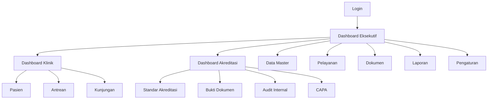

# UI/UX Design Document SIMMAK PPKP

> Dokumen enterprise untuk rancangan antarmuka, pengalaman pengguna, dan sistem desain SIMMAK PPKP.
> Bahasa dokumen: Indonesia profesional. Domain: enterprise healthcare SaaS.
> Referensi mockup: `../mockups/dashboard.png`, `../mockups/clinic-dashboard.png`, `../mockups/accreditation-dashboard.png`.

## 0. Metadata Dokumen

| Atribut | Nilai |
|---|---|
| Produk | SIMMAK PPKP |
| Jenis dokumen | UI/UX Design Document |
| Target pengguna | Eksekutif, klinik, akreditasi, operator, auditor, tenaga kesehatan, administrator |
| Platform | Web responsif, desktop-first, tablet-ready, mobile companion |
| Gaya visual | Modern healthcare, bersih, profesional, penuh warna terkendali |
| Standar aksesibilitas | WCAG 2.1 AA |
| Mode warna | Light mode utama, dark mode opsional |

## 1. Ringkasan Eksekutif

SIMMAK PPKP dirancang sebagai sistem manajemen klinik, pemantauan pelayanan, dan tata kelola akreditasi yang menyatukan data operasional, kualitas layanan, dokumen, indikator, serta alur kerja lintas peran.
Pengalaman pengguna harus terasa cepat, jelas, aman, dan meyakinkan karena pengguna bekerja dengan data kesehatan, indikator mutu, dan dokumen administratif yang berdampak langsung pada layanan.
Desain visual menggabungkan palet teal dan biru sebagai identitas healthcare modern, dilengkapi warna semantik untuk status klinis, risiko, akreditasi, dan progres kerja.
Dashboard harus informatif dan berwarna, tetapi tetap profesional: warna digunakan untuk membedakan prioritas, bukan sebagai dekorasi berlebihan.

## 2. Prinsip Desain Produk

1. Kejelasan sebelum kepadatan: setiap layar harus menunjukkan prioritas utama lebih dulu.
2. Konteks selalu terlihat: pengguna harus tahu modul, fasilitas, periode, status, dan tindakan berikutnya.
3. Data klinis diperlakukan serius: angka, status, dan dokumen harus mudah diverifikasi.
4. Aksi utama konsisten: tombol primer selalu merepresentasikan langkah paling penting.
5. Tabel adalah alat kerja: sort, filter, pencarian, ekspor, dan status harus tersedia pada daftar data kritikal.
6. Dashboard adalah cockpit: menampilkan sinyal, tren, anomali, dan tindakan cepat.
7. Formulir panjang dipecah menjadi bagian logis dengan penyimpanan progres.
8. Aksesibilitas bukan tambahan: kontras, keyboard, label, dan feedback wajib dari awal.
9. Mobile digunakan untuk monitoring, scan QR, approval ringan, dan input cepat.
10. Bahasa Indonesia harus natural, langsung, dan sesuai konteks pelayanan kesehatan.

## 3. Persona Pengguna

### Persona: Direktur atau Kepala PPKP
- Tujuan: Melihat performa lintas klinik, risiko, indikator strategis, dan progres akreditasi.
- Kebutuhan UX: Butuh ringkasan visual, insight cepat, dan kemampuan drill-down.
- Risiko UX: informasi terlalu padat, status tidak jelas, atau aksi kritikal tersamarkan.
- Solusi desain: hierarchy visual kuat, filter kontekstual, warna semantik, dan microcopy yang membantu.

### Persona: Manajer Klinik
- Tujuan: Memantau antrean, kunjungan, layanan, SDM, dan tindak lanjut harian.
- Kebutuhan UX: Butuh dashboard operasional real-time dan notifikasi prioritas.
- Risiko UX: informasi terlalu padat, status tidak jelas, atau aksi kritikal tersamarkan.
- Solusi desain: hierarchy visual kuat, filter kontekstual, warna semantik, dan microcopy yang membantu.

### Persona: Tim Akreditasi
- Tujuan: Mengelola dokumen, elemen penilaian, bukti, jadwal audit, dan gap kepatuhan.
- Kebutuhan UX: Butuh workflow stepper, checklist, heatmap status, dan viewer dokumen.
- Risiko UX: informasi terlalu padat, status tidak jelas, atau aksi kritikal tersamarkan.
- Solusi desain: hierarchy visual kuat, filter kontekstual, warna semantik, dan microcopy yang membantu.

### Persona: Petugas Administrasi
- Tujuan: Input pasien, layanan, jadwal, klaim, dan laporan.
- Kebutuhan UX: Butuh form efisien, validasi jelas, dan tabel yang mudah disaring.
- Risiko UX: informasi terlalu padat, status tidak jelas, atau aksi kritikal tersamarkan.
- Solusi desain: hierarchy visual kuat, filter kontekstual, warna semantik, dan microcopy yang membantu.

### Persona: Auditor Internal
- Tujuan: Menilai kepatuhan, memberi temuan, dan memantau perbaikan.
- Kebutuhan UX: Butuh jejak audit, komentar, status CAPA, dan bukti yang mudah dibuka.
- Risiko UX: informasi terlalu padat, status tidak jelas, atau aksi kritikal tersamarkan.
- Solusi desain: hierarchy visual kuat, filter kontekstual, warna semantik, dan microcopy yang membantu.

### Persona: Tenaga Kesehatan
- Tujuan: Mengakses informasi layanan, tindakan, dan catatan yang relevan.
- Kebutuhan UX: Butuh antarmuka cepat, minim gangguan, dan aman untuk data pasien.
- Risiko UX: informasi terlalu padat, status tidak jelas, atau aksi kritikal tersamarkan.
- Solusi desain: hierarchy visual kuat, filter kontekstual, warna semantik, dan microcopy yang membantu.

## 4. Design System

Design system SIMMAK PPKP diberi nama **SIMMAK Care UI**.
Sistem ini mengatur token desain, komponen, pola interaksi, bahasa visual, dan aturan konten agar produk konsisten di seluruh modul.

### 4.1 Token Spacing

| Token | Nilai | Penggunaan |
|---|---:|---|
| space-0 | 0px | tanpa jarak |
| space-1 | 4px | jarak sangat kecil |
| space-2 | 8px | jarak antar elemen rapat |
| space-3 | 12px | padding kecil |
| space-4 | 16px | padding standar |
| space-5 | 20px | jarak antar grup kecil |
| space-6 | 24px | padding card dan section |
| space-8 | 32px | jarak antar section |
| space-10 | 40px | margin layout besar |
| space-12 | 48px | ruang hero atau panel besar |
| space-16 | 64px | ruang antar zona halaman |

Aturan spacing:
- SP-01: Gunakan `space-4` sebagai padding minimum area input dan toolbar.
- SP-02: Gunakan `space-6` untuk card dashboard agar konten bernafas.
- SP-03: Gunakan `space-8` antar section utama pada desktop.
- SP-04: Gunakan spacing vertikal lebih besar dari horizontal untuk meningkatkan scanability.
- SP-05: Jangan menumpuk lebih dari tiga kepadatan visual dalam satu viewport.
- SP-06: Gunakan `space-4` sebagai padding minimum area input dan toolbar.
- SP-07: Gunakan `space-6` untuk card dashboard agar konten bernafas.
- SP-08: Gunakan `space-8` antar section utama pada desktop.
- SP-09: Gunakan spacing vertikal lebih besar dari horizontal untuk meningkatkan scanability.
- SP-10: Jangan menumpuk lebih dari tiga kepadatan visual dalam satu viewport.
- SP-11: Gunakan `space-4` sebagai padding minimum area input dan toolbar.
- SP-12: Gunakan `space-6` untuk card dashboard agar konten bernafas.
- SP-13: Gunakan `space-8` antar section utama pada desktop.
- SP-14: Gunakan spacing vertikal lebih besar dari horizontal untuk meningkatkan scanability.
- SP-15: Jangan menumpuk lebih dari tiga kepadatan visual dalam satu viewport.
- SP-16: Gunakan `space-4` sebagai padding minimum area input dan toolbar.
- SP-17: Gunakan `space-6` untuk card dashboard agar konten bernafas.
- SP-18: Gunakan `space-8` antar section utama pada desktop.
- SP-19: Gunakan spacing vertikal lebih besar dari horizontal untuk meningkatkan scanability.
- SP-20: Jangan menumpuk lebih dari tiga kepadatan visual dalam satu viewport.

### 4.2 Grid dan Layout

- Desktop large: 12 kolom, gutter 24px, margin 32px.
- Desktop standard: 12 kolom, gutter 20px, margin 24px.
- Tablet: 8 kolom, gutter 16px, margin 20px.
- Mobile: 4 kolom, gutter 12px, margin 16px.
- Area dashboard menggunakan grid card fleksibel dengan rasio 1:1, 2:1, 3:1, dan full width.
- Konten administratif menggunakan layout master-detail saat viewport minimal 1280px.
- Form panjang menggunakan dua kolom pada desktop dan satu kolom pada tablet/mobile.
- Sidebar memiliki lebar 280px expanded dan 72px collapsed.
- Topbar memiliki tinggi 64px desktop dan 56px mobile.
- Sticky action bar digunakan untuk form panjang dengan aksi simpan, batal, dan validasi.

### 4.3 Elevation

| Token | Shadow | Penggunaan |
|---|---|---|
| `elevation-0` | none | panel rata, tabel dalam card |
| `elevation-1` | 0 1px 2px rgba(15,23,42,.08) | card biasa |
| `elevation-2` | 0 4px 12px rgba(15,23,42,.10) | dropdown, popover |
| `elevation-3` | 0 12px 28px rgba(15,23,42,.14) | modal, drawer |
| `elevation-4` | 0 20px 48px rgba(15,23,42,.18) | dialog kritikal |

Aturan elevation:
- Elevation harus mencerminkan lapisan interaksi, bukan sekadar dekorasi.
- Modal selalu memiliki overlay dengan opacity 40-56 persen.
- Card dashboard default memakai `elevation-1`, naik ke `elevation-2` pada hover.
- Drawer kanan untuk detail data memakai `elevation-3`.
- Hindari shadow berlebihan pada tampilan klinis agar data tetap dominan.

### 4.4 Radius

| Token | Nilai | Penggunaan |
|---|---:|---|
| `radius-xs` | 4px | badge kecil, tag |
| `radius-sm` | 6px | input, chip |
| `radius-md` | 10px | button, table row highlight |
| `radius-lg` | 14px | card, modal kecil |
| `radius-xl` | 20px | dashboard hero card |
| `radius-full` | 999px | avatar, pill badge |

### 4.5 Iconography

- Style ikon: outline rounded, stroke 1.75px, konsisten dengan ikon modern healthcare.
- Ukuran ikon standar: 16px untuk tabel, 20px untuk form, 24px untuk menu, 32px untuk empty state kecil, 48px untuk empty state besar.
- Ikon status harus didampingi teks, tidak boleh berdiri sendiri sebagai satu-satunya indikator.
- Ikon klinis: stethoscope, heart pulse, medical cross, clipboard check, document shield, hospital, qr code, chart line.
- Ikon akreditasi: shield check, file badge, target, checklist, alert triangle, timeline, stamp, evidence.
- Ikon navigasi harus tetap terbaca saat sidebar collapsed.

## 5. Color Palette

Palet warna menggabungkan teal sebagai identitas kesehatan, biru sebagai rasa profesional dan teknologi, serta warna semantik yang jelas untuk status.

### 5.1 Primary Teal

| Token | Hex | Penggunaan |
|---|---|---|
| teal-50 | #ECFDF5 | background lembut |
| teal-100 | #D1FAE5 | highlight sukses lembut |
| teal-200 | #A7F3D0 | chip aktif |
| teal-300 | #5EEAD4 | aksen ilustrasi |
| teal-400 | #2DD4BF | grafik positif |
| teal-500 | #14B8A6 | primary base |
| teal-600 | #0D9488 | primary button |
| teal-700 | #0F766E | hover primary |
| teal-800 | #115E59 | teks aksen gelap |
| teal-900 | #134E4A | dark mode panel |

### 5.2 Professional Blue

| Token | Hex | Penggunaan |
|---|---|---|
| blue-50 | #EFF6FF | background informasi |
| blue-100 | #DBEAFE | card info lembut |
| blue-200 | #BFDBFE | border info |
| blue-300 | #93C5FD | chart sekunder |
| blue-400 | #60A5FA | link hover |
| blue-500 | #3B82F6 | info base |
| blue-600 | #2563EB | link utama |
| blue-700 | #1D4ED8 | aksi sekunder kuat |
| blue-800 | #1E40AF | teks info gelap |
| blue-900 | #1E3A8A | dark mode info |

### 5.3 Semantic Colors

| Status | Token | Hex | Penggunaan |
|---|---|---|---|
| Sukses | success-600 | #16A34A | dokumen lengkap, indikator tercapai |
| Peringatan | warning-500 | #F59E0B | deadline dekat, data belum lengkap |
| Bahaya | danger-600 | #DC2626 | risiko tinggi, gagal validasi |
| Informasi | info-600 | #2563EB | notifikasi netral |
| Progres | progress-600 | #7C3AED | tahap sedang berjalan |
| Netral | neutral-600 | #475569 | status arsip atau tidak aktif |
| Akreditasi unggul | accreditation-gold | #D97706 | pencapaian unggul |
| Klinis prioritas | clinical-red | #E11D48 | kasus prioritas |
| Antrian | queue-cyan | #0891B2 | volume antrean |
| Review | review-violet | #8B5CF6 | butuh peninjauan |

### 5.4 Neutral Palette

| Token | Hex | Penggunaan |
|---|---|---|
| slate-50 | #F8FAFC | page background |
| slate-100 | #F1F5F9 | surface muted |
| slate-200 | #E2E8F0 | border |
| slate-300 | #CBD5E1 | divider |
| slate-400 | #94A3B8 | placeholder |
| slate-500 | #64748B | secondary text |
| slate-600 | #475569 | body muted |
| slate-700 | #334155 | body strong |
| slate-800 | #1E293B | heading |
| slate-900 | #0F172A | primary text |

### 5.5 Color Usage Rules
- CLR-01: Setiap status wajib memakai kombinasi warna, ikon, dan label teks.
- CLR-02: Gunakan teal untuk aksi utama dan konteks kesehatan umum.
- CLR-03: Gunakan biru untuk informasi sistem, link, dan navigasi sekunder.
- CLR-04: Gunakan merah hanya untuk risiko, error, atau prioritas klinis tinggi.
- CLR-05: Gunakan kuning untuk peringatan yang masih dapat diperbaiki.
- CLR-06: Gunakan ungu untuk review, workflow, dan proses akreditasi.
- CLR-07: Grafik dashboard boleh memakai warna lebih cerah selama label tetap jelas.
- CLR-08: Setiap status wajib memakai kombinasi warna, ikon, dan label teks.
- CLR-09: Gunakan teal untuk aksi utama dan konteks kesehatan umum.
- CLR-10: Gunakan biru untuk informasi sistem, link, dan navigasi sekunder.
- CLR-11: Gunakan merah hanya untuk risiko, error, atau prioritas klinis tinggi.
- CLR-12: Gunakan kuning untuk peringatan yang masih dapat diperbaiki.
- CLR-13: Gunakan ungu untuk review, workflow, dan proses akreditasi.
- CLR-14: Grafik dashboard boleh memakai warna lebih cerah selama label tetap jelas.
- CLR-15: Setiap status wajib memakai kombinasi warna, ikon, dan label teks.
- CLR-16: Gunakan teal untuk aksi utama dan konteks kesehatan umum.
- CLR-17: Gunakan biru untuk informasi sistem, link, dan navigasi sekunder.
- CLR-18: Gunakan merah hanya untuk risiko, error, atau prioritas klinis tinggi.
- CLR-19: Gunakan kuning untuk peringatan yang masih dapat diperbaiki.
- CLR-20: Gunakan ungu untuk review, workflow, dan proses akreditasi.
- CLR-21: Grafik dashboard boleh memakai warna lebih cerah selama label tetap jelas.
- CLR-22: Setiap status wajib memakai kombinasi warna, ikon, dan label teks.
- CLR-23: Gunakan teal untuk aksi utama dan konteks kesehatan umum.
- CLR-24: Gunakan biru untuk informasi sistem, link, dan navigasi sekunder.
- CLR-25: Gunakan merah hanya untuk risiko, error, atau prioritas klinis tinggi.
- CLR-26: Gunakan kuning untuk peringatan yang masih dapat diperbaiki.
- CLR-27: Gunakan ungu untuk review, workflow, dan proses akreditasi.
- CLR-28: Grafik dashboard boleh memakai warna lebih cerah selama label tetap jelas.
- CLR-29: Setiap status wajib memakai kombinasi warna, ikon, dan label teks.
- CLR-30: Gunakan teal untuk aksi utama dan konteks kesehatan umum.
- CLR-31: Gunakan biru untuk informasi sistem, link, dan navigasi sekunder.
- CLR-32: Gunakan merah hanya untuk risiko, error, atau prioritas klinis tinggi.
- CLR-33: Gunakan kuning untuk peringatan yang masih dapat diperbaiki.
- CLR-34: Gunakan ungu untuk review, workflow, dan proses akreditasi.
- CLR-35: Grafik dashboard boleh memakai warna lebih cerah selama label tetap jelas.

## 6. Typography

Font utama disarankan menggunakan `Inter` untuk antarmuka enterprise modern. Jika tidak tersedia, gunakan fallback `Segoe UI`, `Roboto`, `Arial`, sans-serif.
Untuk angka dashboard dan tabel, gunakan tabular numerals agar angka sejajar.

| Token | Ukuran | Line height | Weight | Penggunaan |
|---|---:|---:|---:|---|
| display-lg | 48px | 56px | 700 | judul hero dashboard |
| display-md | 40px | 48px | 700 | angka KPI besar |
| heading-xl | 32px | 40px | 700 | judul halaman |
| heading-lg | 28px | 36px | 700 | judul section utama |
| heading-md | 24px | 32px | 650 | judul card besar |
| heading-sm | 20px | 28px | 650 | judul card |
| body-lg | 18px | 28px | 400 | deskripsi penting |
| body-md | 16px | 24px | 400 | teks utama |
| body-sm | 14px | 20px | 400 | tabel dan form |
| caption | 12px | 16px | 500 | label kecil |
| overline | 11px | 14px | 700 | label uppercase terbatas |

Aturan tipografi:
- TYP-01: Judul halaman harus menjelaskan objek dan konteks, bukan hanya nama modul.
- TYP-02: Label form memakai sentence case dan tidak diakhiri titik.
- TYP-03: Angka KPI besar memakai weight 700 dengan line-height rapat.
- TYP-04: Teks bantuan memakai `body-sm` dan warna `slate-500`.
- TYP-05: Error form memakai `body-sm` dengan warna danger dan ikon kecil.
- TYP-06: Tabel memakai `body-sm` agar kepadatan data tetap efisien.
- TYP-07: Judul halaman harus menjelaskan objek dan konteks, bukan hanya nama modul.
- TYP-08: Label form memakai sentence case dan tidak diakhiri titik.
- TYP-09: Angka KPI besar memakai weight 700 dengan line-height rapat.
- TYP-10: Teks bantuan memakai `body-sm` dan warna `slate-500`.
- TYP-11: Error form memakai `body-sm` dengan warna danger dan ikon kecil.
- TYP-12: Tabel memakai `body-sm` agar kepadatan data tetap efisien.
- TYP-13: Judul halaman harus menjelaskan objek dan konteks, bukan hanya nama modul.
- TYP-14: Label form memakai sentence case dan tidak diakhiri titik.
- TYP-15: Angka KPI besar memakai weight 700 dengan line-height rapat.
- TYP-16: Teks bantuan memakai `body-sm` dan warna `slate-500`.
- TYP-17: Error form memakai `body-sm` dengan warna danger dan ikon kecil.
- TYP-18: Tabel memakai `body-sm` agar kepadatan data tetap efisien.
- TYP-19: Judul halaman harus menjelaskan objek dan konteks, bukan hanya nama modul.
- TYP-20: Label form memakai sentence case dan tidak diakhiri titik.
- TYP-21: Angka KPI besar memakai weight 700 dengan line-height rapat.
- TYP-22: Teks bantuan memakai `body-sm` dan warna `slate-500`.
- TYP-23: Error form memakai `body-sm` dengan warna danger dan ikon kecil.
- TYP-24: Tabel memakai `body-sm` agar kepadatan data tetap efisien.
- TYP-25: Judul halaman harus menjelaskan objek dan konteks, bukan hanya nama modul.
- TYP-26: Label form memakai sentence case dan tidak diakhiri titik.
- TYP-27: Angka KPI besar memakai weight 700 dengan line-height rapat.
- TYP-28: Teks bantuan memakai `body-sm` dan warna `slate-500`.
- TYP-29: Error form memakai `body-sm` dengan warna danger dan ikon kecil.
- TYP-30: Tabel memakai `body-sm` agar kepadatan data tetap efisien.

## 7. Navigation Architecture

Navigasi harus mendukung alur kerja lintas modul tanpa membuat pengguna kehilangan konteks organisasi, klinik, periode, dan role.



### 7.1 Struktur Sidebar
- NAV-01: Dashboard - muncul sesuai hak akses, dengan badge status bila ada item butuh tindakan.
- NAV-02: Klinik - muncul sesuai hak akses, dengan badge status bila ada item butuh tindakan.
- NAV-03: Pasien - muncul sesuai hak akses, dengan badge status bila ada item butuh tindakan.
- NAV-04: Antrean - muncul sesuai hak akses, dengan badge status bila ada item butuh tindakan.
- NAV-05: Kunjungan - muncul sesuai hak akses, dengan badge status bila ada item butuh tindakan.
- NAV-06: Layanan - muncul sesuai hak akses, dengan badge status bila ada item butuh tindakan.
- NAV-07: Farmasi - muncul sesuai hak akses, dengan badge status bila ada item butuh tindakan.
- NAV-08: Laboratorium - muncul sesuai hak akses, dengan badge status bila ada item butuh tindakan.
- NAV-09: Rujukan - muncul sesuai hak akses, dengan badge status bila ada item butuh tindakan.
- NAV-10: Pembayaran - muncul sesuai hak akses, dengan badge status bila ada item butuh tindakan.
- NAV-11: Akreditasi - muncul sesuai hak akses, dengan badge status bila ada item butuh tindakan.
- NAV-12: Dokumen - muncul sesuai hak akses, dengan badge status bila ada item butuh tindakan.
- NAV-13: Audit Internal - muncul sesuai hak akses, dengan badge status bila ada item butuh tindakan.
- NAV-14: CAPA - muncul sesuai hak akses, dengan badge status bila ada item butuh tindakan.
- NAV-15: Indikator Mutu - muncul sesuai hak akses, dengan badge status bila ada item butuh tindakan.
- NAV-16: Laporan - muncul sesuai hak akses, dengan badge status bila ada item butuh tindakan.
- NAV-17: Notifikasi - muncul sesuai hak akses, dengan badge status bila ada item butuh tindakan.
- NAV-18: Pengaturan - muncul sesuai hak akses, dengan badge status bila ada item butuh tindakan.

### 7.2 Breadcrumb
- Format: Beranda / Modul / Submodul / Objek.
- Breadcrumb harus dapat diklik sampai level submodul.
- Objek terakhir tidak perlu link.
- Pada mobile, tampilkan satu level sebelumnya dengan tombol kembali.

### 7.3 Global Header
- Pencarian global dengan shortcut `/`.
- Switch klinik atau unit kerja.
- Pemilih periode laporan.
- Notifikasi prioritas.
- Avatar pengguna dan menu akun.
- Tombol bantuan kontekstual.

## 8. Component Library

### 8.1 Komponen: Button
- Tujuan: Button membantu pengguna menyelesaikan tugas secara konsisten di seluruh SIMMAK PPKP.
- Anatomi: container, label, konten utama, status, helper text, dan aksi bila relevan.
- Varian: default, hover, focus, active, disabled, loading, error, success.
- Aksesibilitas: focus ring 2px, label programatik, keyboard support, dan kontras minimal AA.
- Responsif: ukuran dan layout menyesuaikan breakpoint tanpa menyembunyikan informasi kritikal.
- Microcopy: gunakan bahasa Indonesia yang langsung, spesifik, dan tidak menyalahkan pengguna.
- Validasi: tampilkan pesan dekat elemen yang bermasalah dan ringkasan error di atas form panjang.
- Data: bila memuat data sensitif, tampilkan masking atau pembatasan sesuai role.
- Jangan: memakai warna saja untuk status, membuat aksi destruktif terlalu dekat dengan aksi utama, atau menyembunyikan error.

### 8.2 Komponen: Icon Button
- Tujuan: Icon Button membantu pengguna menyelesaikan tugas secara konsisten di seluruh SIMMAK PPKP.
- Anatomi: container, label, konten utama, status, helper text, dan aksi bila relevan.
- Varian: default, hover, focus, active, disabled, loading, error, success.
- Aksesibilitas: focus ring 2px, label programatik, keyboard support, dan kontras minimal AA.
- Responsif: ukuran dan layout menyesuaikan breakpoint tanpa menyembunyikan informasi kritikal.
- Microcopy: gunakan bahasa Indonesia yang langsung, spesifik, dan tidak menyalahkan pengguna.
- Validasi: tampilkan pesan dekat elemen yang bermasalah dan ringkasan error di atas form panjang.
- Data: bila memuat data sensitif, tampilkan masking atau pembatasan sesuai role.
- Jangan: memakai warna saja untuk status, membuat aksi destruktif terlalu dekat dengan aksi utama, atau menyembunyikan error.

### 8.3 Komponen: Split Button
- Tujuan: Split Button membantu pengguna menyelesaikan tugas secara konsisten di seluruh SIMMAK PPKP.
- Anatomi: container, label, konten utama, status, helper text, dan aksi bila relevan.
- Varian: default, hover, focus, active, disabled, loading, error, success.
- Aksesibilitas: focus ring 2px, label programatik, keyboard support, dan kontras minimal AA.
- Responsif: ukuran dan layout menyesuaikan breakpoint tanpa menyembunyikan informasi kritikal.
- Microcopy: gunakan bahasa Indonesia yang langsung, spesifik, dan tidak menyalahkan pengguna.
- Validasi: tampilkan pesan dekat elemen yang bermasalah dan ringkasan error di atas form panjang.
- Data: bila memuat data sensitif, tampilkan masking atau pembatasan sesuai role.
- Jangan: memakai warna saja untuk status, membuat aksi destruktif terlalu dekat dengan aksi utama, atau menyembunyikan error.

### 8.4 Komponen: Input Text
- Tujuan: Input Text membantu pengguna menyelesaikan tugas secara konsisten di seluruh SIMMAK PPKP.
- Anatomi: container, label, konten utama, status, helper text, dan aksi bila relevan.
- Varian: default, hover, focus, active, disabled, loading, error, success.
- Aksesibilitas: focus ring 2px, label programatik, keyboard support, dan kontras minimal AA.
- Responsif: ukuran dan layout menyesuaikan breakpoint tanpa menyembunyikan informasi kritikal.
- Microcopy: gunakan bahasa Indonesia yang langsung, spesifik, dan tidak menyalahkan pengguna.
- Validasi: tampilkan pesan dekat elemen yang bermasalah dan ringkasan error di atas form panjang.
- Data: bila memuat data sensitif, tampilkan masking atau pembatasan sesuai role.
- Jangan: memakai warna saja untuk status, membuat aksi destruktif terlalu dekat dengan aksi utama, atau menyembunyikan error.

### 8.5 Komponen: Textarea
- Tujuan: Textarea membantu pengguna menyelesaikan tugas secara konsisten di seluruh SIMMAK PPKP.
- Anatomi: container, label, konten utama, status, helper text, dan aksi bila relevan.
- Varian: default, hover, focus, active, disabled, loading, error, success.
- Aksesibilitas: focus ring 2px, label programatik, keyboard support, dan kontras minimal AA.
- Responsif: ukuran dan layout menyesuaikan breakpoint tanpa menyembunyikan informasi kritikal.
- Microcopy: gunakan bahasa Indonesia yang langsung, spesifik, dan tidak menyalahkan pengguna.
- Validasi: tampilkan pesan dekat elemen yang bermasalah dan ringkasan error di atas form panjang.
- Data: bila memuat data sensitif, tampilkan masking atau pembatasan sesuai role.
- Jangan: memakai warna saja untuk status, membuat aksi destruktif terlalu dekat dengan aksi utama, atau menyembunyikan error.

### 8.6 Komponen: Select
- Tujuan: Select membantu pengguna menyelesaikan tugas secara konsisten di seluruh SIMMAK PPKP.
- Anatomi: container, label, konten utama, status, helper text, dan aksi bila relevan.
- Varian: default, hover, focus, active, disabled, loading, error, success.
- Aksesibilitas: focus ring 2px, label programatik, keyboard support, dan kontras minimal AA.
- Responsif: ukuran dan layout menyesuaikan breakpoint tanpa menyembunyikan informasi kritikal.
- Microcopy: gunakan bahasa Indonesia yang langsung, spesifik, dan tidak menyalahkan pengguna.
- Validasi: tampilkan pesan dekat elemen yang bermasalah dan ringkasan error di atas form panjang.
- Data: bila memuat data sensitif, tampilkan masking atau pembatasan sesuai role.
- Jangan: memakai warna saja untuk status, membuat aksi destruktif terlalu dekat dengan aksi utama, atau menyembunyikan error.

### 8.7 Komponen: Combobox
- Tujuan: Combobox membantu pengguna menyelesaikan tugas secara konsisten di seluruh SIMMAK PPKP.
- Anatomi: container, label, konten utama, status, helper text, dan aksi bila relevan.
- Varian: default, hover, focus, active, disabled, loading, error, success.
- Aksesibilitas: focus ring 2px, label programatik, keyboard support, dan kontras minimal AA.
- Responsif: ukuran dan layout menyesuaikan breakpoint tanpa menyembunyikan informasi kritikal.
- Microcopy: gunakan bahasa Indonesia yang langsung, spesifik, dan tidak menyalahkan pengguna.
- Validasi: tampilkan pesan dekat elemen yang bermasalah dan ringkasan error di atas form panjang.
- Data: bila memuat data sensitif, tampilkan masking atau pembatasan sesuai role.
- Jangan: memakai warna saja untuk status, membuat aksi destruktif terlalu dekat dengan aksi utama, atau menyembunyikan error.

### 8.8 Komponen: Date Picker
- Tujuan: Date Picker membantu pengguna menyelesaikan tugas secara konsisten di seluruh SIMMAK PPKP.
- Anatomi: container, label, konten utama, status, helper text, dan aksi bila relevan.
- Varian: default, hover, focus, active, disabled, loading, error, success.
- Aksesibilitas: focus ring 2px, label programatik, keyboard support, dan kontras minimal AA.
- Responsif: ukuran dan layout menyesuaikan breakpoint tanpa menyembunyikan informasi kritikal.
- Microcopy: gunakan bahasa Indonesia yang langsung, spesifik, dan tidak menyalahkan pengguna.
- Validasi: tampilkan pesan dekat elemen yang bermasalah dan ringkasan error di atas form panjang.
- Data: bila memuat data sensitif, tampilkan masking atau pembatasan sesuai role.
- Jangan: memakai warna saja untuk status, membuat aksi destruktif terlalu dekat dengan aksi utama, atau menyembunyikan error.

### 8.9 Komponen: Date Range Picker
- Tujuan: Date Range Picker membantu pengguna menyelesaikan tugas secara konsisten di seluruh SIMMAK PPKP.
- Anatomi: container, label, konten utama, status, helper text, dan aksi bila relevan.
- Varian: default, hover, focus, active, disabled, loading, error, success.
- Aksesibilitas: focus ring 2px, label programatik, keyboard support, dan kontras minimal AA.
- Responsif: ukuran dan layout menyesuaikan breakpoint tanpa menyembunyikan informasi kritikal.
- Microcopy: gunakan bahasa Indonesia yang langsung, spesifik, dan tidak menyalahkan pengguna.
- Validasi: tampilkan pesan dekat elemen yang bermasalah dan ringkasan error di atas form panjang.
- Data: bila memuat data sensitif, tampilkan masking atau pembatasan sesuai role.
- Jangan: memakai warna saja untuk status, membuat aksi destruktif terlalu dekat dengan aksi utama, atau menyembunyikan error.

### 8.10 Komponen: Checkbox
- Tujuan: Checkbox membantu pengguna menyelesaikan tugas secara konsisten di seluruh SIMMAK PPKP.
- Anatomi: container, label, konten utama, status, helper text, dan aksi bila relevan.
- Varian: default, hover, focus, active, disabled, loading, error, success.
- Aksesibilitas: focus ring 2px, label programatik, keyboard support, dan kontras minimal AA.
- Responsif: ukuran dan layout menyesuaikan breakpoint tanpa menyembunyikan informasi kritikal.
- Microcopy: gunakan bahasa Indonesia yang langsung, spesifik, dan tidak menyalahkan pengguna.
- Validasi: tampilkan pesan dekat elemen yang bermasalah dan ringkasan error di atas form panjang.
- Data: bila memuat data sensitif, tampilkan masking atau pembatasan sesuai role.
- Jangan: memakai warna saja untuk status, membuat aksi destruktif terlalu dekat dengan aksi utama, atau menyembunyikan error.

### 8.11 Komponen: Radio
- Tujuan: Radio membantu pengguna menyelesaikan tugas secara konsisten di seluruh SIMMAK PPKP.
- Anatomi: container, label, konten utama, status, helper text, dan aksi bila relevan.
- Varian: default, hover, focus, active, disabled, loading, error, success.
- Aksesibilitas: focus ring 2px, label programatik, keyboard support, dan kontras minimal AA.
- Responsif: ukuran dan layout menyesuaikan breakpoint tanpa menyembunyikan informasi kritikal.
- Microcopy: gunakan bahasa Indonesia yang langsung, spesifik, dan tidak menyalahkan pengguna.
- Validasi: tampilkan pesan dekat elemen yang bermasalah dan ringkasan error di atas form panjang.
- Data: bila memuat data sensitif, tampilkan masking atau pembatasan sesuai role.
- Jangan: memakai warna saja untuk status, membuat aksi destruktif terlalu dekat dengan aksi utama, atau menyembunyikan error.

### 8.12 Komponen: Switch
- Tujuan: Switch membantu pengguna menyelesaikan tugas secara konsisten di seluruh SIMMAK PPKP.
- Anatomi: container, label, konten utama, status, helper text, dan aksi bila relevan.
- Varian: default, hover, focus, active, disabled, loading, error, success.
- Aksesibilitas: focus ring 2px, label programatik, keyboard support, dan kontras minimal AA.
- Responsif: ukuran dan layout menyesuaikan breakpoint tanpa menyembunyikan informasi kritikal.
- Microcopy: gunakan bahasa Indonesia yang langsung, spesifik, dan tidak menyalahkan pengguna.
- Validasi: tampilkan pesan dekat elemen yang bermasalah dan ringkasan error di atas form panjang.
- Data: bila memuat data sensitif, tampilkan masking atau pembatasan sesuai role.
- Jangan: memakai warna saja untuk status, membuat aksi destruktif terlalu dekat dengan aksi utama, atau menyembunyikan error.

### 8.13 Komponen: File Upload
- Tujuan: File Upload membantu pengguna menyelesaikan tugas secara konsisten di seluruh SIMMAK PPKP.
- Anatomi: container, label, konten utama, status, helper text, dan aksi bila relevan.
- Varian: default, hover, focus, active, disabled, loading, error, success.
- Aksesibilitas: focus ring 2px, label programatik, keyboard support, dan kontras minimal AA.
- Responsif: ukuran dan layout menyesuaikan breakpoint tanpa menyembunyikan informasi kritikal.
- Microcopy: gunakan bahasa Indonesia yang langsung, spesifik, dan tidak menyalahkan pengguna.
- Validasi: tampilkan pesan dekat elemen yang bermasalah dan ringkasan error di atas form panjang.
- Data: bila memuat data sensitif, tampilkan masking atau pembatasan sesuai role.
- Jangan: memakai warna saja untuk status, membuat aksi destruktif terlalu dekat dengan aksi utama, atau menyembunyikan error.

### 8.14 Komponen: Drag Drop Upload
- Tujuan: Drag Drop Upload membantu pengguna menyelesaikan tugas secara konsisten di seluruh SIMMAK PPKP.
- Anatomi: container, label, konten utama, status, helper text, dan aksi bila relevan.
- Varian: default, hover, focus, active, disabled, loading, error, success.
- Aksesibilitas: focus ring 2px, label programatik, keyboard support, dan kontras minimal AA.
- Responsif: ukuran dan layout menyesuaikan breakpoint tanpa menyembunyikan informasi kritikal.
- Microcopy: gunakan bahasa Indonesia yang langsung, spesifik, dan tidak menyalahkan pengguna.
- Validasi: tampilkan pesan dekat elemen yang bermasalah dan ringkasan error di atas form panjang.
- Data: bila memuat data sensitif, tampilkan masking atau pembatasan sesuai role.
- Jangan: memakai warna saja untuk status, membuat aksi destruktif terlalu dekat dengan aksi utama, atau menyembunyikan error.

### 8.15 Komponen: Search Field
- Tujuan: Search Field membantu pengguna menyelesaikan tugas secara konsisten di seluruh SIMMAK PPKP.
- Anatomi: container, label, konten utama, status, helper text, dan aksi bila relevan.
- Varian: default, hover, focus, active, disabled, loading, error, success.
- Aksesibilitas: focus ring 2px, label programatik, keyboard support, dan kontras minimal AA.
- Responsif: ukuran dan layout menyesuaikan breakpoint tanpa menyembunyikan informasi kritikal.
- Microcopy: gunakan bahasa Indonesia yang langsung, spesifik, dan tidak menyalahkan pengguna.
- Validasi: tampilkan pesan dekat elemen yang bermasalah dan ringkasan error di atas form panjang.
- Data: bila memuat data sensitif, tampilkan masking atau pembatasan sesuai role.
- Jangan: memakai warna saja untuk status, membuat aksi destruktif terlalu dekat dengan aksi utama, atau menyembunyikan error.

### 8.16 Komponen: Filter Bar
- Tujuan: Filter Bar membantu pengguna menyelesaikan tugas secara konsisten di seluruh SIMMAK PPKP.
- Anatomi: container, label, konten utama, status, helper text, dan aksi bila relevan.
- Varian: default, hover, focus, active, disabled, loading, error, success.
- Aksesibilitas: focus ring 2px, label programatik, keyboard support, dan kontras minimal AA.
- Responsif: ukuran dan layout menyesuaikan breakpoint tanpa menyembunyikan informasi kritikal.
- Microcopy: gunakan bahasa Indonesia yang langsung, spesifik, dan tidak menyalahkan pengguna.
- Validasi: tampilkan pesan dekat elemen yang bermasalah dan ringkasan error di atas form panjang.
- Data: bila memuat data sensitif, tampilkan masking atau pembatasan sesuai role.
- Jangan: memakai warna saja untuk status, membuat aksi destruktif terlalu dekat dengan aksi utama, atau menyembunyikan error.

### 8.17 Komponen: Data Table
- Tujuan: Data Table membantu pengguna menyelesaikan tugas secara konsisten di seluruh SIMMAK PPKP.
- Anatomi: container, label, konten utama, status, helper text, dan aksi bila relevan.
- Varian: default, hover, focus, active, disabled, loading, error, success.
- Aksesibilitas: focus ring 2px, label programatik, keyboard support, dan kontras minimal AA.
- Responsif: ukuran dan layout menyesuaikan breakpoint tanpa menyembunyikan informasi kritikal.
- Microcopy: gunakan bahasa Indonesia yang langsung, spesifik, dan tidak menyalahkan pengguna.
- Validasi: tampilkan pesan dekat elemen yang bermasalah dan ringkasan error di atas form panjang.
- Data: bila memuat data sensitif, tampilkan masking atau pembatasan sesuai role.
- Jangan: memakai warna saja untuk status, membuat aksi destruktif terlalu dekat dengan aksi utama, atau menyembunyikan error.

### 8.18 Komponen: Pagination
- Tujuan: Pagination membantu pengguna menyelesaikan tugas secara konsisten di seluruh SIMMAK PPKP.
- Anatomi: container, label, konten utama, status, helper text, dan aksi bila relevan.
- Varian: default, hover, focus, active, disabled, loading, error, success.
- Aksesibilitas: focus ring 2px, label programatik, keyboard support, dan kontras minimal AA.
- Responsif: ukuran dan layout menyesuaikan breakpoint tanpa menyembunyikan informasi kritikal.
- Microcopy: gunakan bahasa Indonesia yang langsung, spesifik, dan tidak menyalahkan pengguna.
- Validasi: tampilkan pesan dekat elemen yang bermasalah dan ringkasan error di atas form panjang.
- Data: bila memuat data sensitif, tampilkan masking atau pembatasan sesuai role.
- Jangan: memakai warna saja untuk status, membuat aksi destruktif terlalu dekat dengan aksi utama, atau menyembunyikan error.

### 8.19 Komponen: Card
- Tujuan: Card membantu pengguna menyelesaikan tugas secara konsisten di seluruh SIMMAK PPKP.
- Anatomi: container, label, konten utama, status, helper text, dan aksi bila relevan.
- Varian: default, hover, focus, active, disabled, loading, error, success.
- Aksesibilitas: focus ring 2px, label programatik, keyboard support, dan kontras minimal AA.
- Responsif: ukuran dan layout menyesuaikan breakpoint tanpa menyembunyikan informasi kritikal.
- Microcopy: gunakan bahasa Indonesia yang langsung, spesifik, dan tidak menyalahkan pengguna.
- Validasi: tampilkan pesan dekat elemen yang bermasalah dan ringkasan error di atas form panjang.
- Data: bila memuat data sensitif, tampilkan masking atau pembatasan sesuai role.
- Jangan: memakai warna saja untuk status, membuat aksi destruktif terlalu dekat dengan aksi utama, atau menyembunyikan error.

### 8.20 Komponen: Metric Card
- Tujuan: Metric Card membantu pengguna menyelesaikan tugas secara konsisten di seluruh SIMMAK PPKP.
- Anatomi: container, label, konten utama, status, helper text, dan aksi bila relevan.
- Varian: default, hover, focus, active, disabled, loading, error, success.
- Aksesibilitas: focus ring 2px, label programatik, keyboard support, dan kontras minimal AA.
- Responsif: ukuran dan layout menyesuaikan breakpoint tanpa menyembunyikan informasi kritikal.
- Microcopy: gunakan bahasa Indonesia yang langsung, spesifik, dan tidak menyalahkan pengguna.
- Validasi: tampilkan pesan dekat elemen yang bermasalah dan ringkasan error di atas form panjang.
- Data: bila memuat data sensitif, tampilkan masking atau pembatasan sesuai role.
- Jangan: memakai warna saja untuk status, membuat aksi destruktif terlalu dekat dengan aksi utama, atau menyembunyikan error.

### 8.21 Komponen: Trend Card
- Tujuan: Trend Card membantu pengguna menyelesaikan tugas secara konsisten di seluruh SIMMAK PPKP.
- Anatomi: container, label, konten utama, status, helper text, dan aksi bila relevan.
- Varian: default, hover, focus, active, disabled, loading, error, success.
- Aksesibilitas: focus ring 2px, label programatik, keyboard support, dan kontras minimal AA.
- Responsif: ukuran dan layout menyesuaikan breakpoint tanpa menyembunyikan informasi kritikal.
- Microcopy: gunakan bahasa Indonesia yang langsung, spesifik, dan tidak menyalahkan pengguna.
- Validasi: tampilkan pesan dekat elemen yang bermasalah dan ringkasan error di atas form panjang.
- Data: bila memuat data sensitif, tampilkan masking atau pembatasan sesuai role.
- Jangan: memakai warna saja untuk status, membuat aksi destruktif terlalu dekat dengan aksi utama, atau menyembunyikan error.

### 8.22 Komponen: Modal
- Tujuan: Modal membantu pengguna menyelesaikan tugas secara konsisten di seluruh SIMMAK PPKP.
- Anatomi: container, label, konten utama, status, helper text, dan aksi bila relevan.
- Varian: default, hover, focus, active, disabled, loading, error, success.
- Aksesibilitas: focus ring 2px, label programatik, keyboard support, dan kontras minimal AA.
- Responsif: ukuran dan layout menyesuaikan breakpoint tanpa menyembunyikan informasi kritikal.
- Microcopy: gunakan bahasa Indonesia yang langsung, spesifik, dan tidak menyalahkan pengguna.
- Validasi: tampilkan pesan dekat elemen yang bermasalah dan ringkasan error di atas form panjang.
- Data: bila memuat data sensitif, tampilkan masking atau pembatasan sesuai role.
- Jangan: memakai warna saja untuk status, membuat aksi destruktif terlalu dekat dengan aksi utama, atau menyembunyikan error.

### 8.23 Komponen: Drawer
- Tujuan: Drawer membantu pengguna menyelesaikan tugas secara konsisten di seluruh SIMMAK PPKP.
- Anatomi: container, label, konten utama, status, helper text, dan aksi bila relevan.
- Varian: default, hover, focus, active, disabled, loading, error, success.
- Aksesibilitas: focus ring 2px, label programatik, keyboard support, dan kontras minimal AA.
- Responsif: ukuran dan layout menyesuaikan breakpoint tanpa menyembunyikan informasi kritikal.
- Microcopy: gunakan bahasa Indonesia yang langsung, spesifik, dan tidak menyalahkan pengguna.
- Validasi: tampilkan pesan dekat elemen yang bermasalah dan ringkasan error di atas form panjang.
- Data: bila memuat data sensitif, tampilkan masking atau pembatasan sesuai role.
- Jangan: memakai warna saja untuk status, membuat aksi destruktif terlalu dekat dengan aksi utama, atau menyembunyikan error.

### 8.24 Komponen: Popover
- Tujuan: Popover membantu pengguna menyelesaikan tugas secara konsisten di seluruh SIMMAK PPKP.
- Anatomi: container, label, konten utama, status, helper text, dan aksi bila relevan.
- Varian: default, hover, focus, active, disabled, loading, error, success.
- Aksesibilitas: focus ring 2px, label programatik, keyboard support, dan kontras minimal AA.
- Responsif: ukuran dan layout menyesuaikan breakpoint tanpa menyembunyikan informasi kritikal.
- Microcopy: gunakan bahasa Indonesia yang langsung, spesifik, dan tidak menyalahkan pengguna.
- Validasi: tampilkan pesan dekat elemen yang bermasalah dan ringkasan error di atas form panjang.
- Data: bila memuat data sensitif, tampilkan masking atau pembatasan sesuai role.
- Jangan: memakai warna saja untuk status, membuat aksi destruktif terlalu dekat dengan aksi utama, atau menyembunyikan error.

### 8.25 Komponen: Tooltip
- Tujuan: Tooltip membantu pengguna menyelesaikan tugas secara konsisten di seluruh SIMMAK PPKP.
- Anatomi: container, label, konten utama, status, helper text, dan aksi bila relevan.
- Varian: default, hover, focus, active, disabled, loading, error, success.
- Aksesibilitas: focus ring 2px, label programatik, keyboard support, dan kontras minimal AA.
- Responsif: ukuran dan layout menyesuaikan breakpoint tanpa menyembunyikan informasi kritikal.
- Microcopy: gunakan bahasa Indonesia yang langsung, spesifik, dan tidak menyalahkan pengguna.
- Validasi: tampilkan pesan dekat elemen yang bermasalah dan ringkasan error di atas form panjang.
- Data: bila memuat data sensitif, tampilkan masking atau pembatasan sesuai role.
- Jangan: memakai warna saja untuk status, membuat aksi destruktif terlalu dekat dengan aksi utama, atau menyembunyikan error.

### 8.26 Komponen: Toast
- Tujuan: Toast membantu pengguna menyelesaikan tugas secara konsisten di seluruh SIMMAK PPKP.
- Anatomi: container, label, konten utama, status, helper text, dan aksi bila relevan.
- Varian: default, hover, focus, active, disabled, loading, error, success.
- Aksesibilitas: focus ring 2px, label programatik, keyboard support, dan kontras minimal AA.
- Responsif: ukuran dan layout menyesuaikan breakpoint tanpa menyembunyikan informasi kritikal.
- Microcopy: gunakan bahasa Indonesia yang langsung, spesifik, dan tidak menyalahkan pengguna.
- Validasi: tampilkan pesan dekat elemen yang bermasalah dan ringkasan error di atas form panjang.
- Data: bila memuat data sensitif, tampilkan masking atau pembatasan sesuai role.
- Jangan: memakai warna saja untuk status, membuat aksi destruktif terlalu dekat dengan aksi utama, atau menyembunyikan error.

### 8.27 Komponen: Alert
- Tujuan: Alert membantu pengguna menyelesaikan tugas secara konsisten di seluruh SIMMAK PPKP.
- Anatomi: container, label, konten utama, status, helper text, dan aksi bila relevan.
- Varian: default, hover, focus, active, disabled, loading, error, success.
- Aksesibilitas: focus ring 2px, label programatik, keyboard support, dan kontras minimal AA.
- Responsif: ukuran dan layout menyesuaikan breakpoint tanpa menyembunyikan informasi kritikal.
- Microcopy: gunakan bahasa Indonesia yang langsung, spesifik, dan tidak menyalahkan pengguna.
- Validasi: tampilkan pesan dekat elemen yang bermasalah dan ringkasan error di atas form panjang.
- Data: bila memuat data sensitif, tampilkan masking atau pembatasan sesuai role.
- Jangan: memakai warna saja untuk status, membuat aksi destruktif terlalu dekat dengan aksi utama, atau menyembunyikan error.

### 8.28 Komponen: Badge
- Tujuan: Badge membantu pengguna menyelesaikan tugas secara konsisten di seluruh SIMMAK PPKP.
- Anatomi: container, label, konten utama, status, helper text, dan aksi bila relevan.
- Varian: default, hover, focus, active, disabled, loading, error, success.
- Aksesibilitas: focus ring 2px, label programatik, keyboard support, dan kontras minimal AA.
- Responsif: ukuran dan layout menyesuaikan breakpoint tanpa menyembunyikan informasi kritikal.
- Microcopy: gunakan bahasa Indonesia yang langsung, spesifik, dan tidak menyalahkan pengguna.
- Validasi: tampilkan pesan dekat elemen yang bermasalah dan ringkasan error di atas form panjang.
- Data: bila memuat data sensitif, tampilkan masking atau pembatasan sesuai role.
- Jangan: memakai warna saja untuk status, membuat aksi destruktif terlalu dekat dengan aksi utama, atau menyembunyikan error.

### 8.29 Komponen: Chip
- Tujuan: Chip membantu pengguna menyelesaikan tugas secara konsisten di seluruh SIMMAK PPKP.
- Anatomi: container, label, konten utama, status, helper text, dan aksi bila relevan.
- Varian: default, hover, focus, active, disabled, loading, error, success.
- Aksesibilitas: focus ring 2px, label programatik, keyboard support, dan kontras minimal AA.
- Responsif: ukuran dan layout menyesuaikan breakpoint tanpa menyembunyikan informasi kritikal.
- Microcopy: gunakan bahasa Indonesia yang langsung, spesifik, dan tidak menyalahkan pengguna.
- Validasi: tampilkan pesan dekat elemen yang bermasalah dan ringkasan error di atas form panjang.
- Data: bila memuat data sensitif, tampilkan masking atau pembatasan sesuai role.
- Jangan: memakai warna saja untuk status, membuat aksi destruktif terlalu dekat dengan aksi utama, atau menyembunyikan error.

### 8.30 Komponen: Tabs
- Tujuan: Tabs membantu pengguna menyelesaikan tugas secara konsisten di seluruh SIMMAK PPKP.
- Anatomi: container, label, konten utama, status, helper text, dan aksi bila relevan.
- Varian: default, hover, focus, active, disabled, loading, error, success.
- Aksesibilitas: focus ring 2px, label programatik, keyboard support, dan kontras minimal AA.
- Responsif: ukuran dan layout menyesuaikan breakpoint tanpa menyembunyikan informasi kritikal.
- Microcopy: gunakan bahasa Indonesia yang langsung, spesifik, dan tidak menyalahkan pengguna.
- Validasi: tampilkan pesan dekat elemen yang bermasalah dan ringkasan error di atas form panjang.
- Data: bila memuat data sensitif, tampilkan masking atau pembatasan sesuai role.
- Jangan: memakai warna saja untuk status, membuat aksi destruktif terlalu dekat dengan aksi utama, atau menyembunyikan error.

### 8.31 Komponen: Accordion
- Tujuan: Accordion membantu pengguna menyelesaikan tugas secara konsisten di seluruh SIMMAK PPKP.
- Anatomi: container, label, konten utama, status, helper text, dan aksi bila relevan.
- Varian: default, hover, focus, active, disabled, loading, error, success.
- Aksesibilitas: focus ring 2px, label programatik, keyboard support, dan kontras minimal AA.
- Responsif: ukuran dan layout menyesuaikan breakpoint tanpa menyembunyikan informasi kritikal.
- Microcopy: gunakan bahasa Indonesia yang langsung, spesifik, dan tidak menyalahkan pengguna.
- Validasi: tampilkan pesan dekat elemen yang bermasalah dan ringkasan error di atas form panjang.
- Data: bila memuat data sensitif, tampilkan masking atau pembatasan sesuai role.
- Jangan: memakai warna saja untuk status, membuat aksi destruktif terlalu dekat dengan aksi utama, atau menyembunyikan error.

### 8.32 Komponen: Stepper
- Tujuan: Stepper membantu pengguna menyelesaikan tugas secara konsisten di seluruh SIMMAK PPKP.
- Anatomi: container, label, konten utama, status, helper text, dan aksi bila relevan.
- Varian: default, hover, focus, active, disabled, loading, error, success.
- Aksesibilitas: focus ring 2px, label programatik, keyboard support, dan kontras minimal AA.
- Responsif: ukuran dan layout menyesuaikan breakpoint tanpa menyembunyikan informasi kritikal.
- Microcopy: gunakan bahasa Indonesia yang langsung, spesifik, dan tidak menyalahkan pengguna.
- Validasi: tampilkan pesan dekat elemen yang bermasalah dan ringkasan error di atas form panjang.
- Data: bila memuat data sensitif, tampilkan masking atau pembatasan sesuai role.
- Jangan: memakai warna saja untuk status, membuat aksi destruktif terlalu dekat dengan aksi utama, atau menyembunyikan error.

### 8.33 Komponen: Timeline
- Tujuan: Timeline membantu pengguna menyelesaikan tugas secara konsisten di seluruh SIMMAK PPKP.
- Anatomi: container, label, konten utama, status, helper text, dan aksi bila relevan.
- Varian: default, hover, focus, active, disabled, loading, error, success.
- Aksesibilitas: focus ring 2px, label programatik, keyboard support, dan kontras minimal AA.
- Responsif: ukuran dan layout menyesuaikan breakpoint tanpa menyembunyikan informasi kritikal.
- Microcopy: gunakan bahasa Indonesia yang langsung, spesifik, dan tidak menyalahkan pengguna.
- Validasi: tampilkan pesan dekat elemen yang bermasalah dan ringkasan error di atas form panjang.
- Data: bila memuat data sensitif, tampilkan masking atau pembatasan sesuai role.
- Jangan: memakai warna saja untuk status, membuat aksi destruktif terlalu dekat dengan aksi utama, atau menyembunyikan error.

### 8.34 Komponen: Chart Container
- Tujuan: Chart Container membantu pengguna menyelesaikan tugas secara konsisten di seluruh SIMMAK PPKP.
- Anatomi: container, label, konten utama, status, helper text, dan aksi bila relevan.
- Varian: default, hover, focus, active, disabled, loading, error, success.
- Aksesibilitas: focus ring 2px, label programatik, keyboard support, dan kontras minimal AA.
- Responsif: ukuran dan layout menyesuaikan breakpoint tanpa menyembunyikan informasi kritikal.
- Microcopy: gunakan bahasa Indonesia yang langsung, spesifik, dan tidak menyalahkan pengguna.
- Validasi: tampilkan pesan dekat elemen yang bermasalah dan ringkasan error di atas form panjang.
- Data: bila memuat data sensitif, tampilkan masking atau pembatasan sesuai role.
- Jangan: memakai warna saja untuk status, membuat aksi destruktif terlalu dekat dengan aksi utama, atau menyembunyikan error.

### 8.35 Komponen: Line Chart
- Tujuan: Line Chart membantu pengguna menyelesaikan tugas secara konsisten di seluruh SIMMAK PPKP.
- Anatomi: container, label, konten utama, status, helper text, dan aksi bila relevan.
- Varian: default, hover, focus, active, disabled, loading, error, success.
- Aksesibilitas: focus ring 2px, label programatik, keyboard support, dan kontras minimal AA.
- Responsif: ukuran dan layout menyesuaikan breakpoint tanpa menyembunyikan informasi kritikal.
- Microcopy: gunakan bahasa Indonesia yang langsung, spesifik, dan tidak menyalahkan pengguna.
- Validasi: tampilkan pesan dekat elemen yang bermasalah dan ringkasan error di atas form panjang.
- Data: bila memuat data sensitif, tampilkan masking atau pembatasan sesuai role.
- Jangan: memakai warna saja untuk status, membuat aksi destruktif terlalu dekat dengan aksi utama, atau menyembunyikan error.

### 8.36 Komponen: Bar Chart
- Tujuan: Bar Chart membantu pengguna menyelesaikan tugas secara konsisten di seluruh SIMMAK PPKP.
- Anatomi: container, label, konten utama, status, helper text, dan aksi bila relevan.
- Varian: default, hover, focus, active, disabled, loading, error, success.
- Aksesibilitas: focus ring 2px, label programatik, keyboard support, dan kontras minimal AA.
- Responsif: ukuran dan layout menyesuaikan breakpoint tanpa menyembunyikan informasi kritikal.
- Microcopy: gunakan bahasa Indonesia yang langsung, spesifik, dan tidak menyalahkan pengguna.
- Validasi: tampilkan pesan dekat elemen yang bermasalah dan ringkasan error di atas form panjang.
- Data: bila memuat data sensitif, tampilkan masking atau pembatasan sesuai role.
- Jangan: memakai warna saja untuk status, membuat aksi destruktif terlalu dekat dengan aksi utama, atau menyembunyikan error.

### 8.37 Komponen: Donut Chart
- Tujuan: Donut Chart membantu pengguna menyelesaikan tugas secara konsisten di seluruh SIMMAK PPKP.
- Anatomi: container, label, konten utama, status, helper text, dan aksi bila relevan.
- Varian: default, hover, focus, active, disabled, loading, error, success.
- Aksesibilitas: focus ring 2px, label programatik, keyboard support, dan kontras minimal AA.
- Responsif: ukuran dan layout menyesuaikan breakpoint tanpa menyembunyikan informasi kritikal.
- Microcopy: gunakan bahasa Indonesia yang langsung, spesifik, dan tidak menyalahkan pengguna.
- Validasi: tampilkan pesan dekat elemen yang bermasalah dan ringkasan error di atas form panjang.
- Data: bila memuat data sensitif, tampilkan masking atau pembatasan sesuai role.
- Jangan: memakai warna saja untuk status, membuat aksi destruktif terlalu dekat dengan aksi utama, atau menyembunyikan error.

### 8.38 Komponen: Heatmap
- Tujuan: Heatmap membantu pengguna menyelesaikan tugas secara konsisten di seluruh SIMMAK PPKP.
- Anatomi: container, label, konten utama, status, helper text, dan aksi bila relevan.
- Varian: default, hover, focus, active, disabled, loading, error, success.
- Aksesibilitas: focus ring 2px, label programatik, keyboard support, dan kontras minimal AA.
- Responsif: ukuran dan layout menyesuaikan breakpoint tanpa menyembunyikan informasi kritikal.
- Microcopy: gunakan bahasa Indonesia yang langsung, spesifik, dan tidak menyalahkan pengguna.
- Validasi: tampilkan pesan dekat elemen yang bermasalah dan ringkasan error di atas form panjang.
- Data: bila memuat data sensitif, tampilkan masking atau pembatasan sesuai role.
- Jangan: memakai warna saja untuk status, membuat aksi destruktif terlalu dekat dengan aksi utama, atau menyembunyikan error.

### 8.39 Komponen: Document Viewer
- Tujuan: Document Viewer membantu pengguna menyelesaikan tugas secara konsisten di seluruh SIMMAK PPKP.
- Anatomi: container, label, konten utama, status, helper text, dan aksi bila relevan.
- Varian: default, hover, focus, active, disabled, loading, error, success.
- Aksesibilitas: focus ring 2px, label programatik, keyboard support, dan kontras minimal AA.
- Responsif: ukuran dan layout menyesuaikan breakpoint tanpa menyembunyikan informasi kritikal.
- Microcopy: gunakan bahasa Indonesia yang langsung, spesifik, dan tidak menyalahkan pengguna.
- Validasi: tampilkan pesan dekat elemen yang bermasalah dan ringkasan error di atas form panjang.
- Data: bila memuat data sensitif, tampilkan masking atau pembatasan sesuai role.
- Jangan: memakai warna saja untuk status, membuat aksi destruktif terlalu dekat dengan aksi utama, atau menyembunyikan error.

### 8.40 Komponen: PDF Toolbar
- Tujuan: PDF Toolbar membantu pengguna menyelesaikan tugas secara konsisten di seluruh SIMMAK PPKP.
- Anatomi: container, label, konten utama, status, helper text, dan aksi bila relevan.
- Varian: default, hover, focus, active, disabled, loading, error, success.
- Aksesibilitas: focus ring 2px, label programatik, keyboard support, dan kontras minimal AA.
- Responsif: ukuran dan layout menyesuaikan breakpoint tanpa menyembunyikan informasi kritikal.
- Microcopy: gunakan bahasa Indonesia yang langsung, spesifik, dan tidak menyalahkan pengguna.
- Validasi: tampilkan pesan dekat elemen yang bermasalah dan ringkasan error di atas form panjang.
- Data: bila memuat data sensitif, tampilkan masking atau pembatasan sesuai role.
- Jangan: memakai warna saja untuk status, membuat aksi destruktif terlalu dekat dengan aksi utama, atau menyembunyikan error.

### 8.41 Komponen: QR Scanner UI
- Tujuan: QR Scanner UI membantu pengguna menyelesaikan tugas secara konsisten di seluruh SIMMAK PPKP.
- Anatomi: container, label, konten utama, status, helper text, dan aksi bila relevan.
- Varian: default, hover, focus, active, disabled, loading, error, success.
- Aksesibilitas: focus ring 2px, label programatik, keyboard support, dan kontras minimal AA.
- Responsif: ukuran dan layout menyesuaikan breakpoint tanpa menyembunyikan informasi kritikal.
- Microcopy: gunakan bahasa Indonesia yang langsung, spesifik, dan tidak menyalahkan pengguna.
- Validasi: tampilkan pesan dekat elemen yang bermasalah dan ringkasan error di atas form panjang.
- Data: bila memuat data sensitif, tampilkan masking atau pembatasan sesuai role.
- Jangan: memakai warna saja untuk status, membuat aksi destruktif terlalu dekat dengan aksi utama, atau menyembunyikan error.

### 8.42 Komponen: Camera Permission Panel
- Tujuan: Camera Permission Panel membantu pengguna menyelesaikan tugas secara konsisten di seluruh SIMMAK PPKP.
- Anatomi: container, label, konten utama, status, helper text, dan aksi bila relevan.
- Varian: default, hover, focus, active, disabled, loading, error, success.
- Aksesibilitas: focus ring 2px, label programatik, keyboard support, dan kontras minimal AA.
- Responsif: ukuran dan layout menyesuaikan breakpoint tanpa menyembunyikan informasi kritikal.
- Microcopy: gunakan bahasa Indonesia yang langsung, spesifik, dan tidak menyalahkan pengguna.
- Validasi: tampilkan pesan dekat elemen yang bermasalah dan ringkasan error di atas form panjang.
- Data: bila memuat data sensitif, tampilkan masking atau pembatasan sesuai role.
- Jangan: memakai warna saja untuk status, membuat aksi destruktif terlalu dekat dengan aksi utama, atau menyembunyikan error.

### 8.43 Komponen: Empty State
- Tujuan: Empty State membantu pengguna menyelesaikan tugas secara konsisten di seluruh SIMMAK PPKP.
- Anatomi: container, label, konten utama, status, helper text, dan aksi bila relevan.
- Varian: default, hover, focus, active, disabled, loading, error, success.
- Aksesibilitas: focus ring 2px, label programatik, keyboard support, dan kontras minimal AA.
- Responsif: ukuran dan layout menyesuaikan breakpoint tanpa menyembunyikan informasi kritikal.
- Microcopy: gunakan bahasa Indonesia yang langsung, spesifik, dan tidak menyalahkan pengguna.
- Validasi: tampilkan pesan dekat elemen yang bermasalah dan ringkasan error di atas form panjang.
- Data: bila memuat data sensitif, tampilkan masking atau pembatasan sesuai role.
- Jangan: memakai warna saja untuk status, membuat aksi destruktif terlalu dekat dengan aksi utama, atau menyembunyikan error.

### 8.44 Komponen: Skeleton Loader
- Tujuan: Skeleton Loader membantu pengguna menyelesaikan tugas secara konsisten di seluruh SIMMAK PPKP.
- Anatomi: container, label, konten utama, status, helper text, dan aksi bila relevan.
- Varian: default, hover, focus, active, disabled, loading, error, success.
- Aksesibilitas: focus ring 2px, label programatik, keyboard support, dan kontras minimal AA.
- Responsif: ukuran dan layout menyesuaikan breakpoint tanpa menyembunyikan informasi kritikal.
- Microcopy: gunakan bahasa Indonesia yang langsung, spesifik, dan tidak menyalahkan pengguna.
- Validasi: tampilkan pesan dekat elemen yang bermasalah dan ringkasan error di atas form panjang.
- Data: bila memuat data sensitif, tampilkan masking atau pembatasan sesuai role.
- Jangan: memakai warna saja untuk status, membuat aksi destruktif terlalu dekat dengan aksi utama, atau menyembunyikan error.

### 8.45 Komponen: Error Boundary
- Tujuan: Error Boundary membantu pengguna menyelesaikan tugas secara konsisten di seluruh SIMMAK PPKP.
- Anatomi: container, label, konten utama, status, helper text, dan aksi bila relevan.
- Varian: default, hover, focus, active, disabled, loading, error, success.
- Aksesibilitas: focus ring 2px, label programatik, keyboard support, dan kontras minimal AA.
- Responsif: ukuran dan layout menyesuaikan breakpoint tanpa menyembunyikan informasi kritikal.
- Microcopy: gunakan bahasa Indonesia yang langsung, spesifik, dan tidak menyalahkan pengguna.
- Validasi: tampilkan pesan dekat elemen yang bermasalah dan ringkasan error di atas form panjang.
- Data: bila memuat data sensitif, tampilkan masking atau pembatasan sesuai role.
- Jangan: memakai warna saja untuk status, membuat aksi destruktif terlalu dekat dengan aksi utama, atau menyembunyikan error.

### 8.46 Komponen: Audit Comment
- Tujuan: Audit Comment membantu pengguna menyelesaikan tugas secara konsisten di seluruh SIMMAK PPKP.
- Anatomi: container, label, konten utama, status, helper text, dan aksi bila relevan.
- Varian: default, hover, focus, active, disabled, loading, error, success.
- Aksesibilitas: focus ring 2px, label programatik, keyboard support, dan kontras minimal AA.
- Responsif: ukuran dan layout menyesuaikan breakpoint tanpa menyembunyikan informasi kritikal.
- Microcopy: gunakan bahasa Indonesia yang langsung, spesifik, dan tidak menyalahkan pengguna.
- Validasi: tampilkan pesan dekat elemen yang bermasalah dan ringkasan error di atas form panjang.
- Data: bila memuat data sensitif, tampilkan masking atau pembatasan sesuai role.
- Jangan: memakai warna saja untuk status, membuat aksi destruktif terlalu dekat dengan aksi utama, atau menyembunyikan error.

### 8.47 Komponen: Approval Panel
- Tujuan: Approval Panel membantu pengguna menyelesaikan tugas secara konsisten di seluruh SIMMAK PPKP.
- Anatomi: container, label, konten utama, status, helper text, dan aksi bila relevan.
- Varian: default, hover, focus, active, disabled, loading, error, success.
- Aksesibilitas: focus ring 2px, label programatik, keyboard support, dan kontras minimal AA.
- Responsif: ukuran dan layout menyesuaikan breakpoint tanpa menyembunyikan informasi kritikal.
- Microcopy: gunakan bahasa Indonesia yang langsung, spesifik, dan tidak menyalahkan pengguna.
- Validasi: tampilkan pesan dekat elemen yang bermasalah dan ringkasan error di atas form panjang.
- Data: bila memuat data sensitif, tampilkan masking atau pembatasan sesuai role.
- Jangan: memakai warna saja untuk status, membuat aksi destruktif terlalu dekat dengan aksi utama, atau menyembunyikan error.

### 8.48 Komponen: Notification Item
- Tujuan: Notification Item membantu pengguna menyelesaikan tugas secara konsisten di seluruh SIMMAK PPKP.
- Anatomi: container, label, konten utama, status, helper text, dan aksi bila relevan.
- Varian: default, hover, focus, active, disabled, loading, error, success.
- Aksesibilitas: focus ring 2px, label programatik, keyboard support, dan kontras minimal AA.
- Responsif: ukuran dan layout menyesuaikan breakpoint tanpa menyembunyikan informasi kritikal.
- Microcopy: gunakan bahasa Indonesia yang langsung, spesifik, dan tidak menyalahkan pengguna.
- Validasi: tampilkan pesan dekat elemen yang bermasalah dan ringkasan error di atas form panjang.
- Data: bila memuat data sensitif, tampilkan masking atau pembatasan sesuai role.
- Jangan: memakai warna saja untuk status, membuat aksi destruktif terlalu dekat dengan aksi utama, atau menyembunyikan error.

### 8.49 Komponen: User Avatar
- Tujuan: User Avatar membantu pengguna menyelesaikan tugas secara konsisten di seluruh SIMMAK PPKP.
- Anatomi: container, label, konten utama, status, helper text, dan aksi bila relevan.
- Varian: default, hover, focus, active, disabled, loading, error, success.
- Aksesibilitas: focus ring 2px, label programatik, keyboard support, dan kontras minimal AA.
- Responsif: ukuran dan layout menyesuaikan breakpoint tanpa menyembunyikan informasi kritikal.
- Microcopy: gunakan bahasa Indonesia yang langsung, spesifik, dan tidak menyalahkan pengguna.
- Validasi: tampilkan pesan dekat elemen yang bermasalah dan ringkasan error di atas form panjang.
- Data: bila memuat data sensitif, tampilkan masking atau pembatasan sesuai role.
- Jangan: memakai warna saja untuk status, membuat aksi destruktif terlalu dekat dengan aksi utama, atau menyembunyikan error.

### 8.50 Komponen: Role Badge
- Tujuan: Role Badge membantu pengguna menyelesaikan tugas secara konsisten di seluruh SIMMAK PPKP.
- Anatomi: container, label, konten utama, status, helper text, dan aksi bila relevan.
- Varian: default, hover, focus, active, disabled, loading, error, success.
- Aksesibilitas: focus ring 2px, label programatik, keyboard support, dan kontras minimal AA.
- Responsif: ukuran dan layout menyesuaikan breakpoint tanpa menyembunyikan informasi kritikal.
- Microcopy: gunakan bahasa Indonesia yang langsung, spesifik, dan tidak menyalahkan pengguna.
- Validasi: tampilkan pesan dekat elemen yang bermasalah dan ringkasan error di atas form panjang.
- Data: bila memuat data sensitif, tampilkan masking atau pembatasan sesuai role.
- Jangan: memakai warna saja untuk status, membuat aksi destruktif terlalu dekat dengan aksi utama, atau menyembunyikan error.

### 8.51 Komponen: Progress Ring
- Tujuan: Progress Ring membantu pengguna menyelesaikan tugas secara konsisten di seluruh SIMMAK PPKP.
- Anatomi: container, label, konten utama, status, helper text, dan aksi bila relevan.
- Varian: default, hover, focus, active, disabled, loading, error, success.
- Aksesibilitas: focus ring 2px, label programatik, keyboard support, dan kontras minimal AA.
- Responsif: ukuran dan layout menyesuaikan breakpoint tanpa menyembunyikan informasi kritikal.
- Microcopy: gunakan bahasa Indonesia yang langsung, spesifik, dan tidak menyalahkan pengguna.
- Validasi: tampilkan pesan dekat elemen yang bermasalah dan ringkasan error di atas form panjang.
- Data: bila memuat data sensitif, tampilkan masking atau pembatasan sesuai role.
- Jangan: memakai warna saja untuk status, membuat aksi destruktif terlalu dekat dengan aksi utama, atau menyembunyikan error.

### 8.52 Komponen: Kanban Board
- Tujuan: Kanban Board membantu pengguna menyelesaikan tugas secara konsisten di seluruh SIMMAK PPKP.
- Anatomi: container, label, konten utama, status, helper text, dan aksi bila relevan.
- Varian: default, hover, focus, active, disabled, loading, error, success.
- Aksesibilitas: focus ring 2px, label programatik, keyboard support, dan kontras minimal AA.
- Responsif: ukuran dan layout menyesuaikan breakpoint tanpa menyembunyikan informasi kritikal.
- Microcopy: gunakan bahasa Indonesia yang langsung, spesifik, dan tidak menyalahkan pengguna.
- Validasi: tampilkan pesan dekat elemen yang bermasalah dan ringkasan error di atas form panjang.
- Data: bila memuat data sensitif, tampilkan masking atau pembatasan sesuai role.
- Jangan: memakai warna saja untuk status, membuat aksi destruktif terlalu dekat dengan aksi utama, atau menyembunyikan error.

## 9. Buttons

| Varian | Warna | Penggunaan | Contoh label |
|---|---|---|---|
| Primary | teal-600 | aksi utama halaman | Simpan, Buat Dokumen, Verifikasi |
| Secondary | blue-600 outline | aksi pendukung | Lihat Detail, Ekspor |
| Tertiary | transparent | aksi ringan | Batal, Reset Filter |
| Success | success-600 | konfirmasi positif | Setujui, Tandai Lengkap |
| Warning | warning-500 | aksi hati-hati | Minta Revisi |
| Danger | danger-600 | destruktif | Hapus, Batalkan Verifikasi |
| Ghost | transparent | toolbar dan icon action | Ubah, Salin |

Aturan button:
- BTN-01: Satu halaman hanya memiliki satu aksi primer dominan pada satu konteks kerja.
- BTN-02: Button loading harus mempertahankan lebar agar layout tidak bergeser.
- BTN-03: Aksi destruktif wajib membutuhkan konfirmasi jika berdampak pada data tersimpan.
- BTN-04: Label button harus berupa kata kerja spesifik.
- BTN-05: Icon-only button wajib memiliki tooltip dan accessible name.
- BTN-06: Button pada toolbar tabel menggunakan ukuran small.
- BTN-07: Button pada form utama menggunakan ukuran medium atau large sesuai kepadatan.
- BTN-08: Button disabled harus tetap menjelaskan alasan melalui helper text atau tooltip.
- BTN-09: Satu halaman hanya memiliki satu aksi primer dominan pada satu konteks kerja.
- BTN-10: Button loading harus mempertahankan lebar agar layout tidak bergeser.
- BTN-11: Aksi destruktif wajib membutuhkan konfirmasi jika berdampak pada data tersimpan.
- BTN-12: Label button harus berupa kata kerja spesifik.
- BTN-13: Icon-only button wajib memiliki tooltip dan accessible name.
- BTN-14: Button pada toolbar tabel menggunakan ukuran small.
- BTN-15: Button pada form utama menggunakan ukuran medium atau large sesuai kepadatan.
- BTN-16: Button disabled harus tetap menjelaskan alasan melalui helper text atau tooltip.
- BTN-17: Satu halaman hanya memiliki satu aksi primer dominan pada satu konteks kerja.
- BTN-18: Button loading harus mempertahankan lebar agar layout tidak bergeser.
- BTN-19: Aksi destruktif wajib membutuhkan konfirmasi jika berdampak pada data tersimpan.
- BTN-20: Label button harus berupa kata kerja spesifik.
- BTN-21: Icon-only button wajib memiliki tooltip dan accessible name.
- BTN-22: Button pada toolbar tabel menggunakan ukuran small.
- BTN-23: Button pada form utama menggunakan ukuran medium atau large sesuai kepadatan.
- BTN-24: Button disabled harus tetap menjelaskan alasan melalui helper text atau tooltip.
- BTN-25: Satu halaman hanya memiliki satu aksi primer dominan pada satu konteks kerja.
- BTN-26: Button loading harus mempertahankan lebar agar layout tidak bergeser.
- BTN-27: Aksi destruktif wajib membutuhkan konfirmasi jika berdampak pada data tersimpan.
- BTN-28: Label button harus berupa kata kerja spesifik.
- BTN-29: Icon-only button wajib memiliki tooltip dan accessible name.
- BTN-30: Button pada toolbar tabel menggunakan ukuran small.
- BTN-31: Button pada form utama menggunakan ukuran medium atau large sesuai kepadatan.
- BTN-32: Button disabled harus tetap menjelaskan alasan melalui helper text atau tooltip.
- BTN-33: Satu halaman hanya memiliki satu aksi primer dominan pada satu konteks kerja.
- BTN-34: Button loading harus mempertahankan lebar agar layout tidak bergeser.
- BTN-35: Aksi destruktif wajib membutuhkan konfirmasi jika berdampak pada data tersimpan.
- BTN-36: Label button harus berupa kata kerja spesifik.
- BTN-37: Icon-only button wajib memiliki tooltip dan accessible name.
- BTN-38: Button pada toolbar tabel menggunakan ukuran small.
- BTN-39: Button pada form utama menggunakan ukuran medium atau large sesuai kepadatan.
- BTN-40: Button disabled harus tetap menjelaskan alasan melalui helper text atau tooltip.

## 10. Forms

Form di SIMMAK PPKP harus cepat diisi, toleran terhadap kesalahan manusia, dan jelas dalam validasi.

### 10.1 Struktur Form Standar
- Header form: judul, deskripsi, status draft, dan informasi terakhir disimpan.
- Section form: identitas, detail layanan, dokumen pendukung, review, dan konfirmasi.
- Field wajib: label dengan indikator `Wajib`, bukan hanya tanda bintang.
- Helper text: menjelaskan format, sumber data, atau dampak field.
- Inline validation: muncul setelah field tersentuh atau saat submit.
- Summary validation: muncul di atas form bila submit gagal.
- Autosave: digunakan untuk form panjang seperti akreditasi dan audit.
- Sticky footer: Simpan Draft, Batal, Lanjut, Kirim Review.

### 10.2 Pola Validasi
- FRM-01: Pesan error harus menjelaskan cara memperbaiki, misalnya `Masukkan NIK 16 digit`.
- FRM-02: Validasi tanggal harus mencegah periode akhir lebih awal dari periode mulai.
- FRM-03: Validasi upload harus menyebut format dan ukuran file yang diterima.
- FRM-04: Validasi data pasien harus membedakan data tidak ditemukan dan akses tidak diizinkan.
- FRM-05: Validasi dokumen akreditasi harus menandai elemen penilaian yang belum memiliki bukti.
- FRM-06: Form tidak boleh menghapus input pengguna saat validasi gagal.
- FRM-07: Pesan error harus menjelaskan cara memperbaiki, misalnya `Masukkan NIK 16 digit`.
- FRM-08: Validasi tanggal harus mencegah periode akhir lebih awal dari periode mulai.
- FRM-09: Validasi upload harus menyebut format dan ukuran file yang diterima.
- FRM-10: Validasi data pasien harus membedakan data tidak ditemukan dan akses tidak diizinkan.
- FRM-11: Validasi dokumen akreditasi harus menandai elemen penilaian yang belum memiliki bukti.
- FRM-12: Form tidak boleh menghapus input pengguna saat validasi gagal.
- FRM-13: Pesan error harus menjelaskan cara memperbaiki, misalnya `Masukkan NIK 16 digit`.
- FRM-14: Validasi tanggal harus mencegah periode akhir lebih awal dari periode mulai.
- FRM-15: Validasi upload harus menyebut format dan ukuran file yang diterima.
- FRM-16: Validasi data pasien harus membedakan data tidak ditemukan dan akses tidak diizinkan.
- FRM-17: Validasi dokumen akreditasi harus menandai elemen penilaian yang belum memiliki bukti.
- FRM-18: Form tidak boleh menghapus input pengguna saat validasi gagal.
- FRM-19: Pesan error harus menjelaskan cara memperbaiki, misalnya `Masukkan NIK 16 digit`.
- FRM-20: Validasi tanggal harus mencegah periode akhir lebih awal dari periode mulai.
- FRM-21: Validasi upload harus menyebut format dan ukuran file yang diterima.
- FRM-22: Validasi data pasien harus membedakan data tidak ditemukan dan akses tidak diizinkan.
- FRM-23: Validasi dokumen akreditasi harus menandai elemen penilaian yang belum memiliki bukti.
- FRM-24: Form tidak boleh menghapus input pengguna saat validasi gagal.
- FRM-25: Pesan error harus menjelaskan cara memperbaiki, misalnya `Masukkan NIK 16 digit`.
- FRM-26: Validasi tanggal harus mencegah periode akhir lebih awal dari periode mulai.
- FRM-27: Validasi upload harus menyebut format dan ukuran file yang diterima.
- FRM-28: Validasi data pasien harus membedakan data tidak ditemukan dan akses tidak diizinkan.
- FRM-29: Validasi dokumen akreditasi harus menandai elemen penilaian yang belum memiliki bukti.
- FRM-30: Form tidak boleh menghapus input pengguna saat validasi gagal.
- FRM-31: Pesan error harus menjelaskan cara memperbaiki, misalnya `Masukkan NIK 16 digit`.
- FRM-32: Validasi tanggal harus mencegah periode akhir lebih awal dari periode mulai.
- FRM-33: Validasi upload harus menyebut format dan ukuran file yang diterima.
- FRM-34: Validasi data pasien harus membedakan data tidak ditemukan dan akses tidak diizinkan.
- FRM-35: Validasi dokumen akreditasi harus menandai elemen penilaian yang belum memiliki bukti.
- FRM-36: Form tidak boleh menghapus input pengguna saat validasi gagal.
- FRM-37: Pesan error harus menjelaskan cara memperbaiki, misalnya `Masukkan NIK 16 digit`.
- FRM-38: Validasi tanggal harus mencegah periode akhir lebih awal dari periode mulai.
- FRM-39: Validasi upload harus menyebut format dan ukuran file yang diterima.
- FRM-40: Validasi data pasien harus membedakan data tidak ditemukan dan akses tidak diizinkan.
- FRM-41: Validasi dokumen akreditasi harus menandai elemen penilaian yang belum memiliki bukti.
- FRM-42: Form tidak boleh menghapus input pengguna saat validasi gagal.
- FRM-43: Pesan error harus menjelaskan cara memperbaiki, misalnya `Masukkan NIK 16 digit`.
- FRM-44: Validasi tanggal harus mencegah periode akhir lebih awal dari periode mulai.
- FRM-45: Validasi upload harus menyebut format dan ukuran file yang diterima.
- FRM-46: Validasi data pasien harus membedakan data tidak ditemukan dan akses tidak diizinkan.
- FRM-47: Validasi dokumen akreditasi harus menandai elemen penilaian yang belum memiliki bukti.
- FRM-48: Form tidak boleh menghapus input pengguna saat validasi gagal.
- FRM-49: Pesan error harus menjelaskan cara memperbaiki, misalnya `Masukkan NIK 16 digit`.
- FRM-50: Validasi tanggal harus mencegah periode akhir lebih awal dari periode mulai.
- FRM-51: Validasi upload harus menyebut format dan ukuran file yang diterima.
- FRM-52: Validasi data pasien harus membedakan data tidak ditemukan dan akses tidak diizinkan.
- FRM-53: Validasi dokumen akreditasi harus menandai elemen penilaian yang belum memiliki bukti.
- FRM-54: Form tidak boleh menghapus input pengguna saat validasi gagal.
- FRM-55: Pesan error harus menjelaskan cara memperbaiki, misalnya `Masukkan NIK 16 digit`.
- FRM-56: Validasi tanggal harus mencegah periode akhir lebih awal dari periode mulai.
- FRM-57: Validasi upload harus menyebut format dan ukuran file yang diterima.
- FRM-58: Validasi data pasien harus membedakan data tidak ditemukan dan akses tidak diizinkan.
- FRM-59: Validasi dokumen akreditasi harus menandai elemen penilaian yang belum memiliki bukti.
- FRM-60: Form tidak boleh menghapus input pengguna saat validasi gagal.

## 11. Tables and Lists

Tabel adalah pusat kerja operator, auditor, dan manajer. Tabel harus mendukung pencarian cepat, filter status, sort, bulk action, ekspor, dan drill-down.

### 11.1 Anatomi Tabel
- Header: judul daftar, deskripsi singkat, total data, dan aksi utama.
- Toolbar: search, filter, sort preset, view toggle, ekspor.
- Column header: label jelas, sort indicator, tooltip definisi bila perlu.
- Row: data utama, metadata, status badge, aksi cepat.
- Footer: pagination, jumlah per halaman, ringkasan pilihan.
- Empty state: disesuaikan dengan filter atau belum ada data.

### 11.2 Aturan Tabel
- TBL-01: Kolom status harus menggunakan badge dengan label teks.
- TBL-02: Kolom tanggal menggunakan format Indonesia dan konsisten.
- TBL-03: Kolom angka menggunakan alignment kanan dan tabular numerals.
- TBL-04: Kolom aksi ditempatkan di kanan dan tetap terlihat pada scroll horizontal.
- TBL-05: Filter aktif harus terlihat sebagai chip yang dapat dihapus satu per satu.
- TBL-06: Bulk action hanya muncul setelah ada row dipilih.
- TBL-07: Tabel dengan data sensitif harus mendukung role-based column visibility.
- TBL-08: Kolom status harus menggunakan badge dengan label teks.
- TBL-09: Kolom tanggal menggunakan format Indonesia dan konsisten.
- TBL-10: Kolom angka menggunakan alignment kanan dan tabular numerals.
- TBL-11: Kolom aksi ditempatkan di kanan dan tetap terlihat pada scroll horizontal.
- TBL-12: Filter aktif harus terlihat sebagai chip yang dapat dihapus satu per satu.
- TBL-13: Bulk action hanya muncul setelah ada row dipilih.
- TBL-14: Tabel dengan data sensitif harus mendukung role-based column visibility.
- TBL-15: Kolom status harus menggunakan badge dengan label teks.
- TBL-16: Kolom tanggal menggunakan format Indonesia dan konsisten.
- TBL-17: Kolom angka menggunakan alignment kanan dan tabular numerals.
- TBL-18: Kolom aksi ditempatkan di kanan dan tetap terlihat pada scroll horizontal.
- TBL-19: Filter aktif harus terlihat sebagai chip yang dapat dihapus satu per satu.
- TBL-20: Bulk action hanya muncul setelah ada row dipilih.
- TBL-21: Tabel dengan data sensitif harus mendukung role-based column visibility.
- TBL-22: Kolom status harus menggunakan badge dengan label teks.
- TBL-23: Kolom tanggal menggunakan format Indonesia dan konsisten.
- TBL-24: Kolom angka menggunakan alignment kanan dan tabular numerals.
- TBL-25: Kolom aksi ditempatkan di kanan dan tetap terlihat pada scroll horizontal.
- TBL-26: Filter aktif harus terlihat sebagai chip yang dapat dihapus satu per satu.
- TBL-27: Bulk action hanya muncul setelah ada row dipilih.
- TBL-28: Tabel dengan data sensitif harus mendukung role-based column visibility.
- TBL-29: Kolom status harus menggunakan badge dengan label teks.
- TBL-30: Kolom tanggal menggunakan format Indonesia dan konsisten.
- TBL-31: Kolom angka menggunakan alignment kanan dan tabular numerals.
- TBL-32: Kolom aksi ditempatkan di kanan dan tetap terlihat pada scroll horizontal.
- TBL-33: Filter aktif harus terlihat sebagai chip yang dapat dihapus satu per satu.
- TBL-34: Bulk action hanya muncul setelah ada row dipilih.
- TBL-35: Tabel dengan data sensitif harus mendukung role-based column visibility.
- TBL-36: Kolom status harus menggunakan badge dengan label teks.
- TBL-37: Kolom tanggal menggunakan format Indonesia dan konsisten.
- TBL-38: Kolom angka menggunakan alignment kanan dan tabular numerals.
- TBL-39: Kolom aksi ditempatkan di kanan dan tetap terlihat pada scroll horizontal.
- TBL-40: Filter aktif harus terlihat sebagai chip yang dapat dihapus satu per satu.
- TBL-41: Bulk action hanya muncul setelah ada row dipilih.
- TBL-42: Tabel dengan data sensitif harus mendukung role-based column visibility.
- TBL-43: Kolom status harus menggunakan badge dengan label teks.
- TBL-44: Kolom tanggal menggunakan format Indonesia dan konsisten.
- TBL-45: Kolom angka menggunakan alignment kanan dan tabular numerals.
- TBL-46: Kolom aksi ditempatkan di kanan dan tetap terlihat pada scroll horizontal.
- TBL-47: Filter aktif harus terlihat sebagai chip yang dapat dihapus satu per satu.
- TBL-48: Bulk action hanya muncul setelah ada row dipilih.
- TBL-49: Tabel dengan data sensitif harus mendukung role-based column visibility.
- TBL-50: Kolom status harus menggunakan badge dengan label teks.
- TBL-51: Kolom tanggal menggunakan format Indonesia dan konsisten.
- TBL-52: Kolom angka menggunakan alignment kanan dan tabular numerals.
- TBL-53: Kolom aksi ditempatkan di kanan dan tetap terlihat pada scroll horizontal.
- TBL-54: Filter aktif harus terlihat sebagai chip yang dapat dihapus satu per satu.
- TBL-55: Bulk action hanya muncul setelah ada row dipilih.
- TBL-56: Tabel dengan data sensitif harus mendukung role-based column visibility.
- TBL-57: Kolom status harus menggunakan badge dengan label teks.
- TBL-58: Kolom tanggal menggunakan format Indonesia dan konsisten.
- TBL-59: Kolom angka menggunakan alignment kanan dan tabular numerals.
- TBL-60: Kolom aksi ditempatkan di kanan dan tetap terlihat pada scroll horizontal.
- TBL-61: Filter aktif harus terlihat sebagai chip yang dapat dihapus satu per satu.
- TBL-62: Bulk action hanya muncul setelah ada row dipilih.
- TBL-63: Tabel dengan data sensitif harus mendukung role-based column visibility.
- TBL-64: Kolom status harus menggunakan badge dengan label teks.
- TBL-65: Kolom tanggal menggunakan format Indonesia dan konsisten.
- TBL-66: Kolom angka menggunakan alignment kanan dan tabular numerals.
- TBL-67: Kolom aksi ditempatkan di kanan dan tetap terlihat pada scroll horizontal.
- TBL-68: Filter aktif harus terlihat sebagai chip yang dapat dihapus satu per satu.
- TBL-69: Bulk action hanya muncul setelah ada row dipilih.
- TBL-70: Tabel dengan data sensitif harus mendukung role-based column visibility.

## 12. Cards and Dashboards

Card dashboard harus berwarna, informatif, dan tetap mudah dipindai. Warna card mengkomunikasikan kategori, prioritas, dan perubahan tren.

### 12.1 Metric Card
- Judul metrik singkat.
- Angka utama besar.
- Delta periode dengan ikon naik/turun.
- Sparkline mini bila relevan.
- Warna aksen sesuai kategori.
- Link drill-down.

### 12.2 Dashboard Color Strategy
- Executive: kombinasi teal, blue, violet, amber, rose, dan green untuk membedakan domain indikator.
- Clinic: cyan dan blue untuk antrean, teal untuk layanan selesai, amber untuk tunggu, red untuk prioritas.
- Accreditation: violet untuk review, teal untuk lengkap, amber untuk gap, red untuk overdue, gold untuk pencapaian.

## 13. Charts, Heatmaps, and Data Visualization

Visualisasi data harus menjawab pertanyaan operasional: apa yang terjadi, apakah memburuk, di mana masalahnya, dan apa tindakan berikutnya.

### 13.1 Chart Types
- Line chart untuk tren kunjungan, BOR, kepatuhan, dan indikator mutu.
- Bar chart untuk perbandingan klinik, unit, kategori layanan, atau periode.
- Stacked bar untuk komposisi status dokumen dan pekerjaan.
- Donut chart untuk proporsi capaian akreditasi atau distribusi status.
- Heatmap untuk gap akreditasi per standar dan elemen penilaian.
- Progress ring untuk skor capaian, target, dan SLA.
- Sparkline untuk tren kecil di dalam metric card.
- Calendar heatmap untuk aktivitas audit dan jadwal pelayanan.

### 13.2 Visualization Rules
- CHR-01: Setiap chart harus memiliki judul, periode, sumber data, dan timestamp pembaruan.
- CHR-02: Tooltip chart harus menampilkan angka absolut dan persentase bila relevan.
- CHR-03: Legenda tidak boleh mengandalkan warna saja; gunakan label jelas.
- CHR-04: Chart kosong harus menampilkan empty state, bukan area kosong.
- CHR-05: Warna chart harus konsisten dengan semantik status.
- CHR-06: Setiap chart harus memiliki judul, periode, sumber data, dan timestamp pembaruan.
- CHR-07: Tooltip chart harus menampilkan angka absolut dan persentase bila relevan.
- CHR-08: Legenda tidak boleh mengandalkan warna saja; gunakan label jelas.
- CHR-09: Chart kosong harus menampilkan empty state, bukan area kosong.
- CHR-10: Warna chart harus konsisten dengan semantik status.
- CHR-11: Setiap chart harus memiliki judul, periode, sumber data, dan timestamp pembaruan.
- CHR-12: Tooltip chart harus menampilkan angka absolut dan persentase bila relevan.
- CHR-13: Legenda tidak boleh mengandalkan warna saja; gunakan label jelas.
- CHR-14: Chart kosong harus menampilkan empty state, bukan area kosong.
- CHR-15: Warna chart harus konsisten dengan semantik status.
- CHR-16: Setiap chart harus memiliki judul, periode, sumber data, dan timestamp pembaruan.
- CHR-17: Tooltip chart harus menampilkan angka absolut dan persentase bila relevan.
- CHR-18: Legenda tidak boleh mengandalkan warna saja; gunakan label jelas.
- CHR-19: Chart kosong harus menampilkan empty state, bukan area kosong.
- CHR-20: Warna chart harus konsisten dengan semantik status.
- CHR-21: Setiap chart harus memiliki judul, periode, sumber data, dan timestamp pembaruan.
- CHR-22: Tooltip chart harus menampilkan angka absolut dan persentase bila relevan.
- CHR-23: Legenda tidak boleh mengandalkan warna saja; gunakan label jelas.
- CHR-24: Chart kosong harus menampilkan empty state, bukan area kosong.
- CHR-25: Warna chart harus konsisten dengan semantik status.
- CHR-26: Setiap chart harus memiliki judul, periode, sumber data, dan timestamp pembaruan.
- CHR-27: Tooltip chart harus menampilkan angka absolut dan persentase bila relevan.
- CHR-28: Legenda tidak boleh mengandalkan warna saja; gunakan label jelas.
- CHR-29: Chart kosong harus menampilkan empty state, bukan area kosong.
- CHR-30: Warna chart harus konsisten dengan semantik status.
- CHR-31: Setiap chart harus memiliki judul, periode, sumber data, dan timestamp pembaruan.
- CHR-32: Tooltip chart harus menampilkan angka absolut dan persentase bila relevan.
- CHR-33: Legenda tidak boleh mengandalkan warna saja; gunakan label jelas.
- CHR-34: Chart kosong harus menampilkan empty state, bukan area kosong.
- CHR-35: Warna chart harus konsisten dengan semantik status.
- CHR-36: Setiap chart harus memiliki judul, periode, sumber data, dan timestamp pembaruan.
- CHR-37: Tooltip chart harus menampilkan angka absolut dan persentase bila relevan.
- CHR-38: Legenda tidak boleh mengandalkan warna saja; gunakan label jelas.
- CHR-39: Chart kosong harus menampilkan empty state, bukan area kosong.
- CHR-40: Warna chart harus konsisten dengan semantik status.
- CHR-41: Setiap chart harus memiliki judul, periode, sumber data, dan timestamp pembaruan.
- CHR-42: Tooltip chart harus menampilkan angka absolut dan persentase bila relevan.
- CHR-43: Legenda tidak boleh mengandalkan warna saja; gunakan label jelas.
- CHR-44: Chart kosong harus menampilkan empty state, bukan area kosong.
- CHR-45: Warna chart harus konsisten dengan semantik status.
- CHR-46: Setiap chart harus memiliki judul, periode, sumber data, dan timestamp pembaruan.
- CHR-47: Tooltip chart harus menampilkan angka absolut dan persentase bila relevan.
- CHR-48: Legenda tidak boleh mengandalkan warna saja; gunakan label jelas.
- CHR-49: Chart kosong harus menampilkan empty state, bukan area kosong.
- CHR-50: Warna chart harus konsisten dengan semantik status.

## 14. Workflow Stepper

Workflow stepper digunakan untuk proses multi-tahap seperti verifikasi dokumen, audit internal, CAPA, pendaftaran layanan, dan approval laporan.
- Orientasi horizontal untuk desktop dengan 3-6 tahap.
- Orientasi vertikal untuk mobile atau alur lebih dari 6 tahap.
- Status tahap: belum mulai, sedang berjalan, perlu revisi, selesai, diblokir.
- Tahap aktif harus terlihat melalui warna, ikon, dan label.
- Tahap yang gagal validasi harus dapat diklik menuju masalah terkait.

## 15. Document Viewer

Document viewer adalah komponen kunci untuk bukti akreditasi dan dokumen administratif.
- Mendukung PDF, gambar, dan metadata dokumen.
- Toolbar: zoom, search, rotate, download, print, fullscreen, komentar.
- Panel kanan: metadata, status, versi, riwayat, approval, temuan.
- Mode split view: daftar elemen penilaian di kiri, dokumen di tengah, komentar di kanan.
- Highlight area dokumen untuk komentar audit bila implementasi mendukung anotasi.
- Watermark role atau organisasi untuk dokumen sensitif.

## 16. QR Scanner UI

QR scanner dipakai untuk verifikasi dokumen, check-in layanan, identifikasi antrean, dan validasi bukti.
- Layar meminta izin kamera dengan alasan jelas.
- Area scan berbentuk rounded rectangle dengan corner marker teal.
- Instruksi singkat: `Arahkan QR ke dalam bingkai`.
- Feedback sukses: haptic bila mobile, bunyi opsional, dan status visual hijau.
- Feedback gagal: pesan jelas, opsi scan ulang, dan input manual.
- Riwayat scan terakhir ditampilkan untuk mencegah duplikasi.
- Pada desktop tanpa kamera, tampilkan upload gambar QR atau input kode manual.

## 17. Major Screen Wireframes

### Wireframe: Login
```text
+--------------------------------------------------------------------------------+
| Topbar: logo, search, periode, klinik, notifikasi, profil                    |
+----------------------+---------------------------------------------------------+
| Sidebar              | Header halaman: judul, konteks, aksi utama             |
| - Dashboard          |---------------------------------------------------------|
| - Klinik             | KPI / status / ringkasan                               |
| - Akreditasi         |---------------------------------------------------------|
| - Dokumen            | Konten utama: tabel, chart, form, atau detail          |
| - Laporan            |                                                         |
| - Pengaturan         | Panel kanan opsional: filter, metadata, atau insight   |
+----------------------+---------------------------------------------------------+
| Footer konteks: autosave, pagination, atau sticky action bar                  |
+--------------------------------------------------------------------------------+
```
- Fokus UX: Login harus menampilkan konteks kerja dan tindakan berikutnya dalam 5 detik pertama.
- Empty state: tampilkan ilustrasi healthcare sederhana dan CTA relevan untuk Login.
- Loading state: gunakan skeleton yang menyerupai struktur Login.
- Error state: jelaskan masalah data Login dan berikan opsi coba lagi atau kembali.

### Wireframe: Forgot Password
```text
+--------------------------------------------------------------------------------+
| Topbar: logo, search, periode, klinik, notifikasi, profil                    |
+----------------------+---------------------------------------------------------+
| Sidebar              | Header halaman: judul, konteks, aksi utama             |
| - Dashboard          |---------------------------------------------------------|
| - Klinik             | KPI / status / ringkasan                               |
| - Akreditasi         |---------------------------------------------------------|
| - Dokumen            | Konten utama: tabel, chart, form, atau detail          |
| - Laporan            |                                                         |
| - Pengaturan         | Panel kanan opsional: filter, metadata, atau insight   |
+----------------------+---------------------------------------------------------+
| Footer konteks: autosave, pagination, atau sticky action bar                  |
+--------------------------------------------------------------------------------+
```
- Fokus UX: Forgot Password harus menampilkan konteks kerja dan tindakan berikutnya dalam 5 detik pertama.
- Empty state: tampilkan ilustrasi healthcare sederhana dan CTA relevan untuk Forgot Password.
- Loading state: gunakan skeleton yang menyerupai struktur Forgot Password.
- Error state: jelaskan masalah data Forgot Password dan berikan opsi coba lagi atau kembali.

### Wireframe: Dashboard Eksekutif
```text
+--------------------------------------------------------------------------------+
| Topbar: logo, search, periode, klinik, notifikasi, profil                    |
+----------------------+---------------------------------------------------------+
| Sidebar              | Header halaman: judul, konteks, aksi utama             |
| - Dashboard          |---------------------------------------------------------|
| - Klinik             | KPI / status / ringkasan                               |
| - Akreditasi         |---------------------------------------------------------|
| - Dokumen            | Konten utama: tabel, chart, form, atau detail          |
| - Laporan            |                                                         |
| - Pengaturan         | Panel kanan opsional: filter, metadata, atau insight   |
+----------------------+---------------------------------------------------------+
| Footer konteks: autosave, pagination, atau sticky action bar                  |
+--------------------------------------------------------------------------------+
```
- Fokus UX: Dashboard Eksekutif harus menampilkan konteks kerja dan tindakan berikutnya dalam 5 detik pertama.
- Empty state: tampilkan ilustrasi healthcare sederhana dan CTA relevan untuk Dashboard Eksekutif.
- Loading state: gunakan skeleton yang menyerupai struktur Dashboard Eksekutif.
- Error state: jelaskan masalah data Dashboard Eksekutif dan berikan opsi coba lagi atau kembali.

### Wireframe: Dashboard Klinik
```text
+--------------------------------------------------------------------------------+
| Topbar: logo, search, periode, klinik, notifikasi, profil                    |
+----------------------+---------------------------------------------------------+
| Sidebar              | Header halaman: judul, konteks, aksi utama             |
| - Dashboard          |---------------------------------------------------------|
| - Klinik             | KPI / status / ringkasan                               |
| - Akreditasi         |---------------------------------------------------------|
| - Dokumen            | Konten utama: tabel, chart, form, atau detail          |
| - Laporan            |                                                         |
| - Pengaturan         | Panel kanan opsional: filter, metadata, atau insight   |
+----------------------+---------------------------------------------------------+
| Footer konteks: autosave, pagination, atau sticky action bar                  |
+--------------------------------------------------------------------------------+
```
- Fokus UX: Dashboard Klinik harus menampilkan konteks kerja dan tindakan berikutnya dalam 5 detik pertama.
- Empty state: tampilkan ilustrasi healthcare sederhana dan CTA relevan untuk Dashboard Klinik.
- Loading state: gunakan skeleton yang menyerupai struktur Dashboard Klinik.
- Error state: jelaskan masalah data Dashboard Klinik dan berikan opsi coba lagi atau kembali.

### Wireframe: Dashboard Akreditasi
```text
+--------------------------------------------------------------------------------+
| Topbar: logo, search, periode, klinik, notifikasi, profil                    |
+----------------------+---------------------------------------------------------+
| Sidebar              | Header halaman: judul, konteks, aksi utama             |
| - Dashboard          |---------------------------------------------------------|
| - Klinik             | KPI / status / ringkasan                               |
| - Akreditasi         |---------------------------------------------------------|
| - Dokumen            | Konten utama: tabel, chart, form, atau detail          |
| - Laporan            |                                                         |
| - Pengaturan         | Panel kanan opsional: filter, metadata, atau insight   |
+----------------------+---------------------------------------------------------+
| Footer konteks: autosave, pagination, atau sticky action bar                  |
+--------------------------------------------------------------------------------+
```
- Fokus UX: Dashboard Akreditasi harus menampilkan konteks kerja dan tindakan berikutnya dalam 5 detik pertama.
- Empty state: tampilkan ilustrasi healthcare sederhana dan CTA relevan untuk Dashboard Akreditasi.
- Loading state: gunakan skeleton yang menyerupai struktur Dashboard Akreditasi.
- Error state: jelaskan masalah data Dashboard Akreditasi dan berikan opsi coba lagi atau kembali.

### Wireframe: Daftar Pasien
```text
+--------------------------------------------------------------------------------+
| Topbar: logo, search, periode, klinik, notifikasi, profil                    |
+----------------------+---------------------------------------------------------+
| Sidebar              | Header halaman: judul, konteks, aksi utama             |
| - Dashboard          |---------------------------------------------------------|
| - Klinik             | KPI / status / ringkasan                               |
| - Akreditasi         |---------------------------------------------------------|
| - Dokumen            | Konten utama: tabel, chart, form, atau detail          |
| - Laporan            |                                                         |
| - Pengaturan         | Panel kanan opsional: filter, metadata, atau insight   |
+----------------------+---------------------------------------------------------+
| Footer konteks: autosave, pagination, atau sticky action bar                  |
+--------------------------------------------------------------------------------+
```
- Fokus UX: Daftar Pasien harus menampilkan konteks kerja dan tindakan berikutnya dalam 5 detik pertama.
- Empty state: tampilkan ilustrasi healthcare sederhana dan CTA relevan untuk Daftar Pasien.
- Loading state: gunakan skeleton yang menyerupai struktur Daftar Pasien.
- Error state: jelaskan masalah data Daftar Pasien dan berikan opsi coba lagi atau kembali.

### Wireframe: Detail Pasien
```text
+--------------------------------------------------------------------------------+
| Topbar: logo, search, periode, klinik, notifikasi, profil                    |
+----------------------+---------------------------------------------------------+
| Sidebar              | Header halaman: judul, konteks, aksi utama             |
| - Dashboard          |---------------------------------------------------------|
| - Klinik             | KPI / status / ringkasan                               |
| - Akreditasi         |---------------------------------------------------------|
| - Dokumen            | Konten utama: tabel, chart, form, atau detail          |
| - Laporan            |                                                         |
| - Pengaturan         | Panel kanan opsional: filter, metadata, atau insight   |
+----------------------+---------------------------------------------------------+
| Footer konteks: autosave, pagination, atau sticky action bar                  |
+--------------------------------------------------------------------------------+
```
- Fokus UX: Detail Pasien harus menampilkan konteks kerja dan tindakan berikutnya dalam 5 detik pertama.
- Empty state: tampilkan ilustrasi healthcare sederhana dan CTA relevan untuk Detail Pasien.
- Loading state: gunakan skeleton yang menyerupai struktur Detail Pasien.
- Error state: jelaskan masalah data Detail Pasien dan berikan opsi coba lagi atau kembali.

### Wireframe: Antrean Klinik
```text
+--------------------------------------------------------------------------------+
| Topbar: logo, search, periode, klinik, notifikasi, profil                    |
+----------------------+---------------------------------------------------------+
| Sidebar              | Header halaman: judul, konteks, aksi utama             |
| - Dashboard          |---------------------------------------------------------|
| - Klinik             | KPI / status / ringkasan                               |
| - Akreditasi         |---------------------------------------------------------|
| - Dokumen            | Konten utama: tabel, chart, form, atau detail          |
| - Laporan            |                                                         |
| - Pengaturan         | Panel kanan opsional: filter, metadata, atau insight   |
+----------------------+---------------------------------------------------------+
| Footer konteks: autosave, pagination, atau sticky action bar                  |
+--------------------------------------------------------------------------------+
```
- Fokus UX: Antrean Klinik harus menampilkan konteks kerja dan tindakan berikutnya dalam 5 detik pertama.
- Empty state: tampilkan ilustrasi healthcare sederhana dan CTA relevan untuk Antrean Klinik.
- Loading state: gunakan skeleton yang menyerupai struktur Antrean Klinik.
- Error state: jelaskan masalah data Antrean Klinik dan berikan opsi coba lagi atau kembali.

### Wireframe: Kunjungan Pasien
```text
+--------------------------------------------------------------------------------+
| Topbar: logo, search, periode, klinik, notifikasi, profil                    |
+----------------------+---------------------------------------------------------+
| Sidebar              | Header halaman: judul, konteks, aksi utama             |
| - Dashboard          |---------------------------------------------------------|
| - Klinik             | KPI / status / ringkasan                               |
| - Akreditasi         |---------------------------------------------------------|
| - Dokumen            | Konten utama: tabel, chart, form, atau detail          |
| - Laporan            |                                                         |
| - Pengaturan         | Panel kanan opsional: filter, metadata, atau insight   |
+----------------------+---------------------------------------------------------+
| Footer konteks: autosave, pagination, atau sticky action bar                  |
+--------------------------------------------------------------------------------+
```
- Fokus UX: Kunjungan Pasien harus menampilkan konteks kerja dan tindakan berikutnya dalam 5 detik pertama.
- Empty state: tampilkan ilustrasi healthcare sederhana dan CTA relevan untuk Kunjungan Pasien.
- Loading state: gunakan skeleton yang menyerupai struktur Kunjungan Pasien.
- Error state: jelaskan masalah data Kunjungan Pasien dan berikan opsi coba lagi atau kembali.

### Wireframe: Form Layanan
```text
+--------------------------------------------------------------------------------+
| Topbar: logo, search, periode, klinik, notifikasi, profil                    |
+----------------------+---------------------------------------------------------+
| Sidebar              | Header halaman: judul, konteks, aksi utama             |
| - Dashboard          |---------------------------------------------------------|
| - Klinik             | KPI / status / ringkasan                               |
| - Akreditasi         |---------------------------------------------------------|
| - Dokumen            | Konten utama: tabel, chart, form, atau detail          |
| - Laporan            |                                                         |
| - Pengaturan         | Panel kanan opsional: filter, metadata, atau insight   |
+----------------------+---------------------------------------------------------+
| Footer konteks: autosave, pagination, atau sticky action bar                  |
+--------------------------------------------------------------------------------+
```
- Fokus UX: Form Layanan harus menampilkan konteks kerja dan tindakan berikutnya dalam 5 detik pertama.
- Empty state: tampilkan ilustrasi healthcare sederhana dan CTA relevan untuk Form Layanan.
- Loading state: gunakan skeleton yang menyerupai struktur Form Layanan.
- Error state: jelaskan masalah data Form Layanan dan berikan opsi coba lagi atau kembali.

### Wireframe: Daftar Dokumen
```text
+--------------------------------------------------------------------------------+
| Topbar: logo, search, periode, klinik, notifikasi, profil                    |
+----------------------+---------------------------------------------------------+
| Sidebar              | Header halaman: judul, konteks, aksi utama             |
| - Dashboard          |---------------------------------------------------------|
| - Klinik             | KPI / status / ringkasan                               |
| - Akreditasi         |---------------------------------------------------------|
| - Dokumen            | Konten utama: tabel, chart, form, atau detail          |
| - Laporan            |                                                         |
| - Pengaturan         | Panel kanan opsional: filter, metadata, atau insight   |
+----------------------+---------------------------------------------------------+
| Footer konteks: autosave, pagination, atau sticky action bar                  |
+--------------------------------------------------------------------------------+
```
- Fokus UX: Daftar Dokumen harus menampilkan konteks kerja dan tindakan berikutnya dalam 5 detik pertama.
- Empty state: tampilkan ilustrasi healthcare sederhana dan CTA relevan untuk Daftar Dokumen.
- Loading state: gunakan skeleton yang menyerupai struktur Daftar Dokumen.
- Error state: jelaskan masalah data Daftar Dokumen dan berikan opsi coba lagi atau kembali.

### Wireframe: Viewer Dokumen
```text
+--------------------------------------------------------------------------------+
| Topbar: logo, search, periode, klinik, notifikasi, profil                    |
+----------------------+---------------------------------------------------------+
| Sidebar              | Header halaman: judul, konteks, aksi utama             |
| - Dashboard          |---------------------------------------------------------|
| - Klinik             | KPI / status / ringkasan                               |
| - Akreditasi         |---------------------------------------------------------|
| - Dokumen            | Konten utama: tabel, chart, form, atau detail          |
| - Laporan            |                                                         |
| - Pengaturan         | Panel kanan opsional: filter, metadata, atau insight   |
+----------------------+---------------------------------------------------------+
| Footer konteks: autosave, pagination, atau sticky action bar                  |
+--------------------------------------------------------------------------------+
```
- Fokus UX: Viewer Dokumen harus menampilkan konteks kerja dan tindakan berikutnya dalam 5 detik pertama.
- Empty state: tampilkan ilustrasi healthcare sederhana dan CTA relevan untuk Viewer Dokumen.
- Loading state: gunakan skeleton yang menyerupai struktur Viewer Dokumen.
- Error state: jelaskan masalah data Viewer Dokumen dan berikan opsi coba lagi atau kembali.

### Wireframe: Standar Akreditasi
```text
+--------------------------------------------------------------------------------+
| Topbar: logo, search, periode, klinik, notifikasi, profil                    |
+----------------------+---------------------------------------------------------+
| Sidebar              | Header halaman: judul, konteks, aksi utama             |
| - Dashboard          |---------------------------------------------------------|
| - Klinik             | KPI / status / ringkasan                               |
| - Akreditasi         |---------------------------------------------------------|
| - Dokumen            | Konten utama: tabel, chart, form, atau detail          |
| - Laporan            |                                                         |
| - Pengaturan         | Panel kanan opsional: filter, metadata, atau insight   |
+----------------------+---------------------------------------------------------+
| Footer konteks: autosave, pagination, atau sticky action bar                  |
+--------------------------------------------------------------------------------+
```
- Fokus UX: Standar Akreditasi harus menampilkan konteks kerja dan tindakan berikutnya dalam 5 detik pertama.
- Empty state: tampilkan ilustrasi healthcare sederhana dan CTA relevan untuk Standar Akreditasi.
- Loading state: gunakan skeleton yang menyerupai struktur Standar Akreditasi.
- Error state: jelaskan masalah data Standar Akreditasi dan berikan opsi coba lagi atau kembali.

### Wireframe: Detail Elemen Penilaian
```text
+--------------------------------------------------------------------------------+
| Topbar: logo, search, periode, klinik, notifikasi, profil                    |
+----------------------+---------------------------------------------------------+
| Sidebar              | Header halaman: judul, konteks, aksi utama             |
| - Dashboard          |---------------------------------------------------------|
| - Klinik             | KPI / status / ringkasan                               |
| - Akreditasi         |---------------------------------------------------------|
| - Dokumen            | Konten utama: tabel, chart, form, atau detail          |
| - Laporan            |                                                         |
| - Pengaturan         | Panel kanan opsional: filter, metadata, atau insight   |
+----------------------+---------------------------------------------------------+
| Footer konteks: autosave, pagination, atau sticky action bar                  |
+--------------------------------------------------------------------------------+
```
- Fokus UX: Detail Elemen Penilaian harus menampilkan konteks kerja dan tindakan berikutnya dalam 5 detik pertama.
- Empty state: tampilkan ilustrasi healthcare sederhana dan CTA relevan untuk Detail Elemen Penilaian.
- Loading state: gunakan skeleton yang menyerupai struktur Detail Elemen Penilaian.
- Error state: jelaskan masalah data Detail Elemen Penilaian dan berikan opsi coba lagi atau kembali.

### Wireframe: Audit Internal
```text
+--------------------------------------------------------------------------------+
| Topbar: logo, search, periode, klinik, notifikasi, profil                    |
+----------------------+---------------------------------------------------------+
| Sidebar              | Header halaman: judul, konteks, aksi utama             |
| - Dashboard          |---------------------------------------------------------|
| - Klinik             | KPI / status / ringkasan                               |
| - Akreditasi         |---------------------------------------------------------|
| - Dokumen            | Konten utama: tabel, chart, form, atau detail          |
| - Laporan            |                                                         |
| - Pengaturan         | Panel kanan opsional: filter, metadata, atau insight   |
+----------------------+---------------------------------------------------------+
| Footer konteks: autosave, pagination, atau sticky action bar                  |
+--------------------------------------------------------------------------------+
```
- Fokus UX: Audit Internal harus menampilkan konteks kerja dan tindakan berikutnya dalam 5 detik pertama.
- Empty state: tampilkan ilustrasi healthcare sederhana dan CTA relevan untuk Audit Internal.
- Loading state: gunakan skeleton yang menyerupai struktur Audit Internal.
- Error state: jelaskan masalah data Audit Internal dan berikan opsi coba lagi atau kembali.

### Wireframe: CAPA Board
```text
+--------------------------------------------------------------------------------+
| Topbar: logo, search, periode, klinik, notifikasi, profil                    |
+----------------------+---------------------------------------------------------+
| Sidebar              | Header halaman: judul, konteks, aksi utama             |
| - Dashboard          |---------------------------------------------------------|
| - Klinik             | KPI / status / ringkasan                               |
| - Akreditasi         |---------------------------------------------------------|
| - Dokumen            | Konten utama: tabel, chart, form, atau detail          |
| - Laporan            |                                                         |
| - Pengaturan         | Panel kanan opsional: filter, metadata, atau insight   |
+----------------------+---------------------------------------------------------+
| Footer konteks: autosave, pagination, atau sticky action bar                  |
+--------------------------------------------------------------------------------+
```
- Fokus UX: CAPA Board harus menampilkan konteks kerja dan tindakan berikutnya dalam 5 detik pertama.
- Empty state: tampilkan ilustrasi healthcare sederhana dan CTA relevan untuk CAPA Board.
- Loading state: gunakan skeleton yang menyerupai struktur CAPA Board.
- Error state: jelaskan masalah data CAPA Board dan berikan opsi coba lagi atau kembali.

### Wireframe: Indikator Mutu
```text
+--------------------------------------------------------------------------------+
| Topbar: logo, search, periode, klinik, notifikasi, profil                    |
+----------------------+---------------------------------------------------------+
| Sidebar              | Header halaman: judul, konteks, aksi utama             |
| - Dashboard          |---------------------------------------------------------|
| - Klinik             | KPI / status / ringkasan                               |
| - Akreditasi         |---------------------------------------------------------|
| - Dokumen            | Konten utama: tabel, chart, form, atau detail          |
| - Laporan            |                                                         |
| - Pengaturan         | Panel kanan opsional: filter, metadata, atau insight   |
+----------------------+---------------------------------------------------------+
| Footer konteks: autosave, pagination, atau sticky action bar                  |
+--------------------------------------------------------------------------------+
```
- Fokus UX: Indikator Mutu harus menampilkan konteks kerja dan tindakan berikutnya dalam 5 detik pertama.
- Empty state: tampilkan ilustrasi healthcare sederhana dan CTA relevan untuk Indikator Mutu.
- Loading state: gunakan skeleton yang menyerupai struktur Indikator Mutu.
- Error state: jelaskan masalah data Indikator Mutu dan berikan opsi coba lagi atau kembali.

### Wireframe: Laporan Eksekutif
```text
+--------------------------------------------------------------------------------+
| Topbar: logo, search, periode, klinik, notifikasi, profil                    |
+----------------------+---------------------------------------------------------+
| Sidebar              | Header halaman: judul, konteks, aksi utama             |
| - Dashboard          |---------------------------------------------------------|
| - Klinik             | KPI / status / ringkasan                               |
| - Akreditasi         |---------------------------------------------------------|
| - Dokumen            | Konten utama: tabel, chart, form, atau detail          |
| - Laporan            |                                                         |
| - Pengaturan         | Panel kanan opsional: filter, metadata, atau insight   |
+----------------------+---------------------------------------------------------+
| Footer konteks: autosave, pagination, atau sticky action bar                  |
+--------------------------------------------------------------------------------+
```
- Fokus UX: Laporan Eksekutif harus menampilkan konteks kerja dan tindakan berikutnya dalam 5 detik pertama.
- Empty state: tampilkan ilustrasi healthcare sederhana dan CTA relevan untuk Laporan Eksekutif.
- Loading state: gunakan skeleton yang menyerupai struktur Laporan Eksekutif.
- Error state: jelaskan masalah data Laporan Eksekutif dan berikan opsi coba lagi atau kembali.

### Wireframe: Notifikasi
```text
+--------------------------------------------------------------------------------+
| Topbar: logo, search, periode, klinik, notifikasi, profil                    |
+----------------------+---------------------------------------------------------+
| Sidebar              | Header halaman: judul, konteks, aksi utama             |
| - Dashboard          |---------------------------------------------------------|
| - Klinik             | KPI / status / ringkasan                               |
| - Akreditasi         |---------------------------------------------------------|
| - Dokumen            | Konten utama: tabel, chart, form, atau detail          |
| - Laporan            |                                                         |
| - Pengaturan         | Panel kanan opsional: filter, metadata, atau insight   |
+----------------------+---------------------------------------------------------+
| Footer konteks: autosave, pagination, atau sticky action bar                  |
+--------------------------------------------------------------------------------+
```
- Fokus UX: Notifikasi harus menampilkan konteks kerja dan tindakan berikutnya dalam 5 detik pertama.
- Empty state: tampilkan ilustrasi healthcare sederhana dan CTA relevan untuk Notifikasi.
- Loading state: gunakan skeleton yang menyerupai struktur Notifikasi.
- Error state: jelaskan masalah data Notifikasi dan berikan opsi coba lagi atau kembali.

### Wireframe: Pengaturan Role
```text
+--------------------------------------------------------------------------------+
| Topbar: logo, search, periode, klinik, notifikasi, profil                    |
+----------------------+---------------------------------------------------------+
| Sidebar              | Header halaman: judul, konteks, aksi utama             |
| - Dashboard          |---------------------------------------------------------|
| - Klinik             | KPI / status / ringkasan                               |
| - Akreditasi         |---------------------------------------------------------|
| - Dokumen            | Konten utama: tabel, chart, form, atau detail          |
| - Laporan            |                                                         |
| - Pengaturan         | Panel kanan opsional: filter, metadata, atau insight   |
+----------------------+---------------------------------------------------------+
| Footer konteks: autosave, pagination, atau sticky action bar                  |
+--------------------------------------------------------------------------------+
```
- Fokus UX: Pengaturan Role harus menampilkan konteks kerja dan tindakan berikutnya dalam 5 detik pertama.
- Empty state: tampilkan ilustrasi healthcare sederhana dan CTA relevan untuk Pengaturan Role.
- Loading state: gunakan skeleton yang menyerupai struktur Pengaturan Role.
- Error state: jelaskan masalah data Pengaturan Role dan berikan opsi coba lagi atau kembali.

### Wireframe: QR Scanner
```text
+--------------------------------------------------------------------------------+
| Topbar: logo, search, periode, klinik, notifikasi, profil                    |
+----------------------+---------------------------------------------------------+
| Sidebar              | Header halaman: judul, konteks, aksi utama             |
| - Dashboard          |---------------------------------------------------------|
| - Klinik             | KPI / status / ringkasan                               |
| - Akreditasi         |---------------------------------------------------------|
| - Dokumen            | Konten utama: tabel, chart, form, atau detail          |
| - Laporan            |                                                         |
| - Pengaturan         | Panel kanan opsional: filter, metadata, atau insight   |
+----------------------+---------------------------------------------------------+
| Footer konteks: autosave, pagination, atau sticky action bar                  |
+--------------------------------------------------------------------------------+
```
- Fokus UX: QR Scanner harus menampilkan konteks kerja dan tindakan berikutnya dalam 5 detik pertama.
- Empty state: tampilkan ilustrasi healthcare sederhana dan CTA relevan untuk QR Scanner.
- Loading state: gunakan skeleton yang menyerupai struktur QR Scanner.
- Error state: jelaskan masalah data QR Scanner dan berikan opsi coba lagi atau kembali.

### Wireframe: Profil Pengguna
```text
+--------------------------------------------------------------------------------+
| Topbar: logo, search, periode, klinik, notifikasi, profil                    |
+----------------------+---------------------------------------------------------+
| Sidebar              | Header halaman: judul, konteks, aksi utama             |
| - Dashboard          |---------------------------------------------------------|
| - Klinik             | KPI / status / ringkasan                               |
| - Akreditasi         |---------------------------------------------------------|
| - Dokumen            | Konten utama: tabel, chart, form, atau detail          |
| - Laporan            |                                                         |
| - Pengaturan         | Panel kanan opsional: filter, metadata, atau insight   |
+----------------------+---------------------------------------------------------+
| Footer konteks: autosave, pagination, atau sticky action bar                  |
+--------------------------------------------------------------------------------+
```
- Fokus UX: Profil Pengguna harus menampilkan konteks kerja dan tindakan berikutnya dalam 5 detik pertama.
- Empty state: tampilkan ilustrasi healthcare sederhana dan CTA relevan untuk Profil Pengguna.
- Loading state: gunakan skeleton yang menyerupai struktur Profil Pengguna.
- Error state: jelaskan masalah data Profil Pengguna dan berikan opsi coba lagi atau kembali.

### Wireframe: Master Klinik
```text
+--------------------------------------------------------------------------------+
| Topbar: logo, search, periode, klinik, notifikasi, profil                    |
+----------------------+---------------------------------------------------------+
| Sidebar              | Header halaman: judul, konteks, aksi utama             |
| - Dashboard          |---------------------------------------------------------|
| - Klinik             | KPI / status / ringkasan                               |
| - Akreditasi         |---------------------------------------------------------|
| - Dokumen            | Konten utama: tabel, chart, form, atau detail          |
| - Laporan            |                                                         |
| - Pengaturan         | Panel kanan opsional: filter, metadata, atau insight   |
+----------------------+---------------------------------------------------------+
| Footer konteks: autosave, pagination, atau sticky action bar                  |
+--------------------------------------------------------------------------------+
```
- Fokus UX: Master Klinik harus menampilkan konteks kerja dan tindakan berikutnya dalam 5 detik pertama.
- Empty state: tampilkan ilustrasi healthcare sederhana dan CTA relevan untuk Master Klinik.
- Loading state: gunakan skeleton yang menyerupai struktur Master Klinik.
- Error state: jelaskan masalah data Master Klinik dan berikan opsi coba lagi atau kembali.

### Wireframe: Master Layanan
```text
+--------------------------------------------------------------------------------+
| Topbar: logo, search, periode, klinik, notifikasi, profil                    |
+----------------------+---------------------------------------------------------+
| Sidebar              | Header halaman: judul, konteks, aksi utama             |
| - Dashboard          |---------------------------------------------------------|
| - Klinik             | KPI / status / ringkasan                               |
| - Akreditasi         |---------------------------------------------------------|
| - Dokumen            | Konten utama: tabel, chart, form, atau detail          |
| - Laporan            |                                                         |
| - Pengaturan         | Panel kanan opsional: filter, metadata, atau insight   |
+----------------------+---------------------------------------------------------+
| Footer konteks: autosave, pagination, atau sticky action bar                  |
+--------------------------------------------------------------------------------+
```
- Fokus UX: Master Layanan harus menampilkan konteks kerja dan tindakan berikutnya dalam 5 detik pertama.
- Empty state: tampilkan ilustrasi healthcare sederhana dan CTA relevan untuk Master Layanan.
- Loading state: gunakan skeleton yang menyerupai struktur Master Layanan.
- Error state: jelaskan masalah data Master Layanan dan berikan opsi coba lagi atau kembali.

### Wireframe: Manajemen Pengguna
```text
+--------------------------------------------------------------------------------+
| Topbar: logo, search, periode, klinik, notifikasi, profil                    |
+----------------------+---------------------------------------------------------+
| Sidebar              | Header halaman: judul, konteks, aksi utama             |
| - Dashboard          |---------------------------------------------------------|
| - Klinik             | KPI / status / ringkasan                               |
| - Akreditasi         |---------------------------------------------------------|
| - Dokumen            | Konten utama: tabel, chart, form, atau detail          |
| - Laporan            |                                                         |
| - Pengaturan         | Panel kanan opsional: filter, metadata, atau insight   |
+----------------------+---------------------------------------------------------+
| Footer konteks: autosave, pagination, atau sticky action bar                  |
+--------------------------------------------------------------------------------+
```
- Fokus UX: Manajemen Pengguna harus menampilkan konteks kerja dan tindakan berikutnya dalam 5 detik pertama.
- Empty state: tampilkan ilustrasi healthcare sederhana dan CTA relevan untuk Manajemen Pengguna.
- Loading state: gunakan skeleton yang menyerupai struktur Manajemen Pengguna.
- Error state: jelaskan masalah data Manajemen Pengguna dan berikan opsi coba lagi atau kembali.

## 18. Mockup Descriptions

### 18.1 `../mockups/dashboard.png` - Executive Dashboard
- Nuansa: colorful executive cockpit dengan background slate-50, card putih, aksen teal, blue, violet, amber, rose, dan green.
- Header menampilkan salam, organisasi, periode, filter klinik, dan CTA `Unduh Laporan`.
- KPI utama: total kunjungan, kepatuhan akreditasi, indikator mutu, risiko tinggi, dokumen overdue, dan skor layanan.
- Visual utama: line chart tren kunjungan, bar chart per klinik, donut status akreditasi, heatmap risiko.
- Insight card: rekomendasi tindakan, anomali, dan deadline penting.

### 18.2 `../mockups/clinic-dashboard.png` - Clinic Dashboard
- Nuansa: operasional real-time, lebih padat, dengan warna cyan, teal, amber, dan red untuk status antrean.
- KPI utama: pasien hari ini, waktu tunggu rata-rata, layanan selesai, pasien prioritas, jadwal dokter.
- Visual utama: queue board, timeline layanan, chart jam sibuk, dan tabel pasien aktif.
- Aksi cepat: tambah pasien, scan QR antrean, panggil pasien, buka laporan harian.

### 18.3 `../mockups/accreditation-dashboard.png` - Accreditation Dashboard
- Nuansa: governance dan compliance, menggunakan violet, teal, amber, red, dan gold.
- KPI utama: skor akreditasi, dokumen lengkap, gap kritikal, temuan audit, CAPA overdue.
- Visual utama: heatmap standar, progress per bab, daftar dokumen butuh review, timeline audit.
- Aksi cepat: unggah bukti, mulai review, buat temuan, ekspor paket akreditasi.

## 19. Dashboard Design

### 19.1 Executive Dashboard
- Ringkasan kinerja organisasi lintas klinik.
- Kartu KPI besar berwarna dengan delta periode.
- Heatmap risiko klinik untuk identifikasi prioritas.
- Chart tren indikator mutu dan pelayanan.
- Panel insight otomatis dengan rekomendasi tindakan.
- Tabel klinik dengan skor, status, dan alert.
- Filter periode, wilayah, klinik, dan kategori layanan.
- Drill-down dari KPI ke daftar data terkait.
- CTA ekspor laporan dan jadwalkan review.
- Status data terakhir diperbarui.

### 19.2 Clinic Dashboard
- Fokus pada operasi harian dan kecepatan layanan.
- Queue board real-time dengan status warna.
- KPI antrean, kunjungan, waktu tunggu, dan kapasitas.
- Timeline aktivitas layanan hari ini.
- Daftar pasien prioritas dengan alert merah.
- Ketersediaan dokter dan ruang layanan.
- Aksi scan QR untuk check-in atau verifikasi.
- Panel tugas staf dan follow-up.
- Grafik jam sibuk untuk pengaturan sumber daya.
- Mode compact untuk monitor loket.

### 19.3 Accreditation Dashboard
- Fokus pada kepatuhan, bukti, gap, dan progres.
- Heatmap standar akreditasi dengan status per elemen.
- Progress ring skor keseluruhan.
- Daftar dokumen overdue dan butuh revisi.
- Timeline audit internal dan eksternal.
- Panel CAPA dengan status tindakan korektif.
- Filter standar, bab, penanggung jawab, dan status.
- CTA unggah bukti dan mulai review.
- Indikator risiko akreditasi warna amber dan red.
- Mode presentasi untuk rapat mutu.

## 20. Responsive Design

| Breakpoint | Rentang | Layout |
|---|---:|---|
| Mobile S | 320-374px | 1 kolom, nav bottom atau drawer |
| Mobile M | 375-479px | 1 kolom, card full width |
| Mobile L | 480-767px | 1 kolom luas, filter collapsible |
| Tablet | 768-1023px | 8 kolom, sidebar drawer |
| Laptop | 1024-1279px | 12 kolom, sidebar collapsible |
| Desktop | 1280-1535px | 12 kolom penuh |
| Wide | 1536px+ | max container, dashboard multi-panel |

Aturan responsif:
- RSP-01: Konten kritikal tidak boleh hilang pada mobile; urutan dapat berubah.
- RSP-02: Tabel besar berubah menjadi card list pada mobile.
- RSP-03: Filter kompleks menjadi bottom sheet pada mobile.
- RSP-04: Sidebar berubah menjadi drawer dengan overlay pada tablet dan mobile.
- RSP-05: Dashboard mobile menampilkan KPI prioritas lebih dulu, chart detail di bawah.
- RSP-06: Sticky action bar tetap tersedia pada form mobile.
- RSP-07: QR scanner mobile menggunakan layar penuh.
- RSP-08: Konten kritikal tidak boleh hilang pada mobile; urutan dapat berubah.
- RSP-09: Tabel besar berubah menjadi card list pada mobile.
- RSP-10: Filter kompleks menjadi bottom sheet pada mobile.
- RSP-11: Sidebar berubah menjadi drawer dengan overlay pada tablet dan mobile.
- RSP-12: Dashboard mobile menampilkan KPI prioritas lebih dulu, chart detail di bawah.
- RSP-13: Sticky action bar tetap tersedia pada form mobile.
- RSP-14: QR scanner mobile menggunakan layar penuh.
- RSP-15: Konten kritikal tidak boleh hilang pada mobile; urutan dapat berubah.
- RSP-16: Tabel besar berubah menjadi card list pada mobile.
- RSP-17: Filter kompleks menjadi bottom sheet pada mobile.
- RSP-18: Sidebar berubah menjadi drawer dengan overlay pada tablet dan mobile.
- RSP-19: Dashboard mobile menampilkan KPI prioritas lebih dulu, chart detail di bawah.
- RSP-20: Sticky action bar tetap tersedia pada form mobile.
- RSP-21: QR scanner mobile menggunakan layar penuh.
- RSP-22: Konten kritikal tidak boleh hilang pada mobile; urutan dapat berubah.
- RSP-23: Tabel besar berubah menjadi card list pada mobile.
- RSP-24: Filter kompleks menjadi bottom sheet pada mobile.
- RSP-25: Sidebar berubah menjadi drawer dengan overlay pada tablet dan mobile.
- RSP-26: Dashboard mobile menampilkan KPI prioritas lebih dulu, chart detail di bawah.
- RSP-27: Sticky action bar tetap tersedia pada form mobile.
- RSP-28: QR scanner mobile menggunakan layar penuh.
- RSP-29: Konten kritikal tidak boleh hilang pada mobile; urutan dapat berubah.
- RSP-30: Tabel besar berubah menjadi card list pada mobile.
- RSP-31: Filter kompleks menjadi bottom sheet pada mobile.
- RSP-32: Sidebar berubah menjadi drawer dengan overlay pada tablet dan mobile.
- RSP-33: Dashboard mobile menampilkan KPI prioritas lebih dulu, chart detail di bawah.
- RSP-34: Sticky action bar tetap tersedia pada form mobile.
- RSP-35: QR scanner mobile menggunakan layar penuh.
- RSP-36: Konten kritikal tidak boleh hilang pada mobile; urutan dapat berubah.
- RSP-37: Tabel besar berubah menjadi card list pada mobile.
- RSP-38: Filter kompleks menjadi bottom sheet pada mobile.
- RSP-39: Sidebar berubah menjadi drawer dengan overlay pada tablet dan mobile.
- RSP-40: Dashboard mobile menampilkan KPI prioritas lebih dulu, chart detail di bawah.
- RSP-41: Sticky action bar tetap tersedia pada form mobile.
- RSP-42: QR scanner mobile menggunakan layar penuh.
- RSP-43: Konten kritikal tidak boleh hilang pada mobile; urutan dapat berubah.
- RSP-44: Tabel besar berubah menjadi card list pada mobile.
- RSP-45: Filter kompleks menjadi bottom sheet pada mobile.
- RSP-46: Sidebar berubah menjadi drawer dengan overlay pada tablet dan mobile.
- RSP-47: Dashboard mobile menampilkan KPI prioritas lebih dulu, chart detail di bawah.
- RSP-48: Sticky action bar tetap tersedia pada form mobile.
- RSP-49: QR scanner mobile menggunakan layar penuh.
- RSP-50: Konten kritikal tidak boleh hilang pada mobile; urutan dapat berubah.
- RSP-51: Tabel besar berubah menjadi card list pada mobile.
- RSP-52: Filter kompleks menjadi bottom sheet pada mobile.
- RSP-53: Sidebar berubah menjadi drawer dengan overlay pada tablet dan mobile.
- RSP-54: Dashboard mobile menampilkan KPI prioritas lebih dulu, chart detail di bawah.
- RSP-55: Sticky action bar tetap tersedia pada form mobile.
- RSP-56: QR scanner mobile menggunakan layar penuh.
- RSP-57: Konten kritikal tidak boleh hilang pada mobile; urutan dapat berubah.
- RSP-58: Tabel besar berubah menjadi card list pada mobile.
- RSP-59: Filter kompleks menjadi bottom sheet pada mobile.
- RSP-60: Sidebar berubah menjadi drawer dengan overlay pada tablet dan mobile.
- RSP-61: Dashboard mobile menampilkan KPI prioritas lebih dulu, chart detail di bawah.
- RSP-62: Sticky action bar tetap tersedia pada form mobile.
- RSP-63: QR scanner mobile menggunakan layar penuh.
- RSP-64: Konten kritikal tidak boleh hilang pada mobile; urutan dapat berubah.
- RSP-65: Tabel besar berubah menjadi card list pada mobile.
- RSP-66: Filter kompleks menjadi bottom sheet pada mobile.
- RSP-67: Sidebar berubah menjadi drawer dengan overlay pada tablet dan mobile.
- RSP-68: Dashboard mobile menampilkan KPI prioritas lebih dulu, chart detail di bawah.
- RSP-69: Sticky action bar tetap tersedia pada form mobile.
- RSP-70: QR scanner mobile menggunakan layar penuh.

## 21. Accessibility WCAG 2.1 AA

SIMMAK PPKP menangani informasi penting, sehingga aksesibilitas harus menjadi bagian dari kualitas produk.

### 21.1 Checklist Aksesibilitas
- A11Y-001: Kontras teks normal minimal 4.5:1.
- A11Y-002: Kontras teks besar minimal 3:1.
- A11Y-003: Semua kontrol interaktif dapat diakses keyboard.
- A11Y-004: Focus indicator terlihat jelas dan konsisten.
- A11Y-005: Form field memiliki label programatik.
- A11Y-006: Error tidak hanya ditunjukkan dengan warna.
- A11Y-007: Chart memiliki ringkasan tekstual.
- A11Y-008: Tabel memiliki header yang benar.
- A11Y-009: Modal mengunci fokus dan dapat ditutup dengan Escape.
- A11Y-010: Toast penting memiliki alternatif yang dapat dibaca screen reader.
- A11Y-011: Gambar informatif memiliki alt text.
- A11Y-012: Icon dekoratif disembunyikan dari screen reader.
- A11Y-013: Kontras teks normal minimal 4.5:1.
- A11Y-014: Kontras teks besar minimal 3:1.
- A11Y-015: Semua kontrol interaktif dapat diakses keyboard.
- A11Y-016: Focus indicator terlihat jelas dan konsisten.
- A11Y-017: Form field memiliki label programatik.
- A11Y-018: Error tidak hanya ditunjukkan dengan warna.
- A11Y-019: Chart memiliki ringkasan tekstual.
- A11Y-020: Tabel memiliki header yang benar.
- A11Y-021: Modal mengunci fokus dan dapat ditutup dengan Escape.
- A11Y-022: Toast penting memiliki alternatif yang dapat dibaca screen reader.
- A11Y-023: Gambar informatif memiliki alt text.
- A11Y-024: Icon dekoratif disembunyikan dari screen reader.
- A11Y-025: Kontras teks normal minimal 4.5:1.
- A11Y-026: Kontras teks besar minimal 3:1.
- A11Y-027: Semua kontrol interaktif dapat diakses keyboard.
- A11Y-028: Focus indicator terlihat jelas dan konsisten.
- A11Y-029: Form field memiliki label programatik.
- A11Y-030: Error tidak hanya ditunjukkan dengan warna.
- A11Y-031: Chart memiliki ringkasan tekstual.
- A11Y-032: Tabel memiliki header yang benar.
- A11Y-033: Modal mengunci fokus dan dapat ditutup dengan Escape.
- A11Y-034: Toast penting memiliki alternatif yang dapat dibaca screen reader.
- A11Y-035: Gambar informatif memiliki alt text.
- A11Y-036: Icon dekoratif disembunyikan dari screen reader.
- A11Y-037: Kontras teks normal minimal 4.5:1.
- A11Y-038: Kontras teks besar minimal 3:1.
- A11Y-039: Semua kontrol interaktif dapat diakses keyboard.
- A11Y-040: Focus indicator terlihat jelas dan konsisten.
- A11Y-041: Form field memiliki label programatik.
- A11Y-042: Error tidak hanya ditunjukkan dengan warna.
- A11Y-043: Chart memiliki ringkasan tekstual.
- A11Y-044: Tabel memiliki header yang benar.
- A11Y-045: Modal mengunci fokus dan dapat ditutup dengan Escape.
- A11Y-046: Toast penting memiliki alternatif yang dapat dibaca screen reader.
- A11Y-047: Gambar informatif memiliki alt text.
- A11Y-048: Icon dekoratif disembunyikan dari screen reader.
- A11Y-049: Kontras teks normal minimal 4.5:1.
- A11Y-050: Kontras teks besar minimal 3:1.
- A11Y-051: Semua kontrol interaktif dapat diakses keyboard.
- A11Y-052: Focus indicator terlihat jelas dan konsisten.
- A11Y-053: Form field memiliki label programatik.
- A11Y-054: Error tidak hanya ditunjukkan dengan warna.
- A11Y-055: Chart memiliki ringkasan tekstual.
- A11Y-056: Tabel memiliki header yang benar.
- A11Y-057: Modal mengunci fokus dan dapat ditutup dengan Escape.
- A11Y-058: Toast penting memiliki alternatif yang dapat dibaca screen reader.
- A11Y-059: Gambar informatif memiliki alt text.
- A11Y-060: Icon dekoratif disembunyikan dari screen reader.
- A11Y-061: Kontras teks normal minimal 4.5:1.
- A11Y-062: Kontras teks besar minimal 3:1.
- A11Y-063: Semua kontrol interaktif dapat diakses keyboard.
- A11Y-064: Focus indicator terlihat jelas dan konsisten.
- A11Y-065: Form field memiliki label programatik.
- A11Y-066: Error tidak hanya ditunjukkan dengan warna.
- A11Y-067: Chart memiliki ringkasan tekstual.
- A11Y-068: Tabel memiliki header yang benar.
- A11Y-069: Modal mengunci fokus dan dapat ditutup dengan Escape.
- A11Y-070: Toast penting memiliki alternatif yang dapat dibaca screen reader.
- A11Y-071: Gambar informatif memiliki alt text.
- A11Y-072: Icon dekoratif disembunyikan dari screen reader.
- A11Y-073: Kontras teks normal minimal 4.5:1.
- A11Y-074: Kontras teks besar minimal 3:1.
- A11Y-075: Semua kontrol interaktif dapat diakses keyboard.
- A11Y-076: Focus indicator terlihat jelas dan konsisten.
- A11Y-077: Form field memiliki label programatik.
- A11Y-078: Error tidak hanya ditunjukkan dengan warna.
- A11Y-079: Chart memiliki ringkasan tekstual.
- A11Y-080: Tabel memiliki header yang benar.
- A11Y-081: Modal mengunci fokus dan dapat ditutup dengan Escape.
- A11Y-082: Toast penting memiliki alternatif yang dapat dibaca screen reader.
- A11Y-083: Gambar informatif memiliki alt text.
- A11Y-084: Icon dekoratif disembunyikan dari screen reader.
- A11Y-085: Kontras teks normal minimal 4.5:1.
- A11Y-086: Kontras teks besar minimal 3:1.
- A11Y-087: Semua kontrol interaktif dapat diakses keyboard.
- A11Y-088: Focus indicator terlihat jelas dan konsisten.
- A11Y-089: Form field memiliki label programatik.
- A11Y-090: Error tidak hanya ditunjukkan dengan warna.
- A11Y-091: Chart memiliki ringkasan tekstual.
- A11Y-092: Tabel memiliki header yang benar.
- A11Y-093: Modal mengunci fokus dan dapat ditutup dengan Escape.
- A11Y-094: Toast penting memiliki alternatif yang dapat dibaca screen reader.
- A11Y-095: Gambar informatif memiliki alt text.
- A11Y-096: Icon dekoratif disembunyikan dari screen reader.
- A11Y-097: Kontras teks normal minimal 4.5:1.
- A11Y-098: Kontras teks besar minimal 3:1.
- A11Y-099: Semua kontrol interaktif dapat diakses keyboard.
- A11Y-100: Focus indicator terlihat jelas dan konsisten.
- A11Y-101: Form field memiliki label programatik.
- A11Y-102: Error tidak hanya ditunjukkan dengan warna.
- A11Y-103: Chart memiliki ringkasan tekstual.
- A11Y-104: Tabel memiliki header yang benar.
- A11Y-105: Modal mengunci fokus dan dapat ditutup dengan Escape.
- A11Y-106: Toast penting memiliki alternatif yang dapat dibaca screen reader.
- A11Y-107: Gambar informatif memiliki alt text.
- A11Y-108: Icon dekoratif disembunyikan dari screen reader.
- A11Y-109: Kontras teks normal minimal 4.5:1.
- A11Y-110: Kontras teks besar minimal 3:1.
- A11Y-111: Semua kontrol interaktif dapat diakses keyboard.
- A11Y-112: Focus indicator terlihat jelas dan konsisten.
- A11Y-113: Form field memiliki label programatik.
- A11Y-114: Error tidak hanya ditunjukkan dengan warna.
- A11Y-115: Chart memiliki ringkasan tekstual.
- A11Y-116: Tabel memiliki header yang benar.
- A11Y-117: Modal mengunci fokus dan dapat ditutup dengan Escape.
- A11Y-118: Toast penting memiliki alternatif yang dapat dibaca screen reader.
- A11Y-119: Gambar informatif memiliki alt text.
- A11Y-120: Icon dekoratif disembunyikan dari screen reader.

## 22. Indonesian Localization Guidelines

- Gunakan bahasa Indonesia formal, singkat, dan tidak kaku.
- Hindari istilah teknis bahasa Inggris jika ada padanan yang jelas.
- Gunakan `Simpan Draft`, bukan `Save Draft`.
- Gunakan `Berhasil disimpan`, bukan `Data sukses`.
- Gunakan format tanggal `25 Juni 2026` untuk tampilan panjang.
- Gunakan format tanggal pendek `25/06/2026` hanya untuk tabel padat.
- Gunakan format waktu 24 jam, misalnya `14:30`.
- Gunakan pemisah ribuan titik dan desimal koma sesuai Indonesia.
- Gunakan `Tidak ada data` untuk empty state netral.
- Gunakan `Belum ada dokumen yang diunggah` untuk empty state spesifik.

### 22.1 Microcopy
- LOC-01: Pesan sukses: `Perubahan berhasil disimpan.`
- LOC-02: Pesan error jaringan: `Koneksi terputus. Periksa jaringan lalu coba lagi.`
- LOC-03: Pesan validasi: `Lengkapi bidang wajib sebelum melanjutkan.`
- LOC-04: Pesan upload: `Unggah file PDF maksimal 10 MB.`
- LOC-05: Pesan empty: `Belum ada data untuk filter ini.`
- LOC-06: Pesan permission: `Anda tidak memiliki akses untuk membuka data ini.`
- LOC-07: Pesan konfirmasi hapus: `Data yang dihapus tidak dapat dipulihkan.`
- LOC-08: Pesan autosave: `Draft tersimpan otomatis pukul 14:30.`
- LOC-09: Pesan sukses: `Perubahan berhasil disimpan.`
- LOC-10: Pesan error jaringan: `Koneksi terputus. Periksa jaringan lalu coba lagi.`
- LOC-11: Pesan validasi: `Lengkapi bidang wajib sebelum melanjutkan.`
- LOC-12: Pesan upload: `Unggah file PDF maksimal 10 MB.`
- LOC-13: Pesan empty: `Belum ada data untuk filter ini.`
- LOC-14: Pesan permission: `Anda tidak memiliki akses untuk membuka data ini.`
- LOC-15: Pesan konfirmasi hapus: `Data yang dihapus tidak dapat dipulihkan.`
- LOC-16: Pesan autosave: `Draft tersimpan otomatis pukul 14:30.`
- LOC-17: Pesan sukses: `Perubahan berhasil disimpan.`
- LOC-18: Pesan error jaringan: `Koneksi terputus. Periksa jaringan lalu coba lagi.`
- LOC-19: Pesan validasi: `Lengkapi bidang wajib sebelum melanjutkan.`
- LOC-20: Pesan upload: `Unggah file PDF maksimal 10 MB.`
- LOC-21: Pesan empty: `Belum ada data untuk filter ini.`
- LOC-22: Pesan permission: `Anda tidak memiliki akses untuk membuka data ini.`
- LOC-23: Pesan konfirmasi hapus: `Data yang dihapus tidak dapat dipulihkan.`
- LOC-24: Pesan autosave: `Draft tersimpan otomatis pukul 14:30.`
- LOC-25: Pesan sukses: `Perubahan berhasil disimpan.`
- LOC-26: Pesan error jaringan: `Koneksi terputus. Periksa jaringan lalu coba lagi.`
- LOC-27: Pesan validasi: `Lengkapi bidang wajib sebelum melanjutkan.`
- LOC-28: Pesan upload: `Unggah file PDF maksimal 10 MB.`
- LOC-29: Pesan empty: `Belum ada data untuk filter ini.`
- LOC-30: Pesan permission: `Anda tidak memiliki akses untuk membuka data ini.`
- LOC-31: Pesan konfirmasi hapus: `Data yang dihapus tidak dapat dipulihkan.`
- LOC-32: Pesan autosave: `Draft tersimpan otomatis pukul 14:30.`
- LOC-33: Pesan sukses: `Perubahan berhasil disimpan.`
- LOC-34: Pesan error jaringan: `Koneksi terputus. Periksa jaringan lalu coba lagi.`
- LOC-35: Pesan validasi: `Lengkapi bidang wajib sebelum melanjutkan.`
- LOC-36: Pesan upload: `Unggah file PDF maksimal 10 MB.`
- LOC-37: Pesan empty: `Belum ada data untuk filter ini.`
- LOC-38: Pesan permission: `Anda tidak memiliki akses untuk membuka data ini.`
- LOC-39: Pesan konfirmasi hapus: `Data yang dihapus tidak dapat dipulihkan.`
- LOC-40: Pesan autosave: `Draft tersimpan otomatis pukul 14:30.`
- LOC-41: Pesan sukses: `Perubahan berhasil disimpan.`
- LOC-42: Pesan error jaringan: `Koneksi terputus. Periksa jaringan lalu coba lagi.`
- LOC-43: Pesan validasi: `Lengkapi bidang wajib sebelum melanjutkan.`
- LOC-44: Pesan upload: `Unggah file PDF maksimal 10 MB.`
- LOC-45: Pesan empty: `Belum ada data untuk filter ini.`
- LOC-46: Pesan permission: `Anda tidak memiliki akses untuk membuka data ini.`
- LOC-47: Pesan konfirmasi hapus: `Data yang dihapus tidak dapat dipulihkan.`
- LOC-48: Pesan autosave: `Draft tersimpan otomatis pukul 14:30.`
- LOC-49: Pesan sukses: `Perubahan berhasil disimpan.`
- LOC-50: Pesan error jaringan: `Koneksi terputus. Periksa jaringan lalu coba lagi.`
- LOC-51: Pesan validasi: `Lengkapi bidang wajib sebelum melanjutkan.`
- LOC-52: Pesan upload: `Unggah file PDF maksimal 10 MB.`
- LOC-53: Pesan empty: `Belum ada data untuk filter ini.`
- LOC-54: Pesan permission: `Anda tidak memiliki akses untuk membuka data ini.`
- LOC-55: Pesan konfirmasi hapus: `Data yang dihapus tidak dapat dipulihkan.`
- LOC-56: Pesan autosave: `Draft tersimpan otomatis pukul 14:30.`
- LOC-57: Pesan sukses: `Perubahan berhasil disimpan.`
- LOC-58: Pesan error jaringan: `Koneksi terputus. Periksa jaringan lalu coba lagi.`
- LOC-59: Pesan validasi: `Lengkapi bidang wajib sebelum melanjutkan.`
- LOC-60: Pesan upload: `Unggah file PDF maksimal 10 MB.`
- LOC-61: Pesan empty: `Belum ada data untuk filter ini.`
- LOC-62: Pesan permission: `Anda tidak memiliki akses untuk membuka data ini.`
- LOC-63: Pesan konfirmasi hapus: `Data yang dihapus tidak dapat dipulihkan.`
- LOC-64: Pesan autosave: `Draft tersimpan otomatis pukul 14:30.`
- LOC-65: Pesan sukses: `Perubahan berhasil disimpan.`
- LOC-66: Pesan error jaringan: `Koneksi terputus. Periksa jaringan lalu coba lagi.`
- LOC-67: Pesan validasi: `Lengkapi bidang wajib sebelum melanjutkan.`
- LOC-68: Pesan upload: `Unggah file PDF maksimal 10 MB.`
- LOC-69: Pesan empty: `Belum ada data untuk filter ini.`
- LOC-70: Pesan permission: `Anda tidak memiliki akses untuk membuka data ini.`
- LOC-71: Pesan konfirmasi hapus: `Data yang dihapus tidak dapat dipulihkan.`
- LOC-72: Pesan autosave: `Draft tersimpan otomatis pukul 14:30.`
- LOC-73: Pesan sukses: `Perubahan berhasil disimpan.`
- LOC-74: Pesan error jaringan: `Koneksi terputus. Periksa jaringan lalu coba lagi.`
- LOC-75: Pesan validasi: `Lengkapi bidang wajib sebelum melanjutkan.`
- LOC-76: Pesan upload: `Unggah file PDF maksimal 10 MB.`
- LOC-77: Pesan empty: `Belum ada data untuk filter ini.`
- LOC-78: Pesan permission: `Anda tidak memiliki akses untuk membuka data ini.`
- LOC-79: Pesan konfirmasi hapus: `Data yang dihapus tidak dapat dipulihkan.`
- LOC-80: Pesan autosave: `Draft tersimpan otomatis pukul 14:30.`

## 23. Dark Mode Considerations

Dark mode bersifat opsional tetapi harus dipikirkan sejak awal melalui token warna.
- Background utama: `slate-950`.
- Surface: `slate-900` dan `slate-800`.
- Border: `slate-700`.
- Text utama: `slate-100`.
- Text sekunder: `slate-300`.
- Primary teal dinaikkan ke `teal-400` agar terlihat di permukaan gelap.
- Chart harus memakai warna dengan luminance cukup.
- Shadow diganti dengan border dan overlay karena shadow kurang terlihat di dark mode.
- Status danger jangan terlalu neon; gunakan `red-400` untuk foreground dan `red-950` untuk background.
- Document viewer dapat mempertahankan dokumen asli dengan panel sekitar dark.

## 24. Screen Inventory Per Module

### Modul: Autentikasi
- Tujuan modul: mendukung proses Autentikasi dengan alur yang jelas, cepat, dan terukur.
- Layar daftar: menampilkan pencarian, filter status, sort, pagination, dan aksi utama.
- Layar detail: menampilkan ringkasan, metadata, status, riwayat, dan aksi sesuai role.
- Layar tambah/ubah: menggunakan form bertahap bila data panjang dan validasi inline.
- Layar review: menampilkan perbandingan data, komentar, status approval, dan riwayat perubahan.
- Layar ekspor: menyediakan pilihan format, periode, kolom, dan konfirmasi.
- Empty state: menyesuaikan kondisi belum ada data, filter terlalu spesifik, atau akses terbatas.
- Loading state: skeleton untuk tabel, card, dan chart.
- Error state: pesan jelas, kode referensi opsional, dan tombol coba lagi.
- Aksesibilitas: semua aksi tersedia via keyboard dan memiliki label jelas.
- Responsif desktop: master-detail jika layar cukup luas.
- Responsif tablet: sidebar menjadi drawer dan detail berada di halaman terpisah.
- Responsif mobile: daftar menjadi card list dengan aksi utama tetap terlihat.
- KPI terkait: jumlah data aktif, status tertunda, SLA, dan tren periode.
- Audit trail: setiap perubahan penting harus terekam dengan pengguna dan waktu.
- Keamanan: tampilkan data sensitif hanya sesuai hak akses.
- Navigasi: breadcrumb sampai objek detail dan back behavior yang konsisten.
- Microcopy: gunakan istilah operasional yang familiar bagi pengguna Indonesia.
- Komponen utama: table, filter bar, badge status, modal konfirmasi, toast, dan drawer detail.
- Risiko UX: pengguna tersesat karena banyak status atau proses lintas role.
- Solusi UX: status badge konsisten, stepper, dan panel tindakan berikutnya.
- Prioritas desktop: efisiensi kerja dan kemampuan membandingkan data.
- Prioritas mobile: monitoring, approval ringan, scan QR, dan notifikasi.
- Aksi primer: ditempatkan di kanan header dan sticky bila form panjang.
- Aksi sekunder: berada di toolbar atau menu overflow.
- Aksi destruktif: selalu dikonfirmasi dengan konteks objek.
- Data quality: tampilkan indikator kelengkapan bila modul membutuhkan data wajib.
- Search: mendukung nama, kode, nomor dokumen, atau identitas relevan.
- Filter wajib: status, periode, klinik/unit, penanggung jawab.
- Sorting default: item terbaru atau item paling membutuhkan tindakan.
- Export: mengikuti hak akses dan mencantumkan timestamp.
- Print: layout bersih dengan identitas organisasi.
- Notification hook: item overdue atau perlu review muncul di pusat notifikasi.
- Help text: tersedia di field atau istilah yang tidak umum.
- Telemetry UX: ukur waktu penyelesaian tugas, error submit, dan penggunaan filter.

### Modul: Dashboard Eksekutif
- Tujuan modul: mendukung proses Dashboard Eksekutif dengan alur yang jelas, cepat, dan terukur.
- Layar daftar: menampilkan pencarian, filter status, sort, pagination, dan aksi utama.
- Layar detail: menampilkan ringkasan, metadata, status, riwayat, dan aksi sesuai role.
- Layar tambah/ubah: menggunakan form bertahap bila data panjang dan validasi inline.
- Layar review: menampilkan perbandingan data, komentar, status approval, dan riwayat perubahan.
- Layar ekspor: menyediakan pilihan format, periode, kolom, dan konfirmasi.
- Empty state: menyesuaikan kondisi belum ada data, filter terlalu spesifik, atau akses terbatas.
- Loading state: skeleton untuk tabel, card, dan chart.
- Error state: pesan jelas, kode referensi opsional, dan tombol coba lagi.
- Aksesibilitas: semua aksi tersedia via keyboard dan memiliki label jelas.
- Responsif desktop: master-detail jika layar cukup luas.
- Responsif tablet: sidebar menjadi drawer dan detail berada di halaman terpisah.
- Responsif mobile: daftar menjadi card list dengan aksi utama tetap terlihat.
- KPI terkait: jumlah data aktif, status tertunda, SLA, dan tren periode.
- Audit trail: setiap perubahan penting harus terekam dengan pengguna dan waktu.
- Keamanan: tampilkan data sensitif hanya sesuai hak akses.
- Navigasi: breadcrumb sampai objek detail dan back behavior yang konsisten.
- Microcopy: gunakan istilah operasional yang familiar bagi pengguna Indonesia.
- Komponen utama: table, filter bar, badge status, modal konfirmasi, toast, dan drawer detail.
- Risiko UX: pengguna tersesat karena banyak status atau proses lintas role.
- Solusi UX: status badge konsisten, stepper, dan panel tindakan berikutnya.
- Prioritas desktop: efisiensi kerja dan kemampuan membandingkan data.
- Prioritas mobile: monitoring, approval ringan, scan QR, dan notifikasi.
- Aksi primer: ditempatkan di kanan header dan sticky bila form panjang.
- Aksi sekunder: berada di toolbar atau menu overflow.
- Aksi destruktif: selalu dikonfirmasi dengan konteks objek.
- Data quality: tampilkan indikator kelengkapan bila modul membutuhkan data wajib.
- Search: mendukung nama, kode, nomor dokumen, atau identitas relevan.
- Filter wajib: status, periode, klinik/unit, penanggung jawab.
- Sorting default: item terbaru atau item paling membutuhkan tindakan.
- Export: mengikuti hak akses dan mencantumkan timestamp.
- Print: layout bersih dengan identitas organisasi.
- Notification hook: item overdue atau perlu review muncul di pusat notifikasi.
- Help text: tersedia di field atau istilah yang tidak umum.
- Telemetry UX: ukur waktu penyelesaian tugas, error submit, dan penggunaan filter.

### Modul: Dashboard Klinik
- Tujuan modul: mendukung proses Dashboard Klinik dengan alur yang jelas, cepat, dan terukur.
- Layar daftar: menampilkan pencarian, filter status, sort, pagination, dan aksi utama.
- Layar detail: menampilkan ringkasan, metadata, status, riwayat, dan aksi sesuai role.
- Layar tambah/ubah: menggunakan form bertahap bila data panjang dan validasi inline.
- Layar review: menampilkan perbandingan data, komentar, status approval, dan riwayat perubahan.
- Layar ekspor: menyediakan pilihan format, periode, kolom, dan konfirmasi.
- Empty state: menyesuaikan kondisi belum ada data, filter terlalu spesifik, atau akses terbatas.
- Loading state: skeleton untuk tabel, card, dan chart.
- Error state: pesan jelas, kode referensi opsional, dan tombol coba lagi.
- Aksesibilitas: semua aksi tersedia via keyboard dan memiliki label jelas.
- Responsif desktop: master-detail jika layar cukup luas.
- Responsif tablet: sidebar menjadi drawer dan detail berada di halaman terpisah.
- Responsif mobile: daftar menjadi card list dengan aksi utama tetap terlihat.
- KPI terkait: jumlah data aktif, status tertunda, SLA, dan tren periode.
- Audit trail: setiap perubahan penting harus terekam dengan pengguna dan waktu.
- Keamanan: tampilkan data sensitif hanya sesuai hak akses.
- Navigasi: breadcrumb sampai objek detail dan back behavior yang konsisten.
- Microcopy: gunakan istilah operasional yang familiar bagi pengguna Indonesia.
- Komponen utama: table, filter bar, badge status, modal konfirmasi, toast, dan drawer detail.
- Risiko UX: pengguna tersesat karena banyak status atau proses lintas role.
- Solusi UX: status badge konsisten, stepper, dan panel tindakan berikutnya.
- Prioritas desktop: efisiensi kerja dan kemampuan membandingkan data.
- Prioritas mobile: monitoring, approval ringan, scan QR, dan notifikasi.
- Aksi primer: ditempatkan di kanan header dan sticky bila form panjang.
- Aksi sekunder: berada di toolbar atau menu overflow.
- Aksi destruktif: selalu dikonfirmasi dengan konteks objek.
- Data quality: tampilkan indikator kelengkapan bila modul membutuhkan data wajib.
- Search: mendukung nama, kode, nomor dokumen, atau identitas relevan.
- Filter wajib: status, periode, klinik/unit, penanggung jawab.
- Sorting default: item terbaru atau item paling membutuhkan tindakan.
- Export: mengikuti hak akses dan mencantumkan timestamp.
- Print: layout bersih dengan identitas organisasi.
- Notification hook: item overdue atau perlu review muncul di pusat notifikasi.
- Help text: tersedia di field atau istilah yang tidak umum.
- Telemetry UX: ukur waktu penyelesaian tugas, error submit, dan penggunaan filter.

### Modul: Dashboard Akreditasi
- Tujuan modul: mendukung proses Dashboard Akreditasi dengan alur yang jelas, cepat, dan terukur.
- Layar daftar: menampilkan pencarian, filter status, sort, pagination, dan aksi utama.
- Layar detail: menampilkan ringkasan, metadata, status, riwayat, dan aksi sesuai role.
- Layar tambah/ubah: menggunakan form bertahap bila data panjang dan validasi inline.
- Layar review: menampilkan perbandingan data, komentar, status approval, dan riwayat perubahan.
- Layar ekspor: menyediakan pilihan format, periode, kolom, dan konfirmasi.
- Empty state: menyesuaikan kondisi belum ada data, filter terlalu spesifik, atau akses terbatas.
- Loading state: skeleton untuk tabel, card, dan chart.
- Error state: pesan jelas, kode referensi opsional, dan tombol coba lagi.
- Aksesibilitas: semua aksi tersedia via keyboard dan memiliki label jelas.
- Responsif desktop: master-detail jika layar cukup luas.
- Responsif tablet: sidebar menjadi drawer dan detail berada di halaman terpisah.
- Responsif mobile: daftar menjadi card list dengan aksi utama tetap terlihat.
- KPI terkait: jumlah data aktif, status tertunda, SLA, dan tren periode.
- Audit trail: setiap perubahan penting harus terekam dengan pengguna dan waktu.
- Keamanan: tampilkan data sensitif hanya sesuai hak akses.
- Navigasi: breadcrumb sampai objek detail dan back behavior yang konsisten.
- Microcopy: gunakan istilah operasional yang familiar bagi pengguna Indonesia.
- Komponen utama: table, filter bar, badge status, modal konfirmasi, toast, dan drawer detail.
- Risiko UX: pengguna tersesat karena banyak status atau proses lintas role.
- Solusi UX: status badge konsisten, stepper, dan panel tindakan berikutnya.
- Prioritas desktop: efisiensi kerja dan kemampuan membandingkan data.
- Prioritas mobile: monitoring, approval ringan, scan QR, dan notifikasi.
- Aksi primer: ditempatkan di kanan header dan sticky bila form panjang.
- Aksi sekunder: berada di toolbar atau menu overflow.
- Aksi destruktif: selalu dikonfirmasi dengan konteks objek.
- Data quality: tampilkan indikator kelengkapan bila modul membutuhkan data wajib.
- Search: mendukung nama, kode, nomor dokumen, atau identitas relevan.
- Filter wajib: status, periode, klinik/unit, penanggung jawab.
- Sorting default: item terbaru atau item paling membutuhkan tindakan.
- Export: mengikuti hak akses dan mencantumkan timestamp.
- Print: layout bersih dengan identitas organisasi.
- Notification hook: item overdue atau perlu review muncul di pusat notifikasi.
- Help text: tersedia di field atau istilah yang tidak umum.
- Telemetry UX: ukur waktu penyelesaian tugas, error submit, dan penggunaan filter.

### Modul: Manajemen Pasien
- Tujuan modul: mendukung proses Manajemen Pasien dengan alur yang jelas, cepat, dan terukur.
- Layar daftar: menampilkan pencarian, filter status, sort, pagination, dan aksi utama.
- Layar detail: menampilkan ringkasan, metadata, status, riwayat, dan aksi sesuai role.
- Layar tambah/ubah: menggunakan form bertahap bila data panjang dan validasi inline.
- Layar review: menampilkan perbandingan data, komentar, status approval, dan riwayat perubahan.
- Layar ekspor: menyediakan pilihan format, periode, kolom, dan konfirmasi.
- Empty state: menyesuaikan kondisi belum ada data, filter terlalu spesifik, atau akses terbatas.
- Loading state: skeleton untuk tabel, card, dan chart.
- Error state: pesan jelas, kode referensi opsional, dan tombol coba lagi.
- Aksesibilitas: semua aksi tersedia via keyboard dan memiliki label jelas.
- Responsif desktop: master-detail jika layar cukup luas.
- Responsif tablet: sidebar menjadi drawer dan detail berada di halaman terpisah.
- Responsif mobile: daftar menjadi card list dengan aksi utama tetap terlihat.
- KPI terkait: jumlah data aktif, status tertunda, SLA, dan tren periode.
- Audit trail: setiap perubahan penting harus terekam dengan pengguna dan waktu.
- Keamanan: tampilkan data sensitif hanya sesuai hak akses.
- Navigasi: breadcrumb sampai objek detail dan back behavior yang konsisten.
- Microcopy: gunakan istilah operasional yang familiar bagi pengguna Indonesia.
- Komponen utama: table, filter bar, badge status, modal konfirmasi, toast, dan drawer detail.
- Risiko UX: pengguna tersesat karena banyak status atau proses lintas role.
- Solusi UX: status badge konsisten, stepper, dan panel tindakan berikutnya.
- Prioritas desktop: efisiensi kerja dan kemampuan membandingkan data.
- Prioritas mobile: monitoring, approval ringan, scan QR, dan notifikasi.
- Aksi primer: ditempatkan di kanan header dan sticky bila form panjang.
- Aksi sekunder: berada di toolbar atau menu overflow.
- Aksi destruktif: selalu dikonfirmasi dengan konteks objek.
- Data quality: tampilkan indikator kelengkapan bila modul membutuhkan data wajib.
- Search: mendukung nama, kode, nomor dokumen, atau identitas relevan.
- Filter wajib: status, periode, klinik/unit, penanggung jawab.
- Sorting default: item terbaru atau item paling membutuhkan tindakan.
- Export: mengikuti hak akses dan mencantumkan timestamp.
- Print: layout bersih dengan identitas organisasi.
- Notification hook: item overdue atau perlu review muncul di pusat notifikasi.
- Help text: tersedia di field atau istilah yang tidak umum.
- Telemetry UX: ukur waktu penyelesaian tugas, error submit, dan penggunaan filter.

### Modul: Antrean
- Tujuan modul: mendukung proses Antrean dengan alur yang jelas, cepat, dan terukur.
- Layar daftar: menampilkan pencarian, filter status, sort, pagination, dan aksi utama.
- Layar detail: menampilkan ringkasan, metadata, status, riwayat, dan aksi sesuai role.
- Layar tambah/ubah: menggunakan form bertahap bila data panjang dan validasi inline.
- Layar review: menampilkan perbandingan data, komentar, status approval, dan riwayat perubahan.
- Layar ekspor: menyediakan pilihan format, periode, kolom, dan konfirmasi.
- Empty state: menyesuaikan kondisi belum ada data, filter terlalu spesifik, atau akses terbatas.
- Loading state: skeleton untuk tabel, card, dan chart.
- Error state: pesan jelas, kode referensi opsional, dan tombol coba lagi.
- Aksesibilitas: semua aksi tersedia via keyboard dan memiliki label jelas.
- Responsif desktop: master-detail jika layar cukup luas.
- Responsif tablet: sidebar menjadi drawer dan detail berada di halaman terpisah.
- Responsif mobile: daftar menjadi card list dengan aksi utama tetap terlihat.
- KPI terkait: jumlah data aktif, status tertunda, SLA, dan tren periode.
- Audit trail: setiap perubahan penting harus terekam dengan pengguna dan waktu.
- Keamanan: tampilkan data sensitif hanya sesuai hak akses.
- Navigasi: breadcrumb sampai objek detail dan back behavior yang konsisten.
- Microcopy: gunakan istilah operasional yang familiar bagi pengguna Indonesia.
- Komponen utama: table, filter bar, badge status, modal konfirmasi, toast, dan drawer detail.
- Risiko UX: pengguna tersesat karena banyak status atau proses lintas role.
- Solusi UX: status badge konsisten, stepper, dan panel tindakan berikutnya.
- Prioritas desktop: efisiensi kerja dan kemampuan membandingkan data.
- Prioritas mobile: monitoring, approval ringan, scan QR, dan notifikasi.
- Aksi primer: ditempatkan di kanan header dan sticky bila form panjang.
- Aksi sekunder: berada di toolbar atau menu overflow.
- Aksi destruktif: selalu dikonfirmasi dengan konteks objek.
- Data quality: tampilkan indikator kelengkapan bila modul membutuhkan data wajib.
- Search: mendukung nama, kode, nomor dokumen, atau identitas relevan.
- Filter wajib: status, periode, klinik/unit, penanggung jawab.
- Sorting default: item terbaru atau item paling membutuhkan tindakan.
- Export: mengikuti hak akses dan mencantumkan timestamp.
- Print: layout bersih dengan identitas organisasi.
- Notification hook: item overdue atau perlu review muncul di pusat notifikasi.
- Help text: tersedia di field atau istilah yang tidak umum.
- Telemetry UX: ukur waktu penyelesaian tugas, error submit, dan penggunaan filter.

### Modul: Kunjungan
- Tujuan modul: mendukung proses Kunjungan dengan alur yang jelas, cepat, dan terukur.
- Layar daftar: menampilkan pencarian, filter status, sort, pagination, dan aksi utama.
- Layar detail: menampilkan ringkasan, metadata, status, riwayat, dan aksi sesuai role.
- Layar tambah/ubah: menggunakan form bertahap bila data panjang dan validasi inline.
- Layar review: menampilkan perbandingan data, komentar, status approval, dan riwayat perubahan.
- Layar ekspor: menyediakan pilihan format, periode, kolom, dan konfirmasi.
- Empty state: menyesuaikan kondisi belum ada data, filter terlalu spesifik, atau akses terbatas.
- Loading state: skeleton untuk tabel, card, dan chart.
- Error state: pesan jelas, kode referensi opsional, dan tombol coba lagi.
- Aksesibilitas: semua aksi tersedia via keyboard dan memiliki label jelas.
- Responsif desktop: master-detail jika layar cukup luas.
- Responsif tablet: sidebar menjadi drawer dan detail berada di halaman terpisah.
- Responsif mobile: daftar menjadi card list dengan aksi utama tetap terlihat.
- KPI terkait: jumlah data aktif, status tertunda, SLA, dan tren periode.
- Audit trail: setiap perubahan penting harus terekam dengan pengguna dan waktu.
- Keamanan: tampilkan data sensitif hanya sesuai hak akses.
- Navigasi: breadcrumb sampai objek detail dan back behavior yang konsisten.
- Microcopy: gunakan istilah operasional yang familiar bagi pengguna Indonesia.
- Komponen utama: table, filter bar, badge status, modal konfirmasi, toast, dan drawer detail.
- Risiko UX: pengguna tersesat karena banyak status atau proses lintas role.
- Solusi UX: status badge konsisten, stepper, dan panel tindakan berikutnya.
- Prioritas desktop: efisiensi kerja dan kemampuan membandingkan data.
- Prioritas mobile: monitoring, approval ringan, scan QR, dan notifikasi.
- Aksi primer: ditempatkan di kanan header dan sticky bila form panjang.
- Aksi sekunder: berada di toolbar atau menu overflow.
- Aksi destruktif: selalu dikonfirmasi dengan konteks objek.
- Data quality: tampilkan indikator kelengkapan bila modul membutuhkan data wajib.
- Search: mendukung nama, kode, nomor dokumen, atau identitas relevan.
- Filter wajib: status, periode, klinik/unit, penanggung jawab.
- Sorting default: item terbaru atau item paling membutuhkan tindakan.
- Export: mengikuti hak akses dan mencantumkan timestamp.
- Print: layout bersih dengan identitas organisasi.
- Notification hook: item overdue atau perlu review muncul di pusat notifikasi.
- Help text: tersedia di field atau istilah yang tidak umum.
- Telemetry UX: ukur waktu penyelesaian tugas, error submit, dan penggunaan filter.

### Modul: Layanan Klinik
- Tujuan modul: mendukung proses Layanan Klinik dengan alur yang jelas, cepat, dan terukur.
- Layar daftar: menampilkan pencarian, filter status, sort, pagination, dan aksi utama.
- Layar detail: menampilkan ringkasan, metadata, status, riwayat, dan aksi sesuai role.
- Layar tambah/ubah: menggunakan form bertahap bila data panjang dan validasi inline.
- Layar review: menampilkan perbandingan data, komentar, status approval, dan riwayat perubahan.
- Layar ekspor: menyediakan pilihan format, periode, kolom, dan konfirmasi.
- Empty state: menyesuaikan kondisi belum ada data, filter terlalu spesifik, atau akses terbatas.
- Loading state: skeleton untuk tabel, card, dan chart.
- Error state: pesan jelas, kode referensi opsional, dan tombol coba lagi.
- Aksesibilitas: semua aksi tersedia via keyboard dan memiliki label jelas.
- Responsif desktop: master-detail jika layar cukup luas.
- Responsif tablet: sidebar menjadi drawer dan detail berada di halaman terpisah.
- Responsif mobile: daftar menjadi card list dengan aksi utama tetap terlihat.
- KPI terkait: jumlah data aktif, status tertunda, SLA, dan tren periode.
- Audit trail: setiap perubahan penting harus terekam dengan pengguna dan waktu.
- Keamanan: tampilkan data sensitif hanya sesuai hak akses.
- Navigasi: breadcrumb sampai objek detail dan back behavior yang konsisten.
- Microcopy: gunakan istilah operasional yang familiar bagi pengguna Indonesia.
- Komponen utama: table, filter bar, badge status, modal konfirmasi, toast, dan drawer detail.
- Risiko UX: pengguna tersesat karena banyak status atau proses lintas role.
- Solusi UX: status badge konsisten, stepper, dan panel tindakan berikutnya.
- Prioritas desktop: efisiensi kerja dan kemampuan membandingkan data.
- Prioritas mobile: monitoring, approval ringan, scan QR, dan notifikasi.
- Aksi primer: ditempatkan di kanan header dan sticky bila form panjang.
- Aksi sekunder: berada di toolbar atau menu overflow.
- Aksi destruktif: selalu dikonfirmasi dengan konteks objek.
- Data quality: tampilkan indikator kelengkapan bila modul membutuhkan data wajib.
- Search: mendukung nama, kode, nomor dokumen, atau identitas relevan.
- Filter wajib: status, periode, klinik/unit, penanggung jawab.
- Sorting default: item terbaru atau item paling membutuhkan tindakan.
- Export: mengikuti hak akses dan mencantumkan timestamp.
- Print: layout bersih dengan identitas organisasi.
- Notification hook: item overdue atau perlu review muncul di pusat notifikasi.
- Help text: tersedia di field atau istilah yang tidak umum.
- Telemetry UX: ukur waktu penyelesaian tugas, error submit, dan penggunaan filter.

### Modul: Farmasi
- Tujuan modul: mendukung proses Farmasi dengan alur yang jelas, cepat, dan terukur.
- Layar daftar: menampilkan pencarian, filter status, sort, pagination, dan aksi utama.
- Layar detail: menampilkan ringkasan, metadata, status, riwayat, dan aksi sesuai role.
- Layar tambah/ubah: menggunakan form bertahap bila data panjang dan validasi inline.
- Layar review: menampilkan perbandingan data, komentar, status approval, dan riwayat perubahan.
- Layar ekspor: menyediakan pilihan format, periode, kolom, dan konfirmasi.
- Empty state: menyesuaikan kondisi belum ada data, filter terlalu spesifik, atau akses terbatas.
- Loading state: skeleton untuk tabel, card, dan chart.
- Error state: pesan jelas, kode referensi opsional, dan tombol coba lagi.
- Aksesibilitas: semua aksi tersedia via keyboard dan memiliki label jelas.
- Responsif desktop: master-detail jika layar cukup luas.
- Responsif tablet: sidebar menjadi drawer dan detail berada di halaman terpisah.
- Responsif mobile: daftar menjadi card list dengan aksi utama tetap terlihat.
- KPI terkait: jumlah data aktif, status tertunda, SLA, dan tren periode.
- Audit trail: setiap perubahan penting harus terekam dengan pengguna dan waktu.
- Keamanan: tampilkan data sensitif hanya sesuai hak akses.
- Navigasi: breadcrumb sampai objek detail dan back behavior yang konsisten.
- Microcopy: gunakan istilah operasional yang familiar bagi pengguna Indonesia.
- Komponen utama: table, filter bar, badge status, modal konfirmasi, toast, dan drawer detail.
- Risiko UX: pengguna tersesat karena banyak status atau proses lintas role.
- Solusi UX: status badge konsisten, stepper, dan panel tindakan berikutnya.
- Prioritas desktop: efisiensi kerja dan kemampuan membandingkan data.
- Prioritas mobile: monitoring, approval ringan, scan QR, dan notifikasi.
- Aksi primer: ditempatkan di kanan header dan sticky bila form panjang.
- Aksi sekunder: berada di toolbar atau menu overflow.
- Aksi destruktif: selalu dikonfirmasi dengan konteks objek.
- Data quality: tampilkan indikator kelengkapan bila modul membutuhkan data wajib.
- Search: mendukung nama, kode, nomor dokumen, atau identitas relevan.
- Filter wajib: status, periode, klinik/unit, penanggung jawab.
- Sorting default: item terbaru atau item paling membutuhkan tindakan.
- Export: mengikuti hak akses dan mencantumkan timestamp.
- Print: layout bersih dengan identitas organisasi.
- Notification hook: item overdue atau perlu review muncul di pusat notifikasi.
- Help text: tersedia di field atau istilah yang tidak umum.
- Telemetry UX: ukur waktu penyelesaian tugas, error submit, dan penggunaan filter.

### Modul: Laboratorium
- Tujuan modul: mendukung proses Laboratorium dengan alur yang jelas, cepat, dan terukur.
- Layar daftar: menampilkan pencarian, filter status, sort, pagination, dan aksi utama.
- Layar detail: menampilkan ringkasan, metadata, status, riwayat, dan aksi sesuai role.
- Layar tambah/ubah: menggunakan form bertahap bila data panjang dan validasi inline.
- Layar review: menampilkan perbandingan data, komentar, status approval, dan riwayat perubahan.
- Layar ekspor: menyediakan pilihan format, periode, kolom, dan konfirmasi.
- Empty state: menyesuaikan kondisi belum ada data, filter terlalu spesifik, atau akses terbatas.
- Loading state: skeleton untuk tabel, card, dan chart.
- Error state: pesan jelas, kode referensi opsional, dan tombol coba lagi.
- Aksesibilitas: semua aksi tersedia via keyboard dan memiliki label jelas.
- Responsif desktop: master-detail jika layar cukup luas.
- Responsif tablet: sidebar menjadi drawer dan detail berada di halaman terpisah.
- Responsif mobile: daftar menjadi card list dengan aksi utama tetap terlihat.
- KPI terkait: jumlah data aktif, status tertunda, SLA, dan tren periode.
- Audit trail: setiap perubahan penting harus terekam dengan pengguna dan waktu.
- Keamanan: tampilkan data sensitif hanya sesuai hak akses.
- Navigasi: breadcrumb sampai objek detail dan back behavior yang konsisten.
- Microcopy: gunakan istilah operasional yang familiar bagi pengguna Indonesia.
- Komponen utama: table, filter bar, badge status, modal konfirmasi, toast, dan drawer detail.
- Risiko UX: pengguna tersesat karena banyak status atau proses lintas role.
- Solusi UX: status badge konsisten, stepper, dan panel tindakan berikutnya.
- Prioritas desktop: efisiensi kerja dan kemampuan membandingkan data.
- Prioritas mobile: monitoring, approval ringan, scan QR, dan notifikasi.
- Aksi primer: ditempatkan di kanan header dan sticky bila form panjang.
- Aksi sekunder: berada di toolbar atau menu overflow.
- Aksi destruktif: selalu dikonfirmasi dengan konteks objek.
- Data quality: tampilkan indikator kelengkapan bila modul membutuhkan data wajib.
- Search: mendukung nama, kode, nomor dokumen, atau identitas relevan.
- Filter wajib: status, periode, klinik/unit, penanggung jawab.
- Sorting default: item terbaru atau item paling membutuhkan tindakan.
- Export: mengikuti hak akses dan mencantumkan timestamp.
- Print: layout bersih dengan identitas organisasi.
- Notification hook: item overdue atau perlu review muncul di pusat notifikasi.
- Help text: tersedia di field atau istilah yang tidak umum.
- Telemetry UX: ukur waktu penyelesaian tugas, error submit, dan penggunaan filter.

### Modul: Rujukan
- Tujuan modul: mendukung proses Rujukan dengan alur yang jelas, cepat, dan terukur.
- Layar daftar: menampilkan pencarian, filter status, sort, pagination, dan aksi utama.
- Layar detail: menampilkan ringkasan, metadata, status, riwayat, dan aksi sesuai role.
- Layar tambah/ubah: menggunakan form bertahap bila data panjang dan validasi inline.
- Layar review: menampilkan perbandingan data, komentar, status approval, dan riwayat perubahan.
- Layar ekspor: menyediakan pilihan format, periode, kolom, dan konfirmasi.
- Empty state: menyesuaikan kondisi belum ada data, filter terlalu spesifik, atau akses terbatas.
- Loading state: skeleton untuk tabel, card, dan chart.
- Error state: pesan jelas, kode referensi opsional, dan tombol coba lagi.
- Aksesibilitas: semua aksi tersedia via keyboard dan memiliki label jelas.
- Responsif desktop: master-detail jika layar cukup luas.
- Responsif tablet: sidebar menjadi drawer dan detail berada di halaman terpisah.
- Responsif mobile: daftar menjadi card list dengan aksi utama tetap terlihat.
- KPI terkait: jumlah data aktif, status tertunda, SLA, dan tren periode.
- Audit trail: setiap perubahan penting harus terekam dengan pengguna dan waktu.
- Keamanan: tampilkan data sensitif hanya sesuai hak akses.
- Navigasi: breadcrumb sampai objek detail dan back behavior yang konsisten.
- Microcopy: gunakan istilah operasional yang familiar bagi pengguna Indonesia.
- Komponen utama: table, filter bar, badge status, modal konfirmasi, toast, dan drawer detail.
- Risiko UX: pengguna tersesat karena banyak status atau proses lintas role.
- Solusi UX: status badge konsisten, stepper, dan panel tindakan berikutnya.
- Prioritas desktop: efisiensi kerja dan kemampuan membandingkan data.
- Prioritas mobile: monitoring, approval ringan, scan QR, dan notifikasi.
- Aksi primer: ditempatkan di kanan header dan sticky bila form panjang.
- Aksi sekunder: berada di toolbar atau menu overflow.
- Aksi destruktif: selalu dikonfirmasi dengan konteks objek.
- Data quality: tampilkan indikator kelengkapan bila modul membutuhkan data wajib.
- Search: mendukung nama, kode, nomor dokumen, atau identitas relevan.
- Filter wajib: status, periode, klinik/unit, penanggung jawab.
- Sorting default: item terbaru atau item paling membutuhkan tindakan.
- Export: mengikuti hak akses dan mencantumkan timestamp.
- Print: layout bersih dengan identitas organisasi.
- Notification hook: item overdue atau perlu review muncul di pusat notifikasi.
- Help text: tersedia di field atau istilah yang tidak umum.
- Telemetry UX: ukur waktu penyelesaian tugas, error submit, dan penggunaan filter.

### Modul: Pembayaran
- Tujuan modul: mendukung proses Pembayaran dengan alur yang jelas, cepat, dan terukur.
- Layar daftar: menampilkan pencarian, filter status, sort, pagination, dan aksi utama.
- Layar detail: menampilkan ringkasan, metadata, status, riwayat, dan aksi sesuai role.
- Layar tambah/ubah: menggunakan form bertahap bila data panjang dan validasi inline.
- Layar review: menampilkan perbandingan data, komentar, status approval, dan riwayat perubahan.
- Layar ekspor: menyediakan pilihan format, periode, kolom, dan konfirmasi.
- Empty state: menyesuaikan kondisi belum ada data, filter terlalu spesifik, atau akses terbatas.
- Loading state: skeleton untuk tabel, card, dan chart.
- Error state: pesan jelas, kode referensi opsional, dan tombol coba lagi.
- Aksesibilitas: semua aksi tersedia via keyboard dan memiliki label jelas.
- Responsif desktop: master-detail jika layar cukup luas.
- Responsif tablet: sidebar menjadi drawer dan detail berada di halaman terpisah.
- Responsif mobile: daftar menjadi card list dengan aksi utama tetap terlihat.
- KPI terkait: jumlah data aktif, status tertunda, SLA, dan tren periode.
- Audit trail: setiap perubahan penting harus terekam dengan pengguna dan waktu.
- Keamanan: tampilkan data sensitif hanya sesuai hak akses.
- Navigasi: breadcrumb sampai objek detail dan back behavior yang konsisten.
- Microcopy: gunakan istilah operasional yang familiar bagi pengguna Indonesia.
- Komponen utama: table, filter bar, badge status, modal konfirmasi, toast, dan drawer detail.
- Risiko UX: pengguna tersesat karena banyak status atau proses lintas role.
- Solusi UX: status badge konsisten, stepper, dan panel tindakan berikutnya.
- Prioritas desktop: efisiensi kerja dan kemampuan membandingkan data.
- Prioritas mobile: monitoring, approval ringan, scan QR, dan notifikasi.
- Aksi primer: ditempatkan di kanan header dan sticky bila form panjang.
- Aksi sekunder: berada di toolbar atau menu overflow.
- Aksi destruktif: selalu dikonfirmasi dengan konteks objek.
- Data quality: tampilkan indikator kelengkapan bila modul membutuhkan data wajib.
- Search: mendukung nama, kode, nomor dokumen, atau identitas relevan.
- Filter wajib: status, periode, klinik/unit, penanggung jawab.
- Sorting default: item terbaru atau item paling membutuhkan tindakan.
- Export: mengikuti hak akses dan mencantumkan timestamp.
- Print: layout bersih dengan identitas organisasi.
- Notification hook: item overdue atau perlu review muncul di pusat notifikasi.
- Help text: tersedia di field atau istilah yang tidak umum.
- Telemetry UX: ukur waktu penyelesaian tugas, error submit, dan penggunaan filter.

### Modul: Dokumen
- Tujuan modul: mendukung proses Dokumen dengan alur yang jelas, cepat, dan terukur.
- Layar daftar: menampilkan pencarian, filter status, sort, pagination, dan aksi utama.
- Layar detail: menampilkan ringkasan, metadata, status, riwayat, dan aksi sesuai role.
- Layar tambah/ubah: menggunakan form bertahap bila data panjang dan validasi inline.
- Layar review: menampilkan perbandingan data, komentar, status approval, dan riwayat perubahan.
- Layar ekspor: menyediakan pilihan format, periode, kolom, dan konfirmasi.
- Empty state: menyesuaikan kondisi belum ada data, filter terlalu spesifik, atau akses terbatas.
- Loading state: skeleton untuk tabel, card, dan chart.
- Error state: pesan jelas, kode referensi opsional, dan tombol coba lagi.
- Aksesibilitas: semua aksi tersedia via keyboard dan memiliki label jelas.
- Responsif desktop: master-detail jika layar cukup luas.
- Responsif tablet: sidebar menjadi drawer dan detail berada di halaman terpisah.
- Responsif mobile: daftar menjadi card list dengan aksi utama tetap terlihat.
- KPI terkait: jumlah data aktif, status tertunda, SLA, dan tren periode.
- Audit trail: setiap perubahan penting harus terekam dengan pengguna dan waktu.
- Keamanan: tampilkan data sensitif hanya sesuai hak akses.
- Navigasi: breadcrumb sampai objek detail dan back behavior yang konsisten.
- Microcopy: gunakan istilah operasional yang familiar bagi pengguna Indonesia.
- Komponen utama: table, filter bar, badge status, modal konfirmasi, toast, dan drawer detail.
- Risiko UX: pengguna tersesat karena banyak status atau proses lintas role.
- Solusi UX: status badge konsisten, stepper, dan panel tindakan berikutnya.
- Prioritas desktop: efisiensi kerja dan kemampuan membandingkan data.
- Prioritas mobile: monitoring, approval ringan, scan QR, dan notifikasi.
- Aksi primer: ditempatkan di kanan header dan sticky bila form panjang.
- Aksi sekunder: berada di toolbar atau menu overflow.
- Aksi destruktif: selalu dikonfirmasi dengan konteks objek.
- Data quality: tampilkan indikator kelengkapan bila modul membutuhkan data wajib.
- Search: mendukung nama, kode, nomor dokumen, atau identitas relevan.
- Filter wajib: status, periode, klinik/unit, penanggung jawab.
- Sorting default: item terbaru atau item paling membutuhkan tindakan.
- Export: mengikuti hak akses dan mencantumkan timestamp.
- Print: layout bersih dengan identitas organisasi.
- Notification hook: item overdue atau perlu review muncul di pusat notifikasi.
- Help text: tersedia di field atau istilah yang tidak umum.
- Telemetry UX: ukur waktu penyelesaian tugas, error submit, dan penggunaan filter.

### Modul: Akreditasi Standar
- Tujuan modul: mendukung proses Akreditasi Standar dengan alur yang jelas, cepat, dan terukur.
- Layar daftar: menampilkan pencarian, filter status, sort, pagination, dan aksi utama.
- Layar detail: menampilkan ringkasan, metadata, status, riwayat, dan aksi sesuai role.
- Layar tambah/ubah: menggunakan form bertahap bila data panjang dan validasi inline.
- Layar review: menampilkan perbandingan data, komentar, status approval, dan riwayat perubahan.
- Layar ekspor: menyediakan pilihan format, periode, kolom, dan konfirmasi.
- Empty state: menyesuaikan kondisi belum ada data, filter terlalu spesifik, atau akses terbatas.
- Loading state: skeleton untuk tabel, card, dan chart.
- Error state: pesan jelas, kode referensi opsional, dan tombol coba lagi.
- Aksesibilitas: semua aksi tersedia via keyboard dan memiliki label jelas.
- Responsif desktop: master-detail jika layar cukup luas.
- Responsif tablet: sidebar menjadi drawer dan detail berada di halaman terpisah.
- Responsif mobile: daftar menjadi card list dengan aksi utama tetap terlihat.
- KPI terkait: jumlah data aktif, status tertunda, SLA, dan tren periode.
- Audit trail: setiap perubahan penting harus terekam dengan pengguna dan waktu.
- Keamanan: tampilkan data sensitif hanya sesuai hak akses.
- Navigasi: breadcrumb sampai objek detail dan back behavior yang konsisten.
- Microcopy: gunakan istilah operasional yang familiar bagi pengguna Indonesia.
- Komponen utama: table, filter bar, badge status, modal konfirmasi, toast, dan drawer detail.
- Risiko UX: pengguna tersesat karena banyak status atau proses lintas role.
- Solusi UX: status badge konsisten, stepper, dan panel tindakan berikutnya.
- Prioritas desktop: efisiensi kerja dan kemampuan membandingkan data.
- Prioritas mobile: monitoring, approval ringan, scan QR, dan notifikasi.
- Aksi primer: ditempatkan di kanan header dan sticky bila form panjang.
- Aksi sekunder: berada di toolbar atau menu overflow.
- Aksi destruktif: selalu dikonfirmasi dengan konteks objek.
- Data quality: tampilkan indikator kelengkapan bila modul membutuhkan data wajib.
- Search: mendukung nama, kode, nomor dokumen, atau identitas relevan.
- Filter wajib: status, periode, klinik/unit, penanggung jawab.
- Sorting default: item terbaru atau item paling membutuhkan tindakan.
- Export: mengikuti hak akses dan mencantumkan timestamp.
- Print: layout bersih dengan identitas organisasi.
- Notification hook: item overdue atau perlu review muncul di pusat notifikasi.
- Help text: tersedia di field atau istilah yang tidak umum.
- Telemetry UX: ukur waktu penyelesaian tugas, error submit, dan penggunaan filter.

### Modul: Audit Internal
- Tujuan modul: mendukung proses Audit Internal dengan alur yang jelas, cepat, dan terukur.
- Layar daftar: menampilkan pencarian, filter status, sort, pagination, dan aksi utama.
- Layar detail: menampilkan ringkasan, metadata, status, riwayat, dan aksi sesuai role.
- Layar tambah/ubah: menggunakan form bertahap bila data panjang dan validasi inline.
- Layar review: menampilkan perbandingan data, komentar, status approval, dan riwayat perubahan.
- Layar ekspor: menyediakan pilihan format, periode, kolom, dan konfirmasi.
- Empty state: menyesuaikan kondisi belum ada data, filter terlalu spesifik, atau akses terbatas.
- Loading state: skeleton untuk tabel, card, dan chart.
- Error state: pesan jelas, kode referensi opsional, dan tombol coba lagi.
- Aksesibilitas: semua aksi tersedia via keyboard dan memiliki label jelas.
- Responsif desktop: master-detail jika layar cukup luas.
- Responsif tablet: sidebar menjadi drawer dan detail berada di halaman terpisah.
- Responsif mobile: daftar menjadi card list dengan aksi utama tetap terlihat.
- KPI terkait: jumlah data aktif, status tertunda, SLA, dan tren periode.
- Audit trail: setiap perubahan penting harus terekam dengan pengguna dan waktu.
- Keamanan: tampilkan data sensitif hanya sesuai hak akses.
- Navigasi: breadcrumb sampai objek detail dan back behavior yang konsisten.
- Microcopy: gunakan istilah operasional yang familiar bagi pengguna Indonesia.
- Komponen utama: table, filter bar, badge status, modal konfirmasi, toast, dan drawer detail.
- Risiko UX: pengguna tersesat karena banyak status atau proses lintas role.
- Solusi UX: status badge konsisten, stepper, dan panel tindakan berikutnya.
- Prioritas desktop: efisiensi kerja dan kemampuan membandingkan data.
- Prioritas mobile: monitoring, approval ringan, scan QR, dan notifikasi.
- Aksi primer: ditempatkan di kanan header dan sticky bila form panjang.
- Aksi sekunder: berada di toolbar atau menu overflow.
- Aksi destruktif: selalu dikonfirmasi dengan konteks objek.
- Data quality: tampilkan indikator kelengkapan bila modul membutuhkan data wajib.
- Search: mendukung nama, kode, nomor dokumen, atau identitas relevan.
- Filter wajib: status, periode, klinik/unit, penanggung jawab.
- Sorting default: item terbaru atau item paling membutuhkan tindakan.
- Export: mengikuti hak akses dan mencantumkan timestamp.
- Print: layout bersih dengan identitas organisasi.
- Notification hook: item overdue atau perlu review muncul di pusat notifikasi.
- Help text: tersedia di field atau istilah yang tidak umum.
- Telemetry UX: ukur waktu penyelesaian tugas, error submit, dan penggunaan filter.

### Modul: CAPA
- Tujuan modul: mendukung proses CAPA dengan alur yang jelas, cepat, dan terukur.
- Layar daftar: menampilkan pencarian, filter status, sort, pagination, dan aksi utama.
- Layar detail: menampilkan ringkasan, metadata, status, riwayat, dan aksi sesuai role.
- Layar tambah/ubah: menggunakan form bertahap bila data panjang dan validasi inline.
- Layar review: menampilkan perbandingan data, komentar, status approval, dan riwayat perubahan.
- Layar ekspor: menyediakan pilihan format, periode, kolom, dan konfirmasi.
- Empty state: menyesuaikan kondisi belum ada data, filter terlalu spesifik, atau akses terbatas.
- Loading state: skeleton untuk tabel, card, dan chart.
- Error state: pesan jelas, kode referensi opsional, dan tombol coba lagi.
- Aksesibilitas: semua aksi tersedia via keyboard dan memiliki label jelas.
- Responsif desktop: master-detail jika layar cukup luas.
- Responsif tablet: sidebar menjadi drawer dan detail berada di halaman terpisah.
- Responsif mobile: daftar menjadi card list dengan aksi utama tetap terlihat.
- KPI terkait: jumlah data aktif, status tertunda, SLA, dan tren periode.
- Audit trail: setiap perubahan penting harus terekam dengan pengguna dan waktu.
- Keamanan: tampilkan data sensitif hanya sesuai hak akses.
- Navigasi: breadcrumb sampai objek detail dan back behavior yang konsisten.
- Microcopy: gunakan istilah operasional yang familiar bagi pengguna Indonesia.
- Komponen utama: table, filter bar, badge status, modal konfirmasi, toast, dan drawer detail.
- Risiko UX: pengguna tersesat karena banyak status atau proses lintas role.
- Solusi UX: status badge konsisten, stepper, dan panel tindakan berikutnya.
- Prioritas desktop: efisiensi kerja dan kemampuan membandingkan data.
- Prioritas mobile: monitoring, approval ringan, scan QR, dan notifikasi.
- Aksi primer: ditempatkan di kanan header dan sticky bila form panjang.
- Aksi sekunder: berada di toolbar atau menu overflow.
- Aksi destruktif: selalu dikonfirmasi dengan konteks objek.
- Data quality: tampilkan indikator kelengkapan bila modul membutuhkan data wajib.
- Search: mendukung nama, kode, nomor dokumen, atau identitas relevan.
- Filter wajib: status, periode, klinik/unit, penanggung jawab.
- Sorting default: item terbaru atau item paling membutuhkan tindakan.
- Export: mengikuti hak akses dan mencantumkan timestamp.
- Print: layout bersih dengan identitas organisasi.
- Notification hook: item overdue atau perlu review muncul di pusat notifikasi.
- Help text: tersedia di field atau istilah yang tidak umum.
- Telemetry UX: ukur waktu penyelesaian tugas, error submit, dan penggunaan filter.

### Modul: Indikator Mutu
- Tujuan modul: mendukung proses Indikator Mutu dengan alur yang jelas, cepat, dan terukur.
- Layar daftar: menampilkan pencarian, filter status, sort, pagination, dan aksi utama.
- Layar detail: menampilkan ringkasan, metadata, status, riwayat, dan aksi sesuai role.
- Layar tambah/ubah: menggunakan form bertahap bila data panjang dan validasi inline.
- Layar review: menampilkan perbandingan data, komentar, status approval, dan riwayat perubahan.
- Layar ekspor: menyediakan pilihan format, periode, kolom, dan konfirmasi.
- Empty state: menyesuaikan kondisi belum ada data, filter terlalu spesifik, atau akses terbatas.
- Loading state: skeleton untuk tabel, card, dan chart.
- Error state: pesan jelas, kode referensi opsional, dan tombol coba lagi.
- Aksesibilitas: semua aksi tersedia via keyboard dan memiliki label jelas.
- Responsif desktop: master-detail jika layar cukup luas.
- Responsif tablet: sidebar menjadi drawer dan detail berada di halaman terpisah.
- Responsif mobile: daftar menjadi card list dengan aksi utama tetap terlihat.
- KPI terkait: jumlah data aktif, status tertunda, SLA, dan tren periode.
- Audit trail: setiap perubahan penting harus terekam dengan pengguna dan waktu.
- Keamanan: tampilkan data sensitif hanya sesuai hak akses.
- Navigasi: breadcrumb sampai objek detail dan back behavior yang konsisten.
- Microcopy: gunakan istilah operasional yang familiar bagi pengguna Indonesia.
- Komponen utama: table, filter bar, badge status, modal konfirmasi, toast, dan drawer detail.
- Risiko UX: pengguna tersesat karena banyak status atau proses lintas role.
- Solusi UX: status badge konsisten, stepper, dan panel tindakan berikutnya.
- Prioritas desktop: efisiensi kerja dan kemampuan membandingkan data.
- Prioritas mobile: monitoring, approval ringan, scan QR, dan notifikasi.
- Aksi primer: ditempatkan di kanan header dan sticky bila form panjang.
- Aksi sekunder: berada di toolbar atau menu overflow.
- Aksi destruktif: selalu dikonfirmasi dengan konteks objek.
- Data quality: tampilkan indikator kelengkapan bila modul membutuhkan data wajib.
- Search: mendukung nama, kode, nomor dokumen, atau identitas relevan.
- Filter wajib: status, periode, klinik/unit, penanggung jawab.
- Sorting default: item terbaru atau item paling membutuhkan tindakan.
- Export: mengikuti hak akses dan mencantumkan timestamp.
- Print: layout bersih dengan identitas organisasi.
- Notification hook: item overdue atau perlu review muncul di pusat notifikasi.
- Help text: tersedia di field atau istilah yang tidak umum.
- Telemetry UX: ukur waktu penyelesaian tugas, error submit, dan penggunaan filter.

### Modul: Laporan
- Tujuan modul: mendukung proses Laporan dengan alur yang jelas, cepat, dan terukur.
- Layar daftar: menampilkan pencarian, filter status, sort, pagination, dan aksi utama.
- Layar detail: menampilkan ringkasan, metadata, status, riwayat, dan aksi sesuai role.
- Layar tambah/ubah: menggunakan form bertahap bila data panjang dan validasi inline.
- Layar review: menampilkan perbandingan data, komentar, status approval, dan riwayat perubahan.
- Layar ekspor: menyediakan pilihan format, periode, kolom, dan konfirmasi.
- Empty state: menyesuaikan kondisi belum ada data, filter terlalu spesifik, atau akses terbatas.
- Loading state: skeleton untuk tabel, card, dan chart.
- Error state: pesan jelas, kode referensi opsional, dan tombol coba lagi.
- Aksesibilitas: semua aksi tersedia via keyboard dan memiliki label jelas.
- Responsif desktop: master-detail jika layar cukup luas.
- Responsif tablet: sidebar menjadi drawer dan detail berada di halaman terpisah.
- Responsif mobile: daftar menjadi card list dengan aksi utama tetap terlihat.
- KPI terkait: jumlah data aktif, status tertunda, SLA, dan tren periode.
- Audit trail: setiap perubahan penting harus terekam dengan pengguna dan waktu.
- Keamanan: tampilkan data sensitif hanya sesuai hak akses.
- Navigasi: breadcrumb sampai objek detail dan back behavior yang konsisten.
- Microcopy: gunakan istilah operasional yang familiar bagi pengguna Indonesia.
- Komponen utama: table, filter bar, badge status, modal konfirmasi, toast, dan drawer detail.
- Risiko UX: pengguna tersesat karena banyak status atau proses lintas role.
- Solusi UX: status badge konsisten, stepper, dan panel tindakan berikutnya.
- Prioritas desktop: efisiensi kerja dan kemampuan membandingkan data.
- Prioritas mobile: monitoring, approval ringan, scan QR, dan notifikasi.
- Aksi primer: ditempatkan di kanan header dan sticky bila form panjang.
- Aksi sekunder: berada di toolbar atau menu overflow.
- Aksi destruktif: selalu dikonfirmasi dengan konteks objek.
- Data quality: tampilkan indikator kelengkapan bila modul membutuhkan data wajib.
- Search: mendukung nama, kode, nomor dokumen, atau identitas relevan.
- Filter wajib: status, periode, klinik/unit, penanggung jawab.
- Sorting default: item terbaru atau item paling membutuhkan tindakan.
- Export: mengikuti hak akses dan mencantumkan timestamp.
- Print: layout bersih dengan identitas organisasi.
- Notification hook: item overdue atau perlu review muncul di pusat notifikasi.
- Help text: tersedia di field atau istilah yang tidak umum.
- Telemetry UX: ukur waktu penyelesaian tugas, error submit, dan penggunaan filter.

### Modul: Notifikasi
- Tujuan modul: mendukung proses Notifikasi dengan alur yang jelas, cepat, dan terukur.
- Layar daftar: menampilkan pencarian, filter status, sort, pagination, dan aksi utama.
- Layar detail: menampilkan ringkasan, metadata, status, riwayat, dan aksi sesuai role.
- Layar tambah/ubah: menggunakan form bertahap bila data panjang dan validasi inline.
- Layar review: menampilkan perbandingan data, komentar, status approval, dan riwayat perubahan.
- Layar ekspor: menyediakan pilihan format, periode, kolom, dan konfirmasi.
- Empty state: menyesuaikan kondisi belum ada data, filter terlalu spesifik, atau akses terbatas.
- Loading state: skeleton untuk tabel, card, dan chart.
- Error state: pesan jelas, kode referensi opsional, dan tombol coba lagi.
- Aksesibilitas: semua aksi tersedia via keyboard dan memiliki label jelas.
- Responsif desktop: master-detail jika layar cukup luas.
- Responsif tablet: sidebar menjadi drawer dan detail berada di halaman terpisah.
- Responsif mobile: daftar menjadi card list dengan aksi utama tetap terlihat.
- KPI terkait: jumlah data aktif, status tertunda, SLA, dan tren periode.
- Audit trail: setiap perubahan penting harus terekam dengan pengguna dan waktu.
- Keamanan: tampilkan data sensitif hanya sesuai hak akses.
- Navigasi: breadcrumb sampai objek detail dan back behavior yang konsisten.
- Microcopy: gunakan istilah operasional yang familiar bagi pengguna Indonesia.
- Komponen utama: table, filter bar, badge status, modal konfirmasi, toast, dan drawer detail.
- Risiko UX: pengguna tersesat karena banyak status atau proses lintas role.
- Solusi UX: status badge konsisten, stepper, dan panel tindakan berikutnya.
- Prioritas desktop: efisiensi kerja dan kemampuan membandingkan data.
- Prioritas mobile: monitoring, approval ringan, scan QR, dan notifikasi.
- Aksi primer: ditempatkan di kanan header dan sticky bila form panjang.
- Aksi sekunder: berada di toolbar atau menu overflow.
- Aksi destruktif: selalu dikonfirmasi dengan konteks objek.
- Data quality: tampilkan indikator kelengkapan bila modul membutuhkan data wajib.
- Search: mendukung nama, kode, nomor dokumen, atau identitas relevan.
- Filter wajib: status, periode, klinik/unit, penanggung jawab.
- Sorting default: item terbaru atau item paling membutuhkan tindakan.
- Export: mengikuti hak akses dan mencantumkan timestamp.
- Print: layout bersih dengan identitas organisasi.
- Notification hook: item overdue atau perlu review muncul di pusat notifikasi.
- Help text: tersedia di field atau istilah yang tidak umum.
- Telemetry UX: ukur waktu penyelesaian tugas, error submit, dan penggunaan filter.

### Modul: Manajemen Pengguna
- Tujuan modul: mendukung proses Manajemen Pengguna dengan alur yang jelas, cepat, dan terukur.
- Layar daftar: menampilkan pencarian, filter status, sort, pagination, dan aksi utama.
- Layar detail: menampilkan ringkasan, metadata, status, riwayat, dan aksi sesuai role.
- Layar tambah/ubah: menggunakan form bertahap bila data panjang dan validasi inline.
- Layar review: menampilkan perbandingan data, komentar, status approval, dan riwayat perubahan.
- Layar ekspor: menyediakan pilihan format, periode, kolom, dan konfirmasi.
- Empty state: menyesuaikan kondisi belum ada data, filter terlalu spesifik, atau akses terbatas.
- Loading state: skeleton untuk tabel, card, dan chart.
- Error state: pesan jelas, kode referensi opsional, dan tombol coba lagi.
- Aksesibilitas: semua aksi tersedia via keyboard dan memiliki label jelas.
- Responsif desktop: master-detail jika layar cukup luas.
- Responsif tablet: sidebar menjadi drawer dan detail berada di halaman terpisah.
- Responsif mobile: daftar menjadi card list dengan aksi utama tetap terlihat.
- KPI terkait: jumlah data aktif, status tertunda, SLA, dan tren periode.
- Audit trail: setiap perubahan penting harus terekam dengan pengguna dan waktu.
- Keamanan: tampilkan data sensitif hanya sesuai hak akses.
- Navigasi: breadcrumb sampai objek detail dan back behavior yang konsisten.
- Microcopy: gunakan istilah operasional yang familiar bagi pengguna Indonesia.
- Komponen utama: table, filter bar, badge status, modal konfirmasi, toast, dan drawer detail.
- Risiko UX: pengguna tersesat karena banyak status atau proses lintas role.
- Solusi UX: status badge konsisten, stepper, dan panel tindakan berikutnya.
- Prioritas desktop: efisiensi kerja dan kemampuan membandingkan data.
- Prioritas mobile: monitoring, approval ringan, scan QR, dan notifikasi.
- Aksi primer: ditempatkan di kanan header dan sticky bila form panjang.
- Aksi sekunder: berada di toolbar atau menu overflow.
- Aksi destruktif: selalu dikonfirmasi dengan konteks objek.
- Data quality: tampilkan indikator kelengkapan bila modul membutuhkan data wajib.
- Search: mendukung nama, kode, nomor dokumen, atau identitas relevan.
- Filter wajib: status, periode, klinik/unit, penanggung jawab.
- Sorting default: item terbaru atau item paling membutuhkan tindakan.
- Export: mengikuti hak akses dan mencantumkan timestamp.
- Print: layout bersih dengan identitas organisasi.
- Notification hook: item overdue atau perlu review muncul di pusat notifikasi.
- Help text: tersedia di field atau istilah yang tidak umum.
- Telemetry UX: ukur waktu penyelesaian tugas, error submit, dan penggunaan filter.

### Modul: Role dan Hak Akses
- Tujuan modul: mendukung proses Role dan Hak Akses dengan alur yang jelas, cepat, dan terukur.
- Layar daftar: menampilkan pencarian, filter status, sort, pagination, dan aksi utama.
- Layar detail: menampilkan ringkasan, metadata, status, riwayat, dan aksi sesuai role.
- Layar tambah/ubah: menggunakan form bertahap bila data panjang dan validasi inline.
- Layar review: menampilkan perbandingan data, komentar, status approval, dan riwayat perubahan.
- Layar ekspor: menyediakan pilihan format, periode, kolom, dan konfirmasi.
- Empty state: menyesuaikan kondisi belum ada data, filter terlalu spesifik, atau akses terbatas.
- Loading state: skeleton untuk tabel, card, dan chart.
- Error state: pesan jelas, kode referensi opsional, dan tombol coba lagi.
- Aksesibilitas: semua aksi tersedia via keyboard dan memiliki label jelas.
- Responsif desktop: master-detail jika layar cukup luas.
- Responsif tablet: sidebar menjadi drawer dan detail berada di halaman terpisah.
- Responsif mobile: daftar menjadi card list dengan aksi utama tetap terlihat.
- KPI terkait: jumlah data aktif, status tertunda, SLA, dan tren periode.
- Audit trail: setiap perubahan penting harus terekam dengan pengguna dan waktu.
- Keamanan: tampilkan data sensitif hanya sesuai hak akses.
- Navigasi: breadcrumb sampai objek detail dan back behavior yang konsisten.
- Microcopy: gunakan istilah operasional yang familiar bagi pengguna Indonesia.
- Komponen utama: table, filter bar, badge status, modal konfirmasi, toast, dan drawer detail.
- Risiko UX: pengguna tersesat karena banyak status atau proses lintas role.
- Solusi UX: status badge konsisten, stepper, dan panel tindakan berikutnya.
- Prioritas desktop: efisiensi kerja dan kemampuan membandingkan data.
- Prioritas mobile: monitoring, approval ringan, scan QR, dan notifikasi.
- Aksi primer: ditempatkan di kanan header dan sticky bila form panjang.
- Aksi sekunder: berada di toolbar atau menu overflow.
- Aksi destruktif: selalu dikonfirmasi dengan konteks objek.
- Data quality: tampilkan indikator kelengkapan bila modul membutuhkan data wajib.
- Search: mendukung nama, kode, nomor dokumen, atau identitas relevan.
- Filter wajib: status, periode, klinik/unit, penanggung jawab.
- Sorting default: item terbaru atau item paling membutuhkan tindakan.
- Export: mengikuti hak akses dan mencantumkan timestamp.
- Print: layout bersih dengan identitas organisasi.
- Notification hook: item overdue atau perlu review muncul di pusat notifikasi.
- Help text: tersedia di field atau istilah yang tidak umum.
- Telemetry UX: ukur waktu penyelesaian tugas, error submit, dan penggunaan filter.

### Modul: Master Klinik
- Tujuan modul: mendukung proses Master Klinik dengan alur yang jelas, cepat, dan terukur.
- Layar daftar: menampilkan pencarian, filter status, sort, pagination, dan aksi utama.
- Layar detail: menampilkan ringkasan, metadata, status, riwayat, dan aksi sesuai role.
- Layar tambah/ubah: menggunakan form bertahap bila data panjang dan validasi inline.
- Layar review: menampilkan perbandingan data, komentar, status approval, dan riwayat perubahan.
- Layar ekspor: menyediakan pilihan format, periode, kolom, dan konfirmasi.
- Empty state: menyesuaikan kondisi belum ada data, filter terlalu spesifik, atau akses terbatas.
- Loading state: skeleton untuk tabel, card, dan chart.
- Error state: pesan jelas, kode referensi opsional, dan tombol coba lagi.
- Aksesibilitas: semua aksi tersedia via keyboard dan memiliki label jelas.
- Responsif desktop: master-detail jika layar cukup luas.
- Responsif tablet: sidebar menjadi drawer dan detail berada di halaman terpisah.
- Responsif mobile: daftar menjadi card list dengan aksi utama tetap terlihat.
- KPI terkait: jumlah data aktif, status tertunda, SLA, dan tren periode.
- Audit trail: setiap perubahan penting harus terekam dengan pengguna dan waktu.
- Keamanan: tampilkan data sensitif hanya sesuai hak akses.
- Navigasi: breadcrumb sampai objek detail dan back behavior yang konsisten.
- Microcopy: gunakan istilah operasional yang familiar bagi pengguna Indonesia.
- Komponen utama: table, filter bar, badge status, modal konfirmasi, toast, dan drawer detail.
- Risiko UX: pengguna tersesat karena banyak status atau proses lintas role.
- Solusi UX: status badge konsisten, stepper, dan panel tindakan berikutnya.
- Prioritas desktop: efisiensi kerja dan kemampuan membandingkan data.
- Prioritas mobile: monitoring, approval ringan, scan QR, dan notifikasi.
- Aksi primer: ditempatkan di kanan header dan sticky bila form panjang.
- Aksi sekunder: berada di toolbar atau menu overflow.
- Aksi destruktif: selalu dikonfirmasi dengan konteks objek.
- Data quality: tampilkan indikator kelengkapan bila modul membutuhkan data wajib.
- Search: mendukung nama, kode, nomor dokumen, atau identitas relevan.
- Filter wajib: status, periode, klinik/unit, penanggung jawab.
- Sorting default: item terbaru atau item paling membutuhkan tindakan.
- Export: mengikuti hak akses dan mencantumkan timestamp.
- Print: layout bersih dengan identitas organisasi.
- Notification hook: item overdue atau perlu review muncul di pusat notifikasi.
- Help text: tersedia di field atau istilah yang tidak umum.
- Telemetry UX: ukur waktu penyelesaian tugas, error submit, dan penggunaan filter.

### Modul: Master Layanan
- Tujuan modul: mendukung proses Master Layanan dengan alur yang jelas, cepat, dan terukur.
- Layar daftar: menampilkan pencarian, filter status, sort, pagination, dan aksi utama.
- Layar detail: menampilkan ringkasan, metadata, status, riwayat, dan aksi sesuai role.
- Layar tambah/ubah: menggunakan form bertahap bila data panjang dan validasi inline.
- Layar review: menampilkan perbandingan data, komentar, status approval, dan riwayat perubahan.
- Layar ekspor: menyediakan pilihan format, periode, kolom, dan konfirmasi.
- Empty state: menyesuaikan kondisi belum ada data, filter terlalu spesifik, atau akses terbatas.
- Loading state: skeleton untuk tabel, card, dan chart.
- Error state: pesan jelas, kode referensi opsional, dan tombol coba lagi.
- Aksesibilitas: semua aksi tersedia via keyboard dan memiliki label jelas.
- Responsif desktop: master-detail jika layar cukup luas.
- Responsif tablet: sidebar menjadi drawer dan detail berada di halaman terpisah.
- Responsif mobile: daftar menjadi card list dengan aksi utama tetap terlihat.
- KPI terkait: jumlah data aktif, status tertunda, SLA, dan tren periode.
- Audit trail: setiap perubahan penting harus terekam dengan pengguna dan waktu.
- Keamanan: tampilkan data sensitif hanya sesuai hak akses.
- Navigasi: breadcrumb sampai objek detail dan back behavior yang konsisten.
- Microcopy: gunakan istilah operasional yang familiar bagi pengguna Indonesia.
- Komponen utama: table, filter bar, badge status, modal konfirmasi, toast, dan drawer detail.
- Risiko UX: pengguna tersesat karena banyak status atau proses lintas role.
- Solusi UX: status badge konsisten, stepper, dan panel tindakan berikutnya.
- Prioritas desktop: efisiensi kerja dan kemampuan membandingkan data.
- Prioritas mobile: monitoring, approval ringan, scan QR, dan notifikasi.
- Aksi primer: ditempatkan di kanan header dan sticky bila form panjang.
- Aksi sekunder: berada di toolbar atau menu overflow.
- Aksi destruktif: selalu dikonfirmasi dengan konteks objek.
- Data quality: tampilkan indikator kelengkapan bila modul membutuhkan data wajib.
- Search: mendukung nama, kode, nomor dokumen, atau identitas relevan.
- Filter wajib: status, periode, klinik/unit, penanggung jawab.
- Sorting default: item terbaru atau item paling membutuhkan tindakan.
- Export: mengikuti hak akses dan mencantumkan timestamp.
- Print: layout bersih dengan identitas organisasi.
- Notification hook: item overdue atau perlu review muncul di pusat notifikasi.
- Help text: tersedia di field atau istilah yang tidak umum.
- Telemetry UX: ukur waktu penyelesaian tugas, error submit, dan penggunaan filter.

### Modul: Master SDM
- Tujuan modul: mendukung proses Master SDM dengan alur yang jelas, cepat, dan terukur.
- Layar daftar: menampilkan pencarian, filter status, sort, pagination, dan aksi utama.
- Layar detail: menampilkan ringkasan, metadata, status, riwayat, dan aksi sesuai role.
- Layar tambah/ubah: menggunakan form bertahap bila data panjang dan validasi inline.
- Layar review: menampilkan perbandingan data, komentar, status approval, dan riwayat perubahan.
- Layar ekspor: menyediakan pilihan format, periode, kolom, dan konfirmasi.
- Empty state: menyesuaikan kondisi belum ada data, filter terlalu spesifik, atau akses terbatas.
- Loading state: skeleton untuk tabel, card, dan chart.
- Error state: pesan jelas, kode referensi opsional, dan tombol coba lagi.
- Aksesibilitas: semua aksi tersedia via keyboard dan memiliki label jelas.
- Responsif desktop: master-detail jika layar cukup luas.
- Responsif tablet: sidebar menjadi drawer dan detail berada di halaman terpisah.
- Responsif mobile: daftar menjadi card list dengan aksi utama tetap terlihat.
- KPI terkait: jumlah data aktif, status tertunda, SLA, dan tren periode.
- Audit trail: setiap perubahan penting harus terekam dengan pengguna dan waktu.
- Keamanan: tampilkan data sensitif hanya sesuai hak akses.
- Navigasi: breadcrumb sampai objek detail dan back behavior yang konsisten.
- Microcopy: gunakan istilah operasional yang familiar bagi pengguna Indonesia.
- Komponen utama: table, filter bar, badge status, modal konfirmasi, toast, dan drawer detail.
- Risiko UX: pengguna tersesat karena banyak status atau proses lintas role.
- Solusi UX: status badge konsisten, stepper, dan panel tindakan berikutnya.
- Prioritas desktop: efisiensi kerja dan kemampuan membandingkan data.
- Prioritas mobile: monitoring, approval ringan, scan QR, dan notifikasi.
- Aksi primer: ditempatkan di kanan header dan sticky bila form panjang.
- Aksi sekunder: berada di toolbar atau menu overflow.
- Aksi destruktif: selalu dikonfirmasi dengan konteks objek.
- Data quality: tampilkan indikator kelengkapan bila modul membutuhkan data wajib.
- Search: mendukung nama, kode, nomor dokumen, atau identitas relevan.
- Filter wajib: status, periode, klinik/unit, penanggung jawab.
- Sorting default: item terbaru atau item paling membutuhkan tindakan.
- Export: mengikuti hak akses dan mencantumkan timestamp.
- Print: layout bersih dengan identitas organisasi.
- Notification hook: item overdue atau perlu review muncul di pusat notifikasi.
- Help text: tersedia di field atau istilah yang tidak umum.
- Telemetry UX: ukur waktu penyelesaian tugas, error submit, dan penggunaan filter.

### Modul: Jadwal
- Tujuan modul: mendukung proses Jadwal dengan alur yang jelas, cepat, dan terukur.
- Layar daftar: menampilkan pencarian, filter status, sort, pagination, dan aksi utama.
- Layar detail: menampilkan ringkasan, metadata, status, riwayat, dan aksi sesuai role.
- Layar tambah/ubah: menggunakan form bertahap bila data panjang dan validasi inline.
- Layar review: menampilkan perbandingan data, komentar, status approval, dan riwayat perubahan.
- Layar ekspor: menyediakan pilihan format, periode, kolom, dan konfirmasi.
- Empty state: menyesuaikan kondisi belum ada data, filter terlalu spesifik, atau akses terbatas.
- Loading state: skeleton untuk tabel, card, dan chart.
- Error state: pesan jelas, kode referensi opsional, dan tombol coba lagi.
- Aksesibilitas: semua aksi tersedia via keyboard dan memiliki label jelas.
- Responsif desktop: master-detail jika layar cukup luas.
- Responsif tablet: sidebar menjadi drawer dan detail berada di halaman terpisah.
- Responsif mobile: daftar menjadi card list dengan aksi utama tetap terlihat.
- KPI terkait: jumlah data aktif, status tertunda, SLA, dan tren periode.
- Audit trail: setiap perubahan penting harus terekam dengan pengguna dan waktu.
- Keamanan: tampilkan data sensitif hanya sesuai hak akses.
- Navigasi: breadcrumb sampai objek detail dan back behavior yang konsisten.
- Microcopy: gunakan istilah operasional yang familiar bagi pengguna Indonesia.
- Komponen utama: table, filter bar, badge status, modal konfirmasi, toast, dan drawer detail.
- Risiko UX: pengguna tersesat karena banyak status atau proses lintas role.
- Solusi UX: status badge konsisten, stepper, dan panel tindakan berikutnya.
- Prioritas desktop: efisiensi kerja dan kemampuan membandingkan data.
- Prioritas mobile: monitoring, approval ringan, scan QR, dan notifikasi.
- Aksi primer: ditempatkan di kanan header dan sticky bila form panjang.
- Aksi sekunder: berada di toolbar atau menu overflow.
- Aksi destruktif: selalu dikonfirmasi dengan konteks objek.
- Data quality: tampilkan indikator kelengkapan bila modul membutuhkan data wajib.
- Search: mendukung nama, kode, nomor dokumen, atau identitas relevan.
- Filter wajib: status, periode, klinik/unit, penanggung jawab.
- Sorting default: item terbaru atau item paling membutuhkan tindakan.
- Export: mengikuti hak akses dan mencantumkan timestamp.
- Print: layout bersih dengan identitas organisasi.
- Notification hook: item overdue atau perlu review muncul di pusat notifikasi.
- Help text: tersedia di field atau istilah yang tidak umum.
- Telemetry UX: ukur waktu penyelesaian tugas, error submit, dan penggunaan filter.

### Modul: Inventaris
- Tujuan modul: mendukung proses Inventaris dengan alur yang jelas, cepat, dan terukur.
- Layar daftar: menampilkan pencarian, filter status, sort, pagination, dan aksi utama.
- Layar detail: menampilkan ringkasan, metadata, status, riwayat, dan aksi sesuai role.
- Layar tambah/ubah: menggunakan form bertahap bila data panjang dan validasi inline.
- Layar review: menampilkan perbandingan data, komentar, status approval, dan riwayat perubahan.
- Layar ekspor: menyediakan pilihan format, periode, kolom, dan konfirmasi.
- Empty state: menyesuaikan kondisi belum ada data, filter terlalu spesifik, atau akses terbatas.
- Loading state: skeleton untuk tabel, card, dan chart.
- Error state: pesan jelas, kode referensi opsional, dan tombol coba lagi.
- Aksesibilitas: semua aksi tersedia via keyboard dan memiliki label jelas.
- Responsif desktop: master-detail jika layar cukup luas.
- Responsif tablet: sidebar menjadi drawer dan detail berada di halaman terpisah.
- Responsif mobile: daftar menjadi card list dengan aksi utama tetap terlihat.
- KPI terkait: jumlah data aktif, status tertunda, SLA, dan tren periode.
- Audit trail: setiap perubahan penting harus terekam dengan pengguna dan waktu.
- Keamanan: tampilkan data sensitif hanya sesuai hak akses.
- Navigasi: breadcrumb sampai objek detail dan back behavior yang konsisten.
- Microcopy: gunakan istilah operasional yang familiar bagi pengguna Indonesia.
- Komponen utama: table, filter bar, badge status, modal konfirmasi, toast, dan drawer detail.
- Risiko UX: pengguna tersesat karena banyak status atau proses lintas role.
- Solusi UX: status badge konsisten, stepper, dan panel tindakan berikutnya.
- Prioritas desktop: efisiensi kerja dan kemampuan membandingkan data.
- Prioritas mobile: monitoring, approval ringan, scan QR, dan notifikasi.
- Aksi primer: ditempatkan di kanan header dan sticky bila form panjang.
- Aksi sekunder: berada di toolbar atau menu overflow.
- Aksi destruktif: selalu dikonfirmasi dengan konteks objek.
- Data quality: tampilkan indikator kelengkapan bila modul membutuhkan data wajib.
- Search: mendukung nama, kode, nomor dokumen, atau identitas relevan.
- Filter wajib: status, periode, klinik/unit, penanggung jawab.
- Sorting default: item terbaru atau item paling membutuhkan tindakan.
- Export: mengikuti hak akses dan mencantumkan timestamp.
- Print: layout bersih dengan identitas organisasi.
- Notification hook: item overdue atau perlu review muncul di pusat notifikasi.
- Help text: tersedia di field atau istilah yang tidak umum.
- Telemetry UX: ukur waktu penyelesaian tugas, error submit, dan penggunaan filter.

### Modul: Pengaturan Organisasi
- Tujuan modul: mendukung proses Pengaturan Organisasi dengan alur yang jelas, cepat, dan terukur.
- Layar daftar: menampilkan pencarian, filter status, sort, pagination, dan aksi utama.
- Layar detail: menampilkan ringkasan, metadata, status, riwayat, dan aksi sesuai role.
- Layar tambah/ubah: menggunakan form bertahap bila data panjang dan validasi inline.
- Layar review: menampilkan perbandingan data, komentar, status approval, dan riwayat perubahan.
- Layar ekspor: menyediakan pilihan format, periode, kolom, dan konfirmasi.
- Empty state: menyesuaikan kondisi belum ada data, filter terlalu spesifik, atau akses terbatas.
- Loading state: skeleton untuk tabel, card, dan chart.
- Error state: pesan jelas, kode referensi opsional, dan tombol coba lagi.
- Aksesibilitas: semua aksi tersedia via keyboard dan memiliki label jelas.
- Responsif desktop: master-detail jika layar cukup luas.
- Responsif tablet: sidebar menjadi drawer dan detail berada di halaman terpisah.
- Responsif mobile: daftar menjadi card list dengan aksi utama tetap terlihat.
- KPI terkait: jumlah data aktif, status tertunda, SLA, dan tren periode.
- Audit trail: setiap perubahan penting harus terekam dengan pengguna dan waktu.
- Keamanan: tampilkan data sensitif hanya sesuai hak akses.
- Navigasi: breadcrumb sampai objek detail dan back behavior yang konsisten.
- Microcopy: gunakan istilah operasional yang familiar bagi pengguna Indonesia.
- Komponen utama: table, filter bar, badge status, modal konfirmasi, toast, dan drawer detail.
- Risiko UX: pengguna tersesat karena banyak status atau proses lintas role.
- Solusi UX: status badge konsisten, stepper, dan panel tindakan berikutnya.
- Prioritas desktop: efisiensi kerja dan kemampuan membandingkan data.
- Prioritas mobile: monitoring, approval ringan, scan QR, dan notifikasi.
- Aksi primer: ditempatkan di kanan header dan sticky bila form panjang.
- Aksi sekunder: berada di toolbar atau menu overflow.
- Aksi destruktif: selalu dikonfirmasi dengan konteks objek.
- Data quality: tampilkan indikator kelengkapan bila modul membutuhkan data wajib.
- Search: mendukung nama, kode, nomor dokumen, atau identitas relevan.
- Filter wajib: status, periode, klinik/unit, penanggung jawab.
- Sorting default: item terbaru atau item paling membutuhkan tindakan.
- Export: mengikuti hak akses dan mencantumkan timestamp.
- Print: layout bersih dengan identitas organisasi.
- Notification hook: item overdue atau perlu review muncul di pusat notifikasi.
- Help text: tersedia di field atau istilah yang tidak umum.
- Telemetry UX: ukur waktu penyelesaian tugas, error submit, dan penggunaan filter.

### Modul: Integrasi
- Tujuan modul: mendukung proses Integrasi dengan alur yang jelas, cepat, dan terukur.
- Layar daftar: menampilkan pencarian, filter status, sort, pagination, dan aksi utama.
- Layar detail: menampilkan ringkasan, metadata, status, riwayat, dan aksi sesuai role.
- Layar tambah/ubah: menggunakan form bertahap bila data panjang dan validasi inline.
- Layar review: menampilkan perbandingan data, komentar, status approval, dan riwayat perubahan.
- Layar ekspor: menyediakan pilihan format, periode, kolom, dan konfirmasi.
- Empty state: menyesuaikan kondisi belum ada data, filter terlalu spesifik, atau akses terbatas.
- Loading state: skeleton untuk tabel, card, dan chart.
- Error state: pesan jelas, kode referensi opsional, dan tombol coba lagi.
- Aksesibilitas: semua aksi tersedia via keyboard dan memiliki label jelas.
- Responsif desktop: master-detail jika layar cukup luas.
- Responsif tablet: sidebar menjadi drawer dan detail berada di halaman terpisah.
- Responsif mobile: daftar menjadi card list dengan aksi utama tetap terlihat.
- KPI terkait: jumlah data aktif, status tertunda, SLA, dan tren periode.
- Audit trail: setiap perubahan penting harus terekam dengan pengguna dan waktu.
- Keamanan: tampilkan data sensitif hanya sesuai hak akses.
- Navigasi: breadcrumb sampai objek detail dan back behavior yang konsisten.
- Microcopy: gunakan istilah operasional yang familiar bagi pengguna Indonesia.
- Komponen utama: table, filter bar, badge status, modal konfirmasi, toast, dan drawer detail.
- Risiko UX: pengguna tersesat karena banyak status atau proses lintas role.
- Solusi UX: status badge konsisten, stepper, dan panel tindakan berikutnya.
- Prioritas desktop: efisiensi kerja dan kemampuan membandingkan data.
- Prioritas mobile: monitoring, approval ringan, scan QR, dan notifikasi.
- Aksi primer: ditempatkan di kanan header dan sticky bila form panjang.
- Aksi sekunder: berada di toolbar atau menu overflow.
- Aksi destruktif: selalu dikonfirmasi dengan konteks objek.
- Data quality: tampilkan indikator kelengkapan bila modul membutuhkan data wajib.
- Search: mendukung nama, kode, nomor dokumen, atau identitas relevan.
- Filter wajib: status, periode, klinik/unit, penanggung jawab.
- Sorting default: item terbaru atau item paling membutuhkan tindakan.
- Export: mengikuti hak akses dan mencantumkan timestamp.
- Print: layout bersih dengan identitas organisasi.
- Notification hook: item overdue atau perlu review muncul di pusat notifikasi.
- Help text: tersedia di field atau istilah yang tidak umum.
- Telemetry UX: ukur waktu penyelesaian tugas, error submit, dan penggunaan filter.

### Modul: Log Aktivitas
- Tujuan modul: mendukung proses Log Aktivitas dengan alur yang jelas, cepat, dan terukur.
- Layar daftar: menampilkan pencarian, filter status, sort, pagination, dan aksi utama.
- Layar detail: menampilkan ringkasan, metadata, status, riwayat, dan aksi sesuai role.
- Layar tambah/ubah: menggunakan form bertahap bila data panjang dan validasi inline.
- Layar review: menampilkan perbandingan data, komentar, status approval, dan riwayat perubahan.
- Layar ekspor: menyediakan pilihan format, periode, kolom, dan konfirmasi.
- Empty state: menyesuaikan kondisi belum ada data, filter terlalu spesifik, atau akses terbatas.
- Loading state: skeleton untuk tabel, card, dan chart.
- Error state: pesan jelas, kode referensi opsional, dan tombol coba lagi.
- Aksesibilitas: semua aksi tersedia via keyboard dan memiliki label jelas.
- Responsif desktop: master-detail jika layar cukup luas.
- Responsif tablet: sidebar menjadi drawer dan detail berada di halaman terpisah.
- Responsif mobile: daftar menjadi card list dengan aksi utama tetap terlihat.
- KPI terkait: jumlah data aktif, status tertunda, SLA, dan tren periode.
- Audit trail: setiap perubahan penting harus terekam dengan pengguna dan waktu.
- Keamanan: tampilkan data sensitif hanya sesuai hak akses.
- Navigasi: breadcrumb sampai objek detail dan back behavior yang konsisten.
- Microcopy: gunakan istilah operasional yang familiar bagi pengguna Indonesia.
- Komponen utama: table, filter bar, badge status, modal konfirmasi, toast, dan drawer detail.
- Risiko UX: pengguna tersesat karena banyak status atau proses lintas role.
- Solusi UX: status badge konsisten, stepper, dan panel tindakan berikutnya.
- Prioritas desktop: efisiensi kerja dan kemampuan membandingkan data.
- Prioritas mobile: monitoring, approval ringan, scan QR, dan notifikasi.
- Aksi primer: ditempatkan di kanan header dan sticky bila form panjang.
- Aksi sekunder: berada di toolbar atau menu overflow.
- Aksi destruktif: selalu dikonfirmasi dengan konteks objek.
- Data quality: tampilkan indikator kelengkapan bila modul membutuhkan data wajib.
- Search: mendukung nama, kode, nomor dokumen, atau identitas relevan.
- Filter wajib: status, periode, klinik/unit, penanggung jawab.
- Sorting default: item terbaru atau item paling membutuhkan tindakan.
- Export: mengikuti hak akses dan mencantumkan timestamp.
- Print: layout bersih dengan identitas organisasi.
- Notification hook: item overdue atau perlu review muncul di pusat notifikasi.
- Help text: tersedia di field atau istilah yang tidak umum.
- Telemetry UX: ukur waktu penyelesaian tugas, error submit, dan penggunaan filter.

### Modul: Bantuan
- Tujuan modul: mendukung proses Bantuan dengan alur yang jelas, cepat, dan terukur.
- Layar daftar: menampilkan pencarian, filter status, sort, pagination, dan aksi utama.
- Layar detail: menampilkan ringkasan, metadata, status, riwayat, dan aksi sesuai role.
- Layar tambah/ubah: menggunakan form bertahap bila data panjang dan validasi inline.
- Layar review: menampilkan perbandingan data, komentar, status approval, dan riwayat perubahan.
- Layar ekspor: menyediakan pilihan format, periode, kolom, dan konfirmasi.
- Empty state: menyesuaikan kondisi belum ada data, filter terlalu spesifik, atau akses terbatas.
- Loading state: skeleton untuk tabel, card, dan chart.
- Error state: pesan jelas, kode referensi opsional, dan tombol coba lagi.
- Aksesibilitas: semua aksi tersedia via keyboard dan memiliki label jelas.
- Responsif desktop: master-detail jika layar cukup luas.
- Responsif tablet: sidebar menjadi drawer dan detail berada di halaman terpisah.
- Responsif mobile: daftar menjadi card list dengan aksi utama tetap terlihat.
- KPI terkait: jumlah data aktif, status tertunda, SLA, dan tren periode.
- Audit trail: setiap perubahan penting harus terekam dengan pengguna dan waktu.
- Keamanan: tampilkan data sensitif hanya sesuai hak akses.
- Navigasi: breadcrumb sampai objek detail dan back behavior yang konsisten.
- Microcopy: gunakan istilah operasional yang familiar bagi pengguna Indonesia.
- Komponen utama: table, filter bar, badge status, modal konfirmasi, toast, dan drawer detail.
- Risiko UX: pengguna tersesat karena banyak status atau proses lintas role.
- Solusi UX: status badge konsisten, stepper, dan panel tindakan berikutnya.
- Prioritas desktop: efisiensi kerja dan kemampuan membandingkan data.
- Prioritas mobile: monitoring, approval ringan, scan QR, dan notifikasi.
- Aksi primer: ditempatkan di kanan header dan sticky bila form panjang.
- Aksi sekunder: berada di toolbar atau menu overflow.
- Aksi destruktif: selalu dikonfirmasi dengan konteks objek.
- Data quality: tampilkan indikator kelengkapan bila modul membutuhkan data wajib.
- Search: mendukung nama, kode, nomor dokumen, atau identitas relevan.
- Filter wajib: status, periode, klinik/unit, penanggung jawab.
- Sorting default: item terbaru atau item paling membutuhkan tindakan.
- Export: mengikuti hak akses dan mencantumkan timestamp.
- Print: layout bersih dengan identitas organisasi.
- Notification hook: item overdue atau perlu review muncul di pusat notifikasi.
- Help text: tersedia di field atau istilah yang tidak umum.
- Telemetry UX: ukur waktu penyelesaian tugas, error submit, dan penggunaan filter.

## 25. Detailed Patterns

### Pattern: Form Pattern
- FORMPATTERN-01: Mulai dengan konteks yang menjawab di mana pengguna berada.
- FORMPATTERN-02: Tampilkan tindakan utama secara konsisten di header atau footer sticky.
- FORMPATTERN-03: Gunakan status semantik untuk membedakan prioritas.
- FORMPATTERN-04: Berikan feedback langsung setelah aksi berhasil atau gagal.
- FORMPATTERN-05: Pertahankan input pengguna saat terjadi error.
- FORMPATTERN-06: Sediakan jalur kembali yang jelas tanpa kehilangan konteks.
- FORMPATTERN-07: Mulai dengan konteks yang menjawab di mana pengguna berada.
- FORMPATTERN-08: Tampilkan tindakan utama secara konsisten di header atau footer sticky.
- FORMPATTERN-09: Gunakan status semantik untuk membedakan prioritas.
- FORMPATTERN-10: Berikan feedback langsung setelah aksi berhasil atau gagal.
- FORMPATTERN-11: Pertahankan input pengguna saat terjadi error.
- FORMPATTERN-12: Sediakan jalur kembali yang jelas tanpa kehilangan konteks.
- FORMPATTERN-13: Mulai dengan konteks yang menjawab di mana pengguna berada.
- FORMPATTERN-14: Tampilkan tindakan utama secara konsisten di header atau footer sticky.
- FORMPATTERN-15: Gunakan status semantik untuk membedakan prioritas.
- FORMPATTERN-16: Berikan feedback langsung setelah aksi berhasil atau gagal.
- FORMPATTERN-17: Pertahankan input pengguna saat terjadi error.
- FORMPATTERN-18: Sediakan jalur kembali yang jelas tanpa kehilangan konteks.

### Pattern: List Pattern
- LISTPATTERN-01: Mulai dengan konteks yang menjawab di mana pengguna berada.
- LISTPATTERN-02: Tampilkan tindakan utama secara konsisten di header atau footer sticky.
- LISTPATTERN-03: Gunakan status semantik untuk membedakan prioritas.
- LISTPATTERN-04: Berikan feedback langsung setelah aksi berhasil atau gagal.
- LISTPATTERN-05: Pertahankan input pengguna saat terjadi error.
- LISTPATTERN-06: Sediakan jalur kembali yang jelas tanpa kehilangan konteks.
- LISTPATTERN-07: Mulai dengan konteks yang menjawab di mana pengguna berada.
- LISTPATTERN-08: Tampilkan tindakan utama secara konsisten di header atau footer sticky.
- LISTPATTERN-09: Gunakan status semantik untuk membedakan prioritas.
- LISTPATTERN-10: Berikan feedback langsung setelah aksi berhasil atau gagal.
- LISTPATTERN-11: Pertahankan input pengguna saat terjadi error.
- LISTPATTERN-12: Sediakan jalur kembali yang jelas tanpa kehilangan konteks.
- LISTPATTERN-13: Mulai dengan konteks yang menjawab di mana pengguna berada.
- LISTPATTERN-14: Tampilkan tindakan utama secara konsisten di header atau footer sticky.
- LISTPATTERN-15: Gunakan status semantik untuk membedakan prioritas.
- LISTPATTERN-16: Berikan feedback langsung setelah aksi berhasil atau gagal.
- LISTPATTERN-17: Pertahankan input pengguna saat terjadi error.
- LISTPATTERN-18: Sediakan jalur kembali yang jelas tanpa kehilangan konteks.

### Pattern: Detail Pattern
- DETAILPATTERN-01: Mulai dengan konteks yang menjawab di mana pengguna berada.
- DETAILPATTERN-02: Tampilkan tindakan utama secara konsisten di header atau footer sticky.
- DETAILPATTERN-03: Gunakan status semantik untuk membedakan prioritas.
- DETAILPATTERN-04: Berikan feedback langsung setelah aksi berhasil atau gagal.
- DETAILPATTERN-05: Pertahankan input pengguna saat terjadi error.
- DETAILPATTERN-06: Sediakan jalur kembali yang jelas tanpa kehilangan konteks.
- DETAILPATTERN-07: Mulai dengan konteks yang menjawab di mana pengguna berada.
- DETAILPATTERN-08: Tampilkan tindakan utama secara konsisten di header atau footer sticky.
- DETAILPATTERN-09: Gunakan status semantik untuk membedakan prioritas.
- DETAILPATTERN-10: Berikan feedback langsung setelah aksi berhasil atau gagal.
- DETAILPATTERN-11: Pertahankan input pengguna saat terjadi error.
- DETAILPATTERN-12: Sediakan jalur kembali yang jelas tanpa kehilangan konteks.
- DETAILPATTERN-13: Mulai dengan konteks yang menjawab di mana pengguna berada.
- DETAILPATTERN-14: Tampilkan tindakan utama secara konsisten di header atau footer sticky.
- DETAILPATTERN-15: Gunakan status semantik untuk membedakan prioritas.
- DETAILPATTERN-16: Berikan feedback langsung setelah aksi berhasil atau gagal.
- DETAILPATTERN-17: Pertahankan input pengguna saat terjadi error.
- DETAILPATTERN-18: Sediakan jalur kembali yang jelas tanpa kehilangan konteks.

### Pattern: Dashboard Pattern
- DASHBOARDPATTERN-01: Mulai dengan konteks yang menjawab di mana pengguna berada.
- DASHBOARDPATTERN-02: Tampilkan tindakan utama secara konsisten di header atau footer sticky.
- DASHBOARDPATTERN-03: Gunakan status semantik untuk membedakan prioritas.
- DASHBOARDPATTERN-04: Berikan feedback langsung setelah aksi berhasil atau gagal.
- DASHBOARDPATTERN-05: Pertahankan input pengguna saat terjadi error.
- DASHBOARDPATTERN-06: Sediakan jalur kembali yang jelas tanpa kehilangan konteks.
- DASHBOARDPATTERN-07: Mulai dengan konteks yang menjawab di mana pengguna berada.
- DASHBOARDPATTERN-08: Tampilkan tindakan utama secara konsisten di header atau footer sticky.
- DASHBOARDPATTERN-09: Gunakan status semantik untuk membedakan prioritas.
- DASHBOARDPATTERN-10: Berikan feedback langsung setelah aksi berhasil atau gagal.
- DASHBOARDPATTERN-11: Pertahankan input pengguna saat terjadi error.
- DASHBOARDPATTERN-12: Sediakan jalur kembali yang jelas tanpa kehilangan konteks.
- DASHBOARDPATTERN-13: Mulai dengan konteks yang menjawab di mana pengguna berada.
- DASHBOARDPATTERN-14: Tampilkan tindakan utama secara konsisten di header atau footer sticky.
- DASHBOARDPATTERN-15: Gunakan status semantik untuk membedakan prioritas.
- DASHBOARDPATTERN-16: Berikan feedback langsung setelah aksi berhasil atau gagal.
- DASHBOARDPATTERN-17: Pertahankan input pengguna saat terjadi error.
- DASHBOARDPATTERN-18: Sediakan jalur kembali yang jelas tanpa kehilangan konteks.

### Pattern: Approval Pattern
- APPROVALPATTERN-01: Mulai dengan konteks yang menjawab di mana pengguna berada.
- APPROVALPATTERN-02: Tampilkan tindakan utama secara konsisten di header atau footer sticky.
- APPROVALPATTERN-03: Gunakan status semantik untuk membedakan prioritas.
- APPROVALPATTERN-04: Berikan feedback langsung setelah aksi berhasil atau gagal.
- APPROVALPATTERN-05: Pertahankan input pengguna saat terjadi error.
- APPROVALPATTERN-06: Sediakan jalur kembali yang jelas tanpa kehilangan konteks.
- APPROVALPATTERN-07: Mulai dengan konteks yang menjawab di mana pengguna berada.
- APPROVALPATTERN-08: Tampilkan tindakan utama secara konsisten di header atau footer sticky.
- APPROVALPATTERN-09: Gunakan status semantik untuk membedakan prioritas.
- APPROVALPATTERN-10: Berikan feedback langsung setelah aksi berhasil atau gagal.
- APPROVALPATTERN-11: Pertahankan input pengguna saat terjadi error.
- APPROVALPATTERN-12: Sediakan jalur kembali yang jelas tanpa kehilangan konteks.
- APPROVALPATTERN-13: Mulai dengan konteks yang menjawab di mana pengguna berada.
- APPROVALPATTERN-14: Tampilkan tindakan utama secara konsisten di header atau footer sticky.
- APPROVALPATTERN-15: Gunakan status semantik untuk membedakan prioritas.
- APPROVALPATTERN-16: Berikan feedback langsung setelah aksi berhasil atau gagal.
- APPROVALPATTERN-17: Pertahankan input pengguna saat terjadi error.
- APPROVALPATTERN-18: Sediakan jalur kembali yang jelas tanpa kehilangan konteks.

### Pattern: Upload Pattern
- UPLOADPATTERN-01: Mulai dengan konteks yang menjawab di mana pengguna berada.
- UPLOADPATTERN-02: Tampilkan tindakan utama secara konsisten di header atau footer sticky.
- UPLOADPATTERN-03: Gunakan status semantik untuk membedakan prioritas.
- UPLOADPATTERN-04: Berikan feedback langsung setelah aksi berhasil atau gagal.
- UPLOADPATTERN-05: Pertahankan input pengguna saat terjadi error.
- UPLOADPATTERN-06: Sediakan jalur kembali yang jelas tanpa kehilangan konteks.
- UPLOADPATTERN-07: Mulai dengan konteks yang menjawab di mana pengguna berada.
- UPLOADPATTERN-08: Tampilkan tindakan utama secara konsisten di header atau footer sticky.
- UPLOADPATTERN-09: Gunakan status semantik untuk membedakan prioritas.
- UPLOADPATTERN-10: Berikan feedback langsung setelah aksi berhasil atau gagal.
- UPLOADPATTERN-11: Pertahankan input pengguna saat terjadi error.
- UPLOADPATTERN-12: Sediakan jalur kembali yang jelas tanpa kehilangan konteks.
- UPLOADPATTERN-13: Mulai dengan konteks yang menjawab di mana pengguna berada.
- UPLOADPATTERN-14: Tampilkan tindakan utama secara konsisten di header atau footer sticky.
- UPLOADPATTERN-15: Gunakan status semantik untuk membedakan prioritas.
- UPLOADPATTERN-16: Berikan feedback langsung setelah aksi berhasil atau gagal.
- UPLOADPATTERN-17: Pertahankan input pengguna saat terjadi error.
- UPLOADPATTERN-18: Sediakan jalur kembali yang jelas tanpa kehilangan konteks.

### Pattern: Review Pattern
- REVIEWPATTERN-01: Mulai dengan konteks yang menjawab di mana pengguna berada.
- REVIEWPATTERN-02: Tampilkan tindakan utama secara konsisten di header atau footer sticky.
- REVIEWPATTERN-03: Gunakan status semantik untuk membedakan prioritas.
- REVIEWPATTERN-04: Berikan feedback langsung setelah aksi berhasil atau gagal.
- REVIEWPATTERN-05: Pertahankan input pengguna saat terjadi error.
- REVIEWPATTERN-06: Sediakan jalur kembali yang jelas tanpa kehilangan konteks.
- REVIEWPATTERN-07: Mulai dengan konteks yang menjawab di mana pengguna berada.
- REVIEWPATTERN-08: Tampilkan tindakan utama secara konsisten di header atau footer sticky.
- REVIEWPATTERN-09: Gunakan status semantik untuk membedakan prioritas.
- REVIEWPATTERN-10: Berikan feedback langsung setelah aksi berhasil atau gagal.
- REVIEWPATTERN-11: Pertahankan input pengguna saat terjadi error.
- REVIEWPATTERN-12: Sediakan jalur kembali yang jelas tanpa kehilangan konteks.
- REVIEWPATTERN-13: Mulai dengan konteks yang menjawab di mana pengguna berada.
- REVIEWPATTERN-14: Tampilkan tindakan utama secara konsisten di header atau footer sticky.
- REVIEWPATTERN-15: Gunakan status semantik untuk membedakan prioritas.
- REVIEWPATTERN-16: Berikan feedback langsung setelah aksi berhasil atau gagal.
- REVIEWPATTERN-17: Pertahankan input pengguna saat terjadi error.
- REVIEWPATTERN-18: Sediakan jalur kembali yang jelas tanpa kehilangan konteks.

### Pattern: Search Pattern
- SEARCHPATTERN-01: Mulai dengan konteks yang menjawab di mana pengguna berada.
- SEARCHPATTERN-02: Tampilkan tindakan utama secara konsisten di header atau footer sticky.
- SEARCHPATTERN-03: Gunakan status semantik untuk membedakan prioritas.
- SEARCHPATTERN-04: Berikan feedback langsung setelah aksi berhasil atau gagal.
- SEARCHPATTERN-05: Pertahankan input pengguna saat terjadi error.
- SEARCHPATTERN-06: Sediakan jalur kembali yang jelas tanpa kehilangan konteks.
- SEARCHPATTERN-07: Mulai dengan konteks yang menjawab di mana pengguna berada.
- SEARCHPATTERN-08: Tampilkan tindakan utama secara konsisten di header atau footer sticky.
- SEARCHPATTERN-09: Gunakan status semantik untuk membedakan prioritas.
- SEARCHPATTERN-10: Berikan feedback langsung setelah aksi berhasil atau gagal.
- SEARCHPATTERN-11: Pertahankan input pengguna saat terjadi error.
- SEARCHPATTERN-12: Sediakan jalur kembali yang jelas tanpa kehilangan konteks.
- SEARCHPATTERN-13: Mulai dengan konteks yang menjawab di mana pengguna berada.
- SEARCHPATTERN-14: Tampilkan tindakan utama secara konsisten di header atau footer sticky.
- SEARCHPATTERN-15: Gunakan status semantik untuk membedakan prioritas.
- SEARCHPATTERN-16: Berikan feedback langsung setelah aksi berhasil atau gagal.
- SEARCHPATTERN-17: Pertahankan input pengguna saat terjadi error.
- SEARCHPATTERN-18: Sediakan jalur kembali yang jelas tanpa kehilangan konteks.

### Pattern: Filter Pattern
- FILTERPATTERN-01: Mulai dengan konteks yang menjawab di mana pengguna berada.
- FILTERPATTERN-02: Tampilkan tindakan utama secara konsisten di header atau footer sticky.
- FILTERPATTERN-03: Gunakan status semantik untuk membedakan prioritas.
- FILTERPATTERN-04: Berikan feedback langsung setelah aksi berhasil atau gagal.
- FILTERPATTERN-05: Pertahankan input pengguna saat terjadi error.
- FILTERPATTERN-06: Sediakan jalur kembali yang jelas tanpa kehilangan konteks.
- FILTERPATTERN-07: Mulai dengan konteks yang menjawab di mana pengguna berada.
- FILTERPATTERN-08: Tampilkan tindakan utama secara konsisten di header atau footer sticky.
- FILTERPATTERN-09: Gunakan status semantik untuk membedakan prioritas.
- FILTERPATTERN-10: Berikan feedback langsung setelah aksi berhasil atau gagal.
- FILTERPATTERN-11: Pertahankan input pengguna saat terjadi error.
- FILTERPATTERN-12: Sediakan jalur kembali yang jelas tanpa kehilangan konteks.
- FILTERPATTERN-13: Mulai dengan konteks yang menjawab di mana pengguna berada.
- FILTERPATTERN-14: Tampilkan tindakan utama secara konsisten di header atau footer sticky.
- FILTERPATTERN-15: Gunakan status semantik untuk membedakan prioritas.
- FILTERPATTERN-16: Berikan feedback langsung setelah aksi berhasil atau gagal.
- FILTERPATTERN-17: Pertahankan input pengguna saat terjadi error.
- FILTERPATTERN-18: Sediakan jalur kembali yang jelas tanpa kehilangan konteks.

### Pattern: Export Pattern
- EXPORTPATTERN-01: Mulai dengan konteks yang menjawab di mana pengguna berada.
- EXPORTPATTERN-02: Tampilkan tindakan utama secara konsisten di header atau footer sticky.
- EXPORTPATTERN-03: Gunakan status semantik untuk membedakan prioritas.
- EXPORTPATTERN-04: Berikan feedback langsung setelah aksi berhasil atau gagal.
- EXPORTPATTERN-05: Pertahankan input pengguna saat terjadi error.
- EXPORTPATTERN-06: Sediakan jalur kembali yang jelas tanpa kehilangan konteks.
- EXPORTPATTERN-07: Mulai dengan konteks yang menjawab di mana pengguna berada.
- EXPORTPATTERN-08: Tampilkan tindakan utama secara konsisten di header atau footer sticky.
- EXPORTPATTERN-09: Gunakan status semantik untuk membedakan prioritas.
- EXPORTPATTERN-10: Berikan feedback langsung setelah aksi berhasil atau gagal.
- EXPORTPATTERN-11: Pertahankan input pengguna saat terjadi error.
- EXPORTPATTERN-12: Sediakan jalur kembali yang jelas tanpa kehilangan konteks.
- EXPORTPATTERN-13: Mulai dengan konteks yang menjawab di mana pengguna berada.
- EXPORTPATTERN-14: Tampilkan tindakan utama secara konsisten di header atau footer sticky.
- EXPORTPATTERN-15: Gunakan status semantik untuk membedakan prioritas.
- EXPORTPATTERN-16: Berikan feedback langsung setelah aksi berhasil atau gagal.
- EXPORTPATTERN-17: Pertahankan input pengguna saat terjadi error.
- EXPORTPATTERN-18: Sediakan jalur kembali yang jelas tanpa kehilangan konteks.

### Pattern: Print Pattern
- PRINTPATTERN-01: Mulai dengan konteks yang menjawab di mana pengguna berada.
- PRINTPATTERN-02: Tampilkan tindakan utama secara konsisten di header atau footer sticky.
- PRINTPATTERN-03: Gunakan status semantik untuk membedakan prioritas.
- PRINTPATTERN-04: Berikan feedback langsung setelah aksi berhasil atau gagal.
- PRINTPATTERN-05: Pertahankan input pengguna saat terjadi error.
- PRINTPATTERN-06: Sediakan jalur kembali yang jelas tanpa kehilangan konteks.
- PRINTPATTERN-07: Mulai dengan konteks yang menjawab di mana pengguna berada.
- PRINTPATTERN-08: Tampilkan tindakan utama secara konsisten di header atau footer sticky.
- PRINTPATTERN-09: Gunakan status semantik untuk membedakan prioritas.
- PRINTPATTERN-10: Berikan feedback langsung setelah aksi berhasil atau gagal.
- PRINTPATTERN-11: Pertahankan input pengguna saat terjadi error.
- PRINTPATTERN-12: Sediakan jalur kembali yang jelas tanpa kehilangan konteks.
- PRINTPATTERN-13: Mulai dengan konteks yang menjawab di mana pengguna berada.
- PRINTPATTERN-14: Tampilkan tindakan utama secara konsisten di header atau footer sticky.
- PRINTPATTERN-15: Gunakan status semantik untuk membedakan prioritas.
- PRINTPATTERN-16: Berikan feedback langsung setelah aksi berhasil atau gagal.
- PRINTPATTERN-17: Pertahankan input pengguna saat terjadi error.
- PRINTPATTERN-18: Sediakan jalur kembali yang jelas tanpa kehilangan konteks.

### Pattern: Notification Pattern
- NOTIFICATIONPATTERN-01: Mulai dengan konteks yang menjawab di mana pengguna berada.
- NOTIFICATIONPATTERN-02: Tampilkan tindakan utama secara konsisten di header atau footer sticky.
- NOTIFICATIONPATTERN-03: Gunakan status semantik untuk membedakan prioritas.
- NOTIFICATIONPATTERN-04: Berikan feedback langsung setelah aksi berhasil atau gagal.
- NOTIFICATIONPATTERN-05: Pertahankan input pengguna saat terjadi error.
- NOTIFICATIONPATTERN-06: Sediakan jalur kembali yang jelas tanpa kehilangan konteks.
- NOTIFICATIONPATTERN-07: Mulai dengan konteks yang menjawab di mana pengguna berada.
- NOTIFICATIONPATTERN-08: Tampilkan tindakan utama secara konsisten di header atau footer sticky.
- NOTIFICATIONPATTERN-09: Gunakan status semantik untuk membedakan prioritas.
- NOTIFICATIONPATTERN-10: Berikan feedback langsung setelah aksi berhasil atau gagal.
- NOTIFICATIONPATTERN-11: Pertahankan input pengguna saat terjadi error.
- NOTIFICATIONPATTERN-12: Sediakan jalur kembali yang jelas tanpa kehilangan konteks.
- NOTIFICATIONPATTERN-13: Mulai dengan konteks yang menjawab di mana pengguna berada.
- NOTIFICATIONPATTERN-14: Tampilkan tindakan utama secara konsisten di header atau footer sticky.
- NOTIFICATIONPATTERN-15: Gunakan status semantik untuk membedakan prioritas.
- NOTIFICATIONPATTERN-16: Berikan feedback langsung setelah aksi berhasil atau gagal.
- NOTIFICATIONPATTERN-17: Pertahankan input pengguna saat terjadi error.
- NOTIFICATIONPATTERN-18: Sediakan jalur kembali yang jelas tanpa kehilangan konteks.

### Pattern: Audit Trail Pattern
- AUDITTRAILPATTERN-01: Mulai dengan konteks yang menjawab di mana pengguna berada.
- AUDITTRAILPATTERN-02: Tampilkan tindakan utama secara konsisten di header atau footer sticky.
- AUDITTRAILPATTERN-03: Gunakan status semantik untuk membedakan prioritas.
- AUDITTRAILPATTERN-04: Berikan feedback langsung setelah aksi berhasil atau gagal.
- AUDITTRAILPATTERN-05: Pertahankan input pengguna saat terjadi error.
- AUDITTRAILPATTERN-06: Sediakan jalur kembali yang jelas tanpa kehilangan konteks.
- AUDITTRAILPATTERN-07: Mulai dengan konteks yang menjawab di mana pengguna berada.
- AUDITTRAILPATTERN-08: Tampilkan tindakan utama secara konsisten di header atau footer sticky.
- AUDITTRAILPATTERN-09: Gunakan status semantik untuk membedakan prioritas.
- AUDITTRAILPATTERN-10: Berikan feedback langsung setelah aksi berhasil atau gagal.
- AUDITTRAILPATTERN-11: Pertahankan input pengguna saat terjadi error.
- AUDITTRAILPATTERN-12: Sediakan jalur kembali yang jelas tanpa kehilangan konteks.
- AUDITTRAILPATTERN-13: Mulai dengan konteks yang menjawab di mana pengguna berada.
- AUDITTRAILPATTERN-14: Tampilkan tindakan utama secara konsisten di header atau footer sticky.
- AUDITTRAILPATTERN-15: Gunakan status semantik untuk membedakan prioritas.
- AUDITTRAILPATTERN-16: Berikan feedback langsung setelah aksi berhasil atau gagal.
- AUDITTRAILPATTERN-17: Pertahankan input pengguna saat terjadi error.
- AUDITTRAILPATTERN-18: Sediakan jalur kembali yang jelas tanpa kehilangan konteks.

### Pattern: Settings Pattern
- SETTINGSPATTERN-01: Mulai dengan konteks yang menjawab di mana pengguna berada.
- SETTINGSPATTERN-02: Tampilkan tindakan utama secara konsisten di header atau footer sticky.
- SETTINGSPATTERN-03: Gunakan status semantik untuk membedakan prioritas.
- SETTINGSPATTERN-04: Berikan feedback langsung setelah aksi berhasil atau gagal.
- SETTINGSPATTERN-05: Pertahankan input pengguna saat terjadi error.
- SETTINGSPATTERN-06: Sediakan jalur kembali yang jelas tanpa kehilangan konteks.
- SETTINGSPATTERN-07: Mulai dengan konteks yang menjawab di mana pengguna berada.
- SETTINGSPATTERN-08: Tampilkan tindakan utama secara konsisten di header atau footer sticky.
- SETTINGSPATTERN-09: Gunakan status semantik untuk membedakan prioritas.
- SETTINGSPATTERN-10: Berikan feedback langsung setelah aksi berhasil atau gagal.
- SETTINGSPATTERN-11: Pertahankan input pengguna saat terjadi error.
- SETTINGSPATTERN-12: Sediakan jalur kembali yang jelas tanpa kehilangan konteks.
- SETTINGSPATTERN-13: Mulai dengan konteks yang menjawab di mana pengguna berada.
- SETTINGSPATTERN-14: Tampilkan tindakan utama secara konsisten di header atau footer sticky.
- SETTINGSPATTERN-15: Gunakan status semantik untuk membedakan prioritas.
- SETTINGSPATTERN-16: Berikan feedback langsung setelah aksi berhasil atau gagal.
- SETTINGSPATTERN-17: Pertahankan input pengguna saat terjadi error.
- SETTINGSPATTERN-18: Sediakan jalur kembali yang jelas tanpa kehilangan konteks.

### Pattern: Bulk Action Pattern
- BULKACTIONPATTERN-01: Mulai dengan konteks yang menjawab di mana pengguna berada.
- BULKACTIONPATTERN-02: Tampilkan tindakan utama secara konsisten di header atau footer sticky.
- BULKACTIONPATTERN-03: Gunakan status semantik untuk membedakan prioritas.
- BULKACTIONPATTERN-04: Berikan feedback langsung setelah aksi berhasil atau gagal.
- BULKACTIONPATTERN-05: Pertahankan input pengguna saat terjadi error.
- BULKACTIONPATTERN-06: Sediakan jalur kembali yang jelas tanpa kehilangan konteks.
- BULKACTIONPATTERN-07: Mulai dengan konteks yang menjawab di mana pengguna berada.
- BULKACTIONPATTERN-08: Tampilkan tindakan utama secara konsisten di header atau footer sticky.
- BULKACTIONPATTERN-09: Gunakan status semantik untuk membedakan prioritas.
- BULKACTIONPATTERN-10: Berikan feedback langsung setelah aksi berhasil atau gagal.
- BULKACTIONPATTERN-11: Pertahankan input pengguna saat terjadi error.
- BULKACTIONPATTERN-12: Sediakan jalur kembali yang jelas tanpa kehilangan konteks.
- BULKACTIONPATTERN-13: Mulai dengan konteks yang menjawab di mana pengguna berada.
- BULKACTIONPATTERN-14: Tampilkan tindakan utama secara konsisten di header atau footer sticky.
- BULKACTIONPATTERN-15: Gunakan status semantik untuk membedakan prioritas.
- BULKACTIONPATTERN-16: Berikan feedback langsung setelah aksi berhasil atau gagal.
- BULKACTIONPATTERN-17: Pertahankan input pengguna saat terjadi error.
- BULKACTIONPATTERN-18: Sediakan jalur kembali yang jelas tanpa kehilangan konteks.

### Pattern: Inline Edit Pattern
- INLINEEDITPATTERN-01: Mulai dengan konteks yang menjawab di mana pengguna berada.
- INLINEEDITPATTERN-02: Tampilkan tindakan utama secara konsisten di header atau footer sticky.
- INLINEEDITPATTERN-03: Gunakan status semantik untuk membedakan prioritas.
- INLINEEDITPATTERN-04: Berikan feedback langsung setelah aksi berhasil atau gagal.
- INLINEEDITPATTERN-05: Pertahankan input pengguna saat terjadi error.
- INLINEEDITPATTERN-06: Sediakan jalur kembali yang jelas tanpa kehilangan konteks.
- INLINEEDITPATTERN-07: Mulai dengan konteks yang menjawab di mana pengguna berada.
- INLINEEDITPATTERN-08: Tampilkan tindakan utama secara konsisten di header atau footer sticky.
- INLINEEDITPATTERN-09: Gunakan status semantik untuk membedakan prioritas.
- INLINEEDITPATTERN-10: Berikan feedback langsung setelah aksi berhasil atau gagal.
- INLINEEDITPATTERN-11: Pertahankan input pengguna saat terjadi error.
- INLINEEDITPATTERN-12: Sediakan jalur kembali yang jelas tanpa kehilangan konteks.
- INLINEEDITPATTERN-13: Mulai dengan konteks yang menjawab di mana pengguna berada.
- INLINEEDITPATTERN-14: Tampilkan tindakan utama secara konsisten di header atau footer sticky.
- INLINEEDITPATTERN-15: Gunakan status semantik untuk membedakan prioritas.
- INLINEEDITPATTERN-16: Berikan feedback langsung setelah aksi berhasil atau gagal.
- INLINEEDITPATTERN-17: Pertahankan input pengguna saat terjadi error.
- INLINEEDITPATTERN-18: Sediakan jalur kembali yang jelas tanpa kehilangan konteks.

### Pattern: Comment Pattern
- COMMENTPATTERN-01: Mulai dengan konteks yang menjawab di mana pengguna berada.
- COMMENTPATTERN-02: Tampilkan tindakan utama secara konsisten di header atau footer sticky.
- COMMENTPATTERN-03: Gunakan status semantik untuk membedakan prioritas.
- COMMENTPATTERN-04: Berikan feedback langsung setelah aksi berhasil atau gagal.
- COMMENTPATTERN-05: Pertahankan input pengguna saat terjadi error.
- COMMENTPATTERN-06: Sediakan jalur kembali yang jelas tanpa kehilangan konteks.
- COMMENTPATTERN-07: Mulai dengan konteks yang menjawab di mana pengguna berada.
- COMMENTPATTERN-08: Tampilkan tindakan utama secara konsisten di header atau footer sticky.
- COMMENTPATTERN-09: Gunakan status semantik untuk membedakan prioritas.
- COMMENTPATTERN-10: Berikan feedback langsung setelah aksi berhasil atau gagal.
- COMMENTPATTERN-11: Pertahankan input pengguna saat terjadi error.
- COMMENTPATTERN-12: Sediakan jalur kembali yang jelas tanpa kehilangan konteks.
- COMMENTPATTERN-13: Mulai dengan konteks yang menjawab di mana pengguna berada.
- COMMENTPATTERN-14: Tampilkan tindakan utama secara konsisten di header atau footer sticky.
- COMMENTPATTERN-15: Gunakan status semantik untuk membedakan prioritas.
- COMMENTPATTERN-16: Berikan feedback langsung setelah aksi berhasil atau gagal.
- COMMENTPATTERN-17: Pertahankan input pengguna saat terjadi error.
- COMMENTPATTERN-18: Sediakan jalur kembali yang jelas tanpa kehilangan konteks.

### Pattern: Versioning Pattern
- VERSIONINGPATTERN-01: Mulai dengan konteks yang menjawab di mana pengguna berada.
- VERSIONINGPATTERN-02: Tampilkan tindakan utama secara konsisten di header atau footer sticky.
- VERSIONINGPATTERN-03: Gunakan status semantik untuk membedakan prioritas.
- VERSIONINGPATTERN-04: Berikan feedback langsung setelah aksi berhasil atau gagal.
- VERSIONINGPATTERN-05: Pertahankan input pengguna saat terjadi error.
- VERSIONINGPATTERN-06: Sediakan jalur kembali yang jelas tanpa kehilangan konteks.
- VERSIONINGPATTERN-07: Mulai dengan konteks yang menjawab di mana pengguna berada.
- VERSIONINGPATTERN-08: Tampilkan tindakan utama secara konsisten di header atau footer sticky.
- VERSIONINGPATTERN-09: Gunakan status semantik untuk membedakan prioritas.
- VERSIONINGPATTERN-10: Berikan feedback langsung setelah aksi berhasil atau gagal.
- VERSIONINGPATTERN-11: Pertahankan input pengguna saat terjadi error.
- VERSIONINGPATTERN-12: Sediakan jalur kembali yang jelas tanpa kehilangan konteks.
- VERSIONINGPATTERN-13: Mulai dengan konteks yang menjawab di mana pengguna berada.
- VERSIONINGPATTERN-14: Tampilkan tindakan utama secara konsisten di header atau footer sticky.
- VERSIONINGPATTERN-15: Gunakan status semantik untuk membedakan prioritas.
- VERSIONINGPATTERN-16: Berikan feedback langsung setelah aksi berhasil atau gagal.
- VERSIONINGPATTERN-17: Pertahankan input pengguna saat terjadi error.
- VERSIONINGPATTERN-18: Sediakan jalur kembali yang jelas tanpa kehilangan konteks.

### Pattern: Permission Pattern
- PERMISSIONPATTERN-01: Mulai dengan konteks yang menjawab di mana pengguna berada.
- PERMISSIONPATTERN-02: Tampilkan tindakan utama secara konsisten di header atau footer sticky.
- PERMISSIONPATTERN-03: Gunakan status semantik untuk membedakan prioritas.
- PERMISSIONPATTERN-04: Berikan feedback langsung setelah aksi berhasil atau gagal.
- PERMISSIONPATTERN-05: Pertahankan input pengguna saat terjadi error.
- PERMISSIONPATTERN-06: Sediakan jalur kembali yang jelas tanpa kehilangan konteks.
- PERMISSIONPATTERN-07: Mulai dengan konteks yang menjawab di mana pengguna berada.
- PERMISSIONPATTERN-08: Tampilkan tindakan utama secara konsisten di header atau footer sticky.
- PERMISSIONPATTERN-09: Gunakan status semantik untuk membedakan prioritas.
- PERMISSIONPATTERN-10: Berikan feedback langsung setelah aksi berhasil atau gagal.
- PERMISSIONPATTERN-11: Pertahankan input pengguna saat terjadi error.
- PERMISSIONPATTERN-12: Sediakan jalur kembali yang jelas tanpa kehilangan konteks.
- PERMISSIONPATTERN-13: Mulai dengan konteks yang menjawab di mana pengguna berada.
- PERMISSIONPATTERN-14: Tampilkan tindakan utama secara konsisten di header atau footer sticky.
- PERMISSIONPATTERN-15: Gunakan status semantik untuk membedakan prioritas.
- PERMISSIONPATTERN-16: Berikan feedback langsung setelah aksi berhasil atau gagal.
- PERMISSIONPATTERN-17: Pertahankan input pengguna saat terjadi error.
- PERMISSIONPATTERN-18: Sediakan jalur kembali yang jelas tanpa kehilangan konteks.

### Pattern: Help Pattern
- HELPPATTERN-01: Mulai dengan konteks yang menjawab di mana pengguna berada.
- HELPPATTERN-02: Tampilkan tindakan utama secara konsisten di header atau footer sticky.
- HELPPATTERN-03: Gunakan status semantik untuk membedakan prioritas.
- HELPPATTERN-04: Berikan feedback langsung setelah aksi berhasil atau gagal.
- HELPPATTERN-05: Pertahankan input pengguna saat terjadi error.
- HELPPATTERN-06: Sediakan jalur kembali yang jelas tanpa kehilangan konteks.
- HELPPATTERN-07: Mulai dengan konteks yang menjawab di mana pengguna berada.
- HELPPATTERN-08: Tampilkan tindakan utama secara konsisten di header atau footer sticky.
- HELPPATTERN-09: Gunakan status semantik untuk membedakan prioritas.
- HELPPATTERN-10: Berikan feedback langsung setelah aksi berhasil atau gagal.
- HELPPATTERN-11: Pertahankan input pengguna saat terjadi error.
- HELPPATTERN-12: Sediakan jalur kembali yang jelas tanpa kehilangan konteks.
- HELPPATTERN-13: Mulai dengan konteks yang menjawab di mana pengguna berada.
- HELPPATTERN-14: Tampilkan tindakan utama secara konsisten di header atau footer sticky.
- HELPPATTERN-15: Gunakan status semantik untuk membedakan prioritas.
- HELPPATTERN-16: Berikan feedback langsung setelah aksi berhasil atau gagal.
- HELPPATTERN-17: Pertahankan input pengguna saat terjadi error.
- HELPPATTERN-18: Sediakan jalur kembali yang jelas tanpa kehilangan konteks.

## 26. Empty, Loading, and Error States

### 26.1 Empty States
- EMP-01: Empty karena belum ada data harus menyediakan CTA membuat data baru bila pengguna berhak.
- EMP-02: Empty karena filter harus menawarkan reset filter.
- EMP-03: Empty karena akses harus menjelaskan bahwa data dibatasi role.
- EMP-04: Empty chart harus menjelaskan bahwa belum ada data pada periode terpilih.
- EMP-05: Empty dokumen harus menawarkan upload atau panduan format dokumen.
- EMP-06: Empty karena belum ada data harus menyediakan CTA membuat data baru bila pengguna berhak.
- EMP-07: Empty karena filter harus menawarkan reset filter.
- EMP-08: Empty karena akses harus menjelaskan bahwa data dibatasi role.
- EMP-09: Empty chart harus menjelaskan bahwa belum ada data pada periode terpilih.
- EMP-10: Empty dokumen harus menawarkan upload atau panduan format dokumen.
- EMP-11: Empty karena belum ada data harus menyediakan CTA membuat data baru bila pengguna berhak.
- EMP-12: Empty karena filter harus menawarkan reset filter.
- EMP-13: Empty karena akses harus menjelaskan bahwa data dibatasi role.
- EMP-14: Empty chart harus menjelaskan bahwa belum ada data pada periode terpilih.
- EMP-15: Empty dokumen harus menawarkan upload atau panduan format dokumen.
- EMP-16: Empty karena belum ada data harus menyediakan CTA membuat data baru bila pengguna berhak.
- EMP-17: Empty karena filter harus menawarkan reset filter.
- EMP-18: Empty karena akses harus menjelaskan bahwa data dibatasi role.
- EMP-19: Empty chart harus menjelaskan bahwa belum ada data pada periode terpilih.
- EMP-20: Empty dokumen harus menawarkan upload atau panduan format dokumen.
- EMP-21: Empty karena belum ada data harus menyediakan CTA membuat data baru bila pengguna berhak.
- EMP-22: Empty karena filter harus menawarkan reset filter.
- EMP-23: Empty karena akses harus menjelaskan bahwa data dibatasi role.
- EMP-24: Empty chart harus menjelaskan bahwa belum ada data pada periode terpilih.
- EMP-25: Empty dokumen harus menawarkan upload atau panduan format dokumen.
- EMP-26: Empty karena belum ada data harus menyediakan CTA membuat data baru bila pengguna berhak.
- EMP-27: Empty karena filter harus menawarkan reset filter.
- EMP-28: Empty karena akses harus menjelaskan bahwa data dibatasi role.
- EMP-29: Empty chart harus menjelaskan bahwa belum ada data pada periode terpilih.
- EMP-30: Empty dokumen harus menawarkan upload atau panduan format dokumen.
- EMP-31: Empty karena belum ada data harus menyediakan CTA membuat data baru bila pengguna berhak.
- EMP-32: Empty karena filter harus menawarkan reset filter.
- EMP-33: Empty karena akses harus menjelaskan bahwa data dibatasi role.
- EMP-34: Empty chart harus menjelaskan bahwa belum ada data pada periode terpilih.
- EMP-35: Empty dokumen harus menawarkan upload atau panduan format dokumen.
- EMP-36: Empty karena belum ada data harus menyediakan CTA membuat data baru bila pengguna berhak.
- EMP-37: Empty karena filter harus menawarkan reset filter.
- EMP-38: Empty karena akses harus menjelaskan bahwa data dibatasi role.
- EMP-39: Empty chart harus menjelaskan bahwa belum ada data pada periode terpilih.
- EMP-40: Empty dokumen harus menawarkan upload atau panduan format dokumen.
- EMP-41: Empty karena belum ada data harus menyediakan CTA membuat data baru bila pengguna berhak.
- EMP-42: Empty karena filter harus menawarkan reset filter.
- EMP-43: Empty karena akses harus menjelaskan bahwa data dibatasi role.
- EMP-44: Empty chart harus menjelaskan bahwa belum ada data pada periode terpilih.
- EMP-45: Empty dokumen harus menawarkan upload atau panduan format dokumen.
- EMP-46: Empty karena belum ada data harus menyediakan CTA membuat data baru bila pengguna berhak.
- EMP-47: Empty karena filter harus menawarkan reset filter.
- EMP-48: Empty karena akses harus menjelaskan bahwa data dibatasi role.
- EMP-49: Empty chart harus menjelaskan bahwa belum ada data pada periode terpilih.
- EMP-50: Empty dokumen harus menawarkan upload atau panduan format dokumen.
- EMP-51: Empty karena belum ada data harus menyediakan CTA membuat data baru bila pengguna berhak.
- EMP-52: Empty karena filter harus menawarkan reset filter.
- EMP-53: Empty karena akses harus menjelaskan bahwa data dibatasi role.
- EMP-54: Empty chart harus menjelaskan bahwa belum ada data pada periode terpilih.
- EMP-55: Empty dokumen harus menawarkan upload atau panduan format dokumen.

### 26.2 Loading States
- LOD-01: Gunakan skeleton sesuai bentuk konten, bukan spinner tunggal untuk halaman penuh.
- LOD-02: Tampilkan spinner hanya untuk aksi singkat pada button.
- LOD-03: Jika loading lebih dari 3 detik, tampilkan pesan progres.
- LOD-04: Dashboard dapat memuat card secara bertahap agar terasa cepat.
- LOD-05: Jangan menggeser layout besar saat data selesai dimuat.
- LOD-06: Gunakan skeleton sesuai bentuk konten, bukan spinner tunggal untuk halaman penuh.
- LOD-07: Tampilkan spinner hanya untuk aksi singkat pada button.
- LOD-08: Jika loading lebih dari 3 detik, tampilkan pesan progres.
- LOD-09: Dashboard dapat memuat card secara bertahap agar terasa cepat.
- LOD-10: Jangan menggeser layout besar saat data selesai dimuat.
- LOD-11: Gunakan skeleton sesuai bentuk konten, bukan spinner tunggal untuk halaman penuh.
- LOD-12: Tampilkan spinner hanya untuk aksi singkat pada button.
- LOD-13: Jika loading lebih dari 3 detik, tampilkan pesan progres.
- LOD-14: Dashboard dapat memuat card secara bertahap agar terasa cepat.
- LOD-15: Jangan menggeser layout besar saat data selesai dimuat.
- LOD-16: Gunakan skeleton sesuai bentuk konten, bukan spinner tunggal untuk halaman penuh.
- LOD-17: Tampilkan spinner hanya untuk aksi singkat pada button.
- LOD-18: Jika loading lebih dari 3 detik, tampilkan pesan progres.
- LOD-19: Dashboard dapat memuat card secara bertahap agar terasa cepat.
- LOD-20: Jangan menggeser layout besar saat data selesai dimuat.
- LOD-21: Gunakan skeleton sesuai bentuk konten, bukan spinner tunggal untuk halaman penuh.
- LOD-22: Tampilkan spinner hanya untuk aksi singkat pada button.
- LOD-23: Jika loading lebih dari 3 detik, tampilkan pesan progres.
- LOD-24: Dashboard dapat memuat card secara bertahap agar terasa cepat.
- LOD-25: Jangan menggeser layout besar saat data selesai dimuat.
- LOD-26: Gunakan skeleton sesuai bentuk konten, bukan spinner tunggal untuk halaman penuh.
- LOD-27: Tampilkan spinner hanya untuk aksi singkat pada button.
- LOD-28: Jika loading lebih dari 3 detik, tampilkan pesan progres.
- LOD-29: Dashboard dapat memuat card secara bertahap agar terasa cepat.
- LOD-30: Jangan menggeser layout besar saat data selesai dimuat.
- LOD-31: Gunakan skeleton sesuai bentuk konten, bukan spinner tunggal untuk halaman penuh.
- LOD-32: Tampilkan spinner hanya untuk aksi singkat pada button.
- LOD-33: Jika loading lebih dari 3 detik, tampilkan pesan progres.
- LOD-34: Dashboard dapat memuat card secara bertahap agar terasa cepat.
- LOD-35: Jangan menggeser layout besar saat data selesai dimuat.
- LOD-36: Gunakan skeleton sesuai bentuk konten, bukan spinner tunggal untuk halaman penuh.
- LOD-37: Tampilkan spinner hanya untuk aksi singkat pada button.
- LOD-38: Jika loading lebih dari 3 detik, tampilkan pesan progres.
- LOD-39: Dashboard dapat memuat card secara bertahap agar terasa cepat.
- LOD-40: Jangan menggeser layout besar saat data selesai dimuat.
- LOD-41: Gunakan skeleton sesuai bentuk konten, bukan spinner tunggal untuk halaman penuh.
- LOD-42: Tampilkan spinner hanya untuk aksi singkat pada button.
- LOD-43: Jika loading lebih dari 3 detik, tampilkan pesan progres.
- LOD-44: Dashboard dapat memuat card secara bertahap agar terasa cepat.
- LOD-45: Jangan menggeser layout besar saat data selesai dimuat.
- LOD-46: Gunakan skeleton sesuai bentuk konten, bukan spinner tunggal untuk halaman penuh.
- LOD-47: Tampilkan spinner hanya untuk aksi singkat pada button.
- LOD-48: Jika loading lebih dari 3 detik, tampilkan pesan progres.
- LOD-49: Dashboard dapat memuat card secara bertahap agar terasa cepat.
- LOD-50: Jangan menggeser layout besar saat data selesai dimuat.
- LOD-51: Gunakan skeleton sesuai bentuk konten, bukan spinner tunggal untuk halaman penuh.
- LOD-52: Tampilkan spinner hanya untuk aksi singkat pada button.
- LOD-53: Jika loading lebih dari 3 detik, tampilkan pesan progres.
- LOD-54: Dashboard dapat memuat card secara bertahap agar terasa cepat.
- LOD-55: Jangan menggeser layout besar saat data selesai dimuat.

### 26.3 Error States
- ERR-01: Error harus menjelaskan masalah dan tindakan berikutnya.
- ERR-02: Error izin akses harus berbeda dari data tidak ditemukan.
- ERR-03: Error server dapat menampilkan kode referensi untuk dukungan teknis.
- ERR-04: Error validasi harus membawa pengguna ke field bermasalah.
- ERR-05: Error upload harus menjelaskan format, ukuran, atau koneksi.
- ERR-06: Error harus menjelaskan masalah dan tindakan berikutnya.
- ERR-07: Error izin akses harus berbeda dari data tidak ditemukan.
- ERR-08: Error server dapat menampilkan kode referensi untuk dukungan teknis.
- ERR-09: Error validasi harus membawa pengguna ke field bermasalah.
- ERR-10: Error upload harus menjelaskan format, ukuran, atau koneksi.
- ERR-11: Error harus menjelaskan masalah dan tindakan berikutnya.
- ERR-12: Error izin akses harus berbeda dari data tidak ditemukan.
- ERR-13: Error server dapat menampilkan kode referensi untuk dukungan teknis.
- ERR-14: Error validasi harus membawa pengguna ke field bermasalah.
- ERR-15: Error upload harus menjelaskan format, ukuran, atau koneksi.
- ERR-16: Error harus menjelaskan masalah dan tindakan berikutnya.
- ERR-17: Error izin akses harus berbeda dari data tidak ditemukan.
- ERR-18: Error server dapat menampilkan kode referensi untuk dukungan teknis.
- ERR-19: Error validasi harus membawa pengguna ke field bermasalah.
- ERR-20: Error upload harus menjelaskan format, ukuran, atau koneksi.
- ERR-21: Error harus menjelaskan masalah dan tindakan berikutnya.
- ERR-22: Error izin akses harus berbeda dari data tidak ditemukan.
- ERR-23: Error server dapat menampilkan kode referensi untuk dukungan teknis.
- ERR-24: Error validasi harus membawa pengguna ke field bermasalah.
- ERR-25: Error upload harus menjelaskan format, ukuran, atau koneksi.
- ERR-26: Error harus menjelaskan masalah dan tindakan berikutnya.
- ERR-27: Error izin akses harus berbeda dari data tidak ditemukan.
- ERR-28: Error server dapat menampilkan kode referensi untuk dukungan teknis.
- ERR-29: Error validasi harus membawa pengguna ke field bermasalah.
- ERR-30: Error upload harus menjelaskan format, ukuran, atau koneksi.
- ERR-31: Error harus menjelaskan masalah dan tindakan berikutnya.
- ERR-32: Error izin akses harus berbeda dari data tidak ditemukan.
- ERR-33: Error server dapat menampilkan kode referensi untuk dukungan teknis.
- ERR-34: Error validasi harus membawa pengguna ke field bermasalah.
- ERR-35: Error upload harus menjelaskan format, ukuran, atau koneksi.
- ERR-36: Error harus menjelaskan masalah dan tindakan berikutnya.
- ERR-37: Error izin akses harus berbeda dari data tidak ditemukan.
- ERR-38: Error server dapat menampilkan kode referensi untuk dukungan teknis.
- ERR-39: Error validasi harus membawa pengguna ke field bermasalah.
- ERR-40: Error upload harus menjelaskan format, ukuran, atau koneksi.
- ERR-41: Error harus menjelaskan masalah dan tindakan berikutnya.
- ERR-42: Error izin akses harus berbeda dari data tidak ditemukan.
- ERR-43: Error server dapat menampilkan kode referensi untuk dukungan teknis.
- ERR-44: Error validasi harus membawa pengguna ke field bermasalah.
- ERR-45: Error upload harus menjelaskan format, ukuran, atau koneksi.
- ERR-46: Error harus menjelaskan masalah dan tindakan berikutnya.
- ERR-47: Error izin akses harus berbeda dari data tidak ditemukan.
- ERR-48: Error server dapat menampilkan kode referensi untuk dukungan teknis.
- ERR-49: Error validasi harus membawa pengguna ke field bermasalah.
- ERR-50: Error upload harus menjelaskan format, ukuran, atau koneksi.
- ERR-51: Error harus menjelaskan masalah dan tindakan berikutnya.
- ERR-52: Error izin akses harus berbeda dari data tidak ditemukan.
- ERR-53: Error server dapat menampilkan kode referensi untuk dukungan teknis.
- ERR-54: Error validasi harus membawa pengguna ke field bermasalah.
- ERR-55: Error upload harus menjelaskan format, ukuran, atau koneksi.

## 27. Security and Privacy UX

- Data pasien dan dokumen sensitif harus dilindungi melalui role, masking, dan session timeout.
- Aksi ekspor data sensitif menampilkan konfirmasi dan dicatat di audit trail.
- Screenshot prevention dapat dipertimbangkan untuk mode mobile tertentu bila kebijakan organisasi mensyaratkan.
- Session timeout menampilkan dialog peringatan sebelum logout otomatis.
- Informasi pasien pada notifikasi harus diminimalkan.
- QR code harus divalidasi dan tidak langsung membuka data sensitif tanpa otorisasi.

## 28. Implementation Notes for Frontend

- Gunakan token desain sebagai sumber tunggal untuk warna, spacing, radius, shadow, dan typography.
- Komponen harus mendukung state `loading`, `disabled`, `error`, dan `success` secara konsisten.
- Hindari hard-coded color di halaman; gunakan semantic token.
- Buat chart wrapper yang selalu menyertakan title, subtitle, legend, tooltip, empty, loading, dan error.
- Buat table wrapper dengan toolbar, pagination, empty state, dan column visibility.
- Buat form field wrapper dengan label, required indicator, helper, error, dan describedby.
- Buat layout shell untuk sidebar, topbar, breadcrumb, dan content container.
- Siapkan CSS variables untuk light mode dan dark mode.

## 29. Quality Checklist

- QA-001: Apakah layar memiliki satu tujuan utama yang jelas?
- QA-002: Apakah aksi primer terlihat tanpa scroll pada desktop?
- QA-003: Apakah status menggunakan label, warna, dan ikon?
- QA-004: Apakah form dapat diselesaikan dengan keyboard?
- QA-005: Apakah error menjelaskan cara memperbaiki?
- QA-006: Apakah dashboard menampilkan periode dan sumber data?
- QA-007: Apakah tabel memiliki filter yang dibutuhkan pengguna?
- QA-008: Apakah mobile layout tetap mempertahankan informasi penting?
- QA-009: Apakah istilah Indonesia konsisten?
- QA-010: Apakah kontras memenuhi WCAG AA?
- QA-011: Apakah loading state tidak membuat layout meloncat?
- QA-012: Apakah empty state memberi langkah berikutnya?
- QA-013: Apakah layar memiliki satu tujuan utama yang jelas?
- QA-014: Apakah aksi primer terlihat tanpa scroll pada desktop?
- QA-015: Apakah status menggunakan label, warna, dan ikon?
- QA-016: Apakah form dapat diselesaikan dengan keyboard?
- QA-017: Apakah error menjelaskan cara memperbaiki?
- QA-018: Apakah dashboard menampilkan periode dan sumber data?
- QA-019: Apakah tabel memiliki filter yang dibutuhkan pengguna?
- QA-020: Apakah mobile layout tetap mempertahankan informasi penting?
- QA-021: Apakah istilah Indonesia konsisten?
- QA-022: Apakah kontras memenuhi WCAG AA?
- QA-023: Apakah loading state tidak membuat layout meloncat?
- QA-024: Apakah empty state memberi langkah berikutnya?
- QA-025: Apakah layar memiliki satu tujuan utama yang jelas?
- QA-026: Apakah aksi primer terlihat tanpa scroll pada desktop?
- QA-027: Apakah status menggunakan label, warna, dan ikon?
- QA-028: Apakah form dapat diselesaikan dengan keyboard?
- QA-029: Apakah error menjelaskan cara memperbaiki?
- QA-030: Apakah dashboard menampilkan periode dan sumber data?
- QA-031: Apakah tabel memiliki filter yang dibutuhkan pengguna?
- QA-032: Apakah mobile layout tetap mempertahankan informasi penting?
- QA-033: Apakah istilah Indonesia konsisten?
- QA-034: Apakah kontras memenuhi WCAG AA?
- QA-035: Apakah loading state tidak membuat layout meloncat?
- QA-036: Apakah empty state memberi langkah berikutnya?
- QA-037: Apakah layar memiliki satu tujuan utama yang jelas?
- QA-038: Apakah aksi primer terlihat tanpa scroll pada desktop?
- QA-039: Apakah status menggunakan label, warna, dan ikon?
- QA-040: Apakah form dapat diselesaikan dengan keyboard?
- QA-041: Apakah error menjelaskan cara memperbaiki?
- QA-042: Apakah dashboard menampilkan periode dan sumber data?
- QA-043: Apakah tabel memiliki filter yang dibutuhkan pengguna?
- QA-044: Apakah mobile layout tetap mempertahankan informasi penting?
- QA-045: Apakah istilah Indonesia konsisten?
- QA-046: Apakah kontras memenuhi WCAG AA?
- QA-047: Apakah loading state tidak membuat layout meloncat?
- QA-048: Apakah empty state memberi langkah berikutnya?
- QA-049: Apakah layar memiliki satu tujuan utama yang jelas?
- QA-050: Apakah aksi primer terlihat tanpa scroll pada desktop?
- QA-051: Apakah status menggunakan label, warna, dan ikon?
- QA-052: Apakah form dapat diselesaikan dengan keyboard?
- QA-053: Apakah error menjelaskan cara memperbaiki?
- QA-054: Apakah dashboard menampilkan periode dan sumber data?
- QA-055: Apakah tabel memiliki filter yang dibutuhkan pengguna?
- QA-056: Apakah mobile layout tetap mempertahankan informasi penting?
- QA-057: Apakah istilah Indonesia konsisten?
- QA-058: Apakah kontras memenuhi WCAG AA?
- QA-059: Apakah loading state tidak membuat layout meloncat?
- QA-060: Apakah empty state memberi langkah berikutnya?
- QA-061: Apakah layar memiliki satu tujuan utama yang jelas?
- QA-062: Apakah aksi primer terlihat tanpa scroll pada desktop?
- QA-063: Apakah status menggunakan label, warna, dan ikon?
- QA-064: Apakah form dapat diselesaikan dengan keyboard?
- QA-065: Apakah error menjelaskan cara memperbaiki?
- QA-066: Apakah dashboard menampilkan periode dan sumber data?
- QA-067: Apakah tabel memiliki filter yang dibutuhkan pengguna?
- QA-068: Apakah mobile layout tetap mempertahankan informasi penting?
- QA-069: Apakah istilah Indonesia konsisten?
- QA-070: Apakah kontras memenuhi WCAG AA?
- QA-071: Apakah loading state tidak membuat layout meloncat?
- QA-072: Apakah empty state memberi langkah berikutnya?
- QA-073: Apakah layar memiliki satu tujuan utama yang jelas?
- QA-074: Apakah aksi primer terlihat tanpa scroll pada desktop?
- QA-075: Apakah status menggunakan label, warna, dan ikon?
- QA-076: Apakah form dapat diselesaikan dengan keyboard?
- QA-077: Apakah error menjelaskan cara memperbaiki?
- QA-078: Apakah dashboard menampilkan periode dan sumber data?
- QA-079: Apakah tabel memiliki filter yang dibutuhkan pengguna?
- QA-080: Apakah mobile layout tetap mempertahankan informasi penting?
- QA-081: Apakah istilah Indonesia konsisten?
- QA-082: Apakah kontras memenuhi WCAG AA?
- QA-083: Apakah loading state tidak membuat layout meloncat?
- QA-084: Apakah empty state memberi langkah berikutnya?
- QA-085: Apakah layar memiliki satu tujuan utama yang jelas?
- QA-086: Apakah aksi primer terlihat tanpa scroll pada desktop?
- QA-087: Apakah status menggunakan label, warna, dan ikon?
- QA-088: Apakah form dapat diselesaikan dengan keyboard?
- QA-089: Apakah error menjelaskan cara memperbaiki?
- QA-090: Apakah dashboard menampilkan periode dan sumber data?
- QA-091: Apakah tabel memiliki filter yang dibutuhkan pengguna?
- QA-092: Apakah mobile layout tetap mempertahankan informasi penting?
- QA-093: Apakah istilah Indonesia konsisten?
- QA-094: Apakah kontras memenuhi WCAG AA?
- QA-095: Apakah loading state tidak membuat layout meloncat?
- QA-096: Apakah empty state memberi langkah berikutnya?
- QA-097: Apakah layar memiliki satu tujuan utama yang jelas?
- QA-098: Apakah aksi primer terlihat tanpa scroll pada desktop?
- QA-099: Apakah status menggunakan label, warna, dan ikon?
- QA-100: Apakah form dapat diselesaikan dengan keyboard?
- QA-101: Apakah error menjelaskan cara memperbaiki?
- QA-102: Apakah dashboard menampilkan periode dan sumber data?
- QA-103: Apakah tabel memiliki filter yang dibutuhkan pengguna?
- QA-104: Apakah mobile layout tetap mempertahankan informasi penting?
- QA-105: Apakah istilah Indonesia konsisten?
- QA-106: Apakah kontras memenuhi WCAG AA?
- QA-107: Apakah loading state tidak membuat layout meloncat?
- QA-108: Apakah empty state memberi langkah berikutnya?
- QA-109: Apakah layar memiliki satu tujuan utama yang jelas?
- QA-110: Apakah aksi primer terlihat tanpa scroll pada desktop?
- QA-111: Apakah status menggunakan label, warna, dan ikon?
- QA-112: Apakah form dapat diselesaikan dengan keyboard?
- QA-113: Apakah error menjelaskan cara memperbaiki?
- QA-114: Apakah dashboard menampilkan periode dan sumber data?
- QA-115: Apakah tabel memiliki filter yang dibutuhkan pengguna?
- QA-116: Apakah mobile layout tetap mempertahankan informasi penting?
- QA-117: Apakah istilah Indonesia konsisten?
- QA-118: Apakah kontras memenuhi WCAG AA?
- QA-119: Apakah loading state tidak membuat layout meloncat?
- QA-120: Apakah empty state memberi langkah berikutnya?
- QA-121: Apakah layar memiliki satu tujuan utama yang jelas?
- QA-122: Apakah aksi primer terlihat tanpa scroll pada desktop?
- QA-123: Apakah status menggunakan label, warna, dan ikon?
- QA-124: Apakah form dapat diselesaikan dengan keyboard?
- QA-125: Apakah error menjelaskan cara memperbaiki?
- QA-126: Apakah dashboard menampilkan periode dan sumber data?
- QA-127: Apakah tabel memiliki filter yang dibutuhkan pengguna?
- QA-128: Apakah mobile layout tetap mempertahankan informasi penting?
- QA-129: Apakah istilah Indonesia konsisten?
- QA-130: Apakah kontras memenuhi WCAG AA?
- QA-131: Apakah loading state tidak membuat layout meloncat?
- QA-132: Apakah empty state memberi langkah berikutnya?
- QA-133: Apakah layar memiliki satu tujuan utama yang jelas?
- QA-134: Apakah aksi primer terlihat tanpa scroll pada desktop?
- QA-135: Apakah status menggunakan label, warna, dan ikon?
- QA-136: Apakah form dapat diselesaikan dengan keyboard?
- QA-137: Apakah error menjelaskan cara memperbaiki?
- QA-138: Apakah dashboard menampilkan periode dan sumber data?
- QA-139: Apakah tabel memiliki filter yang dibutuhkan pengguna?
- QA-140: Apakah mobile layout tetap mempertahankan informasi penting?
- QA-141: Apakah istilah Indonesia konsisten?
- QA-142: Apakah kontras memenuhi WCAG AA?
- QA-143: Apakah loading state tidak membuat layout meloncat?
- QA-144: Apakah empty state memberi langkah berikutnya?
- QA-145: Apakah layar memiliki satu tujuan utama yang jelas?
- QA-146: Apakah aksi primer terlihat tanpa scroll pada desktop?
- QA-147: Apakah status menggunakan label, warna, dan ikon?
- QA-148: Apakah form dapat diselesaikan dengan keyboard?
- QA-149: Apakah error menjelaskan cara memperbaiki?
- QA-150: Apakah dashboard menampilkan periode dan sumber data?
- QA-151: Apakah tabel memiliki filter yang dibutuhkan pengguna?
- QA-152: Apakah mobile layout tetap mempertahankan informasi penting?
- QA-153: Apakah istilah Indonesia konsisten?
- QA-154: Apakah kontras memenuhi WCAG AA?
- QA-155: Apakah loading state tidak membuat layout meloncat?
- QA-156: Apakah empty state memberi langkah berikutnya?
- QA-157: Apakah layar memiliki satu tujuan utama yang jelas?
- QA-158: Apakah aksi primer terlihat tanpa scroll pada desktop?
- QA-159: Apakah status menggunakan label, warna, dan ikon?
- QA-160: Apakah form dapat diselesaikan dengan keyboard?
- QA-161: Apakah error menjelaskan cara memperbaiki?
- QA-162: Apakah dashboard menampilkan periode dan sumber data?
- QA-163: Apakah tabel memiliki filter yang dibutuhkan pengguna?
- QA-164: Apakah mobile layout tetap mempertahankan informasi penting?
- QA-165: Apakah istilah Indonesia konsisten?
- QA-166: Apakah kontras memenuhi WCAG AA?
- QA-167: Apakah loading state tidak membuat layout meloncat?
- QA-168: Apakah empty state memberi langkah berikutnya?
- QA-169: Apakah layar memiliki satu tujuan utama yang jelas?
- QA-170: Apakah aksi primer terlihat tanpa scroll pada desktop?
- QA-171: Apakah status menggunakan label, warna, dan ikon?
- QA-172: Apakah form dapat diselesaikan dengan keyboard?
- QA-173: Apakah error menjelaskan cara memperbaiki?
- QA-174: Apakah dashboard menampilkan periode dan sumber data?
- QA-175: Apakah tabel memiliki filter yang dibutuhkan pengguna?
- QA-176: Apakah mobile layout tetap mempertahankan informasi penting?
- QA-177: Apakah istilah Indonesia konsisten?
- QA-178: Apakah kontras memenuhi WCAG AA?
- QA-179: Apakah loading state tidak membuat layout meloncat?
- QA-180: Apakah empty state memberi langkah berikutnya?

## 30. Appendix: Screen-Level Requirements

### Requirement Screen: Login
- LOGIN-REQ-01: Header harus memuat judul, deskripsi singkat, dan aksi utama.
- LOGIN-REQ-02: Breadcrumb harus menjelaskan posisi layar dalam arsitektur navigasi.
- LOGIN-REQ-03: Data utama harus terlihat sebelum data pendukung.
- LOGIN-REQ-04: Status harus konsisten dengan palet semantik.
- LOGIN-REQ-05: Filter harus dapat dikosongkan dan terlihat saat aktif.
- LOGIN-REQ-06: Aksi berisiko harus dikonfirmasi.
- LOGIN-REQ-07: Keyboard focus harus mengikuti urutan visual.
- LOGIN-REQ-08: Mobile harus menyajikan konten sebagai satu alur vertikal.
- LOGIN-REQ-09: Header harus memuat judul, deskripsi singkat, dan aksi utama.
- LOGIN-REQ-10: Breadcrumb harus menjelaskan posisi layar dalam arsitektur navigasi.
- LOGIN-REQ-11: Data utama harus terlihat sebelum data pendukung.
- LOGIN-REQ-12: Status harus konsisten dengan palet semantik.
- LOGIN-REQ-13: Filter harus dapat dikosongkan dan terlihat saat aktif.
- LOGIN-REQ-14: Aksi berisiko harus dikonfirmasi.
- LOGIN-REQ-15: Keyboard focus harus mengikuti urutan visual.
- LOGIN-REQ-16: Mobile harus menyajikan konten sebagai satu alur vertikal.

### Requirement Screen: Forgot Password
- FORGOTPASSWORD-REQ-01: Header harus memuat judul, deskripsi singkat, dan aksi utama.
- FORGOTPASSWORD-REQ-02: Breadcrumb harus menjelaskan posisi layar dalam arsitektur navigasi.
- FORGOTPASSWORD-REQ-03: Data utama harus terlihat sebelum data pendukung.
- FORGOTPASSWORD-REQ-04: Status harus konsisten dengan palet semantik.
- FORGOTPASSWORD-REQ-05: Filter harus dapat dikosongkan dan terlihat saat aktif.
- FORGOTPASSWORD-REQ-06: Aksi berisiko harus dikonfirmasi.
- FORGOTPASSWORD-REQ-07: Keyboard focus harus mengikuti urutan visual.
- FORGOTPASSWORD-REQ-08: Mobile harus menyajikan konten sebagai satu alur vertikal.
- FORGOTPASSWORD-REQ-09: Header harus memuat judul, deskripsi singkat, dan aksi utama.
- FORGOTPASSWORD-REQ-10: Breadcrumb harus menjelaskan posisi layar dalam arsitektur navigasi.
- FORGOTPASSWORD-REQ-11: Data utama harus terlihat sebelum data pendukung.
- FORGOTPASSWORD-REQ-12: Status harus konsisten dengan palet semantik.
- FORGOTPASSWORD-REQ-13: Filter harus dapat dikosongkan dan terlihat saat aktif.
- FORGOTPASSWORD-REQ-14: Aksi berisiko harus dikonfirmasi.
- FORGOTPASSWORD-REQ-15: Keyboard focus harus mengikuti urutan visual.
- FORGOTPASSWORD-REQ-16: Mobile harus menyajikan konten sebagai satu alur vertikal.

### Requirement Screen: Dashboard Eksekutif
- DASHBOARDEKSEKUTIF-REQ-01: Header harus memuat judul, deskripsi singkat, dan aksi utama.
- DASHBOARDEKSEKUTIF-REQ-02: Breadcrumb harus menjelaskan posisi layar dalam arsitektur navigasi.
- DASHBOARDEKSEKUTIF-REQ-03: Data utama harus terlihat sebelum data pendukung.
- DASHBOARDEKSEKUTIF-REQ-04: Status harus konsisten dengan palet semantik.
- DASHBOARDEKSEKUTIF-REQ-05: Filter harus dapat dikosongkan dan terlihat saat aktif.
- DASHBOARDEKSEKUTIF-REQ-06: Aksi berisiko harus dikonfirmasi.
- DASHBOARDEKSEKUTIF-REQ-07: Keyboard focus harus mengikuti urutan visual.
- DASHBOARDEKSEKUTIF-REQ-08: Mobile harus menyajikan konten sebagai satu alur vertikal.
- DASHBOARDEKSEKUTIF-REQ-09: Header harus memuat judul, deskripsi singkat, dan aksi utama.
- DASHBOARDEKSEKUTIF-REQ-10: Breadcrumb harus menjelaskan posisi layar dalam arsitektur navigasi.
- DASHBOARDEKSEKUTIF-REQ-11: Data utama harus terlihat sebelum data pendukung.
- DASHBOARDEKSEKUTIF-REQ-12: Status harus konsisten dengan palet semantik.
- DASHBOARDEKSEKUTIF-REQ-13: Filter harus dapat dikosongkan dan terlihat saat aktif.
- DASHBOARDEKSEKUTIF-REQ-14: Aksi berisiko harus dikonfirmasi.
- DASHBOARDEKSEKUTIF-REQ-15: Keyboard focus harus mengikuti urutan visual.
- DASHBOARDEKSEKUTIF-REQ-16: Mobile harus menyajikan konten sebagai satu alur vertikal.

### Requirement Screen: Dashboard Klinik
- DASHBOARDKLINIK-REQ-01: Header harus memuat judul, deskripsi singkat, dan aksi utama.
- DASHBOARDKLINIK-REQ-02: Breadcrumb harus menjelaskan posisi layar dalam arsitektur navigasi.
- DASHBOARDKLINIK-REQ-03: Data utama harus terlihat sebelum data pendukung.
- DASHBOARDKLINIK-REQ-04: Status harus konsisten dengan palet semantik.
- DASHBOARDKLINIK-REQ-05: Filter harus dapat dikosongkan dan terlihat saat aktif.
- DASHBOARDKLINIK-REQ-06: Aksi berisiko harus dikonfirmasi.
- DASHBOARDKLINIK-REQ-07: Keyboard focus harus mengikuti urutan visual.
- DASHBOARDKLINIK-REQ-08: Mobile harus menyajikan konten sebagai satu alur vertikal.
- DASHBOARDKLINIK-REQ-09: Header harus memuat judul, deskripsi singkat, dan aksi utama.
- DASHBOARDKLINIK-REQ-10: Breadcrumb harus menjelaskan posisi layar dalam arsitektur navigasi.
- DASHBOARDKLINIK-REQ-11: Data utama harus terlihat sebelum data pendukung.
- DASHBOARDKLINIK-REQ-12: Status harus konsisten dengan palet semantik.
- DASHBOARDKLINIK-REQ-13: Filter harus dapat dikosongkan dan terlihat saat aktif.
- DASHBOARDKLINIK-REQ-14: Aksi berisiko harus dikonfirmasi.
- DASHBOARDKLINIK-REQ-15: Keyboard focus harus mengikuti urutan visual.
- DASHBOARDKLINIK-REQ-16: Mobile harus menyajikan konten sebagai satu alur vertikal.

### Requirement Screen: Dashboard Akreditasi
- DASHBOARDAKREDITASI-REQ-01: Header harus memuat judul, deskripsi singkat, dan aksi utama.
- DASHBOARDAKREDITASI-REQ-02: Breadcrumb harus menjelaskan posisi layar dalam arsitektur navigasi.
- DASHBOARDAKREDITASI-REQ-03: Data utama harus terlihat sebelum data pendukung.
- DASHBOARDAKREDITASI-REQ-04: Status harus konsisten dengan palet semantik.
- DASHBOARDAKREDITASI-REQ-05: Filter harus dapat dikosongkan dan terlihat saat aktif.
- DASHBOARDAKREDITASI-REQ-06: Aksi berisiko harus dikonfirmasi.
- DASHBOARDAKREDITASI-REQ-07: Keyboard focus harus mengikuti urutan visual.
- DASHBOARDAKREDITASI-REQ-08: Mobile harus menyajikan konten sebagai satu alur vertikal.
- DASHBOARDAKREDITASI-REQ-09: Header harus memuat judul, deskripsi singkat, dan aksi utama.
- DASHBOARDAKREDITASI-REQ-10: Breadcrumb harus menjelaskan posisi layar dalam arsitektur navigasi.
- DASHBOARDAKREDITASI-REQ-11: Data utama harus terlihat sebelum data pendukung.
- DASHBOARDAKREDITASI-REQ-12: Status harus konsisten dengan palet semantik.
- DASHBOARDAKREDITASI-REQ-13: Filter harus dapat dikosongkan dan terlihat saat aktif.
- DASHBOARDAKREDITASI-REQ-14: Aksi berisiko harus dikonfirmasi.
- DASHBOARDAKREDITASI-REQ-15: Keyboard focus harus mengikuti urutan visual.
- DASHBOARDAKREDITASI-REQ-16: Mobile harus menyajikan konten sebagai satu alur vertikal.

### Requirement Screen: Daftar Pasien
- DAFTARPASIEN-REQ-01: Header harus memuat judul, deskripsi singkat, dan aksi utama.
- DAFTARPASIEN-REQ-02: Breadcrumb harus menjelaskan posisi layar dalam arsitektur navigasi.
- DAFTARPASIEN-REQ-03: Data utama harus terlihat sebelum data pendukung.
- DAFTARPASIEN-REQ-04: Status harus konsisten dengan palet semantik.
- DAFTARPASIEN-REQ-05: Filter harus dapat dikosongkan dan terlihat saat aktif.
- DAFTARPASIEN-REQ-06: Aksi berisiko harus dikonfirmasi.
- DAFTARPASIEN-REQ-07: Keyboard focus harus mengikuti urutan visual.
- DAFTARPASIEN-REQ-08: Mobile harus menyajikan konten sebagai satu alur vertikal.
- DAFTARPASIEN-REQ-09: Header harus memuat judul, deskripsi singkat, dan aksi utama.
- DAFTARPASIEN-REQ-10: Breadcrumb harus menjelaskan posisi layar dalam arsitektur navigasi.
- DAFTARPASIEN-REQ-11: Data utama harus terlihat sebelum data pendukung.
- DAFTARPASIEN-REQ-12: Status harus konsisten dengan palet semantik.
- DAFTARPASIEN-REQ-13: Filter harus dapat dikosongkan dan terlihat saat aktif.
- DAFTARPASIEN-REQ-14: Aksi berisiko harus dikonfirmasi.
- DAFTARPASIEN-REQ-15: Keyboard focus harus mengikuti urutan visual.
- DAFTARPASIEN-REQ-16: Mobile harus menyajikan konten sebagai satu alur vertikal.

### Requirement Screen: Detail Pasien
- DETAILPASIEN-REQ-01: Header harus memuat judul, deskripsi singkat, dan aksi utama.
- DETAILPASIEN-REQ-02: Breadcrumb harus menjelaskan posisi layar dalam arsitektur navigasi.
- DETAILPASIEN-REQ-03: Data utama harus terlihat sebelum data pendukung.
- DETAILPASIEN-REQ-04: Status harus konsisten dengan palet semantik.
- DETAILPASIEN-REQ-05: Filter harus dapat dikosongkan dan terlihat saat aktif.
- DETAILPASIEN-REQ-06: Aksi berisiko harus dikonfirmasi.
- DETAILPASIEN-REQ-07: Keyboard focus harus mengikuti urutan visual.
- DETAILPASIEN-REQ-08: Mobile harus menyajikan konten sebagai satu alur vertikal.
- DETAILPASIEN-REQ-09: Header harus memuat judul, deskripsi singkat, dan aksi utama.
- DETAILPASIEN-REQ-10: Breadcrumb harus menjelaskan posisi layar dalam arsitektur navigasi.
- DETAILPASIEN-REQ-11: Data utama harus terlihat sebelum data pendukung.
- DETAILPASIEN-REQ-12: Status harus konsisten dengan palet semantik.
- DETAILPASIEN-REQ-13: Filter harus dapat dikosongkan dan terlihat saat aktif.
- DETAILPASIEN-REQ-14: Aksi berisiko harus dikonfirmasi.
- DETAILPASIEN-REQ-15: Keyboard focus harus mengikuti urutan visual.
- DETAILPASIEN-REQ-16: Mobile harus menyajikan konten sebagai satu alur vertikal.

### Requirement Screen: Antrean Klinik
- ANTREANKLINIK-REQ-01: Header harus memuat judul, deskripsi singkat, dan aksi utama.
- ANTREANKLINIK-REQ-02: Breadcrumb harus menjelaskan posisi layar dalam arsitektur navigasi.
- ANTREANKLINIK-REQ-03: Data utama harus terlihat sebelum data pendukung.
- ANTREANKLINIK-REQ-04: Status harus konsisten dengan palet semantik.
- ANTREANKLINIK-REQ-05: Filter harus dapat dikosongkan dan terlihat saat aktif.
- ANTREANKLINIK-REQ-06: Aksi berisiko harus dikonfirmasi.
- ANTREANKLINIK-REQ-07: Keyboard focus harus mengikuti urutan visual.
- ANTREANKLINIK-REQ-08: Mobile harus menyajikan konten sebagai satu alur vertikal.
- ANTREANKLINIK-REQ-09: Header harus memuat judul, deskripsi singkat, dan aksi utama.
- ANTREANKLINIK-REQ-10: Breadcrumb harus menjelaskan posisi layar dalam arsitektur navigasi.
- ANTREANKLINIK-REQ-11: Data utama harus terlihat sebelum data pendukung.
- ANTREANKLINIK-REQ-12: Status harus konsisten dengan palet semantik.
- ANTREANKLINIK-REQ-13: Filter harus dapat dikosongkan dan terlihat saat aktif.
- ANTREANKLINIK-REQ-14: Aksi berisiko harus dikonfirmasi.
- ANTREANKLINIK-REQ-15: Keyboard focus harus mengikuti urutan visual.
- ANTREANKLINIK-REQ-16: Mobile harus menyajikan konten sebagai satu alur vertikal.

### Requirement Screen: Kunjungan Pasien
- KUNJUNGANPASIEN-REQ-01: Header harus memuat judul, deskripsi singkat, dan aksi utama.
- KUNJUNGANPASIEN-REQ-02: Breadcrumb harus menjelaskan posisi layar dalam arsitektur navigasi.
- KUNJUNGANPASIEN-REQ-03: Data utama harus terlihat sebelum data pendukung.
- KUNJUNGANPASIEN-REQ-04: Status harus konsisten dengan palet semantik.
- KUNJUNGANPASIEN-REQ-05: Filter harus dapat dikosongkan dan terlihat saat aktif.
- KUNJUNGANPASIEN-REQ-06: Aksi berisiko harus dikonfirmasi.
- KUNJUNGANPASIEN-REQ-07: Keyboard focus harus mengikuti urutan visual.
- KUNJUNGANPASIEN-REQ-08: Mobile harus menyajikan konten sebagai satu alur vertikal.
- KUNJUNGANPASIEN-REQ-09: Header harus memuat judul, deskripsi singkat, dan aksi utama.
- KUNJUNGANPASIEN-REQ-10: Breadcrumb harus menjelaskan posisi layar dalam arsitektur navigasi.
- KUNJUNGANPASIEN-REQ-11: Data utama harus terlihat sebelum data pendukung.
- KUNJUNGANPASIEN-REQ-12: Status harus konsisten dengan palet semantik.
- KUNJUNGANPASIEN-REQ-13: Filter harus dapat dikosongkan dan terlihat saat aktif.
- KUNJUNGANPASIEN-REQ-14: Aksi berisiko harus dikonfirmasi.
- KUNJUNGANPASIEN-REQ-15: Keyboard focus harus mengikuti urutan visual.
- KUNJUNGANPASIEN-REQ-16: Mobile harus menyajikan konten sebagai satu alur vertikal.

### Requirement Screen: Form Layanan
- FORMLAYANAN-REQ-01: Header harus memuat judul, deskripsi singkat, dan aksi utama.
- FORMLAYANAN-REQ-02: Breadcrumb harus menjelaskan posisi layar dalam arsitektur navigasi.
- FORMLAYANAN-REQ-03: Data utama harus terlihat sebelum data pendukung.
- FORMLAYANAN-REQ-04: Status harus konsisten dengan palet semantik.
- FORMLAYANAN-REQ-05: Filter harus dapat dikosongkan dan terlihat saat aktif.
- FORMLAYANAN-REQ-06: Aksi berisiko harus dikonfirmasi.
- FORMLAYANAN-REQ-07: Keyboard focus harus mengikuti urutan visual.
- FORMLAYANAN-REQ-08: Mobile harus menyajikan konten sebagai satu alur vertikal.
- FORMLAYANAN-REQ-09: Header harus memuat judul, deskripsi singkat, dan aksi utama.
- FORMLAYANAN-REQ-10: Breadcrumb harus menjelaskan posisi layar dalam arsitektur navigasi.
- FORMLAYANAN-REQ-11: Data utama harus terlihat sebelum data pendukung.
- FORMLAYANAN-REQ-12: Status harus konsisten dengan palet semantik.
- FORMLAYANAN-REQ-13: Filter harus dapat dikosongkan dan terlihat saat aktif.
- FORMLAYANAN-REQ-14: Aksi berisiko harus dikonfirmasi.
- FORMLAYANAN-REQ-15: Keyboard focus harus mengikuti urutan visual.
- FORMLAYANAN-REQ-16: Mobile harus menyajikan konten sebagai satu alur vertikal.

### Requirement Screen: Daftar Dokumen
- DAFTARDOKUMEN-REQ-01: Header harus memuat judul, deskripsi singkat, dan aksi utama.
- DAFTARDOKUMEN-REQ-02: Breadcrumb harus menjelaskan posisi layar dalam arsitektur navigasi.
- DAFTARDOKUMEN-REQ-03: Data utama harus terlihat sebelum data pendukung.
- DAFTARDOKUMEN-REQ-04: Status harus konsisten dengan palet semantik.
- DAFTARDOKUMEN-REQ-05: Filter harus dapat dikosongkan dan terlihat saat aktif.
- DAFTARDOKUMEN-REQ-06: Aksi berisiko harus dikonfirmasi.
- DAFTARDOKUMEN-REQ-07: Keyboard focus harus mengikuti urutan visual.
- DAFTARDOKUMEN-REQ-08: Mobile harus menyajikan konten sebagai satu alur vertikal.
- DAFTARDOKUMEN-REQ-09: Header harus memuat judul, deskripsi singkat, dan aksi utama.
- DAFTARDOKUMEN-REQ-10: Breadcrumb harus menjelaskan posisi layar dalam arsitektur navigasi.
- DAFTARDOKUMEN-REQ-11: Data utama harus terlihat sebelum data pendukung.
- DAFTARDOKUMEN-REQ-12: Status harus konsisten dengan palet semantik.
- DAFTARDOKUMEN-REQ-13: Filter harus dapat dikosongkan dan terlihat saat aktif.
- DAFTARDOKUMEN-REQ-14: Aksi berisiko harus dikonfirmasi.
- DAFTARDOKUMEN-REQ-15: Keyboard focus harus mengikuti urutan visual.
- DAFTARDOKUMEN-REQ-16: Mobile harus menyajikan konten sebagai satu alur vertikal.

### Requirement Screen: Viewer Dokumen
- VIEWERDOKUMEN-REQ-01: Header harus memuat judul, deskripsi singkat, dan aksi utama.
- VIEWERDOKUMEN-REQ-02: Breadcrumb harus menjelaskan posisi layar dalam arsitektur navigasi.
- VIEWERDOKUMEN-REQ-03: Data utama harus terlihat sebelum data pendukung.
- VIEWERDOKUMEN-REQ-04: Status harus konsisten dengan palet semantik.
- VIEWERDOKUMEN-REQ-05: Filter harus dapat dikosongkan dan terlihat saat aktif.
- VIEWERDOKUMEN-REQ-06: Aksi berisiko harus dikonfirmasi.
- VIEWERDOKUMEN-REQ-07: Keyboard focus harus mengikuti urutan visual.
- VIEWERDOKUMEN-REQ-08: Mobile harus menyajikan konten sebagai satu alur vertikal.
- VIEWERDOKUMEN-REQ-09: Header harus memuat judul, deskripsi singkat, dan aksi utama.
- VIEWERDOKUMEN-REQ-10: Breadcrumb harus menjelaskan posisi layar dalam arsitektur navigasi.
- VIEWERDOKUMEN-REQ-11: Data utama harus terlihat sebelum data pendukung.
- VIEWERDOKUMEN-REQ-12: Status harus konsisten dengan palet semantik.
- VIEWERDOKUMEN-REQ-13: Filter harus dapat dikosongkan dan terlihat saat aktif.
- VIEWERDOKUMEN-REQ-14: Aksi berisiko harus dikonfirmasi.
- VIEWERDOKUMEN-REQ-15: Keyboard focus harus mengikuti urutan visual.
- VIEWERDOKUMEN-REQ-16: Mobile harus menyajikan konten sebagai satu alur vertikal.

### Requirement Screen: Standar Akreditasi
- STANDARAKREDITASI-REQ-01: Header harus memuat judul, deskripsi singkat, dan aksi utama.
- STANDARAKREDITASI-REQ-02: Breadcrumb harus menjelaskan posisi layar dalam arsitektur navigasi.
- STANDARAKREDITASI-REQ-03: Data utama harus terlihat sebelum data pendukung.
- STANDARAKREDITASI-REQ-04: Status harus konsisten dengan palet semantik.
- STANDARAKREDITASI-REQ-05: Filter harus dapat dikosongkan dan terlihat saat aktif.
- STANDARAKREDITASI-REQ-06: Aksi berisiko harus dikonfirmasi.
- STANDARAKREDITASI-REQ-07: Keyboard focus harus mengikuti urutan visual.
- STANDARAKREDITASI-REQ-08: Mobile harus menyajikan konten sebagai satu alur vertikal.
- STANDARAKREDITASI-REQ-09: Header harus memuat judul, deskripsi singkat, dan aksi utama.
- STANDARAKREDITASI-REQ-10: Breadcrumb harus menjelaskan posisi layar dalam arsitektur navigasi.
- STANDARAKREDITASI-REQ-11: Data utama harus terlihat sebelum data pendukung.
- STANDARAKREDITASI-REQ-12: Status harus konsisten dengan palet semantik.
- STANDARAKREDITASI-REQ-13: Filter harus dapat dikosongkan dan terlihat saat aktif.
- STANDARAKREDITASI-REQ-14: Aksi berisiko harus dikonfirmasi.
- STANDARAKREDITASI-REQ-15: Keyboard focus harus mengikuti urutan visual.
- STANDARAKREDITASI-REQ-16: Mobile harus menyajikan konten sebagai satu alur vertikal.

### Requirement Screen: Detail Elemen Penilaian
- DETAILELEMENPENILAIAN-REQ-01: Header harus memuat judul, deskripsi singkat, dan aksi utama.
- DETAILELEMENPENILAIAN-REQ-02: Breadcrumb harus menjelaskan posisi layar dalam arsitektur navigasi.
- DETAILELEMENPENILAIAN-REQ-03: Data utama harus terlihat sebelum data pendukung.
- DETAILELEMENPENILAIAN-REQ-04: Status harus konsisten dengan palet semantik.
- DETAILELEMENPENILAIAN-REQ-05: Filter harus dapat dikosongkan dan terlihat saat aktif.
- DETAILELEMENPENILAIAN-REQ-06: Aksi berisiko harus dikonfirmasi.
- DETAILELEMENPENILAIAN-REQ-07: Keyboard focus harus mengikuti urutan visual.
- DETAILELEMENPENILAIAN-REQ-08: Mobile harus menyajikan konten sebagai satu alur vertikal.
- DETAILELEMENPENILAIAN-REQ-09: Header harus memuat judul, deskripsi singkat, dan aksi utama.
- DETAILELEMENPENILAIAN-REQ-10: Breadcrumb harus menjelaskan posisi layar dalam arsitektur navigasi.
- DETAILELEMENPENILAIAN-REQ-11: Data utama harus terlihat sebelum data pendukung.
- DETAILELEMENPENILAIAN-REQ-12: Status harus konsisten dengan palet semantik.
- DETAILELEMENPENILAIAN-REQ-13: Filter harus dapat dikosongkan dan terlihat saat aktif.
- DETAILELEMENPENILAIAN-REQ-14: Aksi berisiko harus dikonfirmasi.
- DETAILELEMENPENILAIAN-REQ-15: Keyboard focus harus mengikuti urutan visual.
- DETAILELEMENPENILAIAN-REQ-16: Mobile harus menyajikan konten sebagai satu alur vertikal.

### Requirement Screen: Audit Internal
- AUDITINTERNAL-REQ-01: Header harus memuat judul, deskripsi singkat, dan aksi utama.
- AUDITINTERNAL-REQ-02: Breadcrumb harus menjelaskan posisi layar dalam arsitektur navigasi.
- AUDITINTERNAL-REQ-03: Data utama harus terlihat sebelum data pendukung.
- AUDITINTERNAL-REQ-04: Status harus konsisten dengan palet semantik.
- AUDITINTERNAL-REQ-05: Filter harus dapat dikosongkan dan terlihat saat aktif.
- AUDITINTERNAL-REQ-06: Aksi berisiko harus dikonfirmasi.
- AUDITINTERNAL-REQ-07: Keyboard focus harus mengikuti urutan visual.
- AUDITINTERNAL-REQ-08: Mobile harus menyajikan konten sebagai satu alur vertikal.
- AUDITINTERNAL-REQ-09: Header harus memuat judul, deskripsi singkat, dan aksi utama.
- AUDITINTERNAL-REQ-10: Breadcrumb harus menjelaskan posisi layar dalam arsitektur navigasi.
- AUDITINTERNAL-REQ-11: Data utama harus terlihat sebelum data pendukung.
- AUDITINTERNAL-REQ-12: Status harus konsisten dengan palet semantik.
- AUDITINTERNAL-REQ-13: Filter harus dapat dikosongkan dan terlihat saat aktif.
- AUDITINTERNAL-REQ-14: Aksi berisiko harus dikonfirmasi.
- AUDITINTERNAL-REQ-15: Keyboard focus harus mengikuti urutan visual.
- AUDITINTERNAL-REQ-16: Mobile harus menyajikan konten sebagai satu alur vertikal.

### Requirement Screen: CAPA Board
- CAPABOARD-REQ-01: Header harus memuat judul, deskripsi singkat, dan aksi utama.
- CAPABOARD-REQ-02: Breadcrumb harus menjelaskan posisi layar dalam arsitektur navigasi.
- CAPABOARD-REQ-03: Data utama harus terlihat sebelum data pendukung.
- CAPABOARD-REQ-04: Status harus konsisten dengan palet semantik.
- CAPABOARD-REQ-05: Filter harus dapat dikosongkan dan terlihat saat aktif.
- CAPABOARD-REQ-06: Aksi berisiko harus dikonfirmasi.
- CAPABOARD-REQ-07: Keyboard focus harus mengikuti urutan visual.
- CAPABOARD-REQ-08: Mobile harus menyajikan konten sebagai satu alur vertikal.
- CAPABOARD-REQ-09: Header harus memuat judul, deskripsi singkat, dan aksi utama.
- CAPABOARD-REQ-10: Breadcrumb harus menjelaskan posisi layar dalam arsitektur navigasi.
- CAPABOARD-REQ-11: Data utama harus terlihat sebelum data pendukung.
- CAPABOARD-REQ-12: Status harus konsisten dengan palet semantik.
- CAPABOARD-REQ-13: Filter harus dapat dikosongkan dan terlihat saat aktif.
- CAPABOARD-REQ-14: Aksi berisiko harus dikonfirmasi.
- CAPABOARD-REQ-15: Keyboard focus harus mengikuti urutan visual.
- CAPABOARD-REQ-16: Mobile harus menyajikan konten sebagai satu alur vertikal.

### Requirement Screen: Indikator Mutu
- INDIKATORMUTU-REQ-01: Header harus memuat judul, deskripsi singkat, dan aksi utama.
- INDIKATORMUTU-REQ-02: Breadcrumb harus menjelaskan posisi layar dalam arsitektur navigasi.
- INDIKATORMUTU-REQ-03: Data utama harus terlihat sebelum data pendukung.
- INDIKATORMUTU-REQ-04: Status harus konsisten dengan palet semantik.
- INDIKATORMUTU-REQ-05: Filter harus dapat dikosongkan dan terlihat saat aktif.
- INDIKATORMUTU-REQ-06: Aksi berisiko harus dikonfirmasi.
- INDIKATORMUTU-REQ-07: Keyboard focus harus mengikuti urutan visual.
- INDIKATORMUTU-REQ-08: Mobile harus menyajikan konten sebagai satu alur vertikal.
- INDIKATORMUTU-REQ-09: Header harus memuat judul, deskripsi singkat, dan aksi utama.
- INDIKATORMUTU-REQ-10: Breadcrumb harus menjelaskan posisi layar dalam arsitektur navigasi.
- INDIKATORMUTU-REQ-11: Data utama harus terlihat sebelum data pendukung.
- INDIKATORMUTU-REQ-12: Status harus konsisten dengan palet semantik.
- INDIKATORMUTU-REQ-13: Filter harus dapat dikosongkan dan terlihat saat aktif.
- INDIKATORMUTU-REQ-14: Aksi berisiko harus dikonfirmasi.
- INDIKATORMUTU-REQ-15: Keyboard focus harus mengikuti urutan visual.
- INDIKATORMUTU-REQ-16: Mobile harus menyajikan konten sebagai satu alur vertikal.

### Requirement Screen: Laporan Eksekutif
- LAPORANEKSEKUTIF-REQ-01: Header harus memuat judul, deskripsi singkat, dan aksi utama.
- LAPORANEKSEKUTIF-REQ-02: Breadcrumb harus menjelaskan posisi layar dalam arsitektur navigasi.
- LAPORANEKSEKUTIF-REQ-03: Data utama harus terlihat sebelum data pendukung.
- LAPORANEKSEKUTIF-REQ-04: Status harus konsisten dengan palet semantik.
- LAPORANEKSEKUTIF-REQ-05: Filter harus dapat dikosongkan dan terlihat saat aktif.
- LAPORANEKSEKUTIF-REQ-06: Aksi berisiko harus dikonfirmasi.
- LAPORANEKSEKUTIF-REQ-07: Keyboard focus harus mengikuti urutan visual.
- LAPORANEKSEKUTIF-REQ-08: Mobile harus menyajikan konten sebagai satu alur vertikal.
- LAPORANEKSEKUTIF-REQ-09: Header harus memuat judul, deskripsi singkat, dan aksi utama.
- LAPORANEKSEKUTIF-REQ-10: Breadcrumb harus menjelaskan posisi layar dalam arsitektur navigasi.
- LAPORANEKSEKUTIF-REQ-11: Data utama harus terlihat sebelum data pendukung.
- LAPORANEKSEKUTIF-REQ-12: Status harus konsisten dengan palet semantik.
- LAPORANEKSEKUTIF-REQ-13: Filter harus dapat dikosongkan dan terlihat saat aktif.
- LAPORANEKSEKUTIF-REQ-14: Aksi berisiko harus dikonfirmasi.
- LAPORANEKSEKUTIF-REQ-15: Keyboard focus harus mengikuti urutan visual.
- LAPORANEKSEKUTIF-REQ-16: Mobile harus menyajikan konten sebagai satu alur vertikal.

### Requirement Screen: Notifikasi
- NOTIFIKASI-REQ-01: Header harus memuat judul, deskripsi singkat, dan aksi utama.
- NOTIFIKASI-REQ-02: Breadcrumb harus menjelaskan posisi layar dalam arsitektur navigasi.
- NOTIFIKASI-REQ-03: Data utama harus terlihat sebelum data pendukung.
- NOTIFIKASI-REQ-04: Status harus konsisten dengan palet semantik.
- NOTIFIKASI-REQ-05: Filter harus dapat dikosongkan dan terlihat saat aktif.
- NOTIFIKASI-REQ-06: Aksi berisiko harus dikonfirmasi.
- NOTIFIKASI-REQ-07: Keyboard focus harus mengikuti urutan visual.
- NOTIFIKASI-REQ-08: Mobile harus menyajikan konten sebagai satu alur vertikal.
- NOTIFIKASI-REQ-09: Header harus memuat judul, deskripsi singkat, dan aksi utama.
- NOTIFIKASI-REQ-10: Breadcrumb harus menjelaskan posisi layar dalam arsitektur navigasi.
- NOTIFIKASI-REQ-11: Data utama harus terlihat sebelum data pendukung.
- NOTIFIKASI-REQ-12: Status harus konsisten dengan palet semantik.
- NOTIFIKASI-REQ-13: Filter harus dapat dikosongkan dan terlihat saat aktif.
- NOTIFIKASI-REQ-14: Aksi berisiko harus dikonfirmasi.
- NOTIFIKASI-REQ-15: Keyboard focus harus mengikuti urutan visual.
- NOTIFIKASI-REQ-16: Mobile harus menyajikan konten sebagai satu alur vertikal.

### Requirement Screen: Pengaturan Role
- PENGATURANROLE-REQ-01: Header harus memuat judul, deskripsi singkat, dan aksi utama.
- PENGATURANROLE-REQ-02: Breadcrumb harus menjelaskan posisi layar dalam arsitektur navigasi.
- PENGATURANROLE-REQ-03: Data utama harus terlihat sebelum data pendukung.
- PENGATURANROLE-REQ-04: Status harus konsisten dengan palet semantik.
- PENGATURANROLE-REQ-05: Filter harus dapat dikosongkan dan terlihat saat aktif.
- PENGATURANROLE-REQ-06: Aksi berisiko harus dikonfirmasi.
- PENGATURANROLE-REQ-07: Keyboard focus harus mengikuti urutan visual.
- PENGATURANROLE-REQ-08: Mobile harus menyajikan konten sebagai satu alur vertikal.
- PENGATURANROLE-REQ-09: Header harus memuat judul, deskripsi singkat, dan aksi utama.
- PENGATURANROLE-REQ-10: Breadcrumb harus menjelaskan posisi layar dalam arsitektur navigasi.
- PENGATURANROLE-REQ-11: Data utama harus terlihat sebelum data pendukung.
- PENGATURANROLE-REQ-12: Status harus konsisten dengan palet semantik.
- PENGATURANROLE-REQ-13: Filter harus dapat dikosongkan dan terlihat saat aktif.
- PENGATURANROLE-REQ-14: Aksi berisiko harus dikonfirmasi.
- PENGATURANROLE-REQ-15: Keyboard focus harus mengikuti urutan visual.
- PENGATURANROLE-REQ-16: Mobile harus menyajikan konten sebagai satu alur vertikal.

### Requirement Screen: QR Scanner
- QRSCANNER-REQ-01: Header harus memuat judul, deskripsi singkat, dan aksi utama.
- QRSCANNER-REQ-02: Breadcrumb harus menjelaskan posisi layar dalam arsitektur navigasi.
- QRSCANNER-REQ-03: Data utama harus terlihat sebelum data pendukung.
- QRSCANNER-REQ-04: Status harus konsisten dengan palet semantik.
- QRSCANNER-REQ-05: Filter harus dapat dikosongkan dan terlihat saat aktif.
- QRSCANNER-REQ-06: Aksi berisiko harus dikonfirmasi.
- QRSCANNER-REQ-07: Keyboard focus harus mengikuti urutan visual.
- QRSCANNER-REQ-08: Mobile harus menyajikan konten sebagai satu alur vertikal.
- QRSCANNER-REQ-09: Header harus memuat judul, deskripsi singkat, dan aksi utama.
- QRSCANNER-REQ-10: Breadcrumb harus menjelaskan posisi layar dalam arsitektur navigasi.
- QRSCANNER-REQ-11: Data utama harus terlihat sebelum data pendukung.
- QRSCANNER-REQ-12: Status harus konsisten dengan palet semantik.
- QRSCANNER-REQ-13: Filter harus dapat dikosongkan dan terlihat saat aktif.
- QRSCANNER-REQ-14: Aksi berisiko harus dikonfirmasi.
- QRSCANNER-REQ-15: Keyboard focus harus mengikuti urutan visual.
- QRSCANNER-REQ-16: Mobile harus menyajikan konten sebagai satu alur vertikal.

### Requirement Screen: Profil Pengguna
- PROFILPENGGUNA-REQ-01: Header harus memuat judul, deskripsi singkat, dan aksi utama.
- PROFILPENGGUNA-REQ-02: Breadcrumb harus menjelaskan posisi layar dalam arsitektur navigasi.
- PROFILPENGGUNA-REQ-03: Data utama harus terlihat sebelum data pendukung.
- PROFILPENGGUNA-REQ-04: Status harus konsisten dengan palet semantik.
- PROFILPENGGUNA-REQ-05: Filter harus dapat dikosongkan dan terlihat saat aktif.
- PROFILPENGGUNA-REQ-06: Aksi berisiko harus dikonfirmasi.
- PROFILPENGGUNA-REQ-07: Keyboard focus harus mengikuti urutan visual.
- PROFILPENGGUNA-REQ-08: Mobile harus menyajikan konten sebagai satu alur vertikal.
- PROFILPENGGUNA-REQ-09: Header harus memuat judul, deskripsi singkat, dan aksi utama.
- PROFILPENGGUNA-REQ-10: Breadcrumb harus menjelaskan posisi layar dalam arsitektur navigasi.
- PROFILPENGGUNA-REQ-11: Data utama harus terlihat sebelum data pendukung.
- PROFILPENGGUNA-REQ-12: Status harus konsisten dengan palet semantik.
- PROFILPENGGUNA-REQ-13: Filter harus dapat dikosongkan dan terlihat saat aktif.
- PROFILPENGGUNA-REQ-14: Aksi berisiko harus dikonfirmasi.
- PROFILPENGGUNA-REQ-15: Keyboard focus harus mengikuti urutan visual.
- PROFILPENGGUNA-REQ-16: Mobile harus menyajikan konten sebagai satu alur vertikal.

### Requirement Screen: Master Klinik
- MASTERKLINIK-REQ-01: Header harus memuat judul, deskripsi singkat, dan aksi utama.
- MASTERKLINIK-REQ-02: Breadcrumb harus menjelaskan posisi layar dalam arsitektur navigasi.
- MASTERKLINIK-REQ-03: Data utama harus terlihat sebelum data pendukung.
- MASTERKLINIK-REQ-04: Status harus konsisten dengan palet semantik.
- MASTERKLINIK-REQ-05: Filter harus dapat dikosongkan dan terlihat saat aktif.
- MASTERKLINIK-REQ-06: Aksi berisiko harus dikonfirmasi.
- MASTERKLINIK-REQ-07: Keyboard focus harus mengikuti urutan visual.
- MASTERKLINIK-REQ-08: Mobile harus menyajikan konten sebagai satu alur vertikal.
- MASTERKLINIK-REQ-09: Header harus memuat judul, deskripsi singkat, dan aksi utama.
- MASTERKLINIK-REQ-10: Breadcrumb harus menjelaskan posisi layar dalam arsitektur navigasi.
- MASTERKLINIK-REQ-11: Data utama harus terlihat sebelum data pendukung.
- MASTERKLINIK-REQ-12: Status harus konsisten dengan palet semantik.
- MASTERKLINIK-REQ-13: Filter harus dapat dikosongkan dan terlihat saat aktif.
- MASTERKLINIK-REQ-14: Aksi berisiko harus dikonfirmasi.
- MASTERKLINIK-REQ-15: Keyboard focus harus mengikuti urutan visual.
- MASTERKLINIK-REQ-16: Mobile harus menyajikan konten sebagai satu alur vertikal.

### Requirement Screen: Master Layanan
- MASTERLAYANAN-REQ-01: Header harus memuat judul, deskripsi singkat, dan aksi utama.
- MASTERLAYANAN-REQ-02: Breadcrumb harus menjelaskan posisi layar dalam arsitektur navigasi.
- MASTERLAYANAN-REQ-03: Data utama harus terlihat sebelum data pendukung.
- MASTERLAYANAN-REQ-04: Status harus konsisten dengan palet semantik.
- MASTERLAYANAN-REQ-05: Filter harus dapat dikosongkan dan terlihat saat aktif.
- MASTERLAYANAN-REQ-06: Aksi berisiko harus dikonfirmasi.
- MASTERLAYANAN-REQ-07: Keyboard focus harus mengikuti urutan visual.
- MASTERLAYANAN-REQ-08: Mobile harus menyajikan konten sebagai satu alur vertikal.
- MASTERLAYANAN-REQ-09: Header harus memuat judul, deskripsi singkat, dan aksi utama.
- MASTERLAYANAN-REQ-10: Breadcrumb harus menjelaskan posisi layar dalam arsitektur navigasi.
- MASTERLAYANAN-REQ-11: Data utama harus terlihat sebelum data pendukung.
- MASTERLAYANAN-REQ-12: Status harus konsisten dengan palet semantik.
- MASTERLAYANAN-REQ-13: Filter harus dapat dikosongkan dan terlihat saat aktif.
- MASTERLAYANAN-REQ-14: Aksi berisiko harus dikonfirmasi.
- MASTERLAYANAN-REQ-15: Keyboard focus harus mengikuti urutan visual.
- MASTERLAYANAN-REQ-16: Mobile harus menyajikan konten sebagai satu alur vertikal.

### Requirement Screen: Manajemen Pengguna
- MANAJEMENPENGGUNA-REQ-01: Header harus memuat judul, deskripsi singkat, dan aksi utama.
- MANAJEMENPENGGUNA-REQ-02: Breadcrumb harus menjelaskan posisi layar dalam arsitektur navigasi.
- MANAJEMENPENGGUNA-REQ-03: Data utama harus terlihat sebelum data pendukung.
- MANAJEMENPENGGUNA-REQ-04: Status harus konsisten dengan palet semantik.
- MANAJEMENPENGGUNA-REQ-05: Filter harus dapat dikosongkan dan terlihat saat aktif.
- MANAJEMENPENGGUNA-REQ-06: Aksi berisiko harus dikonfirmasi.
- MANAJEMENPENGGUNA-REQ-07: Keyboard focus harus mengikuti urutan visual.
- MANAJEMENPENGGUNA-REQ-08: Mobile harus menyajikan konten sebagai satu alur vertikal.
- MANAJEMENPENGGUNA-REQ-09: Header harus memuat judul, deskripsi singkat, dan aksi utama.
- MANAJEMENPENGGUNA-REQ-10: Breadcrumb harus menjelaskan posisi layar dalam arsitektur navigasi.
- MANAJEMENPENGGUNA-REQ-11: Data utama harus terlihat sebelum data pendukung.
- MANAJEMENPENGGUNA-REQ-12: Status harus konsisten dengan palet semantik.
- MANAJEMENPENGGUNA-REQ-13: Filter harus dapat dikosongkan dan terlihat saat aktif.
- MANAJEMENPENGGUNA-REQ-14: Aksi berisiko harus dikonfirmasi.
- MANAJEMENPENGGUNA-REQ-15: Keyboard focus harus mengikuti urutan visual.
- MANAJEMENPENGGUNA-REQ-16: Mobile harus menyajikan konten sebagai satu alur vertikal.

## 31. Penutup

Dokumen ini menjadi referensi utama untuk merancang, membangun, mengevaluasi, dan mengembangkan UI/UX SIMMAK PPKP.
Setiap desain baru harus diuji terhadap prinsip enterprise healthcare: jelas, aman, aksesibel, responsif, konsisten, dan mendukung keputusan berbasis data.
Dashboard harus tetap colorful, namun warna selalu dipakai untuk makna: kategori, prioritas, status, tren, dan tindakan.

<!-- End of SIMMAK PPKP UI/UX Design Document -->
